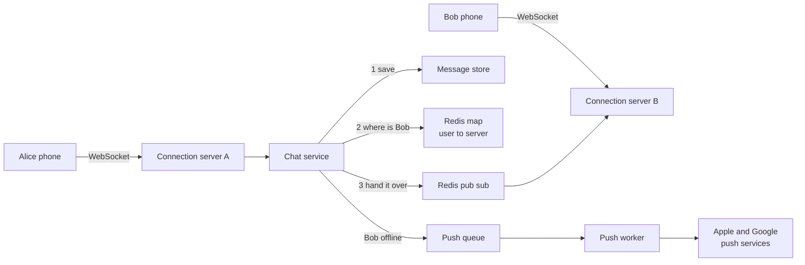
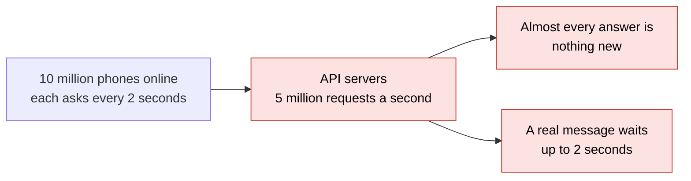
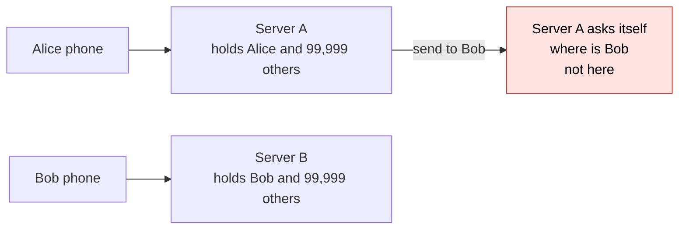
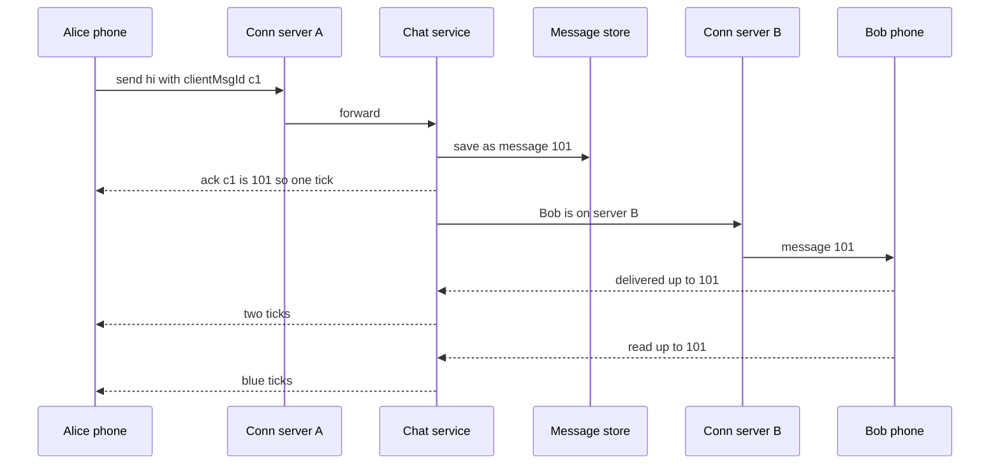
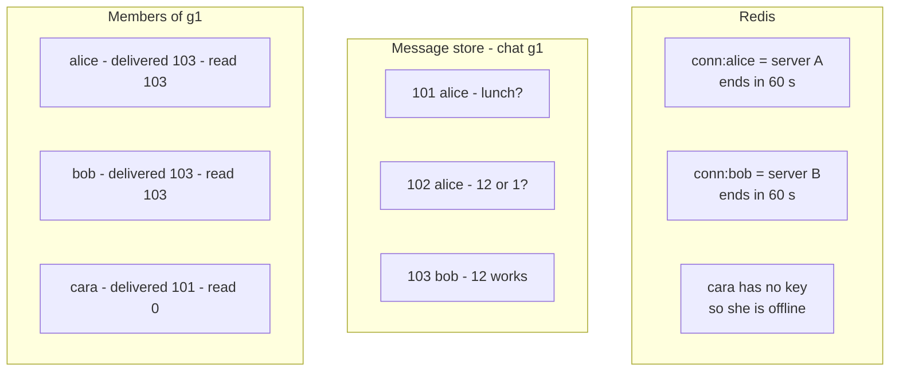
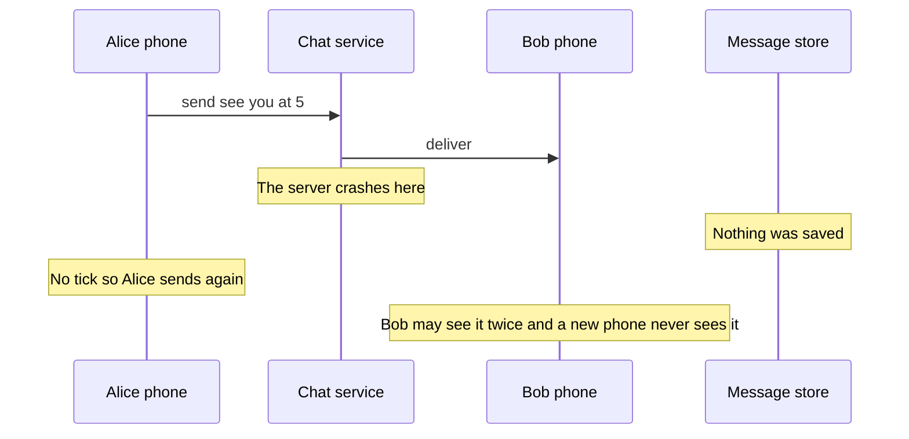
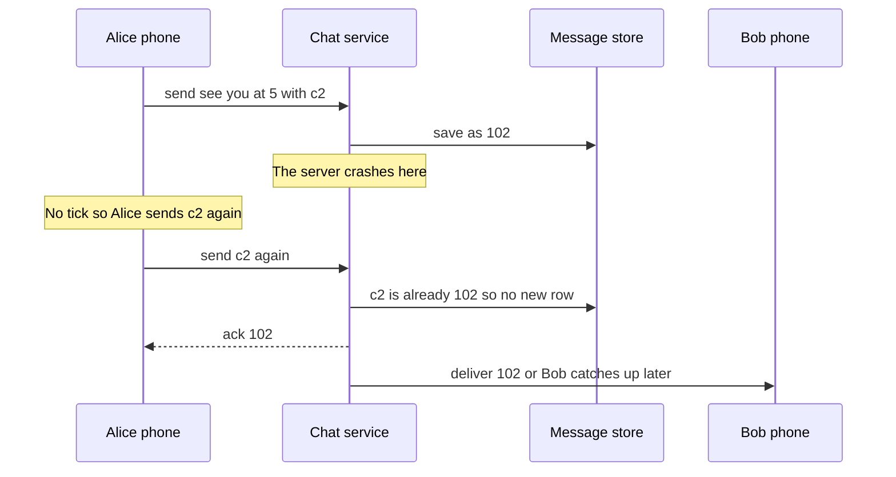
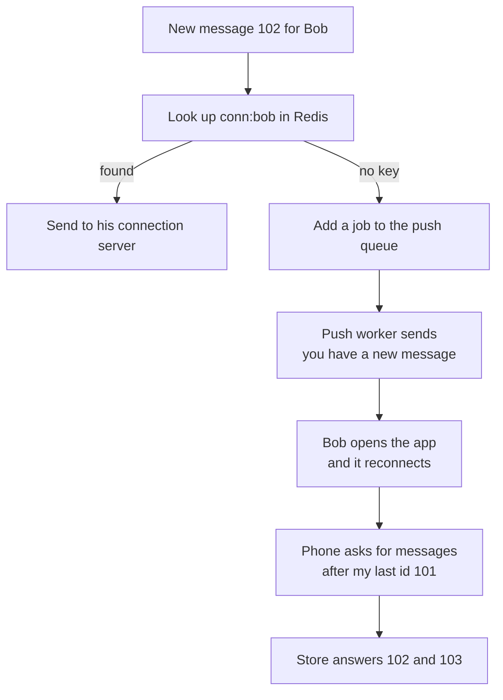
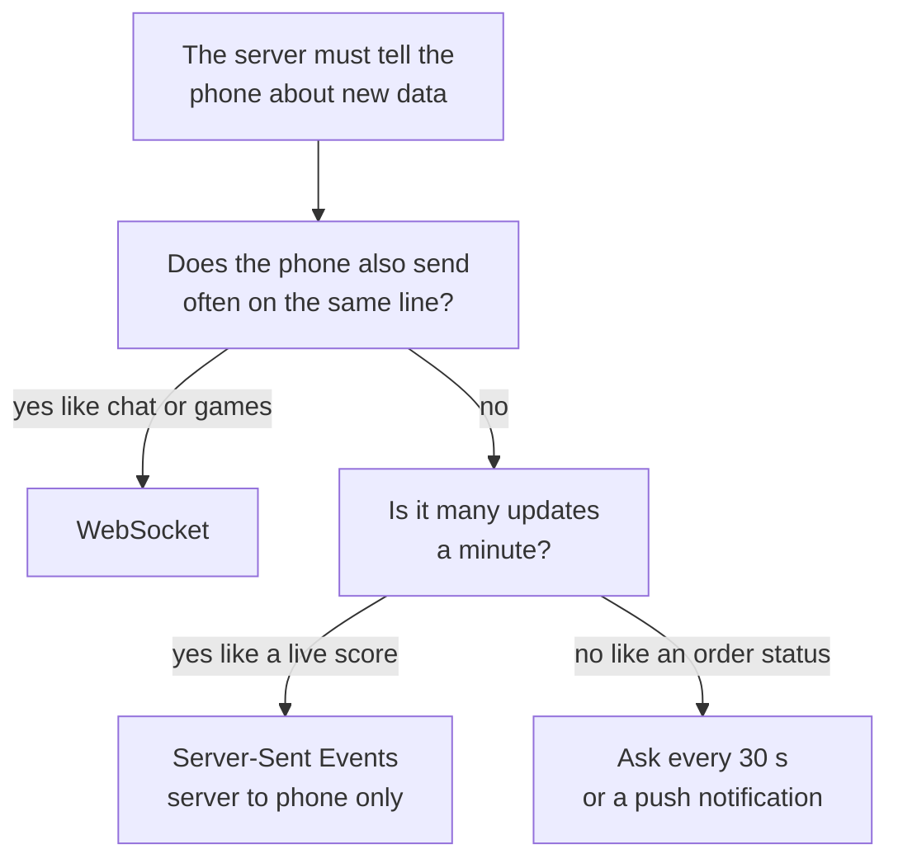

# 10. Design a chat app

> **Subject:** System Design · **Lesson:** 10 · **Made:** 2026-10-21 · **Status:** ready
> **You will be able to:** draw how one message travels from Alice's phone to Bob's phone when they sit on different servers, explain why the server saves the message before it delivers it, show how the three ticks work with only two numbers per person, and say what happens when Bob is offline.
> **Before this:** [Design a rate limiter](09-design-a-rate-limiter.md) · **Next:** [Design a notification system](11-design-a-notification-system.md)

## 1. The idea in one sentence

Each phone keeps one line open to a server, so the server can hand it a new message the moment it arrives. The server saves every message first, then delivers it.

Lessons 08 and 09 were "ask, get an answer". Chat is different. Bob never asks "do I have a message?". The server must reach Bob by itself. The two hard parts are **finding Bob**, because he sits on one of many servers, and **never losing a message**, because phones go offline all the time.

New words (four):

- **WebSocket:** a line between the phone and the server that stays open. Both sides can send at any time. Normal HTTP only answers when the phone asks.
- **Ack:** a small "I got it" reply. The server's ack to the sender is the first tick. (Interview word: acknowledgement.)
- **Push notification:** a short note sent through Apple or Google that wakes up a phone that has no open line.
- **Catch up from the last id:** a phone that comes back says "give me everything after message 101". (Interview word: sync with a cursor.)

Two plain ideas, explained now so the pictures make sense:

- **A connection server** is a server whose main job is to hold many open WebSockets. Alice's line may land on server A, and Bob's on server B.
- **The who-is-where map** is a small table in Redis: "Bob is on server B". Each connection server writes to it when a phone connects.

From earlier lessons:

- Many servers sit behind a load balancer, and each phone can land on any of them (lessons 02 and 03).
- A queue holds jobs that are slow or can fail, and workers retry them (lesson 06).
- A resend must not make a second copy. Lesson 08 used a unique key for that.

Numbers in the pictures are example numbers, not measured.

## 2. The pictures

### 2a. The big picture

Notice that Alice and Bob sit on different connection servers. The chat service saves the message, looks Bob up, and hands the message across.



**Pub sub** (publish and subscribe): each connection server listens on its own named channel in Redis. To reach server B, the chat service posts on channel "server B".

### 2b. The problem, drawn

Without an open line, each phone must keep asking. Notice how many questions get "nothing new" as the answer.



The second problem: you add WebSockets, but there are many servers. Notice that server A has no line to Bob.



### 2c. How it works over time: one message and three ticks

Notice the order: save, ack, then deliver. Each tick is a separate small message going back to Alice.



`clientMsgId` is an id the phone makes before sending. It is the resend guard from lesson 08.

### 2d. What is in memory right now

This is one moment in a group chat. Notice that the ticks do not need a row per person per message. Each member keeps only two numbers.



Message 101 from Alice has two ticks: Bob and Cara both have it. Message 102 has one tick: Cara does not have it yet. Nothing is blue for Alice, because Cara has read nothing.

The Redis keys end by themselves. Each phone sends a small "still here" message every 30 seconds (interview word: heartbeat), and the server pushes the end time forward. A dead phone simply disappears from the map.

### 2e. Right against wrong

The server crashes halfway through sending. Notice what is left on disk.





"Sent" must mean "it is on disk". Then any later failure only delays the message. It never loses it.

### 2f. Bob is offline

Notice that the push carries only a short note. The real messages come from the store.



### 2g. Which way to reach the phone?

This is the choice you say out loud. Notice that chat lands on WebSocket because both sides talk.



## 3. Real life analogy

A hotel with many floors, and a phone in every room.

- **Polling:** each guest walks to the front desk every 2 minutes to ask "any letters for me?". The desk is full of people asking, and almost every answer is no.
- **WebSocket:** each room has a phone line that stays open. The desk calls the room when a letter arrives.
- **Connection servers:** each floor has its own desk. Alice's letter arrives at floor 3, but Bob is on floor 8.
- **The who-is-where map:** a board in the lobby that says which floor each guest is on.
- **Save first:** the desk puts the letter in the guest's mailbox before it calls. If the call drops, the letter is still in the box.
- **Push notification:** the guest is out. The hotel sends a text, "you have mail". The guest comes back and empties the mailbox.

Where the analogy stops: a hotel has a few hundred guests. A chat app holds 10 million open lines at once, and phones drop and come back every few minutes on mobile networks.

## 4. The smallest code that shows it

One server, two users, and a map of open lines. Bob is online for the first message, then goes offline.

```js
const messages = [];                                      // the message store
const online = new Map();                                 // user -> their open line
let lastId = 100;
function send(from, to, text) {
  const msg = { id: ++lastId, from, to, text };
  messages.push(msg);                                     // 1. save first
  const line = online.get(to);
  if (line) line(msg);                                    // 2a. online: send on the open line
  else console.log(`push to ${to}: you have a new message`);   // 2b. offline: wake the phone
  return msg.id;                                          // 3. the ack, one tick
}
const after = (user, id) => messages.filter((m) => m.to === user && m.id > id).map((m) => m.text);
online.set("bob", (m) => console.log(`bob gets ${m.id}: ${m.text}`));
send("alice", "bob", "hi");
online.delete("bob");                                     // bob's phone goes offline
send("alice", "bob", "are you there?");
send("alice", "bob", "call me");
console.log("bob is back, last id 101:", after("bob", 101));
```

**Output:**

```
bob gets 101: hi
push to bob: you have a new message
push to bob: you have a new message
bob is back, last id 101: [ 'are you there?', 'call me' ]
```

Checked on 2026-10-21 with Node 24.

The `online` map plays the Redis who-is-where map. A function plays the open line. Bob's phone remembers one number, the last id it has, and that is enough to catch up.

## 5. What really happens, step by step

One row is one thing the server does. Watch the store, the map and what Bob has.

| Step | Code | What the server does | Store after | Online map | Bob has |
|---|---|---|---|---|---|
| 1 | `online.set("bob", ...)` | Bob's phone opens its line | empty | bob | nothing |
| 2 | `send(... "hi")` | Makes id 101 and saves it | 101 | bob | nothing |
| 3 | same call | Finds Bob's line and sends on it | 101 | bob | 101 |
| 4 | same call | Returns 101. Alice gets one tick | 101 | bob | 101 |
| 5 | `online.delete("bob")` | Bob's line closes, for example he goes into a lift | 101 | empty | 101 |
| 6 | `send(... "are you there?")` | Saves 102. Finds no line, so it pushes | 101, 102 | empty | 101 |
| 7 | `send(... "call me")` | Saves 103. No line, so it pushes again | 101, 102, 103 | empty | 101 |
| 8 | `after("bob", 101)` | Bob is back. His phone says "after 101" | 101, 102, 103 | (bob again) | 101, 102, 103 |

What to see:

- Steps 2 and 6: the save comes before anything else. Even while Bob is offline, nothing is lost.
- Steps 6 and 7: the push does not carry the message. It only wakes the phone.
- Step 8: the phone does not need "which messages did I miss?". It only needs "the last id I have". The ids grow, so "bigger than 101" is exactly what it missed.
- In the real system, step 3 is longer. The server looks up `conn:bob` in Redis, finds "server B", and posts the message on server B's pub sub channel. Server B then writes it to Bob's WebSocket.

**Step through it yourself:** [open the stepper](visuals/10-design-a-chat-app.html). It has three stories. Story 1 is one message across two servers with all three ticks. Story 2 is Bob going offline, the push, and the catch up. Story 3 is a lost ack: Alice sends again, without and with a `clientMsgId`. Guess first, then press Next.

## 6. Why it exists and what it costs

- **Problem without it:** with polling, millions of phones ask every few seconds and almost always hear "nothing". Messages still arrive late.
- **How it solves it:** one open line per phone. The server sends the moment a message is saved. A who-is-where map lets any server find any phone.
- **Cost or tradeoff:** servers now hold state, the open lines. You cannot freely kill or move a connection server. Millions of open lines need many servers and a map that must stay fresh.

### The numbers

A rough estimate with round numbers (interview words: back of the envelope). These are assumptions. Say them out loud.

| Question | The math | Answer |
|---|---|---|
| Messages a day | 50 million daily users times 40 messages | 2 billion |
| Messages a second | 2 billion divided by 100,000 (seconds in a day, rounded) | 20,000 |
| At the busiest time | 20,000 times 3 | 60,000 a second |
| Storage a day | 2 billion times 200 bytes | 400 GB, about 146 TB a year |
| Open lines at the busiest hour | 20 percent of 50 million online | 10 million |
| Connection servers | 10 million divided by a safe 100,000 lines each | about 100 |

The driver is two numbers: **10 million open lines**, so you need a fleet of connection servers and a map. And **146 TB a year that only grows**, so one plain Postgres table will not hold it for long.

### Four ways to reach the phone

| Way | How it works | Good | Bad |
|---|---|---|---|
| **Polling** | The phone asks every few seconds | Plain HTTP, easy | Many empty answers, messages are late |
| **Long polling** | The phone asks, and the server waits up to 30 s before answering | Fewer empty answers | A new request after every message |
| **Server-Sent Events** | One open HTTP answer that the server keeps writing to | Simple, works through most proxies | Server to phone only |
| **WebSocket** | One open line, both ways | Instant, tiny cost per message | Servers hold state, harder to deploy |

Chat sends both ways all the time, so WebSocket. A live sports score or an AI answer that types itself out only flows one way, so Server-Sent Events are enough there.

### Where the messages live

- **Small app:** Postgres is fine. One `messages` table with an index on `(chat_id, id DESC)`. Split the table by month when it grows (interview word: partition).
- **Huge app:** the main question is always "the latest 50 messages of chat X". A store that keeps one chat's recent messages together on one disk fits that well. Discord keeps messages grouped by channel and a time window, first on Cassandra and since 2022 on ScyllaDB.
- **Message ids that sort by time:** each id starts with the time. Sorting by id is sorting by time, so everyone sees the same order.

### What it costs

| Cost | What it means | What you do |
|---|---|---|
| Servers hold open lines | A deploy or a crash drops 100,000 phones at once | Phones reconnect after a short random wait. They catch up from their last id |
| The map can be wrong | Bob's server died, but the key has not ended yet | If the hand over fails, treat Bob as offline and push |
| Pub sub can lose a message | Redis pub sub sends once. If server B is not listening, the message is gone | Fine, because the message is already saved. Bob catches up on reconnect |
| A save on every message | A database write before the first tick | Keep it a simple append. It is the price of "never lose a message" |
| Ticks in a group of 500 | A row per person per message would be huge | Two numbers per member: last delivered id and last read id |

## 7. Common mistakes

**Wrong:** deliver first, then save.

```js
// sketch, not run here
await sendToBob(msg);             // 1. deliver
await db.messages.insert(msg);    // 2. save. If the server dies before this, the message is gone
ack(alice, msg.id);
```

**Right:**

```js
// sketch, not run here
const saved = await db.messages.insert(msg);   // 1. save. Now "sent" is true
ack(alice, saved.id);                          // 2. one tick
await sendToBob(saved).catch(() => pushQueue.add({ userId: "bob", messageId: saved.id }));   // 3. deliver or push
```

**Why:** once it is on disk, every later failure only delays the message. Practice B shows the crash in code.

**Wrong:** "Each connection server keeps the list of who is online in its own memory."

**Right:** "The who-is-where map lives in Redis, with keys that end unless a heartbeat keeps them alive."

**Why:** server A cannot see server B's memory. And a key with no end time stays forever when a phone dies without saying goodbye.

**Wrong:** "The push notification carries the message, so offline users get it that way."

**Right:** "The push only wakes the phone. The phone reconnects and asks for everything after its last id."

**Why:** pushes can be late, merged or dropped by Apple and Google. The store is the truth.

**If you freeze:**

1. Say "Each phone keeps a WebSocket open to a connection server. A Redis map says which server each user is on."
2. Say "I save the message first, then ack, then deliver. Sent means it is on disk."
3. Say "Offline users get a push. The phone reconnects and asks for everything after its last id. Ticks are two numbers per member: last delivered and last read."

## 8. Watch and play

Every link below was opened and checked on 2026-10-21. For the video, the title, channel and length come from YouTube's own data. If one breaks later, say so and it will be replaced.

- **Video:** [FAANG System Design Interview: Design A Chat System](https://www.youtube.com/watch?v=okrR1KXNLtA) ByteByteGo, 8 min 45 s - polling, long polling and WebSocket, then the full design. Compare it with pictures 2a and 2c.
- **Play with it:** [the stepper in this folder](visuals/10-design-a-chat-app.html) - guess first, then press Next. Try all three tabs.
- **Play with it:** [WebSocket realtime flow](https://system-design.space/en/visuals/websocket-realtime-dynamics/) on System Design Space - raise the load and watch the queues and the reconnects.
- **Read:** [Hello Interview: Design a Messaging App Like WhatsApp](https://www.hellointerview.com/learn/system-design/problem-breakdowns/whatsapp) - the full interview answer. Find where it writes the message to the store before it publishes it.
- **Read:** [Discord: How Discord Stores Trillions of Messages](https://discord.com/blog/how-discord-stores-trillions-of-messages) - why they group messages by channel and a time window, and the move from Cassandra to ScyllaDB.
- **Read:** [Socket.IO: Redis adapter](https://socket.io/docs/v4/redis-adapter/) - the Node way to pass messages between connection servers through Redis pub sub, the hand over in picture 2a.
- **Read:** [MDN: The WebSocket API](https://developer.mozilla.org/en-US/docs/Web/API/WebSockets_API) - what the browser gives you: open the line, send, and the message and close events.

<details><summary>Go deeper (optional)</summary>

**Redis pub sub sends at most once.** The [Redis pub sub docs](https://redis.io/docs/latest/develop/pubsub/) say it plainly: if the listener is not connected, "the message is forever lost". That is fine here only because the message was saved first. If you want the hand over itself to be safe, Redis Streams keep the messages and support at least once.

**Message ids that sort by time.** Discord and Twitter use a Snowflake id: the time in milliseconds, then a machine number, then a counter. Two servers can make ids in the same millisecond, so the order of two messages sent at the same moment can differ a little. If a group needs a perfect order, give each chat its own counter, for example Redis `INCR chat:g1:seq`. The cost is one more call per message.

**Discord's numbers.** In the Discord article, the move to ScyllaDB took them from 177 database machines to 72, and the slowest 1 percent of reads went from 40 to 125 ms down to 15 ms. Their main pain before was "hot partitions": one huge, busy channel making one machine slow for everyone on it.

**Huge groups.** For 500 members, the server sends to each online member. For a channel with 100,000 members, it does not. Members fetch the latest messages when they open the channel. This is the same "fan out on write or on read" choice as the news feed in the workbook.

**Many phones per user.** The map holds a list of lines per user, not one. Each device keeps its own "last id I have", so a laptop and a phone catch up separately.

**Deploying a connection server.** Stop sending new phones to it, then close its old lines slowly over a few minutes. Phones reconnect elsewhere after a short random wait (interview word: jitter), so 100,000 phones do not all hit the next server in the same second.

**Presence, "Bob is online".** The same heartbeat key gives presence. Send presence changes only to people who have that chat open, not to every contact, or presence becomes more traffic than the messages.

**GraphQL subscriptions.** Hasura and Apollo can run GraphQL subscriptions over a WebSocket. They fit a small app or live data in an admin screen. For a big chat fleet, a plain WebSocket protocol with your own small events is simpler to scale.

**End to end encryption.** WhatsApp and Signal encrypt on the phone, so the server stores only scrambled bytes. The design above stays the same. The server just cannot read or search the text.

**Other videos.** [Hello Interview: Design WhatsApp](https://www.hellointerview.com/learn/system-design/problem-breakdowns/whatsapp) has a long video walk through on the same page. Watch it after the short ByteByteGo video.

**Checked on:** 2026-10-21.

</details>

## 9. Practice

**A. Predict the output** (write your answer before opening)

A group with Alice, Bob and Cara. Alice sent messages 5, 6 and 7. Each member keeps only "the newest message I have read".

```js
const lastRead = { bob: 7, cara: 5 };                     // the newest message each member has read
const tick = (id) => Object.values(lastRead).every((r) => r >= id) ? "blue" : "grey";
console.log([5, 6, 7].map(tick).join(" "));
lastRead.cara = 6;                                        // cara scrolls down one message
console.log([5, 6, 7].map(tick).join(" "));
```

Then answer: the group has 500 members and 10,000 messages. How many numbers do you store for read ticks?

<details><summary>Answer</summary>

```
blue grey grey
blue blue grey
```

A message is blue only when every member has read up to it or further. Bob read up to 7, but Cara only up to 5, so only 5 is blue. When Cara reaches 6, message 6 turns blue too. (Checked on 2026-10-21 with Node 24.)

For 500 members you store 500 numbers, one per member, no matter how many messages there are. A row per person per message would be 500 times 10,000, which is 5 million rows. With delivered ticks too, it is 2 numbers per member, so 1,000.

</details>

**B. Fix the bug**

The server crashes after the first step of sending "see you at 5". Run it in your head, then fix it.

```js
const store = [];                                         // the message store on disk
const bobLine = (m) => console.log("bob sees:", m.text);  // bob's open line
function send(text, crash) {
  const msg = { id: store.length + 1, text };
  bobLine(msg);                                           // 1. deliver
  if (crash) throw new Error("server crashed");           // the server dies here
  store.push(msg);                                        // 2. save
  return msg.id;                                          // 3. ack to alice
}
try { send("hi", false); send("see you at 5", true); } catch (e) { console.log(e.message); }
console.log("history:", store.map((m) => m.text));
```

<details><summary>Answer</summary>

It prints:

```
bob sees: hi
bob sees: see you at 5
server crashed
history: [ 'hi' ]
```

Bob saw "see you at 5", but it was never saved. Alice got no tick, so her phone sends it again, and Bob may see it twice. Bob's new laptop will never see it, because it is not in the history.

Fix: swap the two steps. Save first, then deliver.

```js
  store.push(msg);                                        // 1. save
  if (crash) throw new Error("server crashed");           // the server dies here
  bobLine(msg);                                           // 2. deliver
```

It now prints:

```
bob sees: hi
server crashed
history: [ 'hi', 'see you at 5' ]
```

Bob has not seen it yet, but it is safe on disk. His phone catches up from its last id. Alice still has no tick, so her phone sends again with the same `clientMsgId`, and the server answers with the saved id instead of saving a second copy. (Both outputs checked on 2026-10-21 with Node 24.)

</details>

**C. Write it yourself**

Open `learn/system-design/practice/10-design-a-chat-app.js`. It has one empty function, `createChatServer`. It plays the whole back end: the open lines, the message store, the push list and the ticks. `send` must save first, deliver to online members, push to offline ones, and ignore a resend with the same `clientMsgId`. `history` gives the messages after an id. `markDelivered`, `markRead` and `status` give the three ticks with two numbers per member. Write it, then run this from the repo root and make all the tests pass:

```
node --test learn/system-design/practice/10-design-a-chat-app.test.js
```

<details><summary>One possible answer</summary>

```js
function createChatServer() {
  const members = new Map();                                  // chatId -> [userId]
  const lines = new Map();                                    // userId -> open line, like the Redis map
  const messages = [];                                        // the message store
  const seen = new Map();                                     // "sender:clientMsgId" -> messageId
  const receipts = new Map();                                 // "chatId:userId" -> { delivered, read }
  const pushes = [];
  let lastId = 0;

  const receipt = (chatId, userId) => {
    const k = chatId + ":" + userId;
    if (!receipts.has(k)) receipts.set(k, { delivered: 0, read: 0 });
    return receipts.get(k);
  };

  return {
    pushes,
    addChat(chatId, memberIds) { members.set(chatId, memberIds); },
    connect(userId, line) { lines.set(userId, line); },
    disconnect(userId) { lines.delete(userId); },
    send(senderId, chatId, clientMsgId, text) {
      const key = senderId + ":" + clientMsgId;
      if (seen.has(key)) return { messageId: seen.get(key) };    // a resend: same answer, no new save
      const msg = { id: ++lastId, chatId, senderId, text };
      messages.push(msg);                                     // 1. save first
      seen.set(key, msg.id);
      for (const userId of members.get(chatId)) {
        if (userId === senderId) continue;
        const line = lines.get(userId);
        try {
          if (!line) throw new Error("offline");
          line(msg);                                          // 2a. online: send on the open line
        } catch {
          pushes.push({ userId, chatId, messageId: msg.id }); // 2b. offline or broken: push
        }
      }
      return { messageId: msg.id };                           // 3. the ack
    },
    history(chatId, { afterId = 0 } = {}) {
      return messages.filter((m) => m.chatId === chatId && m.id > afterId);
    },
    markDelivered(userId, chatId, upToId) {
      const r = receipt(chatId, userId);
      r.delivered = Math.max(r.delivered, upToId);
    },
    markRead(userId, chatId, upToId) {
      const r = receipt(chatId, userId);
      r.read = Math.max(r.read, upToId);
      r.delivered = Math.max(r.delivered, r.read);
    },
    status(chatId, messageId) {
      const msg = messages.find((m) => m.id === messageId);
      const others = members.get(chatId).filter((u) => u !== msg.senderId).map((u) => receipt(chatId, u));
      if (others.every((r) => r.read >= messageId)) return "read";
      if (others.every((r) => r.delivered >= messageId)) return "delivered";
      return "sent";
    },
  };
}

module.exports = { createChatServer };
```

Checked on 2026-10-21 with Node 24: the 17 tests fail on the empty stub and all 17 pass with this answer. `Math.max` is what keeps the ticks from moving back when an old receipt arrives late. In a real system the `seen` map is a unique index on `(sender_id, client_msg_id)` in the database, so two servers cannot both save the resend.

</details>

## 10. Interview question

**Q:** "Design a chat app like WhatsApp. People chat one to one and in small groups. Messages show sent, delivered and read. 50 million daily users."

A common follow-up: "A connection server with 100,000 phones on it dies. What happens?" The "What it costs" table in section 6 is the answer.

<details><summary>A strong answer, in four parts</summary>

1. **Problem:** the server must reach a phone without being asked, and must never lose a message after the sender sees one tick. I estimate 50 million users at 40 messages a day. That is 20,000 messages a second, 60,000 at the busiest time, and about 10 million open lines. First I ask: how big can a group be? Do we need history on a new phone? Are photos in scope?
2. **How it works:** each phone keeps a WebSocket open to one of about 100 connection servers. When a phone connects, its server writes `conn:user = server B` in Redis, with an end time that a heartbeat keeps pushing forward. On send, the chat service saves the message with an id that grows with time, then acks Alice, which is one tick. It looks up each member in the map. For online members, it posts on that server's Redis pub sub channel, and that server writes to the WebSocket. For offline members, it adds a job to a push queue. A phone that reconnects asks for everything after its last id. Ticks are two numbers per member per chat: last delivered and last read.
3. **Tradeoff:** WebSocket is instant and both ways, but servers now hold state, so deploys must drain lines slowly. Saving first adds a write before the first tick, but sent then means on disk. Two numbers per member keep ticks tiny, but you cannot mark one old message as unread. Postgres is fine at the start. At about 146 TB a year, a store built for "the latest messages of one chat" grows more easily.
4. **My example:**
   - **Fact:** I have not built a chat system in my projects. I do not claim one.
   - **Fact:** DBO has a React Native app for store owners, a GraphQL API, and BullMQ on Redis. Order and shipping status changes come into DBO's API as webhooks from the Manager system.
   - **Idea, not a fact:** if store owners wanted to see a status change live, the same pieces apply. For a status that changes a few times a day, a push notification or a refresh when the screen opens is enough. A WebSocket only pays off when updates come many times a minute or flow both ways, like chat.
   - **Fact:** the DBO case study tells of two copies of one TADA event that both ran "has this been processed?" before either wrote, so stores got double points. We fixed it with a row lock inside a transaction. A chat resend after a lost ack is the same shape, and `clientMsgId` with a unique rule is the guard.

</details>

## 11. Explain it back

Close this file. Explain a chat app out loud like to a new junior, in 4 parts (problem, how, tradeoff, my example). Use the story of Alice on server A sending "hi" to Bob on server B, and the story of Bob going into a lift and coming back. Then write your best version below and run `/explain-check design a chat app` or ask the `explain-coach` agent to review it.

### My explanation

<write here>

### Coach feedback

<the explain-coach agent writes here>

## 12. Review questions (day 1, 3, 7, 21)

1. Alice is on connection server A and Bob is on server B. Walk through how "hi" reaches Bob, naming each part it passes.
2. Why does the server save the message before it delivers it? What goes wrong the other way round?
3. Bob was offline for an hour. How does he get the messages he missed? Why does the push not carry them?
4. Draw picture 2c from memory: one message and the three ticks.

<details><summary>Answers</summary>

1. Alice's phone sends on its WebSocket to server A. Server A passes it to the chat service, which saves it and acks Alice with the id. The chat service looks up `conn:bob` in Redis and gets "server B". It posts the message on server B's pub sub channel. Server B writes it to Bob's WebSocket. Bob's phone answers "delivered up to this id", and later "read up to this id".
2. So that "sent" means "on disk". If the server crashes after saving, the message is only late: Bob catches up, and Alice's resend with the same `clientMsgId` is ignored. The other way round, Bob may see a message that was never saved. Alice gets no tick and sends again, so Bob may see it twice, and his other devices never see it.
3. His phone remembers the last id it has, say 101. When it reconnects, it asks the store for everything in each chat after 101. The push only says "you have a message", because pushes can be late, merged or dropped, and they are small. The store is the truth.
4. Alice to server A: send with `clientMsgId`. Chat service: save as 101. Back to Alice: ack, one tick. Chat service to server B to Bob: message 101. Bob back: delivered up to 101, two ticks for Alice. Bob back: read up to 101, blue ticks for Alice.

</details>

## Connected lessons

- [Design a rate limiter](09-design-a-rate-limiter.md) - the lesson before. A chat app needs a limit on how fast one user can send, or a bot can flood a group.
- [Design a notification system](11-design-a-notification-system.md) - the next lesson. The push queue and push worker in picture 2a, in full.
- [Scaling up vs out](02-scaling-up-vs-out.md) - why connection servers are not stateless, and why that makes scaling out harder.
- [Load balancers](03-load-balancers.md) - long lived connections and how a load balancer spreads them.
- [Message queues](06-message-queues.md) - the push queue, retries and at least once delivery.
- [Design a URL shortener](08-design-a-url-shortener.md) - the unique key that stops a resend from making a second copy, used here as `clientMsgId`.
- [Idempotency and retries](13-idempotency-and-retries.md) - the resend after a lost ack, in depth.
- [Streams vs queues](21-streams-vs-queues.md) - Redis Streams and Kafka keep messages, unlike pub sub.
- [Design workbook part 1, Part 2](design-workbook-part-1-classic-designs.md) - the same design as a full written answer, with the data model and failure plan.
- [Networking for system design](../networking/networking-for-system-design.md) - polling, long polling, Server-Sent Events and WebSocket side by side.
