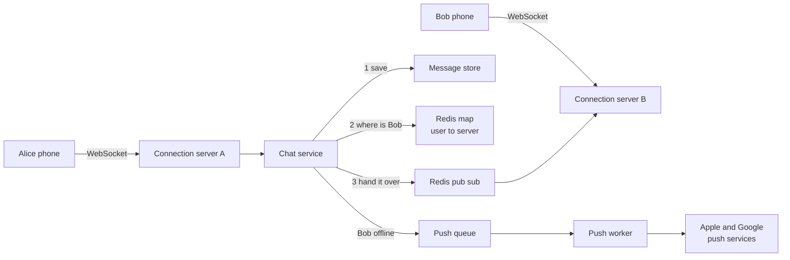
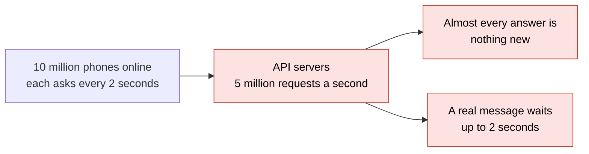
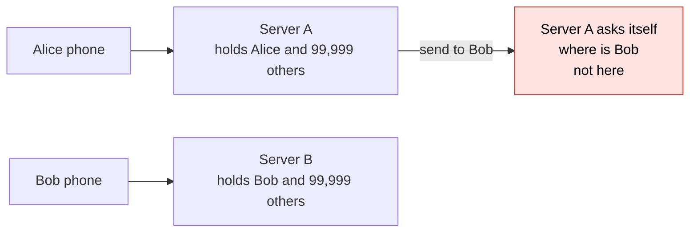
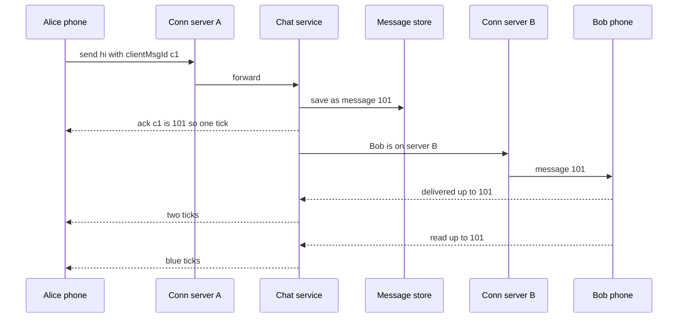
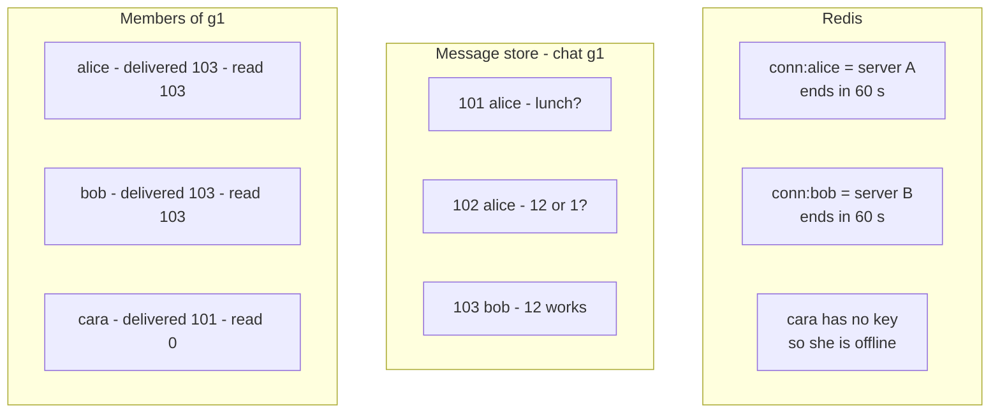
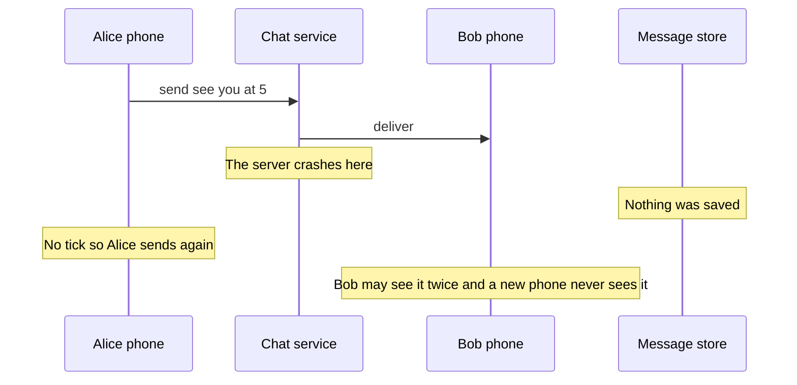
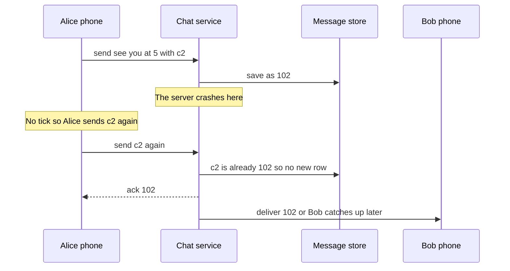
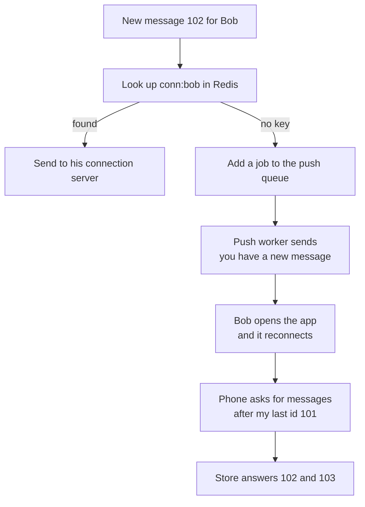
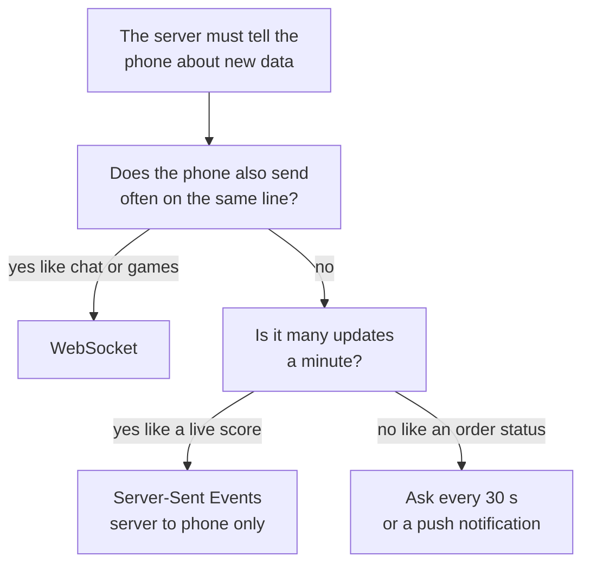

# 10. Design a chat app

> **Subject:** System Design · **Lesson:** 10 · **Made:** 2026-10-21 · **Status:** ready
> **You will be able to:** draw how one message travels from Alice's phone to Bob's phone when they sit on different servers, explain why the server saves the message before it delivers it, show how the three ticks work with only two numbers per person, and say what happens when Bob is offline.
> **Before this:** [Design a rate limiter](09-design-a-rate-limiter.md) · **Next:** [Design a notification system](11-design-a-notification-system.md)

## 1. The idea in one sentence

Each phone keeps one line open to a server. The server saves each new message, then sends it down that line.

In chat, Bob never asks for news. The server must reach him by itself. Two parts are hard:

- **Finding Bob.** He sits on one of many servers.
- **Never losing a message.** Phones go offline all the time.

New words (four):

- **WebSocket:** a line between phone and server that stays open. Both sides can send at any time. A normal web request (HTTP) only answers when asked.
- **Ack:** a small "I got it" reply. The server's ack to Alice is her first tick. (Interview word: acknowledgement.)
- **Push notification:** a short note from Apple or Google that wakes a phone with no open line.
- **Catch up from the last id:** a phone that comes back asks for "everything after message 101". (Interview word: sync with a cursor.)

Two more plain ideas:

- **Connection server:** a server that holds many open WebSockets.
- **Who-is-where map:** a small table in Redis, the fast store from earlier lessons. It says "Bob is on server B".

From earlier lessons: load balancers (02, 03), queues with retries (06), and the unique key that stops a second copy (08). Numbers in the pictures are examples.

## 2. The pictures

### 2a. The big picture

The chat service is the code that handles each message. Notice that Alice and Bob sit on different servers.



**Pub sub** (publish and subscribe): each connection server listens on its own Redis channel. To reach server B, the chat service posts on that channel.

### 2b. The problem, drawn

Without an open line, phones must keep asking (interview word: polling). Notice the empty answers.



Now add WebSockets. Notice that server A has no line to Bob.



### 2c. How it works over time: one message and three ticks

Notice the order: save, ack, then deliver.



`clientMsgId` is an id the phone makes. It stops a second copy.

### 2d. What is in memory right now

One moment in a group chat. Notice that each member keeps only two numbers.



- 101 has two ticks. Bob and Cara have it.
- 102 has one tick. Cara does not have it.
- Nothing is blue. Cara has read nothing.

Every 30 seconds, each phone sends "still here" (interview word: heartbeat). If it stops, its Redis key ends. The phone drops off the map.

### 2e. Right against wrong

Wrong: deliver, then save. Notice that nothing is on disk after the crash.



Right: save, then deliver. Notice that the resend finds the saved copy.



"Sent" must mean "on disk". A later failure then only makes a message late.

### 2f. Bob is offline

Notice that the push is only a short note. The messages come from the store.



### 2g. Which way to reach the phone?

Notice that chat ends at WebSocket, because both sides talk.



## 3. Real life analogy

A hotel with many floors, and a phone in every room.

- **Polling:** guests keep walking to the front desk to ask "any letters?".
- **WebSocket:** each room has an open phone line. The desk calls when a letter arrives.
- **Connection servers:** each floor has its own desk. Alice is on floor 3, Bob on floor 8.
- **Who-is-where map:** a lobby board shows each guest's floor.
- **Save first:** the desk puts the letter in the mailbox before it calls.
- **Push notification:** the guest is out, so the hotel texts "you have mail".

Where the analogy stops: a hotel has hundreds of guests, not 10 million open lines. Phones also drop and come back every few minutes.

## 4. The smallest code that shows it

Bob is online for the first message, then goes offline.

```js
const messages = [];                                      // the message store
const online = new Map();                                 // user -> their open line
let lastId = 100;
function send(from, to, text) {
  const msg = { id: ++lastId, from, to, text };
  messages.push(msg);                                     // 1. save first
  const line = online.get(to);
  if (line) line(msg);                                    // 2a. online: send on the open line
  else console.log(`push to ${to}: you have a new message`);   // 2b. offline: wake the phone
  return msg.id;                                          // 3. the ack, one tick
}
const after = (user, id) => messages.filter((m) => m.to === user && m.id > id).map((m) => m.text);
online.set("bob", (m) => console.log(`bob gets ${m.id}: ${m.text}`));
send("alice", "bob", "hi");
online.delete("bob");                                     // bob's phone goes offline
send("alice", "bob", "are you there?");
send("alice", "bob", "call me");
console.log("bob is back, last id 101:", after("bob", 101));
```

**Output:**

```
bob gets 101: hi
push to bob: you have a new message
push to bob: you have a new message
bob is back, last id 101: [ 'are you there?', 'call me' ]
```

The `online` map plays the Redis map. A function plays the open line.

Checked on 2026-10-21 with Node 24.

## 5. What really happens, step by step

Each row is one thing the server does.

| Step | Code | What the server does | Store after | Online map | Bob has |
|---|---|---|---|---|---|
| 1 | `online.set("bob", ...)` | Bob's phone opens its line | empty | bob | nothing |
| 2 | `send(... "hi")` | Makes id 101 and saves it | 101 | bob | nothing |
| 3 | same call | Finds Bob's line and sends on it | 101 | bob | 101 |
| 4 | same call | Returns 101. Alice gets one tick | 101 | bob | 101 |
| 5 | `online.delete("bob")` | Bob's line closes. Say he steps into a lift | 101 | empty | 101 |
| 6 | `send(... "are you there?")` | Saves 102. Finds no line, so it pushes | 101, 102 | empty | 101 |
| 7 | `send(... "call me")` | Saves 103. Finds no line, so it pushes again | 101, 102, 103 | empty | 101 |
| 8 | `after("bob", 101)` | Bob is back. His phone asks for "after 101" | 101, 102, 103 | (bob again) | 101, 102, 103 |

What to see:

- Steps 2 and 6: the server saves first. Nothing is lost while Bob is away.
- Steps 6 and 7: the push only wakes the phone. It does not carry the message.
- Step 8: ids only grow, so "bigger than 101" is exactly what Bob missed.

**Step through it yourself:** [open the stepper](visuals/10-design-a-chat-app.html). It has three stories: one message with three ticks, Bob offline and back, and a lost ack. Guess first, then press Next.

<details><summary>Go deeper (optional)</summary>

**The three stepper stories.** Story 1 sends one message across two servers, with all three ticks. In story 2, Bob goes offline, gets a push, and catches up. In story 3 the ack is lost, so Alice sends again, first without and then with a `clientMsgId`.

**Bob needs one number.** His phone only remembers its last id. That is enough to catch up.

**Step 3 in the real system.** The step is longer there. The chat service looks up `conn:bob` in Redis and finds "server B". It posts the message on server B's pub sub channel. Server B then writes it to Bob's WebSocket.

</details>

## 6. Why it exists and what it costs

- **Problem without it:** polling gives millions of empty answers, and messages still come late.
- **How it solves it:** one open line per phone, plus a map to find it.
- **Cost or tradeoff:** servers now hold open lines. You cannot freely restart or move them.

### The numbers

Round numbers, said out loud (interview words: back of the envelope).

| Question | The math | Answer |
|---|---|---|
| Messages a day | 50 million daily users times 40 messages | 2 billion |
| Messages a second | 2 billion divided by 100,000 (seconds in a day, rounded) | 20,000 |
| At the busiest time | 20,000 times 3 | 60,000 a second |
| Storage a day | 2 billion times 200 bytes | 400 GB, about 146 TB a year |
| Open lines at the busiest hour | 20 percent of 50 million online | 10 million |
| Connection servers | 10 million divided by a safe 100,000 lines each | about 100 |

Two numbers shape the design: 10 million open lines, and 146 TB a year.

### Four ways to reach the phone

| Way | How it works | Good | Bad |
|---|---|---|---|
| **Polling** | The phone asks every few seconds | Plain HTTP, easy | Many empty answers, messages are late |
| **Long polling** | The phone asks, and the server waits up to 30 s before answering | Fewer empty answers | A new request after every message |
| **Server-Sent Events** | One open HTTP answer that the server keeps writing to | Simple, works on most networks | Server to phone only |
| **WebSocket** | One open line, both ways | Instant, tiny cost per message | Servers must keep each line, so updates are harder |

Chat talks both ways, so it uses WebSocket.

### Where the messages live

Each message id starts with the time, so sorting by id sorts by time.

### What it costs

| Cost | What it means | What you do |
|---|---|---|
| Servers hold open lines | A restart or a crash drops 100,000 phones at once | Phones reconnect after a short random wait. They catch up from their last id |
| The map can be wrong | Bob's server died, but the key has not ended yet | If the hand over fails, treat Bob as offline and push |
| Pub sub can lose a message | Redis pub sub sends once. If server B is not listening, the message is gone | Fine, because the message is already saved. Bob catches up when he reconnects |
| A save on every message | A database write before the first tick | Keep it a simple add to the end. It is the price of "never lose a message" |
| Ticks in a group of 500 | A row per person per message would be huge | Two numbers per member: last delivered id and last read id |

<details><summary>Go deeper (optional)</summary>

**What the two numbers mean.** 10 million open lines need about 100 connection servers and a map. 146 TB a year needs a store that can keep growing.

**Same order for everyone.** Because ids sort by time, every phone shows the messages in the same order.

**Ten million lines.** They need many servers, and a map that stays fresh.

**Small app storage.** Postgres, a normal database, is fine. Use one `messages` table with an index on `(chat_id, id DESC)`. Split the table by month when it grows (interview word: partition). At about 146 TB a year, one plain Postgres table will not hold it for long.

**Huge app storage.** The main question is always "the latest 50 messages of chat X". A store that keeps one chat's recent messages together on one disk fits that well. Discord keeps messages grouped by channel and a time window. They used Cassandra first, and ScyllaDB since 2022.

**One way updates.** A live sports score only flows one way. So does an AI answer that types itself out. Server-Sent Events are enough there.

**Proxies.** Server-Sent Events are plain HTTP, so they pass through most proxies, the middle boxes between a phone and a server.

</details>

## 7. Common mistakes

**Wrong:** deliver first, then save.

```js
// sketch, not run here
await sendToBob(msg);             // 1. deliver
await db.messages.insert(msg);    // 2. save. If the server dies before this, the message is gone
ack(alice, msg.id);
```

**Right:**

```js
// sketch, not run here
const saved = await db.messages.insert(msg);   // 1. save. Now "sent" is true
ack(alice, saved.id);                          // 2. one tick
await sendToBob(saved).catch(() => pushQueue.add({ userId: "bob", messageId: saved.id }));   // 3. deliver or push
```

**Why:** once it is on disk, a failure only makes it late. Practice B shows the crash.

**Wrong:** "The push notification carries the message, so offline users get it that way."

**Right:** "The push only wakes the phone. The phone then catches up from its last id."

**Why:** Apple and Google may delay, merge or drop pushes. The store is the truth.

<details><summary>Go deeper (optional)</summary>

**One more mistake.** Wrong: "Each connection server keeps the list of who is online in its own memory." Right: "The map lives in Redis. Its keys end unless a heartbeat keeps them alive." Why: server A cannot see the memory of server B. And a key that never ends stays forever when a phone dies without saying goodbye.

</details>

**If you get stuck, say these three lines:**

1. "Each phone holds a WebSocket to a connection server. A Redis map says which one."
2. "I save first, then ack, then deliver. Sent means on disk."
3. "Offline phones get a push, then catch up from their last id. Ticks are two numbers per member."

## 8. Watch and play

Every link was opened and checked on 2026-10-21.

- **Video:** [FAANG System Design Interview: Design A Chat System](https://www.youtube.com/watch?v=okrR1KXNLtA) ByteByteGo, 8 min 45 s. Compare it with picture 2a.
- **Play with it:** [the stepper in this folder](visuals/10-design-a-chat-app.html). Try all three tabs.
- **Play with it:** [WebSocket realtime flow](https://system-design.space/en/visuals/websocket-realtime-dynamics/) on System Design Space. Raise the load and watch.
- **Read:** [Hello Interview: Design a Messaging App Like WhatsApp](https://www.hellointerview.com/learn/system-design/problem-breakdowns/whatsapp). Find where it saves before it sends.
- **Read:** [MDN: The WebSocket API](https://developer.mozilla.org/en-US/docs/Web/API/WebSockets_API). What the browser gives you.

<details><summary>Go deeper (optional)</summary>

**More links.**

- [Discord: How Discord Stores Trillions of Messages](https://discord.com/blog/how-discord-stores-trillions-of-messages) - why they group messages by channel and a time window, and the move from Cassandra to ScyllaDB.
- [Socket.IO: Redis adapter](https://socket.io/docs/v4/redis-adapter/) - the Node way to pass messages between connection servers through Redis pub sub, the hand over in picture 2a.
- The ByteByteGo video covers polling, long polling and WebSocket, then the full design. Picture 2c matches its tick flow. Its title, channel and length come from YouTube's own data.
- In the stepper, guess first, then press Next.
- In the System Design Space visual, watch the queues fill up and the phones reconnect as the load grows.
- On MDN, find the open, send, message and close events.

**Redis pub sub sends at most once.** The [Redis pub sub docs](https://redis.io/docs/latest/develop/pubsub/) say it plainly: if the listener is not connected, "the message is forever lost". That is fine here only because the message was saved first. If you want the hand over itself to be safe, Redis Streams keep the messages and support at least once.

**Message ids that sort by time.** Discord and Twitter use a Snowflake id: the time in milliseconds, then a machine number, then a counter. Two servers can make ids in the same millisecond, so the order of two messages sent at the same moment can differ a little. If a group needs a perfect order, give each chat its own counter, for example Redis `INCR chat:g1:seq`. The cost is one more call per message.

**Discord's numbers.** In the Discord article, the move to ScyllaDB took them from 177 database machines to 72, and the slowest 1 percent of reads went from 40 to 125 ms down to 15 ms. Their main pain before was "hot partitions": one huge, busy channel making one machine slow for everyone on it.

**Huge groups.** For 500 members, the server sends to each online member. For a channel with 100,000 members, it does not. Members fetch the latest messages when they open the channel. This is the same "fan out on write or on read" choice as the news feed in the workbook.

**Many phones per user.** The map holds a list of lines per user, not one. Each device keeps its own "last id I have", so a laptop and a phone catch up separately.

**Deploying a connection server.** Stop sending new phones to it, then close its old lines slowly over a few minutes. Phones reconnect elsewhere after a short random wait (interview word: jitter), so 100,000 phones do not all hit the next server in the same second.

**Presence, "Bob is online".** The same heartbeat key gives presence. Send presence changes only to people who have that chat open, not to every contact, or presence becomes more traffic than the messages.

**GraphQL subscriptions.** Hasura and Apollo can run GraphQL subscriptions over a WebSocket. They fit a small app or live data in an admin screen. For a big chat fleet, a plain WebSocket protocol with your own small events is simpler to scale.

**End to end encryption.** WhatsApp and Signal encrypt on the phone, so the server stores only scrambled bytes. The design above stays the same. The server just cannot read or search the text.

**Other videos.** [Hello Interview: Design WhatsApp](https://www.hellointerview.com/learn/system-design/problem-breakdowns/whatsapp) has a long video walk through on the same page. Watch it after the short ByteByteGo video.

**If a link breaks.** Say so, and it will be replaced.

**Checked on:** 2026-10-21.

</details>

## 9. Practice

**A. Predict the output** (write your answer before opening)

A group has Alice, Bob and Cara. Alice sent messages 5, 6 and 7. Each member keeps only "the newest message I have read".

```js
const lastRead = { bob: 7, cara: 5 };                     // the newest message each member has read
const tick = (id) => Object.values(lastRead).every((r) => r >= id) ? "blue" : "grey";
console.log([5, 6, 7].map(tick).join(" "));
lastRead.cara = 6;                                        // cara scrolls down one message
console.log([5, 6, 7].map(tick).join(" "));
```

Then: with 500 members and 10,000 messages, how many numbers hold the read ticks?

<details><summary>Answer</summary>

```
blue grey grey
blue blue grey
```

A message is blue only when every member has read up to it or further. Bob read up to 7, but Cara only up to 5, so only 5 is blue. When Cara reaches 6, message 6 turns blue too. (Checked on 2026-10-21 with Node 24.)

For 500 members you store 500 numbers, one per member, no matter how many messages there are. A row per person per message would be 500 times 10,000, which is 5 million rows. With delivered ticks too, it is 2 numbers per member, so 1,000.

</details>

**B. Fix the bug**

The server crashes after step 1 of sending "see you at 5". Run it in your head, then fix it.

```js
const store = [];                                         // the message store on disk
const bobLine = (m) => console.log("bob sees:", m.text);  // bob's open line
function send(text, crash) {
  const msg = { id: store.length + 1, text };
  bobLine(msg);                                           // 1. deliver
  if (crash) throw new Error("server crashed");           // the server dies here
  store.push(msg);                                        // 2. save
  return msg.id;                                          // 3. ack to alice
}
try { send("hi", false); send("see you at 5", true); } catch (e) { console.log(e.message); }
console.log("history:", store.map((m) => m.text));
```

<details><summary>Answer</summary>

It prints:

```
bob sees: hi
bob sees: see you at 5
server crashed
history: [ 'hi' ]
```

Bob saw "see you at 5", but it was never saved. Alice got no tick, so her phone sends it again, and Bob may see it twice. Bob's new laptop will never see it, because it is not in the history.

Fix: swap the two steps. Save first, then deliver.

```js
  store.push(msg);                                        // 1. save
  if (crash) throw new Error("server crashed");           // the server dies here
  bobLine(msg);                                           // 2. deliver
```

It now prints:

```
bob sees: hi
server crashed
history: [ 'hi', 'see you at 5' ]
```

Bob has not seen it yet, but it is safe on disk. His phone catches up from its last id. Alice still has no tick, so her phone sends again with the same `clientMsgId`, and the server answers with the saved id instead of saving a second copy. (Both outputs checked on 2026-10-21 with Node 24.)

</details>

**C. Write it yourself**

Open `learn/system-design/practice/10-design-a-chat-app.js`. Fill in `createChatServer`, its one empty function.

- `send` saves first, then delivers or pushes. It ignores a resend with the same `clientMsgId`.
- `history` gives the messages after an id.
- `markDelivered`, `markRead` and `status` give the ticks, with two numbers per member.

Run this from the repo root until all tests pass:

```
node --test learn/system-design/practice/10-design-a-chat-app.test.js
```

<details><summary>One possible answer</summary>

```js
function createChatServer() {
  const members = new Map();                                  // chatId -> [userId]
  const lines = new Map();                                    // userId -> open line, like the Redis map
  const messages = [];                                        // the message store
  const seen = new Map();                                     // "sender:clientMsgId" -> messageId
  const receipts = new Map();                                 // "chatId:userId" -> { delivered, read }
  const pushes = [];
  let lastId = 0;

  const receipt = (chatId, userId) => {
    const k = chatId + ":" + userId;
    if (!receipts.has(k)) receipts.set(k, { delivered: 0, read: 0 });
    return receipts.get(k);
  };

  return {
    pushes,
    addChat(chatId, memberIds) { members.set(chatId, memberIds); },
    connect(userId, line) { lines.set(userId, line); },
    disconnect(userId) { lines.delete(userId); },
    send(senderId, chatId, clientMsgId, text) {
      const key = senderId + ":" + clientMsgId;
      if (seen.has(key)) return { messageId: seen.get(key) };    // a resend: same answer, no new save
      const msg = { id: ++lastId, chatId, senderId, text };
      messages.push(msg);                                     // 1. save first
      seen.set(key, msg.id);
      for (const userId of members.get(chatId)) {
        if (userId === senderId) continue;
        const line = lines.get(userId);
        try {
          if (!line) throw new Error("offline");
          line(msg);                                          // 2a. online: send on the open line
        } catch {
          pushes.push({ userId, chatId, messageId: msg.id }); // 2b. offline or broken: push
        }
      }
      return { messageId: msg.id };                           // 3. the ack
    },
    history(chatId, { afterId = 0 } = {}) {
      return messages.filter((m) => m.chatId === chatId && m.id > afterId);
    },
    markDelivered(userId, chatId, upToId) {
      const r = receipt(chatId, userId);
      r.delivered = Math.max(r.delivered, upToId);
    },
    markRead(userId, chatId, upToId) {
      const r = receipt(chatId, userId);
      r.read = Math.max(r.read, upToId);
      r.delivered = Math.max(r.delivered, r.read);
    },
    status(chatId, messageId) {
      const msg = messages.find((m) => m.id === messageId);
      const others = members.get(chatId).filter((u) => u !== msg.senderId).map((u) => receipt(chatId, u));
      if (others.every((r) => r.read >= messageId)) return "read";
      if (others.every((r) => r.delivered >= messageId)) return "delivered";
      return "sent";
    },
  };
}

module.exports = { createChatServer };
```

Checked on 2026-10-21 with Node 24: the 17 tests fail on the empty stub and all 17 pass with this answer. `Math.max` is what keeps the ticks from moving back when an old receipt arrives late. In a real system the `seen` map is a unique index on `(sender_id, client_msg_id)` in the database, so two servers cannot both save the resend.

</details>

## 10. Interview question

**Q:** "Design a chat app like WhatsApp. People chat one to one and in small groups. Messages show sent, delivered and read. 50 million daily users."

<details><summary>A strong answer, in four parts</summary>

A common follow-up: "A connection server with 100,000 phones dies. What happens?" The "What it costs" table in section 6 answers it.

1. **Problem:** the server must reach a phone without being asked, and must never lose a message after the sender sees one tick. I estimate 50 million users at 40 messages a day. That is 20,000 messages a second, 60,000 at the busiest time, and about 10 million open lines. First I ask: how big can a group be? Do we need history on a new phone? Are photos in scope?
2. **How it works:** each phone keeps a WebSocket open to one of about 100 connection servers. When a phone connects, its server writes `conn:user = server B` in Redis, with an end time that a heartbeat keeps pushing forward. On send, the chat service saves the message with an id that grows with time, then acks Alice, which is one tick. It looks up each member in the map. For online members, it posts on that server's Redis pub sub channel, and that server writes to the WebSocket. For offline members, it adds a job to a push queue. A phone that reconnects asks for everything after its last id. Ticks are two numbers per member per chat: last delivered and last read.
3. **Tradeoff:** WebSocket is instant and both ways, but servers now hold state, so deploys must drain lines slowly. Saving first adds a write before the first tick, but sent then means on disk. Two numbers per member keep ticks tiny, but you cannot mark one old message as unread. Postgres is fine at the start. At about 146 TB a year, a store built for "the latest messages of one chat" grows more easily.
4. **My example:**
   - **Fact:** I have not built a chat system in my projects. I do not claim one.
   - **Fact:** DBO has a React Native app for store owners, a GraphQL API, and BullMQ on Redis. Order and shipping status changes come into DBO's API as webhooks from the Manager system.
   - **Idea, not a fact:** if store owners wanted to see a status change live, the same pieces apply. For a status that changes a few times a day, a push notification or a refresh when the screen opens is enough. A WebSocket only pays off when updates come many times a minute or flow both ways, like chat.
   - **Fact:** the DBO case study tells of two copies of one TADA event that both ran "has this been processed?" before either wrote, so stores got double points. We fixed it with a row lock inside a transaction. A chat resend after a lost ack is the same shape, and `clientMsgId` with a unique rule is the guard.

</details>

## 11. Explain it back

Close this file. Explain a chat app out loud to a new junior: problem, how, tradeoff, my example. Use Alice sending "hi" across two servers, and Bob in a lift. Write it below, then run `/explain-check design a chat app` or ask the `explain-coach` agent.

### My explanation

<write here>

### Coach feedback

<the explain-coach agent writes here>

## 12. Review questions (day 1, 3, 7, 21)

1. Alice is on server A and Bob on server B. Name each part "hi" passes.
2. Why save before deliver? What goes wrong the other way round?
3. Bob was offline for an hour. How does he catch up? Why not through the push?
4. Draw picture 2c from memory.

<details><summary>Answers</summary>

1. Alice's phone sends on its WebSocket to server A. Server A passes it to the chat service, which saves it and acks Alice with the id. The chat service looks up `conn:bob` in Redis and gets "server B". It posts the message on server B's pub sub channel. Server B writes it to Bob's WebSocket. Bob's phone answers "delivered up to this id", and later "read up to this id".
2. So that "sent" means "on disk". If the server crashes after saving, the message is only late: Bob catches up, and Alice's resend with the same `clientMsgId` is ignored. The other way round, Bob may see a message that was never saved. Alice gets no tick and sends again, so Bob may see it twice, and his other devices never see it.
3. His phone remembers the last id it has, say 101. When it reconnects, it asks the store for everything in each chat after 101. The push only says "you have a message", because pushes can be late, merged or dropped, and they are small. The store is the truth.
4. Alice to server A: send with `clientMsgId`. Chat service: save as 101. Back to Alice: ack, one tick. Chat service to server B to Bob: message 101. Bob back: delivered up to 101, two ticks for Alice. Bob back: read up to 101, blue ticks for Alice.

</details>

## Connected lessons

- [Design a rate limiter](09-design-a-rate-limiter.md) - stops a bot flooding a group.
- [Design a notification system](11-design-a-notification-system.md) - the push queue in full.
- [Scaling up vs out](02-scaling-up-vs-out.md) - open lines make scaling harder.
- [Load balancers](03-load-balancers.md) - spreading long open lines.
- [Message queues](06-message-queues.md) - retries, at least once delivery.
- [Design a URL shortener](08-design-a-url-shortener.md) - the unique key behind `clientMsgId`.
- [Idempotency and retries](13-idempotency-and-retries.md) - the resend, in depth.
- [Streams vs queues](21-streams-vs-queues.md) - Streams keep messages. Pub sub does not.
- [Design workbook part 1, Part 2](design-workbook-part-1-classic-designs.md) - data model and failure plan.
- [Networking for system design](../networking/networking-for-system-design.md) - the four ways, side by side.
