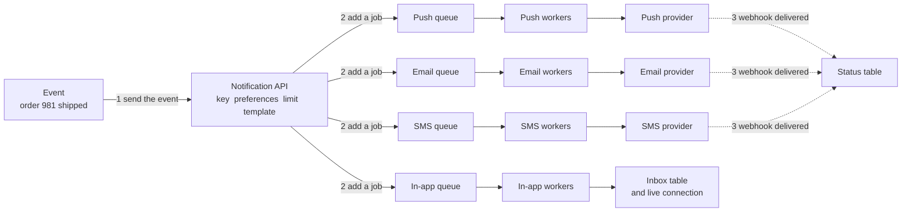
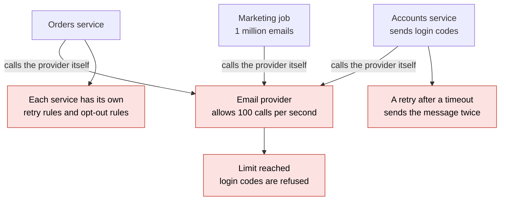
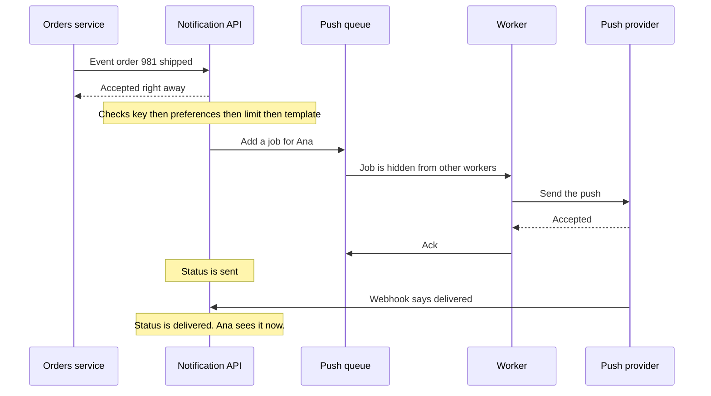
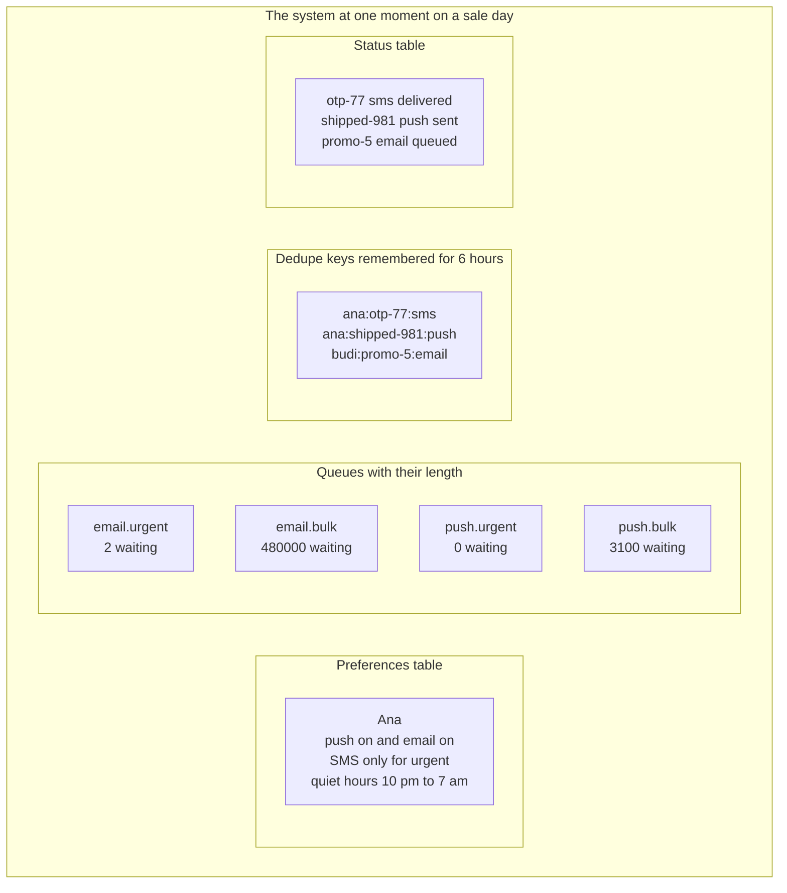
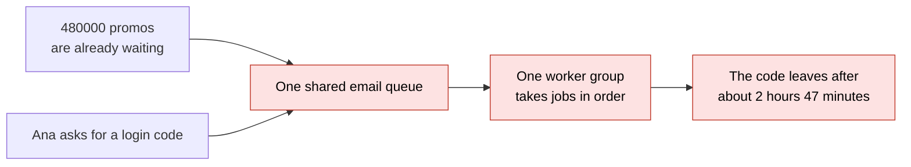
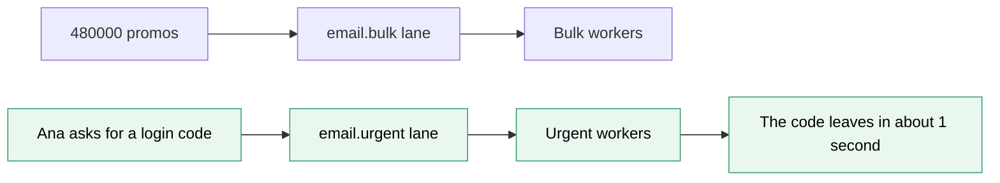
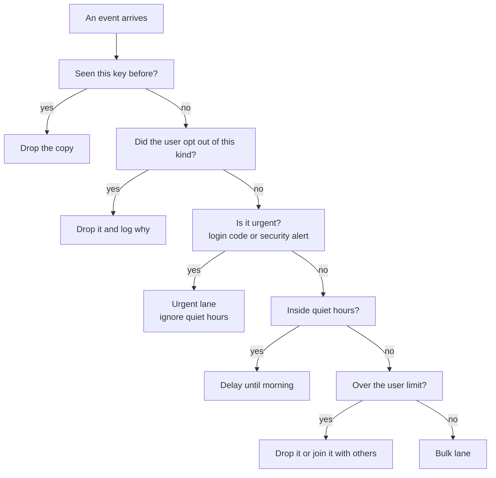
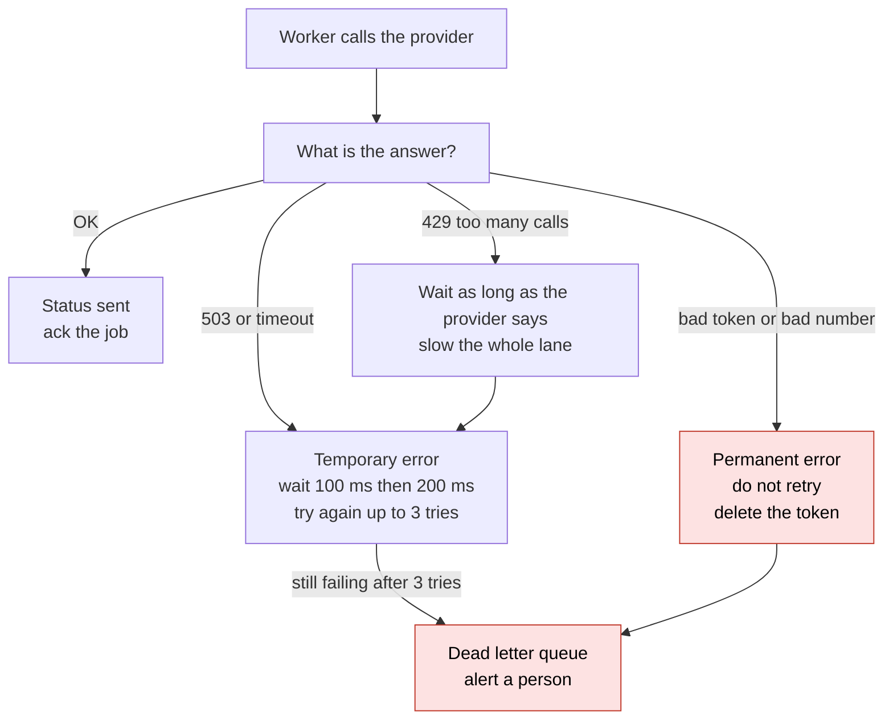
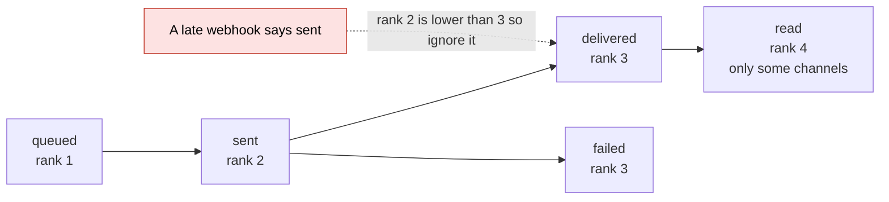

# 11. Design a notification system

> **Subject:** System Design · **Lesson:** 11 · **Made:** 2026-10-17 · **Status:** ready
> **You will be able to:** draw a notification system with one queue per channel and a fast lane for urgent messages, say what each part is for, and explain what happens when the provider fails, an event repeats, or the user is asleep.
> **Before this:** [Design a chat app](10-design-a-chat-app.md) · **Next:** [Design an online shop checkout](12-design-an-online-shop-checkout.md)

## 1. The idea in one sentence

A notification system takes one event, like "order shipped", and decides who to tell, on which channel, and when. Then it hands the message to an outside company that really sends it, and it keeps track of what happened.

Lesson 06 gave you the queue. This lesson puts queues to work in one full design.

New words (four):

- **Channel:** one way to reach a person. Push is a pop-up on the phone. Email, SMS (a text message) and in-app (a bell inside your own app) are the others.
- **Provider:** the outside company that really sends the message. Firebase and Apple do push. Twilio does SMS. You hand over the message and they do the last step (interview words: third party provider).
- **Dedupe key:** a label for one exact message, like `ana:shipped-981:push`. If the same label comes again, you drop the copy (interview word: idempotency key, see lesson [13](13-idempotency-and-retries.md)).
- **Webhook:** a call that the provider makes to your server later, to tell you what happened to a message, for example "delivered".

From lesson [06](06-message-queues.md), in one line each. A **queue** is a waiting line. A **worker** takes a job from it. An **ack** means "I finished this job". The **dead letter queue** is a shelf for jobs that failed every try. **Backoff** means growing waits between tries, like 100 ms, then 200 ms. **At least once** means a job can run twice.

Four plain ideas, explained now so the pictures make sense:

- **A lane** is a separate queue for one kind of message, such as urgent or bulk.
- **Quiet hours** are the hours when a user does not want to be disturbed, for example 10 pm to 7 am.
- **A template** is a message with blanks: `Your order {order} has shipped`.
- **A per-user limit** is a cap on how many messages one person gets, for example 5 pushes per hour.

Sizes and times in the pictures are example numbers.

## 2. The pictures

### 2a. The big picture

Notice that every channel has its own queue, its own workers and its own provider. The status table is filled by webhooks.



### 2b. The problem, drawn

This is the system with no notification service. Notice that three services each call the provider by themselves. Nobody owns the rules.



### 2c. How it works over time

This is story 1 of the stepper. Notice that the orders service gets its answer before any message is sent. Also notice that "sent" and "delivered" are two different moments.



### 2d. What is in the system right now

This is one moment on a sale day. Notice the two email queues: 2 login codes wait in one, and 480,000 promos wait in the other.



### 2e. Right against wrong

The wrong way puts every email in one line. Notice that Ana's login code is at the back of 480,000 promos.



The right way gives urgent messages their own lane and their own workers. Notice that the bulk backlog never reaches the urgent workers.



### 2f. What happens to one event (the decision picture)

The checks run in this order. Notice that urgent messages skip the quiet hours check, and that most "no" answers end with a drop and a log line.



### 2g. When the provider fails

This is story 3 of the stepper. Notice that the worker first asks one question: can waiting help?



### 2h. The life of a status

The status table moves forward only. Notice the late webhook that says "sent" after "delivered". It is ignored, because its rank is lower.



## 3. Real life analogy

The mail room of a big company. People drop in requests: "tell Ana her order shipped". The mail room clerk is the notification API.

- **The checks:** the clerk reads the address book (preferences). It says "no deliveries after 10 pm" (quiet hours). The clerk also writes down each letter, so the same letter does not go twice (dedupe key).
- **The bins:** there is one bin for each courier company: push, email, SMS. Each bin has its own clerk who hands letters to the courier. That is the queue and the workers.
- **The express bin:** urgent letters, like a login code, go in a different bin with its own clerk. A pile of flyers in the flyer bin cannot slow it down.
- **The courier company:** that is the provider. It takes the letter at the door. That moment is "sent".
- **The receipt:** later the courier sends a signed receipt. That is the webhook that says "delivered".

Where the analogy stops: a real courier can bring the letter back. A pop-up on a phone cannot be taken back. Also, providers do not always send a receipt, and receipts can arrive late or in the wrong order.

## 4. The smallest code that shows it

This is the worker's core: a dedupe key, up to 3 tries, and growing waits. The provider fails on its first call only. Nothing really waits here. The code only prints how long it would wait.

```js
const sent = new Set(); let calls = 0;
const provider = () => { if (++calls === 1) throw new Error("503"); };   // the provider fails on its first call only
function dispatch(msg) {
  const key = msg.user + ":" + msg.event + ":" + msg.channel;            // the dedupe key
  if (sent.has(key)) return "skip " + key;                               // same message again: drop it
  for (let t = 1; t <= 3; t++) {                                         // up to 3 tries
    try { provider(msg); sent.add(key); return "sent " + key + " on try " + t; }
    catch { if (t < 3) console.log("  try " + t + " failed, wait " + 100 * 2 ** (t - 1) + " ms"); }   // waits 100, 200
  }
  return "dead letter " + key;
}
const otp = { user: "ana", event: "otp", channel: "sms" };
for (const m of [otp, otp, { ...otp, channel: "email" }]) console.log(dispatch(m));
```

**Output:**

```
  try 1 failed, wait 100 ms
sent ana:otp:sms on try 2
skip ana:otp:sms
sent ana:otp:email on try 1
```

Checked on 2026-10-17 with Node 24.

Look at the last two lines. The same login code on the same channel is dropped. The same login code on another channel is a different message, so it is sent. That is why the channel is part of the key.

## 5. What really happens, step by step

### Part 1: the code above

The machine here is the `dispatch` function with two pieces of memory: the `sent` set and the `calls` counter. One row is one pass through the loop.

| Step | Message | What the code does | Printed or returned | `calls` | `sent` set after |
|---|---|---|---|---|---|
| 1 | `ana:otp:sms`, try 1 | The key is new. The provider is called. It is call 1, so it throws | prints `try 1 failed, wait 100 ms` | 1 | empty |
| 2 | `ana:otp:sms`, try 2 | The loop goes on. The provider is called again. It works | returns `sent ana:otp:sms on try 2` | 2 | `ana:otp:sms` |
| 3 | `ana:otp:sms` again | The key is in `sent`. The function returns at once. The provider is not called | returns `skip ana:otp:sms` | 2 | `ana:otp:sms` |
| 4 | `ana:otp:email`, try 1 | A new key, because the channel is different. The provider works | returns `sent ana:otp:email on try 1` | 3 | `ana:otp:sms`, `ana:otp:email` |

What to see: the provider was called 3 times for 3 events. The repeat in step 3 cost nothing.

### Part 2: the life of one push (the status table over time)

This is the same story as picture 2c. Each row changes one thing.

| Time | What happens | Queue length | Status row | Ana's phone |
|---|---|---|---|---|
| 0 ms | The event arrives. The API answers "accepted" | 0 | none | nothing |
| 5 ms | Check 1: the key `ana:shipped-981:push` is new. The API writes it down | 0 | none | nothing |
| 8 ms | Checks 2 and 3: Ana allows push, it is 2 pm, she is under her limit | 0 | none | nothing |
| 10 ms | Check 4: the template is filled. The row is saved and the job is added | 1 | queued | nothing |
| 40 ms | A worker takes the job and calls the provider | 0 | queued | nothing |
| 140 ms | The provider says OK. The worker acks | 0 | sent | nothing yet |
| 2 s | The webhook "delivered" arrives | 0 | delivered | **1 push** |
| 3 s | A late webhook "sent" arrives. Its rank is lower, so the API ignores it | 0 | delivered | 1 push |

**Step through it yourself:** [open the stepper](visuals/11-design-a-notification-system.html). It has three stories: one message from start to finish, a login code behind a promo blast (one shared queue against two lanes), and provider trouble with a repeat and a replay. Guess first, then press Next.

## 6. Why it exists and what it costs

- **Problem without it:** every service calls providers by itself (picture 2b). Each one repeats the retry rules and the opt-out rules. A marketing blast can use up the provider's limit, and then login codes are refused. A retry after a timeout sends the same message twice.
- **How it solves it:** one place owns the rules. Services send an event and move on. The API checks, queues and answers at once (picture 2c). Each channel and each lane has its own workers (pictures 2a and 2e), so one slow provider or one big blast cannot block the rest.
- **Cost or tradeoff:** more parts, and a delay between the event and the message. The table at the end of this section has the full list.

**What each part is for**

| Part | Its job | What goes wrong without it |
|---|---|---|
| Notification API | Accepts the event and answers at once | The orders service waits for providers |
| Dedupe key | Drops a repeated event | The user gets the same message 2 or 3 times |
| Preferences and quiet hours | Respect what the user chose | Users switch notifications off, or complain |
| Per-user limit | Caps messages per person | A bug in a loop sends 200 pushes to one phone |
| Template | One place for the text, per channel and language | Every service builds its own text |
| One queue per channel | Each channel has its own speed and its own failures | A slow SMS provider stops push too |
| Lanes (urgent and bulk) | An urgent message never waits behind a blast | The login code arrives after 2 hours 47 minutes |
| Retry, backoff and dead letters | Pass short failures, park long ones | Lost messages, or a retry storm |
| Status table and webhooks | Know what really happened | "Sent" is mistaken for "delivered" |

**Two kinds of provider errors.** Picture 2g shows the choice. A temporary error (a 503 or a timeout) can pass later, so the worker waits and tries again. A permanent error (a push token that is not registered, a phone number that does not exist) never passes. Retrying only wastes calls and can hurt your standing with the provider. The worker stops, parks the message and deletes the dead token.

**Why the channel is in the dedupe key.** One event can go out on several channels on purpose. Each channel needs its own key, or the second channel would be dropped as a repeat (section 4).

**The check at send time.** A bulk job can wait for hours in its lane. The user may switch push off during that time. So the worker checks the preferences again right before it calls the provider. A check at enqueue time alone is not enough.

**How big?** An example from the AlgoMaster design guide (opened 2026-10-17): 50 million users and 5 messages per user per day is 250 million per day. That is about 2,900 per second on average. A peak of 1 million messages in 1 minute is about 17,000 per second. A queue per lane absorbs the peak, and the workers drain it at the provider's speed.

**What it costs**

| Cost | What it means | What you do about it |
|---|---|---|
| More parts to run | API, queues, workers per lane, a store for keys, a status table | Start with two lanes, not ten |
| A delay | The message leaves a little after the event | Measure the age of the oldest job in each lane |
| "Sent" is not "delivered" | The provider took it. The phone may be off | Store both. Show "delivered" only after the webhook |
| A rare duplicate | The key store can lose keys when it fails over. A provider call that timed out may still have sent | Use a database unique key for critical messages. Accept a rare repeat for the rest |
| More workers | Each lane needs its own workers and its own provider account or stream | Give the urgent lane few workers that are always free |
| Legal rules | Some opt-outs must always be honored | Keep opt-outs in one place that every channel reads |

**When not to build this.** One app, one email provider, a few thousand messages a day: send from a queue in the app you have. Build the full design when several services send messages, or when a blast can hurt an urgent message.

## 7. Common mistakes

**Wrong:** one queue for every message.

```js
// sketch, not run here
await queue.add("send", { to: user, text });   // login codes and promos share one line
```

**Right:**

```js
// sketch, not run here
const lane = msg.urgent ? "urgent" : "bulk";
await queues[msg.channel + "." + lane].add("send", msg);   // email.urgent, email.bulk, push.urgent ...
```

**Why:** a long bulk backlog must never sit in front of a login code (picture 2e). Each lane also needs its own workers.

**Wrong:** retry every error the same way.

```js
// sketch, not run here
for (let t = 0; t < 5; t++) {
  try { return await provider.send(msg); } catch { await sleep(1000); }   // even "token is not registered"
}
```

**Right:**

```js
// sketch, not run here
try { return await provider.send(msg); }
catch (err) {
  if (err.permanent) return deadLetter(msg, err);   // bad token, bad number: waiting cannot help
  throw err;                                        // the queue retries with growing waits
}
```

**Why:** a permanent error never passes. Retrying it wastes calls and hides the real problem (picture 2g).

**Wrong:** "sent" means the user has it.

**Right:** "sent" means the provider took it. "delivered" arrives later by webhook. Show "delivered" only after the webhook.

**Why:** the phone may be off, or the app may be gone. Only the provider's webhook knows.

**Wrong:** trust the order of webhooks.

```js
// sketch, not run here
await db.update(notifications, { status: event.status });   // a late "sent" overwrites "delivered"
```

**Right:**

```js
// sketch, not run here
const RANK = { queued: 1, sent: 2, delivered: 3, failed: 3 };
if (RANK[event.status] > RANK[row.status]) await db.update(notifications, { status: event.status });   // forward only
```

**Why:** Twilio's guide says there is no guarantee that status callbacks arrive in the order they were sent (see Watch and play). A status that only moves forward cannot be undone by a late event.

**If you freeze:**

1. Say "Services send an event to one API. It checks the key, the preferences and the limit, then adds a job to a queue for each channel."
2. Say "Urgent messages get their own lane, so a promo blast cannot delay a login code."
3. Say "Workers retry temporary errors with growing waits and park the rest in a dead letter queue. Webhooks tell me what was really delivered."

## 8. Watch and play

How the links were checked on 2026-10-17: each page was opened with a fetch tool and read. For the video, YouTube returned only the title and channel. I could not see the length or watch it. So open it once and judge it yourself.

- **Video:** [How to Design a Notification System, Must-Know for System Design Interviews](https://www.youtube.com/watch?v=0pOYU5-pXWA) - channel Interview Simplified, length not shown. Watch for the queues and the retry part, then compare with pictures 2a and 2g.
- **Play with it:** [the stepper in this folder](visuals/11-design-a-notification-system.html) - guess first, then press Next. Try all three tabs.
- **Play with it:** [webhook.site](https://webhook.site) - the page says it gives you a free unique URL and shows every request sent to it. Copy the URL, then run `curl -X POST -d '{"status":"delivered"}' <your-url>` in a terminal. You just played the provider. Watch the request appear.
- **Read:** [AlgoMaster: Design a Scalable Notification Service](https://blog.algomaster.io/p/design-a-scalable-notification-service) - the same boxes as picture 2a: a queue per channel, preferences, retries, a dead letter queue. Find the numbers section.
- **Read:** [Hello Interview: Design a Notification System](https://www.hellointerview.com/learn/system-design/problem-breakdowns/notification-system) - only the start is free. It lists the questions an interviewer asks: keep bulk traffic from delaying login codes, never drop an accepted message, avoid duplicates.
- **Read:** [Twilio: track outbound message status](https://www.twilio.com/docs/messaging/guides/track-outbound-message-status) - how a status callback URL works. Find the sentence about the order of callbacks.

<details><summary>Go deeper (optional)</summary>

**Quiet hours in detail.** Store each user's time zone, not only a time. For a non-urgent message inside quiet hours, work out the next 7 am in that user's zone and add the job as a delayed job. BullMQ has a `delay` option for this. Check the preferences again when the job wakes up. Time changes (daylight saving) can move the hour, so use a library for zones. Urgent messages, like a login code or a security alert, ignore quiet hours.

**Priority inside one queue, or separate queues?** The [BullMQ priority page](https://docs.bullmq.io/guide/jobs/prioritized) (opened 2026-10-17) says a job's priority runs from 1 to 2,097,151, and a lower number is a higher priority. A job with no priority is processed before every prioritized job. Adding prioritized jobs is slower: the page says the cost grows with the log of the number of prioritized jobs. A single queue with priorities still shares one pool of workers, so a long running bulk job can hold a worker that an urgent job needs. Separate lanes with separate workers give a hard wall. Use priorities inside a lane when you need an order there.

**Email has the same wall at the provider.** Postmark's [message streams page](https://postmarkapp.com/message-streams) (opened 2026-10-17) says transactional and broadcast mail use separate infrastructure and separate IP pools, and "broadcast and transactional traffic don't mix". The reason: a promo that gets spam complaints should not hurt the inbox rate of your password resets. Whichever provider you use, give the urgent lane its own sender stream or account.

**Push has expiry and token rules.** From Firebase's docs (opened 2026-10-17): a push message waits up to 4 weeks by default when the phone is off, and the most you can set is 28 days. A `ttl` of 0 means "discard it if you cannot deliver it now". A login code should have a short life, because it expires anyway. A collapse key makes a new message replace an older waiting one for the same phone ([message lifespan](https://firebase.google.com/docs/cloud-messaging/customize-messages/setting-message-lifespan)). On errors: the [token guide](https://firebase.google.com/docs/cloud-messaging/manage-tokens) says `UNREGISTERED` (HTTP 404) means the token is dead, and it is safe to delete it. `INVALID_ARGUMENT` (HTTP 400) can also come from a bad payload, so only treat it as a dead token when the payload is valid. The same guide says a registration that has not connected for over a month is stale, and an Android one inactive for 270 days expires.

**Retries.** Add a random part to each wait (jitter), so many failed jobs do not return at the same second. The [AWS Builders' Library](https://builder.aws.com/content/3EumjoZascWd1oZiEgL8ORlv3qE/timeouts-retries-and-backoff-with-jitter) (opened 2026-10-17) says retries add load when a service is already weak. Five layers with three tries each would raise database load 243 times. So retry in one place and set a limit. BullMQ ([retry page](https://docs.bullmq.io/guide/retrying-failing-jobs), opened 2026-10-17) waits `2 ^ (attempts - 1) * delay` ms for the exponential type, and it has a `jitter` option from 0 to 1. A `429` answer means "too many calls". Wait as long as the provider says, and slow the whole lane, not only one job. Lesson [23](23-timeouts-retries-and-circuit-breakers.md) goes deeper.

**A second provider.** If the SMS provider fails again and again, a circuit breaker can stop calls to it for a while, and the worker can use a second provider for urgent codes. The cost is a second contract, two sets of webhooks to map into one status, and different delivery rules per country.

**Duplicates have two sources.** The first is a repeated event from the producer. The dedupe key stops it. The second is your own retry after a timeout: the provider may have sent the message even though you saw no answer. A dedupe key cannot see that. If the provider supports its own idempotency key, send one. Otherwise accept a rare repeat for push and email. For a money related message, make the content safe to see twice ("Your payment of 100 was received" with the payment number). Where to keep keys: a store like Redis, with a lifetime of a few hours, is fast. The article [Designing a notification system that won't bury your OTP](https://www.techinterview.org/post/3233476887/designing-a-notification-system/) (opened 2026-10-17) builds the key from user, event and channel, and keeps it in Redis for a few hours. If Redis fails over, some keys are lost, so a duplicate can get through. A database unique key never loses a key, and it costs a write. The same article keeps login codes and promos in separate topics, which is the lane idea of this lesson.

**Never drop an accepted event.** If the API answers "accepted" and then crashes before the job is in the queue, the message is lost. The fix is to save the notification row and the job together in one database transaction, and send the job from there later (an outbox). Lesson [12](12-design-an-online-shop-checkout.md) explains the outbox.

**Webhook statuses.** Twilio's [status callback guide](https://www.twilio.com/docs/messaging/guides/outbound-message-status-in-status-callbacks) (opened 2026-10-17) lists these statuses: `queued`, `canceled`, `sent`, `failed`, `delivered`, `undelivered`, and `read` (only for channels that support read receipts, like RCS and WhatsApp). `sent` means sending succeeded. `delivered` means delivery succeeded. `failed` means the send did not succeed and `undelivered` means the delivery did not. A status callback is not sent for the first status of a new message. Other providers use other names, so map them into your own small set.

**Campaigns and fan out.** A campaign for 1 million users should not be one huge request. One event says "send promo 5 to segment X". Workers read the segment in pages of, say, 1,000 users and add a job per user to the bulk lane. The Hello Interview page (only the free preview was readable, 2026-10-17) uses these numbers: about 10 million messages per day, which is about 100 per second, with surges of 5,000 per second, about 50 times more. Its test: urgent messages must still leave within about 5 seconds during a blast.

**Numbers to put on a dashboard.** The age of the oldest job in each lane (alert on the urgent lane first). The 99th percentile time from event to "sent" for the urgent lane. The size of the dead letter queue (alert above 0). The provider error rate per provider. The share of messages that reach "delivered".

**In-app is different.** There is no outside provider. The worker writes a row in an inbox table. If the user has the app open, it also pushes the row over a live connection. A badge counts unread rows. Lesson [10](10-design-a-chat-app.md) covers live connections.

</details>

## 9. Practice

**A. Predict the output** (write your answer before opening)

```js
const seen = new Set(), out = [];
const events = [["ana", "shipped", "push"], ["ana", "shipped", "push"], ["ana", "shipped", "email"]];
for (const e of events) {
  const key = e.join(":");
  if (seen.has(key)) { out.push("skip " + key); continue; }
  seen.add(key);
  out.push("send " + key);
}
console.log(out.join(" | "));
```

Then answer: why is the channel part of the key?

<details><summary>Answer</summary>

```
send ana:shipped:push | skip ana:shipped:push | send ana:shipped:email
```

The second event has the same user, event and channel, so the key is in the set and the copy is skipped. The third event has the same user and event, but another channel. It is a different message on purpose, so it is sent. If the key had no channel, the email would be dropped as a repeat. (Checked on 2026-10-17 with Node 24.)

</details>

**B. Fix the bug**

Three promos are waiting. Then Ana's login code arrives. One worker takes jobs from one shared line. Run it in your head: where is the login code in the output? Then fix it so the login code leaves first.

```js
const line = [];                                // one shared line for every kind of message
for (let i = 1; i <= 3; i++) line.push("promo " + i);
line.push("otp 1");                             // the login code arrives last
const order = [];
while (line.length) order.push(line.shift());   // one worker takes the front of the line
console.log(order.join(", "));
```

<details><summary>Answer</summary>

It prints `promo 1, promo 2, promo 3, otp 1`. The login code is last, because it waited behind the promos.

Fix: use two lanes. The worker looks at the urgent lane first.

```js
const urgent = [], bulk = [];                   // two lanes
for (let i = 1; i <= 3; i++) bulk.push("promo " + i);
urgent.push("otp 1");
const order = [];
while (urgent.length || bulk.length) order.push(urgent.length ? urgent.shift() : bulk.shift());   // urgent first
console.log(order.join(", "));                  // otp 1, promo 1, promo 2, promo 3
```

This toy has one worker that always checks the urgent lane first. A real system also gives each lane its own workers, so a bulk job that is already running cannot hold the only worker. (Checked on 2026-10-17 with Node 24.)

</details>

**C. Write it yourself**

Open `learn/system-design/practice/11-design-a-notification-system.js`. It has one empty function, `createDispatcher`. It builds the worker from section 4, but with a real `send` function, growing waits, a dead letter list, and a safe answer for two copies at the same moment. Write it, then run this from the repo root and make all the tests pass:

```
node --test learn/system-design/practice/11-design-a-notification-system.test.js
```

<details><summary>One possible answer</summary>

```js
function createDispatcher({ send, maxTries = 3, baseMs = 100, sleep = async () => {} }) {
  const claimed = new Set();                    // keys that are sent, or being sent right now
  const dead = [];
  async function dispatch(msg) {
    const key = msg.user + ":" + msg.event + ":" + msg.channel;
    if (claimed.has(key)) return { status: "duplicate", tries: 0, waits: [] };
    claimed.add(key);                           // claim the key BEFORE the first await, so a second copy cannot pass
    const waits = [];
    for (let tries = 1; tries <= maxTries; tries++) {
      try {
        await send(msg);
        return { status: "sent", tries, waits };
      } catch (err) {
        if (err.permanent || tries === maxTries) {
          claimed.delete(key);                  // not sent, so a replay is allowed
          dead.push({ msg, error: err.message, tries });
          return { status: "dead", tries, waits };
        }
        const ms = baseMs * 2 ** (tries - 1);
        waits.push(ms);
        await sleep(ms);
      }
    }
  }
  return { dispatch, deadLetters: () => dead.slice() };
}

module.exports = { createDispatcher };
```

Checked on 2026-10-17 with Node 24: the 10 tests fail on the empty stub and all 10 pass with this answer.

The line `claimed.add(key)` comes before the first `await`. JavaScript runs one piece of code at a time, and there is no `await` between the check and the add. So two copies at the same moment cannot both pass. This works inside one program. With many servers, the key must live in a shared place that can do "add only if not there" in one step, such as a database unique key or Redis `SET ... NX`. That is the main idea of lesson [13](13-idempotency-and-retries.md).

</details>

## 10. Interview question

**Q:** "Design a notification system that sends push, email and SMS. A login code must arrive within 5 seconds, even during a campaign to a million users. How do you avoid duplicates, and how do you know a message arrived?"

This is how the Hello Interview preview (2026-10-17) words the deep dives: never drop an accepted notification, deliver high priority messages within 5 seconds during a blast, and prevent duplicates on top of at least once delivery.

<details><summary>A strong answer, in four parts</summary>

1. **Problem:** many services need to tell users things. If each calls providers by itself, the retry and opt-out rules are copied everywhere. A marketing blast can use up a provider's limit and block login codes. A retry after a timeout sends the same message twice. And nobody knows what arrived.
2. **How it works:** services send an event to one API, which answers "accepted" at once. The API checks the dedupe key, the user's preferences and quiet hours, and the per-user limit. It fills a template and saves a status row. Then it adds a job to a queue named by channel and lane, like `email.urgent` and `email.bulk`. Each queue has its own workers, so a bulk backlog never reaches the urgent workers. A worker calls the provider with a timeout. A temporary error is retried with growing waits and a small random part. A permanent error is not retried. After the last try the job goes to a dead letter queue and an alert fires. Providers call webhooks with "delivered" or "failed", and the status table only moves forward.
3. **Tradeoff:** more parts to run, and each lane needs its own workers and its own provider stream. The queue delivers at least once, so I use a dedupe key. The key store can lose keys, so critical messages use a database unique key. "Sent" does not mean "delivered", and I cannot take back a push. I watch the age of the oldest job in each lane, the 99th percentile time for the urgent lane, and the dead letter queue.
4. **My example:**
   - **Fact:** my DBO case study shows a Queue service that uses BullMQ on Redis, with separate workers for email, points and webhooks. That is already "one worker group per kind of job".
   - **Fact:** the case study shows the Auth service sending the WhatsApp login code to Jatis, a third party. It draws this as a direct call, not through the BullMQ queue. So an email backlog in the queue cannot delay a login code. I should not say this was built on purpose as a fast lane until I check why it was built that way.
   - **Fact:** the case study says each login code costs real money, because Jatis charges per WhatsApp message, and that login code requests are a target for fraud.
   - **Fact:** in DBO, TADA sent the same refund event more than once, almost at the same moment, and stores got double points. A repeat is normal, not rare. The dedupe key in this lesson is the same defense (see lesson [13](13-idempotency-and-retries.md)).
   - **Idea, not a fact:** the case study suggests strict limits on login code requests, for example 3 per phone number per hour. That is a per-user limit. I should not say DBO has it.
   - **Idea, not a fact:** if DBO sends order emails and marketing emails through the same email worker, a flash sale could delay receipts. Two BullMQ queues would be the fix. I would need to look at the real setup first.

</details>

## 11. Explain it back

Close this file. Explain the notification system out loud like to a new junior, in 4 parts (problem, how, tradeoff, my example). Use the story of Ana's login code behind 480,000 promos, then the story of one push from "accepted" to "delivered". Then write your best version below and run `/explain-check notification system` or ask the `explain-coach` agent to review it.

### My explanation

<write here>

### Coach feedback

<the explain-coach agent writes here>

## 12. Review questions (day 1, 3, 7, 21)

1. Why does a notification system have one queue per channel, and why does each channel also have an urgent lane?
2. The provider answers "OK" and the worker marks the message "sent". What do you know, what do you not know, and how do you find out?
3. One push fails with "token is not registered". Another fails with "503". What does the worker do with each, and why?
4. Draw the picture from section 2c from memory.

<details><summary>Answers</summary>

1. Each channel has its own provider, its own speed and its own failures, so one slow provider cannot stop the others, and each channel scales on its own. The urgent lane has its own workers, so a login code never waits behind a promo blast.
2. You know the provider took the message. You do not know if the phone showed it. You find out from the provider's webhook ("delivered" or "failed"), which updates the status table. The status only moves forward, so a late webhook cannot undo "delivered".
3. "Token is not registered" is permanent. Waiting cannot help, so the worker does not retry. It parks the message in the dead letters and deletes the token. A "503" is temporary. The worker waits (100 ms, then 200 ms, with a small random part) and tries again, up to the limit. After the last try the message goes to the dead letters and a person is alerted.
4. Orders service, Notification API, Push queue, Worker and Push provider, left to right. The orders service sends an event and gets "accepted" at once. The API runs its checks and adds a job. The queue hands the job to a worker, which calls the provider. The provider answers OK, the worker acks, and the status becomes "sent". Later the provider calls a webhook, and the status becomes "delivered".

</details>

## Connected lessons

- [Message queues](06-message-queues.md) - the base. Queue, worker, ack, retries and the dead letter queue all come from there.
- [Consistency and CAP](07-consistency-and-cap.md) - a status that updates later by webhook is eventual consistency on purpose.
- [Design a chat app](10-design-a-chat-app.md) - the lesson before. Live connections and delivery status for the in-app channel.
- [Design a rate limiter](09-design-a-rate-limiter.md) - the per-user limit in this design is a rate limiter.
- [Design an online shop checkout](12-design-an-online-shop-checkout.md) - the next lesson. Webhooks that arrive late or twice, and the outbox.
- [Idempotency and retries](13-idempotency-and-retries.md) - the dedupe key and the "claim before you work" rule in depth.
- [Observability](14-observability.md) - the age of the oldest job and the dead letter count are the first numbers to alert on.
- [Timeouts, retries and circuit breakers](23-timeouts-retries-and-circuit-breakers.md) - backoff with jitter, retry storms, and a second provider.
- [Queues, streams and event-driven design](queues-streams-and-event-driven-design.md) and its [visual cheatsheet](queues-streams-and-event-driven-design-cheatsheet.html) - Part 4 covers retries and dead letters, Part 7 covers rate limits toward third parties.
- [Design workbook part 1](design-workbook-part-1-classic-designs.md) - chat and the rate limiter, with hidden answers.
- [System design interview questions](senior-system-design-interview-questions.md) - the question bank.
