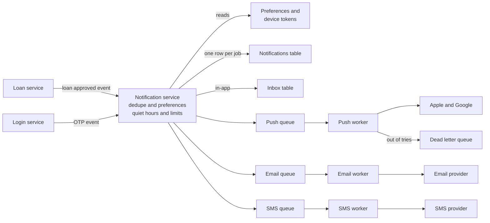
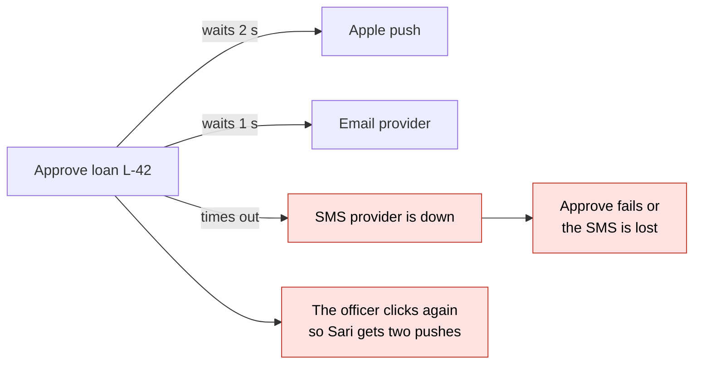
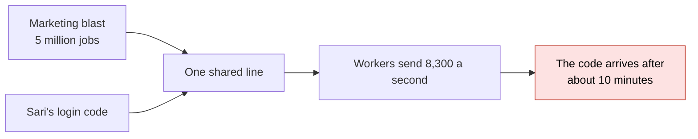
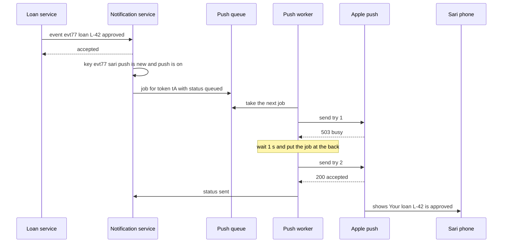
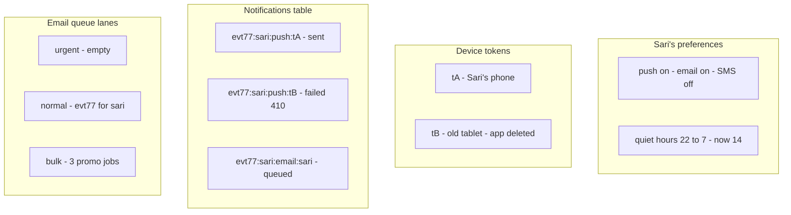
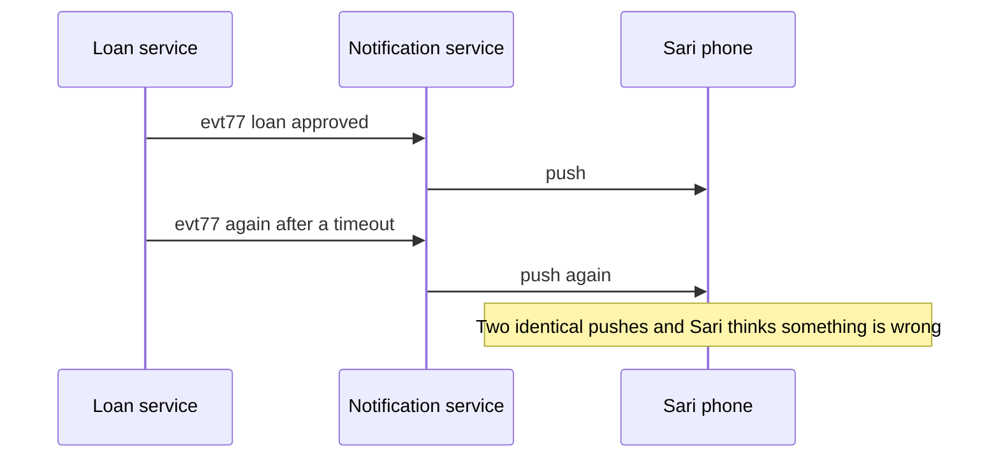
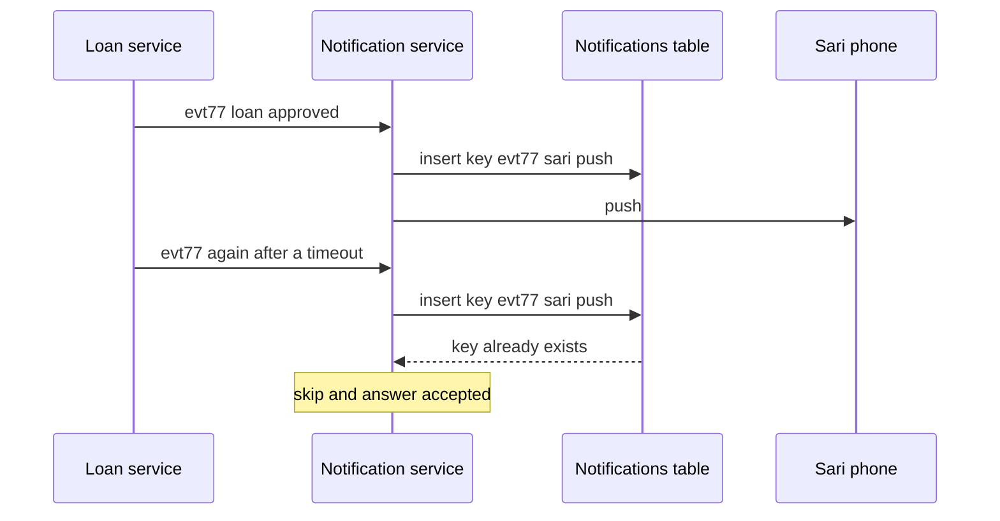
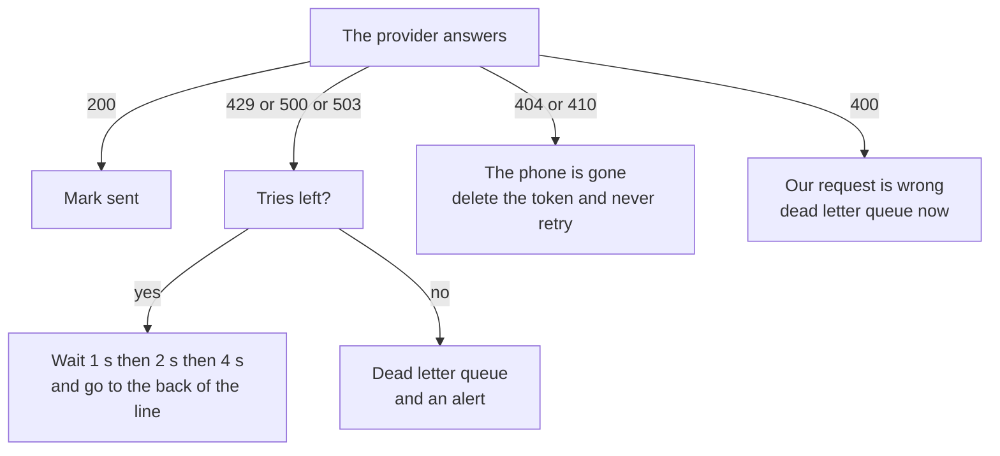
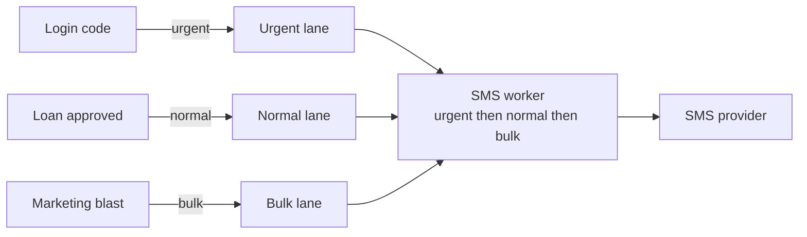

# 11. Design a notification system

> **Subject:** System Design · **Lesson:** 11 · **Made:** 2026-10-21 · **Status:** ready
> **You will be able to:** draw how one event, "your loan is approved", reaches a user by push, email, SMS and in-app without slowing down the request. You will also be able to explain how the dedupe key stops a second copy, which failures get a retry and which go to the dead letter queue, why a dead device token must be deleted, and how an OTP gets past a big marketing blast.
> **Before this:** [Design a chat app](10-design-a-chat-app.md) · **Next:** [Design an online shop checkout](12-design-an-online-shop-checkout.md)

## 1. The idea in one sentence

Services only drop an event and move on. One notification service checks it, makes one job per channel, and puts each job on a queue. Workers send the jobs, retry short problems, and never send the same thing twice.

Lesson 10 had one kind of message going to one place. Here one event fans out to many places, and each place is a different outside company that can be slow, down, or say "this phone no longer exists". The hard parts are **not blocking** the service that made the event, **not sending twice**, **respecting what the user wants**, and **letting urgent messages go first**.

New words (four):

- **Channel:** one way to reach a person: push, email, SMS, or in-app (a row in an inbox the app shows).
- **Provider:** the outside company that really delivers on a channel. Apple (APNs) and Google (FCM) for push, an email company, an SMS company.
- **Dedupe key:** a short text that names one notification, for example `evt77:sari:push`. If the key was seen before, do not send again. (Interview word: idempotency key.)
- **Device token:** the address of one app on one phone. Apple or Google gives it to the app, and the app gives it to you. One user can have several.

From earlier lessons:

- A queue holds slow jobs, workers take them, and a job can arrive **more than once** (at least once). After too many failed tries, a job goes to the dead letter queue for a person to look at (lesson 06). This lesson builds on that and does not explain it again.
- A unique key stops a resend from making a second copy (lesson 08).
- A limit per user stops one user, or one bug, from flooding someone (lesson 09).
- Lesson 10 ended with a push queue and a push worker. This lesson is that box, opened up.

## 2. The pictures

### 2a. The big picture

Notice that the loan service only drops an event. Everything to the right of the notification service happens later, in the background.



One queue per channel means a slow SMS company cannot hold up push or email.

### 2b. The problem, drawn

The simple way is to send right inside the request. Notice everything the approve button now waits for.



The second problem: one line for every message. Notice where the login code ends up.



### 2c. How it works over time: one failed try, one retry

Notice that the loan service is done after one step. The 503 only makes the push a second late.



### 2d. What is in memory right now

This is one moment, a few seconds after the event. Notice that each row has a status, and the key is the dedupe key plus the address.



The statuses are **queued** (waiting), **held** (waiting for quiet hours to end), **sent** (the provider said yes), **failed**, and later **delivered** or **opened** if the provider tells you. Token `tB` got 410, so it is about to be deleted.

### 2e. Right against wrong

The loan service did not hear "accepted" in time, so it sends the same event again. That is normal with at least once.





The key is built from the event id, not from the time or the text. The same event always makes the same key, so the second copy is caught.

### 2f. What to do with each answer

The provider's answer decides everything. Notice that only a short problem is worth a retry.



Google says 404 for a dead token, and Apple says 410. Retrying a dead token forever wastes calls, and Apple may drop your connection if you keep making errors.

### 2g. Priority lanes

Notice that the worker always looks at the urgent lane first.



Urgent jobs also skip quiet hours and the user's channel choices. Nobody wants to wait until 7 am for a login code.

## 3. Real life analogy

The mail room of a bank.

- **Events:** departments drop letters in the mail room tray and go back to work. They do not walk to the post office.
- **Preferences:** each customer has a card: "email yes, phone calls no, nothing after 10 pm".
- **The dedupe key:** a log book, "letter 77 to Sari by email, done". If department 77 sends the same letter again, the clerk sees the line and throws it away.
- **Channel queues and lanes:** one tray per courier. Each tray has a red folder on top for urgent letters.
- **Retries:** the courier is busy, so the clerk tries again in a minute, then in two minutes.
- **The dead letter queue:** after three tries, the letter goes on the "problem" shelf, and a person looks at it.
- **Device token cleanup:** a letter comes back "addressee moved". The clerk crosses out the old address and never uses it again.

Where the analogy stops: a mail room handles a few hundred letters a day. A blast is 5 million in 10 minutes, the couriers answer in milliseconds, and a "moved" note may never come back at all.

## 4. The smallest code that shows it

One event, three channels, a dedupe set, and a push provider that fails once. Then the same event arrives a second time.

```js
const sent = new Set();                                    // dedupe keys that were already sent
const allowed = { sari: ["push", "email"] };               // Sari turned SMS off
let pushFailsLeft = 1;                                     // the push provider fails once
const provider = (ch) => (ch === "push" && pushFailsLeft-- > 0 ? 503 : 200);
function notify(eventId, userId) {
  for (const ch of ["push", "email", "sms"]) {
    const key = `${eventId}:${userId}:${ch}`;              // the dedupe key
    if (!allowed[userId].includes(ch)) { console.log(key, "off"); continue; }
    if (sent.has(key)) { console.log(key, "already sent, skip"); continue; }
    for (let t = 1; t <= 3 && !sent.has(key); t++) {       // up to 3 tries
      const code = provider(ch);
      console.log(key, "try", t, code);
      if (code === 200) sent.add(key);
    }
  }
}
notify("evt77", "sari");                                   // loan L-42 is approved
notify("evt77", "sari");                                   // the same event arrives a second time
```

**Output:**

```
evt77:sari:push try 1 503
evt77:sari:push try 2 200
evt77:sari:email try 1 200
evt77:sari:sms off
evt77:sari:push already sent, skip
evt77:sari:email already sent, skip
evt77:sari:sms off
```

Checked on 2026-10-21 with Node 24.

It is 18 lines, a little long, because it shows three ideas at once: preferences, the retry, and the dedupe key. In a real system, the `sent` set is a unique index on the dedupe key, and the retry does not loop in place. The job goes back to the queue with a wait.

## 5. What really happens, step by step

One row is one thing the code does. Watch the `sent` set and what Sari sees.

| Step | Code | What happens | `sent` after | Sari sees |
|---|---|---|---|---|
| 1 | first `notify`, `ch = "push"` | Builds `evt77:sari:push`. Push is allowed, and the key is new | empty | nothing |
| 2 | `provider("push")` | Returns 503, a short problem. No key is added, so the loop tries again | empty | nothing |
| 3 | `provider("push")` again | Returns 200. The key is added | push | one push |
| 4 | `ch = "email"` | New key, try 1 returns 200 | push, email | push, email |
| 5 | `ch = "sms"` | Sari turned SMS off. Skipped, no call | push, email | push, email |
| 6 | second `notify`, push | `evt77:sari:push` is already in `sent`. Skipped | push, email | push, email |
| 7 | email | Already sent. Skipped | push, email | push, email |
| 8 | sms | Still off | push, email | push, email |

What to see:

- Step 2: the failure does not reach the loan service. It only makes the push a little late.
- Step 3: the key is added **after** the 200, not before. If the key were added first and every try failed, the push would be marked done without ever being sent.
- Steps 6 and 7: the second copy of the event costs nothing. The same event always builds the same key.
- In the real system, step 2 is not a quick loop. The worker puts the job at the back of the queue with a wait of 1 s, then 2 s, so other jobs keep moving.

**Step through it yourself:** [open the stepper](visuals/11-design-a-notification-system.html). Story 1 is loan approved: a 503, a retry, and a second copy of the event that the dedupe key stops. Story 2 is an urgent OTP that jumps past three marketing SMS, a dead token removed after one 410, and a job that runs out of tries and goes to the dead letter queue. Guess first, then press Next.

## 6. Why it exists and what it costs

- **Problem without it:** the service that made the event waits for every provider, fails when one is down, sends twice on a retry, and ignores what users asked for.
- **How it solves it:** an event goes into one service that runs the checks. Jobs go into a queue for each channel, with lanes for priority. Workers retry short problems with growing waits and give up into a dead letter queue.
- **Cost or tradeoff:** more moving parts, a short delay, and duplicates that you must catch yourself, because queues deliver at least once.

### The numbers

A rough estimate with round numbers. These are assumptions. Say them out loud.

| Question | The math | Answer |
|---|---|---|
| Notifications a day | 10 million users times 2 | 20 million |
| Per second | 20 million divided by 100,000 seconds | 200 |
| At the busiest time | 200 times 3 | 600 a second |
| A marketing blast | 5 million users in 10 minutes, 5,000,000 divided by 600 | about 8,300 a second |
| An OTP stuck behind the blast in one line | 5 million jobs at 8,300 a second | about 10 minutes |
| Storage | 20 million rows times 500 bytes | 10 GB a day, about 900 GB for 90 days |
| Device tokens | about 1.5 phones or tablets per user | about 15 million |

The driver is the blast: **8,300 a second, 40 times the normal rate**, and an OTP that must not wait 10 minutes behind it. That one fact is why there are lanes.

### Four channels

| Channel | Good for | Watch out |
|---|---|---|
| **Push** | Fast and free. "Your loan is approved" | Needs a device token. Apple and Google try their best, but they may drop or merge messages |
| **Email** | Long text and documents. Never makes a sound | Spam rules. Marketing mail needs a one click unsubscribe |
| **SMS** | Reaches any phone, even without the app | Costs money for every message. A favorite target for fraud |
| **In-app** | A row in your own inbox table. No provider | Sari only sees it when she opens the app |

### What it costs

| Cost | What it means | What you do |
|---|---|---|
| Duplicates | Queues deliver at least once, and services resend after a timeout | The dedupe key with a unique index. The worker skips a job that is already sent |
| Retries can make it worse | 8,300 jobs retrying at the same moment hit a sick provider again | Doubling waits with a random spread, a cap on tries, and honor `Retry-After` |
| Dead letters need a person | A job in the dead letter queue is a user who got nothing | An alert on its size. A button to send the jobs again after the fix |
| Tokens go stale | Users delete the app or get a new phone | Delete on 404 or 410. Drop tokens not seen for a month |
| Quiet hours | Push and SMS are held until morning | A job that releases held rows at the end of each user's quiet hours |
| Too many messages | Users turn everything off, or uninstall | A limit per user per day for bulk |

## 7. Common mistakes

**Wrong:** send inside the request.

```js
// sketch, not run here
app.post("/loans/:id/approve", async (req, res) => {
  await db.loans.approve(req.params.id);
  await apns.send(token, "Your loan is approved");      // waits for Apple
  await sms.send(phone, "Your loan is approved");       // if this throws, the approve looks failed
  res.json({ ok: true });
});
```

**Right:**

```js
// sketch, not run here
app.post("/loans/:id/approve", async (req, res) => {
  await db.loans.approve(req.params.id);
  await events.publish({ eventId: `loan-approved-${req.params.id}`, userId, type: "loan_approved" });
  res.json({ ok: true });                               // the notification service does the rest
});
```

**Why:** the approve is done in milliseconds. A provider being down only delays the notification. The event id comes from the loan, so a resend builds the same dedupe key. If the server dies between the save and the publish, the event is lost. The fix is an outbox row written in the same transaction, shown in the walkthrough Part 3.

**Wrong:** retry every failure, at once, forever.

**Right:** retry only 429 and 5xx, with growing waits and a cap, then the dead letter queue. On 404 or 410, delete the token. On 400, go to the dead letter queue at once.

**Why:** a dead token never comes back, so retrying it only wastes calls. Practice B shows it in code.

**Wrong:** "The queue gives each job to one worker, so there are no duplicates."

**Right:** "The queue delivers at least once. The dedupe key, `eventId:userId:channel`, with a unique index, makes a second copy harmless."

**Why:** a worker can crash after the send but before the ack, and the queue hands the job out again (lesson 06).

**Wrong:** "One queue for everything, ordered by time."

**Right:** "Lanes or separate queues per priority, with their own workers."

**Why:** an OTP behind a blast waits 10 minutes, and the user gives up.

**If you freeze:**

1. Say "Services drop an event. The notification service checks dedupe, preferences, quiet hours and limits, then puts one job per channel on a queue."
2. Say "Workers send. 429 and 5xx get a retry with growing waits, then the dead letter queue. 404 or 410 means the token is dead, so I delete it."
3. Say "The dedupe key is event, user and channel, with a unique index. OTPs go in an urgent lane, so a marketing blast never blocks them."

## 8. Watch and play

Every link below was opened and checked on 2026-10-21. For the video, the title, channel and length come from YouTube's own data. If one breaks later, say so and it will be replaced.

- **Video:** [Design a Notification Service (OneSignal) | Systems Design Questions 3.0 With Ex-Google SWE](https://www.youtube.com/watch?v=IScGMqojqKE) Jordan has no life, 11 min 33 s - a short whiteboard design. Compare it with pictures 2a and 2g.
- **Play with it:** [the stepper in this folder](visuals/11-design-a-notification-system.html) - guess first, then press Next. Try both tabs.
- **Play with it:** [Resilience patterns](https://system-design.space/en/visuals/resilience-patterns/) on System Design Space - change the load and the scenario, and watch retries and a circuit breaker protect a sick service.
- **Read:** [Hello Interview: Design a Notification System](https://www.hellointerview.com/learn/system-design/problem-breakdowns/notification-system) - the full interview answer. Find the deep dives on never dropping a message, priority during a blast, and idempotency.
- **Read:** [ByteByteGo: How Does a Typical Push Notification System Work?](https://bytebytego.com/guides/how-does-a-typical-push-notification-system-work/) - one picture of the whole path, from the event to Apple and Google.
- **Read:** [Firebase: Best practices for FCM registration management](https://firebase.google.com/docs/cloud-messaging/manage-tokens) - when a token is stale, and why to delete it on `UNREGISTERED`.
- **Read:** [Apple: Handling notification responses from APNs](https://developer.apple.com/documentation/usernotifications/handling-notification-responses-from-apns) - every answer Apple can give, and which ones you must not retry.

<details><summary>Go deeper (optional)</summary>

**What Apple's answers mean.** Apple's page says 410 means "The device token is no longer active for the topic", with reasons like `Unregistered` and `ExpiredToken`, and that "410 isn't considered an error condition". 429 `TooManyRequests` means too many requests to the same token. Apple lists answers you must not retry, among them `BadDeviceToken`, `Unregistered`, `ExpiredToken` and `PayloadTooLarge`. Answers like 429 and 5xx can be retried with a delay.

**What Google's answers mean.** The [FCM error codes](https://firebase.google.com/docs/cloud-messaging/error-codes) page says to retry `UNAVAILABLE` (503), `INTERNAL` (500) and `QUOTA_EXCEEDED` (429) with growing waits, and to "Honor the Retry-After header". Do not retry `UNREGISTERED` (404) or `INVALID_ARGUMENT` (400). The token page calls a token stale when the device has "not connected to FCM for over a month", and suggests the app refreshes its token about once a month.

**The 400 in the practice is simplified.** In real life, a 400 comes with a reason. If the reason is about the token, `BadDeviceToken` from Apple or `INVALID_ARGUMENT` from Google, delete the token too. If it is about the message, like a payload over Apple's 4 KB limit, fix the code.

**The crash between send and ack.** The worker sends, then crashes before it writes "sent". The queue hands the job out again, and the worker cannot know the push went out. Your own dedupe cannot fully close this gap. Apple's [sending requests](https://developer.apple.com/documentation/usernotifications/sending-notification-requests-to-apns) page has an `apns-collapse-id` header: "When sending the same notification more than once, use the same value in this header to merge the requests". Use the dedupe key there.

**Apple stores, but only a little.** If the phone is off, Apple keeps a notification for up to 30 days, depending on `apns-expiration`. It keeps only one per app, usually the latest. So push is never your record of what you told the user. The notifications table or the in-app inbox is.

**Priority at the provider too.** Apple's `apns-priority` 10 means send now, and 5 means when it suits the phone's battery. Google's [Android message priority](https://firebase.google.com/docs/cloud-messaging/android-message-priority) page says high priority can wake a sleeping phone, but "If FCM detects a pattern in which messages don't result in user-facing notifications, your messages may be deprioritized." Do not mark marketing as high.

**Email rules for bulk senders.** Google's [sender guidelines FAQ](https://support.google.com/mail/answer/14229414?hl=en) treats senders of about 5,000 messages a day to Gmail as bulk senders. They need a one click unsubscribe and must keep the spam rate below 0.3%. Messages like a password reset do not need the unsubscribe link.

**Delivery status from webhooks.** Email and SMS providers call you back with "delivered", "bounced" or "opened". These calls can come twice, out of order, or never. Only move a status forward, and treat them as hints. The walkthrough Part 3 covers this.

**Other videos and reads.**

- [19: Notification Service | Systems Design Interview Questions With Ex-Google SWE](https://www.youtube.com/watch?v=J-5JozlYIqI), Jordan has no life, about 21 min. The older, longer version.
- [How to build a Notification System Design EXPLAINED | Ace your System Design Interview - Gourav](https://www.youtube.com/watch?v=6RKYu6eZIPg), Code with GD, about 18 min.
- [AlgoMaster: Design Notification Service](https://algomaster.io/learn/system-design-interviews/design-notification-service), a long written answer.

**Checked on:** 2026-10-21.

</details>

## 9. Practice

**A. Predict the output** (write your answer before opening)

Sari's quiet hours are 22 to 7. The second line prints the wait before each retry.

```js
const quiet = (h, start, end) => (start <= end ? h >= start && h < end : h >= start || h < end);
console.log([21, 22, 23, 3, 7].map((h) => (quiet(h, 22, 7) ? "hold" : "send")).join(" "));
const waits = [1, 2, 3].map((tries) => 1000 * 2 ** (tries - 1));
console.log(waits.join(" "));
```

Then answer: at 23:00 a push and an email for Sari arrive. Which one goes now?

<details><summary>Answer</summary>

```
send hold hold hold send
1000 2000 4000
```

22 to 7 crosses midnight, so "quiet" means 22 or later, **or** before 7. 21 is before the start. 7 is the end, and the end is not included, so 7 sends. The waits double: 1 s, 2 s, 4 s. (Checked on 2026-10-21 with Node 24.)

The email goes now. It makes no sound, so quiet hours do not hold it. The push waits until 7.

</details>

**B. Fix the bug**

Sari has two tokens. `tB` is her old tablet, and she deleted the app there. Run it in your head, then fix it.

```js
const tokens = ["tA", "tB"];                                // tB is Sari's old tablet. The app was deleted
const apns = (token) => (token === "tB" ? 410 : 200);
const outbox = ["tA", "tB"];                                 // one push job per token
let calls = 0;
while (outbox.length && calls < 6) {
  const token = outbox.shift();
  const code = apns(token); calls++;
  console.log(token, code);
  if (code !== 200) outbox.push(token);                     // retry every failure
}
console.log("calls:", calls, "tokens:", tokens.join(" "));
```

<details><summary>Answer</summary>

It prints:

```
tA 200
tB 410
tB 410
tB 410
tB 410
tB 410
calls: 6 tokens: tA tB
```

410 means the app is gone from that device. It will never work, but the code retries it until the safety stop at 6 calls, and the dead token is still there for the next notification. With a million dead tokens, that is a million useless calls every time.

Fix: change `const tokens` to `let tokens`, and change the last line in the loop:

```js
  if (code === 410 || code === 404) tokens = tokens.filter((t) => t !== token);   // the phone is gone: delete, never retry
  else if (code !== 200) outbox.push(token);                                     // a short problem: try again later
```

It now prints:

```
tA 200
tB 410
calls: 2 tokens: tA
```

(Both outputs checked on 2026-10-21 with Node 24.)

</details>

**C. Write it yourself**

Open `learn/system-design/practice/11-design-a-notification-system.js`. It has one empty function, `createNotifier`. It plays the notification service, the channel queues and the workers. `notify` runs the checks (channel choices, the dedupe key, no device, the bulk limit, quiet hours) and makes one job per address. `work` takes the next job, urgent first, calls the provider function you give it, and decides by the code: sent, retry with a doubling wait, token removed, or dead letter. The comment at the top of the file explains every rule. Write it, then run this from the repo root and make all the tests pass:

```
node --test learn/system-design/practice/11-design-a-notification-system.test.js
```

<details><summary>One possible answer</summary>

```js
function createNotifier({ maxTries = 3, bulkPerDay = 2 } = {}) {
  const CHANNELS = ["push", "email", "sms"];
  const LANES = ["urgent", "normal", "bulk"];
  const prefs = new Map();                                    // userId -> { channels, quietStart, quietEnd }
  const tokens = new Map();                                   // userId -> [device tokens]
  const seen = new Set();                                     // dedupe keys "eventId:userId:channel"
  const statuses = new Map();                                 // job key -> "queued" | "held" | "sent" | "failed"
  const bulkCount = new Map();                                // userId -> bulk notifications today
  const queues = {};                                          // channel -> { urgent: [], normal: [], bulk: [] }
  for (const ch of CHANNELS) queues[ch] = { urgent: [], normal: [], bulk: [] };
  let held = [];
  const dead = [];

  const prefsOf = (userId) => prefs.get(userId) || { channels: ["push", "email"] };
  const isQuiet = ({ quietStart: s, quietEnd: e }, hour) => {
    if (s === undefined || e === undefined) return false;
    return s <= e ? hour >= s && hour < e : hour >= s || hour < e;   // the second form crosses midnight
  };
  const enqueue = (job) => { queues[job.channel][job.priority].push(job); statuses.set(job.key, "queued"); };

  return {
    setPrefs(userId, p) { prefs.set(userId, p); },
    addToken(userId, token) { tokens.set(userId, [...(tokens.get(userId) || []), token]); },
    tokensOf: (userId) => [...(tokens.get(userId) || [])],

    notify({ eventId, userId, text, hour, priority = "normal", channels = CHANNELS }) {
      const out = { queued: [], held: [], skipped: [] };
      const p = prefsOf(userId);
      const urgent = priority === "urgent";
      const atLimit = priority === "bulk" && (bulkCount.get(userId) || 0) >= bulkPerDay;
      let made = false;
      for (const channel of CHANNELS.filter((c) => channels.includes(c))) {
        if (!urgent && !p.channels.includes(channel)) { out.skipped.push({ channel, reason: "off" }); continue; }
        const dedupeKey = `${eventId}:${userId}:${channel}`;
        if (seen.has(dedupeKey)) { out.skipped.push({ channel, reason: "duplicate" }); continue; }
        if (atLimit) { out.skipped.push({ channel, reason: "limit" }); continue; }
        const addresses = channel === "push" ? tokens.get(userId) || [] : [userId];
        if (addresses.length === 0) { out.skipped.push({ channel, reason: "no device" }); continue; }
        seen.add(dedupeKey);
        made = true;
        const wait = !urgent && channel !== "email" && isQuiet(p, hour);   // email makes no sound
        for (const to of addresses) {
          const job = { key: `${dedupeKey}:${to}`, eventId, userId, channel, to, text, priority, tries: 0, waitMs: 0 };
          if (wait) { held.push(job); statuses.set(job.key, "held"); out.held.push(job.key); }
          else { enqueue(job); out.queued.push(job.key); }
        }
      }
      if (made && priority === "bulk") bulkCount.set(userId, (bulkCount.get(userId) || 0) + 1);
      return out;
    },

    release() { held.forEach(enqueue); held = []; },
    queueLength: (channel) => LANES.reduce((n, lane) => n + queues[channel][lane].length, 0),

    work(channel, send) {
      const lane = LANES.find((l) => queues[channel][l].length > 0);
      if (!lane) return null;
      const job = queues[channel][lane].shift();
      if (statuses.get(job.key) === "sent") return { result: "duplicate", job };   // already sent: never twice
      job.tries += 1;
      const code = send(job);
      if (code === 200) { statuses.set(job.key, "sent"); return { result: "sent", job }; }
      if ([429, 500, 503].includes(code) && job.tries < maxTries) {
        job.waitMs = 1000 * 2 ** (job.tries - 1);             // 1 s, 2 s, 4 s...
        queues[channel][lane].push(job);                       // back of the line, so others keep moving
        return { result: "retry", job };
      }
      statuses.set(job.key, "failed");
      if (code === 404 || code === 410) {                      // the phone is gone: clean up, never retry
        tokens.set(job.userId, (tokens.get(job.userId) || []).filter((t) => t !== job.to));
        return { result: "token removed", job };
      }
      dead.push({ ...job, reason: code });                     // out of tries, or a bad request
      return { result: "dead", job };
    },

    redeliver(job) { queues[job.channel][job.priority].push(job); },
    status: (key) => statuses.get(key),
    deadLetters: () => dead.map((j) => ({ ...j })),
  };
}

module.exports = { createNotifier };
```

Checked on 2026-10-21 with Node 24: the 24 tests fail on the empty stub and all 24 pass with this answer. Two things to notice. The dedupe key is checked in `notify`, for a second copy of the event, **and** the status is checked in `work`, for a job the queue hands out twice. And `waitMs` is only recorded here. A real queue, like BullMQ with `attempts` and `backoff`, would hold the job for that long before a worker sees it again.

</details>

## 10. Interview question

**Q:** "Design a notification system for a banking app. It sends push, email, SMS and in-app messages: login codes, 'your loan is approved', and marketing. 10 million users."

A common follow-up: "The SMS provider is down for 20 minutes. What happens?" The answer is in picture 2f and the "What it costs" table: jobs wait in the SMS queue, retries back off, push and email keep flowing, and anything out of tries is in the dead letter queue to send again.

<details><summary>A strong answer, in four parts</summary>

1. **Problem:** one event must reach a user on the channels they allow, without blocking the service that made it, without double sends, respecting quiet hours, and with a daily limit on marketing. I estimate 20 million a day, about 200 a second, 600 at the busiest time. A blast to 5 million users in 10 minutes is about 8,300 a second. That is the driver: a login code must not wait behind it. First I ask: which channels? Is there an in-app inbox? How fast must a login code arrive?
2. **How it works:** services publish an event with a stable id. The notification service builds the dedupe key `eventId:userId:channel` and inserts it with a unique index, so a second copy is skipped. It reads preferences and device tokens, holds push and SMS during quiet hours, checks the bulk limit, fills the template, and writes one row per job with status `queued`. Each channel has its own queue with urgent, normal and bulk lanes, and its own workers. A worker calls the provider. 200 means `sent`. 429 and 5xx go back with a wait of 1 s, 2 s, 4 s plus a random spread, and after the last try into the dead letter queue with an alert. 404 or 410 deletes the token. Provider webhooks move the status on to `delivered`.
3. **Tradeoff:** the queue adds a short delay, and at least once means I own the dedupe. Separate lanes cost more workers but keep login codes fast during a blast. SMS reaches everyone but costs money per message, so I prefer push when the user has a token.
4. **My example:**
   - **Fact:** in DBO, the Auth service sends the login OTP by WhatsApp through Jatis.
   - **Fact:** DBO has a Queue service with BullMQ on Redis, and separate workers for email, points and webhooks. Emails already go through a queue, not inside the request.
   - **Idea, not a fact:** the DBO case study suggests a strict limit on OTP requests, for example 3 per phone number per hour, because each WhatsApp message costs money. That is a suggestion, not something we built.
   - **Idea, not a fact:** in a loan system like the ones I work on at Skyworx, "your loan is approved" would be a normal priority event with a dedupe key from the loan id, and the OTP would be urgent. I have no facts about how Skyworx or Unloan send notifications, so I do not claim any.

</details>

## 11. Explain it back

Close this file. Explain a notification system out loud like to a new junior, in 4 parts (problem, how, tradeoff, my example). Use the story of Sari's loan L-42: a 503 and a retry, the event arriving twice, and her old tablet answering 410. Then write your best version below and run `/explain-check design a notification system` or ask the `explain-coach` agent to review it.

### My explanation

<write here>

### Coach feedback

<the explain-coach agent writes here>

## 12. Review questions (day 1, 3, 7, 21)

1. Walk "loan L-42 approved" from the loan service to Sari's phone, naming each part it passes and each check it meets.
2. What goes into the dedupe key, and why the event id and not the time? Where else must a worker check before it sends?
3. The provider answers 503, 410 and 400. What does the worker do for each, and why?
4. A marketing blast of 5 million is running when Sari asks for a login code. Why does the code still arrive in seconds?

<details><summary>Answers</summary>

1. The loan service publishes an event with id `evt77` and moves on. The notification service builds `evt77:sari:push` and inserts it, so it is new. It reads Sari's preferences (push on, SMS off), checks quiet hours (14:00, not quiet), finds token `tA`, and writes a `queued` row. The job goes into the normal lane of the push queue. The push worker takes it, calls Apple, gets 200, and marks it `sent`. Apple shows it on the phone.
2. Event id, user id and channel. The same event always makes the same key, so a resend is caught. The time would be different on a resend, so it would not catch it. The worker also checks the job's status before sending, because the queue can hand out the same job twice after a lost ack.
3. 503: a short problem. Put it back with a wait that doubles, and after the last try move it to the dead letter queue. 410: the app is gone from that device. Delete the token and never retry. 400: our request is wrong, so a retry gives the same answer. Dead letter queue at once, so a person can fix the bug.
4. The code is urgent, so it goes into the urgent lane, and workers always empty that lane first. In one shared line it would wait about 10 minutes behind 5 million jobs at 8,300 a second. Urgent jobs also skip quiet hours and the user's channel choices.

</details>

## Connected lessons

- [Design a chat app](10-design-a-chat-app.md) - the lesson before. Its push queue and push worker are the push channel here.
- [Design an online shop checkout](12-design-an-online-shop-checkout.md) - the next lesson. "Your order is paid" is an event this system sends, and webhooks come back again.
- [Message queues](06-message-queues.md) - at least once, the dead letter queue, and growing waits. This lesson builds on it.
- [Design a URL shortener](08-design-a-url-shortener.md) - the unique key that makes a resend harmless.
- [Design a rate limiter](09-design-a-rate-limiter.md) - the limit per user for bulk, and the strict limit on OTP requests.
- [Idempotency and retries](13-idempotency-and-retries.md) - the dedupe key in depth.
- [Observability](14-observability.md) - queue depth per lane, dead letter size, and provider errors are the numbers to watch.
- [Streams vs queues](21-streams-vs-queues.md) - when the events themselves should live in Kafka.
- [Timeouts, retries and circuit breakers](23-timeouts-retries-and-circuit-breakers.md) - backoff with a random spread, and stopping calls to a provider that is down.
- [System design, step by step, Part 3](system-design-step-by-step-walkthrough.md) - the same problem as a full seven step answer, with the outbox and webhook reconciling.
- [Queues, streams and event-driven design](queues-streams-and-event-driven-design.md) - Part 4 on retries and dead letters, and Part 7 on rate limits toward third parties.
- [Design workbook part 1](design-workbook-part-1-classic-designs.md) and [part 2](design-workbook-part-2-correctness-designs.md) - more full designs that use the same queue and worker shape.
- [Frontend system design](frontend-system-design.md) - Part 6 shows push notifications from the phone's side.
