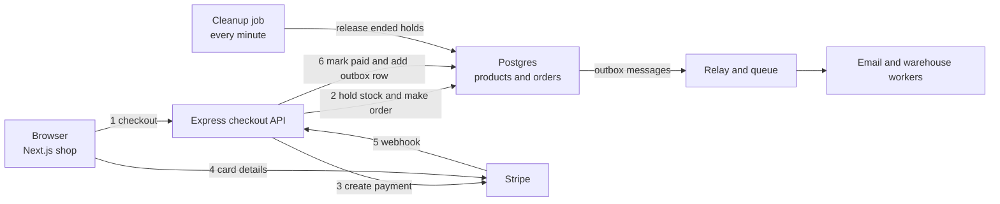
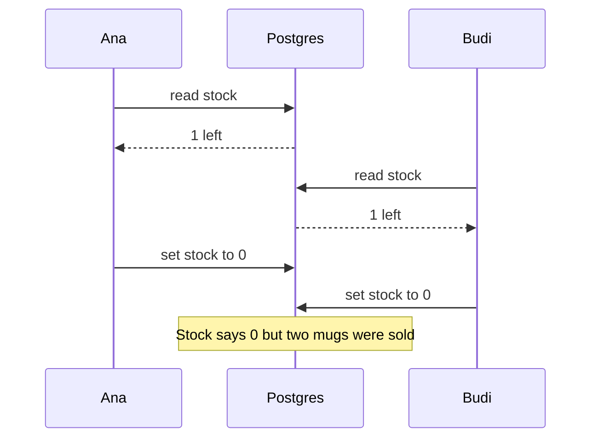
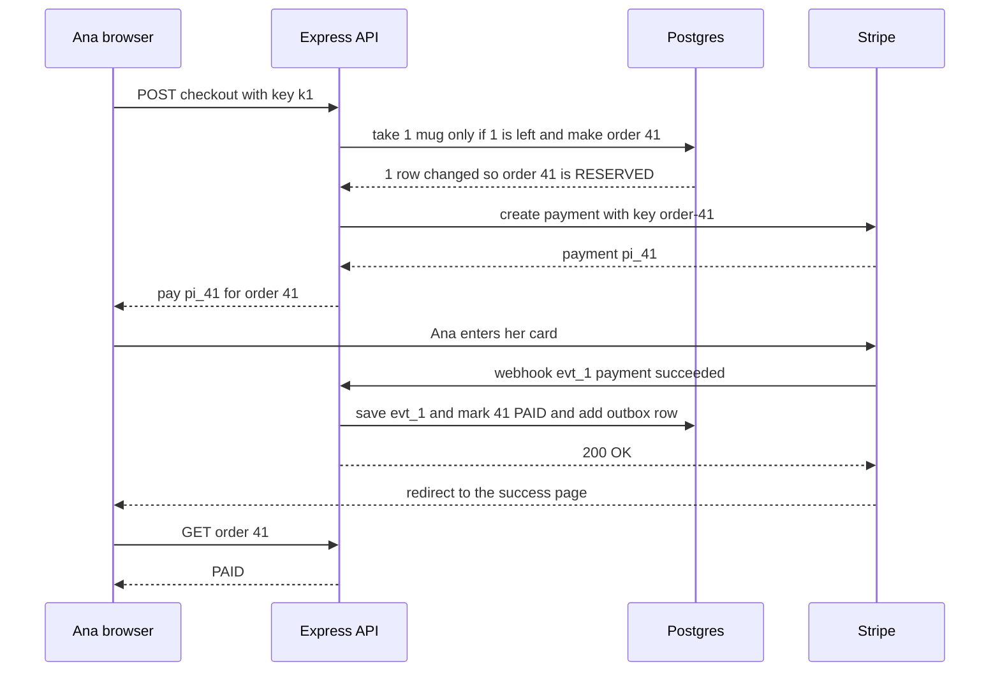
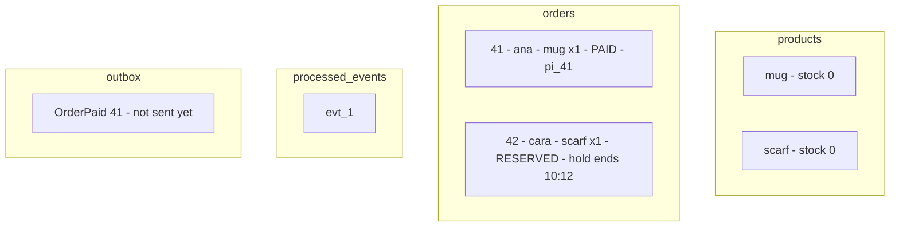
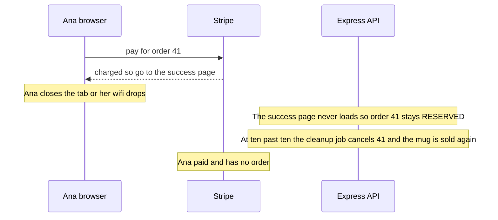
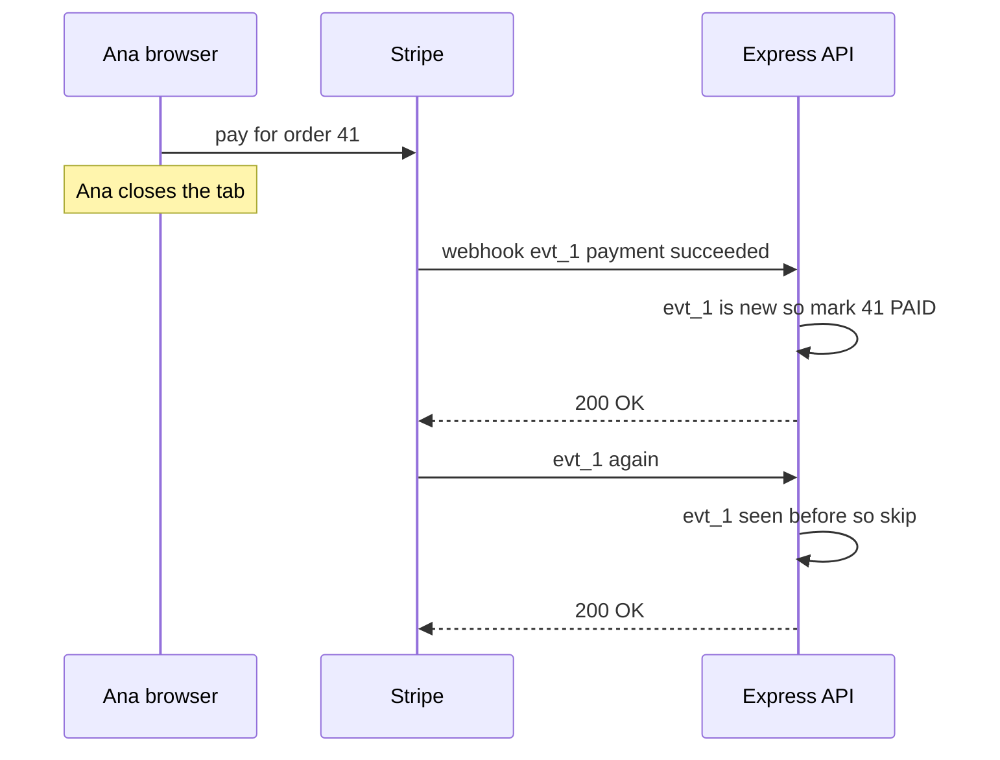
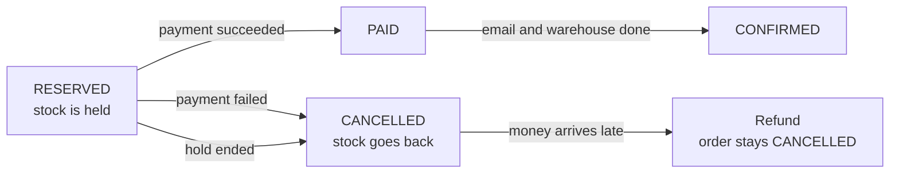
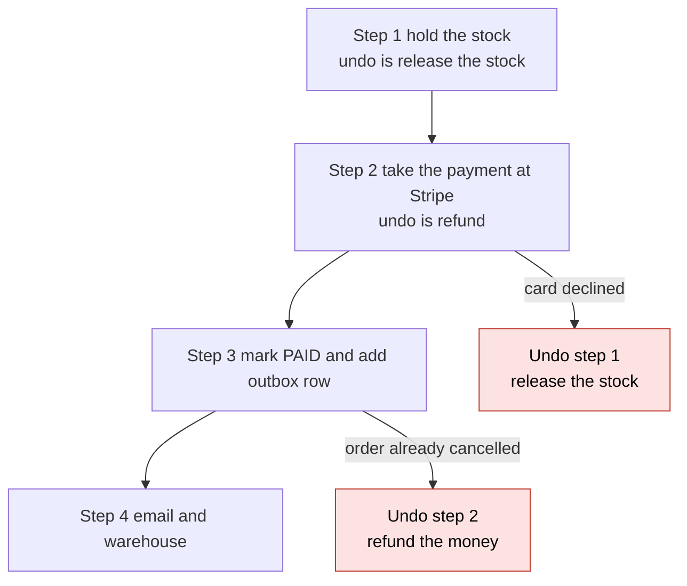

# 12. Design an online shop checkout

> **Subject:** System Design · **Lesson:** 12 · **Made:** 2026-10-21 · **Status:** ready
> **You will be able to:** show why two buyers can both "win" the last item and stop it with one SQL statement, draw the order's status moves from RESERVED to PAID or CANCELLED, explain why the webhook and not the success page decides that an order is paid, and say which undo steps run when a payment fails.
> **Before this:** [Design a notification system](11-design-a-notification-system.md) · **Next:** [Idempotency and retries](13-idempotency-and-retries.md)

## 1. The idea in one sentence

Hold the item in one safe step, let the payment company say "paid", and run undo steps when something fails.

A checkout looks like one button. Four things can go wrong:

- Two buyers want the last item at once.
- The browser closes right after paying.
- The payment company's "paid" message comes twice, or early.
- The payment fails after you set the item aside.

Examples use Next.js, Express, Prisma, Postgres and Stripe.

New words (four):

- **Hold:** stock kept for one buyer for about 10 minutes. Unpaid stock goes back. (Interview word: reservation.)
- **Conditional update:** one SQL statement that checks and changes together: "take a mug only if one is left".
- **Webhook:** a call from another company's server to yours, like Stripe saying "payment succeeded".
- **Saga:** steps that each have an undo step (interview word: compensation). If a later step fails, the undo steps run backwards.

From earlier lessons:

- A transaction: database changes that all happen, or none.
- The outbox is a table of messages saved in the order's transaction (lesson 06).
- A unique key on each request stops a resend from making a copy (lessons 08 and 10). Interview word: idempotency key.

## 2. The pictures

### 2a. The big picture

Notice that card details go to Stripe, not your server.



A small helper (the relay) sends outbox rows to the queue. A cleanup job gives back ended holds.

### 2b. The problem, drawn

Notice that both buyers read "1 left" before either one writes.



### 2c. How it works over time: one good checkout

Notice the order: hold, create the payment, then wait for the webhook.



Two keys stop copies. `k1` stops a second order. `order-41` stops a second payment.

### 2d. What is in the database right now

This is the database after step 7 in section 5. Notice `processed_events`: events already handled.



### 2e. Right against wrong

Wrong: the success page marks the order paid. Notice what happens when it never loads.



Right: the webhook decides. Notice that a repeated event changes nothing.



### 2f. The order status and its allowed moves

Only the arrows are allowed (interview word: state machine). Notice that an event with no arrow is ignored.



In SQL, each move checks its starting status: `WHERE status = 'RESERVED'`. A late "failed" event after PAID changes 0 rows.

### 2g. The saga: undo steps run backwards

Stripe is outside your database. You cannot take back a charge, only refund it. Notice that each undo is a real step.



<details><summary>Go deeper (optional)</summary>

**Only the payment needs the saga.** The hold and the order live in the same Postgres. So they still share one normal transaction.

**Why not trust the success page?** Stripe's own webhooks guide says you cannot rely on the landing page, because the customer may never visit it.

**The outbox relay.** The relay is a small loop. It reads outbox rows that are not sent yet. It puts each one on the queue, then marks it sent. If it crashes between those two steps, it sends that row again. That is one more reason the email worker must be safe to repeat. Part 9 of [Queues, streams and event-driven design](queues-streams-and-event-driven-design.md) has the outbox and inbox in full.

**Two ways to run a saga.** By events (interview word: choreography): each service listens and does its step. By one coordinator (interview word: orchestration): one piece of code calls each step and its undo. For a checkout, one coordinator in your API is easier to read and debug. The [queues guide, Part 8](queues-streams-and-event-driven-design.md) has the picture, and tools like Temporal run long sagas for you.

</details>

## 3. Real life analogy

A small shop has one blue mug. A bank is down the road.

- **Race:** two people reach for the mug. The first at the counter gets it.
- **Hold:** the mug waits behind the counter for Ana until 10:10.
- **Webhook:** the bank phones: "Ana paid". The shopkeeper trusts the bank, not Ana.
- **Duplicate:** the bank calls twice. The shopkeeper says "already done".
- **Undo:** Ana's card fails, so the mug goes back. Late money is sent back.

Where it stops: in a flash sale, a short sale with big discounts, thousands buy in one second. And the shop must check the caller is the bank. Stripe adds a code made with a shared secret (interview word: signature).

## 4. The smallest code that shows it

Two buyers, one mug. First read then write, then check and change in one step.

```js
let stock = 1;                                            // one blue mug left
const db = () => new Promise((r) => setTimeout(r, 10));   // each database step takes 10 ms
async function readThenWrite(buyer) {
  const left = stock; await db();                         // 1. read "1 left", then wait
  if (left < 1) return `${buyer}: sold out`;
  stock = left - 1; return `${buyer}: got the mug`;       // 2. write, using old news
}
async function oneStep(buyer) {
  await db();
  if (stock < 1) return `${buyer}: sold out`;             // check and change in one step,
  stock -= 1; return `${buyer}: got the mug`;             // like UPDATE ... WHERE stock >= 1
}
const race = async (buy) => { stock = 1; console.log(await Promise.all([buy("ana"), buy("budi")]), "stock", stock); };
race(readThenWrite).then(() => race(oneStep));
```

**Output:**

```
[ 'ana: got the mug', 'budi: got the mug' ] stock 0
[ 'ana: got the mug', 'budi: sold out' ] stock 0
```

Line one: stock 0 looks fine, but both buyers got a yes. The Postgres one-step version:

```sql
UPDATE products SET stock = stock - 1
WHERE id = 'mug' AND stock >= 1
RETURNING stock;
```

One row back means "you got it". Zero rows means "sold out".

Checked on 2026-10-21 with Node 24.

## 5. What really happens, step by step

Each row is one event. Watch each column change.

| Step | What happens | What the server does | Mug stock | Order 41 | Seen events | Outbox |
|---|---|---|---|---|---|---|
| 0 | 10:00, one mug left | nothing yet | 1 | none | none | empty |
| 1 | Ana presses Pay, key `k1` | One transaction: the conditional update changes 1 row, then it makes order 41 | 0 | RESERVED, hold ends 10:10 | none | empty |
| 2 | Budi presses Pay a moment later | His update waits for Ana's to finish. Then Postgres checks again: stock is 0, so 0 rows. Answer "sold out" | 0 | RESERVED | none | empty |
| 3 | Ana double clicks, key `k1` again | Finds `k1` already answered. Sends back order 41 again. No new update | 0 | RESERVED | none | empty |
| 4 | API asks Stripe for a payment | After the transaction ends, it calls Stripe with key `order-41` and gets `pi_41` | 0 | RESERVED, `pi_41` | none | empty |
| 5 | Ana pays on Stripe's form | Stripe charges the card | 0 | RESERVED | none | empty |
| 6 | Ana's wifi drops before the redirect | Nothing reaches our server | 0 | RESERVED | none | empty |
| 7 | Webhook `evt_1` "payment succeeded" | In one transaction: checks the signature, saves `evt_1`, moves 41 from RESERVED to PAID, adds an outbox row. Answers 200 | 0 | PAID | `evt_1` | OrderPaid 41 |
| 8 | Stripe sends `evt_1` again | Finds `evt_1` already saved, so it skips. Answers 200 | 0 | PAID | `evt_1` | OrderPaid 41 |
| 9 | Relay and workers run | The relay puts OrderPaid 41 on the queue. The email worker sends the receipt | 0 | CONFIRMED | `evt_1` | sent |

Unhappy paths: Cara holds a scarf, Dan holds a hat.

| Step | What happens | What the server does | Result |
|---|---|---|---|
| 10 | Webhook `evt_2` "payment failed" for Cara | Moves her order from RESERVED to CANCELLED. Gives the scarf back | scarf stock +1, Cara starts a new checkout to try another card |
| 11 | Dan is slow on his bank's extra check. Nothing has arrived when his hold ends at 10:14 | The cleanup job finds his RESERVED order with an ended hold. The same happens if he just closes the tab | CANCELLED, hat stock +1 |
| 12 | Dan finishes the check and his payment succeeds at 10:15 | The order is CANCELLED, so it does not move to PAID. A refund is sent | money back to Dan, order stays CANCELLED |

What to see:

- Step 2: Budi waits, then Postgres checks the new stock.
- Steps 3 and 8: a key guards the API, an event id guards the webhook.
- Steps 6 and 7: no browser, yet the order is PAID.

**Step through it yourself:** [open the stepper](visuals/12-design-an-online-shop-checkout.html). Guess first, then press Next.

## 6. Why it exists and what it costs

- **Problem without it:** one item sold twice, paid orders lost, orders shipped twice.
- **How it solves it:** hold in one step, trust the webhook, skip repeats, undo on failure.
- **Cost:** more parts (cleanup job, relay, refunds). Held stock is blocked for minutes.

### The numbers

Round-number guesses (interview words: back of the envelope). Say them out loud.

| Question | The math | Answer |
|---|---|---|
| Orders a day | a mid-size shop | 100,000 |
| Orders a second | 100,000 divided by 100,000 seconds in a day, rounded | about 1, so 3 at the busiest |
| Flash sale tries | 20,000 buyers in 2 minutes for 500 mugs | about 170 a second, all on one row |
| What one row can take | a short transaction keeps the row busy about 2 ms | about 500 holds a second |
| Webhooks | about 2 events per order, plus retries | a few a second, easy |

A flash sale puts every buyer on **one busy row** (interview word: hot row). Keep that transaction short.

### Four ways to stop selling more than you have

| Way | How it works | Good | Bad |
|---|---|---|---|
| **Take stock at "add to cart"** | The cart holds the item | Simple | Carts that never buy block stock for hours |
| **Conditional update plus a hold that ends** | The pick for this lesson | One SQL statement. Postgres does the waiting | One busy row in a flash sale |
| **A counter in Redis** | Redis subtracts from a number | Very fast | Two systems that can disagree. Shopify moved away from it |
| **One row per unit** | Each buyer grabs any free unit row and skips busy ones | Many buyers at once | More rows and more code |

### What it costs

| Cost | What it means | What you do |
|---|---|---|
| Holds block stock | Someone who never pays blocks the item until the hold ends | A short hold, and a cleanup job every minute |
| The webhook can be late | The success page loads before the order is PAID | The page shows "processing" and asks again every 2 seconds |
| Webhooks come twice or out of order | Stripe does not promise one copy or any order | A seen events table, and moves that check the starting status |
| Money after the hold ended | The item may already be sold to someone else | Refund, and an alert so someone looks |
| Stale reads | A follower may still show the old status | Read stock and order status from the leader (lesson 07) |

<details><summary>Go deeper (optional)</summary>

**How long should a hold last?** A 5 minute hold sends unpaid stock back fast, but slow buyers lose their item while typing a card. A 30 minute hold is kind to slow buyers, but in a sale the stock sits blocked. 10 to 15 minutes is a common middle.

**When one row is not enough.** One hot row limits a flash sale to a few hundred holds a second. Past that, split the stock into one row per unit, and let each buyer skip rows that are busy. That is the "one row per unit" line in the table.

**Shopify's move from Redis to MySQL.** In [Scaling inventory reservations](https://shopify.engineering/scaling-inventory-reservations) (May 2026), Shopify moved checkout holds out of Redis and into MySQL, next to their stock ledger, so one transaction covers both. With Redis they risked selling too many or too few. For busy items they keep one row per unit, capped at 1,000 per item and location, and buyers take free rows with `SKIP LOCKED`, so they do not wait on each other. [Hello Interview's write up](https://www.hellointerview.com/learn/system-design/in-the-wild/shopify-inventory-reservations) goes with the video in section 8.

</details>

## 7. Common mistakes

**Wrong:** read the stock, then write it, in two Prisma calls.

```js
// sketch, not run here
const p = await prisma.product.findUnique({ where: { id } });
if (p.stock < qty) return soldOut();
await prisma.product.update({ where: { id }, data: { stock: p.stock - qty } });   // two buyers both get here
```

**Right:**

```js
// sketch, not run here
const order = await prisma.$transaction(async (tx) => {
  const held = await tx.product.updateMany({
    where: { id, stock: { gte: qty } },                // check and change in one step
    data: { stock: { decrement: qty } },
  });
  if (held.count === 0) return null;                   // 0 rows: sold out
  return tx.order.create({ data: { buyerId, productId: id, qty, status: "RESERVED",
    expiresAt: new Date(Date.now() + 10 * 60_000) } });
});
// only now, after the transaction, call Stripe with idempotencyKey "order-" + order.id
```

**Why:** this `updateMany` is one conditional update. Stripe is called after it, so the row is busy only a short time.

**Wrong:** "Mark the order paid when the success page loads."

**Right:** "The webhook marks it paid. The success page only reads."

**Why:** the browser can close, and anyone can open that URL. Stripe resends the webhook until you answer 2xx (OK).

**Wrong:** act on the webhook JSON every time it arrives.

**Right:** check the signature, save the event id, and only then act.

```js
// sketch, not run here. This route must come before app.use(express.json())
app.post("/webhooks/stripe", express.raw({ type: "application/json" }), async (req, res) => {
  let event;
  try {
    event = stripe.webhooks.constructEvent(req.body, req.headers["stripe-signature"], process.env.STRIPE_WEBHOOK_SECRET);
  } catch { return res.sendStatus(400); }                                     // 1. is it really Stripe?
  await prisma.$transaction(async (tx) => {
    const fresh = await tx.$executeRaw`INSERT INTO processed_events (id) VALUES (${event.id}) ON CONFLICT DO NOTHING`;
    if (fresh === 0) return;                                                  // 2. seen before: skip
    if (event.type === "payment_intent.succeeded") {
      const orderId = Number(event.data.object.metadata.orderId);
      const moved = await tx.order.updateMany({ where: { id: orderId, status: "RESERVED" }, data: { status: "PAID" } });
      if (moved.count === 1) await tx.outbox.create({ data: { type: "OrderPaid", orderId } });   // 3. same transaction
      // count 0 and the order is CANCELLED: add a refund job here
    }
  });
  res.sendStatus(200);                                                        // 4. answer fast
});
```

**Why:** anyone can POST to your URL. The signature proves it is Stripe. Check it on the exact bytes, before `express.json()` changes them.

**If you freeze:**

1. "One conditional update holds the stock. Zero rows means sold out."
2. "The webhook marks it paid, after checking the signature and event id."
3. "On failure, undo steps run: give the stock back, refund late money."

## 8. Watch and play

All links were checked on 2026-10-21.

- **Video:** [Why Shopify Moved Inventory Reservations from Redis to MySQL](https://www.youtube.com/watch?v=CheTuMvFXwc) Hello Interview, 13 min 40 s - how a huge shop holds stock.
- **Video:** [Nobody likes being charged twice!](https://www.youtube.com/watch?v=Pu0jiwA5Nwo) Stripe Developers, 4 min 8 s - idempotency keys, like `order-41`.
- **Play with it:** [the stepper in this folder](visuals/12-design-an-online-shop-checkout.html) - guess, then press Next.
- **Read:** [Stripe: Receive Stripe events in your webhook endpoint](https://docs.stripe.com/webhooks) - duplicates, event order and signatures.

<details><summary>Go deeper (optional)</summary>

**Why Postgres makes the conditional update safe.** In the default mode (READ COMMITTED), if two transactions update the same row, the second one waits for the first to finish. Then it checks its `WHERE` again on the new version of the row. So Budi's `stock >= 1` is checked against 0, not 1. See [PostgreSQL: Transaction Isolation](https://www.postgresql.org/docs/current/transaction-iso.html). Add `CHECK (stock >= 0)` on the table as a safety belt. The other way is `SELECT ... FOR UPDATE` through `prisma.$queryRaw`, then a normal update in the same transaction.

**Stripe idempotency key facts.** From [Stripe: Idempotent requests](https://docs.stripe.com/api/idempotent_requests): keys can be up to 255 characters, and V4 UUIDs are suggested. Stripe saves the first result for a key, even a 500 error, and returns it again. Keys can be removed after at least 24 hours. Reusing a key with different parameters gives an error. In Node: `stripe.paymentIntents.create({ amount, currency, metadata: { orderId: "41" } }, { idempotencyKey: "order-41" })`. Brandur Leach's post [Designing robust and predictable APIs with idempotency](https://stripe.com/blog/idempotency) explains why. Lesson 13 builds your own version.

**Stripe webhook facts.** From the webhooks page: in live mode Stripe retries a failed delivery for up to 3 days with growing waits. In a sandbox it retries 3 times over a few hours. Stripe does not promise the order of events. The signature check refuses events older than 5 minutes by default, which blocks replays. [Stripe: Fulfill orders](https://docs.stripe.com/checkout/fulfillment?payment-ui=stripe-hosted) says the fulfill function must be "safe to run multiple times, even concurrently".

**A payment's own statuses.** A Stripe PaymentIntent moves through `requires_payment_method`, `requires_confirmation`, `requires_action` (for example a bank check like 3D Secure), `processing`, then `succeeded` or `canceled`. Your order status is separate and simpler. After a declined card, Stripe lets the buyer try another card on the same payment. So many shops keep the hold until it ends instead of cancelling on the first "failed" event. This lesson cancels at once to keep the moves simple.

**Cancel the payment when the hold ends (an idea).** The cleanup job could also cancel the PaymentIntent at Stripe when it releases the hold. Then a late payment is less likely, and you refund less often. You still need the refund path, because a payment can succeed in the same second.

**Shopify webhooks.** If you build on Shopify, its webhooks have the same rules: check the `X-Shopify-Hmac-SHA256` header on the raw body, answer within 5 seconds, expect retries (8 times over 4 hours) and no promised order. See [Verify webhooks](https://shopify.dev/docs/apps/build/webhooks/verify-deliveries) and [Best practices](https://shopify.dev/docs/apps/build/webhooks/best-practices).

**Two more places to try.** [webhook.site](https://webhook.site/) gives you a URL of your own. Send a POST to it with curl and see the headers and the raw body, exactly what your webhook route receives. [microservices.io: Pattern: Saga](https://microservices.io/patterns/data/saga.html) is Chris Richardson's page, with an order and customer credit example run both ways: by events and by one coordinator.

**More videos.** [Top 3 Things You Should Know About Webhooks!](https://www.youtube.com/watch?v=x_jjhcDrISk) ByteByteGo, 3 min 55 s, what a webhook is and what to watch out for. [Distributed Transactions Explained: 2 Phase Commit vs Saga Pattern](https://www.youtube.com/watch?v=DOFflggE_0Q) Hello Interview, 14 min 46 s. [Essential tips for handling Stripe webhook events](https://www.youtube.com/watch?v=s7tFBA-1MyA) Stripe Developers, 6 min 14 s. [What is the Transactional Outbox Pattern?](https://www.youtube.com/watch?v=5YLpjPmsPCA) Confluent.

**Checked on:** 2026-10-21. Video titles and channels come from YouTube's own data. If a link breaks later, say so and it will be replaced.

</details>

## 9. Practice

**A. Predict the output** (write your answer before opening)

Order 41 is RESERVED. Three webhook events arrive in this order.

```js
const order = { status: "RESERVED" }; let stock = 0; const seen = new Set();
function onEvent(id, type) {
  if (seen.has(id)) return console.log(id, "skip, seen before");
  seen.add(id);
  if (order.status !== "RESERVED") return console.log(id, type, "ignored, order is", order.status);
  if (type === "succeeded") order.status = "PAID";
  if (type === "failed") { order.status = "CANCELLED"; stock += 1; }
  console.log(id, type, "->", order.status);
}
onEvent("evt_1", "succeeded");
onEvent("evt_1", "succeeded");          // Stripe sends it again
onEvent("evt_2", "failed");             // an older event arrives late
console.log(order.status, "stock", stock);
```

Then answer: `evt_2` is new, so `seen` lets it in. What stops it giving the mug back?

<details><summary>Answer</summary>

```
evt_1 succeeded -> PAID
evt_1 skip, seen before
evt_2 failed ignored, order is PAID
PAID stock 0
```

The seen set stops the second `evt_1`, because it is the same event. It cannot stop `evt_2`, because it is a different event. Stripe does not promise the order of events, so an older event can arrive after a newer one. The status check stops it. A move to CANCELLED is only allowed from RESERVED, and the order is PAID. You need both guards. (Checked on 2026-10-21 with Node 24.)

</details>

**B. Fix the bug**

Order 41 was paid in time. Order 43 was never paid. Run this cleanup job in your head, then fix it.

```js
let stock = 0;                                            // no mugs on the shelf
const orders = [
  { id: 41, status: "PAID", expiresAt: 10 },              // paid before the hold ended
  { id: 43, status: "RESERVED", expiresAt: 10 },          // never paid
];
function expireHolds(now) {                               // a job that runs every minute
  for (const o of orders) {
    if (o.expiresAt <= now) { o.status = "CANCELLED"; stock += 1; }
  }
}
expireHolds(11);
expireHolds(12);
console.log(orders.map((o) => o.id + " " + o.status).join(", "), "| stock", stock);
```

<details><summary>Answer</summary>

It prints:

```
41 CANCELLED, 43 CANCELLED | stock 4
```

Two bugs from one missing check. Ana's paid order 41 is cancelled, so her mug can be sold again. And every run gives the stock back again, so 2 mugs became 4.

Fix: only release orders that are still RESERVED.

```js
    if (o.status === "RESERVED" && o.expiresAt <= now) { o.status = "CANCELLED"; stock += 1; }
```

It now prints:

```
41 PAID, 43 CANCELLED | stock 1
```

In SQL this is `UPDATE orders SET status = 'CANCELLED' WHERE status = 'RESERVED' AND expires_at <= now() RETURNING product_id, qty`, and you add back only the rows it returns. Running it twice is safe, because the second run finds nothing RESERVED. (Both outputs checked on 2026-10-21 with Node 24.)

</details>

**C. Write it yourself**

Open `learn/system-design/practice/12-design-an-online-shop-checkout.js` and write `createShop`. The top comment lists every rule. Run this from the repo root until all tests pass:

```
node --test learn/system-design/practice/12-design-an-online-shop-checkout.test.js
```

<details><summary>One possible answer</summary>

Paste this into the stub file below the `sign` helper, in place of the empty `createShop`. It uses `sign` from the stub.

```js
function createShop({ stock, secret, holdMinutes = 10 }) {
  const free = { ...stock };              // productId -> units free to hold
  const orders = new Map();               // orderId -> order
  const byPayment = new Map();            // paymentId -> orderId
  const answers = new Map();              // "buyerId:key" -> first answer
  const seen = new Set();                 // event ids already processed
  const outbox = [];
  const refunds = [];
  let lastId = 0;
  const giveBack = (o) => { free[o.productId] += o.qty; };

  return {
    outbox,
    refunds,
    checkout({ buyerId, productId, qty = 1, key, now }) {
      const k = buyerId + ":" + key;
      if (answers.has(k)) return answers.get(k);     // double click: same answer
      let answer;
      if ((free[productId] ?? 0) < qty) {
        answer = { ok: false, reason: "sold out" };
      } else {
        free[productId] -= qty;                      // like UPDATE ... WHERE stock >= qty
        const id = ++lastId;
        const paymentId = "pay-" + id;
        const expiresAt = now + holdMinutes;
        orders.set(id, { id, buyerId, productId, qty, status: "RESERVED", reason: null, expiresAt, paymentId });
        byPayment.set(paymentId, id);
        answer = { ok: true, orderId: id, paymentId, expiresAt };
      }
      answers.set(k, answer);
      return answer;
    },
    handleWebhook(rawBody, signature) {
      if (signature !== sign(rawBody, secret)) return "rejected";   // 1. verify the raw text
      const event = JSON.parse(rawBody);
      if (seen.has(event.id)) return "duplicate";                   // 2. dedupe by event id
      seen.add(event.id);
      const o = orders.get(byPayment.get(event.paymentId));
      if (!o) return "processed";
      if (event.type === "payment_intent.succeeded") {
        if (o.status === "RESERVED") {
          o.status = "PAID";
          outbox.push({ type: "OrderPaid", orderId: o.id });
        } else if (o.status === "CANCELLED") {
          refunds.push({ orderId: o.id, paymentId: o.paymentId }); // undo: money came too late
        }
      } else if (event.type === "payment_intent.payment_failed" && o.status === "RESERVED") {
        o.status = "CANCELLED";
        o.reason = "payment failed";
        giveBack(o);                                                // undo: release the stock
      }
      return "processed";
    },
    expireHolds(now) {
      let released = 0;
      for (const o of orders.values()) {
        if (o.status === "RESERVED" && o.expiresAt <= now) {        // the guard makes it safe to rerun
          o.status = "CANCELLED";
          o.reason = "hold expired";
          giveBack(o);
          released++;
        }
      }
      return released;
    },
    getOrder(orderId) {
      const o = orders.get(orderId);
      return o && { ...o };
    },
    stockOf(productId) {
      return free[productId];
    },
  };
}
```

Checked on 2026-10-21 with Node 24: the 21 tests fail on the empty stub and all 21 pass with this answer. In a real system each piece is a database rule: `answers` is a unique index on `(buyer_id, checkout_key)`, `seen` is the `processed_events` table, and every status change is an `UPDATE ... WHERE status = 'RESERVED'`.

</details>

## 10. Interview question

**Q:** "Design the checkout for an online shop. Stock is limited, payments go through Stripe. Never sell more than you have, and never take money without an order."

Follow-up: "The money arrives after the hold ended. What happens?" See picture 2f and step 12.

<details><summary>A strong answer, in four parts</summary>

1. **Problem:** two buyers can race for the last item. The browser can close after paying. Webhooks can come twice, late or out of order. Payments can fail after stock is held. Load is small on a normal day, about 100,000 orders, which is a few a second. The hard case is a flash sale, where thousands of buyers hit one row. First I ask: is there a flash sale? Which payment provider? Can one order hold many items?
2. **How it works:** the checkout API runs one transaction. A conditional update takes the stock only if enough is left, and an order is made as RESERVED with a hold that ends in 10 minutes. The browser sends a checkout key, so a double click returns the same order. After the transaction, the API creates a Stripe payment with the idempotency key `order-<id>`. Stripe's webhook decides the result. The route checks the signature on the raw body, saves the event id with `ON CONFLICT DO NOTHING`, and moves the order only from RESERVED. PAID also writes an outbox row in the same transaction, and a relay sends it to the queue for email and the warehouse. A cleanup job releases ended holds. Undo steps run backwards: release the stock, refund late money.
3. **Tradeoff:** holds keep stock blocked for a few minutes, so I keep them short. One hot row limits a flash sale to a few hundred holds a second. Past that I would split the stock into one row per unit and skip busy rows, like Shopify. The webhook can be late, so the success page shows "processing". A saga is not one atomic transaction. For a moment the order can be PAID while the email is not sent, so every step must be safe to repeat.
4. **My example:**
   - **Fact:** in DBO, the redeem flow takes the points in our database first, then calls TADA, and TADA reports the result by webhook. A refund event gives the points back. That is an undo step, the same shape as releasing stock.
   - **Fact:** two copies of one TADA refund event arrived almost at the same time. Both checked "already processed?" before either wrote, so stores got double points. We fixed the data with a correction script and added `SELECT ... FOR UPDATE` on the store row inside a transaction.
   - **Fact:** the case study lists a table of processed event ids with `ON CONFLICT DO NOTHING` as a next step. It is not built yet. It is the same guard as `processed_events` here.
   - **Idea, not a fact:** ZWS is a React Native store on Shopify with subscriptions, so Shopify runs the checkout and the stock. The parts I would own are the webhooks: check the HMAC header, save the event id, and only move a status from the right starting value.

</details>

## 11. Explain it back

Close this file. Explain a checkout out loud: problem, how, tradeoff, my example. Use the last mug race and Cara's declined card. Write it below, then run `/explain-check design an online shop checkout` or ask `explain-coach`.

### My explanation

<write here>

### Coach feedback

<the explain-coach agent writes here>

## 12. Review questions (day 1, 3, 7, 21)

1. Ana and Budi press Pay for the last mug at once. Which SQL decides, and what does Budi get?
2. Why does the webhook, not the success page, mark an order paid?
3. Name the two webhook guards, and one event each one stops.
4. Draw picture 2f from memory.

<details><summary>Answers</summary>

1. `UPDATE products SET stock = stock - 1 WHERE id = 'mug' AND stock >= 1`. Postgres makes Budi's update wait for Ana's, then checks `stock >= 1` again on the new value, 0. His update changes 0 rows, so the API answers "sold out" and makes no order.
2. The browser can close, the wifi can drop, and anyone can open the success URL by hand. The webhook comes from Stripe, has a signature you can check, and Stripe retries it until you answer 2xx. The success page only reads the status and shows "processing" if the webhook is late.
3. The seen events table stops the same event sent twice, like `evt_1` again. The starting status check, `WHERE status = 'RESERVED'`, stops a different event that comes late, like an old "failed" after the order is PAID.
4. RESERVED to PAID on "payment succeeded". PAID to CONFIRMED when email and warehouse are done. RESERVED to CANCELLED on "payment failed" or "hold ended", and the stock goes back. CANCELLED plus money that arrives late leads to a refund, and the order stays CANCELLED.

</details>

## Connected lessons

- [Design a notification system](11-design-a-notification-system.md) - sends the receipt email.
- [Idempotency and retries](13-idempotency-and-retries.md) - the keys, in depth.
- [Message queues](06-message-queues.md) - safe to repeat workers.
- [Consistency and CAP](07-consistency-and-cap.md) - read from the leader.
- [Design a chat app](10-design-a-chat-app.md) - `clientMsgId` is like the checkout key.
- [Load balancers, microservices and an online shop](load-balancers-microservices-online-shop.md) - the webhook recipe Verify, Dedupe, Queue, Ack.
- [Queues, streams and event-driven design](queues-streams-and-event-driven-design.md) - sagas and the outbox.
- [Design workbook part 2](design-workbook-part-2-correctness-designs.md) - seat booking uses the same hold.
- [Database scaling and correctness](../database/database-scaling-and-correctness.md) - row locks and transactions.
