# 13. Idempotency and retries

> **Subject:** System Design · **Lesson:** 13 · **Made:** 2026-10-21 · **Remade in short cards:** 2026-10-30 · **Status:** ready
>
> **You will be able to:** explain why a timeout can charge a card twice, and how a request key stops it.
>
> **Before this:** [Design an online shop checkout](12-design-an-online-shop-checkout.md) · **Next:** [Observability](14-observability.md)
>
> **How to read it:** one card is one idea. Look at the picture, guess, then press the orange bar to check. The blue bars (📖 More detail) hold the longer explanation. Skip them on the first read, and open them when you want more. About 15 minutes for the cards.

## 1. The idea: a timeout means "I do not know"

Ana taps Pay. The server charges her card, and then the answer gets lost on the way back. Her app waits 10 seconds and stops waiting. A timeout does not mean "it failed". It means "I do not know". So the app sends again, and without a guard Ana pays twice. The fix: the app gives each action a name once, so the server can say "I already did that" and send the same answer again.

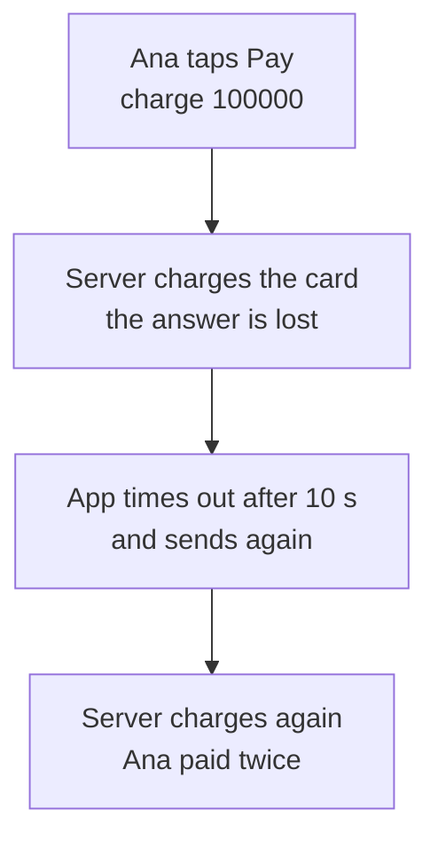

<details class="guess"><summary>🤔 Guess: which are safe to repeat: set the balance to 50, add 10 to the balance, delete order 41, create a payment? Press to check.</summary>

**Set the balance to 50** and **delete order 41** are safe: twice leaves the same result as once. **Add 10** (20 was added) and **create a payment** (two payments) are not. `GET`, `PUT` and `DELETE` are safe to repeat. `POST` and `PATCH` are not.

</details>

> **Remember:** a timeout means "I do not know". So the retry must be harmless: safe to repeat.

<details class="more"><summary>📖 More detail: why you need it, new words, the big picture, the problem drawn, and the bank form</summary>

Why you need it:

- Ana taps Pay. Her app sends "charge 100,000" to your server.
- Your server charges her card. Then the answer gets lost on the way back.
- Ana's app waits 10 seconds and stops waiting. This is a timeout.
- A timeout does not mean "it failed". It means "I do not know".
- So the app sends again. Without a guard, Ana pays twice.

New words (four):

- **Safe to repeat:** twice leaves the same result as once. (Interview word: idempotent.)
- **Request key:** a random id the app makes once per action and sends with every try. (Interview word: idempotency key, sent in the `Idempotency-Key` header.)
- **Unique rule:** the database refuses a second row with the same value. (Interview word: unique constraint.)
- **Body check:** a short code made from the first request's body. A repeat must match it. (Interview word: request fingerprint.)

Some actions are already safe to repeat.

| Action | Done twice | Safe to repeat? |
|---|---|---|
| Set the balance to 50 | balance is 50 | yes |
| Add 10 to the balance | 20 was added | no |
| Delete order 41 | order 41 is gone | yes |
| Create a payment | two payments | no |

HTTP methods follow the same idea. `GET`, `PUT` and `DELETE` are safe to repeat. `POST` and `PATCH` are not. A second `DELETE` may answer 404, but the order is still gone. Safe to repeat is about what is left on the server, not the reply.

Earlier lessons used this idea: queues that deliver twice ([06](06-message-queues.md)), the dedupe key ([11](11-design-a-notification-system.md)) and the checkout key ([12](12-design-an-online-shop-checkout.md)). This lesson shows how it works inside.

**The big picture.** Notice that the app makes the key before the first try, and the server checks it before any work.

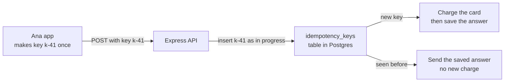

**The problem, drawn.** Notice that the card is charged, but the app only sees a timeout.

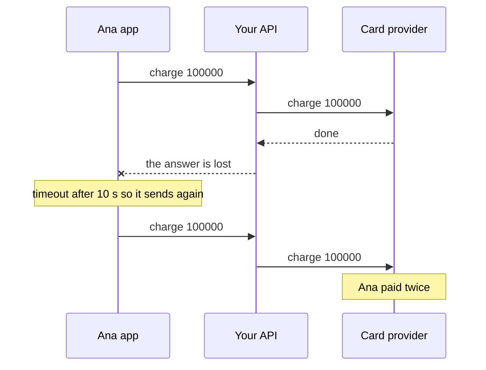

**The bank form in full.**

A numbered form at the bank.

- Your transfer form has number 4471 printed on it. That is the request key.
- The clerk sends the money and writes "4471 done, receipt R9" in her book.
- Your receipt blows away. You queue again with the same form.
- She finds 4471 in the book and gives you a copy of R9. No second transfer.
- You bring 4471 back with a different amount. She refuses it.
- Your friend brings a copy of 4471 to the next counter while she works. The book says "in progress", so he must wait.

Where it stops being true: a bank keeps its book for years, but a server deletes keys after about a day. And a server is many machines, so the book must be one shared table, not each server's memory.

</details>

## 2. One key per action: insert first

A **request key** is a random id the app makes once per action and sends with every try, in the `Idempotency-Key` header. The server inserts the key as "in progress" before any work. The table has a unique rule on `(user_id, key)`, so only one insert wins. The winner charges the card and saves the answer. A repeat gets the saved answer.

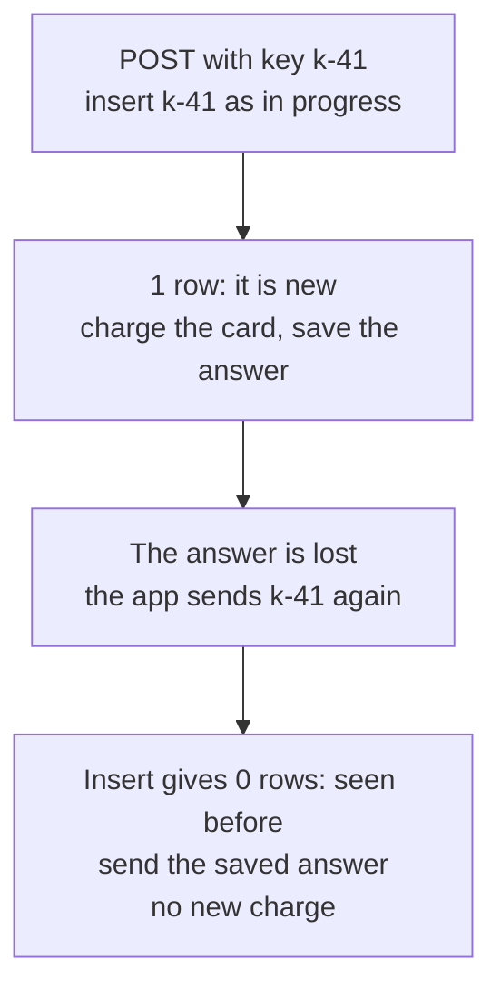

<details class="guess"><summary>🤔 Guess: `pay(100)` runs twice with no key, then `pay(100, "k-41")` runs twice with a key. How much is charged each time? Press to check.</summary>

**200** with no key, **100** with the key. (Real run, Node 26.12.1.) The second call finds `k-41` in the saved answers and sends it back, with no new charge.

</details>

> **Remember:** the insert is the check. Insert first, then do the work, then save the answer.

<details class="more"><summary>📖 More detail: the key over time, what is in the table, the code, and step by step</summary>

**How it works over time.** Notice the order: save the key as "in progress", do the work, then save the answer.

Notice the order: save the key as "in progress", do the work, then save the answer.

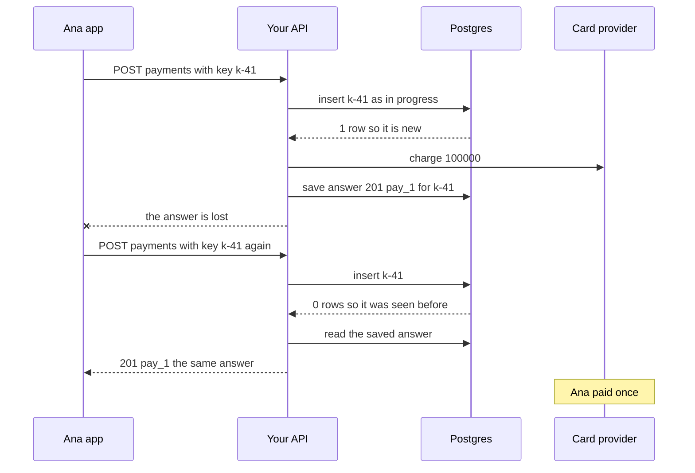

**What is in the table right now.** Notice the two states a row can be in.

Notice the two states a row can be in.

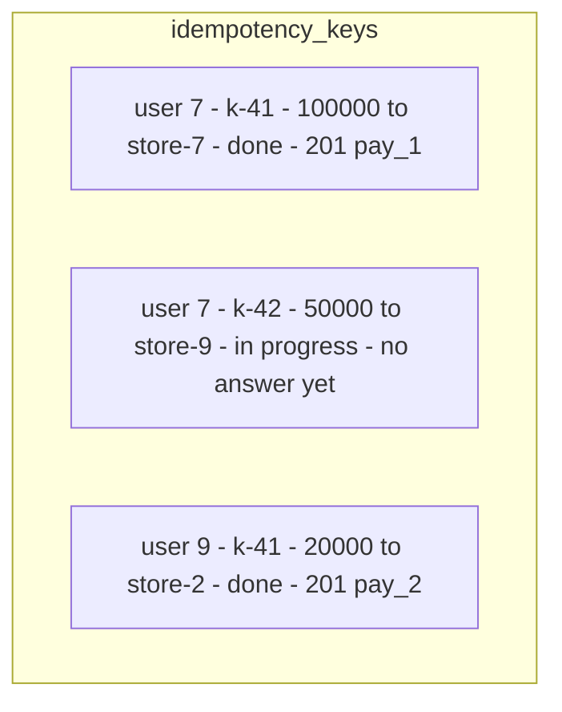

- Another `k-41` from user 7 gets `201 pay_1` back.
- Another `k-42` gets 409: "still working, ask again soon".
- User 9's `k-41` is a different row. Keys are per user.

**The smallest code that shows it.**

```js
let charged = 0;                                       // money taken from Ana's card
const saved = new Map();                               // key -> the saved answer
function pay(amount, key) {
  if (key && saved.has(key)) return saved.get(key);    // seen before: same answer, no new charge
  charged += amount;                                   // the real work
  const answer = { ok: true, charged };
  if (key) saved.set(key, answer);                     // save the answer under the key
  return answer;
}
pay(100); pay(100);                                    // the answer is lost, so the app sends again
console.log("no key, charged:", charged);
charged = 0;
pay(100, "k-41"); pay(100, "k-41");                    // the same story, with a key made once
console.log("with key, charged:", charged, saved.get("k-41"));
```

**Output:**

```
no key, charged: 200
with key, charged: 100 { ok: true, charged: 100 }
```

Checked on 2026-10-21 with Node 24.

The `saved` map plays the `idempotency_keys` table.

Run again on 2026-10-30 with Node 26.12.1: the same output.

**What really happens, step by step.**

Express, Prisma and Postgres.

| Step | What happens | What the server does | Row for the key | Charges for this key |
|---|---|---|---|---|
| 1 | Ana taps Pay | The app makes `k-41` and keeps it until it gets an answer | none | 0 |
| 2 | `POST /payments` with `Idempotency-Key: k-41` | Inserts user 7, `k-41`, the body code, "in progress". 1 row back, so it is new | `k-41` in progress | 0 |
| 3 | same request | Charges the card | `k-41` in progress | 1 |
| 4 | same request | Saves `201 pay_1` in the row and marks it done | `k-41` done | 1 |
| 5 | The answer is lost. After 10 s the app stops waiting | nothing | `k-41` done | 1 |
| 6 | The app waits about 1 s and sends again with `k-41` | The insert gets 0 rows. Same body, row done. Sends the saved `201 pay_1` | `k-41` done | 1 |
| 7 | A bug sends `k-41` with 200,000 | The body code does not match. Answers 422 and does nothing | `k-41` done | 1 |
| 8 | Later, Ana double taps a new payment. Two copies of `k-42` reach two servers | Both insert. Postgres lets copy 1 win with 1 row | `k-42` in progress | 0 |
| 9 | copy 2 | Its insert gets 0 rows. The row is in progress, so it answers 409 | `k-42` in progress | 0 |
| 10 | copy 1 | Charges the card and saves `201 pay_2` | `k-42` done | 1 |
| 11 | The app got 409, waits, asks again | Sends the saved `201 pay_2` | `k-42` done | 1 |
| 12 | The next day | A cleanup job deletes rows older than 24 hours | gone | 1 |

What to see:

- Step 2: the row is saved before the charge. That row stops steps 6 and 9.
- Step 6: the repeat does no work. It only reads.
- Step 9: the unique rule picked the winner. No code asked "is it there?" first.

**Step through it yourself:** [open the stepper](visuals/13-idempotency-and-retries.html).

</details>

## 3. Two copies at the same moment

Ana taps Pay twice fast, and two servers get the same key. Wrong: both read "is `k-42` there?", both hear "no", and both charge. Right: both **insert**, and Postgres lets only one win. The other sees a row that is "in progress" and answers **409**, and the app asks again later and gets the saved answer.

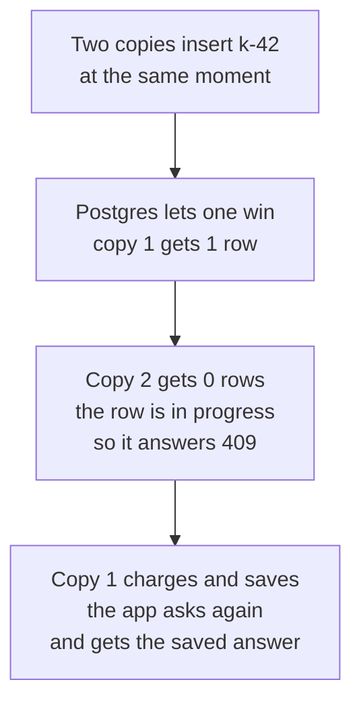

<details class="guess"><summary>🤔 Guess: a bug sends `k-41` again, but with the amount 200,000 instead of 100,000. What does the server answer? Press to check.</summary>

**422.** The body check (a short code made from the first request's body) does not match, so the server does nothing. Same body and done: the saved answer. Same body and still running: 409. Different body: 422.

</details>

> **Remember:** the unique rule picks the winner. No code asks "is it there?" first.

<details class="more"><summary>📖 More detail: two copies drawn, wrong against right, and the key made in the wrong place</summary>

**Two copies at the same moment.** Ana taps Pay twice fast. Two servers get the same key. The wrong way first. Notice that both read "no" before either one writes. Then the right way: notice that Postgres lets only one insert win.

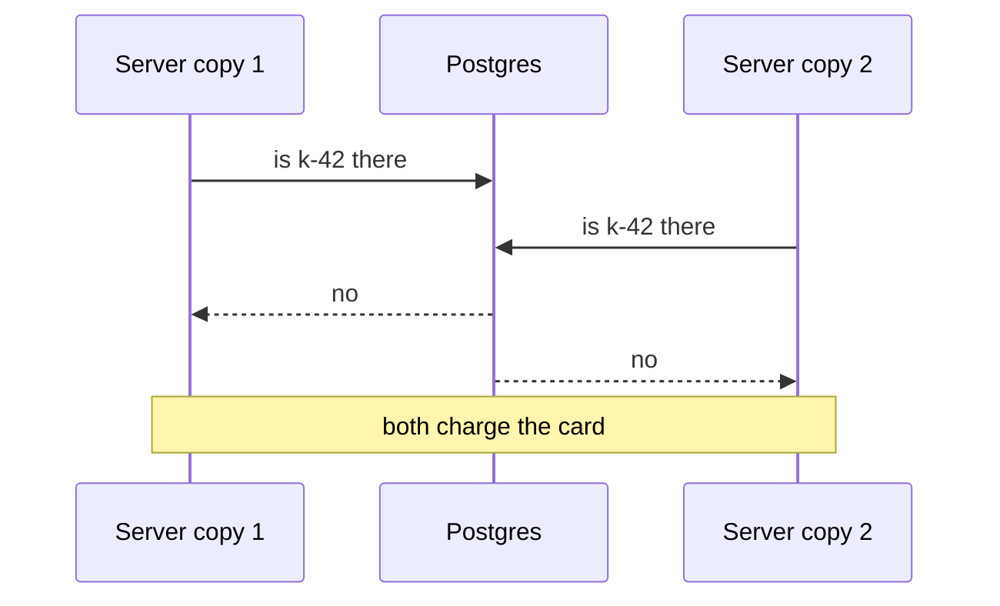

The right way. Notice that Postgres lets only one insert win.

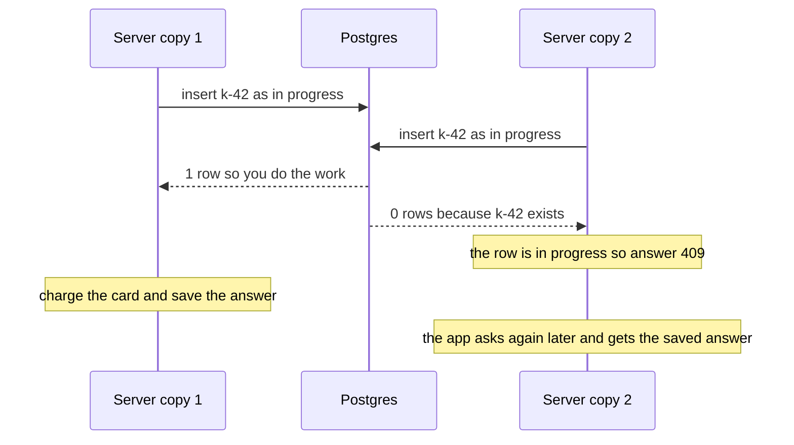

**Right against wrong: where the key is made.** Notice that on the left each try has a new key, so the server sees three different payments.

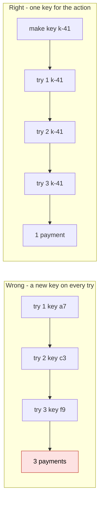

</details>

## 4. When to retry

Retry 2 or 3 times, and wait a bit longer each time plus a small random part (backoff with jitter), so many apps do not retry in the same second. The key is made **once**, before the first try, and every try sends it. The key names the action, not the try.

| What came back | Retry? |
|---|---|
| Timeout or dropped connection | yes, if safe to repeat |
| 500, 502, 503, 504 | yes, if safe to repeat |
| 409 still in progress, 429 too many | yes, later |
| 400, 401, 403, 404, 422 | no |
| 2xx | no |

<details class="guess"><summary>🤔 Guess: the server answers 400. Does the client retry? Press to check.</summary>

**No.** The same request fails the same way every time. Retry timeouts and 5xx, and 409 and 429 after a wait. Never retry other 4xx, or a `POST` without a key.

</details>

> **Remember:** the first question is "is it safe to repeat?", not "did it fail?".

<details class="more"><summary>📖 More detail: when to try again drawn, what to retry, and how long to keep keys</summary>

**When to try again.** Notice that the first question is "is it safe to repeat?", not "did it fail?".

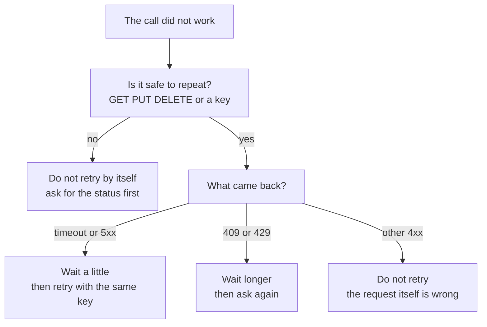

**What to retry.**

| What came back | Retry? | Why |
|---|---|---|
| Timeout or dropped connection | yes, if safe to repeat | you do not know if it worked |
| 500, 502, 503, 504 | yes, if safe to repeat | a server problem may pass |
| 409 still in progress, 429 too many requests | yes, later | the server says "ask again later". For 429, wait the seconds in `Retry-After` ([lesson 09](09-design-a-rate-limiter.md)) |
| 400, 401, 403, 404, 422 | no | the same request fails the same way |
| 2xx | no | it worked |

Retry 2 or 3 times. Wait a bit longer each time, plus a small random part, so many apps do not retry in the same second (interview words: backoff with jitter, [lesson 23](23-timeouts-retries-and-circuit-breakers.md)).

**How long to keep keys.**

- Longer than an app could still be retrying. Stripe removes keys once they are at least 24 hours old.
- After that, the same key runs as new work. So apps must not retry actions days later.

</details>

## 5. Three ways to stop a double action, and what a key costs

| Way | Good | Bad |
|---|---|---|
| Write the action so it is safe by itself (`UPDATE ... WHERE status = 'RESERVED'`) | no extra table | not every action fits |
| A unique business id (unique `order_id` on payments) | simple | only one payment per order |
| A request key table (this lesson) | works for any `POST` | an extra write and a cleanup job |

A key costs one extra database write per request (a few ms), a table to clean up, and a slower path when two copies meet. About 100,000 payments a day is about 100 MB of keys.

<details class="guess"><summary>🤔 Guess: the payments table has a unique `order_id`. Is that enough to stop a double charge? Press to check.</summary>

For **one payment per order**, yes: simple, and no extra table. It fails when an order can have several payments, or the action is not a payment. For any `POST`, use a request key table.

</details>

> **Remember:** where an action can be written to be safe by itself, that is simpler than a key.

<details class="more"><summary>📖 More detail: the three ways in full, the numbers, and why it exists</summary>

**Three ways to stop a double action.**

| Way | Example | Good | Bad |
|---|---|---|---|
| Write the action so it is safe by itself | `UPDATE orders SET status = 'PAID' WHERE id = 41 AND status = 'RESERVED'` | no extra table | not every action fits |
| A unique business id | unique `order_id` on the payments table | simple | only one payment per order |
| A request key table | this lesson | works for any `POST` | an extra write and a cleanup job |

**The numbers.**

| Question | The math | Answer |
|---|---|---|
| Payments a day | a mid-size shop | 100,000 |
| Rows kept | 1 day of keys | 100,000 |
| Table size | 100,000 times about 1 KB | about 100 MB |
| Extra time per request | one insert on a primary key | a few ms |

**Why it exists and what it costs.**

- **Problem without it:** a timeout leaves the app unsure, and a retry can do the action twice.
- **How it solves it:** the app sends one key for all tries. The server saves the key before the work and the answer after it. A repeat gets the saved answer.
- **Cost or tradeoff:** one extra database write per request, a table to clean up, and a slower path when two copies meet.

</details>

## 6. Three mistakes, and what to say if you freeze

- **Wrong:** make a new key inside the retry loop. **Right:** make it once, before the first try.
- **Wrong:** check first, then work, then save the key. **Right:** insert first. The insert is the check.
- **Wrong:** "Retry on any error." **Right:** retry timeouts and 5xx, and only what is safe to repeat.

<details class="guess"><summary>🤔 Guess: the server reads "is the key there?" first and charges second. Two copies arrive at once. What goes wrong? Press to check.</summary>

Both read "not there" **before either one writes**, so both charge. This was the duplicate TADA webhook in DBO. Insert first, and let the unique rule decide.

</details>

> **Remember:** if you freeze, say "A timeout means I do not know. So the retry must be harmless."

<details class="more"><summary>📖 More detail: the three mistakes in full, with the table behind the key, and the freeze plan</summary>

**Wrong:** make a new key inside the retry loop.

```js
// sketch, not run here
for (let attempt = 1; attempt <= 3; attempt++) {
  const key = crypto.randomUUID();                       // a new key every try: 3 payments
  // fetch(...) with "Idempotency-Key": key
}
```

**Right:**

```js
// sketch, not run here
const key = crypto.randomUUID();                         // made once, before the first try
for (let attempt = 1; attempt <= 3; attempt++) {
  try {
    const res = await fetch("/payments", { method: "POST", body,
      headers: { "Content-Type": "application/json", "Idempotency-Key": key },
      signal: AbortSignal.timeout(10_000) });            // stop waiting after 10 s
    if (!shouldRetry({ method: "POST", status: res.status, hasKey: true })) return res;
  } catch { /* timeout or network error: try again */ }
  await new Promise((r) => setTimeout(r, Math.random() * 500 * 2 ** attempt));   // wait, lesson 23
}
```

**Why:** the key names the action, not the try.

**Wrong:** check first, then work, then save the key.

```js
// sketch, not run here
const seen = await prisma.idempotencyKey.findUnique({ where: { userId_key: { userId, key } } });
if (seen) return res.status(seen.responseCode).json(seen.responseBody);
await chargeCard(req.body);                              // two copies both get here
```

**Right:** insert first. The insert is the check.

```js
// sketch, not run here
app.post("/payments", async (req, res) => {
  const key = req.get("Idempotency-Key");
  if (!key) return res.status(400).json({ error: "Idempotency-Key is required" });
  const userId = req.user.id;
  const bodyHash = crypto.createHash("sha256").update(JSON.stringify(req.body)).digest("hex");
  const where = { userId_key: { userId, key } };

  const fresh = await prisma.$executeRaw`
    INSERT INTO idempotency_keys (user_id, key, body_hash) VALUES (${userId}, ${key}, ${bodyHash})
    ON CONFLICT DO NOTHING`;                             // 1 = new, 0 = seen before
  if (fresh === 0) {
    const row = await prisma.idempotencyKey.findUnique({ where });
    if (row.bodyHash !== bodyHash) return res.status(422).json({ error: "key used with a different body" });
    if (row.status === "in_progress") return res.status(409).json({ error: "still working, ask again soon" });
    return res.status(row.responseCode).json(row.responseBody);   // the saved answer
  }

  const payment = await chargeCard(req.body, { idempotencyKey: `${userId}:${key}` });   // pass the key on
  const answer = { paymentId: payment.id };
  await prisma.idempotencyKey.update({ where, data: { status: "done", responseCode: 201, responseBody: answer } });
  res.status(201).json(answer);
});
```

The table behind it:

```sql
CREATE TABLE idempotency_keys (
  user_id       bigint      NOT NULL,
  key           text        NOT NULL,
  body_hash     text        NOT NULL,
  status        text        NOT NULL DEFAULT 'in_progress',
  response_code int,
  response_body jsonb,
  created_at    timestamptz NOT NULL DEFAULT now(),
  PRIMARY KEY (user_id, key)                             -- the unique rule
);
```

**Why:** two copies can both read "not there" before either writes. That was the duplicate TADA webhook in DBO (see the interview question card).

**Wrong:** "Retry on any error." **Right:** "Retry timeouts and 5xx, and only what is safe to repeat." **Why:** a 400 fails the same way every time.

**If you freeze:**

1. "A timeout means I do not know. So the retry must be harmless."
2. "One key per action. Insert it first, save the answer, replay it."
3. "Different body is 422. Still running is 409. Keep keys a day."

</details>

## 7. Watch and play

All links checked on 2026-10-21.

- **Video:** [Idempotency & Retries in System Design Interviews](https://www.youtube.com/watch?v=iNDHmtDxm30) System Design School, 14 min - keys, two retries at once, crashes.
- **Video:** [Nobody likes being charged twice!](https://www.youtube.com/watch?v=Pu0jiwA5Nwo) Stripe Developers, 4 min - the key, from a payments company.
- **Play with it:** [the stepper in this folder](visuals/13-idempotency-and-retries.html) - guess first, then press Next.
- **Play with it:** [OneCompiler PostgreSQL](https://onecompiler.com/postgresql) - run the SQL from card 6 (blue bar) and practice A.
- **Read:** [System Design School: Idempotency in System Design](https://systemdesignschool.io/fundamentals/idempotency) - the video as a page.
- **Read:** [Stripe: Idempotent requests](https://docs.stripe.com/api/idempotent_requests) - what Stripe saves, and for how long.
- **Read:** [Brandur Leach: Implementing Stripe-like Idempotency Keys in Postgres](https://brandur.org/idempotency-keys) - the full Postgres version.

<details><summary>Go deeper (optional)</summary>

**The HTTP rules.** [RFC 9110, section 9.2.2](https://www.rfc-editor.org/rfc/rfc9110.html#name-idempotent-methods) says: "PUT, DELETE, and safe request methods are idempotent." The safe methods are `GET`, `HEAD`, `OPTIONS` and `TRACE`. It also says a client may retry an idempotent request by itself after a connection failure. `PATCH` comes from RFC 5789, which says it is neither safe nor idempotent. Your own code can still break these rules. A `GET` that counts page views changes data. Write handlers so the method tells the truth.

**The `Idempotency-Key` header is not a finished standard.** The IETF HTTPAPI group wrote [The Idempotency-Key HTTP Header Field](https://datatracker.ietf.org/doc/draft-ietf-httpapi-idempotency-key-header/). Version 07 is from October 2025, and it expired in April 2026 without becoming an RFC. Many APIs use the header anyway, and the draft is still a good guide. It suggests 400 for a missing key, 409 when the first request is still running, and 422 when the key is reused with a different body.

**Stripe's exact rules.** From [Stripe: Idempotent requests](https://docs.stripe.com/api/idempotent_requests): keys are up to 255 characters, and V4 UUIDs are suggested. Stripe saves the status code and body of the first request, even a 500 error. A key can be removed once it is at least 24 hours old. A reuse with different parameters gets an error. Nothing is saved if the request fails validation or clashes with another request that is still running, so those are safe to send again. All `POST` requests accept a key. Do not send one with `GET` or `DELETE`, because they are already safe to repeat. Brandur Leach's post [Designing robust and predictable APIs with idempotency](https://stripe.com/blog/idempotency) explains the thinking.

**Pass the key on.** Your server calls Stripe or TADA too. If your server retries that call, it needs its own key, for example `user 7:k-41` or `order-41` as in lesson 12. Then every hop is safe to repeat, not only the first one.

**A crash in the middle.** If the server dies after step 2 and before step 4, the row stays "in progress" forever, and every retry gets 409. Two common answers: a time limit on "in progress", after which a retry may take the work over. Or Brandur's "recovery points", where the row records how far the work got, so a retry continues from there. Both are only safe if the outside call carries its own key, as above.

**Wait instead of 409.** Some servers make the second copy wait for the first, then send the saved answer. In Postgres the second copy can run `SELECT ... FROM idempotency_keys WHERE ... FOR UPDATE` inside a transaction that the first copy still holds. This is kinder to the app, but it keeps a database connection busy while it waits.

**Prisma without raw SQL.** You can call `prisma.idempotencyKey.create(...)` and catch the error code `P2002`, which Prisma throws when the unique rule refuses the row. It does the same job. Inside a transaction, a failed insert spoils the whole transaction in Postgres, so the raw `ON CONFLICT DO NOTHING` is easier to work with.

**Redis instead of Postgres.** `SET idem:7:k-41 in_progress NX EX 86400` writes the key only if it is not there, with a 24 hour end time. It is fast. But the key and the payment row now live in two systems that can disagree after a crash. When the work writes to Postgres anyway, keep the key in the same database.

**AWS's version.** [Making retries safe with idempotent APIs](https://aws.amazon.com/builders-library/making-retries-safe-with-idempotent-APIs/) by Malcolm Featonby, in the Amazon Builders' Library, shows the same idea with a "client token" on create calls.

**Checked on:** 2026-10-21.

</details>

## 8. Practice

**A. Predict the output** (write your answer before opening)

```js
let balance = 0;
const setTo50 = () => { balance = 50; };               // "the balance is now 50"
const add10 = () => { balance += 10; };                // "add 10 to the balance"
setTo50(); setTo50();
console.log("after setTo50 twice:", balance);
add10(); add10();
console.log("after add10 twice:", balance);
```

Then: which one can an app retry without a key? And what does this insert return the second time you run it?

```sql
INSERT INTO idempotency_keys (user_id, key, body_hash)
VALUES (7, 'k-41', 'hash-of-100000')
ON CONFLICT DO NOTHING
RETURNING key;
```

<details><summary>Answer</summary>

```
after setTo50 twice: 50
after add10 twice: 70
```

`setTo50` is safe to repeat: twice is the same as once. `add10` is not: twice added 20. So `add10` needs a key before anyone retries it.

The insert returns one row, `k-41`, the first time and no rows the second time. No rows means "seen before". (Both checked on 2026-10-21, the JavaScript with Node 24 and the SQL with PostgreSQL 18.)

</details>

**B. Fix the bug**

The first answer is lost, so the app retries. Run it in your head, then fix it.

```js
const done = new Map();                                // the server's saved answers
let charges = 0, calls = 0;
function server(key) {
  if (done.has(key)) return done.get(key);             // seen before: saved answer
  charges++; done.set(key, "paid");                    // the card is charged
  if (++calls === 1) throw new Error("timeout");       // the first answer is lost
  return "paid";
}
function payWithRetry() {
  for (let attempt = 1; attempt <= 3; attempt++) {
    const key = "k-" + Math.random().toString(36).slice(2, 8);   // a new key for this try
    try { return server(key); } catch (e) { console.log("try", attempt, e.message); }
  }
}
console.log(payWithRetry(), "charges:", charges);
```

<details><summary>Answer</summary>

It prints:

```
try 1 timeout
paid charges: 2
```

The server did save the first answer. But try 2 came with a new key, so the server saw a new payment.

Fix: move the key line above the loop, so every try sends the same key.

```js
function payWithRetry() {
  const key = "k-" + Math.random().toString(36).slice(2, 8);   // made once, before the first try
  for (let attempt = 1; attempt <= 3; attempt++) {
    try { return server(key); } catch (e) { console.log("try", attempt, e.message); }
  }
}
```

It now prints:

```
try 1 timeout
paid charges: 1
```

(Both outputs checked on 2026-10-21 with Node 24.)

</details>

**C. Write it yourself**

Open `learn/system-design/practice/13-idempotency-and-retries.js`. `createKeyStore` plays the key table. `shouldRetry` is the when-to-retry picture in card 4 (blue bar). The comment at the top lists every rule. Then run:

```
node --test learn/system-design/practice/13-idempotency-and-retries.test.js
```

<details><summary>One possible answer</summary>

Replace the two functions and `module.exports` under the comment with this:

```js
function createKeyStore({ keepHours = 24 } = {}) {
  const rows = new Map();                                 // key -> { body, status, response, startedAt }

  return {
    start(key, body, now = 0) {
      if (!key) return { action: "reject", status: 400 };
      const row = rows.get(key);
      if (!row) {                                         // first time: save "in progress" before the work
        rows.set(key, { body: JSON.stringify(body), status: "in progress", response: null, startedAt: now });
        return { action: "run" };
      }
      if (row.body !== JSON.stringify(body)) return { action: "reject", status: 422 };
      if (row.status === "in progress") return { action: "wait", status: 409 };
      return { action: "replay", response: row.response };   // done: the saved answer, no new work
    },
    finish(key, response) {
      const row = rows.get(key);
      row.status = "done";
      row.response = response;
    },
    forget(key) {
      rows.delete(key);
    },
    removeOld(now) {
      let removed = 0;
      for (const [key, row] of rows) {
        if (now - row.startedAt >= keepHours) { rows.delete(key); removed++; }
      }
      return removed;
    },
  };
}

function shouldRetry({ method, status, hasKey = false }) {
  const safe = ["GET", "HEAD", "OPTIONS", "PUT", "DELETE"].includes(method) || hasKey;
  if (!safe) return false;                                // 1. never repeat what is not safe to repeat
  if (status === "timeout") return true;                  // 2. no answer: try again
  if (status >= 500 && status <= 599) return true;        //    the server had a problem
  return status === 409 || status === 429;                // 3. "ask again later". Other answers: no
}

module.exports = { createKeyStore, shouldRetry };
```

Checked on 2026-10-21 with Node 24: the 18 tests fail on the empty stub and all 18 pass with this answer. In JavaScript one `start` runs fully before the next, so the `Map` cannot have the race from card 3. In a real server the same job is done by the `PRIMARY KEY (user_id, key)` and `ON CONFLICT DO NOTHING`.

</details>

## 9. Interview question

**Q:** "A payment request times out. The client retries. How do you make sure the customer is charged once?"

A common follow-up: "Two copies with the same key arrive at the same moment. What happens?" Card 3 is the answer.

<details><summary>A strong answer, in four parts</summary>

1. **Problem:** a timeout does not tell the client if the charge happened. If it retries a plain `POST`, the customer can pay twice. If it never retries, a real failure is lost. Queues and webhooks also deliver more than once.
2. **How it works:** the client makes one key per action, a UUID, and sends it in the `Idempotency-Key` header on every try. The server inserts the key with the user id and a hash of the body, as "in progress", before any work. The primary key on `(user_id, key)` lets only one insert win. The winner charges the card, passing its own key to the provider, and saves the status code and body in the row. A repeat with the same body gets the saved answer. A different body gets 422. A key still in progress gets 409, and the client asks again later. A job deletes keys after about 24 hours. The client retries only timeouts, 5xx, 409 and 429, two or three times, with a growing random wait.
3. **Tradeoff:** one extra write per request and a table to clean up. A crash in the middle leaves a row stuck "in progress", so I need a time limit or recovery steps. Keys only work inside the time I keep them. Where an action can be written as safe by itself, like "set status to PAID where it is RESERVED", that is simpler than a key.
4. **My example:**
   - **Fact:** in DBO, two copies of one TADA refund event arrived almost at the same time. Both handlers checked "already processed?" before either one wrote, so stores got double points. That is the wrong half of card 3.
   - **Fact:** we fixed the balances with a correction script and added `SELECT ... FOR UPDATE` on the store row inside the transaction, so the second copy waits and then sees the first one's result.
   - **Fact:** the case study lists a table of event ids with a unique rule as the next step. It is not built yet.
   - **Idea, not a fact:** for calls from DBO to TADA, sending our own redeem id as a key would make a retry unable to redeem twice. The case study suggests this, but I do not claim it is built.

</details>

## 10. Explain it back

Close this file. Explain idempotency out loud to a new junior, in 4 parts (problem, how, tradeoff, my example). Use Ana's lost answer and her double tap. Write it below, then run `/explain-check idempotency and retries`.

### My explanation

<write here>

### Coach feedback

<the explain-coach agent writes here>

## 11. Review questions (day 1, 3, 7, 21)

1. Why can't the app just say "it timed out, so it failed"?
2. Name the three answers a server can give for a key it has seen before, and when each one happens.
3. Which errors should a client retry, and which should it never retry?
4. Draw the two copies picture (card 3, blue bar) from memory, wrong and right.

<details><summary>Answers</summary>

1. The work may have happened and only the answer was lost. A timeout means "I do not know", so the retry must be safe to repeat.
2. The saved answer, when the body matches and the row is done. 409, when the body matches and the row is still in progress. 422, when the body is different.
3. Retry timeouts, dropped connections and 5xx, plus 409 and 429 after a wait, and only if the call is safe to repeat (`GET`, `PUT`, `DELETE`, or it has a key). Never retry other 4xx or a `POST` without a key.
4. Wrong: both copies ask "is k-42 there?", both hear "no", both charge. Right: both insert k-42. Postgres gives copy 1 one row and copy 2 zero rows. Copy 1 charges and saves the answer. Copy 2 answers 409, and the app's next try gets the saved answer.

</details>

## Connected lessons

- [Design an online shop checkout](12-design-an-online-shop-checkout.md) - before this. The checkout key in use.
- [Observability](14-observability.md) - next. Seeing retries and 409s in logs.
- [Message queues](06-message-queues.md) - at least once delivery.
- [Design a notification system](11-design-a-notification-system.md) - the dedupe key.
- [Timeouts, retries and circuit breakers](23-timeouts-retries-and-circuit-breakers.md) - how long to wait, and when to stop.
- [Distributed systems and reliability patterns, Part 4](distributed-systems-and-reliability-patterns.md) - timeouts, retry budgets and keys together.
- [DBO case study, Incident 1](../../interview/my-projects/dbo-b2b-platform-system-design-case-study.md) - the duplicate TADA webhook in full.
