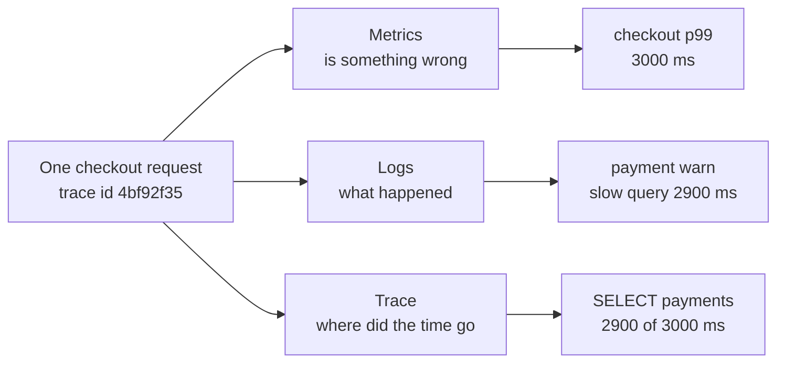
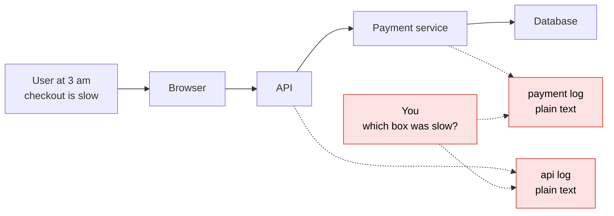
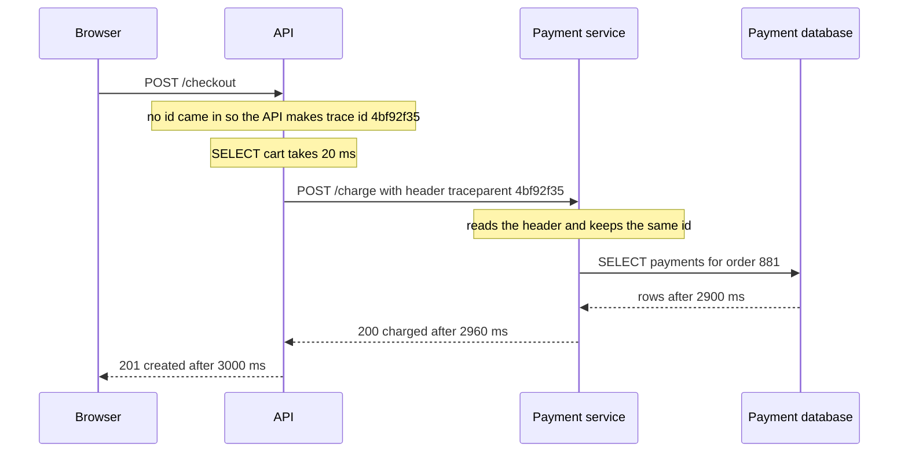
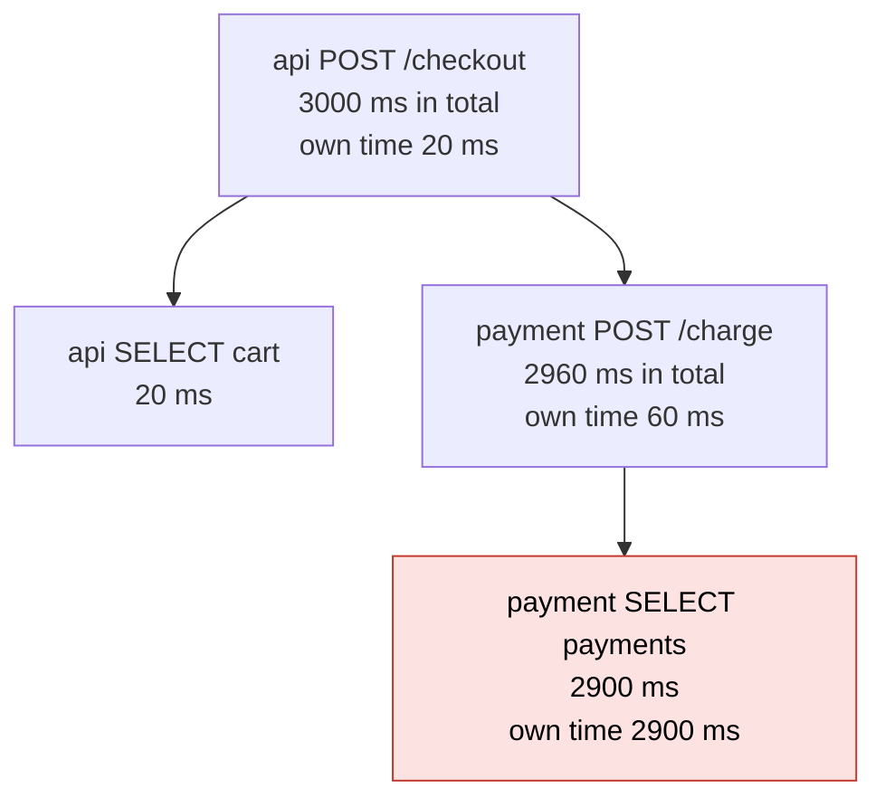
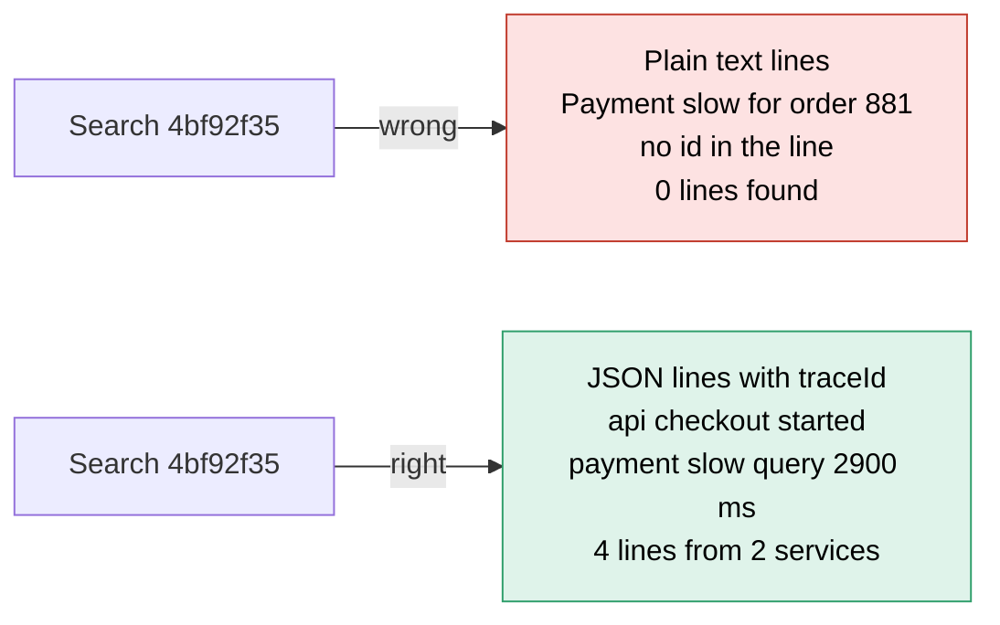
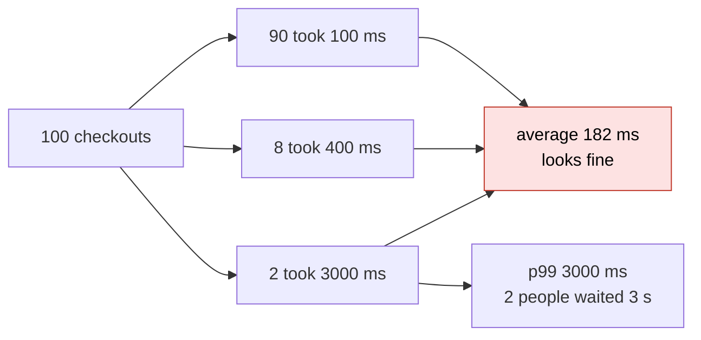
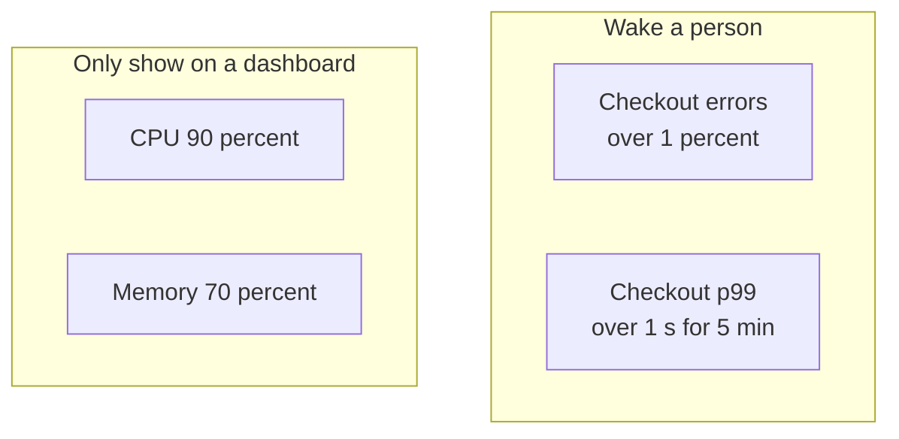

# 14. Observability

> **Subject:** System Design · **Lesson:** 14 · **Made:** 2026-10-21 · **Status:** ready
> **You will be able to:** say which tool answers which question, follow one trace id across two services, find the slow step in a trace, and say why you watch p99.
> **Before this:** [Idempotency and retries](13-idempotency-and-retries.md) · **Next:** [Choosing tools and explaining why](15-choosing-tools-and-explaining-why.md)

## 1. The idea in one sentence

Give every request one id, then use numbers to see that something is wrong, a timeline to see where, and log lines to see why.

It is 3 am. A user writes "checkout is slow". One checkout goes through the API, the payment service and a database. Which box was slow? Observability means the system shows you what happens inside it, so you do not guess.

Three tools, three questions:

| Tool | The question it answers | What it looks like | Cost |
|---|---|---|---|
| **Metrics** | Is something wrong, and how much? | Numbers over time: "checkout p99 is 3,000 ms" | Cheap. A few numbers a minute |
| **Logs** | What exactly happened in this one request? | One JSON line per event | Grows with every request |
| **Traces** | Where did the time go across the services? | A timeline of the steps of one request | Costly, so you keep only some |

New words (four):

- **Trace id:** one random id the first server gives a request. Every box passes it on and writes it down.
- **Span:** one timed step, like one database query. A trace is all the spans with one trace id.
- **Structured log:** a log line written as JSON, with named fields, so a computer can filter it.
- **p99:** 99 out of 100 requests were this fast or faster. (Interview word: 99th percentile.)

The checkout is the one from [lesson 12](12-design-an-online-shop-checkout.md). All numbers are examples.

## 2. The pictures

### 2a. The big picture

Notice that one request feeds all three tools. The trace id ties them together.



### 2b. The problem, drawn

Notice that the two log files share nothing. You can only match lines by time.



### 2c. How it works over time

Notice that the id rides inside an HTTP header. The payment service reads it and keeps the same id.



The real header looks like this:

```
traceparent: 00-4bf92f3577b34da6a3ce929d0e0e4736-00f067aa0ba902b7-01
```

The long middle part is the trace id. This lesson writes only its first 8 characters, `4bf92f35`.

### 2d. What is in memory right now

This is the finished trace. Notice that the top span is always the longest. It waits for everything under it.



**Own time** is a span's time minus the spans directly under it. The slow step has the biggest own time.

The log lines at this moment all carry the same trace id:

| Service | Level | Message | Extra fields |
|---|---|---|---|
| api | info | checkout started | orderId 881 |
| payment | info | charge started | orderId 881 |
| payment | warn | slow query | ms 2900 |
| api | info | checkout done | ms 3000 |

### 2e. Right against wrong: a log line

You search for `4bf92f35`. Notice that plain text lines cannot be found by id.



### 2f. Right against wrong: average or p99

Here are 100 checkouts. Notice that no user waited 182 ms. The average is a number nobody felt.



## 3. Real life analogy

Think of a parcel delivery company.

- **Metrics** are the screen on the office wall: "40 parcels late today". It shows a problem, not which parcel.
- **The trace id** is the tracking number. Every depot scans it.
- **The trace** is the tracking page: each stop with a time.
- **Logs** are the drivers' notebooks. Each note has the tracking number next to it.

Where it stops being true: the company tracks every parcel. You get thousands of requests a second, so you keep only some traces. And a request can be in two services at once. A parcel cannot.

## 4. The smallest code that shows it

The four spans of the slow checkout, drawn as bars. One `#` is 100 ms.

```js
const traceId = "4bf92f35";                                   // one id for the whole checkout
const spans = [                                               // depth = how many steps called it
  { depth: 0, service: "api",     name: "POST /checkout",  ms: 3000 },
  { depth: 1, service: "api",     name: "SELECT cart",     ms: 20 },
  { depth: 1, service: "payment", name: "POST /charge",    ms: 2960 },
  { depth: 2, service: "payment", name: "SELECT payments", ms: 2900 },
];
for (const s of spans) {
  const name = "  ".repeat(s.depth) + s.name;
  const bar = "#".repeat(Math.max(1, Math.round(s.ms / 100)));
  console.log(traceId, s.service.padEnd(8), name.padEnd(20), String(s.ms).padStart(4), "ms", bar);
}
console.log(JSON.stringify({ level: "warn", traceId, service: "payment", msg: "slow query", ms: 2900 }));
```

**Output:**

```
4bf92f35 api      POST /checkout       3000 ms ##############################
4bf92f35 api        SELECT cart          20 ms #
4bf92f35 payment    POST /charge       2960 ms ##############################
4bf92f35 payment      SELECT payments  2900 ms #############################
{"level":"warn","traceId":"4bf92f35","service":"payment","msg":"slow query","ms":2900}
```

Checked on 2026-10-21 with Node 24.

- The first three long bars mostly wait for the bar under them.
- The last bar has nothing under it. Its 2,900 ms are its own. That is the slow step.
- The log line has the same `traceId`, so you can jump from the trace to the log.

## 5. What really happens, step by step

| Step | What happens | Who has id 4bf92f35 | Spans after | New log line | Metrics |
|---|---|---|---|---|---|
| 0 | An alert fires: "checkout p99 over 1 s for 5 minutes" | nobody yet | none | none | p99 3,000 ms, average 182 ms |
| 1 | The browser sends `POST /checkout` with no trace id | nobody | none | none | same |
| 2 | The API makes trace id 4bf92f35 and starts its span | API | POST /checkout running | api, checkout started | same |
| 3 | The API asks Postgres for the cart through Prisma | API | SELECT cart, 20 ms | none | same |
| 4 | The API calls the payment service with the `traceparent` header | API, the header | POST /checkout running | none | same |
| 5 | The payment service reads the header and keeps the id | API, payment | POST /charge running | payment, charge started | same |
| 6 | The payment service asks its database for old payments | API, payment | SELECT payments running | none | same |
| 7 | The query returns after 2,900 ms | API, payment | SELECT payments, 2,900 ms | payment, warn, slow query | same |
| 8 | The payment service answers 200 | API, payment | POST /charge, 2,960 ms | none | same |
| 9 | The API answers 201 and closes its span | API, payment | POST /checkout, 3,000 ms | api, checkout done | 101 requests, 0 errors |
| 10 | You open trace 4bf92f35 and sort by own time | you | all four | search finds all four lines | p99 still 3,000 ms |

What to see:

- Step 0: metrics say **that** checkout is slow, not which box.
- Steps 4 and 5: the id crosses the network inside a header.
- Step 9: 0 errors. Slow is not an error, so a search for errors finds nothing.
- Step 10: the trace says **where**. The warn log says **what**.

**Step through it yourself:** [open the stepper](visuals/14-observability.html). Guess the slow step, then press Next.

## 6. Why it exists and what it costs

- **Problem without it:** you guess which box was slow from log times.
- **How it solves it:** numbers raise the alarm. One trace id joins the spans and logs of one request.
- **Cost or tradeoff:** storage and money. You keep only some traces and choose what to log.

### What to measure for each service

Measure three numbers for every service. Their first letters spell RED.

| Letter | Number | For checkout |
|---|---|---|
| **R**ate | requests per minute | about 20 checkouts a minute |
| **E**rrors | the share that fail with 5xx | 0 percent right now |
| **D**uration | how long they take, as p50 and p99 | p50 100 ms, p99 3,000 ms |

Google's four golden signals add saturation: how full the busiest part is, like "19 of 20 database connections in use".

### Percentiles in plain words

- Sort all the request times from fast to slow.
- **p50** is the middle one. **p99** is near the end: only 1 in 100 was slower.
- The average in picture 2f says 182 ms. It hides the two people who waited 3 seconds. So you watch p99.

### Alert on what users feel

Notice that the top group is what users feel. CPU can be at 90 percent while every user is happy.



- Wake a person only for errors and slow requests.
- Keep CPU and memory on a dashboard. Use them to hunt the cause.
- Making "checkout should be fast" a target number is an SLO. That is [lesson 26](26-slos-and-error-budgets.md).

### In your stack

You do not write spans by hand. OpenTelemetry, a free standard with Node libraries, makes spans for HTTP calls, Express and Prisma. It also adds and reads the `traceparent` header. For logs, use pino and add the trace id. Setup is in [Production readiness, Part 3](production-readiness-observability-security.md).

| What it costs | What you do |
|---|---|
| Logs grow with every request | Log events, not every loop. Use `info` in production |
| Traces are a lot of data | Keep all slow and failed traces, and a small share of the rest |
| A little extra time per request | Usually small. Measure it once |

<details><summary>Go deeper (optional)</summary>

**The `traceparent` header, piece by piece.** `00-4bf92f3577b34da6a3ce929d0e0e4736-00f067aa0ba902b7-01`. `00` is the version. Then 32 hex characters of trace id. Then 16 hex characters for the span that made the call (the spec calls it parent-id). Then `01`, a flag that says "this trace is being kept". It comes from the W3C Trace Context standard, a W3C Recommendation since November 2021. Level 2 is still a draft.

**Keeping only some traces.** This is called sampling. Head sampling decides at the start, for example "keep 10 percent". It is cheap, but may drop the one slow request. Tail sampling waits until the trace ends, then keeps all errors and slow traces. It needs a middle program, the OpenTelemetry Collector, with memory to wait.

**OpenTelemetry status, checked on 2026-10-21.** The spec marks traces, metrics and logs as stable. For JavaScript, the status page lists traces and metrics as stable and logs as "development". That is why this lesson says: pino for logs, plus the trace id.

**Your stack in detail.** `@opentelemetry/auto-instrumentations-node` covers http, Express and pg. Prisma's plugin is `@prisma/instrumentation`. It makes spans like `prisma:client:operation` and `prisma:engine:db_query`. Next.js has an `instrumentation.ts` file for OpenTelemetry. The data goes to a tool like Jaeger or Grafana Tempo, where you open a trace by id. Inside one Node process, OpenTelemetry remembers the current trace across `await` with `AsyncLocalStorage`.

**Alert rules.** Every page must need a human now. If it can wait for the morning, make it a ticket.

**The trace id in queues.** BullMQ jobs have no headers. Put `traceId` into the job data. The worker reads it and uses it in its spans and logs.

**Own time** is called self time in many tools.

**Why p99 matters more than it sounds.** If one page calls 10 services, and each is slow 1 percent of the time, about 1 page in 10 is slow. 1 minus 0.99 to the power of 10 is about 9.6 percent.

**Tools do not keep every time.** Prometheus puts times into buckets (a histogram) and estimates p99 from them. Its answer can differ a little from the exact way in this lesson. You also cannot average two p99 numbers. Compute p99 again from the joined buckets.

**Percentile methods.** This lesson uses "nearest rank": rank = p times count divided by 100, rounded up. Other tools blend two neighbours. On big lists the answers are close.

</details>

## 7. Common mistakes

**Wrong:** logging secrets and personal data.

```js
// sketch, not run here
logger.info({ traceId, body: req.body }, "login");   // body has the password and the phone number
```

**Right:**

```js
// sketch, not run here
logger.info({ traceId, userId: user.id }, "login");   // the id of the user, nothing secret
```

**Why:** logs are copied to many places. A password in a log is a leaked password.

**Wrong:** the user id as a tag on a metric.

```js
// sketch with prom-client, not run here
checkoutTime.observe({ route: "/checkout", userId: user.id }, ms);   // one new set of numbers per user
```

**Right:**

```js
// sketch with prom-client, not run here
checkoutTime.observe({ route: "/checkout", status: 201 }, ms);      // a few routes, a few statuses
```

**Why:** the metric tool keeps one set of numbers per tag value. A million users means a million sets (interview word: high cardinality). Put the user id in logs instead.

**Wrong:** log lines with no trace id. Practice B shows what breaks.

**Wrong:** alerts on CPU, memory and every small warning. People soon stop reading them. Alert on errors and p99.

**If you freeze:**

1. Say "Metrics tell me something is wrong. A trace tells me where. Logs tell me why."
2. Say "The first server makes a trace id. It travels in the traceparent header and goes into every log line."
3. Say "I measure rate, errors and duration. I watch p99, not the average. I alert on what users feel."

## 8. Watch and play

Every link was opened on 2026-10-21.

- **Video:** [Observability Explained: How Metrics, Logs & Traces Help Teams Diagnose Modern System Failures](https://www.youtube.com/watch?v=htajMQi0C1g) Harness, 4 min 12 s - the three tools, short.
- **Video:** [OpenTelemetry: Simplifying Hybrid Cloud Monitoring](https://www.youtube.com/watch?v=hLvwoow3XTk) IBM Technology, 5 min 39 s - what OpenTelemetry collects and sends.
- **Play with it:** [the stepper in this folder](visuals/14-observability.html) - guess the slow step, then press Next.
- **Play with it:** [Jaeger HotROD demo](https://github.com/jaegertracing/jaeger/tree/main/examples/hotrod) - run it with Docker and find the slow span.
- **Read:** [OpenTelemetry: Observability primer](https://opentelemetry.io/docs/concepts/observability-primer/) - has a trace drawn as bars.
- **Read:** [OpenTelemetry: Context propagation](https://opentelemetry.io/docs/concepts/context-propagation/) - how the id crosses to the next service.
- **Read:** [Google SRE book, chapter 6](https://sre.google/sre-book/monitoring-distributed-systems/) - the golden signals, and alerting on what users feel.

<details><summary>Go deeper (optional): more links</summary>

- [W3C Trace Context](https://www.w3.org/TR/trace-context/) - the `traceparent` format, with the example used in this lesson.
- [Grafana: The RED Method](https://grafana.com/blog/2018/08/02/the-red-method-how-to-instrument-your-services/) - Tom Wilkie's post on rate, errors and duration.
- [OpenTelemetry: Traces](https://opentelemetry.io/docs/concepts/signals/traces/) - what a real span looks like as JSON, with trace id and parent id.
- [OpenTelemetry status](https://opentelemetry.io/status/) - which parts are stable in each language.
- [Prisma: OpenTelemetry tracing](https://www.prisma.io/docs/orm/prisma-client/observability-and-logging/opentelemetry-tracing) - the Prisma plugin and the spans it makes.
- [Production readiness guide](production-readiness-observability-security.md) - Parts 1 to 4 go further: log levels, OpenTelemetry setup, burn rate alerts.

</details>

## 9. Practice

**A. Predict the output** (write your answer before opening)

```js
const times = [100, 100, 100, 100, 100, 100, 100, 100, 100, 1000];   // 10 checkouts, in ms
const sorted = [...times].sort((a, b) => a - b);
const pct = (p) => sorted[Math.ceil((p * sorted.length) / 100) - 1];
const average = times.reduce((sum, t) => sum + t, 0) / times.length;
console.log("average", average);
console.log("p50", pct(50));
console.log("p99", pct(99));
```

<details><summary>Answer</summary>

```
average 190
p50 100
p99 1000
```

Nine people waited 100 ms and one waited 1,000 ms. Nobody waited 190 ms. p99 shows the slow person. (Checked on 2026-10-21 with Node 24.)

</details>

**B. Fix the bug**

The payment service logs a slow query. You search for the API's trace id `t1`. What do you find?

```js
let next = 0;
const newTraceId = () => "t" + ++next;                       // a real id is 32 random characters
const lines = [];
const log = (traceId, service, msg) => lines.push({ traceId, service, msg });
function payment(headers) {
  const traceId = newTraceId();                              // the payment service makes an id
  log(traceId, "payment", "slow query 2900 ms");
}
function api() {
  const traceId = newTraceId();                              // the first server makes the id
  log(traceId, "api", "checkout started");
  payment({ traceparent: "00-" + traceId + "-a1b2-01" });    // and passes it on in the header
}
api();
console.log(lines.filter((l) => l.traceId === "t1"));
```

<details><summary>Answer</summary>

It prints only the API line:

```
[ { traceId: 't1', service: 'api', msg: 'checkout started' } ]
```

The payment service ignored the header and made its own id, `t2`. Its slow query line is lost to your search. Fix: read the id from the header.

```js
  const traceId = headers.traceparent.split("-")[1];         // read the id from the header
```

Now it prints both lines:

```
[
  { traceId: 't1', service: 'api', msg: 'checkout started' },
  { traceId: 't1', service: 'payment', msg: 'slow query 2900 ms' }
]
```

In real code OpenTelemetry reads the header for you. This bug shows up when one service has no OpenTelemetry, or when a queue job does not carry the id. (Both outputs checked on 2026-10-21 with Node 24.)

</details>

**C. Write it yourself**

Open `learn/system-design/practice/14-observability.js`. Write `percentile` and `createRecorder`. The comment at the top says what each must do. Then run this from the repo root:

```
node --test learn/system-design/practice/14-observability.test.js
```

<details><summary>One possible answer</summary>

Replace the whole file with this. It needs no helpers from the stub.

```js
function percentile(values, p) {
  if (values.length === 0) return null;
  const sorted = [...values].sort((a, b) => a - b);          // a sorted copy, the input stays as it was
  const rank = Math.ceil((p * sorted.length) / 100);         // nearest rank, counting from 1
  return sorted[Math.max(rank, 1) - 1];
}

const SECRET = ["password", "token", "authorization", "cardnumber"];

function createRecorder() {
  const spans = [];
  const lines = [];                                          // { traceId, text }
  const routes = new Map();                                  // route -> { errors, times }

  return {
    span(s) { spans.push({ ...s }); },

    slowestStep(traceId) {
      const mine = spans.filter((s) => s.traceId === traceId);
      let best = null;
      for (const s of mine) {
        const children = mine.filter((c) => c.parentId === s.spanId);
        const ownMs = s.ms - children.reduce((sum, c) => sum + c.ms, 0);
        if (!best || ownMs > best.ownMs) best = { ...s, ownMs };   // ">" keeps the first one on a tie
      }
      return best;
    },

    log(traceId, service, level, msg, fields = {}) {
      const line = { level, traceId, service, msg };
      for (const [key, value] of Object.entries(fields)) {
        line[key] = SECRET.includes(key.toLowerCase()) ? "[hidden]" : value;
      }
      const text = JSON.stringify(line);
      lines.push({ traceId, text });
      return text;
    },

    logsFor(traceId) {
      return lines.filter((l) => l.traceId === traceId).map((l) => l.text);
    },

    request(route, status, ms) {
      if (!routes.has(route)) routes.set(route, { errors: 0, times: [] });
      const r = routes.get(route);
      if (status >= 500) r.errors += 1;
      r.times.push(ms);
    },

    stats(route) {
      const r = routes.get(route) || { errors: 0, times: [] };
      const requests = r.times.length;
      return {
        requests,
        errors: r.errors,
        errorRate: requests === 0 ? 0 : r.errors / requests,
        p50: percentile(r.times, 50),
        p99: percentile(r.times, 99),
      };
    },
  };
}

module.exports = { percentile, createRecorder };
```

Checked on 2026-10-21 with Node 24: the 18 tests fail on the empty stub and all 18 pass with this answer. The hiding of secret fields is only a safety net. The real plan is to never pass secrets to the logger.

</details>

## 10. Interview question

**Q:** "Users say checkout is slow, but only sometimes. You run several services. How do you find the cause? What would you set up so the next time is easier?"

<details><summary>A strong answer, in four parts</summary>

1. **Problem:** a request crosses several services, and each writes its own logs. Without a shared id, I match lines by time and guess. Slow is not an error, so error logs may show nothing.
2. **How it works:** first I look at the metrics: rate, errors and duration per service. Checkout p99 jumped while the average barely moved, so a few users are very slow. Then I open some slow traces. The first server made a trace id, and OpenTelemetry passed it on in the `traceparent` header. The trace shows spans as a timeline. I look for the span with the biggest own time, here a payments query at 2,900 of 3,000 ms. Then I search the JSON logs by that trace id to see what happened in that step. Next I would check the query with `EXPLAIN`, maybe a missing index. To make it easier next time, I alert on checkout p99 and error rate, not on CPU.
3. **Tradeoff:** logs and traces cost money. I log events, not every step, and never secrets or personal data. I keep all slow and failed traces and a small share of the rest. I keep user ids out of metric labels, because each new value makes a new set of numbers.
4. **My example:**
   - **Fact:** the DBO backend is four Node and TypeScript services on CapRover: an API with GraphQL, Nexus and Prisma, an Auth service, a Queue service with BullMQ on Redis, and a Cron service.
   - **Fact:** in the DBO double points bug, the cause was found by tracing balances back through point history. There were two identical TADA events, milliseconds apart.
   - **Fact:** the DBO case study lists observability as an improvement: JSON logs with a request id passed into BullMQ jobs, p95 and p99, error rate, queue length and job age, and alerts on what users feel.
   - **Idea, not a fact:** with that in place, a failed points redeem across the API, the worker and the TADA webhook would be one search by id.

</details>

## 11. Explain it back

Close this file. Explain observability out loud to a new junior, in 4 parts (problem, how, tradeoff, my example). Use the slow checkout at 3 am. Then write it below and run `/explain-check observability` or ask the `explain-coach` agent.

### My explanation

<write here>

### Coach feedback

<the explain-coach agent writes here>

## 12. Review questions (day 1, 3, 7, 21)

1. Which tool answers "is something wrong", which answers "where", and which answers "what happened"?
2. How does the payment service know it belongs to the same trace as the API?
3. 98 requests take 100 ms and 2 take 5,000 ms. What is the average? What is the p99? Which one would you alert on?
4. Draw picture 2c from memory: the checkout with the trace id moving from box to box.

<details><summary>Answers</summary>

1. Metrics say something is wrong and how much. A trace shows where the time went. Logs say what exactly happened in one request.
2. The API sends the trace id in the `traceparent` header when it calls the payment service. The payment service reads the header and uses the same id for its spans and log lines.
3. The average is (98 times 100 plus 2 times 5,000) divided by 100, which is 198 ms. The p99 is 5,000 ms: sorted, the 99th time is 5,000. Alert on p99, because the average hides the two slow users.
4. Browser to API: POST /checkout. API makes trace id 4bf92f35 and reads the cart in 20 ms. API to payment service: POST /charge with traceparent 4bf92f35. Payment service keeps the id and asks its database, which takes 2,900 ms. Answers go back: 2,960 ms, then 3,000 ms.

</details>

## Connected lessons

- [Idempotency and retries](13-idempotency-and-retries.md) - a retry shows in a trace as the same span twice.
- [Choosing tools and explaining why](15-choosing-tools-and-explaining-why.md) - the next lesson.
- [Message queues](06-message-queues.md) - put the trace id inside the job data.
- [SLOs and error budgets](26-slos-and-error-budgets.md) - p99 as a target, and smarter alerts.
- [Production readiness guide](production-readiness-observability-security.md) - the long version: log levels, setup, sampling.
