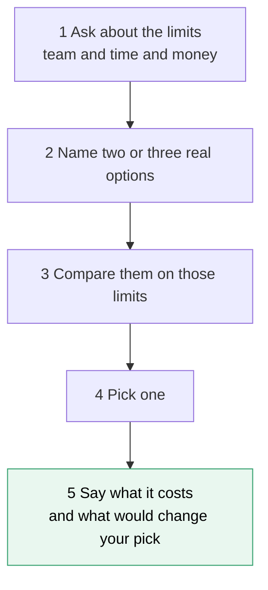
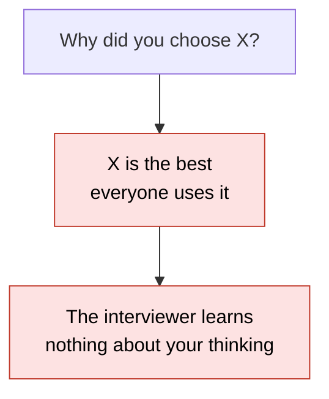
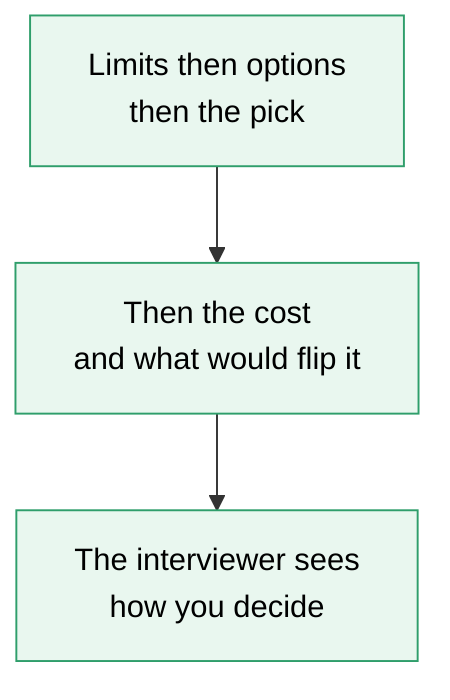
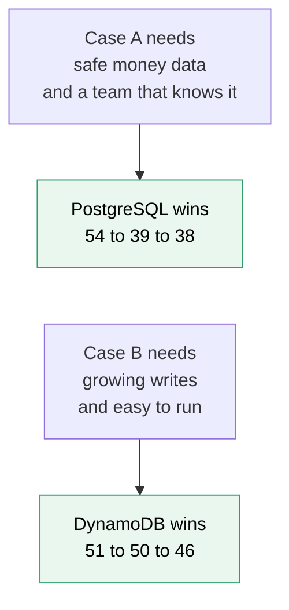
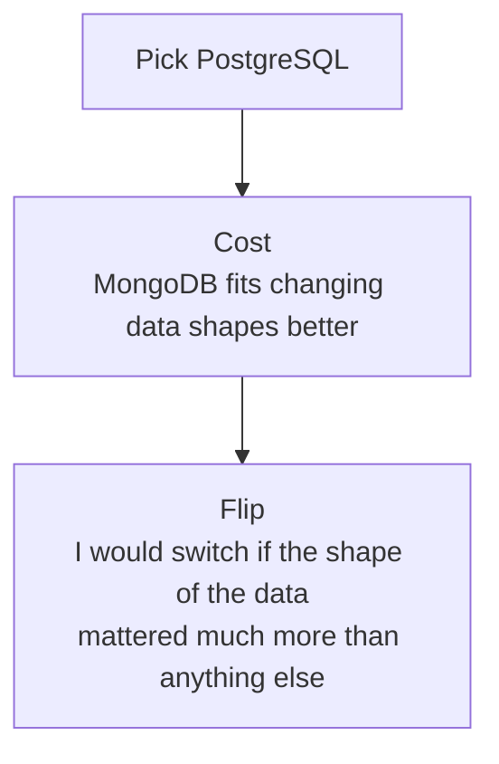

# 15. Choosing tools and explaining why

> **Subject:** System Design · **Lesson:** 15 · **Made:** 2026-11-04 · **Status:** ready
>
> **You will be able to:** answer "why did you choose X?" in five parts (the limits, the other options, why this one won, what it costs, what would change your mind), name the limits that decide most real choices, and show with a small score table how the same tools give a different winner when the needs change.
>
> **Before this:** [Observability](14-observability.md) · **Next:** [Latency numbers and estimation](16-latency-numbers-and-estimation.md)
>
> **How to read it:** one card is one idea. Look at the picture, guess, then press the orange bar to check. The blue bars (📖 More detail) hold the longer explanation. Skip them on the first read, and open them when you want more. About 15 minutes for the cards.

## 1. The idea: a choice is a trade

You need to get to the airport. A bike is cheap but slow. A taxi is fast but costs money. A train is cheap and fast but runs only at some times. Nobody says "the taxi is the best vehicle". They say "I have a heavy bag and a flight in one hour, so a taxi." Tools are the same. The interviewer wants your reasons, not a ranking.



Notice step 5. Most answers stop at step 4. Step 5 is what makes an answer sound senior.

<details class="guess"><summary>🤔 Guess: the interviewer asks "why React?". You say "React is the best framework". What did the interviewer learn about you? Press to check.</summary>

Almost nothing. You gave no limits, no other options, and no cost. It sounds like a slogan. A better start: "It depends on the team and how long the app will live. For a small team that already knows it, I picked React. The cost is that I must choose my own router and data tools."

</details>

> **Remember:** never say "the best". Say which limits you had, what you compared, what you picked, what it cost.

<details class="more"><summary>📖 More detail: new words, the problem drawn, and why it exists</summary>

New words (four):

- **Constraint:** a limit you must live with, such as team size, a deadline, a budget, or a law.
- **Trade-off:** what you give up to get something. Fast but expensive. Simple but less flexible.
- **Default:** the choice you take when nothing forces you to take another. For example, PostgreSQL for data.
- **ADR (architecture decision record):** a short note that says what was decided and why, so the team can read it later.

**The problem, drawn.** Without the five parts, an answer sounds like a fashion choice. The interviewer cannot tell if you reasoned or if you copied.





**Where the analogy stops.** A trip to the airport is one choice for one day. A tool choice stays with the team for years, and other people must run it. So the cost part is bigger in software than it is for a taxi.

**Why it exists and what it costs.**

- **Without it:** you pick by habit or by fashion. Nobody can check the choice, and nobody knows when to change it.
- **With it:** the choice can be checked. A teammate can say "your limit changed, so the choice should change".
- **The cost:** it takes a minute of thinking before you answer. In an interview you also need to know the limits of the company you talk to. Ask, do not guess.

</details>

## 2. The limits that decide most choices

Most real choices are not decided by speed. They are decided by people and time. Ask these six questions first.

| Ask | Why it often wins |
|---|---|
| What does the team already know? | The best tool your team cannot run is the worst choice. |
| Who can we hire? | Can you replace someone in three months? |
| How long will it live? | A ten year bank system and a six month campaign need different things. |
| How mature is it? | Docs, libraries, and answers when you are stuck at 2 AM. |
| Who runs it at night? | A new database is a new thing to back up, watch and fix. |
| Does a rule or a law limit us? | In banking this can remove options before you start. |

<details class="guess"><summary>🤔 Guess: your team of 3 knows only PostgreSQL. A blog post says another database is faster for your case. Which do you pick, and why? Press to check.</summary>

**PostgreSQL**, unless the speed is a real need. The blog's speed is one number. The cost of learning, backing up and fixing a new database at night is many numbers, and it lands on 3 people. A new tool must earn its place with a clear job that the old tool cannot do.

</details>

> **Remember:** the decider is usually the team, the lifetime, and who runs it. Not the benchmark.

<details class="more"><summary>📖 More detail: "boring" tools, and what to say</summary>

Dan McKinley's talk **Choose Boring Technology** says a team has only a few "innovation tokens". Each new tool you pick, spends one. Spend them where your product needs it, and use plain, well known tools everywhere else. His page says the idea in his own words (link in Watch and play).

Martin Fowler's **Monolith First** (3 June 2015) makes the same point for services. Start with one program, learn where the real boundaries are, and split later. He argues that this gives faster feedback early on and lets the team find stable boundaries before splitting.

What to say out loud:

> "A technology choice is rarely only technical. What usually decides it is what the team already knows, how long the system will live, and who will run it."

And ask before you answer: "How big is the team? How long will it live? Is there a rule I must follow?" A tradeoff cannot be settled without the limits.

</details>

## 3. Score it, and watch the winner change

Here is a small tool to think with. Give each option a score from 0 to 5 on each limit. Give each limit a weight for how much it matters **in this case**. Multiply and add.

| Score (0 to 5, my opinion) | Team knows it | Safe for money data | Fits changing data shapes | Easy to grow writes | Easy to run |
|---|---|---|---|---|---|
| PostgreSQL | 5 | 5 | 3 | 3 | 4 |
| MongoDB | 3 | 3 | 5 | 4 | 3 |
| DynamoDB | 2 | 3 | 2 | 5 | 5 |

Case A is a payments feature: safety counts 5, team 3, run 2, shape 1, grow 1. Case B is a stream of click events with no money: grow counts 5, shape 3, run 3, team 1, safety 1.

<details class="guess"><summary>🤔 Guess: in case A, PostgreSQL totals 54, MongoDB 39 and DynamoDB 38. In case B, with the same three tools, does PostgreSQL still win? Press to check.</summary>

**No.** Case B totals: PostgreSQL 46, MongoDB 50, **DynamoDB 51**. Nothing about the tools changed. The needs changed, so the winner changed. (Real run, Node 26.12.1.)

</details>

> **Remember:** the pick comes from the needs. Change the needs and a different tool wins.

<details class="more"><summary>📖 More detail: the code, the real output, and what this tool cannot do</summary>

```js
const options = {
  Postgres: { team: 5, safety: 5, shape: 3, scale: 3, ops: 4 },
  Mongo:    { team: 3, safety: 3, shape: 5, scale: 4, ops: 3 },
  Dynamo:   { team: 2, safety: 3, shape: 2, scale: 5, ops: 5 },
};
const payments = { team: 3, safety: 5, shape: 1, scale: 1, ops: 2 };
const firehose = { team: 1, safety: 1, shape: 3, scale: 5, ops: 3 };
function totals(weights) {
  const out = {};
  for (const [tool, scores] of Object.entries(options)) {
    out[tool] = Object.keys(weights).reduce((sum, c) => sum + weights[c] * scores[c], 0);
  }
  return out;
}
console.log(totals(payments));
console.log(totals(firehose));
```

**Output:**

```
{ Postgres: 54, Mongo: 39, Dynamo: 38 }
{ Postgres: 46, Mongo: 50, Dynamo: 51 }
```

Checked on 2026-11-04 with Node 26.12.1.

**The same three tools in two cases, drawn.** Notice that the tools stay the same. Only the needs change.



**What this tool cannot do.** The scores are my opinion, not measured. A different person gives other scores. The weights are the real answer: choosing the weights **is** the decision. And the table only has the limits you thought of. So do not say "I scored it 54 to 39" in an interview. Say the reasons in words. Use the table to find your own reasons, and to test "what if the needs change?".

Also, "ops" is scored so that **high is good**: 5 means easy to run. Keep every column the same direction, or the sum means nothing.

</details>

## 4. Say the cost, and what would flip it

After you pick, say two more things. **What you give up**: where the runner-up is better. **What would flip it**: how much that thing would have to matter before you pick the runner-up.



<details class="guess"><summary>🤔 Guess: in case A (payments), what does the table say you gave up by choosing PostgreSQL over MongoDB, and how much would that need to matter to flip the pick? Press to check.</summary>

The cost is **shape**: MongoDB scores 5 and PostgreSQL scores 3. The weight of "shape" is 1 now. It would have to reach **9** before MongoDB wins (at 8, PostgreSQL still wins 75 to 74). In plain words: only if the data changed shape all the time and that were the main problem. (Real run, Node 26.12.1, with the answer to practice C.)

</details>

> **Remember:** a decision with no cost sounds shallow. Say what you gave up, and what would change your mind.

<details class="more"><summary>📖 More detail: the sentence to use, and how to find your own flip</summary>

**The sentence:**

> "I chose **X** because **[the limit]**. The cost is **[what Y does better]**. I would pick **Y** if **[the limit changed this way]**."

Example (about a made up shop, not my project): "I chose PostgreSQL for the orders because the team knows it and an order must never be half saved. The cost is that a changing product shape needs migrations. I would look at a document store if the shape of the data changed every week."

**Finding the flip yourself.** Ask: "What would have to be true for the runner-up to win?" The answers are usually one of: the team grows or changes, the traffic grows by 10 times, a rule or a law changes, or the cost of running it changes. If you cannot name one, you do not know your own limits yet.

**Admitting a choice you would change.** Saying "part of that split was not needed at the start" shows judgement. It is not a weakness, if it is true. Only say it if it is true for you.

**Writing it down.** An ADR is this sentence in a file: a title, the context (the limits), the decision, the status, and the consequences (the cost). Michael Nygard's post that started the idea has exactly these five parts (link in Watch and play).

</details>

## 5. Defaults for your stack

A default is a good starting answer. Say it, then say when you would leave it.

| Question | Default | Switch when |
|---|---|---|
| Which database? | PostgreSQL | the shape, the scale or the speed truly needs another (lesson [database 23](../database/23-sql-vs-nosql-and-redis.md)) |
| One program or many services? | one well organised program (a modular monolith) | different parts need to scale, deploy or fail separately |
| REST or GraphQL? | REST for a simple, stable API that is easy to cache | many clients need different data from one API |
| Do it now or later? | do it now, in the request, when the user waits | the work can wait, or must survive another service being down (lesson [06](06-message-queues.md)) |
| React or something else? | the one the team knows and can hire for | a long lived app with rotating teams may favour a more fixed framework |

<details class="guess"><summary>🤔 Guess: a team of 8 builds one web app with orders and payments. Do they start with microservices? Press to check.</summary>

**No.** Start with one well organised program. Eight people can keep it in their heads, and one deploy is simple. They will learn where the real boundaries are. Split only when one part needs to scale or fail on its own. This is the "monolith first" idea.

</details>

> **Remember:** every default has a "switch when". Know both halves.

<details class="more"><summary>📖 More detail: the defaults in full, with the cost of each</summary>

- **PostgreSQL by default.** Gives you rules (foreign keys, unique), real transactions, joins, and also JSON. The cost: you must plan how to grow writes (lessons [database 21](../database/21-replication-and-read-replicas.md) and [22](../database/22-partitioning-and-sharding.md)). A second database is a big commitment, so the bar to add one should be high.
- **A modular monolith first.** Clear folders and clear rules about who may call whom, in one deployable program. The cost: one slow part can slow all of it, and everyone ships together. The gain: no network between the parts, one place to debug.
- **REST for simple and stable; GraphQL for many different clients.** GraphQL lets each client ask for the fields it needs. The cost: HTTP caching is harder because requests look alike, and it is easy to create N+1 queries (lesson [database 12](../database/12-n-plus-1-queries-and-orms.md)).
- **Sync first; a queue when needed.** A queue adds duplicates, ordering questions, monitoring and dead letters (lesson [06](06-message-queues.md)). Do not add one without a clear reason.
- **A banking angle.** In a regulated company, a rule can decide for you. Say the reason respectfully: their choice makes sense for their lifetime and their rules.

</details>

## 6. Talking about a choice you already made

"Why did you choose X in your project?" is the same five parts, in the past tense. Answer from memory, in this order.

| Part | You say |
|---|---|
| 1 The limit | "We had three apps that needed different data, and a small team." |
| 2 The options | "We looked at A and B." |
| 3 Why this one | "A won because ..." |
| 4 The cost | "It cost us ..." |
| 5 The flip | "If ... was different, I would pick B." |

<details class="guess"><summary>🤔 Guess: someone says "we used microservices because they scale". Which of the five parts are missing, and what is the first question to ask back? Press to check.</summary>

Parts 1, 2, 4 and 5 are missing. The first question: "What did you have to scale, and how much?" Most of the time the real reason is something else: separate deploys, a service that must fail alone, or a team that wanted to work alone.

</details>

> **Remember:** for your own projects, say only what is true. If you do not remember the real reason, say "I would need to check", then find out.

<details class="more"><summary>📖 More detail: a worked shape, and how to prepare for your projects</summary>

**A worked shape (made up, for the form only).** "The limit: three apps needed different data and we were five people. The options: REST with more endpoints, or GraphQL. GraphQL won, because each app could ask for its own fields from one schema. The cost: caching was harder and we had to watch for N+1 queries. If we had one app with stable needs, I would pick REST."

**Prepare your real ones.** For each project, pick three or four real choices (database, API style, queue, hosting). For each, write the five parts in one line each. Only write what you can say is true. Mark each part as one of: **fact** (I know it), **not known yet** (I must check), **idea** (what I would do, not what was done). The interview question below shows the shape.

</details>

## 7. Six red flags, and what to say if you freeze

- **Wrong:** "X is the best." **Right:** "X fits when ..., Y fits when ...".
- **Wrong:** you attack the company's stack. **Right:** you explain why their choice makes sense for them.
- **Wrong:** only the good sides. **Right:** always end with the cost.
- **Wrong:** you refuse to pick. **Right:** pick one and name what would change it.
- **Wrong:** you answer with no questions. **Right:** ask about team size, lifetime and rules first.
- **Wrong:** you choose by a benchmark. **Right:** choose by team, lifetime and who runs it.

<details class="guess"><summary>🤔 Guess: the interviewer's company uses Angular and you prefer React. What do you say when asked "what do you think of Angular?" Press to check.</summary>

Say what Angular is **good for**: a long lived app with many changing contributors benefits from one fixed structure. Then say where you would pick React. Never say their choice is wrong. You are showing that you can reason, and that you respect the limits they work under.

</details>

> **Remember:** if you freeze, say "It depends on two things: the team and the lifetime. If ..., I'd pick A. If ..., B. Here it is ..., so A. The cost is ... and I'd change if ...".

<details class="more"><summary>📖 More detail: the red flags in full, and the freeze plan</summary>

- **"X is the best."** A tradeoff has two sides. A ranking ignores the point of the question.
- **Attacking their stack.** You may work on it. The company chose it for reasons you may not know.
- **Only the good sides.** Every real choice costs something. If you cannot name the cost, you have not thought hard enough.
- **Not picking.** "It depends" is a start, not an answer. Finish with a pick.
- **No questions.** A choice depends on limits you do not know yet. Ask 2 or 3 short questions.
- **Benchmarks.** Real differences between similar tools are usually smaller than the differences from architecture, caching and how the team works.

**If you freeze:**

1. Say "It depends on a few limits. Can I ask about the team size and how long it will live?"
2. Say "I'd compare two or three real options on those limits."
3. Say "I'd pick this one. The cost is this. I'd change if that changed."

</details>

## 8. Watch and play

Links were opened with a page fetch tool on 2026-11-04. For the video I confirmed only the title and the channel name from YouTube's embed data. I could not see the length. It is a podcast style video, not the original conference talk.

- **Play with it:** [the stepper in this folder](visuals/15-choosing-tools-and-explaining-why.html) - guess first, then press Next. Try all three tabs.
- **Read:** [Choose Boring Technology, by Dan McKinley](https://boringtechnology.club/) - a transcript of the talk. Find the idea of "innovation tokens".
- **Video:** [Just Use Postgres - Choose Boring Technology by Dan McKinley](https://www.youtube.com/watch?v=UCqA_R8f07k) - channel Book Overflow, length not checked. A discussion of the essay. Compare with card 2.
- **Read:** [Martin Fowler: Monolith First](https://martinfowler.com/bliki/MonolithFirst.html) - 3 June 2015. Find the reason to start with one program.
- **Read:** [Michael Nygard: Documenting Architecture Decisions](https://www.cognitect.com/blog/2011/11/15/documenting-architecture-decisions) - 15 November 2011. The five parts of a decision record: title, context, decision, status, consequences. Compare with card 4.
- **Read:** [adr.github.io](https://adr.github.io/) - what an architecture decision record is, with the tools and templates around it.

<details><summary>Go deeper (optional)</summary>

**Your own guide.** [Choosing the right tool and explaining why](choosing-the-right-tool-frontend-backend-decisions.md) is the long guide this lesson comes from. It has the frontend, mobile, backend language, database, REST against GraphQL, monolith against services, and sync against queue sections, and sentences in Bahasa Indonesia. Some numbers in it (for example cost multiples, usage shares and the "1 million requests a day" threshold for microservices) come from 2025 and 2026 articles. I did not check them again, so do not quote a number without opening the source.

**ADR in your repo.** Many teams keep a `docs/decisions/` folder with one short file per decision, numbered. It costs ten minutes each. It saves the question "why did we do this?" in a year.

**Y-statements.** The adr.github.io page mentions a one sentence form of a decision (the "Y-statement"). The page does not describe it, so look at the article it names before you use it.

</details>

## 9. Practice

**A. Predict the output** (write your answer before opening)

```js
const weights = { team: 3, ops: 1 };
const a = { team: 5, ops: 1 }, b = { team: 2, ops: 5 };
const total = (o) => Object.keys(weights).reduce((s, c) => s + weights[c] * o[c], 0);
console.log(total(a), total(b));
weights.ops = 5;
console.log(total(a), total(b));
```

Then answer: what does the second line show about choosing tools?

<details><summary>Answer</summary>

```
16 11
20 31
```

First, `a` wins 16 to 11. Then the weight of `ops` goes from 1 to 5, and `b` wins 31 to 20. The tools did not change. The weight changed. So before you pick, find out what matters most **here**. (Checked on 2026-11-04 with Node 26.12.1.)

</details>

**B. Fix the answer**

Interviewer: "Why did you choose GraphQL for your API?" A candidate says: "GraphQL is modern, and it is better than REST. Everyone is moving to it." Rewrite it with the five parts. Use a made up case if you must, and mark it as made up.

<details><summary>Answer</summary>

One good version, with a made up case:

> "We had a phone app, an admin site and a partner page, and each needed different fields. The options were REST with more endpoints, or GraphQL. GraphQL won, because each client could ask for its own fields from one schema, which kept the phone payload small. The cost was that caching is harder, and we had to watch for N+1 queries. If we had only one client with stable needs, I would pick REST."

What changed: it names the limit (three clients, different data), two options, why this one won, a real cost, and a flip. It never says "best" or "modern". For your own project, put in your real reasons, not these.

</details>

**C. Write it yourself**

Open `learn/system-design/practice/15-choosing-tools-and-explaining-why.js`. It has one empty function, `decide`. It adds up weights times scores, finds the winner and runner-up, and also finds the cost and the flip from cards 3 and 4. Write it, then run this from the repo root and make all the tests pass:

```
node --test learn/system-design/practice/15-choosing-tools-and-explaining-why.test.js
```

<details><summary>One possible answer</summary>

```js
function totalsOf(options, weights) {
  const criteria = Object.keys(weights);
  const totals = {};
  for (const name of Object.keys(options)) {
    let sum = 0;
    for (const c of criteria) {
      if (typeof options[name][c] !== "number") throw new Error(name + " has no score for " + c);
      sum += weights[c] * options[name][c];
    }
    totals[name] = sum;
  }
  return totals;
}

function rank(options, weights) {
  const totals = totalsOf(options, weights);
  return Object.keys(options).sort((a, b) => totals[b] - totals[a]);   // sort is stable: a tie keeps the listed order
}

function decide(options, weights) {
  const totals = totalsOf(options, weights);
  const ranking = rank(options, weights);
  const winner = ranking[0];
  const runnerUp = ranking.length > 1 ? ranking[1] : null;
  let cost = null;
  if (runnerUp) {
    for (const c of Object.keys(weights)) {
      const behind = options[runnerUp][c] - options[winner][c];
      if (behind <= 0) continue;
      const weighted = behind * weights[c];
      if (!cost || weighted > cost.weighted) cost = { criterion: c, behind, weighted };
    }
  }
  let flip = null;
  if (cost) {
    for (let extra = 1; extra <= 100; extra++) {
      const w = { ...weights, [cost.criterion]: weights[cost.criterion] + extra };
      if (rank(options, w)[0] === runnerUp) { flip = { criterion: cost.criterion, weight: w[cost.criterion] }; break; }
    }
  }
  return { winner, runnerUp, totals, cost, flip };
}

module.exports = { decide };
```

Checked on 2026-11-04 with Node 26.12.1: the 12 tests fail on the empty stub and all 12 pass with this answer. Two details to notice. A tie goes to the tool listed first, because `sort` keeps the order of equal items. And the flip search makes a **new** weights object each time with `{ ...weights }`, so it never changes what you were given.

</details>

## 10. Interview question

**Q:** "Why did you choose [the database or the API style] in your last project? What did it cost, and when would you choose differently?"

A common follow-up: "What if the traffic grew 10 times?" Then redo the limits, and check which tool still fits (lesson [16](16-latency-numbers-and-estimation.md) gives the numbers).

<details><summary>A strong answer, in four parts</summary>

1. **Problem:** a technology choice is not a ranking. It depends on the limits: the team, the lifetime, who runs it, and the rules.
2. **How I decide:** I ask about the limits, name two or three real options, compare them on those limits, pick one, and say what it costs and what would change my mind. For a database I start with PostgreSQL, and I leave it only for a clear job it cannot do.
3. **Tradeoff:** every pick gives something up. I say what, in numbers if I have them. A choice with no cost in the answer sounds like I did not look.
4. **My example:**
   - **Fact:** from my own case study, the DBO API is GraphQL (Nexus and Prisma) and serves both the app and the CMS. The data is three PostgreSQL databases. Background work runs on BullMQ with Redis. It runs as Docker Swarm services on CapRover. There are three clients: the React Native app, the CMS and a verification admin.
   - **Not known yet:** the real reasons for GraphQL, for three databases, and for BullMQ. My older guide has a draft story about GraphQL and N+1 queries, but I did not find that in the case study. Write the real reasons here before I say them in an interview.
   - **Idea, not a fact:** from the case study, GraphQL is good at the edge, where clients pick their fields. Between the backend services a queue event or a plain call may fit better. I would say it as "what I would look at", not "what we did".

</details>

## 11. Explain it back

Close this file. Explain how you answer "why did you choose X?" out loud like to a new junior, in 4 parts (problem, how, tradeoff, my example). Use the story of the payments case against the click stream (PostgreSQL wins, then DynamoDB wins), and the story of the cost and the flip. Then write your best version below and run `/explain-check choosing tools and explaining why` or ask the `explain-coach` agent to review it.

### My explanation

<write here>

### Coach feedback

<the explain-coach agent writes here>

## 12. Review questions (day 1, 3, 7, 21)

1. Name the five parts of a good "why did you choose X?" answer.
2. Name four of the six questions that usually decide a tool choice.
3. Same three tools, two cases. Why can the winner change?
4. What do you say when the interviewer's company uses a tool you do not like?

<details><summary>Answers</summary>

1. The limits, the other options, why this one won, what it costs, and what would change your pick.
2. Any four of: what the team knows, who we can hire, how long it will live, how mature it is, who runs it at night, a rule or a law.
3. Because the needs (the weights) changed. A payments feature values safety and what the team knows. A click stream values growing writes. Nothing about the tools changed.
4. Say what that tool is good for, and the limits where it fits. Do not call it wrong. Then say where you would pick another one.

</details>

## Connected lessons

- [The interview framework](01-the-interview-framework.md) - the six steps of any design answer. This lesson is how to defend a choice inside step 6.
- [Observability](14-observability.md) - the lesson before. "What would flip it" is often a number you can see on a dashboard.
- [Latency numbers and estimation](16-latency-numbers-and-estimation.md) - the next lesson. It gives you the numbers to put into your reasons.
- [Scaling up vs out](02-scaling-up-vs-out.md) - one choice with a clear cost on each side.
- [Consistency and CAP](07-consistency-and-cap.md) - a choice that always has a cost.
- [SQL vs NoSQL and Redis](../database/23-sql-vs-nosql-and-redis.md) - the database default, with tests.
- [Choosing the right tool and explaining why](choosing-the-right-tool-frontend-backend-decisions.md) - the long guide behind this lesson.
- [Architecture patterns in 2026](architecture-patterns-2026.md) - monolith, services, BFF and architecture decision records in more depth.
- [DBO case study](../../interview/my-projects/dbo-b2b-platform-system-design-case-study.md) - the real project facts to build your own answers from.
- [System design interview questions](senior-system-design-interview-questions.md) - the question bank. Several questions start with "why".
