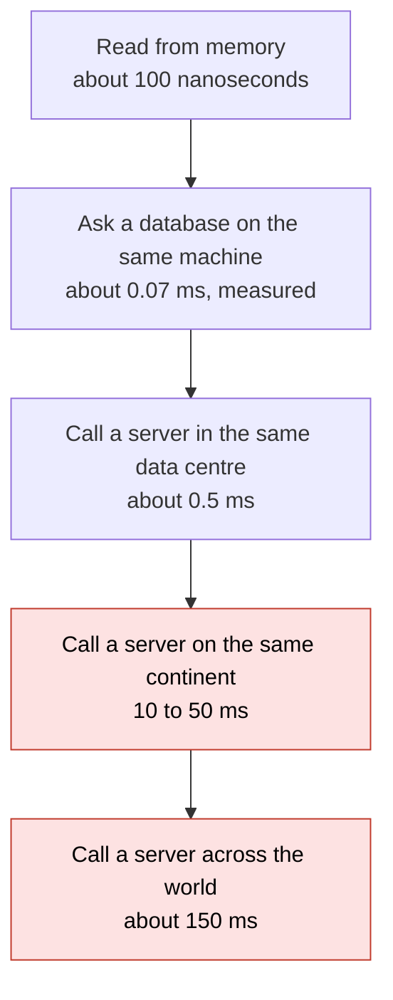
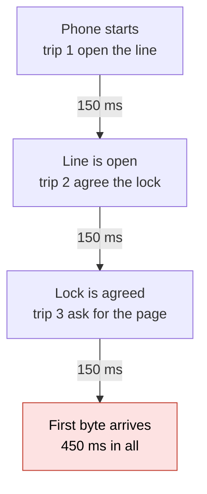
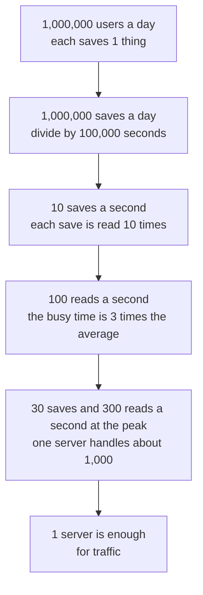
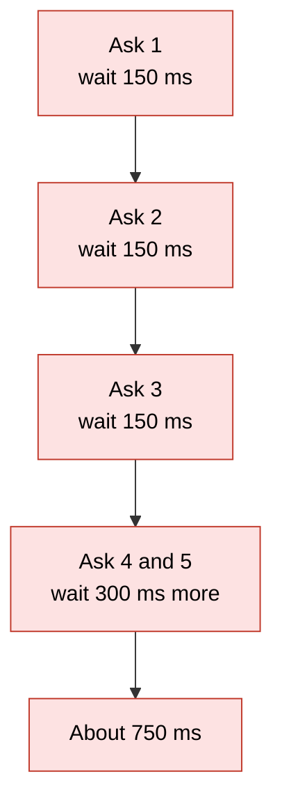
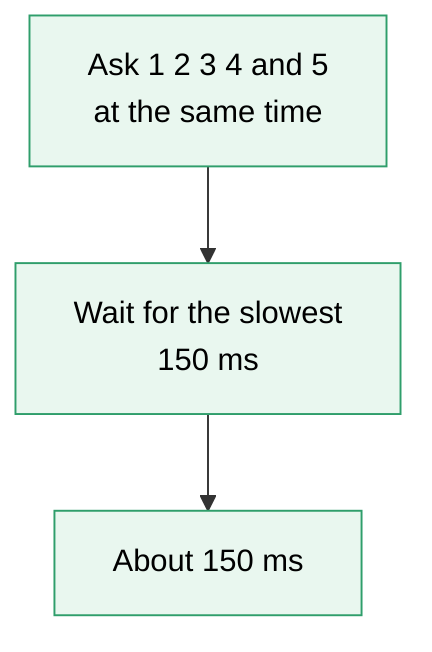

# 16. Latency numbers and estimation

> **Subject:** System Design · **Lesson:** 16 · **Made:** 2026-11-04 · **Status:** ready
>
> **You will be able to:** say how slow each step of a request is (memory, database, other server, other continent), turn "1 million users a day" into requests per second, storage and a server count in under a minute, and say which number is the hard part of a design.
>
> **Before this:** [Choosing tools and explaining why](15-choosing-tools-and-explaining-why.md) · **Next:** [Proxies and API gateways](17-proxies-and-api-gateways.md)
>
> **How to read it:** one card is one idea. Look at the picture, guess, then press the orange bar to check. The blue bars (📖 More detail) hold the longer explanation. Skip them on the first read, and open them when you want more. About 15 minutes for the cards.

## 1. The idea: every step has a price

Think of a trip across a city. Walking to the next room is seconds. Taking a bus is minutes. Flying to another country is a day. A computer is the same. Each step below costs much more than the one above it.



Notice that the last two steps are about the network, not the code. A faster server does not fix them. Only fewer trips, or a shorter distance, does.

<details class="guess"><summary>🤔 Guess: a page needs 5 pieces of data, asked one after another. Each piece takes 1 ms of work on the data server. How long does the page wait if the data server is in the same data centre (0.5 ms per trip), and how long if it is across the world (150 ms per trip)? Press to check.</summary>

Same data centre: 5 × (0.5 + 1) = **7.5 ms**. Across the world: 5 × (150 + 1) = **755 ms**. If you ask for all 5 at the same time, the far server needs only one trip: **151 ms**. (Real run, Node 26.12.1.)

</details>

> **Remember:** count the trips on the user's path. Distance is not fixed by a faster server. Fewer trips and a shorter distance fix it.

<details class="more"><summary>📖 More detail: new words, the code, and why it exists</summary>

New words (four):

- **Latency:** the wait for one thing to happen. For a call, it is the time until the answer starts to arrive.
- **Round trip:** one question and its answer. Designers count round trips, because each one pays the distance twice (there and back).
- **Requests per second (QPS, "queries per second"):** how many requests arrive in one second.
- **Peak:** the busiest time of the day. A system must survive the peak, not the average.

The code behind the guess. It is also practice C below. A request is a list of groups. Calls in one group start together, so the slowest one decides. Groups run one after the other.

```js
function requestTime(steps) {
  let total = 0;
  for (const group of steps) {
    let slowest = 0;
    for (const call of group) slowest = Math.max(slowest, call.rttMs + call.workMs);
    total += slowest;
  }
  return total;
}
const near = () => [{ rttMs: 0.5, workMs: 1 }];
const far = () => [{ rttMs: 150, workMs: 1 }];
console.log(requestTime([near(), near(), near(), near(), near()]));
console.log(requestTime([far(), far(), far(), far(), far()]));
console.log(requestTime([[...far(), ...far(), ...far(), ...far(), ...far()]]));
```

**Output:**

```
7.5
755
151
```

Checked on 2026-11-04 with Node 26.12.1.

This is the **N+1 problem** from lesson [database 12](../database/12-n-plus-1-queries-and-orms.md) with a price tag. A loop of 200 small calls is cheap on one machine and slow when each call crosses a network.

**Where the analogy stops.** A real network trip is not a fixed number. It changes from second to second, and a busy line adds waiting time. The numbers in this lesson are for thinking, not for promises.

**Why it exists and what it costs.**

- **Without it:** you design for a world with no delay. The design works on your laptop and feels slow for real users.
- **With it:** you spend a few seconds on each design choice asking "how many trips, and how far?".
- **The cost:** these are rough numbers. They tell you which choice is clearly bad. They cannot tell you which of two close choices is better. For that, measure.

</details>

## 2. How slow is each step?

These are the numbers worth remembering. Round them. Nobody checks the digits, but everybody checks the size.

| Step | About how long | Where it comes from |
|---|---|---|
| Read one value from memory | 100 ns | the classic list |
| Ask a database on the same machine, using an index | 0.07 ms (70 µs) | measured on my laptop |
| Round trip inside one data centre | 0.5 ms | the classic list |
| Round trip between two zones of one cloud region | 1 to 2 ms | [networking guide](../networking/networking-for-system-design.md) |
| Round trip on one continent | 10 to 50 ms | networking guide |
| Round trip across the world | 150 ms | the classic list |

<details class="guess"><summary>🤔 Guess: a database table has 100,000 rows. One lookup by id uses an index. Another question has no index and must read every row. About how much slower is the second one? Press to check.</summary>

About **90 times slower**: 6.4 ms against 0.072 ms. A missing index on 100,000 rows costs as much as about 13 round trips inside a data centre. (Real run on Postgres 18.3 on the same machine, so no network in these numbers.)

</details>

> **Remember:** memory is nanoseconds, the same machine is microseconds, the same data centre is half a millisecond, and across the world is 150 milliseconds.

<details class="more"><summary>📖 More detail: what I measured, the classic list, and units</summary>

**Units.** 1 second = 1,000 ms (milliseconds) = 1,000,000 µs (microseconds) = 1,000,000,000 ns (nanoseconds). Each name is 1,000 times smaller than the one before.

**What I measured** on 2026-11-04 on an Apple M1 Pro with Node 26.12.1. Each number is the average of thousands of runs, after a warm up. Your machine will give other numbers, but the sizes will be alike.

| What | Time |
|---|---|
| `Map.get` with 1,000 keys | 3 ns |
| `JSON.parse` of a 1.1 KB string | 5.6 µs |
| `JSON.parse` of a 41 KB string | 192 µs |
| SHA-256 of 1 KB | 1.4 µs |
| Read a 4 KB file the system already has in memory | 19 µs |
| One HTTP request to a server on the same machine, connection kept open | 70 µs |
| Postgres `SELECT 1` on the same machine | 56 µs |
| Postgres lookup by primary key in a 100,000 row table | 72 µs |
| Postgres question with no index on the same 100,000 rows | 6,388 µs |

Look at the 70 µs HTTP request. Even with no network, just talking to another program costs far more than reading memory. A network makes it worse.

**The classic list.** "Latency numbers every programmer should know" came from Jeff Dean and was updated by Colin Scott. The interactive page (Watch and play) gives, for its latest year: main memory 100 ns, SSD random read about 16 µs, round trip inside one data centre 500 µs, and a packet from California to the Netherlands and back 150 ms. The page says its numbers are estimated from trends. Cloud networks inside one zone are often faster than 500 µs today.

**One more row you can feel.** I also timed `curl` to two real sites on 2026-11-04. That is next card.

</details>

## 3. Why a new connection needs three trips

A phone opens a brand new HTTPS connection to a far server. Before any data comes back, it needs: **trip 1** to open the line (TCP), **trip 2** to agree on the lock (TLS), and **trip 3** to send the request and get the first byte.



<details class="guess"><summary>🤔 Guess: the server is 150 ms away and the phone opens a new connection for every request. How long until the first byte of the first answer? And of the second answer, if the phone keeps the line open? Press to check.</summary>

About **450 ms** for the first (3 trips × 150 ms). With the line kept open, the second needs only trip 3: about **150 ms**. A real test from my laptop to a site with a 400 ms round trip: line open at 0.40 s, lock done at 0.81 s, first byte at 1.28 s. That is 1, 2 and 3 trips.

</details>

> **Remember:** a new connection costs about 3 round trips. Reuse connections, and put the server near the user.

<details class="more"><summary>📖 More detail: the real curl numbers, what changes the count, and the cost</summary>

I ran `curl -w` three times for each site on 2026-11-04. The times are seconds from the start, middle run of three:

| Site | Name found | Line open (TCP) | Lock done (TLS) | First byte |
|---|---|---|---|---|
| a CDN site near me | 0.005 | 0.031 | 0.066 | 0.108 |
| a government site far away | 0.005 | 0.402 | 0.806 | 1.282 |

For the far site the three times are about 1×, 2× and 3× the same round trip (0.40, 0.81, 1.28). For the near site the trip is 31 ms, and the whole thing is over in 0.1 s. The distance is the whole story. The far site's number is large. It may come from my network path as well as distance, so do not read it as "the internet is 400 ms".

What changes the count:

- **Reusing the connection** (keep-alive) skips trips 1 and 2.
- **TLS 1.3** needs one round trip for the handshake. RFC 8446 calls it the "1-RTT handshake". The older TLS 1.2 needs two, so it would add one more trip.
- **HTTP/3 (QUIC)** joins the line and lock steps into one.
- **A CDN** (lesson [05](05-cdn.md)) puts the end of the line near the user. The trips are the same, but each one is short.
- **The name lookup (DNS)** is one more trip when the name is not cached. Mine took 5 ms because my resolver is close.

**Cost:** keeping connections open uses memory on the server. A server can only hold so many. This is one reason to put a proxy in front (lesson [17](17-proxies-and-api-gateways.md)).

</details>

## 4. From daily users to requests per second

An interviewer says "1 million users a day". You need requests per second. The trick: a day has 86,400 seconds, and you **round it to 100,000**. Then dividing is easy.



<details class="guess"><summary>🤔 Guess: 20 million users open an app each day, and each makes 5 requests. About how many requests per second on average, and at the peak (3 times)? How many simple servers? Press to check.</summary>

20,000,000 × 5 = 100,000,000 requests a day. ÷ 100,000 = **1,000 a second**. At the peak: **3,000 a second**. At 1,000 per server: **3 servers**. (Real run, Node 26.12.1.)

</details>

> **Remember:** per day ÷ 100,000 = per second. Times 3 for the peak. Divide by 1,000 for servers.

<details class="more"><summary>📖 More detail: the code, the real output, why these numbers, and the cost</summary>

The same steps as code. This is practice C below.

```js
function estimate({ dailyUsers, writesPerUser, readsPerWrite, bytesPerWrite, peakFactor = 3, secondsPerDay = 100000, serverRps = 1000, bigBytesPerYear = 1e12 }) {
  const writesPerDay = dailyUsers * writesPerUser;
  const writesPerSec = writesPerDay / secondsPerDay;
  const readsPerSec = writesPerSec * readsPerWrite;
  const peakWrites = writesPerSec * peakFactor;
  const peakReads = readsPerSec * peakFactor;
  const bytesPerDay = writesPerDay * bytesPerWrite;
  const bytesPerYear = bytesPerDay * 365;
  const servers = Math.ceil((peakWrites + peakReads) / serverRps);
  const trafficBig = peakWrites + peakReads > serverRps;
  const storageBig = bytesPerYear > bigBytesPerYear;
  const driver = trafficBig && storageBig ? "both" : trafficBig ? "traffic" : storageBig ? "storage" : "neither";
  return { writesPerDay, writesPerSec, readsPerSec, peakWrites, peakReads, bytesPerDay, bytesPerYear, servers, driver };
}
console.log(estimate({ dailyUsers: 1e6, writesPerUser: 1, readsPerWrite: 10, bytesPerWrite: 10000 }));
```

**Output:**

```
{
  writesPerDay: 1000000,
  writesPerSec: 10,
  readsPerSec: 100,
  peakWrites: 30,
  peakReads: 300,
  bytesPerDay: 10000000000,
  bytesPerYear: 3650000000000,
  servers: 1,
  driver: 'storage'
}
```

Checked on 2026-11-04 with Node 26.12.1.

**Why these numbers.**

- **100,000 instead of 86,400.** The error is 16%. That is smaller than the error in "1 million users" itself. Real 86,400 gives 11.6 a second for 1 million a day, and 100,000 gives 10.
- **Times 3 for the peak.** This is a starting guess. Real traffic can be 2 times or 10 times, for example an evening rush or a sale. When you know the shape, use it. When you do not, say "I'll assume 3 times".
- **1,000 requests per second for one server.** This is a safe round number for a server that does real work, such as a database call per request. An empty Node server on my laptop answered one request every 70 µs (about 14,000 a second), but that skips all real work. Always use the lower number.
- **Reads against writes.** Most products read much more than they write. 10 to 1 is a common first guess. Say it out loud, so the interviewer can change it.

**Cost.** An estimate hides what you left out: one click can make many requests (one page can call 10 APIs), and some users are far busier than others. It is a first check, not a plan.

</details>

## 5. Storage, and bytes against bits

The second number: how much data piles up. Multiply the size of one thing by how many are made. Then by 365 for a year.

| Unit | Size | A thing of that size |
|---|---|---|
| 1 KB | 1,000 bytes | a short JSON answer, a text post |
| 1 MB | 1,000 KB | a photo from a phone, after it is squeezed |
| 1 GB | 1,000 MB | about 1,000 photos |
| 1 TB | 1,000 GB | a laptop disk |

<details class="guess"><summary>🤔 Guess: a paste bin saves 1 million pastes a day, each 10 KB. How much data a day, and a year? Press to check.</summary>

1,000,000 × 10 KB = 10,000,000 KB = **10 GB a day**. × 365 = **3.65 TB a year**. That is one big disk, so storage is the part to think about. Traffic (10 saves and 100 reads a second) is small. (Real run, Node 26.12.1.)

</details>

> **Remember:** size of one thing × how many a day × 365. Network speed is counted in bits, files in bytes, so 1 byte = 8 bits.

<details class="more"><summary>📖 More detail: bandwidth, bits and bytes, and a photo example</summary>

**Bandwidth** is how much data crosses a line each second. Same idea, one more multiplication: requests per second × size of one answer.

- 300 requests a second × 1 KB answer = 300 KB a second. That is nothing.
- 300 requests a second × 2 MB photo = 600 MB a second. In network units that is 600 × 8 = **4,800 megabits, 4.8 gigabits a second**. One server's line cannot carry that. This is why photos and videos go through a CDN (lesson [05](05-cdn.md)) and object storage, not through your API.

**Bits and bytes.** Network speed is in bits: a "1 Gbit/s" line moves at most 125 MB a second, and real life is less. Files are in bytes. The mistake of mixing them up is 8 times, so it matters.

**Where the data lives.** One Postgres server holds many terabytes, but backups, indexes and slow questions get harder as it grows. A few TB a year is the point where you start asking about old data (move it to cheaper storage) and about splitting data (lesson [database 22](../database/22-partitioning-and-sharding.md)).

</details>

## 6. What the numbers tell you to do

Estimates are not for show. Each number points to a design move. Find the number that is **large**, and design for that one.

| If this number is large | A common move | Lesson |
|---|---|---|
| Reads per second far above writes | a cache, or read copies of the database | [04](04-caching.md), [database 21](../database/21-replication-and-read-replicas.md) |
| Peak above what one server handles | more copies of the server behind a load balancer | [02](02-scaling-up-vs-out.md), [03](03-load-balancers.md) |
| Writes in the thousands per second | a queue in front of the database | [06](06-message-queues.md) |
| Storage of terabytes a year | object storage for files, old data moved away, splitting data | [database 22](../database/22-partitioning-and-sharding.md) |
| Big files or photos | a CDN | [05](05-cdn.md) |
| Users far from the server | a CDN, or a second region | [05](05-cdn.md) |
| Many calls in a row on the user's path | fewer trips: ask together, batch, move the parts together | card 1 |

<details class="guess"><summary>🤔 Guess: 50 million users each press "like" once a day (about 50 bytes each), and each like is seen by 10 people. How many servers at the peak, and what is the hard part? Press to check.</summary>

500 likes a second and 5,000 reads a second on average. At the peak: 1,500 and 15,000. Together 16,500 a second, so **17 servers**. Storage is 2.5 GB a day, 912 GB a year, under 1 TB. So the hard part is **traffic**. (Real run, Node 26.12.1, with `estimate` from card 4.)

</details>

> **Remember:** do the maths, find the one big number, and put the design where that number is.

<details class="more"><summary>📖 More detail: the interview flow, and a note about lesson 01</summary>

**How to say it in the interview.** Four sentences:

1. "I assume 1 million active users a day, one save each, and 10 reads for each save."
2. "A day is about 100,000 seconds, so that is 10 writes and 100 reads a second. The busy time is about 3 times that: 30 and 300."
3. "One simple server handles about 1,000 a second, so traffic is small. Each save is 10 KB, so 10 GB a day and 3.65 TB a year."
4. "So storage is the hard part, not traffic. I'll start with one server and one Postgres, and plan how to store the old data."

**A note about lesson 01.** The second example in [lesson 01](01-the-interview-framework.md) has 50 million users with 2 KB per save. That is 100 GB a day and 36.5 TB a year. Lesson 01 calls traffic the hard part. With the rule in this lesson (1 TB a year is a lot), `estimate` calls it **both**, because 36 TB a year is also a lot. The two lessons agree on the traffic number (16,500 a second at the peak). Say both parts out loud in the interview.

**Averages hide the slow ones.** For latency, an average hides the slow tail. Teams look at the p95 or p99 (the time that 95 or 99 of 100 requests beat). Lesson [14](14-observability.md) shows how.

</details>

## 7. Five mistakes, and what to say if you freeze

- **Wrong:** only the average, no peak. **Right:** triple it, or say what the peak shape is.
- **Wrong:** a loop that waits for each call. **Right:** ask for all the calls together, or batch them.
- **Wrong:** mixing bits and bytes. **Right:** network in bits, files in bytes, 8 to 1.
- **Wrong:** false precision ("115.74 a second"). **Right:** round and say "about 100".
- **Wrong:** one click is one request. **Right:** one page may make 10 or 20 calls.

<details class="guess"><summary>🤔 Guess: this code gets 5 items, each from a far server (100 ms a call). How long does it take, and how do you make it faster? Press to check.</summary>

About **500 ms**, because `await` inside the loop waits for each call before it starts the next. Start all 5 and wait together with `Promise.all`: about **100 ms**. (Real run, Node 26.12.1. The 100 ms calls are pretend: a timer.)

</details>

> **Remember:** if you freeze, say "A day is about 100,000 seconds. Users times actions, divided by that, is requests per second. Triple it for the peak. Size times count is storage."

<details class="more"><summary>📖 More detail: the five mistakes in full, and the freeze plan</summary>

**Right against wrong, drawn.** Five calls to a far server, 150 ms each. Notice that the wrong way waits for each answer before it asks the next question.





**Wrong:** one `await` per call, in a loop.

```js
async function slow(ids) {
  const out = [];
  for (const id of ids) out.push(await fetchOne(id));   // waits before starting the next one
  return out;
}
```

**Right:** start all the calls, then wait together.

```js
async function fast(ids) {
  return Promise.all(ids.map((id) => fetchOne(id)));
}
```

Each `fetchOne` waits 100 ms (a timer). The output, run for real:

```
slow 10,20,30,40,50 500 ms
fast 10,20,30,40,50 100 ms
```

Checked on 2026-11-04 with Node 26.12.1. **Careful:** run calls together only when they do not need each other's answers, and when the other side can take them all at once. Hundreds at once can knock a server over. For that, send fewer, bigger calls (a batch).

**The other four.**

- **No peak.** A server sized for the average falls over at the busy time. The peak is the size you need.
- **Bits and bytes.** A 100 Mbit/s line is 12.5 MB a second at best.
- **False precision.** Digits that the input cannot support make you look unsure about the ideas. Round.
- **One click, many requests.** Count the calls on the path, including the ones your own servers make to each other.

**If you freeze:**

1. Say "I'll round: a day is about 100,000 seconds."
2. Say "Users times actions, divided by 100,000, is requests per second. The peak is about 3 times."
3. Say "Size times how many, times 365, is storage a year. Then I look for the one number that is big."

</details>

## 8. Watch and play

Links were opened on 2026-11-04. For the video I confirmed only the title and channel name from YouTube's embed data, not the length. The `samwho.dev/numbers` page that older notes in this folder point to gave a 404 error on 2026-11-04, so it is not listed here.

- **Play with it:** [Latency Numbers Every Programmer Should Know, interactive](https://colin-scott.github.io/personal_website/research/interactive_latency.html) - move the year slider. Watch which numbers drop (SSD) and which never move (a trip across the world).
- **Video:** [Back of the Envelope Storage Estimates | System Design Interview](https://www.youtube.com/watch?v=eR5pIYfxKgY) - channel TechPrep, length not checked. Compare its steps with card 5.
- **Video:** [System Design Basics: Back Of The Envelope Estimation](https://www.youtube.com/watch?v=AsJJGe5vxFM) - channel MLWorks, length not checked. Compare its requests per second steps with card 4.
- **Play with it:** [the stepper in this folder](visuals/16-latency-numbers-and-estimation.html) - guess first, then press Next. Try all three tabs.
- **Read:** [System Design Primer on GitHub](https://github.com/donnemartin/system-design-primer) - the page has a back of the envelope section with a powers of two table and the latency list. I could read only the start of the page, so I did not check the numbers there.
- **Read:** [RFC 8446, TLS 1.3](https://datatracker.ietf.org/doc/html/rfc8446) - Section 1.2 and Section 2.3 mention the 1-RTT handshake and the 0-RTT mode. A very long page, so read only those two parts.

<details><summary>Go deeper (optional)</summary>

**Same data centre against another zone.** The [networking guide](../networking/networking-for-system-design.md), Part 1.3, says AWS puts zones up to about 100 km apart, with single digit millisecond round trips. A loop of 200 calls across zones adds about a third of a second.

**Light is slow, in the end.** Light in fibre cable goes about 200 km in one millisecond. Jakarta to Sydney is about 5,500 km, so a round trip can never be under about 55 ms, however good the network is. That is a floor, and real paths are longer.

**How I measured.** Timings used `performance.now()` around loops of 3,000 to 5,000,000 calls after 200 warm up calls. The Postgres numbers used a throwaway Postgres 18.3 started in a scratch folder on port 55433, with 100,000 rows and a primary key. The HTTP number used Node's built in `http` module with one kept-open connection. The curl numbers used `curl -w` with `time_namelookup`, `time_connect`, `time_appconnect` and `time_starttransfer`.

**A faster path through the same data.** Lesson [04](04-caching.md) is the first answer to "this is too slow": keep the answer close, so you skip the trip.

</details>

## 9. Practice

**A. Predict the output** (write your answer before opening)

```js
const perDay = 20_000_000 * 5;
const perSec = perDay / 100_000;
console.log(perSec, perSec * 3, Math.ceil((perSec * 3) / 1000));
```

Then answer: a request first checks the login (round trip 1 ms, work 2 ms). Then it asks three things at the same time: (round trip 1 ms, work 4 ms), (round trip 1 ms, work 4 ms) and (round trip 5 ms, work 1 ms). How long does the whole request take?

<details><summary>Answer</summary>

```
1000 3000 3
```

20 million × 5 is 100 million a day. ÷ 100,000 is 1,000 a second. The peak is 3,000. At 1,000 per server: 3 servers.

The request: 1 + 2 = **3 ms** for the login. The group takes as long as its slowest call: 5, 5 and 6, so **6 ms**. Total **9 ms**. Asking together saved time. One after the other it would be 3 + 5 + 5 + 6 = 19 ms. (Checked on 2026-11-04 with Node 26.12.1.)

</details>

**B. Fix the bug**

This code takes about 500 ms for 5 items when each call to the far server takes 100 ms. Make it about 100 ms.

```js
const wait = (ms) => new Promise((r) => setTimeout(r, ms));
const fetchOne = async (id) => { await wait(100); return id * 10; };
async function load(ids) {
  const out = [];
  for (const id of ids) out.push(await fetchOne(id));
  return out;
}
```

<details><summary>Answer</summary>

`await` in the loop waits for each call to finish before the next one starts. Five 100 ms waits add up. Start all five, then wait for all:

```js
async function load(ids) {
  return Promise.all(ids.map((id) => fetchOne(id)));
}
```

The result order stays the same as `ids`. It prints the same values in about 100 ms instead of 500 ms. Only do this when the calls do not need each other's answers. (Checked on 2026-11-04 with Node 26.12.1.)

</details>

**C. Write it yourself**

Open `learn/system-design/practice/16-latency-numbers-and-estimation.js`. It has two empty functions: `requestTime` (card 1) and `estimate` (card 4). Write them, then run this from the repo root and make all the tests pass:

```
node --test learn/system-design/practice/16-latency-numbers-and-estimation.test.js
```

<details><summary>One possible answer</summary>

```js
function requestTime(steps) {
  let total = 0;
  for (const group of steps) {
    let slowest = 0;
    for (const call of group) slowest = Math.max(slowest, call.rttMs + call.workMs);
    total += slowest;
  }
  return total;
}

function estimate({ dailyUsers, writesPerUser, readsPerWrite, bytesPerWrite, peakFactor = 3, secondsPerDay = 100000, serverRps = 1000, bigBytesPerYear = 1e12 }) {
  const writesPerDay = dailyUsers * writesPerUser;
  const writesPerSec = writesPerDay / secondsPerDay;
  const readsPerSec = writesPerSec * readsPerWrite;
  const peakWrites = writesPerSec * peakFactor;
  const peakReads = readsPerSec * peakFactor;
  const bytesPerDay = writesPerDay * bytesPerWrite;
  const bytesPerYear = bytesPerDay * 365;
  const servers = Math.ceil((peakWrites + peakReads) / serverRps);
  const trafficBig = peakWrites + peakReads > serverRps;
  const storageBig = bytesPerYear > bigBytesPerYear;
  const driver = trafficBig && storageBig ? "both" : trafficBig ? "traffic" : storageBig ? "storage" : "neither";
  return { writesPerDay, writesPerSec, readsPerSec, peakWrites, peakReads, bytesPerDay, bytesPerYear, servers, driver };
}

module.exports = { requestTime, estimate };
```

Checked on 2026-11-04 with Node 26.12.1: the 12 tests fail on the empty stub and all 12 pass with this answer. Two details to notice. `Math.ceil` rounds servers up, because 0.4 of a server is still one server. And `driver` has four answers, not two, because a design can have both a big traffic number and a big storage number.

</details>

## 10. Interview question

**Q:** "Design a service where 10 million people look at a photo feed every day. Before you draw anything, how big is it?"

A common follow-up: "Where would the time go for a user in another country?" Cards 1 to 3 are the answer.

<details><summary>A strong answer, in four parts</summary>

1. **Problem:** I do not know what is hard yet. Maybe traffic, maybe storage, maybe the photos. Drawing boxes first is a guess.
2. **How I work it out:** I say my assumptions out loud. 10 million people a day, each opens the feed 5 times, and each opening makes 3 requests (feed, user, counts). That is 150 million requests a day, ÷ 100,000 = 1,500 a second, and about 4,500 at the peak. That is about 5 simple servers for traffic. For photos, a feed screen shows 10 photos of 200 KB each after squeezing. That is 2 MB per opening, 4,500 ÷ 3 × 2 MB is about 3 GB a second at the peak, which no server line carries. So the photos are the hard part, and they go through a CDN and object storage, not through my API.
3. **Tradeoff:** these are guesses. If the real numbers are 10 times bigger, the design changes. I would measure after launch and redo the maths. For a user in another country, a new connection to my server is 3 round trips of 150 ms, about 450 ms before the first byte. A CDN and kept-open connections cut that.
4. **My example:**
   - **Fact:** from my own notes, the DBO stack has a React Native app, a CMS and a verification admin as clients, a GraphQL API service, an Auth service, a Queue service on BullMQ and Redis, and a Cron service.
   - **Not known yet:** how many daily users and peak requests per second those systems really have. Open your dashboards or logs and write the real numbers here before you use them in an interview.
   - **Idea, not a fact:** run this estimate for the DBO order flow with the real numbers, then say which of the four boxes it points to.

</details>

## 11. Explain it back

Close this file. Explain how you turn "1 million users a day" into servers and storage, and why a far server hurts, out loud like to a new junior, in 4 parts (problem, how, tradeoff, my example). Use the story of the 5 calls in a row (755 ms) and the story of the 3 trips for a new connection. Then write your best version below and run `/explain-check latency numbers and estimation` or ask the `explain-coach` agent to review it.

### My explanation

<write here>

### Coach feedback

<the explain-coach agent writes here>

## 12. Review questions (day 1, 3, 7, 21)

1. A page asks for 5 pieces of data one after another. Each trip is 150 ms. How long, and what are two ways to make it faster?
2. Turn "2 million users a day, 3 requests each" into requests per second at the peak, and into servers.
3. Why does a new HTTPS connection cost about 3 round trips? What skips two of them?
4. A design saves 5 KB per post, 4 million posts a day. How much a year? Is that the hard part?

<details><summary>Answers</summary>

1. 5 × 150 = about 750 ms. Ask for all five at the same time (about 150 ms), or batch them into one bigger call. Or move the data closer, with a cache, a CDN or a nearby region.
2. 2,000,000 × 3 = 6,000,000 a day. ÷ 100,000 = 60 a second. × 3 for the peak = 180. ÷ 1,000 = 1 server.
3. Trip 1 opens the line (TCP), trip 2 agrees the lock (TLS), trip 3 sends the request and starts the answer. Keeping the connection open (keep-alive) skips trips 1 and 2.
4. 4,000,000 × 5 KB = 20 GB a day. × 365 = 7.3 TB a year. That is a lot, so yes, storage is the hard part. Traffic is 40 saves a second, which is small.

</details>

## Connected lessons

- [The interview framework](01-the-interview-framework.md) - step 2 (estimate) in short. This lesson is the long version.
- [Choosing tools and explaining why](15-choosing-tools-and-explaining-why.md) - the lesson before. Use the numbers from here as the reasons you give there.
- [Proxies and API gateways](17-proxies-and-api-gateways.md) - the next lesson. Each hop through a gateway adds a small cost. This lesson gives you the unit to count it.
- [Scaling up vs out](02-scaling-up-vs-out.md) - what you do when the peak is above one server.
- [Load balancers](03-load-balancers.md) - the front door for the copies.
- [Caching](04-caching.md) - the first fix for "this trip is too slow".
- [CDN](05-cdn.md) - shortens the last trip, and carries the big files.
- [Message queues](06-message-queues.md) - what to use when writes per second get large.
- [Observability](14-observability.md) - where you measure the real numbers after launch.
- [Networking for system design](../networking/networking-for-system-design.md) - Part 1.3 is the deeper guide on latency numbers.
- [N+1 queries](../database/12-n-plus-1-queries-and-orms.md) - the same mistake as the loop of waits in card 7.
- [System design interview questions](senior-system-design-interview-questions.md) - the question bank. Many of its answers start with an estimate.
