# 17. Proxies and API gateways

> **Subject:** System Design · **Lesson:** 17 · **Made:** 2026-10-17 · **Remade in short cards:** 2026-10-30 · **Status:** ready
>
> **You will be able to:** say which side a forward proxy and a reverse proxy speak for, name what an API gateway does and does not do, trace one request through it, tell a gateway from a load balancer and a service mesh, say when a mobile app and a web app each get their own backend for frontend (BFF), and name two ways a gateway goes wrong.
>
> **Before this:** [Latency numbers and estimation](16-latency-numbers-and-estimation.md) · **Next:** [Object storage and presigned uploads](18-object-storage-and-presigned-uploads.md)
>
> **How to read it:** one card is one idea. Look at the picture, guess, then press the orange bar to check. The blue bars (📖 More detail) hold the longer explanation. Skip them on the first read, and open them when you want more. About 15 minutes for the cards.

## 1. The idea: one public front door

An API gateway is one public front door for many services. It checks who you are, counts how often you knock, and sends you to the right service. Like a reception desk in a big office: it checks your badge (the **ticket**), counts how often you came today (the **limit**), points you to the right floor (the **route**), and writes your name in the visitor book (the log).

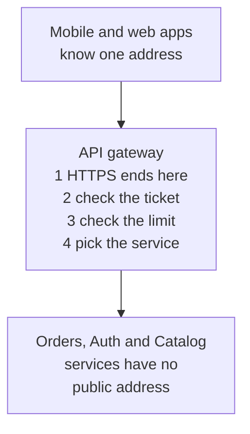

<details class="guess"><summary>🤔 Guess: with no gateway, every service is public with its own door code. A bot sends 10,000 calls a minute, and the catalog service forgot the limit. Who suffers, and what does a new ticket rule cost? Press to check.</summary>

Only the **catalog** suffers. A new ticket rule means **3 code changes**, one in each service, and the copies drift apart. With a gateway, the door jobs are done once.

</details>

> **Remember:** a gateway does the door jobs once: HTTPS, ticket, limit, route. Services stay private.

<details class="more"><summary>📖 More detail: new words, the big picture, the problem drawn, the office building, and why it exists</summary>

Lesson [03](03-load-balancers.md) gave you a front door that shares work between copies of one server. This lesson is about a front door that sends each request to a different service.

New words (four):

- **Proxy:** a middle program that passes a request on for someone else. A **forward proxy** speaks for the clients, like a company web filter. A **reverse proxy** speaks for the servers, like Nginx in front of your app.
- **API gateway:** a reverse proxy with extra door jobs for an API: check the ticket, limit the requests, pick the service.
- **BFF (backend for frontend):** a small server made for one kind of app, for example only the mobile app.
- **Service mesh:** a helper proxy beside every service. It handles the calls between your own services, not the calls from users.

Three plain ideas, explained now so the pictures make sense:

- **The ticket** is the login proof the app sends with each request (interview words: bearer token, often a JWT). The gateway checks that it is real and not too old.
- **The limit** is a cap on how many requests one caller may send in a time window (interview word: rate limit). Over the cap, the gateway answers **429 Too Many Requests**.
- **The route** is the choice of which service gets the request. The gateway often reads the start of the path. `/orders` goes to the orders service.

Also, HTTPS usually ends at the gateway (interview word: TLS termination). The gateway holds the certificate. Inside the private network the services can talk plain HTTP.

Sizes and times in the pictures are example numbers, not measured.

**The big picture.** Notice that the apps know one address only. The services have no public address. The gateway makes the decisions at the door.

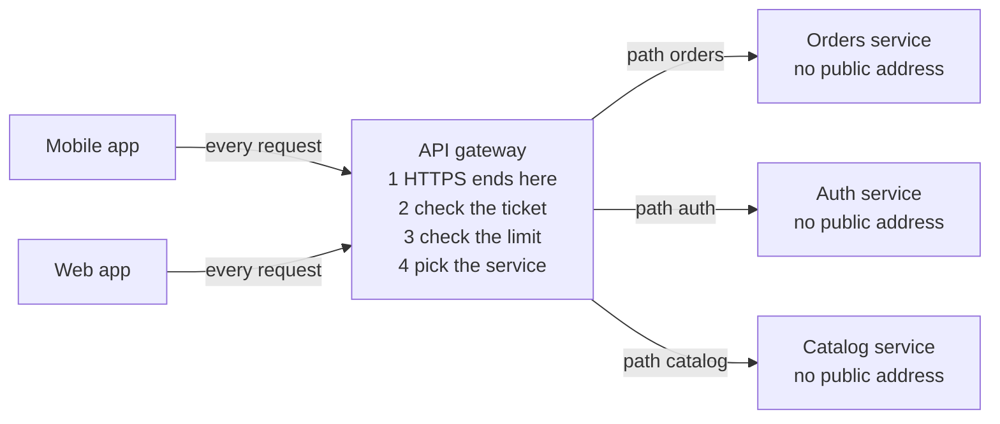

**The problem, drawn.** This is the system with no gateway. Notice that every service is public and has its own copy of the door code. One copy forgot the limit, and the app must know three addresses.

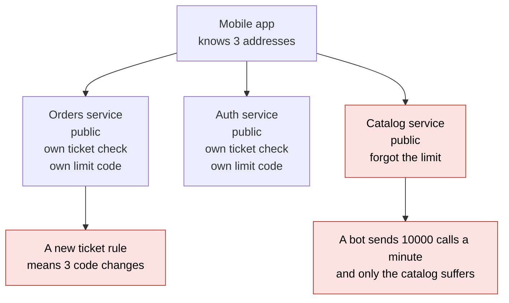

**The office building in full.**

A big office building.

- **Reverse proxy:** the reception desk. Visitors talk to the desk, never to the staff directly. The desk speaks for the company.
- **Forward proxy:** the mail room. Staff hand letters to the mail room. The outside world sees only the mail room. It speaks for the staff.
- **API gateway:** a reception desk that also checks your badge (the ticket), counts how often you came today (the limit), and points you to the right floor (the route). It writes your name in the visitor book (the log).
- **BFF:** a museum has one guide for school groups and one guide for experts. Both show the same collection. Each one tells the story that fits the group.

Where the analogy stops: a receptionist points and you walk alone. A gateway carries the whole request and the whole answer, both ways. A building has one desk, but a gateway can run as two copies. And a gateway writes your badge name on the note it passes on. The staff behind it can trust that note only because nobody else can reach them.

**Why it exists and what it costs.**

- **Problem without it:** every service repeats the door code, and the copies drift apart (card 1). The app must know many addresses. Every service is public, so every service is a target.
- **How it solves it:** one public door does the shared jobs once (card 1). Services stay private. The app knows one address, and you can move or split services behind it without changing the app.
- **Cost or tradeoff:** one more hop, one more thing to run, and one more thing that can break everything. The next parts show the five jobs, the neighbours, and the two ways it goes wrong.

</details>

## 2. The three checks, in order

The cheap check goes first. **Check 1:** is the ticket real and not too old? If not, `401`. **Check 2:** is the caller over the limit? If so, `429`. **Check 3:** the start of the path picks the service (`/orders` goes to the orders service). No route gives `404`. A call with a real ticket counts even when it ends in 404. A refused ticket does not count.

Five requests, with a limit of 3 calls: a good ticket to `/orders/42`, a bad ticket to `/orders/42`, a good ticket to `/auth/login`, a good ticket to `/shop`, and a good ticket to `/orders/1`.

<details class="guess"><summary>🤔 Guess: what does each of the five requests get? Press to check.</summary>

`200 sent to orders-service`, `401 bad token`, `200 sent to auth-service`, `404 no route`, `429 too many requests`. The `/shop` request found no route, but it still used up one of the 3 calls. So the next good request got 429. (Real run, Node 26.12.1.)

</details>

> **Remember:** bad and too many requests never reach a service. The cheap check goes first.

<details class="more"><summary>📖 More detail: one good request over time, the notebook, the code, the real output, and step by step</summary>

**How it works over time.** This is one good request. Notice that the gateway adds notes to the request (who the user is, a request id) before the service sees it.

This is one good request. Notice that the gateway adds notes to the request (who the user is, a request id) before the service sees it.

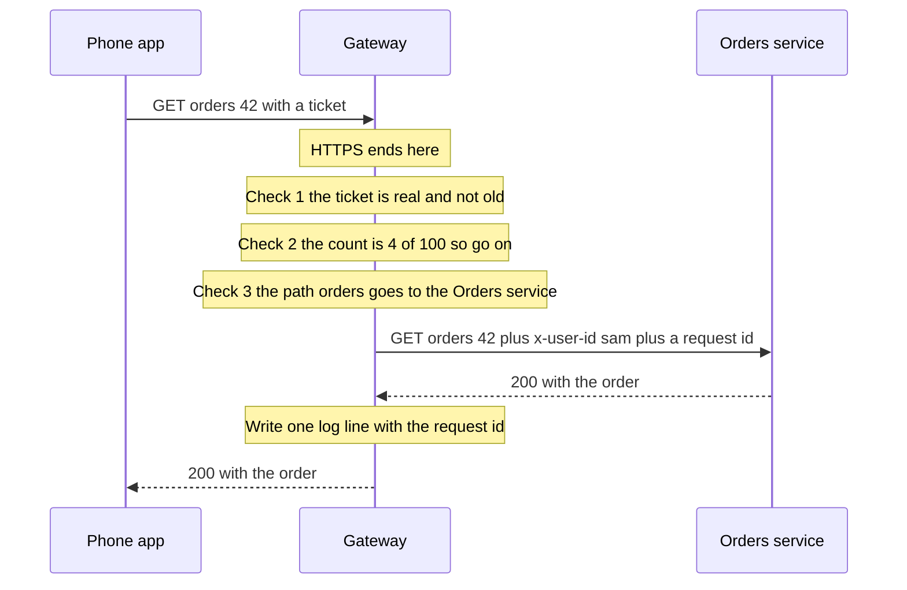

**What is in the gateway's notebook right now.** Notice what the gateway knows (who, how often, where to) and what it does not know (anything about the business).

This is one moment. Notice what the gateway knows (who, how often, where to) and what it does not know (anything about the business).

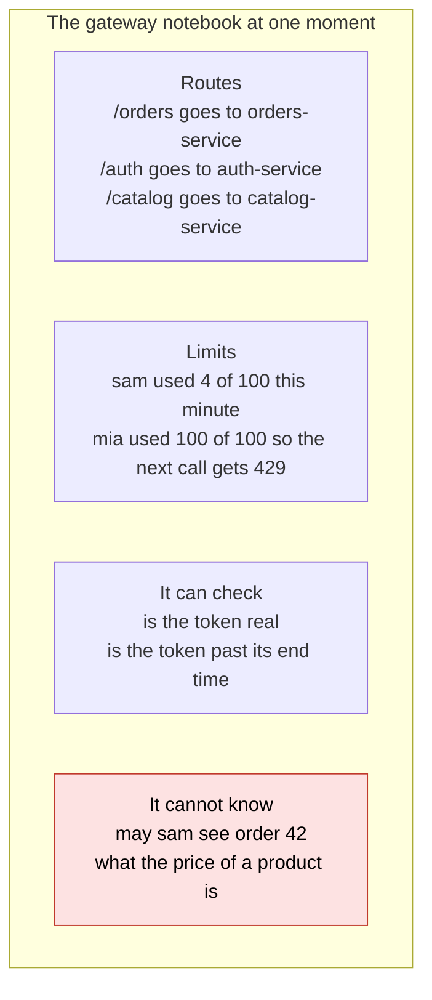

**The smallest code that shows it.** A tiny gateway with the three checks in order. The limit is 3 calls.

A tiny gateway with the three checks in order. The limit is 3 calls. A call with a real ticket counts even when it ends in 404. A refused ticket does not count.

```js
const routes = { "/orders": "orders-service", "/auth": "auth-service" };
const tokens = new Set(["good-token"]), used = {};          // used counts the calls of each token
function gateway(req) {
  if (!tokens.has(req.token)) return "401 bad token";              // check 1: is the ticket real?
  used[req.token] = (used[req.token] || 0) + 1;
  if (used[req.token] > 3) return "429 too many requests";         // check 2: over the limit? (3 calls here)
  const service = routes["/" + req.path.split("/")[1]];            // check 3: the first part of the path picks the service
  return service ? "200 sent to " + service : "404 no route";
}
const calls = [["good-token", "/orders/42"], ["bad-token", "/orders/42"], ["good-token", "/auth/login"],
               ["good-token", "/shop"], ["good-token", "/orders/1"]];
for (const [token, path] of calls) console.log(token, path, "->", gateway({ token, path }));
```

**Output:**

```
good-token /orders/42 -> 200 sent to orders-service
bad-token /orders/42 -> 401 bad token
good-token /auth/login -> 200 sent to auth-service
good-token /shop -> 404 no route
good-token /orders/1 -> 429 too many requests
```

Checked on 2026-10-17 with Node 24.

Look at the last two lines. The `/shop` request found no route, but it still used up one of the 3 calls. So the next good request got 429.

Run again on 2026-10-30 with Node 26.12.1: the same output.

**What really happens, step by step.**

The machine here is the gateway. The state is the count of the good ticket. One row is one call of `gateway(...)`.

| Step | Request | Check 1: ticket | Check 2: count after | Check 3: route | Printed |
|---|---|---|---|---|---|
| 1 | `good-token` `/orders/42` | on the list, go on | 1 of 3, go on | first part `/orders` gives orders-service | `200 sent to orders-service` |
| 2 | `bad-token` `/orders/42` | not on the list, **stop** | stays 1 | not reached | `401 bad token` |
| 3 | `good-token` `/auth/login` | on the list, go on | 2 of 3, go on | first part `/auth` gives auth-service | `200 sent to auth-service` |
| 4 | `good-token` `/shop` | on the list, go on | 3 of 3, go on (3 is not above 3) | `/shop` is not in `routes`, **stop** | `404 no route` |
| 5 | `good-token` `/orders/1` | on the list, go on | 4 of 3, **stop** | not reached | `429 too many requests` |

What to see:

- Steps 2 and 5 never reach a service. The gateway stops bad and too many requests at the door.
- The 404 in step 4 used a call. A caller who sends junk paths still costs the gateway work.
- The order of the checks matters. The cheap check (is the ticket real?) goes first.

**One request through a real gateway.**

| Step | Who does it | What happens | State after |
|---|---|---|---|
| 1 | The phone | Sends `GET /orders/42` with the ticket over HTTPS | The request is on its way, locked |
| 2 | The gateway | Ends HTTPS. It now reads the request in plain form | The gateway can read the path and the headers |
| 3 | The gateway | Check 1: is the ticket real and not too old? | Yes. It knows the user is `sam` |
| 4 | The gateway | Check 2: add 1 to the count of `sam` in the shared counter | 4 of 100 |
| 5 | The gateway | Check 3: the path starts with `/orders`, so the target is the orders service | Target chosen |
| 6 | The gateway | Shapes the request: removes any `x-user-id` the caller sent, then sets `x-user-id: sam` and adds a request id | A clean copy of the request |
| 7 | The orders service | Does the real work. It checks that `sam` may see order 42 | Answer 200 |
| 8 | The gateway | Writes one log line with the request id and the time taken, then sends the answer to the phone | Done in about 1 more hop |

**Step through it yourself:** [open the stepper](visuals/17-proxies-and-api-gateways.html). It has three stories: the five requests from card 2, a gateway that is one door (one copy against two), and a phone screen with and without a BFF. Guess first, then press Next.

</details>

## 3. A gateway must not do business work

The gateway may know about **requests** (who, how often, where to). It must not know about **the business** (what an order is). Joins and shaping for each app go in a BFF or GraphQL, and rules live in the services. The gateway answers "is this ticket real?". The service answers "may this user do this?".

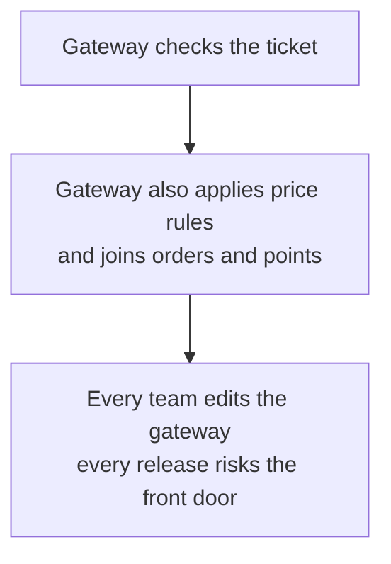

<details class="guess"><summary>🤔 Guess: the gateway sets the user header with `req.headers["x-user-id"] || user`. Mia has a real ticket and sends her own `x-user-id: boss`. What does the service see? Press to check.</summary>

**`boss`.** The gateway believed the header the caller sent, so Mia can act as anyone. Fix: set `"x-user-id": user` last, so it wins. Services behind a gateway must also have **no public route**. (Real run, Node 26.12.1.)

</details>

> **Remember:** the gateway must overwrite `x-user-id` on every request, and the service must still check who owns the order.

<details class="more"><summary>📖 More detail: right against wrong, and logic creep</summary>

**Right against wrong.** The wrong way puts business work in the gateway. Notice who edits the gateway at the end.

The wrong way puts business work in the gateway. Notice who edits the gateway at the end.

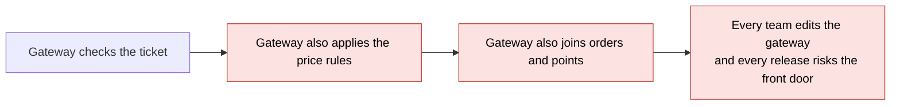

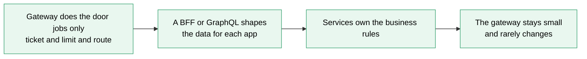

**Way 2 to go wrong: logic creep.**

Every request already passes through the gateway, so it feels like a good home for "just one rule". Price rules, joins, flags. Soon every team edits the gateway, and a mistake in it breaks all traffic. Rule: the gateway may know about **requests** (who, how often, where to). It must not know about **the business** (what an order is).

</details>

## 4. Gateway, load balancer, proxies, mesh

A **forward proxy** speaks for the clients (a company web filter). A **reverse proxy** speaks for the servers (Nginx in front of your app). The next three are all reverse proxies, and they overlap.

| Thing | Main job |
|---|---|
| Forward proxy | speaks for the clients: filter, hide, cache |
| Reverse proxy | speaks for the servers: HTTPS, cache, compress |
| Load balancer | shares work between copies of one service |
| API gateway | door rules in front of many services |
| Service mesh | a helper proxy beside every service, for calls between services |

<details class="guess"><summary>🤔 Guess: which one handles a user's call from outside: the gateway or a service mesh? Press to check.</summary>

The **gateway**. A service mesh handles the calls between your own services, not the calls from users. It costs one more proxy on every call, so with a few services a good HTTP client library is enough.

</details>

> **Remember:** in a design, draw a box for each job you need. Real systems stack them: gateway, then a load balancer per service, then the copies.

<details class="more"><summary>📖 More detail: two kinds of proxy, where each one sits, the five jobs, and the tools</summary>

**Two kinds of proxy.** Notice which side each one speaks for. A forward proxy hides the clients. A reverse proxy hides the servers.

Notice which side each one speaks for. A forward proxy hides the clients. A reverse proxy hides the servers.

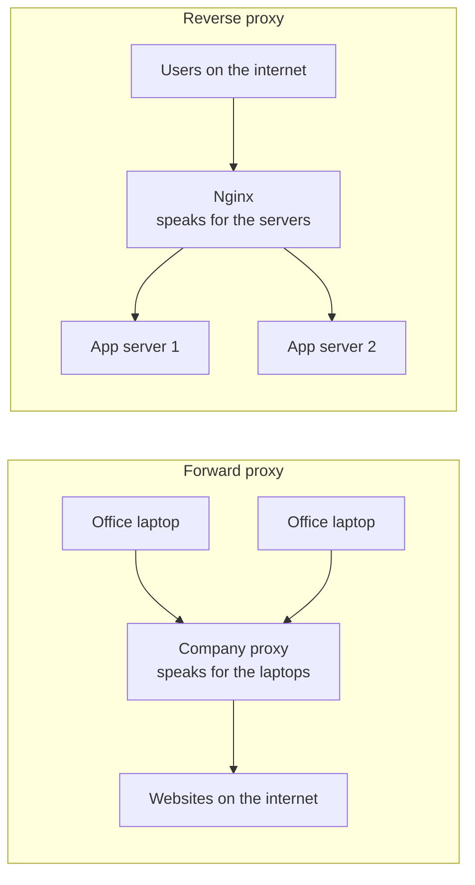

**Where each one sits.** Notice three things. The gateway takes calls from outside. The load balancer sits in front of copies of one service. The helper proxies handle calls between services.

Notice three things. The gateway takes calls from outside. The load balancer sits in front of copies of one service. The helper proxies handle calls between services.

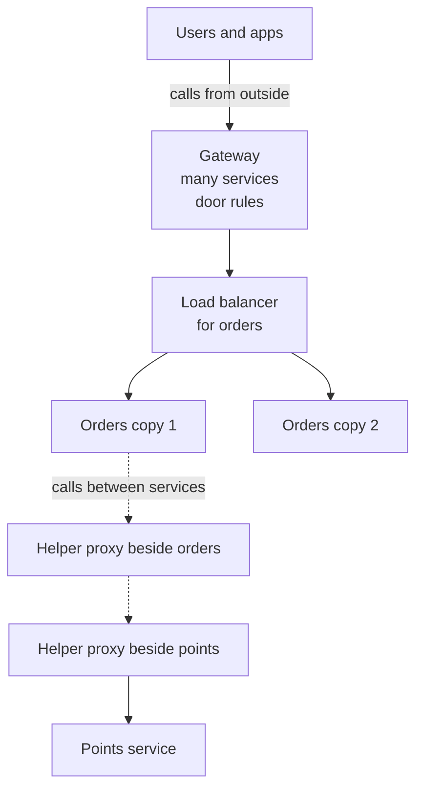

**The five jobs of a gateway.**

1. **Route:** pick the service by host or path.
2. **Check the ticket:** is it real and not old? This is not "may this user do this". The service answers that.
3. **End HTTPS:** one place holds the certificate. Banks sometimes encrypt again inside.
4. **Limit:** count calls per user, per key or per IP. Answer 429 and say when to try again.
5. **Shape the request:** add `x-user-id` and a request id, remove headers the caller must not set, cap the body size, set a timeout, write one log line.

What it must **not** do: business rules, or joining data from many services. That is the next section's first mistake.

**Gateway, load balancer, service mesh.**

| Thing | Sits | Main job | Sends requests to |
|---|---|---|---|
| Forward proxy | next to the clients | speak for the clients: filter, hide, cache | any website |
| Reverse proxy | in front of your servers | speak for the servers: HTTPS, cache, compress | your servers |
| Load balancer (lesson 03) | in front of copies of one service | share work, drop dead copies | copies of the same service |
| API gateway | in front of many services | door rules: ticket, limit, route, shape | different services |
| Service mesh | beside every service | encrypt, retry and measure the calls between services | other services |

The middle three are all reverse proxies. They overlap, and one tool such as Nginx can do the first three jobs. In a design, draw the box for each job you need. Real systems often stack them: gateway, then a load balancer per service, then the copies.

A service mesh is not for users' calls. It helps when many services need the same encryption, retries and numbers. It costs one more proxy on every call and a lot of learning. With a few services, a good HTTP client library is enough.

**Tools people name.**

| Tool | What it is | One fact to know |
|---|---|---|
| **Nginx** | a reverse proxy you configure with a file | `limit_req` limits requests. Nginx refuses with **503** by default. Set `limit_req_status 429` to send the right code |
| **Kong** | an API gateway you run yourself | it is extended with plugins, for example for login checks and rate limits |
| **AWS API Gateway** | a managed gateway | **REST APIs** have API keys, per-client limits and request checks. **HTTP APIs** have fewer features and cost less |
| **Cloudflare** | a gateway-like layer at the edge, in front of your servers | its API Shield can check a JWT before the request reaches you. The full API Shield suite is a paid Enterprise add-on |

Facts checked in the vendor docs on 2026-10-17. The Watch and play card has the links.

</details>

## 5. The one door problem, and the BFF

The gateway is the only way in. If its only copy stops, every service is out of reach even though they are all running. So run two or more copies behind a load balancer with health checks, and keep the counters in a shared store such as Redis. A **BFF** (backend for frontend) is a small server made for one kind of app, for example the mobile app. Only add one when the apps need very different data.

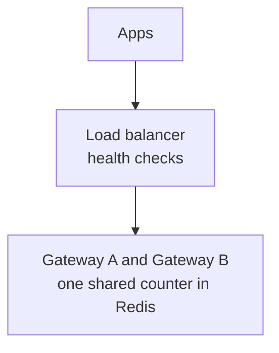

<details class="guess"><summary>🤔 Guess: Sam sends 9 requests. A load balancer shares them over 3 gateway copies, and each copy keeps its own count with a limit of 2. How many of the 9 are allowed? Press to check.</summary>

**6 of 9**, not 2. Each copy sees 3 requests and allows 2. The real limit is the limit times the number of copies. One shared counter fixes it. (Real run, Node 26.12.1.)

</details>

> **Remember:** the gateway is the one door. Run two copies, share the counters, and keep it small.

<details class="more"><summary>📖 More detail: one copy against two, the BFF drawn, and the two ways to go wrong</summary>

**The one door problem.** Now the gateway is the only door. Notice what one copy means.

Now the gateway is the only door. Notice what one copy means.

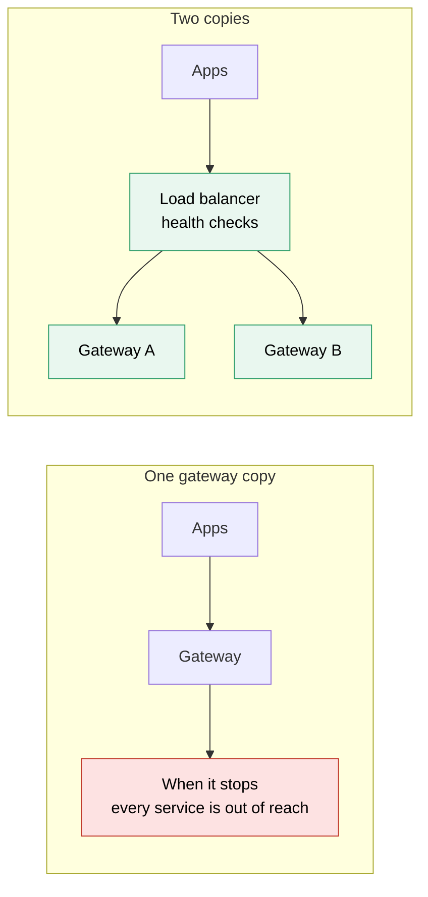

**Does the phone app need its own backend?** First, the shape. Notice that each app has a small server of its own, and both use the same services. Then the choice: notice that the first answer is often "no".

First, the shape. Notice that each app has a small server of its own, and both use the same services.

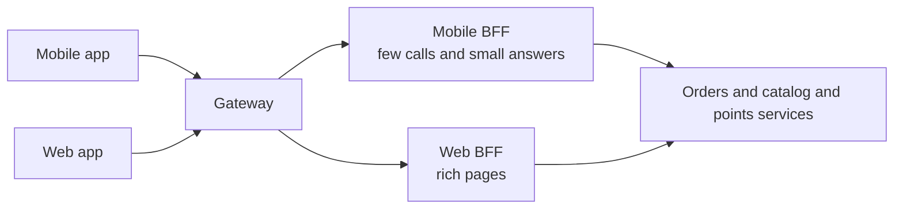

Now the choice. Notice that the first answer is often "no".

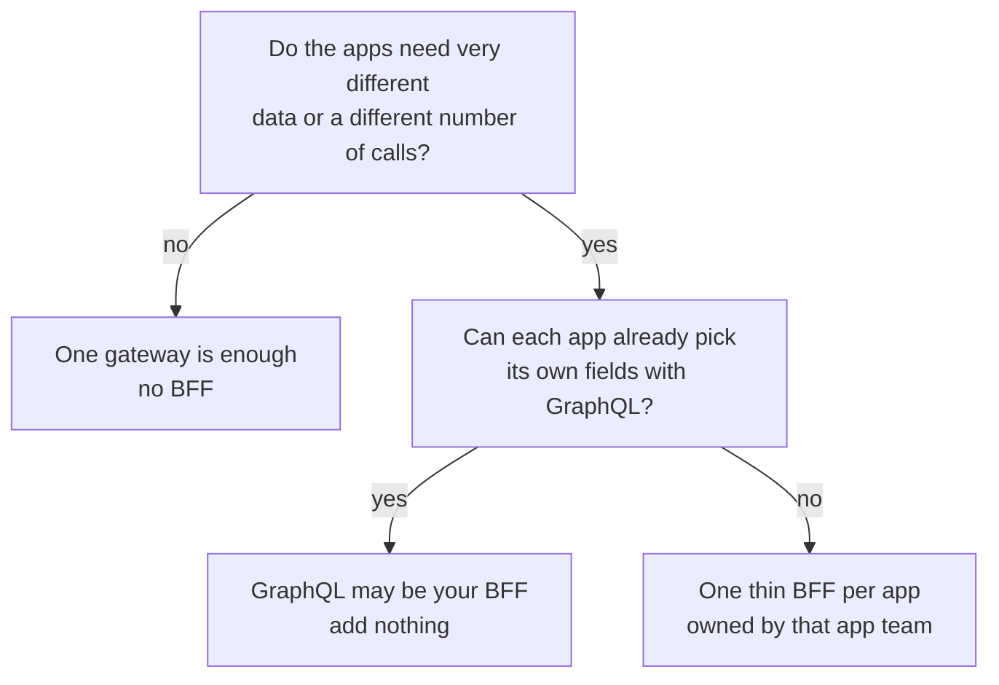

**The backend for frontend (BFF).**

- **Problem:** a mobile app wants few calls and small answers, because the phone network is slow. A web app wants rich pages. An admin site wants other fields. One general backend gets pulled in all directions (card 5, and story 3 of the stepper).
- **Fix:** one thin server per app, owned by the team that builds that app. It calls the services and shapes the answers. It has **no business rules**.
- **In your stack:** the Next.js server is often the web BFF. GraphQL can also do the job, because each client picks its own fields. Microsoft's pattern page says so.
- **Cost:** one more server per app to deploy, some copied code, and one more hop. Do **not** add a BFF when the apps make the same requests, or when only one app uses the backend.

**Way 1 to go wrong: the one door.**

The gateway is the only way in. If its only copy stops, every service is out of reach, even though they are all running (story 2 of the stepper).

- Run two or more copies behind a load balancer, with health checks (lesson 03).
- Keep the counters in a shared store such as Redis. If every copy counts alone, the real limit is the limit times the number of copies.
- Roll out gateway config one copy at a time. A bad config can still take both copies down.
- Set timeouts. A slow service must not hold the gateway's connections for ever (lesson [23](23-timeouts-retries-and-circuit-breakers.md)).

</details>

## 6. Four mistakes, and what to say if you freeze

- **Wrong:** the gateway joins data and applies business rules. **Right:** door jobs only. A BFF shapes the data.
- **Wrong:** the service trusts the whole network. **Right:** it checks that this user owns the order.
- **Wrong:** each gateway copy counts in its own memory. **Right:** one shared counter.
- **Wrong:** one gateway copy. **Right:** two copies, health checks, config in code.

<details class="guess"><summary>🤔 Guess: a service says "the gateway checked the token, so I trust everyone". A caller reaches the service directly. What can they do? Press to check.</summary>

Send **any `x-user-id`** and read anyone's orders. The service must check ownership itself (`findOne({ id, ownerId })`), and it should have no public route.

</details>

> **Remember:** if you freeze, say "A reverse proxy speaks for the servers. A gateway is a reverse proxy that also checks the ticket, limits requests and picks the service."

<details class="more"><summary>📖 More detail: the four mistakes in full, and the freeze plan</summary>

**Wrong:** the gateway joins data and applies business rules.

```js
// sketch, not run here
app.get("/home", async (req, res) => {
  const [orders, points] = await Promise.all([getOrders(req.user), getPoints(req.user)]);
  res.json({ orders: orders.filter((o) => o.price > 100), points });   // business rule inside the gateway
});
```

**Right:**

```js
// sketch, not run here
// gateway: check the ticket, check the limit, pick the target. Nothing else.
route("/home", { to: "mobile-bff" });
// mobile-bff: call the services and cut the answer down for the phone
// orders-service: owns the rule about which orders count
```

**Why:** the gateway is the one place every release can break everything. Keep it small and boring.

**Wrong:** the service trusts the whole network, because "the gateway checked the token".

```js
// sketch, not run here
app.get("/orders/:id", async (req, res) => {
  res.json(await db.orders.findById(req.params.id));       // no check that this user owns the order
});
```

**Right:**

```js
// sketch, not run here
app.get("/orders/:id", async (req, res) => {
  const userId = req.headers["x-user-id"];                  // set by the gateway from the verified ticket
  const order = await db.orders.findOne({ id: req.params.id, ownerId: userId });
  if (!order) return res.sendStatus(404);
  res.json(order);
});
```

**Why:** the gateway answers "is this ticket real?". The service answers "may this user do this?". And the gateway must **overwrite** `x-user-id` on every request, or a caller can send their own (practice B).

**Wrong:** each of 3 gateway copies counts calls in its own memory.

**Right:** all copies add to one shared counter, for example in Redis.

**Why:** a load balancer shares one user's calls across the 3 copies. Each copy sees a third of them, so the real limit is 3 times larger (practice A).

**Wrong:** one gateway copy, because "it is only routing".

**Right:** two copies behind a load balancer, health checks, and config in code.

**Why:** the gateway is the one door (story 2 of the stepper).

**If you freeze:**

1. Say "A reverse proxy speaks for the servers. A gateway is a reverse proxy that also checks the ticket, limits requests and picks the service."
2. Say "It does door jobs only. Business rules live in the services, and data shaping lives in a BFF or GraphQL."
3. Say "It is one door, so I run two copies, share the counters, and keep it small."

</details>

## 7. Watch and play

Links were opened with a page fetch tool on 2026-10-17. For the video, I confirmed the title and the channel name from YouTube's embed data. I could not see the length.

- **Video:** [What is an API Gateway?](https://www.youtube.com/watch?v=RbMxB_Cyx6A) - Gaurav Sen, length not checked. Compare what he lists with the five jobs in card 4 (blue bar).
- **Play with it:** [the stepper in this folder](visuals/17-proxies-and-api-gateways.html) - guess first, then press Next. Try all three tabs.
- **Play with it:** [nginx location tester](https://nginx.viraptor.info/) - paste an nginx config with a few `location` blocks and type a URL. It shows which block wins. This is the "route" check from the code. The page says it does not support sub-locations.
- **Play with it:** [rate limiting playground on system-design.space](https://system-design.space/en/visuals/rate-limiting/) - run a burst against a token bucket and compare it with a fixed window.
- **Read:** [Azure Architecture Center: API gateways](https://learn.microsoft.com/en-us/azure/architecture/microservices/design/gateway) - diagram and the three patterns (routing, aggregation, offloading). Find the list of what to offload.
- **Read:** [Azure Architecture Center: Backends for Frontends pattern](https://learn.microsoft.com/en-us/azure/architecture/patterns/backends-for-frontends) - diagrams, "when to use" and "might not be suitable". Find the GraphQL note.
- **Read:** [Sam Newman: Backends for Frontends](https://samnewman.io/patterns/architectural/bff/) - the person who named the pattern. Find "one experience, one BFF".

<details><summary>Go deeper (optional)</summary>

**More pages I opened on 2026-10-17.**

- [MDN: Proxy servers and tunneling](https://developer.mozilla.org/en-US/docs/Web/HTTP/Guides/Proxy_servers_and_tunneling) - says a forward proxy acts for clients and can hide them, and a reverse proxy can hide the servers. It also lists the `Forwarded` and `X-Forwarded-For` headers. Behind a proxy, your app sees the proxy's address. The real client address is in those headers. Trust them only when your own proxy set them.
- [MDN: 429 Too Many Requests](https://developer.mozilla.org/en-US/docs/Web/HTTP/Reference/Status/429) - the code, and the `Retry-After` header that tells the caller how long to wait.
- [nginx: ngx_http_limit_req_module](https://nginx.org/en/docs/http/ngx_http_limit_req_module.html) - uses the "leaky bucket" method. `burst` sets how many extra requests may wait. With `nodelay` the burst is served at once. The default refusal code is 503, and `limit_req_status` changes it.
- [nginx: reverse proxy guide](https://docs.nginx.com/nginx/admin-guide/web-server/reverse-proxy/) - `proxy_pass`, and which headers nginx changes by default.
- [Kong Gateway](https://developer.konghq.com/gateway/) - the docs call it a lightweight, fast, flexible cloud-native gateway. It runs as a reverse proxy and has plugins for login methods and rate limits (by IP address, API key or Consumer).
- [AWS: REST APIs or HTTP APIs](https://docs.aws.amazon.com/apigateway/latest/developerguide/http-api-vs-rest.html) - the table says API keys, per-client limits, request validation and AWS WAF are REST API features. A JWT authorizer is built into HTTP APIs. REST APIs can use a Lambda authorizer for JWTs.
- [AWS: API Gateway quotas](https://docs.aws.amazon.com/apigateway/latest/developerguide/limits.html) - the default is 10,000 requests per second per account per Region, plus a burst from a token bucket with a bucket of 5,000. Some Regions start lower. The burst number is set by AWS and cannot be changed.
- [Cloudflare API Shield](https://developers.cloudflare.com/api-shield/) and [JWT validation](https://developers.cloudflare.com/api-shield/security/jwt-validation/) - the edge checks a JWT before it reaches your origin and finds tokens that are expired, changed or not yet valid. It does not fetch new keys by itself, and rules decide what to do with the result.
- [Istio: ambient mode](https://istio.io/latest/docs/ambient/overview/) - a mesh without a proxy in every pod. A small proxy runs on each node and an optional proxy handles HTTP rules. I did not check how mature it is today. Look at Istio's feature status page.

**North-south and east-west.** Some people call the calls from outside to inside "north-south" and the calls between services "east-west". A gateway handles the first kind. A mesh handles the second.

**The three gateway patterns** (Azure page above). Routing sends a request to the right service. Aggregation combines several calls into one answer for the client. Offloading moves shared jobs such as HTTPS, login checks and limits into the gateway. Aggregation is the one that tempts logic creep. A BFF is the better home for it.

**GraphQL and the gateway.** A gateway sees the URL and the headers. It cannot easily see inside a GraphQL query body. So depth and cost limits for GraphQL belong inside the API service (from the DBO case study).

**A gateway can be the GraphQL router.** With many teams, a router joins several GraphQL services into one graph (federation). Lesson-sized detail is in the [architecture patterns guide](architecture-patterns-2026.md), Part 4. With one team, one GraphQL server is simpler.

**The first limit is often the cheapest one.** A limit per IP before the ticket check protects the login route from guessing. A limit per user after the ticket check protects the services. The [networking guide](../networking/networking-for-system-design.md), Part 5, and the [rate limiter workbook design](design-workbook-part-1-classic-designs.md) go deeper on counting methods and where the counter lives.

**TLS inside.** Ending HTTPS at the gateway is simpler. Some rules (banks, health data) ask for encryption again inside. A service mesh can do that between services for you.

**jwt.io.** The [JWT debugger](https://jwt.io/) decodes a token so you can see what a gateway reads: who, and when it ends. The page text did not say where decoding runs, so do not paste a real token.

</details>

## 8. Practice

**A. Predict the output** (write your answer before opening)

A counter allows 2 calls per user. What does this print?

```js
const used = {};
function allow(user, limit) { used[user] = (used[user] || 0) + 1; return used[user] <= limit; }
const answers = [];
for (const user of ["sam", "sam", "mia", "sam"]) answers.push(user + ":" + (allow(user, 2) ? "ok" : "429"));
console.log(answers.join(" "));
```

Then answer: Sam sends 9 requests. A load balancer shares them over 3 gateway copies, one after the other, and each copy keeps its own `used`. The limit in each copy is 2. How many of the 9 requests are allowed?

<details><summary>Answer</summary>

```
sam:ok sam:ok mia:ok sam:429
```

Sam's third call is over 2, so it gets 429. Mia has her own count.

With 3 copies, each copy sees 3 of the 9 requests and allows 2 of them. So **6 of 9** are allowed, not 2. The real limit is the limit times the number of copies. The fix is one shared counter, for example in Redis. (Checked on 2026-10-17 with Node 24.)

</details>

**B. Fix the bug**

The gateway sets `x-user-id` so that services know who is calling. Mia has a real ticket. She also sends her own header `x-user-id: boss`. What does the service see? Then fix it.

```js
const tokens = { "t-mia": "mia" };
function shape(req) {
  const user = tokens[req.token];
  return { ...req.headers, "x-user-id": req.headers["x-user-id"] || user };
}
console.log(shape({ token: "t-mia", headers: { "x-user-id": "boss" } }));
```

<details><summary>Answer</summary>

It prints `{ 'x-user-id': 'boss' }`. The gateway believes the header the caller sent, so Mia can act as anyone. The services trust `x-user-id`, so this is a hole.

Fix: the gateway always decides. It uses the user from the ticket and ignores what the caller sent.

```js
const tokens = { "t-mia": "mia" };
function shape(req) {
  const user = tokens[req.token];
  return { ...req.headers, "x-user-id": user };     // set last, so it wins
}
console.log(shape({ token: "t-mia", headers: { "x-user-id": "boss" } }));   // { 'x-user-id': 'mia' }
```

This also shows why services behind a gateway must have **no public route**. If a caller could reach a service directly, they could send any `x-user-id`. (Checked on 2026-10-17 with Node 24.)

</details>

**C. Write it yourself**

Open `learn/system-design/practice/17-proxies-and-api-gateways.js`. It has one empty function, `createGateway`. It makes a tiny gateway with the checks from this lesson: the ticket, a limit per user in a time window, a route by the start of the path (the longest start wins), and a clean `x-user-id` header. Write it, then run this from the repo root and make all the tests pass:

```
node --test learn/system-design/practice/17-proxies-and-api-gateways.test.js
```

<details><summary>One possible answer</summary>

```js
function createGateway({ routes, tokens, limit, windowMs, now }) {
  const windows = new Map();                                    // user -> { start, count }
  const starts = Object.keys(routes).sort((a, b) => b.length - a.length);   // longest start first
  return {
    handle(req) {
      if (!req.token || !Object.hasOwn(tokens, req.token)) return { status: 401 };   // 1 the ticket
      const user = tokens[req.token];
      const t = now();
      let w = windows.get(user);
      if (!w || t - w.start >= windowMs) { w = { start: t, count: 0 }; windows.set(user, w); }
      w.count += 1;                                             // 2 the limit
      if (w.count > limit) return { status: 429, retryAfter: Math.ceil((w.start + windowMs - t) / 1000) };
      const start = starts.find((s) => req.path === s || req.path.startsWith(s + "/"));   // 3 the route
      if (!start) return { status: 404 };
      return { status: 200, service: routes[start], headers: { ...(req.headers || {}), "x-user-id": user } };   // 4 the shaping
    },
  };
}

module.exports = { createGateway };
```

Checked on 2026-10-17 with Node 24: the 15 tests fail on the empty stub and all 15 pass with this answer. Two details to notice. `Object.hasOwn(tokens, ...)` stops a caller from using the token `constructor`, because every object has a property with that name. And the window is a fixed window: it starts at the user's first call. A fixed window lets a user send a double burst at the edge of two windows. Lesson [09](09-design-a-rate-limiter.md) shows better counting methods.

</details>

## 9. Interview question

**Q:** "You have a mobile app, a web app and five backend services. Would you add an API gateway? What would it do, what would you keep out of it, and what happens when it goes down?"

A common follow-up: "What is the difference between a gateway and a load balancer?" Card 4 is the answer.

<details><summary>A strong answer, in four parts</summary>

1. **Problem:** without one door, every service repeats HTTPS, ticket checks and limits, and the copies drift apart. The apps must know many addresses. Every service is public, so every service is a target.
2. **How it works:** one gateway is the only public door. It ends HTTPS, checks that the ticket is real, counts calls per user and answers 429 when the count is too high, picks the service by path, adds `x-user-id` and a request id, and writes a log line. The services have no public address. The gateway checks "is this ticket real". The service checks "may this user do this". A load balancer is different: it shares work between copies of one service. A gateway sends requests to different services. If the apps need very different data shapes, I add a thin BFF per app, or let GraphQL do it.
3. **Tradeoff:** one more hop, and the gateway is a single point of failure, so I run two or more copies behind a load balancer, with health checks and shared counters. I also keep business rules out, or it becomes a second monolith that every team must change. A BFF costs one more server per app, so I add it only when the apps really differ.
4. **My example:**
   - **Fact:** my DBO case study draws three clients (the React Native app, the CMS admin and the verification admin) entering through one gateway box with routing, TLS and rate limiting. Behind it are the API service (GraphQL) and the Auth service.
   - **Fact:** one GraphQL API service serves both the app and the CMS. So each client already picks its own fields. My reading: GraphQL does the job a BFF would do here.
   - **Not known yet:** the case study guesses that the gateway today is "likely just CapRover's bundled nginx doing routing and TLS". I must check what really runs before I say so.
   - **Idea, not a fact:** from the case study. Check the JWT signature at the edge. Use per-route limits with the counter in Redis (the case study says DBO already runs Redis for BullMQ), with very strict limits for OTP and login. Put GraphQL depth limits inside the API service. Move to Traefik before Kong, and add Kong only if API key management is needed. Run the same API image as two deployments, one for app traffic and one for CMS traffic.

</details>

## 10. Explain it back

Close this file. Explain proxies and gateways out loud like to a new junior, in 4 parts (problem, how, tradeoff, my example). Use the story of the five requests (200, 401, 200, 404, 429) and the story of the one door that stops. Then write your best version below and run `/explain-check proxies and api gateways` or ask the `explain-coach` agent to review it.

### My explanation

<write here>

### Coach feedback

<the explain-coach agent writes here>

## 11. Review questions (day 1, 3, 7, 21)

1. A forward proxy and a reverse proxy: which side does each one speak for, and what does each one hide?
2. Name four jobs of an API gateway and one job it must not do. Then say what the gateway checks about the user, and what the service checks.
3. The gateway runs as one copy. What happens when it stops, and what are two fixes?
4. Draw one good request over time (card 2, blue bar) from memory.

<details><summary>Answers</summary>

1. A forward proxy speaks for the clients (like a company web filter) and can hide who the clients are. A reverse proxy speaks for the servers (like Nginx) and hides the servers.
2. Any four of: route by path, check the ticket, end HTTPS, limit requests, shape the request (add `x-user-id` and a request id, set size and time limits), log. It must not hold business rules or join data from many services. The gateway checks "is this ticket real". The service checks "may this user do this".
3. Every service is out of reach, even though they are running, because they have no public address. Fixes: run two or more copies behind a load balancer with health checks, and keep the counters in a shared store. Also roll out config one copy at a time, and keep the gateway small.
4. Phone, Gateway and Orders service, left to right. The phone sends a request with a ticket. The gateway ends HTTPS, checks the ticket, checks the count, and picks the service by path. It sends the request with `x-user-id` and a request id. The service answers. The gateway writes a log line and sends the answer to the phone.

</details>

## Connected lessons

- [Load balancers](03-load-balancers.md) - the front door that shares work between copies of one service. Run your gateway behind one.
- [CDN](05-cdn.md) - another reverse proxy, close to the user. A gateway sits behind it and cares about the API, not the files.
- [Scaling up vs out](02-scaling-up-vs-out.md) - the gateway must keep no user state, so you can add copies.
- [Latency numbers and estimation](16-latency-numbers-and-estimation.md) - the lesson before. Each hop through the gateway costs time. This lesson names that cost.
- [Object storage and presigned uploads](18-object-storage-and-presigned-uploads.md) - the next lesson. A big upload should not go through the gateway or the API at all.
- [Design a rate limiter](09-design-a-rate-limiter.md) - how to count, and where the counter lives, in full.
- [Timeouts, retries and circuit breakers](23-timeouts-retries-and-circuit-breakers.md) - the timeouts a gateway sets on every service call.
- [Security in a design](29-security-in-a-design.md) - the ticket, permissions and service to service trust, in full.
- [Observability](14-observability.md) - the request id the gateway adds is the thread that ties the logs together.
- [Networking for system design](../networking/networking-for-system-design.md) - Part 5 is the deeper guide on proxies, TLS, gateways and meshes.
- [Architecture patterns in 2026](architecture-patterns-2026.md) - Part 4 covers the gateway, the BFF and federation.
- [DBO case study, API gateway deep dive](../../interview/my-projects/dbo-b2b-platform-system-design-case-study.md) - the real project, with the tool options and the rate limit table.
- [System design interview questions](senior-system-design-interview-questions.md) - questions 11 and 46 ask this lesson in two ways: the gateway, and the BFF.
