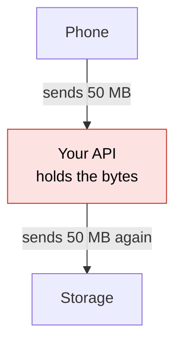
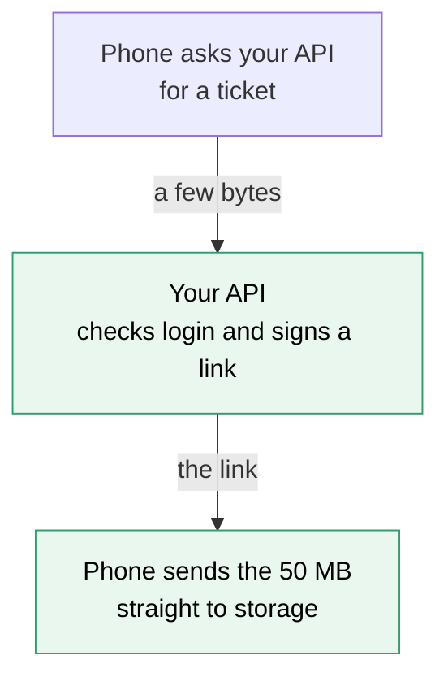
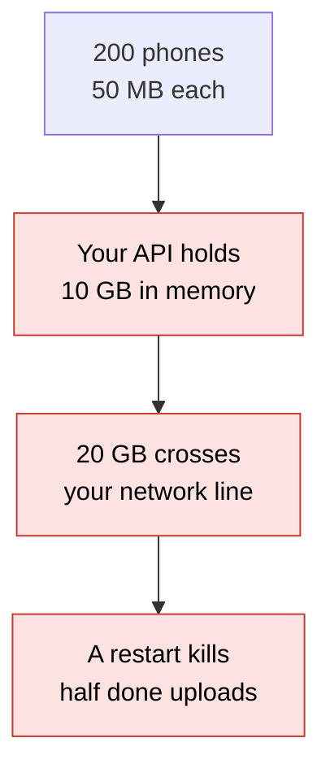
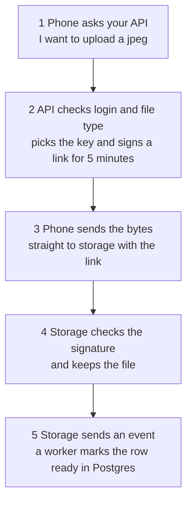
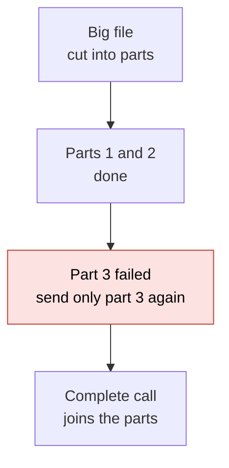
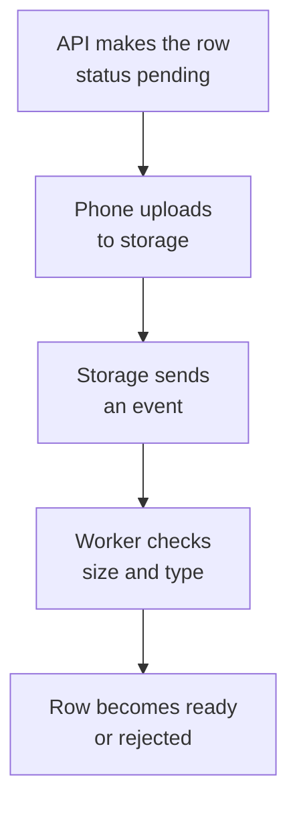
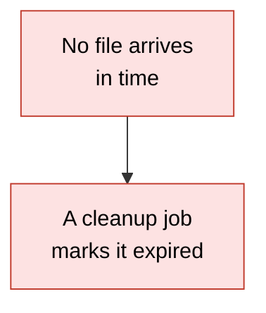

# 18. Object storage and presigned uploads

> **Subject:** System Design · **Lesson:** 18 · **Made:** 2026-11-04 · **Status:** ready
>
> **You will be able to:** say why files live in a bucket and not in your database, draw how a phone uploads a file straight to storage with a signed link, name what the server must still decide (the key, the type, the size), plan a big upload in parts, and say what to do about uploads that never finish.
>
> **Before this:** [Proxies and API gateways](17-proxies-and-api-gateways.md) · **Next:** [Replication and quorums](19-replication-and-quorums.md)
>
> **How to read it:** one card is one idea. Look at the picture, guess, then press the orange bar to check. The blue bars (📖 More detail) hold the longer explanation. Skip them on the first read, and open them when you want more. About 15 minutes for the cards.

## 1. The idea: the parcel skips reception

A driver brings a parcel to a big warehouse. Reception does not carry the parcel inside. Reception checks who the driver is, then hands over a **ticket** that opens one door, for one parcel, for 5 minutes. The driver walks to the warehouse alone. Your API is reception. The storage is the warehouse. The file is the parcel.





Notice that in the first picture your API carries every byte twice. In the second it never sees the file.

<details class="guess"><summary>🤔 Guess: 200 people upload a 50 MB video at the same time. How much data must your API servers carry if the bytes go through them, and how much if the phones use signed links? Press to check.</summary>

Through your API: 200 × 50 MB in, plus the same out to storage, is **20 GB**. With signed links: each phone sends only a small "give me a link" request, about **0.2 MB** in all (if each request is about 1 KB, a guess). The 10 GB of video goes straight to storage. (Real run, Node 26.12.1.)

</details>

> **Remember:** the API checks who may upload and signs a link. The bytes go straight to storage.

<details class="more"><summary>📖 More detail: new words, the problem drawn, and why it exists</summary>

Lesson [05](05-cdn.md) put copies of files near users for reading. This lesson is about where the files live, and how they get there.

New words (four):

- **Object storage:** a service that keeps files ("objects") in containers. Amazon S3 is the best known. Others offer the same idea with the same style of API.
- **Bucket:** the container. **Key:** the name of one file inside it, like `uploads/user-42/abc123`.
- **Presigned URL (a signed link):** a normal web address with a signature inside. It allows one action, on one key, for a short time. Nobody needs your password.
- **Multipart upload:** sending a big file in parts, so one failure costs one part.

**The problem, drawn.** If the file goes through your API, your server holds the bytes, a connection and memory for minutes. If it dies at 90%, the upload starts again from zero. And your network line carries the same data twice.



**The code behind the guess.**

```js
const users = 200, mbEach = 50;
const throughApi = users * mbEach * 2;       // in from the phone, out to storage
const direct = users * 1 / 1000;             // about 1 KB each to ask for a link
console.log(throughApi / 1000 + " GB through the API");
console.log(direct + " MB through the API with signed links");
```

**Output:**

```
20 GB through the API
0.2 MB through the API with signed links
```

Checked on 2026-11-04 with Node 26.12.1.

**Where the analogy stops.** A real ticket is checked by the warehouse, not by reception. That is the point: storage checks the signature itself, with a secret that reception shared with it. Also, a ticket can be passed on. A signed link can be used by whoever holds it (card 3).

**Why it exists and what it costs.**

- **Without it:** your servers are big and busy because of bytes they do not need to read. Uploads break on restarts. You pay twice for traffic.
- **With it:** your servers stay small. Storage is built for big files and for many people at once. A phone can retry one part.
- **The cost:** more steps (ask, upload, confirm), a "pending" state in your database, and clean-up work for uploads that never finish (card 6). You also cannot check the file *before* it is stored. You check it after.

</details>

## 2. A bucket is a map from key to file

Think of object storage as one giant map. The key is the name. The value is the file, plus a little information about it (the type, the size, the date). There are no real folders. `uploads/user-42/` is just the first part of the name.

| Key | File | Information kept with it |
|---|---|---|
| `uploads/user-42/abc123` | the bytes of a photo | `image/jpeg`, 3 MiB |
| `uploads/user-42/def456` | the bytes of a PDF | `application/pdf`, 120 KB |
| `uploads/user-7/ghi789` | the bytes of a photo | `image/png`, 900 KB |

<details class="guess"><summary>🤔 Guess: a phone uploads a new file to the key `uploads/user-42/abc123`, and that key already holds a photo. What happens to the old photo? Press to check.</summary>

It is **replaced**. S3 puts the new file under the same key and the old one is gone (unless you turned on versioning). This is why the **server** must pick the key (card 4).

</details>

> **Remember:** a bucket is a map: key to file. Put the bytes there and the details (owner, status) in Postgres.

<details class="more"><summary>📖 More detail: why not the database, what S3 promises, and the cost</summary>

**Why not keep files in Postgres?** A photo of 6 MB in a table makes the table, the backups and the copies (replicas) grow fast. Every backup copies every photo. The database is made for rows you search and join, not for big blobs. Keep the **key** and the details in Postgres, and the bytes in the bucket:

```sql
-- the details live in Postgres, the bytes live in the bucket
CREATE TABLE file (
  id         uuid PRIMARY KEY,
  owner_id   bigint NOT NULL,
  s3_key     text NOT NULL UNIQUE,
  mime_type  text NOT NULL,
  size_bytes bigint,
  status     text NOT NULL DEFAULT 'pending'   -- pending, ready, rejected, expired
);
```

**What the AWS docs say (opened 2026-11-04):**

- Objects are stored in buckets, and each object has a key that is its unique name in the bucket. Buckets and objects are private unless you grant access.
- A new upload to an existing key replaces the old object.
- S3 gives strong read-after-write consistency. After a successful PUT, a read of that key returns the new data (lesson [07](07-consistency-and-cap.md) is about why this matters). Two writes to one key at once: the later one wins, and S3 has no lock for it.
- Updates are per key. You cannot change two keys in one step. If you need that, build it in your app.
- One upload can be up to 48.8 TiB, but you send it in parts if it is big (card 5).

**Cost.** You cannot search inside files, join them, or change a piece of a file. You replace the whole object. For searching, keep the details in your database (lesson [database 23](../database/23-sql-vs-nosql-and-redis.md) and the data storage guide, Part 4).

</details>

## 3. The signed link, step by step

The signed link is a normal address with a **signature** in it. Storage holds the same secret as your API, so storage can check the signature without calling your API. If you change anything in the link, the signature stops matching.



<details class="guess"><summary>🤔 Guess: someone has a link signed for `uploads/user-42/abc123`. They change the key in the path to `uploads/user-7/ghi789` and send the file. Does storage accept it? Press to check.</summary>

**No.** The signature was worked out from the key, the time, the method and the signed headers. Change the key and the signature that storage works out is different, so it refuses. I recomputed this by hand: the changed key gives a different signature. A change to the expiry, the method, or the signed content type does the same. (I did not test this on real S3. It needs an AWS account.)

</details>

> **Remember:** a signed link allows one action on one key for a short time. It is a ticket: anyone who holds it can use it until it ends.

<details class="more"><summary>📖 More detail: the link taken apart, the recomputed signature, and the limits</summary>

**One real link, taken apart.** I made this link with the AWS SDK v3 (version 3.1161.0), a made up access key and a made up secret. Nothing here talked to AWS.

```js
import { S3Client, PutObjectCommand } from "@aws-sdk/client-s3";
import { getSignedUrl } from "@aws-sdk/s3-request-presigner";

const s3 = new S3Client({ region: "ap-southeast-1" });
const command = new PutObjectCommand({ Bucket: "my-app-media", Key: "uploads/user-42/abc123", ContentType: "image/jpeg" });
const url = await getSignedUrl(s3, command, {
  expiresIn: 300,                                // 5 minutes
  signableHeaders: new Set(["content-type"]),    // the phone must send this exact type
});
```

The path is `/uploads/user-42/abc123` on the host `my-app-media.s3.ap-southeast-1.amazonaws.com`. The parts after the `?`:

| Part of the link | Value | What it means |
|---|---|---|
| `X-Amz-Algorithm` | `AWS4-HMAC-SHA256` | the signing method |
| `X-Amz-Credential` | `AKIAEXAMPLE/20261104/ap-southeast-1/s3/aws4_request` | who signed, the day, the region |
| `X-Amz-Date` | the moment it was signed | when the 5 minutes start |
| `X-Amz-Expires` | `300` | how many seconds it lives |
| `X-Amz-SignedHeaders` | `content-type;host` | headers that must match |
| `X-Amz-Signature` | a long hex number | the proof |

**I recomputed the signature myself** with a short piece of `crypto` code, from the link's own parts and the secret. Same answer as the SDK. Then I changed one thing at a time:

```
1 the link as it is                same as the link  -> S3 accepts
2 another key in the path          different          -> S3 refuses
3 expires 300 changed to 3000      different          -> S3 refuses
4 another content type             different          -> S3 refuses
5 another method (GET)             different          -> S3 refuses
6 someone without the secret       different          -> S3 refuses
```

Checked on 2026-11-04 with Node 26.12.1. This shows how the signature works. It does not show what real S3 does, because I did not call real S3. For that, I rely on the AWS docs.

**What the AWS docs say (opened 2026-11-04):**

- Anyone with valid credentials can make a link, but it only works if the signer has permission to do that action. The link has the power of its signer, no more.
- The docs call presigned URLs "bearer tokens": whoever holds one can use it. You can use one **more than once**, until it expires.
- S3 checks the expiry **at the time of the request**. A download that started before the end carries on. A restart after the end fails.
- With the SDKs the expiry can be up to **7 days**. With the console, 1 minute to 12 hours. With role or temporary credentials, the link dies when the credentials die, even if you asked for longer.
- If a link gives `SignatureDoesNotMatch`, the docs list these checks: the clock, a changed URL, an expired link, a different content type, a wrong region, and a proxy that changes headers.

**A local fake S3 would not have shown this.** I first tried a local fake S3 server (s3rver 3.7.1). It refused an expired link, but it accepted the wrong key, the wrong type, and a read with no signature at all. A fake can skip checks. So the signature test above is the proof, not the fake.

**Cost.** The link is a secret for its few minutes. If it leaks, someone else can use it. Keep it short, and send it only over HTTPS.

</details>

## 4. The server decides what the link allows

The phone does not choose. Your API chooses the **key** (so nobody overwrites another person's file), the **type** and the **size**. Then it puts those in the signature.

| Your API decides | How |
|---|---|
| The key | `uploads/<userId>/<random id>`, made by the server |
| The file type | sign the `content-type` header, so storage refuses another type |
| The size | check it first, then sign the exact `content-length`, or use a signed form (below) |
| How long | a few minutes (5 minutes in the lesson code) |

<details class="guess"><summary>🤔 Guess: the API builds the key with `body.key || "uploads/" + user.id + "/" + body.fileId`. User 42 sends `key: "uploads/7/passport.jpg"`. What key does the link get? Press to check.</summary>

`uploads/7/passport.jpg`. The server believed the key the caller sent. User 42 can now **replace user 7's file**, because a same-key upload replaces the old object. The fix: always build the key on the server and ignore the caller's key. (Real run, Node 26.12.1.)

</details>

> **Remember:** the server picks the key. Sign the type and the size. Never let the phone choose the name.

<details class="more"><summary>📖 More detail: the fix, what is signed, the size limit, and CORS</summary>

**The bug and the fix.**

```js
function makeUploadLink(user, body) {
  const key = body.key || "uploads/" + user.id + "/" + body.fileId;
  return { key };
}
console.log(makeUploadLink({ id: 42 }, { key: "uploads/7/passport.jpg", fileId: "f1" }));
function fixed(user, body) {
  return { key: "uploads/" + user.id + "/" + body.fileId };
}
console.log(fixed({ id: 42 }, { key: "uploads/7/passport.jpg", fileId: "f1" }));
```

```
{ key: 'uploads/7/passport.jpg' }
{ key: 'uploads/42/f1' }
```

Checked on 2026-11-04 with Node 26.12.1. In real code, use a random id (a uuid) in the key, not the caller's file id.

**What the SDK signs.** I checked the links the SDK made, on 2026-11-04:

- With no options, only `host` is signed: `X-Amz-SignedHeaders=host`. **The content type is not signed**, even if you set `ContentType`. So the phone could send any type.
- With `signableHeaders: new Set(["content-type"])`, the link has `content-type;host`. Now the type must match.
- With `ContentLength: 3145728` in the command, the link has `content-length;host`. The exact size is part of the signature. I did not test on real S3 that a different size is refused.

**A size range.** A signed PUT says an exact size at best. It cannot say "up to 5 MB". For a range, use a signed **form** (`@aws-sdk/s3-presigned-post`). I made one for a 5 MiB limit. Its policy had `["content-length-range", 0, 5242880]` and `["eq", "$Content-Type", "image/jpeg"]`. S3 checks that policy itself. You can also check the size in the worker after the file arrives, and reject it (card 6).

**CORS.** If a web page on your site sends the file to the bucket, the browser calls a different address (another "origin"). The bucket needs a CORS rule that allows your site and the method (PUT). The S3 CORS page describes how a rule is matched. A phone app does not need this, because only browsers apply CORS.

**Cost.** Each check you add is one more thing that can refuse a good upload. Keep the allowed types as a short list.

</details>

## 5. Big files go in parts

For a big file, one request is fragile. Send it in **parts**. If one part fails, send only that part again. When all the parts are there, a final "complete" call joins them.



<details class="guess"><summary>🤔 Guess: a 100 GiB file with the smallest part size (5 MiB). How many parts? Is that allowed? What part size works? Press to check.</summary>

100 GiB ÷ 5 MiB = **20,480 parts**. One upload may have at most **10,000** parts, so this is **not allowed**. The part size must be at least 100 GiB ÷ 10,000 = about 10.2 MiB, rounded up to **11 MiB**, which gives **9,310 parts**. (Real run, Node 26.12.1.)

</details>

> **Remember:** parts are 5 MiB to 5 GiB, at most 10,000 of them. Consider parts above about 100 MB.

<details class="more"><summary>📖 More detail: the limits, the code, resume, and the cost</summary>

**The S3 limits** (AWS docs, opened 2026-11-04): the largest object is **48.8 TiB**. A multipart upload has up to **10,000 parts**, numbered 1 to 10,000. A part is **5 MiB to 5 GiB**, and the last part can be smaller. The docs say that when an object reaches about 100 MB you should **consider** multipart. That "100 MB" is advice, not a hard rule.

Check: 10,000 parts × 5 GiB is about 48.83 TiB. That is where the 48.8 TiB limit comes from.

**The code.** It is practice C. It picks the smallest allowed part size.

```js
const MiB = 2 ** 20;
const GiB = 2 ** 30;
const MAX_PARTS = 10000;

function planMultipart(sizeBytes) {
  if (!Number.isInteger(sizeBytes) || sizeBytes <= 0) throw new RangeError("size must be a whole number above 0");
  if (sizeBytes > MAX_PARTS * 5 * GiB) throw new RangeError("too big: the limit is about 48.8 TiB");
  if (sizeBytes <= 100 * MiB) return { mode: "single", parts: 1, partSize: sizeBytes };
  const partSize = Math.max(5 * MiB, Math.ceil(sizeBytes / MAX_PARTS / MiB) * MiB);
  return { mode: "multipart", partSize, parts: Math.ceil(sizeBytes / partSize) };
}
```

Real output for three sizes:

```
3145728 { mode: 'single', parts: 1, partSize: 3145728 }
5000000000 { mode: 'multipart', partSize: 5242880, parts: 954 }
107374182400 { mode: 'multipart', partSize: 11534336, parts: 9310 }
```

Checked on 2026-11-04 with Node 26.12.1.

**With signed links.** The API starts the upload and gets an upload id. For each part it signs one link. The phone sends each part to its own link, sends the part numbers and tags back to the API, and the API makes the final "complete" call. Several parts can go at the same time.

**Resume.** Save the upload id and the finished part numbers (in the app, or in your database). When the app comes back, ask storage which parts it has and send only the rest. The open standard **tus** does this for you. Dropbox cuts every file into 4 MB blocks and names each by its content hash, so a block it already has is never sent again (from the design workbook, which I did not re-check).

**Cost.** Unfinished uploads leave parts in storage, and you pay for them. Add a bucket rule that deletes unfinished multipart uploads after a few days (I did not open that docs page; check the name of the rule in the lifecycle docs).

</details>

## 6. After the upload: trust the event, not the phone

The phone says "done". Do not believe it yet. A phone can crash, lie, or send a different file. Storage knows what really arrived. So the row in Postgres starts as **pending**, and only the **storage event** (or your own check) turns it into **ready**.





<details class="guess"><summary>🤔 Guess: the phone gets a link, then the app crashes before it uploads anything. What is left in Postgres and in the bucket, and what cleans it up? Press to check.</summary>

Postgres has a row that says **pending**. The bucket has **nothing** (or part of a file). A cleanup job marks pending rows older than, say, 1 hour as **expired**, and a bucket rule can delete leftovers. Nobody shows the file to users, because only **ready** rows are shown.

</details>

> **Remember:** pending first, ready only after the storage event. Clean up what never finishes.

<details class="more"><summary>📖 More detail: the states, the code, private files, and the cost</summary>

**The states.** `pending` (a link was given), then `ready` (the event arrived and the size and type match) or `rejected` (they do not match), or `expired` (nothing arrived in time).

| From | What happens | To |
|---|---|---|
| `pending` | the event arrives and the size and type match | `ready` |
| `pending` | the event arrives and they do not match | `rejected` |
| `pending` | no file arrives in time (the cleanup job) | `expired` |

That whole state machine is practice C (`createUploads`). The size and type that the event reports are compared with the ones saved when the link was made.

**Events.** S3 can send a notification when a file arrives, to a queue, a topic or a function (S3 event notifications). A worker reads the event, checks the file, and updates Postgres. Events can be delivered more than once, so the worker must be safe to run twice (lesson [13](13-idempotency-and-retries.md) and lesson [06](06-message-queues.md)).

**Private files.** Keep the bucket private. To read a file, the API checks that the user may see it, then returns a short **signed GET link**, or a signed CDN link (lesson [05](05-cdn.md)). The same signing idea, with GET as the method.

**Never public for private files.** An ID card photo must never sit in a public bucket. S3 buckets are private until you grant access, so do not.

**Cost.** More moving parts: events, a worker, and a "pending" state in the app. The gain is that the API and the database are never trusted on a promise from the phone.

</details>

## 7. Six mistakes, and what to say if you freeze

- **Wrong:** the file goes through your API. **Right:** a signed link, straight to storage.
- **Wrong:** the phone picks the key. **Right:** the server picks it.
- **Wrong:** the type and size are not signed or checked. **Right:** sign them, and check again in the worker.
- **Wrong:** a link that lasts 7 days. **Right:** minutes.
- **Wrong:** "the app said done, so ready". **Right:** pending until the storage event.
- **Wrong:** no cleanup. **Right:** expire old pending rows and delete unfinished parts.

<details class="guess"><summary>🤔 Guess: an upload link leaks in a log file. It was signed for 7 days and the phone may use it many times. What can a stranger do, and what would have limited the harm? Press to check.</summary>

They can upload to **that one key** for 7 days, as many times as they like (the docs say a link can be used more than once until it expires), and a new upload **replaces** the old file. A short expiry (minutes), a server-made random key, and a type and size that are signed would have limited it. After the file is ready, you can also stop trusting that key.

</details>

> **Remember:** if you freeze, say "The API checks the user and signs a short link for a key it picks. The phone uploads straight to storage. A storage event turns the row from pending to ready."

<details class="more"><summary>📖 More detail: the six mistakes in full, and the freeze plan</summary>

- **Through the API.** Memory, connections and traffic twice, and a restart kills the upload (card 1). Exception: a tiny file where you must check it before you store it, for example a small profile text file. Even then, set a deliberate size limit.
- **The phone picks the key.** It can overwrite another user's file (card 4).
- **Not signing the type.** With the SDK defaults, only `host` is signed (card 4). The phone could upload an HTML file under a `.jpg` key. If you then serve it from your own domain, that can become an attack. Sign the type, and serve user files from a separate domain.
- **Long expiry.** The link is a bearer token (card 3). Five minutes is plenty for a phone.
- **No pending state.** If the row is `ready` when the link is made, a failed upload leaves a ghost file in the app.
- **No cleanup.** Pending rows, half files and unfinished parts all cost money or confuse people.

**If you freeze:**

1. Say "The bytes should not go through my API."
2. Say "The API checks the user and signs a short link for a key it picks, with the type and size."
3. Say "The phone uploads straight to storage. A storage event moves the row from pending to ready. A cleanup job removes what never finishes."

</details>

## 8. Watch and play

Links were opened with a page fetch tool on 2026-11-04. For the videos I confirmed only the title and the channel name from YouTube's embed data, not the length or the content.

- **Play with it:** [the stepper in this folder](visuals/18-object-storage-and-presigned-uploads.html) - guess first, then press Next. Try all three tabs.
- **Read:** [AWS: Download and upload objects with presigned URLs](https://docs.aws.amazon.com/AmazonS3/latest/userguide/using-presigned-url.html) - find "bearer tokens", the expiry rules, and the `SignatureDoesNotMatch` checklist.
- **Read:** [AWS: Uploading objects with presigned URLs](https://docs.aws.amazon.com/AmazonS3/latest/userguide/PresignedUrlUploadObject.html) - find the line that a same-key upload replaces the old object.
- **Read:** [AWS: Multipart upload limits](https://docs.aws.amazon.com/AmazonS3/latest/userguide/qfacts.html) - the table with 48.8 TiB, 10,000 parts, 5 MiB to 5 GiB.
- **Read:** [AWS: What is Amazon S3?](https://docs.aws.amazon.com/AmazonS3/latest/userguide/Welcome.html) - buckets, keys, and the strong consistency section.
- **Video:** [Why should you use S3 presigned URLs? (A full demo included)](https://www.youtube.com/watch?v=ctnD5Uzx65w) - channel Enlear Academy, length not checked. Compare its flow with card 3.
- **Video:** [Use Presigned PUT URLs to Easily Upload Files to AWS S3](https://www.youtube.com/watch?v=wbNyipJw9rI) - channel TomDoesTech, length not checked. Compare how it makes the link with the card 3 code.

<details><summary>Go deeper (optional)</summary>

**More pages I opened on 2026-11-04.**

- [AWS: Using cross-origin resource sharing (CORS)](https://docs.aws.amazon.com/AmazonS3/latest/userguide/cors.html) - a rule matches on the origin, the method and the headers. Needed for browser uploads from your site to the bucket.
- [Upload large file using multipart and pre-signed URL](https://www.youtube.com/watch?v=dfxXEQxJPzI) - channel Chandan Maurya, length not checked. The parts flow from card 5.

**Limit the age of a signature.** The AWS page about presigned URLs shows a bucket rule that refuses any signed request whose signature is more than 10 minutes old (the `s3:signatureAge` condition). A good second wall if links are too long lived.

**Checksums.** For uploads with a SigV4 link you can send a checksum header, so S3 can check that the bytes arrived whole. The AWS page lists the algorithms (CRC32, SHA-256 and others).

**Where this appears in your own notes.** The [data storage guide](data-storage-choices-for-system-design.md) Part 3 has the same flow with a Postgres table. The [design workbook, part 1](design-workbook-part-1-classic-designs.md) has the full file sharing design with thumbnails, signed CDN links and sync.

</details>

## 9. Practice

**A. Predict the output** (write your answer before opening)

```js
const MiB = 2 ** 20;
const size = 100 * 2 ** 30;
console.log(Math.ceil(size / (5 * MiB)));
console.log(Math.ceil(size / 10000 / MiB));
```

Then answer: what does the first number tell you about 5 MiB parts for this file?

<details><summary>Answer</summary>

```
20480
11
```

100 GiB in 5 MiB parts is 20,480 parts. That is above the limit of 10,000, so it is not allowed. The second number is the smallest whole number of MiB that keeps the parts at or under 10,000: 11 MiB. (Checked on 2026-11-04 with Node 26.12.1.)

</details>

**B. Fix the bug**

User 42 is logged in. What key does the link get, and why is it a security hole? Then fix it.

```js
function makeUploadLink(user, body) {
  const key = body.key || "uploads/" + user.id + "/" + body.fileId;
  return { key };
}
console.log(makeUploadLink({ id: 42 }, { key: "uploads/7/passport.jpg", fileId: "f1" }));
```

<details><summary>Answer</summary>

It prints `{ key: 'uploads/7/passport.jpg' }`. The server believed the key the caller sent. A signed upload to an existing key replaces that object, so user 42 could replace user 7's file. Fix: build the key on the server, from the logged-in user and a random id, and ignore the caller's key.

```js
function makeUploadLink(user, body) {
  return { key: "uploads/" + user.id + "/" + body.fileId };    // better: a random uuid instead of body.fileId
}
```

It prints `{ key: 'uploads/42/f1' }`. (Checked on 2026-11-04 with Node 26.12.1.)

</details>

**C. Write it yourself**

Open `learn/system-design/practice/18-object-storage-and-presigned-uploads.js`. It has two empty functions: `planMultipart` (card 5) and `createUploads` (card 6, the pending to ready states). Write them, then run this from the repo root and make all the tests pass:

```
node --test learn/system-design/practice/18-object-storage-and-presigned-uploads.test.js
```

<details><summary>One possible answer</summary>

```js
const MiB = 2 ** 20;
const GiB = 2 ** 30;
const MAX_PARTS = 10000;

function planMultipart(sizeBytes) {
  if (!Number.isInteger(sizeBytes) || sizeBytes <= 0) throw new RangeError("size must be a whole number above 0");
  if (sizeBytes > MAX_PARTS * 5 * GiB) throw new RangeError("too big: the limit is about 48.8 TiB");
  if (sizeBytes <= 100 * MiB) return { mode: "single", parts: 1, partSize: sizeBytes };
  const partSize = Math.max(5 * MiB, Math.ceil(sizeBytes / MAX_PARTS / MiB) * MiB);
  return { mode: "multipart", partSize, parts: Math.ceil(sizeBytes / partSize) };
}

function createUploads({ now, newId, maxBytes = 5 * MiB, allowed = ["image/jpeg", "image/png", "application/pdf"], ttlMs = 5 * 60 * 1000, pendingMaxMs = 60 * 60 * 1000 }) {
  const rows = new Map();   // key -> row
  return {
    request({ userId, contentType, sizeBytes }) {
      if (!allowed.includes(contentType)) throw new Error("type not allowed");
      if (!Number.isInteger(sizeBytes) || sizeBytes <= 0 || sizeBytes > maxBytes) throw new Error("size not allowed");
      const key = "uploads/" + userId + "/" + newId();            // the server picks the name, never the client
      rows.set(key, { key, ownerId: userId, contentType, sizeBytes, status: "pending", createdAt: now() });
      return { key, expiresAt: now() + ttlMs, signedHeaders: { "content-type": contentType, "content-length": sizeBytes } };
    },
    confirm({ key, sizeBytes, contentType }) {                     // the storage event, not the app
      const row = rows.get(key);
      if (!row) return "unknown";
      if (row.status !== "pending") return "ignored";
      if (row.sizeBytes !== sizeBytes || row.contentType !== contentType) { row.status = "rejected"; return "rejected"; }
      row.status = "ready";
      return "ready";
    },
    cleanup() {
      const expired = [];
      for (const row of rows.values()) {
        if (row.status === "pending" && now() - row.createdAt > pendingMaxMs) { row.status = "expired"; expired.push(row.key); }
      }
      return expired;
    },
    get(key) { const r = rows.get(key); return r ? { ...r } : undefined; },
    list(userId) { return [...rows.values()].filter((r) => r.ownerId === userId && r.status === "ready").map((r) => ({ ...r })); },
  };
}

module.exports = { planMultipart, createUploads };
```

Checked on 2026-11-04 with Node 26.12.1: the 14 tests fail on the empty stub and all 14 pass with this answer. Two details to notice. The key is built from `newId()` and the user id, and the caller's own `key` is never read. And `confirm` only changes a row that is still `pending`, so a second event for the same file cannot undo a `rejected` row. That makes it safe to run twice.

</details>

## 10. Interview question

**Q:** "Users upload profile photos up to 5 MB and videos up to 5 GB. Design the upload."

A common follow-up: "What if the app crashes at 90%?" and "How do you stop one user from filling the bucket?" Cards 5 and 6 are the answers, plus a quota checked when the link is signed.

<details><summary>A strong answer, in four parts</summary>

1. **Problem:** if the bytes go through my API, my servers carry every file twice, hold connections for minutes, and a restart kills the upload. 200 people sending 50 MB each is 20 GB through my API.
2. **How it works:** the app asks my API for permission. The API checks the login, the type and the size, and a quota. It picks a random key under the user's folder, saves a row as `pending`, and signs a short link (5 minutes) with the type and size. The app uploads straight to storage. For a video, I start a multipart upload and sign a link for each part, so a failed part is sent again alone. A storage event goes to a worker, which checks the size and type and moves the row to `ready`. A cleanup job expires old `pending` rows. Reads go through a private bucket, a CDN, and short signed links.
3. **Tradeoff:** more steps and a pending state. I cannot check the file before it is stored, only after, so the worker must check, and a scan for bad files can run there too. Links are bearer tokens, so I keep them to minutes and never public. Multipart needs a clean-up rule for unfinished uploads.
4. **My example:**
   - **Fact:** my DBO case study lists a profile and KTP photo upload for store owners that a verification admin approves. It draws the flow as the API going to storage.
   - **Not known yet:** whether the photo goes through the API server or straight to storage, and what size limit it has. Check the real code before I say it.
   - **Idea, not a fact:** the case study suggests a deliberate size limit for KTP photos. If the photo is small, one signed PUT is enough. For a 5 GB file I would use parts. I would keep the bucket private and show the photo to the admin with a short signed GET link.

</details>

## 11. Explain it back

Close this file. Explain how a phone uploads a big file safely, out loud like to a new junior, in 4 parts (problem, how, tradeoff, my example). Use the story of the 20 GB through the API against 0.2 MB, and the story of the pending row that becomes ready. Then write your best version below and run `/explain-check object storage and presigned uploads` or ask the `explain-coach` agent to review it.

### My explanation

<write here>

### Coach feedback

<the explain-coach agent writes here>

## 12. Review questions (day 1, 3, 7, 21)

1. Why should a 50 MB video not go through your API? Give the numbers for 200 people.
2. What does the server decide when it signs an upload link, and what goes wrong if the phone picks the key?
3. A file is 100 GiB. Why can it not use 5 MiB parts, and what part size works?
4. A row is `pending` and the phone says "done". What makes it `ready`, and what cleans up if no file ever arrives?

<details><summary>Answers</summary>

1. The API would carry the bytes in and out: 200 × 50 MB × 2 = 20 GB, and hold the connections and memory while it does. With signed links it carries about 0.2 MB (only the "give me a link" requests), and the video goes straight to storage.
2. The server decides the key (random, under the user's folder), the file type and size (signed, and checked), a short expiry, and a quota. If the phone picks the key, a same-key upload replaces the old object, so a user can replace someone else's file.
3. 100 GiB in 5 MiB parts is 20,480 parts, and one upload has at most 10,000. The part size must be at least about 10.2 MiB, so 11 MiB, which gives 9,310 parts.
4. The storage event (or the worker's own check) turns it to `ready` when the size and type match. A cleanup job marks old `pending` rows `expired`, and a bucket rule deletes leftover parts.

</details>

## Connected lessons

- [CDN](05-cdn.md) - copies of files near users. Reads go through it, with a private bucket behind.
- [Message queues](06-message-queues.md) - the storage event goes to a queue, and workers run the checks.
- [Idempotency and retries](13-idempotency-and-retries.md) - storage events can arrive twice, so the worker must be safe to run twice.
- [Proxies and API gateways](17-proxies-and-api-gateways.md) - the lesson before. A big upload should not go through the gateway or the API at all.
- [Latency numbers and estimation](16-latency-numbers-and-estimation.md) - the numbers for "how much traffic is 200 uploads?".
- [Consistency and CAP](07-consistency-and-cap.md) - why S3's strong read-after-write consistency is useful.
- [Security in a design](29-security-in-a-design.md) - bearer tokens, short lives, and who may do what.
- [Data storage choices for system design](data-storage-choices-for-system-design.md) - Part 3 has the same flow with a Postgres table.
- [Design workbook part 1](design-workbook-part-1-classic-designs.md) - the full file upload and sharing design, and the video design.
- [Observability](14-observability.md) - upload success rate and the time from "uploaded" to "ready" are the numbers to watch.
- [DBO case study](../../interview/my-projects/dbo-b2b-platform-system-design-case-study.md) - the real project facts about the KTP photo upload.
