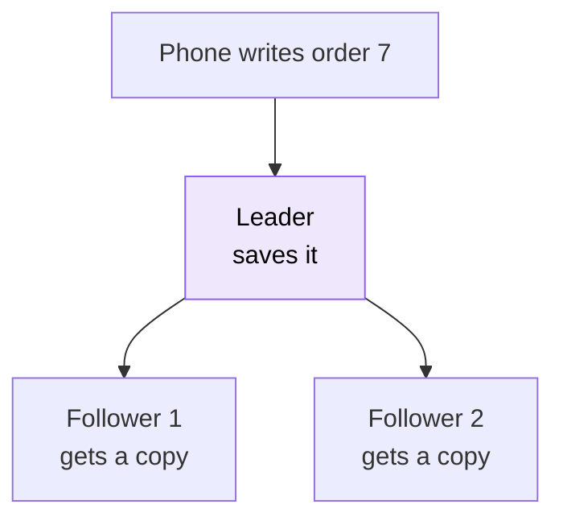
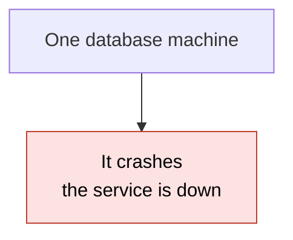
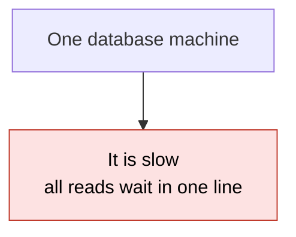
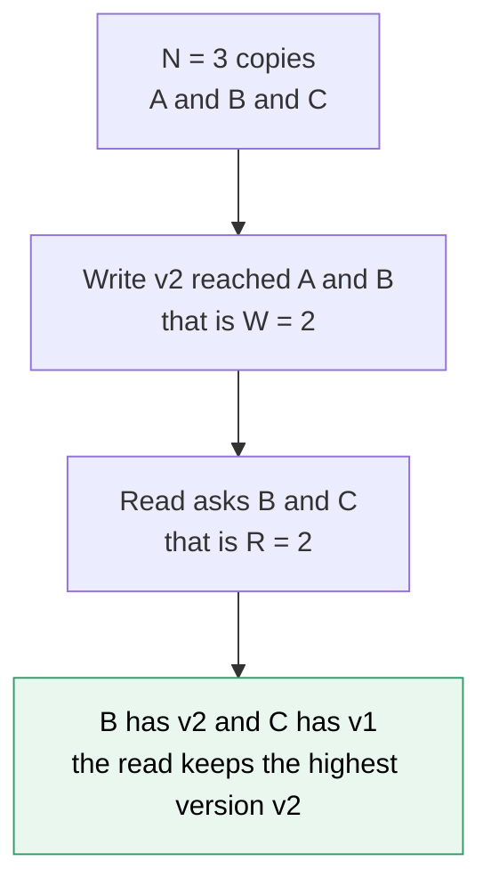

# 19. Replication and quorums

> **Subject:** System Design · **Lesson:** 19 · **Made:** 2026-11-04 · **Status:** ready
>
> **You will be able to:** say why data is kept as several copies, explain the leader and follower pattern, say what is lost when the leader says "saved" before the followers have the data (asynchronous) and what is lost when it waits (synchronous), use N, W and R and the rule R + W > N, and say what a store does when copies are down.
>
> **Before this:** [Object storage and presigned uploads](18-object-storage-and-presigned-uploads.md) · **Next:** [Consistent hashing](20-consistent-hashing.md)
>
> **How to read it:** one card is one idea. Look at the picture, guess, then press the orange bar to check. The blue bars (📖 More detail) hold the longer explanation. Skip them on the first read, and open them when you want more. About 15 minutes for the cards.

## 1. The idea: more than one copy

One machine holding your data is one thing that can break. So you keep **copies** on other machines. In the simplest pattern, one machine is the **leader**. All writes go to it. It sends each change on to the **followers**. If the leader dies, a follower takes over. Like a teacher who writes on the board while three students copy it into their notebooks. If the teacher faints, a student has the notes.



Notice the one question this lesson is about: when does the leader tell the phone "saved"? Before the followers have the copy, or after?

<details class="guess"><summary>🤔 Guess: the leader says "saved" after 1 ms. It sends the copy to a follower, but the copy has not arrived yet. The leader crashes. The follower becomes the new leader. Is order 7 on the new leader? Press to check.</summary>

**No.** The phone was told "saved", and the order is gone. This is the cost of answering before the copy lands (**asynchronous** replication). The window is small, but it is real.

</details>

> **Remember:** a copy is only a safety net for the data that has reached it. The question is when "saved" is said.

<details class="more"><summary>📖 More detail: new words, the problem drawn, and why it exists</summary>

Lesson [database 21](../database/21-replication-and-read-replicas.md) showed this with Postgres. This lesson is the design view, and adds quorums.

New words (four):

- **Replica (copy):** one machine's copy of the data. **Leader:** the replica that takes the writes. **Follower:** a replica that copies the leader.
- **Asynchronous / synchronous:** the leader says "saved" **before** (async) or **after** (sync) the followers have the change.
- **Quorum:** a group of copies big enough that two such groups must share a copy.
- **N, W, R:** N is how many copies there are. W is how many must save a write before it counts. R is how many are asked in a read.

**The problem, drawn.** One machine: any crash loses everything it held since the last backup, and every read hits the same machine.





**Where the analogy stops.** Students copy at their own speed, and some are slower. A real follower can be seconds behind, or in another city. And "the teacher faints" needs someone to decide which student takes over, without two students both thinking they are the teacher (lesson 24, consensus and Raft, is planned for that).

**Why it exists and what it costs.**

- **Without it:** one machine is your whole risk, and one machine does all the work.
- **With it:** if one machine dies, another has the data. Reads can go to followers too.
- **The cost:** every write is sent several times, copies can be behind, and you must decide the "saved" rule. Also, more copies cost more money.

</details>

## 2. Say "saved" first, or wait?

**Asynchronous:** the leader says "saved" at once and sends the copy later. Fast, but a crash in the gap loses a write you promised. **Synchronous:** the leader waits until a follower has the copy, then says "saved". Safe, but each write is slower, and if the follower is gone, the write waits.

| | Async | Sync |
|---|---|---|
| Customer hears "saved" | after the leader saves | after a follower also saves |
| Leader crashes in the gap | the write can be **lost** | the write is **not lost** |
| Follower is down | writes go on | writes **wait** |
| Speed of a write | fastest | slower by the trip to the follower |

<details class="guess"><summary>🤔 Guess: Postgres is set to synchronous replication with one follower. The follower server stops. What happens to the next INSERT on the leader? Press to check.</summary>

It **waits**, and does not return. In the Postgres test in database lesson 21 (2026-11-01), the INSERT was still waiting after 2.5 seconds. With the follower running, a sync commit took 1 ms and an async commit 2 ms on one laptop, so there was almost no difference there. The cost shows up when the follower is gone.

</details>

> **Remember:** async can lose the last writes. Sync cannot, but writes wait for the follower, and stop if it is gone.

<details class="more"><summary>📖 More detail: Postgres settings, the middle way, and the stepper</summary>

**Postgres.** The setting `synchronous_standby_names` chooses the followers a commit waits for. The docs (opened 2026-11-04) describe two forms: `FIRST num_sync (...)` waits for the `num_sync` followers with the best priority, and `ANY num_sync (...)` waits for **at least** `num_sync` of the listed followers. They call `ANY` quorum-based. With two followers and `ANY 1`, one follower can be down and writes still go on. A bare list like `s1, s2` means `FIRST 1 (s1, s2)`.

**The middle way.** Many systems wait for **some** copies and not all: not zero (async) and not all (sync). That is exactly what W does in the next card.

**RPO and RTO.** Async means your RPO (how much data you may lose) is the last few writes. Sync means zero lost writes, at the cost of speed and availability. Lesson 28 (disaster recovery, planned) is about this.

**Step through it yourself:** [open the stepper](visuals/19-replication-and-quorums.html). Tab 1 shows the async crash and the sync wait. Guess first, then press Next.

**Cost.** There is no free choice. A faster answer risks lost writes. A safer answer risks waiting. You choose by what the data is worth: a payment waits, a view counter does not.

</details>

## 3. Quorums: N copies, W must save, R are asked

Instead of "one follower or all", pick numbers. **N** copies exist. A write counts when **W** copies have saved it. A read asks **R** copies and keeps the answer with the newest version. The rule: if **R + W > N**, every read meets at least one copy that has the newest write.



<details class="guess"><summary>🤔 Guess: N = 3, W = 2, R = 2. A write of v2 reached copies A and B. Copy C is late and still holds v1. A read asks B and C. What does the read return? Press to check.</summary>

**v2.** B has v2, C has v1, and the read keeps the answer with the **highest version**. Any two copies out of three must include A or B, so the late copy C cannot win alone. (Real run, Node 26.12.1.)

</details>

> **Remember:** R + W > N means the group that wrote and the group that reads must share at least one copy.

<details class="more"><summary>📖 More detail: the code, the real output, and who uses this</summary>

A tiny store with these rules is practice C. Use it like this:

```js
const c = createCluster({ n: 3, w: 2, r: 2 });
console.log(c.write("v2", [0, 1]));    // copies 0 and 1 saved it, copy 2 is late
console.log(c.read([1, 2]));           // ask copies 1 and 2
const fast = createCluster({ n: 3, w: 2, r: 1 });
fast.write("v2", [0, 1]);
console.log(fast.read([2]));           // R = 1, and it landed on the late copy
```

**Output:**

```
{ ok: true, acks: 2 }
{ ok: true, value: 'v2', version: 2, stale: false }
{ ok: true, value: 'v1', version: 1, stale: true }
```

Checked on 2026-11-04 with Node 26.12.1.

**Who uses it.** The Apache Cassandra docs (opened 2026-11-04) say `QUORUM` means "a majority (n/2 + 1) of the replicas must respond". They say it is common to choose read and write levels so that **W + R > RF** (RF is the replication factor, the same as N), so that acknowledged writes are visible to later reads. The Dynamo paper (Amazon, 2007) uses N, R and W in the same way. The common setting in its secondary sources is N = 3, R = 2, W = 2.

**Where the analogy stops.** Quorums are about a **single value**. Real stores also have to decide what to do when two writes happen at the same moment, and when a copy is told to write but never answers. The rule gives "a read meets a copy with the newest acknowledged write". It does not make the store behave like one machine in every case (card 5).

**Step through it yourself:** tab 2 of the [stepper](visuals/19-replication-and-quorums.html) shows W = 2, R = 2 first and then R = 1.

</details>

## 4. Why R + W > N works, by counting

You do not need to trust the rule. Try **every** group of W copies that saved the write, and **every** group of R copies that answer the read. If any read is stale, the numbers are not safe.

| N = 3 | W | R | R + W | Can a read be stale? |
|---|---|---|---|---|
| fast and loose | 1 | 1 | 2 | yes |
| fast reads, fewer saves | 2 | 1 | 3 | yes |
| fast writes, more reads | 1 | 2 | 3 | yes |
| the common choice | 2 | 2 | 4 | **never** |
| slow writes, fast reads | 3 | 1 | 4 | **never** |
| fast writes, slow reads | 1 | 3 | 4 | **never** |

<details class="guess"><summary>🤔 Guess: N = 3, W = 2, R = 1. R + W = 3, which is not more than N. Show one write group and one read group that give a stale read. Press to check.</summary>

The write saves on A and B. The read asks only C. Groups {A, B} and {C} share nothing, so C answers with the old value. Counting finds it in a moment: one of the 3 write groups and one of the 3 read groups. (The table above is a real run of `canBeStale`.)

</details>

> **Remember:** a stale read is possible exactly when some write group and some read group share no copy.

<details class="more"><summary>📖 More detail: the code, and why "more than" and not "at least"</summary>

```js
function canBeStale(n, w, r) {
  for (const writeGroup of groupsOf(n, w)) {          // every group of w copies
    for (const readGroup of groupsOf(n, r)) {         // every group of r copies
      const c = createCluster({ n, w, r });
      c.write("v2", writeGroup);
      if (c.read(readGroup).stale) return true;
    }
  }
  return false;
}
```

`groupsOf(n, size)` lists every group of `size` copies out of `n`. The practice test checks all n up to 5: `canBeStale` is false exactly when `r + w > n`.

**Why "more than".** Two groups of sizes W and R, taken from N copies, must overlap when W + R is more than N. There are not enough copies to keep them apart. When W + R equals N exactly, they can fit side by side with no shared copy (N = 3, W = 2, R = 1: {A, B} and {C}).

**Why a majority.** If W is more than half of N, two writes at the same moment must also share a copy, so they cannot both be acknowledged without one copy seeing both. That is why the common choices are majorities: N = 3 with W = 2, N = 5 with W = 3.

**Cost.** A bigger W makes writes wait for slower copies. A bigger R makes reads wait. W = 3, R = 1 gives fast reads and slow writes that stop if any copy is down. W = 1, R = 3 is the other way round.

</details>

## 5. When copies are down

A store that follows the rule is **safe** when copies fail. It stays **available** only while enough copies are up. N = 3, W = 2, R = 2 works with one copy down. With two down, a write cannot get two saves, so it is **refused**. It does not guess.

| Copies up | Can write (W = 2)? | Can read (R = 2)? |
|---|---|---|
| 3 | yes | yes |
| 2 | yes | yes |
| 1 | **no** | **no** |

<details class="guess"><summary>🤔 Guess: N = 3, W = 2, R = 2. Two copies are down, only one is up. Can a write succeed? Press to check.</summary>

**No.** Only 1 copy can save it, and W is 2, so the write is refused (`{ ok: false, acks: 1 }`). A read needs 2 answers, so it is refused too. The store gives up some availability to avoid giving a wrong answer. (Real run, Node 26.12.1.)

</details>

> **Remember:** quorums keep answers right and give up availability when too many copies are gone.

<details class="more"><summary>📖 More detail: coming back, catching up, and the cost</summary>

**A copy comes back behind.** A copy that was down keeps its old data when it starts again. It missed writes. If a read asks it together with a good copy, the newest version wins (practice: "a copy that was down comes back behind, and the newest answer still wins"). It catches up by being sent the newest value. Some systems also fix an old copy when a read finds it (read repair).

**Tab 3 of the [stepper](visuals/19-replication-and-quorums.html)** shows a copy going down and coming back.

**Choosing the numbers.** With N = 3: W = 2, R = 2 survives one failure and keeps reads fresh. W = 3, R = 1 is for data that is read a lot and written rarely, but one dead copy stops all writes. A bigger N (5) survives two failures with W = 3, R = 3, and costs more.

**Cost.** More copies are more money and more writes. Spread them across zones (lesson [16](16-latency-numbers-and-estimation.md) gives the 1 to 2 ms between zones), or one zone dying takes out more than W copies at once.

</details>

## 6. Six mistakes, and what to say if you freeze

- **Wrong:** read from a follower right after you write. **Right:** a rule such as "read from the leader for a few seconds after a write" (database lesson 21).
- **Wrong:** "R + W > N means it behaves like one machine". **Right:** it means a read meets a copy with the newest *acknowledged* write. Concurrent writes and failed writes still need rules.
- **Wrong:** call async "safe". **Right:** say what you can lose: the last few writes.
- **Wrong:** N = 2 and "majority". **Right:** with 2 copies a majority is 2, so one failure stops writes. Use 3.
- **Wrong:** all copies in one zone. **Right:** spread them across zones.
- **Wrong:** two machines both think they are the leader. **Right:** one decider, a majority vote (lesson 24).

<details class="guess"><summary>🤔 Guess: a team says "we have 3 copies, so we are safe". All 3 are in one data centre and it loses power. What is left? Press to check.</summary>

**Nothing.** Copies in one place fail together. Safety needs copies in **different** failure zones, so one failure takes at most one copy.

</details>

> **Remember:** if you freeze, say "Copies for safety. The leader takes writes. W copies must save and R copies are asked. If R plus W is more than N, a read meets the newest write."

<details class="more"><summary>📖 More detail: the mistakes in full, and the freeze plan</summary>

- **Reading from a follower right after writing.** A follower can be behind, so the user's own change can vanish for a moment. See database lesson 21, card 2, and its "read your writes" fix.
- **Over-trusting the rule.** Cassandra's docs only claim that acknowledged writes are visible to later reads when the levels overlap. Dynamo-style stores may use a **sloppy quorum**, where a write goes to other copies when the right ones are down, and the overlap is then not guaranteed (lecture notes on the Dynamo paper).
- **Async called safe.** If you say "we use async replication", add "so we can lose the last writes if the leader dies".
- **N = 2.** One copy down means a majority of 2 cannot be reached.
- **One zone.** Put copies in different zones, as in the [networking guide](../networking/networking-for-system-design.md).
- **Two leaders (split brain).** Two machines both accept writes and the data splits. Prevent it with a majority vote to choose a leader (Raft, lesson 24).

**If you freeze:**

1. Say "I keep N copies in different zones. One leader takes writes."
2. Say "A write counts after W copies save it. A read asks R copies and keeps the newest."
3. Say "If R plus W is more than N, the read and write groups share a copy. The price is that writes or reads stop when too many copies are gone."

</details>

## 7. Watch and play

Links were opened with a page fetch tool on 2026-11-04. For the video I re-checked only the title and the channel name from YouTube's embed data, not the length.

- **Play with it:** [the stepper in this folder](visuals/19-replication-and-quorums.html) - guess first, then press Next. Try all three tabs.
- **Video:** [Read Replicas and Replication Lag: Read-Your-Writes, Failover | System Design Masterclass](https://www.youtube.com/watch?v=BaluKlE2Gdk) - Prateek Goel (GrowAsEngineers), length not checked. Compare with card 2.
- **Read:** [Cassandra docs: Dynamo](https://cassandra.apache.org/doc/latest/cassandra/architecture/dynamo.html) - find "Picking Consistency Levels" and the `W + R > RF` rule.
- **Read:** [PostgreSQL docs: replication settings](https://www.postgresql.org/docs/current/runtime-config-replication.html) - find `synchronous_standby_names`, `FIRST` and `ANY`.
- **Read:** [PostgreSQL docs: log-shipping standby servers](https://www.postgresql.org/docs/current/warm-standby.html) - streaming and synchronous replication.
- **Read:** [Dynamo: Amazon's Highly Available Key-value Store](https://www.cs.princeton.edu/courses/archive/fall15/cos518/papers/dynamo.pdf) - the 2007 paper that made N, R and W famous. I opened the link (it loaded) but did not read the paper text, so I could not check the wording.

<details><summary>Go deeper (optional)</summary>

- [Probabilistically Bounded Staleness for Practical Partial Quorums](https://arxiv.org/abs/1204.6082) - a paper about how stale reads really are when R + W is **not** more than N. I opened the link (it loaded) and did not read the paper.
- **Database lesson 21** has the real Postgres numbers for lag and for a sync commit with the follower down: [Replication and read replicas](../database/21-replication-and-read-replicas.md).
- **The long guide:** [Distributed systems and reliability patterns](distributed-systems-and-reliability-patterns.md) covers CAP, consistency levels and consensus in depth. [Data storage choices](data-storage-choices-for-system-design.md) has replication in Part 5.

</details>

## 8. Practice

**A. Predict the output** (write your answer before opening)

```js
const c = createCluster({ n: 3, w: 2, r: 1 });
c.write("v2", [0, 1]);
console.log(c.read([0]).stale, c.read([2]).stale);
```

Then answer: what single change to the settings makes both reads fresh?

<details><summary>Answer</summary>

```
false true
```

Copy 0 saved the write, so it is fresh. Copy 2 was late, so it is stale. The fix: make R + W more than N. Use R = 2 (then the read asks two copies and keeps the newest), or W = 3 (then the write is only OK when all three have it). The first keeps writes fast. (Checked on 2026-11-04 with Node 26.12.1, using the answer to practice C.)

</details>

**B. Fix the answer**

An engineer says: "We run N = 3 with W = 1 and R = 1. Since we have 3 copies, reads always return the latest write." Say what is wrong and what to change.

<details><summary>Answer</summary>

With W = 1 and R = 1, R + W is 2, which is not more than 3. A write can be saved on copy A only, and a read can ask copy C, which is old. The `canBeStale(3, 1, 1)` run shows "can be stale". Three copies give safety if one dies, but not fresh reads. To keep fresh reads, raise R or W so that R + W is more than N, for example W = 2 and R = 2.

</details>

**C. Write it yourself**

Open `learn/system-design/practice/19-replication-and-quorums.js`. It has two empty functions: `createCluster` (cards 3 and 5) and `canBeStale` (card 4). Write them, then run this from the repo root and make all the tests pass:

```
node --test learn/system-design/practice/19-replication-and-quorums.test.js
```

<details><summary>One possible answer</summary>

```js
function createCluster({ n = 3, w = 2, r = 2 } = {}) {
  const cs = Array.from({ length: n }, () => ({ version: 1, value: "v1", up: true }));
  let acked = 1;                                              // the version of the newest write that was OK
  const clean = (list) => [...new Set(list)].filter((i) => Number.isInteger(i) && i >= 0 && i < n && cs[i].up);
  const upCount = () => cs.filter((c) => c.up).length;
  return {
    write(value, reached) {
      const saved = clean(reached);
      if (saved.length < w) return { ok: false, acks: saved.length };
      const version = Math.max(...cs.map((c) => c.version)) + 1;
      for (const i of saved) cs[i] = { version, value, up: true };
      acked = version;
      return { ok: true, acks: saved.length };
    },
    read(answered) {
      const got = clean(answered);
      if (got.length < r) return { ok: false };
      const best = got.map((i) => cs[i]).reduce((a, b) => (b.version > a.version ? b : a));
      return { ok: true, value: best.value, version: best.version, stale: best.version < acked };
    },
    down(i) { cs[i].up = false; },
    up(i) { cs[i].up = true; },
    catchUp(i) {
      const newest = cs.filter((c) => c.up).reduce((a, b) => (b.version > a.version ? b : a));
      cs[i].version = newest.version; cs[i].value = newest.value;
    },
    canWrite() { return upCount() >= w; },
    canRead() { return upCount() >= r; },
    copies() { return cs.map((c) => ({ ...c })); },
  };
}

function groupsOf(n, size) {                                   // every group of `size` copies out of n
  const out = [];
  const go = (start, chosen) => {
    if (chosen.length === size) return out.push(chosen.slice());
    for (let i = start; i < n; i++) { chosen.push(i); go(i + 1, chosen); chosen.pop(); }
  };
  go(0, []);
  return out;
}

function canBeStale(n, w, r) {
  for (const writeGroup of groupsOf(n, w)) {
    for (const readGroup of groupsOf(n, r)) {
      const c = createCluster({ n, w, r });
      c.write("v2", writeGroup);
      if (c.read(readGroup).stale) return true;
    }
  }
  return false;
}

module.exports = { createCluster, canBeStale };
```

Checked on 2026-11-04 with Node 26.12.1: the 16 tests fail on the empty stub and all 16 pass with this answer. Two details to notice. A repeated copy number in `reached` counts once (`new Set`), and a copy that is down is dropped before the count. And a refused write changes **nothing**: the version only moves when the write is acknowledged.

</details>

## 9. Interview question

**Q:** "You keep three copies of your data. A write comes in. When do you tell the client it succeeded, and what can a read see afterwards?"

A common follow-up: "What if one copy is down? What if two are?" Card 5 is the answer.

<details><summary>A strong answer, in four parts</summary>

1. **Problem:** one copy is one failure away from data loss, and one machine serves all reads. But copies create a new question: when is a write "saved", and can a read see an old value?
2. **How it works:** one leader takes writes and sends them to followers. I choose N = 3 copies in different zones, W = 2 and R = 2. A write is acknowledged after 2 copies saved it. A read asks 2 copies and keeps the highest version. Because R + W = 4 is more than N = 3, a read always meets a copy that saved the latest acknowledged write. With one copy down, both still work. With two down, writes and reads are refused, so I keep correctness and lose availability.
3. **Tradeoff:** async (W = 1) is fast but can lose the last write if the leader dies. Sync on all copies (W = 3) is safe but stops if any copy is down. Reads on followers can be old, so a user may not see their own write; I read from the leader for a short time after a write. The rule does not cover two writes at the same moment, or a leader choice after a crash. For those I need a majority vote (Raft).
4. **My example:**
   - **Fact:** from my own notes, the DBO stack runs three PostgreSQL databases. The case study does not say whether any of them has replicas.
   - **Not known yet:** whether replicas exist, and whether replication is async or sync. Check the real setup before I say it.
   - **Idea, not a fact:** for a payment-like table I would use sync replication to one follower in another zone, or `ANY 1` of two followers, so one can be down. For reports I would use async followers. I would say it as "what I would look at".

</details>

## 10. Explain it back

Close this file. Explain how copies are kept, and what N, W and R do, out loud like to a new junior, in 4 parts (problem, how, tradeoff, my example). Use the story of the async crash (order 7 lost) and the story of the late copy C with W = 2 and R = 2. Then write your best version below and run `/explain-check replication and quorums` or ask the `explain-coach` agent to review it.

### My explanation

<write here>

### Coach feedback

<the explain-coach agent writes here>

## 11. Review questions (day 1, 3, 7, 21)

1. A leader says "saved" before the follower has the copy and then crashes. What is lost, and what is this mode called?
2. N = 3. Which of these can give a stale read: W=2 R=2, W=2 R=1, W=3 R=1, W=1 R=1?
3. N = 3, W = 2, R = 2, and two copies are down. What happens to a write, and why is that on purpose?
4. Why is N = 3 with all copies in one data centre not safe?

<details><summary>Answers</summary>

1. The write the client was told about is lost, if no follower got it. It is called asynchronous replication.
2. W=2 R=1 and W=1 R=1 (R + W is not more than 3). W=2 R=2 and W=3 R=1 are never stale (R + W is 4).
3. The write is refused, because only 1 copy can save it and W is 2. It is on purpose: the store gives up availability so that it never gives a wrong answer.
4. Copies in one place fail together, for example a power loss. Put them in different zones.

</details>

## Connected lessons

- [Consistency and CAP](07-consistency-and-cap.md) - quorums are one way to choose between strong and eventual. Refusing writes when copies are down is the "C over A" choice.
- [Object storage and presigned uploads](18-object-storage-and-presigned-uploads.md) - the lesson before. Object storage keeps copies in several zones for you.
- [Replication and read replicas (database 21)](../database/21-replication-and-read-replicas.md) - the real Postgres numbers for lag and sync commit.
- [Partitioning and sharding (database 22)](../database/22-partitioning-and-sharding.md) - copies keep the same data safe. Sharding splits different data across machines. Often you do both.
- [Idempotency and retries](13-idempotency-and-retries.md) - a refused write is retried. It must be safe to retry.
- [Latency numbers and estimation](16-latency-numbers-and-estimation.md) - the trip to a follower is the price of a sync write.
- [Distributed systems and reliability patterns](distributed-systems-and-reliability-patterns.md) - CAP, consistency levels and consensus in depth.
- [Observability](14-observability.md) - replication lag is a number to watch and alert on.
