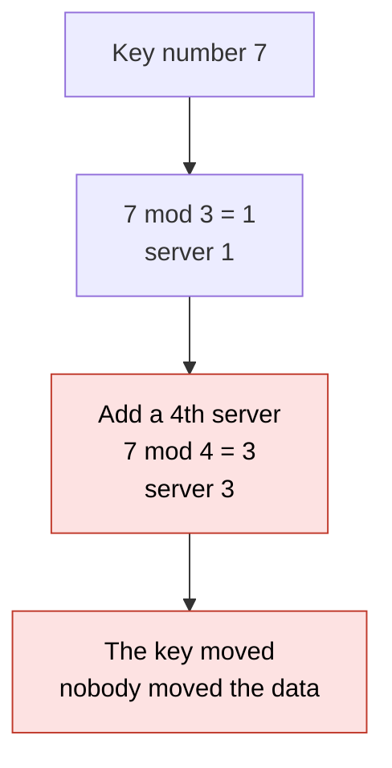
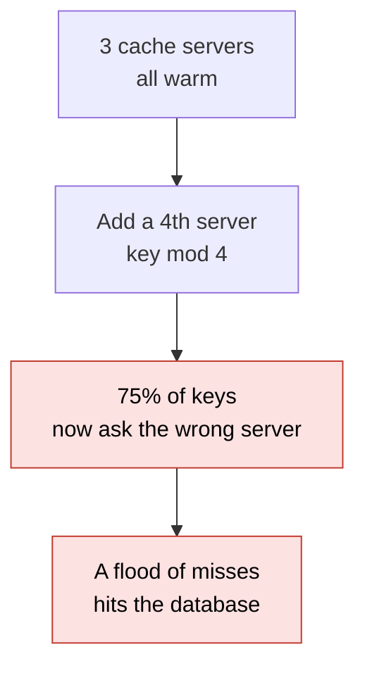

# 20. Consistent hashing

> **Subject:** System Design · **Lesson:** 20 · **Made:** 2026-11-04 · **Status:** ready
>
> **You will be able to:** say why "key mod number of servers" breaks when you add a server, draw the ring and say which server owns a key, say that adding or removing a server moves only a small share of keys, explain why each server gets many spots (virtual nodes), and say where real systems use it.
>
> **Before this:** [Replication and quorums](19-replication-and-quorums.md) · **Next:** [Streams vs queues](21-streams-vs-queues.md)
>
> **How to read it:** one card is one idea. Look at the picture, guess, then press the orange bar to check. The blue bars (📖 More detail) hold the longer explanation. Skip them on the first read, and open them when you want more. About 15 minutes for the cards.

## 1. The idea: which server holds this key?

You have 3 cache servers and millions of keys. For each key you need one server, and every app server must pick the **same** one. The easy rule: turn the key into a number (a **hash**), divide by the number of servers, and use the remainder. Key 7 with 3 servers: 7 mod 3 = 1, so server 1. Like putting books on 3 shelves by the book number.



Notice that adding one server changes the answer for almost every key. For a cache, a moved key is a cache miss, so most of the cache is suddenly empty.

<details class="guess"><summary>🤔 Guess: 12 keys numbered 0 to 11 live on 3 servers (key mod 3). You add a 4th server (key mod 4). How many of the 12 keys end up on a different server? Press to check.</summary>

**9 of 12.** Keys 0, 1 and 2 give the same answer for mod 3 and mod 4, so they stay. Keys 3 to 11 all change. With 10,000 real keys and a real hash, going from 3 to 4 servers moved **7,461** (75%). (Real run, Node 26.12.1.)

</details>

> **Remember:** with "mod N", adding one server moves about N out of N+1 keys. Almost everything moves.

<details class="more"><summary>📖 More detail: new words, the problem drawn, and why it exists</summary>

The cache lessons ([04](04-caching.md)) said "keep the answer close". When you have many cache servers, this lesson says how to know which one holds an answer.

New words (four):

- **Hash:** a function that turns any text into a number. The same text always gives the same number. A good one spreads numbers evenly.
- **Ring:** all hash numbers from 0 up to a very big number, with the biggest joined back to 0, like a clock.
- **Spot:** a place on the ring where a server sits. Also called a virtual node (vnode) when one server has many.
- **Rebalance:** moving data to the server that now owns it.

**The problem, drawn.** The plain rule, in real numbers (10,000 keys, a real hash, Node 26.12.1):

| Servers go from | Keys that change server |
|---|---|
| 3 to 4 | 7,461 of 10,000 (75%) |
| 4 to 5 | 7,986 of 10,000 (80%) |
| 9 to 10 | 8,946 of 10,000 (89%) |
| 5 to 4 (one server removed) | 7,986 of 10,000 (80%) |

The share that moves is about N out of N + 1. Removing a server is just as bad.



**Where the analogy stops.** Shelves hold books that you can carry. A cache server holds data that is expensive to refill, and a database shard holds data that must really be moved. A moved key means real work.

**Why it exists and what it costs.**

- **Without it:** every change in the number of servers is a small disaster: most keys move.
- **With it (card 2):** adding or removing a server moves only about 1 key in N, and only to or from that server.
- **The cost:** a little more code and memory (a sorted list of spots), and you must pick how many spots each server gets (card 4).

</details>

## 2. The ring: each key goes to the next spot

Put the servers on a circle, at places given by their hash. Put each key on the same circle, at the place given by its hash. A key belongs to the **first server spot you reach by walking clockwise**. After the last spot, you wrap round to the first.

| Key at | Walk clockwise to | Owner |
|---|---|---|
| 25 | B at 40 | B |
| 45 | C at 70 | C |
| 85 | past the last spot, so wrap round to A at 10 | A |

<details class="guess"><summary>🤔 Guess: the ring has A at 10, B at 40 and C at 70 (positions go from 0 to 99). A new server D is added at position 55. Of the keys at 5, 25, 45, 65 and 85, how many change server? Press to check.</summary>

**1.** Key 45 was owned by C (the next spot after 45 was C at 70). Now D at 55 is the next spot, so key 45 goes to D. The keys at 5, 25, 65 and 85 find the same server as before. Only keys between the spot before D (B at 40) and D itself can move. (Real run: this is a test in the practice file.)

</details>

> **Remember:** a key walks clockwise to the next server spot. A new server takes over only the keys just before it.

<details class="more"><summary>📖 More detail: the code, the picture of one change, and what the old ring did</summary>

**The code.** A sorted list of spots, and a search for the first spot at or after the key's hash. This is practice C.

```js
serverFor(key) {
  if (spots.length === 0) return null;
  const p = hashFn(key);
  let lo = 0, hi = spots.length;                // first spot with pos >= p
  while (lo < hi) {
    const mid = (lo + hi) >> 1;
    if (spots[mid].pos >= p) hi = mid; else lo = mid + 1;
  }
  return spots[lo === spots.length ? 0 : lo].server;   // past the last spot: wrap to the first
}
```

It is a binary search, so with S spots a lookup takes about log2(S) steps. For 400 spots that is about 9 looks (lesson [problem solving 06](../problem-solving/06-binary-search-and-sorting.md)).

**One change on the ring.** Before D is added:

| Key at | Next spot | Owner |
|---|---|---|
| 5 | A at 10 | A |
| 25 | B at 40 | B |
| 45 | C at 70 | C |
| 65 | C at 70 | C |
| 85 | wrap to A at 10 | A |

After D at 55 is added, only the row for key 45 changes (to D). Nothing moves between A, B and C.

**Step through it yourself:** tab 2 of the [stepper](visuals/20-consistent-hashing.html) draws the ring and the keys.

**Cost.** A lookup is a search, not one division. A ring needs the same hash function and the same spots in every app server, or two servers disagree.

</details>

## 3. Adding or removing a server moves only a few keys

With a ring, adding the 5th server takes about **1 key in 5** from the others. All of them go to the new server. Nobody moves between the old servers. Removing a server sends only **its** keys to the next spots.

| Change | Plain rule (mod N) | Ring, 100 spots each |
|---|---|---|
| Add a 5th server to 4 | 7,986 of 10,000 move | **2,009** move, all to the new server |
| Remove one of 5 servers | 7,986 of 10,000 move | only that server's keys move |

<details class="guess"><summary>🤔 Guess: a ring has 4 servers with 100 spots each. Server D is removed. Do all of D's keys go to one other server, or do they spread? Press to check.</summary>

They **spread**. In a real run with 10,000 keys, D's keys went to C (901), B (937) and A (640). Each of D's 100 spots sat next to a spot of another server, so its keys flowed to different neighbours. With only 1 spot each, all of D's keys would go to **one** neighbour. (Real run, Node 26.12.1.)

</details>

> **Remember:** on a ring, a change moves about 1 key in N, and only to or from the changed server.

<details class="more"><summary>📖 More detail: the real run, and what "moves" means for a cache and a database</summary>

The run (10,000 keys named `user-0` to `user-9999`, an MD5-based hash, 4 servers A to D, then E added):

```
plain rule 4 -> 5 servers: 7986 of 10000 keys move
ring, 100 spots each: add 5th server: 2009 keys move (all of them to E)
```

Checked on 2026-11-04 with Node 26.12.1. 2,009 out of 10,000 is 20%, which is 1 in 5. That is the best a change can do: the new server needs a fair share, so about 1 in 5 keys must go to it.

**What "moves" means.**

- **A cache.** The key is not copied. The next ask goes to the new server and misses, and the app fills it from the database (lesson [04](04-caching.md)). With the plain rule, 80% of asks miss at once. With a ring, about 20% do.
- **A database or a file store.** The data must be copied to the new server (a rebalance). With a ring, only about 1 in N of the data moves, and only to the new machine. See sharding in [database 22](../database/22-partitioning-and-sharding.md).

**Cost.** The keys on the new server still move, so a change is not free. Do it slowly, and keep the old owner serving until the copy is done.

</details>

## 4. One spot each is not fair. Use many (virtual nodes)

If each server sits at **one** spot, the gaps between spots are random. One server can get a huge gap and another a tiny gap. The fix: each server gets **many spots** (100 or more), named `A#0`, `A#1`, `A#2` and so on. Many small random gaps add up to a fair share.

| Spots per server | Keys on A, B, C, D (10,000 keys) |
|---|---|
| 1 | 300, 141, 3,995, 5,564 |
| 10 | 1,234, 4,002, 2,095, 2,669 |
| 100 | 2,556, 2,487, 2,479, 2,478 |

<details class="guess"><summary>🤔 Guess: 4 servers, 1 spot each, 10,000 keys. Is the load about 2,500 each? Press to check.</summary>

**No.** In the real run: A had 300 keys, B 141, C 3,995 and D 5,564. One server held 40 times more than another. With 100 spots each, every server held between 2,479 and 2,556. (Real run, Node 26.12.1.)

</details>

> **Remember:** give each server many spots, so the load is even. A bigger server can get more spots.

<details class="more"><summary>📖 More detail: why it works, how many spots, and the cost</summary>

**Why it works.** One random gap can be big or small. The sum of many random gaps is close to the average (the same reason that rolling a die 100 times gives an average near 3.5, and rolling it once gives anything).

**How many?** More spots give a fairer share and a bigger list to store and search. 100 to 200 per server is a common starting point. In the run above, 10 spots was still uneven (1,234 against 4,002). The lesson's tests check that 100 spots give every server between 2,000 and 3,000 of 10,000 keys.

**Bigger servers.** Give a big machine 200 spots and a small one 100, and it takes twice the keys. That is how real systems deal with machines of different size.

**Replicas.** To keep copies (lesson [19](19-replication-and-quorums.md)), store each key on the next N **different** servers clockwise. Dynamo-style stores do this.

**Cost.** Each server adds 100 spots to the sorted list. A ring of 100 servers is 10,000 spots. A search is still fast (about 14 looks), but the list must be rebuilt when servers join or leave.

</details>

## 5. Where it is used, and what to say instead

You have probably met it without the name. A few real examples (opened 2026-11-04):

- **nginx** has `hash $request_uri consistent;` for an upstream group. Its docs say plain hashing may "remap most of the keys" when a server is added or removed, and that `consistent` uses the ketama method, which "ensures that only a few keys will be remapped".
- **Redis Cluster** does **not** use a ring. It uses a fixed number of **hash slots**: `HASH_SLOT = CRC16(key) mod 16384`. Each master holds a set of the 16384 slots. Moving a slot to a new node moves the keys in it.
- **Amazon Dynamo** and **Apache Cassandra** use consistent hashing to place data (named in the Wikipedia article on the idea, which credits Karger and others, 1997). **Akamai** (a CDN) used it to balance load inside a cluster.

<details class="guess"><summary>🤔 Guess: Redis Cluster has 16,384 slots and 3 nodes. You add a 4th node. Do most keys move, as with "mod N"? Press to check.</summary>

**No.** The slot of a key never changes (`CRC16(key) mod 16384` does not depend on the number of nodes). Only **whole slots** are handed to the new node, so only the keys in those slots move. The fixed slot count plays the role of the ring.

</details>

> **Remember:** the idea is "an owner that does not depend on how many servers there are". A ring and fixed slots both do that.

<details class="more"><summary>📖 More detail: ring against slots, and the other uses</summary>

| | Ring with spots | Fixed slots (Redis Cluster) |
|---|---|---|
| Who owns a key | next spot clockwise | the node that holds the key's slot |
| Add a server | it takes spots, so it takes about 1/N of the keys | you move some slots to it, by hand or by a tool |
| Even load | many spots per server | many slots (16,384) over a few nodes |
| Who decides | the hash, with no central list | a table of slot owners that every node keeps |

**Other places:** a load balancer that keeps one user on one server ("sticky by key", lesson [03](03-load-balancers.md)); caching proxies; a CDN choosing which edge machine holds a file; sharded databases that must grow without a full reshuffle.

**Hot keys.** A ring spreads **keys** evenly. It does not spread **requests** evenly. One very popular key still hits one server. For that, copy the key to several servers, or add a small cache in front.

</details>

## 6. Five mistakes, and what to say if you freeze

- **Wrong:** `key % servers` for a cache that grows. **Right:** a ring or fixed slots.
- **Wrong:** one spot per server. **Right:** many spots, so the load is even.
- **Wrong:** different app servers with different rings. **Right:** the same hash function and the same server list everywhere.
- **Wrong:** "consistent hashing solves hot keys". **Right:** it spreads keys, not popularity.
- **Wrong:** "adding a server is free". **Right:** about 1 key in N must still move, so warm up or copy slowly.

<details class="guess"><summary>🤔 Guess: two app servers build the ring with different hash functions. The same key goes to server B on one and server D on the other. What happens? Press to check.</summary>

Writes and reads for that key go to **different** servers, so a cache looks empty and a database read can find nothing. The ring is only an agreement. Every client must use the same hash and the same list.

</details>

> **Remember:** if you freeze, say "Hash servers and keys onto a ring. A key goes to the next server clockwise. Each server has many spots. Adding a server moves about 1 key in N."

<details class="more"><summary>📖 More detail: the mistakes in full, and the freeze plan</summary>

- **Plain mod.** It is the right answer for a fixed number of servers, or when you will restart everything anyway. It is wrong when servers come and go.
- **One spot.** The gaps are random, so some servers get 40 times the keys of others (card 4).
- **Different rings.** Put the server list in one place (config or service discovery) and the hash in shared code.
- **Hot keys.** Same as in the [caching guide](caching-and-cdn-in-depth.md), "stampedes and hot keys".
- **Free change.** Add a server in the quiet hours, or copy its keys first and switch when they are there.

**If you freeze:**

1. Say "The plain rule, key mod N, moves almost every key when N changes."
2. Say "A ring puts servers and keys on a circle. A key goes to the next server clockwise."
3. Say "Many spots per server make it fair. Adding a server moves only about 1 key in N, and only to the new one."

</details>

## 7. Watch and play

Links were opened on 2026-11-04. For the videos I confirmed only the title and the channel name from YouTube's embed data, not the length or the content.

- **Play with it:** [the stepper in this folder](visuals/20-consistent-hashing.html) - guess first, then press Next. Try all three tabs.
- **Video:** [Consistent Hashing - Hash space & Ring, Adding and Removing Servers, Virtual Nodes](https://www.youtube.com/watch?v=5JLE1ClfHUY) - channel udaykiran.tech, length not checked. Compare its ring with card 2.
- **Video:** [Virtual Nodes in Consistent Hashing Explained](https://www.youtube.com/watch?v=c7R8Xx34NWk) - channel CodeLucky, length not checked. Compare with card 4.
- **Read:** [Consistent hashing on Wikipedia](https://en.wikipedia.org/wiki/Consistent_hashing) - the history (Karger et al., 1997), the "about K/n keys move" claim, and the list of systems that use it.
- **Read:** [nginx: the `hash` directive](https://nginx.org/en/docs/http/ngx_http_upstream_module.html) - find `consistent` and the ketama note.
- **Read:** [Redis cluster specification](https://redis.io/docs/latest/operate/oss_and_stack/reference/cluster-spec/) - find "Key distribution model": 16384 slots and `CRC16(key) mod 16384`.

<details><summary>Go deeper (optional)</summary>

**How I measured.** Keys named `user-0` to `user-9999`. The hash is the first 8 hex digits of an MD5, read as a number from 0 to 4,294,967,295. A server's spot number i is at `hash(name + "#" + i)`. The counts in the lesson come from `createRing` and `modMoved` in practice C, run on Node 26.12.1. A different hash gives different counts, with the same sizes.

**Rendezvous hashing (highest random weight).** Another way to pick an owner with no ring: for each server compute `hash(server + key)`, and take the server with the biggest number. Adding a server moves only the keys that it now wins. I did not run it for this lesson.

**Where it comes in the system design round.** Caches that grow, sharded databases and file stores, and "which server holds this user's session". See the [data storage guide](data-storage-choices-for-system-design.md) (sharding and IDs at scale) and the [caching guide](caching-and-cdn-in-depth.md).

</details>

## 8. Practice

**A. Predict the output** (write your answer before opening)

```js
const keys = Array.from({ length: 12 }, (_, i) => i);
let moved = 0;
for (const k of keys) if (k % 3 !== k % 4) moved++;
console.log(moved);
```

Then answer: which keys stay on the same server?

<details><summary>Answer</summary>

```
9
```

Keys 0, 1 and 2 give the same answer for mod 3 and mod 4 (0, 1, 2). Every other key from 3 to 11 gives a different answer. So 9 move, 3 stay. This is the 9 of 12 from card 1. (Checked on 2026-11-04 with Node 26.12.1.)

</details>

**B. Fix the answer**

A teammate says: "To grow our cache from 4 to 5 servers, we change `key % 4` to `key % 5`. Only a few keys will move, because it is just one more server." What is wrong, and what do you suggest?

<details><summary>Answer</summary>

About 80% of the keys move (7,986 of 10,000 in the real run), because the remainder changes for almost every key. For a cache that means most asks miss at once and the database gets the flood. Suggest a consistent hash ring with about 100 spots per server (or fixed slots, as Redis Cluster does). Then about 1 key in 5 moves, and all of them go to the new server.

</details>

**C. Write it yourself**

Open `learn/system-design/practice/20-consistent-hashing.js`. It has three empty functions: `modMoved` (card 1), `createRing` (cards 2 to 4) and `ringMoved` (card 3). `hash` is done for you. Write them, then run this from the repo root and make all the tests pass:

```
node --test learn/system-design/practice/20-consistent-hashing.test.js
```

<details><summary>One possible answer</summary>

```js
function modMoved(keys, from, to, hashFn = hash) {
  let moved = 0;
  for (const key of keys) if (hashFn(key) % from !== hashFn(key) % to) moved++;
  return moved;
}

function createRing({ vnodes = 100, hash: hashFn = hash } = {}) {
  let spots = [];                                   // { pos, server }, sorted by pos
  const names = new Set();
  const sortSpots = () => spots.sort((a, b) => a.pos - b.pos);
  return {
    addServer(name) {
      if (names.has(name)) return false;
      names.add(name);
      for (let i = 0; i < vnodes; i++) spots.push({ pos: hashFn(name + "#" + i), server: name });
      sortSpots();
      return true;
    },
    removeServer(name) {
      if (!names.has(name)) return false;
      names.delete(name);
      spots = spots.filter((s) => s.server !== name);
      return true;
    },
    serverFor(key) {
      if (spots.length === 0) return null;
      const p = hashFn(key);
      let lo = 0, hi = spots.length;                // first spot with pos >= p
      while (lo < hi) {
        const mid = (lo + hi) >> 1;
        if (spots[mid].pos >= p) hi = mid; else lo = mid + 1;
      }
      return spots[lo === spots.length ? 0 : lo].server;   // past the last spot: wrap to the first
    },
    servers() { return [...names].sort(); },
  };
}

function ringMoved(keys, ring, change) {
  const before = keys.map((k) => ring.serverFor(k));
  change(ring);
  let moved = 0;
  keys.forEach((k, i) => { if (ring.serverFor(k) !== before[i]) moved++; });
  return moved;
}
```

Checked on 2026-11-04 with Node 26.12.1: 15 of the 16 tests fail on the empty stub (the one that passes only checks the `hash` that is done for you) and all 16 pass with this answer. Two details to notice. `ringMoved` takes a snapshot **before** it runs the change. And the search `pos >= p` makes a key exactly on a spot belong to that spot.

</details>

## 9. Interview question

**Q:** "You have a fleet of cache servers and need to add one without emptying the cache. How do you decide which server holds a key?"

A common follow-up: "How do you stop one server holding too many keys?" and "What about a very popular key?" Cards 4 and 5 are the answers.

<details><summary>A strong answer, in four parts</summary>

1. **Problem:** the easy rule, hash(key) mod N, changes the owner of about N out of N + 1 keys when N changes. In a real run, going from 4 to 5 servers moved 80% of 10,000 keys. For a cache that is 80% misses at once, and the database takes the flood.
2. **How it works:** a consistent hash ring. I hash each server (many times, `A#0`, `A#1`, and so on, about 100 spots each) and each key onto the same circle. A key belongs to the first spot clockwise. Adding a server takes about 1 key in N, all to the new server. Removing one sends its keys to its neighbours. The many spots make the load even: in a run with 10,000 keys and 4 servers, 1 spot each gave 141 to 5,564 keys per server, and 100 spots each gave 2,479 to 2,556.
3. **Tradeoff:** a lookup is a search in a sorted list, and every client must share the same hash and server list. A ring spreads keys, not requests, so a very popular key still needs a copy on several servers or a small cache in front. Moving keys is still real work, so add servers when it is quiet. Redis Cluster takes another road: fixed hash slots, 16,384 of them.
4. **My example:**
   - **Fact:** from my own notes, the DBO stack uses Redis for BullMQ, and has three PostgreSQL databases. The case study does not say that it runs a cache fleet or shards a database.
   - **Not known yet:** whether any part of DBO uses a hash to choose a server. Check before I say it.
   - **Idea, not a fact:** if I had to grow a cache from three servers to five, I would use a ring, or Redis Cluster slots, and plan for about 40% of the keys to move rather than about 80%. I would say it as "what I would look at".

</details>

## 10. Explain it back

Close this file. Explain why adding a server breaks "key mod N" and how a ring fixes it, out loud like to a new junior, in 4 parts (problem, how, tradeoff, my example). Use the story of the 12 keys (9 move) and the story of the new server D at spot 55 (only key 45 moves). Then write your best version below and run `/explain-check consistent hashing` or ask the `explain-coach` agent to review it.

### My explanation

<write here>

### Coach feedback

<the explain-coach agent writes here>

## 11. Review questions (day 1, 3, 7, 21)

1. With 12 keys numbered 0 to 11, how many keys change server when you go from `mod 3` to `mod 4`, and why?
2. On a ring, which server owns a key, and what happens at the end of the ring?
3. Why does each server get many spots, and what did the run show for 1 spot against 100 spots?
4. How does Redis Cluster avoid the "mod N" problem without a ring?

<details><summary>Answers</summary>

1. 9. Only keys 0, 1 and 2 give the same remainder for mod 3 and mod 4. The remainder changes for most keys when the divisor changes.
2. The first spot at or after the key's position, walking clockwise. Past the last spot you wrap to the first spot.
3. Random gaps are uneven with one spot, so some servers get far more keys. In the run, 1 spot each gave 141 to 5,564 keys per server, and 100 spots each gave 2,479 to 2,556.
4. A key's slot is `CRC16(key) mod 16384`. It does not depend on the number of nodes. Adding a node moves whole slots to it, so only the keys in those slots move.

</details>

## Connected lessons

- [Caching](04-caching.md) - a moved key is a cache miss. The ring keeps most of the cache warm when a server is added.
- [Load balancers](03-load-balancers.md) - "sticky by key" routing can use a ring.
- [Replication and quorums](19-replication-and-quorums.md) - the lesson before. Copies of a key go to the next N servers on the ring.
- [Partitioning and sharding (database 22)](../database/22-partitioning-and-sharding.md) - the same problem for databases, where data must really be moved.
- [Latency numbers and estimation](16-latency-numbers-and-estimation.md) - the numbers for "how many cache servers do I need?".
- [Binary search (problem solving 06)](../problem-solving/06-binary-search-and-sorting.md) - how the ring finds the next spot.
- [Hash maps and sets (problem solving 02)](../problem-solving/02-hash-maps-and-sets.md) - what a hash is, in the small.
- [Caching and CDN in depth](caching-and-cdn-in-depth.md) - hot keys and stampedes.
- [Data storage choices for system design](data-storage-choices-for-system-design.md) - sharding and IDs at scale.
