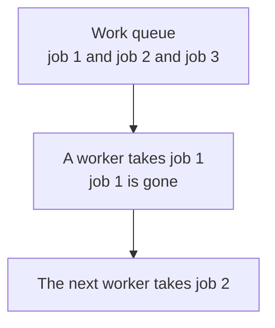
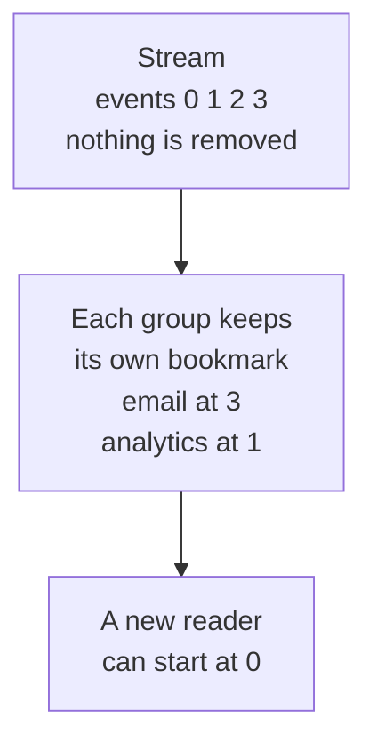
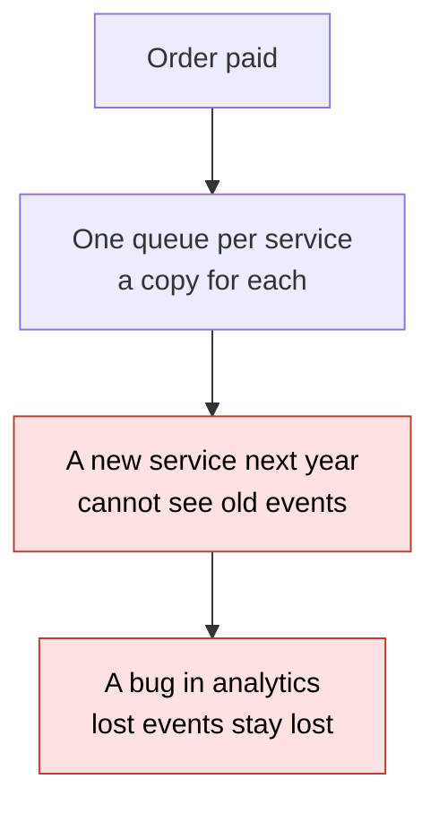
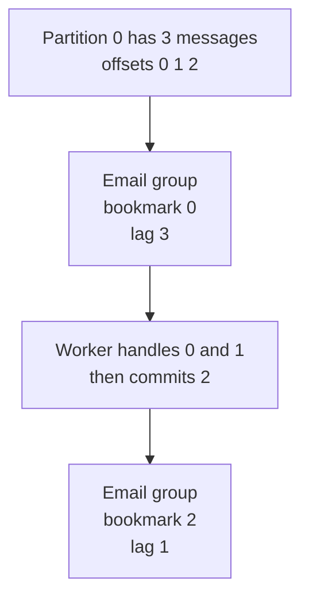

# 21. Streams vs queues

> **Subject:** System Design · **Lesson:** 21 · **Made:** 2026-11-04 · **Status:** ready
>
> **You will be able to:** say the difference between a work queue (a message is taken and gone) and a stream (a log that stays, with a bookmark for each reader), explain partitions, offsets and consumer groups, say why order exists only inside one partition, explain what happens when a worker crashes before it commits, and choose between a queue and a stream for a job.
>
> **Before this:** [Consistent hashing](20-consistent-hashing.md) · **Next:** [Search indexes](22-search-indexes.md)
>
> **How to read it:** one card is one idea. Look at the picture, guess, then press the orange bar to check. The blue bars (📖 More detail) hold the longer explanation. Skip them on the first read, and open them when you want more. About 15 minutes for the cards.

## 1. The idea: a tray of jobs, or a notebook that stays

A **work queue** is like a tray of papers on a desk. A worker takes one paper and does it. The paper is gone. Another worker takes the next one. A **stream** is like a notebook where every event is written on the next line. Nobody tears out a page. Each reader keeps a **bookmark** that says how far it has read. A new reader can start at page one.





Notice that in the stream every reader gets **every** event, at its own speed. In the queue each job goes to **one** worker.

<details class="guess"><summary>🤔 Guess: an "order paid" event must be seen by the email service AND the analytics service. With a plain work queue, what happens when the email worker takes the message? Press to check.</summary>

It is **gone**. The analytics service never sees it. With a queue you must send a copy to each service (a queue per service). With a stream, both read the same log with their own bookmarks. (Real run in the lesson code, card 2: both groups read the same messages.)

</details>

> **Remember:** a queue hands out jobs and forgets them. A stream keeps the events, and each reader keeps its own place.

<details class="more"><summary>📖 More detail: new words, the problem drawn, and why it exists</summary>

Lesson [06](06-message-queues.md) was about a queue between two parts of your system. This lesson adds the other design: the log.

New words (four):

- **Partition:** one numbered list inside a stream. A stream (a "topic" in Kafka) is split into several partitions so it can be read in parallel.
- **Offset:** the place of a message in its partition: 0, 1, 2 ... It never changes.
- **Consumer group:** a set of workers that share one job. A group keeps one bookmark per partition.
- **Commit:** saving the bookmark. "I have finished everything before offset 3."

**The problem, drawn.** Many services want the same events: email, analytics, search, a new service next year. With a queue, you add one queue and one copy for each, and an event that was already consumed is gone for ever.



**What the docs say (opened 2026-11-04).** The Apache Kafka introduction says events with the same key go to the same partition, and a consumer of a partition reads its events "in exactly the same order as they were written". It also says events stay in the topic after they are read, and you set how long Kafka keeps them for each topic. The Amazon SQS docs say a standard queue gives at-least-once delivery, may deliver a message more than once, and orders messages only on a best-effort basis.

**Where the analogy stops.** A real stream is not kept for ever. It has a **retention** setting: events older than that (or bigger than a size) are deleted. A bookmark that points to deleted events cannot be used.

**Why it exists and what it costs.**

- **Without it:** every reader needs its own copy of every event, and a mistake cannot be undone.
- **With it:** one log, many readers, replay from any point, and order for each key.
- **The cost:** you run a bigger system (partitions, groups, retention), the order is only per partition, and a slow message can hold up its partition (card 6).

</details>

## 2. Inside a stream: partitions and offsets

A message has a **key** (for example the order id). The key picks the **partition**: `hash(key) % number of partitions`. In each partition, messages are numbered 0, 1, 2 in the order they arrive. The number is the **offset**.

| Message key | Partition (hash % 2) | Offset |
|---|---|---|
| `k0` | 0 | 0 |
| `k1` | 1 | 0 |
| `k2` | 0 | 1 |

<details class="guess"><summary>🤔 Guess: the keys k0 and k2 go to partition 0, and k1 goes to partition 1. Messages arrive in this order: k0, k1, k2. What are the (partition, offset) pairs? And is the "paid" message of k1 before or after the "created" message of k0? Press to check.</summary>

`k0` is (0, 0). `k1` is (1, 0). `k2` is (0, 1). The k1 and k0 messages both have **offset 0**, in different partitions. There is **no order** between them. Order exists only **inside one partition**. All messages of one key stay in order because the same key always goes to the same partition. (Real run, Node 26.12.1.)

</details>

> **Remember:** the key picks the partition. Order is kept inside a partition, not across partitions.

<details class="more"><summary>📖 More detail: the code, the real output, and why not one big list</summary>

This is practice C. A log is a list for each partition. `append` adds to the end. Nothing is ever removed by a reader.

```js
function createLog({ partitions = 2, hash: hashFn = hash } = {}) {
  const lists = Array.from({ length: partitions }, () => []);          // one list per partition, never shrinks
  const saved = new Map();                                              // "group|partition" -> next offset to read
  const partitionOf = (key) => hashFn(key) % partitions;
  return {
    partitionOf,
    append(key, value) {
      const partition = partitionOf(key);
      lists[partition].push({ key, value });
      return { partition, offset: lists[partition].length - 1 };
    },
    // read, commit, position, lag: see practice C
  };
}
```

Run with a fake hash where `k0` and `k2` go to partition 0 and `k1` to partition 1:

```
{ partition: 0, offset: 0 }
{ partition: 1, offset: 0 }
{ partition: 0, offset: 1 }
```

Checked on 2026-11-04 with Node 26.12.1.

**Why not one big list?** One list means one reader at a time, and one machine. Partitions let you spread the stream over machines and read it in parallel. The price is that you give up one total order. If you need order, use the **same key** for everything that must stay in order, such as every event of one order.

**This is the same idea as lesson [20](20-consistent-hashing.md).** A key picks a place with a hash. Here the places are partitions. The rule `hash % partitions` has the same weakness: change the number of partitions and the same key may land in another partition. Check the docs of your tool before adding partitions to a topic that needs order per key.

**Step through it yourself:** [open the stepper](visuals/21-streams-vs-queues.html). Tab 1 compares a queue and a stream, and tab 2 shows partitions and offsets.

</details>

## 3. Bookmarks: consumer groups, commit, lag

Each **group** keeps one bookmark per partition. Reading does **not** move the bookmark. The worker moves it with a **commit**, after it has finished the work. **Lag** is how many messages the group has not committed past.



The analytics group keeps its own bookmark. It is still at 0, so its lag is still 3.

<details class="guess"><summary>🤔 Guess: a worker reads the message "paid", handles it (sends the email), and crashes before it commits. After the restart it reads again. What does it get, and what must the code expect? Press to check.</summary>

The **same message again** ("paid" and "paid" in the real run). The bookmark never moved, so nothing says "paid" is done. The email may go out twice. So the worker must be safe to run twice: **idempotent** (lesson [13](13-idempotency-and-retries.md)). This is **at-least-once** delivery. (Real run, Node 26.12.1.)

</details>

> **Remember:** commit after the work, so a crash gives a repeat and not a loss. Then make the work safe to repeat.

<details class="more"><summary>📖 More detail: the real output, commit before or after, and the cost</summary>

```js
log.commit("email", 0, 2);                    // email has finished offsets 0 and 1
const first = log.read("email", 1).map((m) => m.value);
const again = log.read("email", 1).map((m) => m.value);       // the worker crashed before commit
```

```
after email commits 2 -> email reads partition 0: (nothing left)  | analytics position: 0
crash before commit: [ 'paid' ] [ 'paid' ]
lag email: 1 | lag analytics: 3
```

Checked on 2026-11-04 with Node 26.12.1 (partition 0 has 2 messages, partition 1 has 1, as in card 2).

**Commit before or after the work?**

| When you commit | If the worker crashes in the middle | Name |
|---|---|---|
| after the work | the message comes again | at-least-once (safe, may repeat) |
| before the work | the message is lost | at-most-once (may lose) |

At-least-once with an idempotent worker is the common choice. A queue like SQS gives you the same: a standard queue may deliver a message more than once (docs, opened 2026-11-04).

**Lag is the number to watch.** If lag grows, workers are too slow or stopped. It is the stream's version of "queue depth" in lesson [14](14-observability.md).

**Cost.** A bookmark per group and partition must be stored somewhere safe. In real Kafka the broker stores it for you.

</details>

## 4. Replay, and how many workers can help

Because nothing is deleted, a group can **replay**: commit an earlier offset and read the old messages again. And because a partition is read by **one worker per group**, the number of partitions is the limit for how many workers share the job.

| Partitions | Workers in the group | Who does work |
|---|---|---|
| 4 | 2 | each gets 2 partitions: `{ m1: [0, 2], m2: [1, 3] }` |
| 2 | 3 | `{ a: [0], b: [1], c: [] }`: **c has nothing to do** |
| 3 | 1 | one worker gets all three partitions |

<details class="guess"><summary>🤔 Guess: a topic has 2 partitions and a group has 3 workers. How many workers do any work? Press to check.</summary>

**Two.** Each partition goes to one worker of the group (docs: "each partition is assigned to exactly one consumer in the group"). The third worker waits, as a spare. To use 3 workers you need at least 3 partitions. (Real run of `assign`, Node 26.12.1.)

</details>

> **Remember:** more workers than partitions do not help. And a replay is just a commit to an earlier offset.

<details class="more"><summary>📖 More detail: replay, who assigns, and the cost</summary>

**Replay.** The analytics group had read everything, then a bug was found. Commit offset 0 and it reads again (practice test "replay"):

```
replay: analytics reads again: [ 'created', 'shipped' ]
size after all this: 2 1
```

The log did not shrink (2 and 1 messages are still there). In a real system, replay only works as far back as the **retention** setting.

**Who assigns partitions.** In Kafka a broker called the group coordinator tracks which workers are alive and moves partitions when one dies or joins (Confluent docs, opened 2026-11-04). Our `assign` is the simple round-robin version: partition `p` goes to `members[p % members.length]`.

**Adding a worker** moves some partitions to it. For a moment those partitions are not read (a rebalance).

**Cost.** The number of partitions is a hard limit on parallel work in one group. Choose it with growth in mind, because changing it later can move keys to other partitions (card 2).

</details>

## 5. Which one for which job?

Use a **queue** when the message is a **job to do once**. Use a **stream** when the message is a **fact that happened**, many readers want it, you may want to replay it, or the order for one key matters.

| The need | Pick | Examples |
|---|---|---|
| Send one email, resize one photo, charge one card | work queue | BullMQ, SQS, a Postgres job table |
| Order events that email, search, analytics and billing all read | stream | Kafka |
| Replay last week's events after a bug | stream | Kafka |
| Events of one order must stay in order | stream, key = order id | Kafka |
| Retry with delay and a dead letter queue (lesson 06) | work queue | BullMQ, SQS |

<details class="guess"><summary>🤔 Guess: thumbnail jobs for uploaded photos. Queue or stream? And an audit trail of every change to an order that finance, search and analytics all read? Press to check.</summary>

Thumbnails: a **work queue**. It is a job to do once, with retries. The audit trail: a **stream**. It is a fact that many readers want, in order for each order, with replay.

</details>

> **Remember:** a queue is a to-do list. A stream is a history. Many systems have both: events in a stream, and jobs in queues.

<details class="more"><summary>📖 More detail: the tools, and how they fit your stack</summary>

- **BullMQ** (Redis) is a job queue for Node. The lesson on queues has a real example with retries (the [queues guide](queues-streams-and-event-driven-design.md)). Its jobs are meant to be taken and finished. My notes say DBO runs BullMQ on Redis for background work.
- **SQS** is a hosted queue. Standard queues give at-least-once and best-effort order. FIFO queues give strict order within a group (the docs name `MessageGroupId`, which I did not open for this lesson).
- **Kafka** is the stream. Its docs describe topics, partitions, per-partition order and per-topic retention.
- **A Postgres table** can be a small queue (lesson [database 18](../database/18-upsert-idempotency-and-job-queues.md)). It is enough until the volume is large.

**Both together.** A common design: the service writes an event to the stream. A consumer reads it and puts jobs into a work queue, where workers with retries do the real work. The stream is the history, and the queue is the to-do list. See the [queues guide](queues-streams-and-event-driven-design.md), Part 6, for how to choose.

**Cost.** A stream is a bigger system to run than a hosted queue or a Redis queue. If you have one reader and one job type, a queue is simpler.

</details>

## 6. Five mistakes, and what to say if you freeze

- **Wrong:** a stream when you only need jobs done once. **Right:** a queue is simpler.
- **Wrong:** "Kafka keeps global order". **Right:** order is inside one partition, so use the same key for events that must stay in order.
- **Wrong:** commit before the work. **Right:** commit after, and make the work safe to repeat.
- **Wrong:** 2 partitions and 10 workers. **Right:** partitions limit the workers: you need at least as many partitions as workers.
- **Wrong:** one failing message that is retried for ever. **Right:** a limit on retries and a place to put it (a dead letter queue or topic).

<details class="guess"><summary>🤔 Guess: in a partition, message 5 always fails and the worker keeps retrying it. What happens to messages 6, 7 and 8 of that partition? Press to check.</summary>

They **wait**. A partition is read in order, so the worker cannot commit past 5 until 5 is done or skipped. That is "a slow message holds up its partition". Fix: a retry limit, then move message 5 to a dead letter place and go on.

</details>

> **Remember:** if you freeze, say "A queue hands out jobs and forgets them. A stream keeps events with a bookmark for each group. The key picks the partition, and order lives only inside a partition."

<details class="more"><summary>📖 More detail: the mistakes in full, and the freeze plan</summary>

- **A stream for jobs.** If every message is a job for one worker, you get the cost of partitions and groups and none of the benefits.
- **Global order.** Two events with different keys can be read in any order. If "created" must come before "paid" for one order, both need the same key.
- **Commit before.** A crash then loses the message. The only time this is fine is when losing one is cheap (a view counter).
- **Few partitions.** The limit is hard (card 4).
- **Retry for ever.** It blocks the partition and burns money. Lesson [06](06-message-queues.md) covers retry limits and dead letters, and lesson 23 (planned) covers backoff.

**If you freeze:**

1. Say "A queue is a to-do list: take a job, it is gone. A stream is a history: events stay, and each group keeps a bookmark."
2. Say "The key picks the partition. Order exists only inside a partition. One worker per partition in a group."
3. Say "Commit after the work. A crash means a repeat, so the worker must be idempotent."

</details>

## 7. Watch and play

Links were opened on 2026-11-04. For the videos I confirmed only the title and the channel name from YouTube's embed data, not the length or the content.

- **Play with it:** [the stepper in this folder](visuals/21-streams-vs-queues.html) - guess first, then press Next. Try all three tabs.
- **Read:** [Apache Kafka: introduction](https://kafka.apache.org/intro) - find topics, partitions, "same partition" for the same key, and retention.
- **Read:** [Confluent: Kafka consumer design](https://docs.confluent.io/kafka/design/consumer-design.html) - consumer groups, offsets, and the group coordinator.
- **Read:** [Amazon SQS standard queues](https://docs.aws.amazon.com/AWSSimpleQueueService/latest/SQSDeveloperGuide/standard-queues.html) - at-least-once and best-effort ordering, and the use cases.
- **Video:** [How do Kafka Consumer Groups and Consumer Offsets work in Apache Kafka?](https://www.youtube.com/watch?v=9o5LAbPNc28) - channel Conduktor, length not checked. Compare with card 3.
- **Video:** [Kafka as a Message Queue: can you do it, and should you do it? by Adam Warski](https://www.youtube.com/watch?v=-As92HV0O4E) - channel Devoxx, length not checked. Compare with cards 5 and 6.

<details><summary>Go deeper (optional)</summary>

- [BullMQ docs](https://docs.bullmq.io/) - the job queue from your stack. I opened the home page. I did not check the removal settings, because the page I tried for them was not found.
- **Not run here.** I did not run Kafka. The code in this lesson is a small in-memory log, so all outputs show the idea and not Kafka's real behaviour. Everything about real Kafka and SQS comes from their docs.
- **Exactly-once.** Kafka and others advertise "exactly once" in some setups. The safe way to think about it: assume at-least-once and make the consumer idempotent (lesson [13](13-idempotency-and-retries.md)).
- **Your own guide.** [Queues, streams and event-driven design](queues-streams-and-event-driven-design.md) has delivery guarantees, dead letter queues, Kafka against SQS against BullMQ, sagas, CQRS and event sourcing.

</details>

## 8. Practice

**A. Predict the output** (write your answer before opening)

```js
const log = createLog({ partitions: 2, hash: (s) => Number(s.slice(1)) });
log.append("k0", "a");
log.append("k1", "b");
log.append("k2", "c");
log.commit("email", 0, 1);
console.log(log.read("email", 0).map((m) => m.value), log.lag("email"), log.lag("analytics"));
```

Then answer: what does `analytics` see if it reads partition 0?

<details><summary>Answer</summary>

```
[ 'c' ] 2 3
```

Partition 0 holds `a` (offset 0) and `c` (offset 1). Email committed offset 1, so it reads only `c`. Email's lag is 1 (the `c` in partition 0) plus 1 (the `b` in partition 1) = 2. Analytics has committed nothing, so its lag is 3, and it reads `a` and `c` from partition 0. (Checked on 2026-11-04 with Node 26.12.1, using the answer to practice C.)

</details>

**B. Fix the answer**

A teammate says: "Our order events go to a Kafka topic with 3 partitions, and the keys are random uuids. We need 'created' to be read before 'paid' for each order. Kafka keeps the order, so we are fine." What is wrong?

<details><summary>Answer</summary>

Order is kept only **inside one partition**. With a random uuid for each message, "created" and "paid" of the same order can land in different partitions and be read in any order. Use the **order id as the key** for all events of that order. Then they go to the same partition and are read in the order they were written.

</details>

**C. Write it yourself**

Open `learn/system-design/practice/21-streams-vs-queues.js`. It has two empty functions: `createLog` (cards 2 to 4) and `assign` (card 4). `hash` is done for you. Write them, then run this from the repo root and make all the tests pass:

```
node --test learn/system-design/practice/21-streams-vs-queues.test.js
```

<details><summary>One possible answer</summary>

```js
function createLog({ partitions = 2, hash: hashFn = hash } = {}) {
  const lists = Array.from({ length: partitions }, () => []);          // one list per partition, never shrinks
  const saved = new Map();                                              // "group|partition" -> next offset to read
  const keyOf = (group, p) => group + "|" + p;
  const position = (group, p) => saved.get(keyOf(group, p)) || 0;
  const partitionOf = (key) => hashFn(key) % partitions;
  return {
    partitionOf,
    append(key, value) {
      const partition = partitionOf(key);
      lists[partition].push({ key, value });
      return { partition, offset: lists[partition].length - 1 };
    },
    size(partition) { return lists[partition].length; },
    read(group, partition, max = 10) {
      const start = position(group, partition);
      return lists[partition].slice(start, start + max).map((m, i) => ({ partition, offset: start + i, key: m.key, value: m.value }));
    },
    commit(group, partition, offset) {
      if (!Number.isInteger(offset) || offset < 0 || offset > lists[partition].length) return false;
      saved.set(keyOf(group, partition), offset);
      return true;
    },
    position,
    lag(group) {
      return lists.reduce((sum, list, p) => sum + (list.length - position(group, p)), 0);
    },
  };
}

function assign(partitionCount, members) {
  const out = {};
  for (const m of members) out[m] = [];
  if (members.length === 0) return out;
  for (let p = 0; p < partitionCount; p++) out[members[p % members.length]].push(p);
  return out;
}
```

Checked on 2026-11-04 with Node 26.12.1: the 18 tests fail on the empty stub and all 18 pass with this answer. Two details to notice. `read` never changes the bookmark, so reading twice gives the same messages, which is why a crash before `commit` repeats them. And `commit` accepts an offset equal to the size (the group is fully caught up) but refuses one above it.

</details>

## 9. Interview question

**Q:** "When would you use Kafka instead of a queue like SQS or BullMQ?"

A common follow-up: "How do you keep the events of one order in order?" and "What happens if a consumer crashes?" Cards 2 and 3 are the answers.

<details><summary>A strong answer, in four parts</summary>

1. **Problem:** a queue gives each message to one worker and forgets it. That is right for jobs. It is wrong when many services need the same events, when you want to replay after a bug, or when order for one key matters.
2. **How it works:** a stream is a log split into partitions. The key (for example the order id) picks the partition, and inside a partition messages have offsets 0, 1, 2 in the order they arrived. Each consumer group keeps its own bookmark for each partition and commits after it finishes the work. Email and analytics read the same events at their own speed. A new service can start from offset 0. Inside a group, each partition is read by one worker, so the partitions limit how many workers can share the job.
3. **Tradeoff:** more to run than a hosted queue. Order exists only inside a partition. A crash before commit gives a repeat, so consumers must be idempotent. A failing message holds up its partition, so I need a retry limit and a dead letter place. Retention is limited, so replay goes back only that far. For simple jobs with retries, I would still use BullMQ or SQS.
4. **My example:**
   - **Fact:** from my notes, DBO runs a Queue service with BullMQ on Redis for background work, and the Cron service runs scheduled jobs. The case study does not mention a stream.
   - **Not known yet:** which jobs run on the queue, and how many readers each event has.
   - **Idea, not a fact:** if several services (points, notifications, reporting) all needed every order event, I would write the events to a stream with the order id as the key, and keep BullMQ for the jobs. I would say it as "what I would look at".

</details>

## 10. Explain it back

Close this file. Explain the difference between a queue and a stream out loud like to a new junior, in 4 parts (problem, how, tradeoff, my example). Use the story of the email and analytics groups with their own bookmarks, and the story of the worker that crashes before it commits. Then write your best version below and run `/explain-check streams vs queues` or ask the `explain-coach` agent to review it.

### My explanation

<write here>

### Coach feedback

<the explain-coach agent writes here>

## 11. Review questions (day 1, 3, 7, 21)

1. What happens to a message in a work queue after a worker finishes it, and what happens in a stream?
2. Why is order kept only inside one partition, and what do you do to keep the events of one order in order?
3. A worker handles a message and crashes before it commits. What does it read after the restart, and what must the code be?
4. A topic has 3 partitions and a group has 5 workers. How many do work?

<details><summary>Answers</summary>

1. In a queue it is removed. In a stream it stays (until retention ends), and each group only moves its bookmark.
2. Partitions are separate lists with their own offsets, and no order is kept between them. Use the order id as the key for all its events, so they go to one partition.
3. The same message again, because the bookmark did not move. The code must be idempotent (safe to run twice).
4. Three. Each partition goes to one worker in the group, so two workers wait.

</details>

## Connected lessons

- [Message queues](06-message-queues.md) - the work queue, at-least-once delivery and dead letter queues.
- [Idempotency and retries](13-idempotency-and-retries.md) - how a consumer survives repeats.
- [Consistent hashing](20-consistent-hashing.md) - the lesson before. Key to partition is the same idea as key to server.
- [Replication and quorums](19-replication-and-quorums.md) - partitions of a stream are also copied to several machines.
- [Search indexes](22-search-indexes.md) - the next lesson. A stream of changes is how a search index is kept in step with the database.
- [Observability](14-observability.md) - consumer lag is the number to alert on.
- [Upsert, idempotency and job queues (database 18)](../database/18-upsert-idempotency-and-job-queues.md) - a queue in a Postgres table.
- [Queues, streams and event-driven design](queues-streams-and-event-driven-design.md) - the long guide: delivery guarantees, dead letters, Kafka against SQS against BullMQ.
- [Design workbook part 1](design-workbook-part-1-classic-designs.md) - chat, news feed and video designs that use a queue or a stream.
