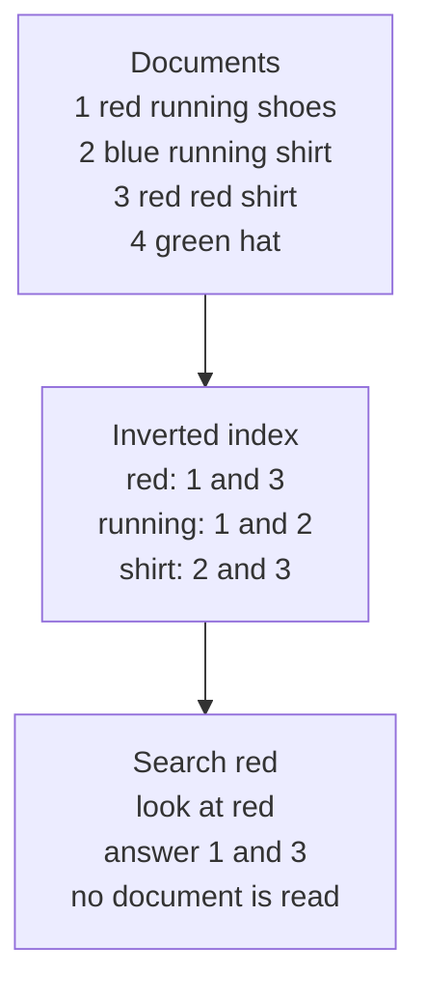
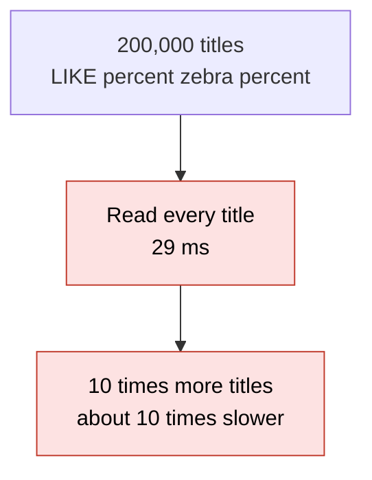
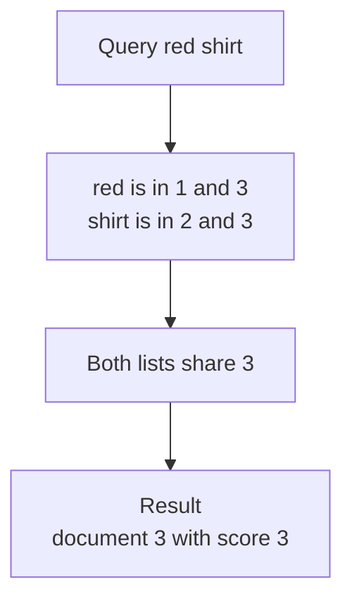
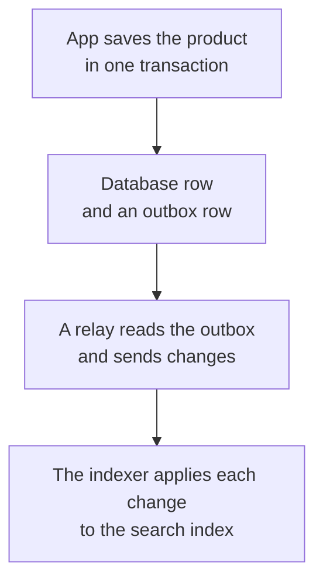

# 22. Search indexes

> **Subject:** System Design · **Lesson:** 22 · **Made:** 2026-11-04 · **Status:** ready
>
> **You will be able to:** explain what an inverted index is and why it finds words fast, build a tiny one by hand (words, then the documents that hold them), say how a search with several words and a simple score works, say when a database index is enough and when you need a search engine, and explain how a search index is kept in step with the database, with duplicates and wrong order.
>
> **Before this:** [Streams vs queues](21-streams-vs-queues.md) · **Next:** [Timeouts, retries and circuit breakers](23-timeouts-retries-and-circuit-breakers.md)
>
> **How to read it:** one card is one idea. Look at the picture, guess, then press the orange bar to check. The blue bars (📖 More detail) hold the longer explanation. Skip them on the first read, and open them when you want more. About 15 minutes for the cards.

## 1. The idea: the index at the back of a book

To find the word "shirt" in a thick book, you do not read every page. You open the **index** at the back. It lists words in order, and next to each word the pages that have it. A search index is the same, built for a computer. For each **word**, it keeps the list of **documents** that contain it. This is called an **inverted index**: the normal way is "document, then its words", and the index turns it round into "word, then its documents".



Notice that a search looks up the word and reads a short list. It does not read the documents.

<details class="guess"><summary>🤔 Guess: a table has 200,000 product titles. You search for a rare word that is in 1 title. How long does `ILIKE '%zebra%'` take, and how long with a full text index in Postgres (a GIN index)? Press to check.</summary>

About **29 ms** for `ILIKE` (it reads every title) and **0.2 ms** with the index. That is about 150 times faster. (Real run on Postgres 18.3, 200,000 rows, best of 5. Card 4 has the rest of the numbers.)

</details>

> **Remember:** an inverted index maps each word to the documents that hold it. A search reads the lists for the words, not the documents.

<details class="more"><summary>📖 More detail: new words, the problem drawn, and why it exists</summary>

Lesson [database 09](../database/09-indexes-and-b-trees.md) was about indexes that find a value or a range. A search index finds **words inside text**, which a B-tree cannot do for `%word%`.

New words (four):

- **Token / word:** a piece of text after you cut it up. "Red Shoes!" gives `red` and `shoes`.
- **Posting list:** the list of document ids for one word. The index is a set of posting lists.
- **Relevance (score):** a number that says how well a document fits the query, so the best come first.
- **Search engine:** a system built for this, such as Elasticsearch, OpenSearch or Meilisearch, which runs next to your database.

**The problem, drawn.** `LIKE '%word%'` has to look inside every row, because the word could be anywhere. With more rows, it is slower in step.



**What the docs say (opened 2026-11-04).** The Elastic docs say an inverted index maps each token to the documents that contain it, with a **sorted** dictionary of terms so a term can be found fast, and then its list of ids. The Postgres docs say GIN indexes, "as inverted indexes", contain "an index entry for each word (lexeme), with a compressed list of matching locations".

**Where the analogy stops.** A book index is made once. A search index must change when documents change, and the lists are kept in order and compressed. Also a real search also handles word endings ("shoe" and "shoes"), spelling, and ranking, which a book index does not.

**Why it exists and what it costs.**

- **Without it:** every search reads every row, and search gets slower as data grows.
- **With it:** a search reads a few short lists. It stays fast with many documents.
- **The cost:** the index takes space (4.9 MB for a 29 MB table in my test) and must be updated on every change. A search engine is also another system to run and keep in step (card 5).

</details>

## 2. Building the index by hand

Cut each document into words (**tokenize**: lowercase, split on anything that is not a letter or digit). For each word, remember the documents that have it and **how many times** it appears there.

| Word | Documents (id: times) |
|---|---|
| red | 1: 1, 3: 2 |
| running | 1: 1, 2: 1 |
| shoes | 1: 1 |
| blue | 2: 1 |
| shirt | 2: 1, 3: 1 |
| green | 4: 1 |
| hat | 4: 1 |

<details class="guess"><summary>🤔 Guess: documents 1 to 4 are "red running shoes", "blue running shirt", "red red shirt" and "green hat". What does the index say for the words red, running and shirt? Press to check.</summary>

`red: [1, 3]`, `running: [1, 2]`, `shirt: [2, 3]`. And the index has 7 different words for 4 documents. (Real run of the practice code, Node 26.12.1.)

</details>

> **Remember:** tokenize, then for each word keep the documents and the counts.

<details class="more"><summary>📖 More detail: the code, the real output, and what happens on a change</summary>

This is practice C (`tokenize` and `createIndex`):

```js
function tokenize(text) {
  return String(text).toLowerCase().match(/[a-z0-9]+/g) || [];
}

function createIndex() {
  const postings = new Map();          // word -> Map(id -> how many times the word is in that document)
  const wordsOf = new Map();           // id -> the words of the document, so remove() knows where to look
  const index = {
    add(id, text) {
      if (wordsOf.has(id)) index.remove(id);                     // adding the same id again replaces the document
      const counts = new Map();
      for (const w of tokenize(text)) counts.set(w, (counts.get(w) || 0) + 1);
      for (const [w, n] of counts) {
        if (!postings.has(w)) postings.set(w, new Map());
        postings.get(w).set(id, n);
      }
      wordsOf.set(id, [...counts.keys()]);
    },
    // remove, postings, search, stats: see practice C
  };
  return index;
}
```

**Output** for the four documents:

```
[ 'red', 'shoes', 'size', '42' ]       <- tokenize("Red Shoes, size 42!")
postings red: [ 1, 3 ] | running: [ 1, 2 ] | shirt: [ 2, 3 ]
```

Checked on 2026-11-04 with Node 26.12.1.

**On a change.** To change a document you must **remove** its old words first (that is why `wordsOf` remembers them), and then add the new ones. A word with no documents is deleted from the index, or the index grows with dead words.

**Real engines** also: drop very common words, cut words to a root ("running" to "run"), fix accents, and keep the **position** of each word so they can find phrases. The idea is the same: word to list.

**Step through it yourself:** [open the stepper](visuals/22-search-indexes.html). Tab 1 builds the index document by document.

</details>

## 3. Searching: lists, "and", and a score

To search "red shirt", look up the list for **red** (1, 3) and the list for **shirt** (2, 3). A document must be in **both** lists: that is 3. The score is simple here: add up how many times each query word is in the document. "red red shirt" has red twice and shirt once, so its score is 3.



<details class="guess"><summary>🤔 Guess: with the same four documents, what does the search "red hat" give, and what does "red" give (with scores)? Press to check.</summary>

"red hat": **nothing**. Red is in 1 and 3, hat is in 4, and no document is in both lists. "red": **document 3 first (score 2), then document 1 (score 1)**, because "red red shirt" has the word twice. (Real run, Node 26.12.1.)

</details>

> **Remember:** a search looks up each word, keeps the documents in every list, and sorts by a score.

<details class="more"><summary>📖 More detail: the code, the speed trick, and better scores</summary>

```js
search(query, limit = 10) {
  const terms = [...new Set(tokenize(query))];
  if (terms.length === 0) return [];
  const lists = terms.map((t) => postings.get(t));
  if (lists.some((l) => !l)) return [];                      // a word nobody has: no document can match all words
  const smallest = lists.reduce((a, b) => (b.size < a.size ? b : a));
  const hits = [];
  for (const id of smallest.keys()) {
    if (lists.every((l) => l.has(id))) hits.push({ id, score: lists.reduce((sum, l) => sum + l.get(id), 0) });
  }
  hits.sort((a, b) => b.score - a.score || byId(a.id, b.id));
  return hits.slice(0, limit);
}
```

**Output:**

```
[ { id: 3, score: 2 }, { id: 1, score: 1 } ]       <- search("red")
[ { id: 3, score: 3 } ]                             <- search("red shirt")
[] { docs: 4, terms: 7 }                            <- search("red hat"), and stats()
```

Checked on 2026-11-04 with Node 26.12.1.

**The speed trick.** Walk the **smallest** list, and check each id in the other lists. A query for a rare word and a common word reads the rare word's short list only.

**Better scores.** Counting words is too simple. A word that is in every document tells you nothing, and a long document has more chances to hold a word. Real engines weigh these (the well known names are TF-IDF and BM25). I did not run those here. Postgres has `ts_rank`; in my test, for the query "w0 w1", the best title was `w0 w1 w0 w0 w1 w819` with a rank of 0.46.

**Cost.** The list of a very common word is huge, so even an index cannot help much for it (card 4).

</details>

## 4. Postgres, or a search engine?

Postgres can do full text search itself. You keep a `tsvector` (the words of a row) in a column and put a **GIN** index on it (the same inverted index idea). For many apps, that is enough, and it stays in step with the data by itself.

| 200,000 rows (Postgres 18.3) | Time (best of 5) |
|---|---|
| `ILIKE '%zebra%'`, rare word, no index | 29 ms |
| `to_tsvector(title) @@ 'zebra'`, no stored column or index | 225 ms |
| `doc @@ 'zebra'` with GIN | **0.2 ms** |
| `doc @@ 'w0'`, a word in 30% of rows, with GIN | 9.3 ms (60,829 rows) |
| `ILIKE '%w0%'`, same word, no index | 20.1 ms |
| two common words `w0 w1` with GIN | 3.2 ms (4,674 rows) |

<details class="guess"><summary>🤔 Guess: a word is in 30% of all rows. How much faster is the GIN index than `ILIKE` for that word? And for the rare word? Press to check.</summary>

For the common word: only about **2 times** (9.3 ms against 20.1 ms), because the answer is 60,829 rows and the work is mostly reading them. For the rare word: about **150 times** (0.2 ms against 29 ms). An index helps most for words that few documents have. (Real run.)

</details>

> **Remember:** start with Postgres full text search. Move to a search engine when you need more than it does well.

<details class="more"><summary>📖 More detail: the setup, how I measured, and when to switch</summary>

**The setup I used:**

```sql
CREATE TABLE product (id serial PRIMARY KEY, title text);
-- a stored column keeps the words of each title, built by Postgres
ALTER TABLE product ADD COLUMN doc tsvector GENERATED ALWAYS AS (to_tsvector('simple', title)) STORED;
CREATE INDEX product_doc_gin ON product USING gin (doc);
SELECT id FROM product WHERE doc @@ plainto_tsquery('simple', 'zebra');
```

The plan for the rare word was a `Bitmap Index Scan on product_doc_gin`. Building the index on 200,000 rows took 274 ms. The table was 29 MB and the GIN index 4.9 MB. A row inserted in the same session was **found at once**: the index is part of the transaction (the query for `unicorn` returned 1 right after the insert).

**How I measured.** A throwaway Postgres 18.3 on the same machine, 200,000 rows of 6 made-up words each from 5,000 words (small numbers are common), one row with the word `zebra`. Best time of 5 runs, through the `pg` driver. The `simple` setting means no word stemming. Times on your machine differ, the sizes of the gaps stay.

**When Postgres is enough:** one language, a simple ranking, up to some millions of rows, and you want search to match the data at once.

**When to add a search engine** (Elasticsearch, OpenSearch, Meilisearch, Typesense): you need typo tolerance, "did you mean", faceted filters over many fields, relevance tuning, many languages, or very big data and many searches. The cost is another system, and card 5.

**Cost.** A GIN index makes writes slower and takes space. My test did not time updates, so check that with your own data.

</details>

## 5. Keeping the search index in step with the database

If the search lives in a separate engine, your data is in **two places**. The database is the truth, and the index is a copy. When a product changes, both must change. If your code writes to the database and then to the engine, one write can fail and the two disagree (the **dual write** problem).



<details class="guess"><summary>🤔 Guess: the indexer gets "upsert doc 1, version 2" then "upsert doc 1, version 1" (late) and then "upsert doc 1, version 2" again (a repeat). What should it do with each? Press to check.</summary>

**Apply** the first. **Ignore** the late older one (stale) and **ignore** the repeat (stale). The indexer remembers the newest version it saw for each id, and only applies a bigger one. A late old change must not undo a newer one. (Real run of `createSync`: `applied`, `stale`, `stale`.)

</details>

> **Remember:** changes arrive twice and out of order. Number the changes (a version) and ignore any that are not newer. Search is a little behind, on purpose.

<details class="more"><summary>📖 More detail: the outbox, deletes, the delay, and the code</summary>

**The outbox** (microservices.io, opened 2026-11-04): the service writes its change into an outbox table in the **same transaction** as the business data. A separate relay reads the outbox and publishes the changes. The page says messages are sent if and only if the transaction commits, that the relay can publish a message **more than once**, and that consumers must be idempotent. (Lesson [13](13-idempotency-and-retries.md) is about this. A stream like in lesson [21](21-streams-vs-queues.md) can carry the changes.) Another way is **change data capture** (CDC), which reads the database log and needs no outbox table; lesson [database 18](../database/18-upsert-idempotency-and-job-queues.md) and the data storage guide mention it.

**The code** (practice C, `createSync`):

```js
function createSync(index) {
  const lastVersion = new Map();       // id -> the newest version seen, also for deleted ids
  return {
    apply({ op, id, version, text }) {
      if (lastVersion.has(id) && version <= lastVersion.get(id)) return "stale";
      if (op === "upsert") index.add(id, text);
      else if (op === "delete") index.remove(id);
      else throw new Error("unknown op: " + op);
      lastVersion.set(id, version);
      return "applied";
    },
  };
}
```

```
applied   <- upsert doc 1, version 2
stale     <- upsert doc 1, version 1 (late)
stale     <- upsert doc 1, version 2 (a repeat)
applied   <- delete doc 1, version 3
stale     <- upsert doc 1, version 2 (very late, after the delete)  { docs: 0, terms: 0 }
```

Checked on 2026-11-04 with Node 26.12.1. A delete **keeps its version** (a "tombstone"), so a very late upsert cannot bring the document back.

**The delay.** A search engine is not instant. The Elastic docs say a document becomes searchable after a **refresh**, by default about every 1 second, and "document changes are not visible to search immediately". With a queue in front there is more delay. So a user who saves a product and searches at once may not find it. Show the saved page from the database, and let the search catch up. Postgres full text search does not have this delay (card 4).

**Rebuilding.** The index is a copy, so you can rebuild it from the database. Keep a way to do a full reindex (for a new language setting, or after a bug), and write to a **new** index, then switch a name over to it.

**Cost.** The engine, the relay, the indexer and the monitoring are all new parts to keep alive. Watch the **lag** between the database and the index (lesson [14](14-observability.md)).

</details>

## 6. Five mistakes, and what to say if you freeze

- **Wrong:** `LIKE '%word%'` on a big table. **Right:** a GIN index (Postgres) or a search engine.
- **Wrong:** a search engine as the only copy of the data. **Right:** the database is the truth. The index can be rebuilt.
- **Wrong:** write to the database and the engine in the same request. **Right:** the outbox, or CDC, then an indexer.
- **Wrong:** apply changes in the order they arrive. **Right:** a version for each change, and ignore old ones.
- **Wrong:** expect search to show a new row at once. **Right:** plan for a short delay.

<details class="guess"><summary>🤔 Guess: the app saves a product in the database, then calls the search engine, which is down. The user sees "saved". What is the state now, and what is the fix? Press to check.</summary>

The **database has the product, the search does not**, and nobody knows. The write to the engine was lost. The fix: write a change to an **outbox in the same transaction**. A relay retries until the indexer has applied it, so nothing is lost when the engine is down for a while.

</details>

> **Remember:** if you freeze, say "An inverted index maps each word to its documents. Postgres full text search is the start. For a search engine, the database stays the truth and an outbox with versioned changes keeps the index in step."

<details class="more"><summary>📖 More detail: the mistakes in full, and the freeze plan</summary>

- **LIKE on big tables.** Fine for hundreds of rows, slow for hundreds of thousands (29 ms for 200,000 titles in my test, and it grows in step with the data).
- **The engine as the only copy.** Engines are tuned for search, not for being your record. Keep the data in the database.
- **Dual write.** A crash between the two writes leaves them different, for ever, until a rebuild.
- **Apply in arrival order.** Duplicates and late changes would undo newer ones (the stale cases above).
- **Search is instant.** Show the user's own change from the database, then let the search catch up.

**If you freeze:**

1. Say "An inverted index maps each word to the documents that contain it. A search reads the lists for its words."
2. Say "I would start with Postgres full text search: a tsvector column and a GIN index."
3. Say "If I add a search engine, the database stays the truth. An outbox sends versioned changes to an indexer, which ignores stale ones. Search is a little behind."

</details>

## 7. Watch and play

Links were opened on 2026-11-04. For the videos I confirmed only the title and the channel name from YouTube's embed data, not the length or the content.

- **Play with it:** [the stepper in this folder](visuals/22-search-indexes.html) - guess first, then press Next. Try all three tabs.
- **Read:** [Elastic: How full-text search works](https://www.elastic.co/docs/solutions/search/full-text/how-full-text-works) - analysis, and the inverted index built from tokens.
- **Read:** [Elastic: Near real-time search](https://www.elastic.co/docs/manage-data/data-store/near-real-time-search) - refresh, and the default of about 1 second.
- **Read:** [PostgreSQL docs: GIN and GiST text search indexes](https://www.postgresql.org/docs/current/textsearch-indexes.html) - "As inverted indexes", and the GiST lossy note.
- **Read:** [PostgreSQL docs: full text search introduction](https://www.postgresql.org/docs/current/textsearch-intro.html) - `tsvector` and `tsquery`. I opened it (it loaded) and did not read the details.
- **Read:** [microservices.io: Transactional outbox](https://microservices.io/patterns/data/transactional-outbox.html) - the dual write problem, the outbox table, the relay, and the "idempotent consumers" note.
- **Video:** [Inverted Indexing Explained | Elastic Search & Google Crawlers](https://www.youtube.com/watch?v=RVJHEuCgn0w) - channel Kartikeya Sharma, length not checked. Compare with cards 1 to 3.
- **Video:** [Elasticsearch from the bottom up](https://www.youtube.com/watch?v=PpX7J-G2PEo) - EuroPython 2014, length not checked. An older talk about Lucene and the inverted index, so check current docs for version details.

<details><summary>Go deeper (optional)</summary>

- **Segments.** The Elastic material I found says Lucene keeps data in **immutable segments** that are merged over time, because inverted indexes are not good at changes in place. That is why a change is "add a new thing and merge later". I did not read the Lucene docs for this lesson.
- **Sorting and filters.** An inverted index is good at "which documents contain this word". It is poor at sorting and counting, which need "which words does this document have". Engines keep a second structure for that (Elastic calls it doc values, from the search result I read).
- **Your own guides.** [Data storage choices for system design](data-storage-choices-for-system-design.md), Part 4, covers search with Postgres and with a search engine. [Queues, streams and event-driven design](queues-streams-and-event-driven-design.md) covers the outbox and change data capture.
- **Not run here.** I did not run Elasticsearch or OpenSearch. The engine facts come from their docs. The Postgres numbers and the code outputs are real runs.

</details>

## 8. Practice

**A. Predict the output** (write your answer before opening)

```js
const index = createIndex();
index.add(1, "red running shoes");
index.add(2, "blue running shirt");
index.add(3, "red red shirt");
console.log(index.search("running"));
index.add(2, "green hat");
console.log(index.search("running"), index.stats());
```

Then answer: why does `stats()` say 3 documents and 6 words?

<details><summary>Answer</summary>

```
[ { id: 1, score: 1 }, { id: 2, score: 1 } ]
[ { id: 1, score: 1 } ] { docs: 3, terms: 6 }
```

Both documents have `running` once, and equal scores put the smaller id first. After `add(2, "green hat")` the old words of document 2 (`blue`, `running`, `shirt`) are removed first. `blue` has no documents any more, so it leaves the index. `running` stays for document 1, and `shirt` stays for document 3. The words now are `red`, `running`, `shoes`, `shirt`, `green`, `hat`: 6. (Checked on 2026-11-04 with Node 26.12.1, using the answer to practice C.)

</details>

**B. Fix the answer**

A teammate says: "To keep search in step, our API saves the order in Postgres and then calls the search engine. If the call fails we log it. Search is a copy, so we will fix it later." What is wrong, and what do you suggest?

<details><summary>Answer</summary>

It is a dual write. If the call fails, the two disagree, and nothing will ever fix it (the log line is not a retry). Also two changes to one product that arrive late or twice can undo each other. Suggest: write an outbox row in the **same transaction** as the order. A relay reads the outbox and sends changes, with a version for each. The indexer applies a change only if its version is newer, and the relay retries until the indexer says done. Keep a way to rebuild the whole index from Postgres.

</details>

**C. Write it yourself**

Open `learn/system-design/practice/22-search-indexes.js`. It has three empty functions: `tokenize` (card 2), `createIndex` (cards 2 and 3) and `createSync` (card 5). Write them, then run this from the repo root and make all the tests pass:

```
node --test learn/system-design/practice/22-search-indexes.test.js
```

<details><summary>One possible answer</summary>

```js
// A word is a run of letters or digits. Everything else separates words. Case does not matter.
function tokenize(text) {
  return String(text).toLowerCase().match(/[a-z0-9]+/g) || [];
}

const byId = (a, b) => (a < b ? -1 : a > b ? 1 : 0);

function createIndex() {
  const postings = new Map();          // word -> Map(id -> how many times the word is in that document)
  const wordsOf = new Map();           // id -> the words of the document, so remove() knows where to look
  const index = {
    add(id, text) {
      if (wordsOf.has(id)) index.remove(id);                     // adding the same id again replaces the document
      const counts = new Map();
      for (const w of tokenize(text)) counts.set(w, (counts.get(w) || 0) + 1);
      for (const [w, n] of counts) {
        if (!postings.has(w)) postings.set(w, new Map());
        postings.get(w).set(id, n);
      }
      wordsOf.set(id, [...counts.keys()]);
    },
    remove(id) {
      const words = wordsOf.get(id);
      if (!words) return false;
      for (const w of words) {
        const list = postings.get(w);
        list.delete(id);
        if (list.size === 0) postings.delete(w);                 // a word with no documents leaves the index
      }
      wordsOf.delete(id);
      return true;
    },
    postings(word) {
      const list = postings.get(String(word).toLowerCase());
      return list ? [...list.keys()].sort(byId) : [];
    },
    search(query, limit = 10) {
      const terms = [...new Set(tokenize(query))];
      if (terms.length === 0) return [];
      const lists = terms.map((t) => postings.get(t));
      if (lists.some((l) => !l)) return [];                      // a word nobody has: no document can match all words
      const smallest = lists.reduce((a, b) => (b.size < a.size ? b : a));
      const hits = [];
      for (const id of smallest.keys()) {
        if (lists.every((l) => l.has(id))) hits.push({ id, score: lists.reduce((sum, l) => sum + l.get(id), 0) });
      }
      hits.sort((a, b) => b.score - a.score || byId(a.id, b.id));
      return hits.slice(0, limit);
    },
    stats() { return { docs: wordsOf.size, terms: postings.size }; },
  };
  return index;
}

// Keeps the index in step with changes from the database. Changes can arrive twice or in the wrong order.
function createSync(index) {
  const lastVersion = new Map();       // id -> the newest version seen, also for deleted ids
  return {
    apply({ op, id, version, text }) {
      if (lastVersion.has(id) && version <= lastVersion.get(id)) return "stale";
      if (op === "upsert") index.add(id, text);
      else if (op === "delete") index.remove(id);
      else throw new Error("unknown op: " + op);
      lastVersion.set(id, version);
      return "applied";
    },
  };
}

module.exports = { tokenize, createIndex, createSync };
```

Checked on 2026-11-04 with Node 26.12.1: the 16 tests fail on the empty stub and all 16 pass with this answer. Two details to notice. `remove` needs `wordsOf`, because without it you would have to look through every posting list to find the document. And `createSync` keeps the version of a deleted id, so a very late older upsert is still ignored.

</details>

## 9. Interview question

**Q:** "Add search to an online shop with a million products. What do you build, and how does it stay up to date?"

A common follow-up: "A user edits a product and searches a second later. Do they find it?" Card 5 is the answer.

<details><summary>A strong answer, in four parts</summary>

1. **Problem:** `LIKE '%word%'` reads every row, so it gets slower as data grows (29 ms for 200,000 titles in my test). We need to look words up, not scan text.
2. **How it works:** an inverted index: for each word, a list of the products that hold it. A query looks up its words, keeps the products in every list, and sorts by a score. I would start with Postgres full text search: a `tsvector` column with a GIN index. In my test that took a rare word from 29 ms to 0.2 ms on 200,000 rows, and a new row was findable at once. If I need typo tolerance, filters over many fields or relevance tuning, I add a search engine such as Elasticsearch or OpenSearch. Then Postgres stays the truth. A change writes an outbox row in the same transaction. A relay sends changes to an indexer, each with a version. The indexer ignores stale ones, so duplicates and late changes are safe. I can rebuild the index from Postgres.
3. **Tradeoff:** a search engine is another system to run, and it is behind the database. In Elasticsearch a document becomes searchable after a refresh, about a second by default, plus the queue delay. So the product page reads from the database, and search catches up. I watch the lag. Postgres full text search has no delay, but ranking and typo handling are weaker, and a very common word is not helped much by the index (in my test only about 2 times).
4. **My example:**
   - **Fact:** from my own notes, DBO has the API on GraphQL with Prisma and PostgreSQL, and a Queue service on BullMQ with Redis. The case study does not mention a search feature or a search engine.
   - **Not known yet:** whether any DBO screen searches products by text, and how it does it today.
   - **Idea, not a fact:** for product search in an app like this, I would start with a Postgres `tsvector` and a GIN index, and use a BullMQ job to keep any external index in step. I would say it as "what I would look at".

</details>

## 10. Explain it back

Close this file. Explain how a search index works and how it stays in step with the database, out loud like to a new junior, in 4 parts (problem, how, tradeoff, my example). Use the story of the four documents (red: 1 and 3) and the story of the late change that must not undo a newer one. Then write your best version below and run `/explain-check search indexes` or ask the `explain-coach` agent to review it.

### My explanation

<write here>

### Coach feedback

<the explain-coach agent writes here>

## 11. Review questions (day 1, 3, 7, 21)

1. What is an inverted index, and what does a search for "red shirt" do with it?
2. A rare word and a very common word: for which one does a GIN index help more, and what did my test show?
3. Why is "save to the database, then call the search engine" a bug waiting to happen, and what is the fix?
4. The indexer gets version 3 of a document, then version 2. What does it do with version 2, and why?

<details><summary>Answers</summary>

1. It maps each word to the list of documents that contain it. For "red shirt" it looks up the list for red and the list for shirt, keeps the documents in both, and sorts them by a score.
2. The rare word. About 150 times faster (29 ms against 0.2 ms). For a word in 30% of rows only about 2 times (20.1 ms against 9.3 ms), because most of the work is reading the many matching rows.
3. It is a dual write. If the second call fails, the two disagree for good. The fix is an outbox row in the same transaction, a relay that retries, and an indexer that applies changes by version.
4. It ignores version 2 (stale). The indexer keeps the newest version for each id and applies only a bigger one, so a late old change cannot undo a newer one.

</details>

## Connected lessons

- [Streams vs queues](21-streams-vs-queues.md) - the lesson before. A stream or a queue carries the changes to the indexer.
- [Idempotency and retries](13-idempotency-and-retries.md) - the indexer must be safe to run twice.
- [Message queues](06-message-queues.md) - the relay and the indexer, with retries and dead letters.
- [Consistency and CAP](07-consistency-and-cap.md) - the search index is eventually consistent with the database.
- [Caching](04-caching.md) - another copy of data that can be behind. The same ideas about staleness.
- [Observability](14-observability.md) - watch the lag between the database and the index.
- [Indexes and B-trees (database 09)](../database/09-indexes-and-b-trees.md) - the other kind of index, for values and ranges.
- [Upsert, idempotency and job queues (database 18)](../database/18-upsert-idempotency-and-job-queues.md) - upserts and a queue in a Postgres table.
- [Data storage choices for system design](data-storage-choices-for-system-design.md) - search with Postgres and with a search engine, in Part 4.
- [Queues, streams and event-driven design](queues-streams-and-event-driven-design.md) - the outbox and change data capture.
- [Design workbook part 1](design-workbook-part-1-classic-designs.md) - autocomplete is a search design.
