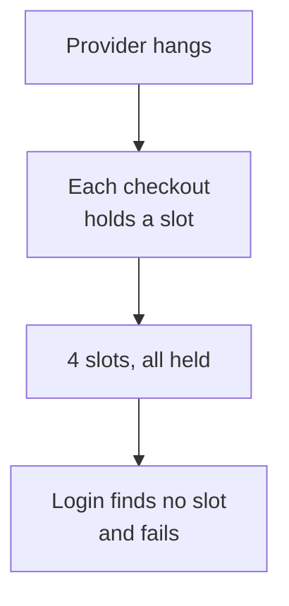
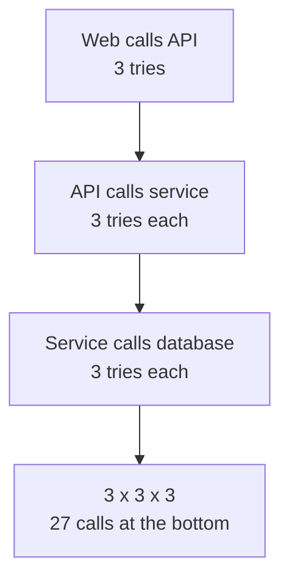
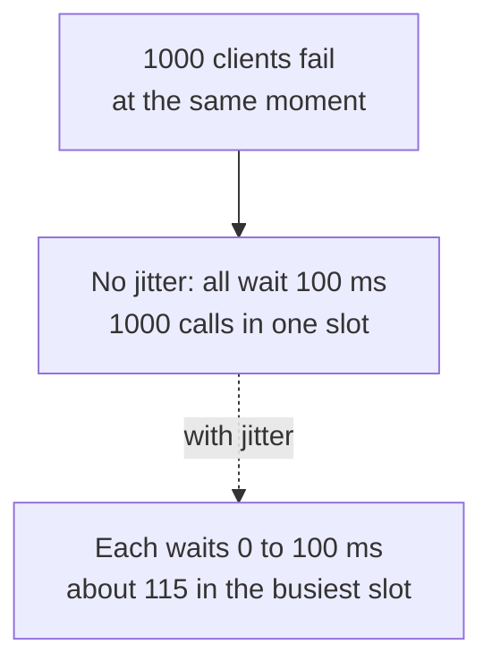

# 23. Timeouts, retries and circuit breakers

> **Subject:** System Design · **Lesson:** 23 · **Made:** 2026-11-04 · **Status:** ready
>
> **You will be able to:** say why every call to another system needs a timeout, retry only the calls that are safe and worth retrying, add a random part to the waits so retries do not arrive as one crowd, explain why retries at every layer multiply, and describe a circuit breaker with its three states.
>
> **Before this:** [Search indexes](22-search-indexes.md) · **Next:** Consensus and Raft (lesson 24, not written yet)
>
> **How to read it:** one card is one idea. Look at the picture, guess, then press the orange bar to check. The blue bars (📖 More detail) hold the longer explanation. Skip them on the first read, and open them when you want more. About 15 minutes for the cards.

## 1. The idea: a call with no timeout waits for ever

Your API calls a payment provider. One day the provider does not fail. It just **never answers**. Your code waits. Each waiting checkout holds one of your server's slots (a worker, a connection). Four checkouts later, all 4 slots are held, and a user who only wants to **log in** gets an error, even though login never touches the provider. A **timeout** fixes this: "if no answer comes in 2 seconds, give up and free the slot."



Notice that the login failed because of a problem that is not its own.

<details class="guess"><summary>🤔 Guess: a server has 4 slots and no timeout. The provider hangs. A checkout arrives every 100 ms, and a login arrives at 500 ms. What does the login get? And with a timeout of 200 ms? Press to check.</summary>

Without a timeout the login gets **503 (no free slot)**. With a 200 ms timeout it gets **200 (works)**, because the first checkout gave up at 207 ms and freed its slot. (Real run, a local Node server and a hanging provider, Node 26.12.1.)

</details>

> **Remember:** every call to another system needs a timeout. Without one, a slow friend takes down the healthy parts of your system.

<details class="more"><summary>📖 More detail: new words, the real run, and what a timeout costs</summary>

Lesson [13](13-idempotency-and-retries.md) said that a timeout means "I do not know" (the work may have happened). This lesson is about the other side: what the timeout protects.

New words (four):

- **Timeout:** the longest you wait for one call before you give up.
- **Retry:** try the same call again after a failure.
- **Backoff:** wait longer after each failure (100 ms, 200 ms, 400 ms).
- **Circuit breaker:** a switch in front of a dependency. When the dependency keeps failing, it stops sending calls for a while, like the breaker in a home fuse box.

**The real run** (a local Node `http` server with 4 slots, and a provider that never answers):

```
NO TIMEOUT:
  login at ~547 ms -> 503
  checkout 1 -> client gave up at 3004 ms        <- only the caller's own 3 s limit ended it
TIMEOUT 200 ms:
  checkout 1 -> 504 at 207 ms
  checkout 4 -> 504 at 512 ms
  login at ~515 ms -> 200
```

Checked on 2026-11-04 with Node 26.12.1. The server answers 504 when its own timeout fires. In the first run the checkouts only ended when the caller gave up after 3 seconds.

**What a timeout costs.** Too short, and it cancels calls that would have worked. The AWS Builders' Library says to start from the false timeout rate you can accept, for example 0.1%, and use the matching latency of the other service (p99.9). Card 5 has more.

**Where the picture stops.** Real servers do not always have "4 slots", but the effect is the same: connections, threads or memory fill up with waiting calls. In Node the waiting requests pile up in memory and open connections. My DBO case study says the same in one line: "a request with no timeout is a memory leak with extra steps".

**Cost.** The user gets an error after 2 seconds instead of a spinner for ever. That is better, and card 5 shows what to show instead of an error.

</details>

## 2. Retries help, and they multiply

Many failures pass by themselves (a dropped connection, a busy second). So a retry is useful. But a retry is **more load on a system that is already struggling**. And when every layer retries, the retries multiply. Say 3 layers each try 3 times and the bottom fails every time. The bottom does not see 3 calls. It sees 27.



<details class="guess"><summary>🤔 Guess: 5 layers, each tries 3 times, and the bottom always fails. How many calls reach the bottom? Press to check.</summary>

**243**, which is 3 to the power of 5. (Real run: 1 layer gives 3, 2 layers 9, 3 layers 27, 5 layers 243. The AWS Builders' Library gives the same 243 as its own example.)

</details>

> **Remember:** retry at one layer only, retry only what is worth retrying, and keep the number of tries small.

<details class="more"><summary>📖 More detail: which errors to retry, the budget idea, and the sources</summary>

**Retry only if all three are true:**

1. **The error can pass.** A timeout, a dropped connection, a 503 can pass. A 400 (bad data), 401 or 404 never will, so retrying only adds load (lesson [06](06-message-queues.md) says the same for jobs).
2. **The action is safe to repeat.** A read is. A payment is only safe with an idempotency key (lesson [13](13-idempotency-and-retries.md)).
3. **Someone is still waiting for the answer.** If the user already left, the retry is wasted load.

**Where to retry.** The Google SRE book says to retry only at the layer **directly above** the one that rejects the request, or you get a "combinatorial retry explosion". The AWS Builders' Library says the same: retry at one point in the stack, and its example of 5 layers with 3 tries each gives 243 times the load.

**A budget.** Google's book describes two limits: a request gets **up to 3 tries**, and a client retries only while retries are **under 10%** of its requests. Their numbers: without the 10% budget, traffic in the worst case grows to just below 3 times. With it, to about 1.1 times. AWS describes a similar idea (a token bucket: free retries while tokens last, then a fixed slow rate). I did not run either, the numbers are from their pages.

**Retry-After.** When a server says "busy, come back later" (HTTP 429 or 503), it may say how long to wait. Use that instead of a guess. The Google book also describes a backend that tells clients "overloaded, do not retry" when it sees many retries.

**Cost.** A retry makes a slow call even slower for the user (card 5 has the arithmetic), and more load for the other system.

</details>

## 3. Backoff and jitter: do not retry as one crowd

If a call fails, wait before you try again, and wait **longer each time** (backoff). But there is a trap. If 1,000 clients failed at the same moment, and all wait exactly 100 ms, then all 1,000 retry at the same moment. The wait grew, but the crowd stayed together. The fix is **jitter**: each client waits a **random** time from 0 up to the ceiling. Then the crowd spreads out.



<details class="guess"><summary>🤔 Guess: 1000 clients fail together and retry 4 times, with waits that double (100, 200, 400, 800 ms). With no jitter, how many calls land in the busiest 10 ms slot? With jitter? Press to check.</summary>

No jitter: **1000** in every round, which is every client at once. With jitter, the busiest slot of the first round has **115**, and the later rounds have 64, 34 and 22. (Real run of the crowd simulation, Node 26.12.1. The output is in the 📖 box.)

</details>

> **Remember:** backoff makes retries rarer. Jitter makes them spread out. You want both.

<details class="more"><summary>📖 More detail: the formula, the code, the real output, and a real outage</summary>

This is practice A (`backoffMs`), called "full jitter":

```js
function backoffMs(attempt, { baseMs = 100, capMs = 5000, random = Math.random } = {}) {
  const ceiling = Math.min(capMs, baseMs * 2 ** attempt);   // 100, 200, 400, 800 ... up to the cap
  return random() * ceiling;                                 // a random point from 0 to the ceiling
}
```

**Output** (with a fixed `random`, so the numbers are exact):

```
ceilings (random = 1):  100, 200, 400, 800, 1600, 3200, 5000, 5000     <- the cap stops the doubling
half (random = .5):     50, 100, 200, 400
retry: paid  waits [ 50, 100 ]          <- fails twice, works on the third try
always fails: 503  calls 3  waits [ 50, 100 ]     <- the last error is thrown after 3 tries
```

Checked on 2026-11-04 with Node 26.12.1.

**The crowd simulation** (1000 clients, 4 tries, 10 ms slots, a fixed seed):

```
no jitter  busiest 10 ms slot per round: 1000, 1000, 1000, 1000   (1 slot used in each round)
jitter     busiest 10 ms slot per round:  115,   64,   34,   22   (10, 30, 60, 120 slots used)
           over all 4 rounds, the busiest slot: 152 calls
```

Each round the wait ceiling doubles, so the same 1000 clients spread over more time and the pile gets smaller.

**What AWS found** (the Architecture Blog post "Exponential Backoff and Jitter", opened 2026-11-04): capped backoff **without** jitter reduces work only slightly and is "the clear loser". All three jitter types (full, equal, decorrelated) cut the work a lot. Full and equal make about the same number of calls. Equal jitter takes much longer, and decorrelated makes more calls than full. I did not run their test.

**A real outage.** Google's incident report for 12 June 2025 says that as Service Control tasks restarted, "it created a herd effect" on the database below them, and that the service "did not have the appropriate randomized exponential backoff implemented". (Opened 2026-11-04. I took only these two points from the report.) Restarting everything at once is the same crowd problem as retrying at once.

**Other kinds of jitter.** Add random time also to timers and periodic jobs (a cache expiry, a cron on every server), not only to retries. Lesson [04](04-caching.md) calls the cache version an avalanche.

**Cost.** The wait is random, so one unlucky client may wait the full ceiling, and a test that needs exact numbers must pass its own `random` (as the practice tests do).

</details>

## 4. The circuit breaker: stop calling a dead friend

Retries with backoff are still a request every few seconds, from every client. If the provider is **down for minutes**, you want to stop calling it at all, and fail at once. A **circuit breaker** has three states.

| State | What it does | Moves to |
|---|---|---|
| **Closed** | Calls go through. It counts failures in a row. | **Open**, after 3 failures in a row |
| **Open** | Calls fail at once. The provider is not called. | **Half open**, after the cooldown (for example 10 s) |
| **Half open** | One test call goes through. The others fail at once. | **Closed** if the test works. **Open** again if it fails |

<details class="guess"><summary>🤔 Guess: a breaker opens after 3 failures in a row and stays open for 10 s. It opened at second 2. The provider is down until second 15. A test call goes out at second 12. What happens, and when is the next test? Press to check.</summary>

The test call at second 12 **fails**, so the breaker opens again and the cooldown restarts: the next test is allowed from second **22**. At second 22 the provider is back, the test works, and the breaker closes. (Real run, the output is in the 📖 box.)

</details>

> **Remember:** closed lets calls through, open stops them, half open tests with one call. Open means "fail fast and give the other side time to recover".

<details class="more"><summary>📖 More detail: the code, the real output, and what to show the user</summary>

This is practice B. The core of the closed state and the half open state:

```js
async call(fn) {
  const s = state();                                  // "closed", "open" or "half-open", worked out from the clock
  if (s === "open") throw openError();                // fail at once, code "CIRCUIT_OPEN", provider not called
  if (s === "half-open") {
    if (trialRunning) throw openError();              // only one test call at a time
    trialRunning = true;
    try { const v = await fn(); failures = 0; openedAt = null; return v; }   // the test worked: close
    catch (e) { openedAt = now(); throw e; }          // the test failed: open again, restart the cooldown
    finally { trialRunning = false; }
  }
  try { const v = await fn(); failures = 0; return v; }                      // closed
  catch (e) { if (++failures >= failureThreshold) openedAt = now(); throw e; }
}
```

**Output** (a fake clock, calls at the seconds shown, the provider down until second 15):

```
second  0 -> fail  state now: closed  failures: 1
second  1 -> fail  state now: closed  failures: 2
second  2 -> fail  state now: open    failures: 3     <- the breaker opens
second  3 -> fast  state now: open
second  8 -> fast  state now: open
second 12 -> fail  state now: open                    <- the test call fails, open again
second 13 -> fast  state now: open
second 22 -> ok    state now: closed                  <- the test call works
second 23 -> ok    state now: closed
```

Of the 7 calls during the outage (seconds 0 to 13), 4 reached the provider and 3 were rejected at once. Checked on 2026-11-04 with Node 26.12.1.

**What the docs say.** Martin Fowler's page (opened 2026-11-04) describes the same three states, counts failures that trip the breaker, a reset timeout before a trial call, and says a breaker should log its state changes and let people see its state, with an alert when it opens.

**What to show the user.** An open breaker throws an error at once. Your code must decide what to do with it. Options: a **fallback** (show cached data, "payment is busy, we saved your order", queue the order for later), or a clear error. Without a fallback, the breaker only makes the error faster.

**Rate or count.** My breaker counts failures **in a row**. Fowler's page also mentions tripping at a failure **rate** (for example 50%), which suits busy services better. I did not build that one.

**Cost.** A breaker can open when the provider is fine (a few bad calls in a row), and it hides real calls for the cooldown. Use one breaker per provider, not one for everything, and alert when it opens.

**Step through it yourself:** [open the stepper](visuals/23-timeouts-retries-and-circuit-breakers.html). Tab 1 is the stuck slots, tab 2 the crowd of retries, tab 3 the breaker.

</details>

## 5. Putting them together: how long should the whole thing take?

One call goes through all three tools, in this order from the inside: a **timeout** on every attempt, a **retry** with backoff and jitter around it, and a **breaker** around that. The user is waiting too, so add up the worst case.

| Setting | Value |
|---|---|
| Timeout per attempt | 2 s |
| Tries | 3 |
| Waits between tries (at most) | 100 ms and 200 ms |
| **Worst case for the user** | 3 x 2 s + 0.3 s = **6.3 s** |

<details class="guess"><summary>🤔 Guess: the user's page gives up after 3 seconds. The call has a 2 second timeout and 3 tries. What goes wrong, and what do you change? Press to check.</summary>

The page gives up at 3 s, but the call can run for up to **6.3 s**. The retries keep going after nobody is waiting: wasted load. Change it so the **whole call has a deadline** (for example 2.5 s in total) and no attempt starts when the time is gone. Or lower the timeout per attempt (for example 1 s) so 3 tries fit. (Arithmetic, not a run.)

</details>

> **Remember:** add up the worst case. Timeout per try times tries, plus the waits, must fit inside what the user is willing to wait.

<details class="more"><summary>📖 More detail: choosing the numbers, deadlines, and the order</summary>

**Choosing the timeout.** The AWS Builders' Library way: pick the false timeout rate you can accept (for example 0.1%), then use the latency of that percentile of the other service (p99.9). Lesson [14](14-observability.md) says how to read the percentiles. Internet clients need extra for the network. Never guess 30 seconds "to be safe": that is the stuck slot from card 1, just slower.

**A deadline.** Instead of a timeout for each try, pass one **deadline** for the whole request down the calls. Each call gets "the time that is left". This stops the call chain from working for a user who has left. In Node, `AbortSignal.timeout(ms)` gives a timeout for `fetch`; I used it in the card 1 run. I did not build a deadline helper here.

**The order of the tools.** Inside: the timeout. Around it: the retry. Outside: the breaker. A retry that sees `CIRCUIT_OPEN` must **not** retry. It should stop at once, or the retries would keep hammering an open breaker (cheap, but pointless).

**Cost.** Each tool has a number to choose and watch: the timeout, the tries, the cap, the threshold, the cooldown. Put them in config, log every retry and every breaker change, and watch them (lesson [14](14-observability.md)).

</details>

## 6. Five mistakes, and what to say if you freeze

- **Wrong:** no timeout, or the default of a library (often very long or none). **Right:** set one on every outside call.
- **Wrong:** retry at every layer. **Right:** retry at one layer, 3 tries at most.
- **Wrong:** retry with the same wait for everyone. **Right:** exponential backoff with jitter.
- **Wrong:** retry a payment or a "create" call without a key. **Right:** an idempotency key first (lesson 13), then retry.
- **Wrong:** a breaker with no fallback and no alert. **Right:** decide what the user sees, and alert when it opens.

<details class="guess"><summary>🤔 Guess: a provider is down for 20 seconds. Each of your 500 servers retries 3 times with a fixed wait of 1 second, and the provider comes back at second 20. What do you see at second 20, and what are the fixes? Press to check.</summary>

Every server retries at the **same second**, so the provider, which was just coming back, gets a wall of calls and may fall over again. Fixes: **jitter** on the waits (so the crowd spreads), and a **breaker** (so the servers stop calling for a while). Also fewer tries and retry at one layer only. (This is the retry storm of card 3.)

</details>

> **Remember:** if you freeze, say "Every outside call gets a timeout. I retry only safe, passing errors, at one layer, with backoff and jitter. A circuit breaker stops calls to a dependency that keeps failing, and I decide the fallback."

<details class="more"><summary>📖 More detail: the mistakes in full, and the freeze plan</summary>

- **No timeout.** The stuck slots of card 1.
- **Retry everywhere.** 27 or 243 calls from one failure. Card 2.
- **No jitter.** The crowd that returns at the same moment. Card 3, and the Google herd effect.
- **No key on a retry.** The timeout does not say whether the work happened. A retry may charge twice (lesson [13](13-idempotency-and-retries.md)).
- **A silent breaker.** If it opens and nobody knows, users see errors for a day. Log state changes and alert.

**If you freeze:**

1. Say "A timeout on every outside call, so a slow friend cannot fill my slots."
2. Say "Retries only for errors that pass, calls that are safe to repeat, at one layer, with exponential backoff and jitter, and a small budget."
3. Say "A circuit breaker per provider: closed, open, half open. When open it fails fast, and I show a fallback."

</details>

## 7. Watch and play

Links were opened on 2026-11-04. For the video I confirmed only the title and the channel name from YouTube's embed data, not the length or the content.

- **Play with it:** [the stepper in this folder](visuals/23-timeouts-retries-and-circuit-breakers.html) - guess first, then press Next. Try all three tabs.
- **Play with it:** [Resilience patterns on System Design Space](https://system-design.space/en/visuals/resilience-patterns/) - a playground with a circuit breaker, a bulkhead and retries working together. You can change the load and make a prediction before each run. I opened it and read its description, and did not use it long.
- **Read:** [AWS Architecture Blog: Exponential Backoff And Jitter](https://aws.amazon.com/blogs/architecture/exponential-backoff-and-jitter/) - full, equal and decorrelated jitter, compared.
- **Read:** [AWS Builders' Library: Timeouts, retries and backoff with jitter](https://builder.aws.com/content/3EumjoZascWd1oZiEgL8ORlv3qE/timeouts-retries-and-backoff-with-jitter) - how to pick a timeout, the 243 times example, and token bucket retry limits. The old amazon.com address redirects here.
- **Read:** [Google SRE book: Handling Overload](https://sre.google/sre-book/handling-overload/) - the retry budgets and "retry at one layer".
- **Read:** [Martin Fowler: Circuit Breaker](https://martinfowler.com/bliki/CircuitBreaker.html) - the three states and what to monitor.
- **Read:** [Google Cloud incident report, 12 June 2025](https://status.cloud.google.com/incidents/ow5i3PPK96RduMcb1SsW) - the herd effect and the missing randomized backoff.
- **Video:** [Retry & Circuit Breaker in System Design | Netflix-Style Resilience Patterns Explained](https://www.youtube.com/watch?v=IS_egVvdb1Q) - channel Roli Agrawal (HerCodeJourney), length not checked. I did not watch it, only checked that it exists. Compare it with cards 2 to 4.

<details><summary>Go deeper (optional)</summary>

- **Bulkheads.** Give each dependency its own small pool of slots, so one slow dependency cannot take all of them. This is the idea behind card 1, and the System Design Space playground above shows it. I did not build or measure one.
- **Hedged requests.** Send a second copy of a slow call to another server and use the first answer. It cuts the slow tail and adds load. I did not cover or run it.
- **Library names.** Node has `p-retry` and `cockatiel`, Java has Resilience4j, and BullMQ has `attempts` and `backoff` for jobs (lesson [06](06-message-queues.md)). I did not run them here.
- **Your own guides.** [Distributed systems and reliability patterns](distributed-systems-and-reliability-patterns.md) covers these patterns, and [Production readiness](production-readiness-observability-security.md) covers watching them.
- **Not run here.** I did not run a real payment provider. The timeout run used a local server that never answers, and the other numbers are from the practice code.

</details>

## 8. Practice

**A. Predict the output** (write your answer before opening)

```js
const top = { random: () => 1 };
console.log(backoffMs(0, top), backoffMs(4, top), backoffMs(9, top));
console.log(backoffMs(4, { random: () => 0.25 }));
```

Then answer: why is the third number not 51200?

<details><summary>Answer</summary>

```
100 1600 5000
400
```

The ceilings are `100 * 2 ** attempt`: 100, then 1600 for attempt 4. For attempt 9 the ceiling would be 51200, but the cap is 5000, so it stops there. With `random()` at 0.25 and a ceiling of 1600, the wait is 400. (Checked on 2026-11-04 with Node 26.12.1, using the answer to practice C.)

</details>

**B. Fix the answer**

A teammate says: "Our web app, our API and our order service each retry a failed call 3 times, and none of them has a timeout. So we are very safe." What is wrong, and what do you suggest?

<details><summary>Answer</summary>

Two problems. **No timeouts:** a provider that hangs fills the slots at every layer, so healthy pages fail too. **Retries at every layer:** a failure at the bottom gets 3 x 3 x 3 = 27 calls, and the more layers, the more. Suggest: a timeout on every outside call, retries at **one** layer only (the one above the failing system), with exponential backoff and jitter, a small budget, and an idempotency key for calls that change data. Add a breaker with a fallback for each outside provider.

</details>

**C. Write it yourself**

Open `learn/system-design/practice/23-timeouts-retries-and-circuit-breakers.js`. It has two empty functions: `backoffMs` (card 3) and `createCircuitBreaker` (card 4). Write them, then run this from the repo root and make all the tests pass:

```
node --test learn/system-design/practice/23-timeouts-retries-and-circuit-breakers.test.js
```

<details><summary>One possible answer</summary>

```js
// Full jitter: the ceiling doubles each attempt up to the cap, and the wait is a random point from 0 to the ceiling.
function backoffMs(attempt, options = {}) {
  const { baseMs = 100, capMs = 5000, random = Math.random } = options;
  const ceiling = Math.min(capMs, baseMs * 2 ** attempt);
  return random() * ceiling;
}

function createCircuitBreaker(options = {}) {
  const { failureThreshold = 3, cooldownMs = 30000, now = Date.now } = options;
  let failures = 0;
  let openedAt = null;          // null while closed
  let trialRunning = false;     // true while the one half-open test call is running

  function state() {
    if (openedAt === null) return "closed";
    return now() - openedAt >= cooldownMs ? "half-open" : "open";
  }
  function openError() {
    const err = new Error("circuit open");
    err.code = "CIRCUIT_OPEN";
    return err;
  }

  return {
    state,
    failures: () => failures,
    async call(fn) {
      const s = state();
      if (s === "open") throw openError();            // not a failure: nothing changes
      if (s === "half-open") {
        if (trialRunning) throw openError();          // only one test call at a time
        trialRunning = true;
        try {
          const value = await fn();
          failures = 0;
          openedAt = null;                            // the test worked: close
          return value;
        } catch (err) {
          openedAt = now();                           // the test failed: open again, restart the cooldown
          throw err;
        } finally {
          trialRunning = false;
        }
      }
      try {                                           // closed
        const value = await fn();
        failures = 0;
        return value;
      } catch (err) {
        failures++;
        if (failures >= failureThreshold) openedAt = now();
        throw err;
      }
    },
  };
}

module.exports = { backoffMs, createCircuitBreaker };
```

Checked on 2026-11-04 with Node 26.12.1: the 19 tests fail on the empty stub and all 19 pass with this answer. Two details to notice. The state is **worked out from the clock** (`now() - openedAt`), so there is no timer to start or stop, and tests only move a fake clock. And the "one test call at a time" flag is cleared in `finally`, so a test call that throws still frees the way for the next one.

</details>

## 9. Interview question

**Q:** "Your checkout calls a payment provider. The provider gets slow. What do you do so your system stays up?"

A common follow-up: "Why not just retry more?" Card 2 and card 3 are the answer.

<details><summary>A strong answer, in four parts</summary>

1. **Problem:** a slow provider holds my slots, so even login fails (in my run, a login got 503 while checkouts were stuck). Retries add load to a provider that is already struggling, and retries at every layer multiply (3 layers of 3 tries is 27 calls).
2. **How it works:** a timeout on every call, chosen from the provider's latency (for example its p99.9). Retries only for errors that pass, at one layer, 3 tries at most, with exponential backoff and **jitter** so my servers do not retry together (1000 clients at once gave 1000 calls in one 10 ms slot without jitter, and 115 with). A payment gets an **idempotency key** before any retry. A **circuit breaker** per provider opens after a few failures in a row, fails fast, and tests with one call after a cooldown.
3. **Tradeoff:** a short timeout cancels calls that would have worked. A breaker can open by mistake and hide a healthy provider for the cooldown. Retries make the worst case for the user longer, so I add up timeout times tries plus the waits and keep it under the user's patience (3 x 2 s + 0.3 s is 6.3 s, too long for a 3 s page). I alert when a breaker opens, and I decide the fallback: for example "we saved your order, payment is busy" and a job that completes it later.
4. **My example:**
   - **Fact:** my DBO case study lists outbound calls to outside systems: Auth to Jatis for the WhatsApp OTP, the API to Manager to create an order, and the API to TADA to redeem points. It also lists background jobs on BullMQ with retries and backoff.
   - **Fact:** the case study *recommends* timeouts of 2 to 5 seconds, jittered backoff only after the call is idempotent, and a circuit breaker per provider with orders queued for later. It writes these as advice, not as a record of what was built.
   - **Not known yet:** whether the real DBO code has timeouts, jitter or breakers on these calls, and what they are set to. I should check the real code before I say it.
   - **Idea, not a fact:** for the TADA redeem call I would use a timeout, an idempotency key from the order id, one retry layer, and a "pending" state (as the case study suggests), so a timeout never means "probably succeeded". I would say it as "what I would check and add".

</details>

## 10. Explain it back

Close this file. Explain how to protect a system from a slow dependency, out loud like to a new junior, in 4 parts (problem, how, tradeoff, my example). Use the story of the 4 stuck slots with the login that failed, and the story of the 1000 clients that retry at the same moment. Then write your best version below and run `/explain-check timeouts and circuit breakers` or ask the `explain-coach` agent to review it.

### My explanation

<write here>

### Coach feedback

<the explain-coach agent writes here>

## 11. Review questions (day 1, 3, 7, 21)

1. Why can a call with no timeout make a login fail, when login never calls the provider?
2. Three layers each try a failing call 3 times. How many calls reach the bottom, and what is the rule that avoids it?
3. Backoff doubles the wait, so why do you still need jitter?
4. A breaker is open and the cooldown is over. What does half open do, and what happens if the test call fails?
5. A call has a 2 second timeout, 3 tries and waits of up to 300 ms in total. What is the worst case for the user?

<details><summary>Answers</summary>

1. Each stuck call holds a slot. When all slots are held by calls that wait for ever, the login finds no free slot. A timeout frees the slot.
2. 3 x 3 x 3 = 27. Retry at one layer only (the one directly above the failing system), and keep tries and a budget small.
3. All clients that failed together still wait the same time, so they retry together, round after round. Jitter gives each a random wait, so the calls spread out (1000 in one slot against 115 in my run).
4. It lets one test call through and rejects the others. If the test works, the breaker closes and the count resets. If it fails, the breaker opens again and the cooldown restarts.
5. 3 x 2 s + 0.3 s = 6.3 s. That must fit in how long the user will wait, or the call needs a deadline.

</details>

## Connected lessons

- [Search indexes](22-search-indexes.md) - the lesson before. The relay that feeds an index retries, with the same rules.
- [Idempotency and retries](13-idempotency-and-retries.md) - make a call safe to repeat before you retry it.
- [Message queues](06-message-queues.md) - failed jobs get backoff, jitter and a dead letter queue.
- [Load balancers](03-load-balancers.md) - what to do in the gap before a health check finds a dead server.
- [Design a rate limiter](09-design-a-rate-limiter.md) - a short timeout on the Redis call, and failing open.
- [Design a notification system](11-design-a-notification-system.md) - stop calling a provider that is down.
- [Caching](04-caching.md) - jitter on cache expiry, against the avalanche.
- [Observability](14-observability.md) - alert when a breaker opens, and watch the percentiles you used for the timeout.
- [Proxies and API gateways](17-proxies-and-api-gateways.md) - a gateway can apply timeouts and retries for many services.
- [Distributed systems and reliability patterns](distributed-systems-and-reliability-patterns.md) - the longer guide on these patterns.
