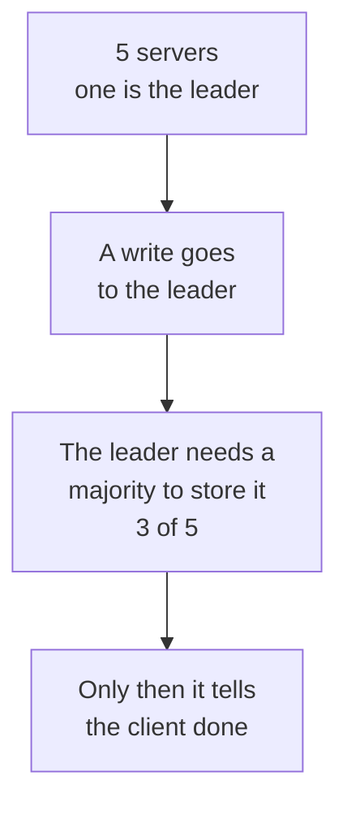
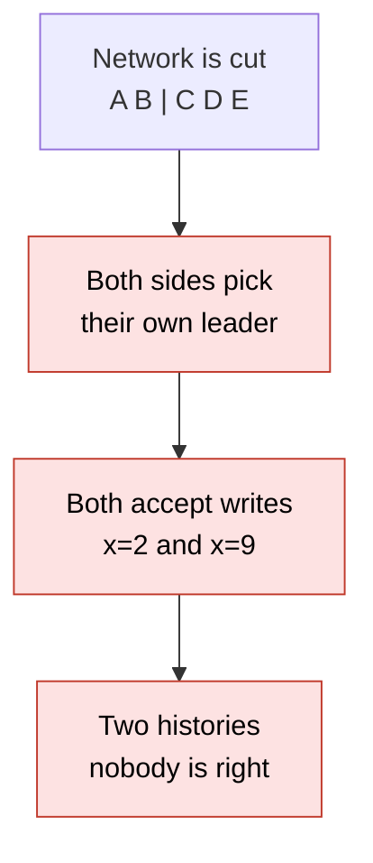
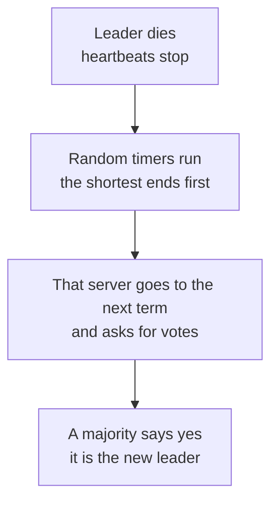
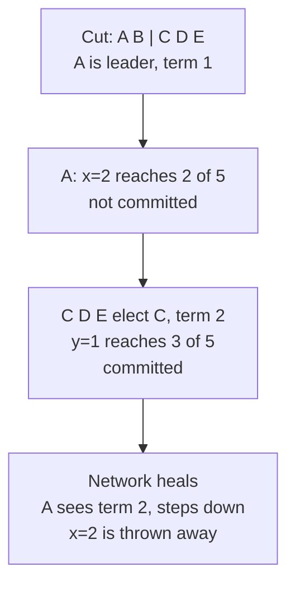

# 24. Consensus and Raft

> **Subject:** System Design · **Lesson:** 24 · **Made:** 2026-11-04 · **Status:** ready
>
> **You will be able to:** explain what "consensus" means and why a group of servers needs a majority, say why 3 or 5 servers are normal and 4 is not better than 3, describe how Raft elects a leader (terms, votes, random timers), say when a write counts as committed, and explain how a split network can cause two leaders and how Raft stops the old one from doing harm.
>
> **Before this:** [Timeouts, retries and circuit breakers](23-timeouts-retries-and-circuit-breakers.md) · **Next:** [Multi-tenancy](25-multi-tenancy.md)
>
> **How to read it:** one card is one idea. Look at the picture, guess, then press the orange bar to check. The blue bars (📖 More detail) hold the longer explanation. Skip them on the first read, and open them when you want more. About 15 minutes for the cards.

## 1. The idea: who is the boss, when the network can break?

Some small data must be exactly right: "who is the leader", "which server has this lock", "what is the cluster's setting". You do not keep it on one server, because that server can die. So you keep it on **5 servers** that must **agree**. Getting a group of servers to agree, even when some are down or cannot talk to the others, is called **consensus**. The simple idea behind Raft, a popular way to do it: **one leader at a time, and it needs a majority** (3 of 5) before it says "done".



Notice that the leader never decides alone. A majority has to agree first.

<details class="guess"><summary>🤔 Guess: 5 servers. A cable breaks: A and B can talk to each other, and C, D and E can talk to each other. Both groups try to elect a leader. What happens? Press to check.</summary>

**Only the group C, D, E can elect a leader**, because it has 3 of 5. A and B have only 2, so they can never reach a majority, even if both vote for A. (Real run of the practice code, Node 26.12.1.)

</details>

> **Remember:** consensus is a group of servers agreeing on one history. The rule is "a majority must agree", so two halves of a split network can never both go ahead.

<details class="more"><summary>📖 More detail: new words, the problem drawn, and where it is used</summary>

Lesson [19](19-replication-and-quorums.md) used quorums (W and R) to decide how many copies must answer. Consensus uses the same majority idea, and adds a **leader** and an order for all changes, so the servers never disagree about "what happened first".

New words (five):

- **Leader and follower:** the leader takes the writes. Followers copy what the leader sends.
- **Term:** a number that goes up with each election. Term 2 is newer than term 1. It works like a version number for "who is the leader".
- **Log:** the list of changes, in order. Each entry has the term in which it was made.
- **Committed:** an entry that a majority has stored. It will not be lost.
- **Split brain:** two parts of a system both believe they are in charge, and both accept changes, so there are two different histories.

**The problem, drawn.** Without a majority rule, a cut network makes two leaders.



**What the sources say (opened 2026-11-04).** The Raft paper says a cluster is fully working "as long as any majority of the servers are operational" and that "a typical cluster of five servers can tolerate the failure of any two servers". The Raft website says the same about 5 servers and 2 failures. The paper assumes servers fail by **stopping**. It does not cover servers that lie (called Byzantine faults).

**Where you meet it.** You rarely write Raft. You use things built on it:

- **etcd** keeps Kubernetes data: the Kubernetes docs call it "a consistent and highly-available key value store used as Kubernetes' backing store for all cluster data". The etcd page says a change "only needs to go through the raft protocol to commit".
- **Docker Swarm** managers use Raft for the cluster state. The Docker docs say they use "the Raft consensus algorithm" and need a majority of `(N/2)+1`. My DBO case study says the backend runs on Docker Swarm via CapRover, so this applies to the platform under it. How many managers it has is not in my notes.

**Where the analogy stops.** A school vote is one time. Raft votes again whenever the leader seems dead, and every new leader must hold all entries that were committed.

**Cost.** Every write waits for a majority of the servers, which is a network trip. More servers make writes slower (the etcd FAQ says so), and the data is small on purpose: it is for settings and coordination, not for all your data.

</details>

## 2. Why a majority? Because two majorities always share a server

A majority is **more than half**. Any two groups that are each more than half must have **at least one server in common**. That one server has voted for only one thing in a term, so two different leaders cannot both win. This is also why servers are odd: 4 servers need 3, and tolerate only 1 failure, the same as 3 servers.

| Servers | Majority | Failures it survives |
|---|---|---|
| 1 | 1 | 0 |
| 2 | 2 | 0 |
| 3 | 2 | 1 |
| 4 | 3 | 1 |
| 5 | 3 | 2 |
| 6 | 4 | 2 |
| 7 | 4 | 3 |

<details class="guess"><summary>🤔 Guess: you can pay for 3 or 4 servers. Which one is safer against a failed server? And which one costs less for writes? Press to check.</summary>

**Neither is safer.** Both survive 1 failure. The 4 server cluster needs 3 votes for every write, the 3 server one needs 2, so the **3 server cluster is cheaper and just as safe**. Go to 5 if you need to survive 2 failures. (Real output of the practice code, and the same numbers as the etcd FAQ table.)

</details>

> **Remember:** majority is `floor(n / 2) + 1`. Use 3 or 5 servers. An even number adds cost and no safety.

<details class="more"><summary>📖 More detail: the check, the code, and two data centers</summary>

**The overlap, checked.** I listed every group of servers from a cluster of 5 that has 3 or more servers (16 groups: 10 of size 3, 5 of size 4 and 1 of size 5) and checked every pair. **Every pair shares at least one server.** That is one of the tests in the practice file. (Checked on 2026-11-04 with Node 26.12.1.)

```js
function majority(n) { return Math.floor(n / 2) + 1; }
function toleratedFailures(n) { return n - majority(n); }
```

**What the docs say.** The etcd FAQ lists the same table (quorum is `(n/2)+1`). It says an even number adds no extra tolerance, that odd sizes are recommended, that five members is the commonly suggested size, that it "should have no more than seven nodes", and that larger clusters slow writes because data goes to more machines. The Kubernetes page recommends a five member etcd in production, and says a single node is for testing only.

**Two data centers do not work well.** Take 6 servers, 3 in each of two data centers. The majority is 4. If the link between the data centers breaks, each side has 3 and **neither can go on**. With 2 + 2 + 1 servers across **three** places, a cut of any one place leaves a side with 3 or 4 of 5, so the cluster still works. This is arithmetic from the table above, not a test I ran.

**Cost.** Majority means that if the network breaks and you are on the small side, you stop, even though your servers are healthy. That is the choice: be correct and unavailable on the small side, rather than available and wrong (lesson [07](07-consistency-and-cap.md), CAP).

</details>

## 3. Electing a leader: terms, votes and random timers

The leader sends small **heartbeats**. A follower who hears none for a while thinks the leader is dead and **stands for election**: it goes to the next term, votes for itself, and asks the others for votes. A server gives **one vote per term**. The first to get a majority is the leader and starts sending heartbeats. How long does a follower wait? A **random** time, so they do not all stand at once.



<details class="guess"><summary>🤔 Guess: the leader A dies. The timers of the others are B 187 ms, C 241 ms, D 163 ms, E 292 ms. Who becomes the leader, and how many votes does it get? Press to check.</summary>

**D**, because its timer ends first (163 ms). B, C and E get its request before their own timers end, so they vote yes. D has **4 votes** (3 others and itself). A majority of 5 is 3, so A being down does not matter. (Real run of `elect("D")` with A cut off.)

</details>

> **Remember:** a new election needs a majority and happens in a new term. Random timers make it rare that two servers stand at the same moment.

<details class="more"><summary>📖 More detail: the rules, the split vote, my simulation, and the paper</summary>

**The voting rules** (practice C, in this order):

1. If the candidate's term is **smaller** than mine, refuse.
2. If it is **bigger**, take that term, forget my vote and become a follower.
3. If the candidate's log is **behind** mine, refuse (card 4).
4. If I already voted for a **different** candidate in this term, refuse. Otherwise vote yes.

**Output** of the practice code:

```
elect A (healthy cluster):     true    A is leader, term 1, all others voted for A
cut: A B | C D E, elect A:     false   A stays a candidate with 2 votes of 5
                 elect C:      true    C is leader with 3 votes of 5
```

Checked on 2026-11-04 with Node 26.12.1.

**What the paper says.** A server votes for at most one candidate in a term. Election timeouts are "chosen randomly from a fixed interval (e.g., 150-300ms)". If many followers stand together, "votes could be split so that no candidate obtains a majority", and each then starts a new election with a new random timer. The paper also says it recommends a conservative timeout such as 150 to 300 ms. Its own test (a cluster of five, with some timeouts as short as 12 to 24 ms) elected a leader in 35 ms on average, but such short timeouts break its timing rules.

**My simulation of the split vote.** One server is dead, the others have random timers, messages take 5 to 15 ms, and a follower votes for the first request it sees. 200,000 runs of the first round:

| Timers | 3 servers | 5 servers |
|---|---|---|
| All 150 ms (the same) | 100% split | 100% split |
| 150 to 160 ms | 95.8% split | 98.4% split |
| **150 to 300 ms** | **12.9% split** | **7.2% split** |

This is my own simplified model, not a measurement of a real Raft. It shows the idea: the wider the range of the timers, the fewer elections split. A split is not a disaster: everybody waits again with new random timers.

**Same trick as lesson 23.** The random timer is jitter. It spreads servers in time so they do not all act at the same moment.

**Cost.** A short timer finds a dead leader fast but may start elections for a slow leader that is alive. A long timer is calm but leaves the cluster without a leader for longer. The paper recommends 150 to 300 ms for its setup.

**Step through it yourself:** [open the stepper](visuals/24-consensus-and-raft.html). Tab 2 is the election.

</details>

## 4. Committing a write: a majority must store it

A write goes to the leader. The leader adds it to its **log**, sends it to the followers, and counts who stored it. When a **majority** has it (the leader counts itself), the entry is **committed**, and only then does the leader tell the client "done". A committed entry is safe: any new leader must come from a majority, and that majority must contain a server that has the entry.

| Servers down (of 5) | Servers that store the entry | Committed? |
|---|---|---|
| 0 | 5 | yes |
| 2 | 3 | yes |
| 3 | 2 | **no** (needs 3) |

<details class="guess"><summary>🤔 Guess: 5 servers, and D and E are down. The leader gets a write. Does it commit? And if C is down too? Press to check.</summary>

With D and E down, the leader and two more servers hold the entry: **3 of 5, committed**. With C down too, only **2 of 5**: it is **not committed**. The leader keeps the entry in its log and cannot say "done". (Real run: `acks: 3` committed, `acks: 2` not.)

</details>

> **Remember:** an entry is committed when a majority stores it. Only committed entries are promised.

<details class="more"><summary>📖 More detail: the vote rule that protects commits, the code, and the output</summary>

**One more voting rule.** A server refuses to vote for a candidate whose log is **behind** its own. The paper compares the term of the last entry, and if equal, the length. This guarantees that a new leader has every committed entry. Here is the test I wrote for it:

```
5 servers. A is leader. The cluster is cut: A B C | D E.
A stores x=1 on A, B, C (3 of 5: committed).
D stands twice (terms 1 and 2) and loses both times.
The network heals. D stands in term 3 (the highest term), with an empty log.
D elect: false     <- A, B and C take term 3 but refuse, because D's log is behind
B elect: true      <- B has x=1, B log: [ 'x=1' ]
```

Checked on 2026-11-04 with Node 26.12.1. Without this rule, D could win and the committed `x=1` would be lost.

**The leader's side** (the core of practice C, `append`):

```js
me.log.push({ term: me.term, command });
let acks = 1;                                           // the leader counts itself
for (const other of others(id)) {
  const node = nodes.get(other);
  if (node.term > me.term) { seeTerm(me, node.term); return { committed: false, acks }; }   // I am out of date
  seeTerm(node, me.term);
  node.log = me.log.map((e) => ({ ...e }));             // the follower takes the leader's log
  acks++;
}
if (acks >= majority(ids.length)) { /* committed */ }
```

**What I left out.** My practice is much smaller than real Raft. There are no timers and no network messages. A follower takes the leader's **whole log**, while real Raft checks the logs entry by entry, with a "previous entry" test, and fixes only what differs. The paper also has a rule about committing entries from **older terms** (section 5.4.2), and ways to change the group of servers and to take snapshots. I did not build those.

**Cost.** Every write is a round trip to a majority. That is why consensus systems hold small, important data, and why writes can be slower than on a single server.

</details>

## 5. Split brain, stopped

The network splits 2 | 3, and the old leader is on the **small** side. It does not know. A client writes to it. The old leader adds the entry to its log, but only 1 follower answers, so **2 of 5: not committed**, and it cannot say "done". On the big side, a new leader is elected in a **bigger term** and goes on. When the network is repaired, the old leader sees the bigger term and **steps down**. Its uncommitted entries are replaced.



<details class="guess"><summary>🤔 Guess: A stored x=2 in its log but it was never committed. The network heals. What happens to x=2? Was any client told it was saved? Press to check.</summary>

**x=2 is thrown away**, and **no client was told it was saved**, because A could not commit it. A takes the log of the real leader C. That is why it is safe to drop. (Real run, output below.)

</details>

> **Remember:** an old leader on the small side can write to its own log but cannot commit. A bigger term always wins, so after the network heals there is one leader and one history.

<details class="more"><summary>📖 More detail: the full output, why the term is the tie breaker, and what is still dangerous</summary>

**Output** of the story (practice code, Node 26.12.1, 2026-11-04):

```
elect A: true                      append x=1: { committed: true, acks: 5 }
cut: A B | C D E
A append x=2: { committed: false, acks: 2 }
elect C: true  (term 2)            C append y=1: { committed: true, acks: 3 }
heal
A append x=3: { committed: false, acks: 2 }       <- B (term 1) took it, then C (term 2) refused A
C append z=1: { committed: true, acks: 5 }

after healing, every server: term 2, log [ x=1@1, y=1@2, z=1@2 ], commit 3
C is the leader, the other four are followers      <- x=2 and x=3 are gone
```

**Why this is correct.** A could not reach a majority, so it never told a client "saved". Dropping x=2 loses nothing that was promised. The new leader C was elected by a majority, and any majority contains a server that has every committed entry (the overlap of card 2 plus the log rule of card 4).

**The term is the tie breaker.** Every message carries a term. A server that sees a bigger term takes it and steps down if it was a leader or candidate. A message with a smaller term is refused. The paper's Election Safety property is: "at most one leader can be elected in a given term".

**What is still dangerous: a stale leader that does not ask.** The old leader A, on the small side, still *believes* it is the leader until it hears a bigger term. If A answered a client **read** from its own memory, it could return old data. Real systems handle reads with care: for example by making the leader check with a majority first, or with a lease. I did not build or measure reads here. If you read from a leader of a consensus system, check what read guarantee the tool gives.

**Not the same as other splits.** Lesson [19](19-replication-and-quorums.md) (leader and follower databases) is not consensus by itself: a plain async replica takes over when you tell it to, and nothing forces the old leader to stop. Raft adds the majority and the term to force it.

**Cost.** The small side stops. If you run only 2 data centers, a cut can stop both sides (card 2).

**Step through it yourself:** [open the stepper](visuals/24-consensus-and-raft.html). Tab 3 is this story step by step.

</details>

## 6. Five mistakes, and what to say if you freeze

- **Wrong:** 2 or 4 servers "to be safer". **Right:** 3 or 5. An even number costs more and survives no more.
- **Wrong:** half the servers in one data center and half in another. **Right:** spread over 3 places, so a cut of one place keeps a majority.
- **Wrong:** a "leader" picked by a flag or a timer, with no term number. **Right:** a term that everyone checks, so an old leader is refused.
- **Wrong:** tell the client "saved" before a majority has the entry. **Right:** commit first, then answer.
- **Wrong:** write your own consensus. **Right:** use etcd, ZooKeeper or a managed database that has it, and learn the rules (majority, terms, 3 or 5).

<details class="guess"><summary>🤔 Guess: a Docker Swarm cluster has 3 manager nodes. One dies. Can it still schedule new tasks? And if two die? Press to check.</summary>

With **1 dead**, 2 of 3 managers are left, a majority, so it **works**. With **2 dead**, 1 of 3 is left, **no majority**. The Docker docs say that when quorum is lost the cluster cannot process new requests to schedule tasks, but existing tasks keep running. (Math from the majority rule, plus the Docker docs' description of lost quorum. I did not run Swarm.)

</details>

> **Remember:** if you freeze, say "Consensus means servers agree on one history. One leader at a time, elected by a majority, and a write is committed when a majority stores it. Use 3 or 5 servers. A bigger term always wins, so the old leader on the small side cannot commit."

<details class="more"><summary>📖 More detail: the mistakes in full, and the freeze plan</summary>

- **Even number.** 4 servers survive 1 failure, like 3, and every write needs 3 answers instead of 2.
- **Two data centers.** With 6 servers in 3 + 3, a cut stops both sides. Three places stop that.
- **No term.** A flag in a table says "A is the leader". After a cut, A still reads the flag from its own memory and goes on. A term checked by everyone is how the old leader is refused.
- **Early "saved".** If the leader answers before a majority has the entry and then dies, the entry may be lost. The client believed it was saved.
- **Your own Raft.** The rules are small, but the details (log checks, old-term entries, changing members, snapshots) are where the bugs are. The paper and the tools exist, so use them.

**If you freeze:**

1. Say "Consensus lets servers agree on one history even if some fail or the network splits. The rule is: a majority must agree."
2. Say "One leader at a time. A new leader is elected in a new term with a majority of votes. A write is committed when a majority stores it. 3 or 5 servers."
3. Say "If the network splits, only the side with a majority can go on. The old leader on the small side cannot commit, and it steps down when it sees a bigger term."

</details>

## 7. Watch and play

Links were opened on 2026-11-04. For the video I confirmed only the title and the channel name from YouTube's embed data, not the length or the content.

- **Play with it:** [the stepper in this folder](visuals/24-consensus-and-raft.html) - guess first, then press Next. Try all three tabs.
- **Play with it:** [RaftScope](https://raft.github.io/raftscope/index.html) - a Raft animation with 5 servers, where you can stop servers and watch elections and logs. The Raft website calls it "still pretty rough around the edges". The address answered (HTTP 200), and I did not use it in a browser.
- **Read:** [The Raft website](https://raft.github.io/) - what Raft is, the 5 servers and 2 failures example, and links to the paper and implementations.
- **Read:** [In Search of an Understandable Consensus Algorithm (the Raft paper)](https://raft.github.io/raft.pdf) - I read the parts on election, votes, the log rule and the timeouts. I did not read the whole paper.
- **Read:** [etcd FAQ](https://etcd.io/docs/latest/faq/) - the cluster size table, odd numbers, and why five.
- **Read:** [Kubernetes: Operating etcd clusters](https://kubernetes.io/docs/tasks/administer-cluster/configure-upgrade-etcd/) - etcd as the backing store, and five members for production. I read the first 100,000 characters.
- **Read:** [Docker: Administer and maintain a swarm of Docker Engines (Raft)](https://docs.docker.com/engine/swarm/raft/) - managers use Raft, the majority rule, and what happens when quorum is lost.
- **Video:** [Distributed Systems 6.2: Raft](https://www.youtube.com/watch?v=uXEYuDwm7e4) - channel Martin Kleppmann, length not checked. I did not watch it, only checked that it exists. Compare it with cards 3 to 5.

<details><summary>Go deeper (optional)</summary>

- **Paxos and others.** Paxos is the older algorithm. The Raft site says Raft is equivalent to Paxos in fault tolerance and performance, and is designed to be easier to understand. ZooKeeper uses a different one, called Zab, which I did not read about here.
- **Log matching.** Real Raft checks the previous entry before it accepts new ones, and a leader backs up and repairs a follower whose log differs. See section 5.3 of the paper.
- **Changing the members.** Adding or removing servers needs care, or two majorities could exist at once. The paper has a section on it. etcd also has a "learner" state for new members.
- **Leases and read safety.** How a leader answers reads without being stale (see card 5). I did not cover or run it.
- **Quorums without a leader.** Lesson [19](19-replication-and-quorums.md) (N, W, R) is a looser form of the majority idea. Consensus adds the leader and the order.
- **Your own guides.** [Distributed systems and reliability patterns](distributed-systems-and-reliability-patterns.md) and [Architecture patterns 2026](architecture-patterns-2026.md) mention leader election and consensus.
- **Not run here.** I did not run etcd, ZooKeeper or Docker Swarm. The facts about them come from their docs. The Raft numbers and the outputs come from my own small practice code and my own simulation.

</details>

## 8. Practice

**A. Predict the output** (write your answer before opening)

```js
console.log(majority(6), toleratedFailures(6), toleratedFailures(7));
const c = createCluster(["A", "B", "C"]);
console.log(c.elect("A"));
c.partition([["A"], ["B", "C"]]);
console.log(c.append("A", "x"));
console.log(c.elect("B"), c.state("B").term);
```

Then answer: what is A's role at the end, and what is in A's log?

<details><summary>Answer</summary>

```
4 2 3
true
{ committed: false, acks: 1 }
true 2
```

6 servers need 4 and survive 2. A is elected in term 1 with all 3 votes. After the cut, A is alone: it adds `x` to its log, but only 1 of 3 servers has it, so it is not committed. B stands in term 2 and C votes yes: 2 of 3, so B wins. At the end A is still a **leader** (of term 1, with `x` in its log, not committed). It does not know yet that it is out of date. (Checked on 2026-11-04 with Node 26.12.1, using the answer to practice C.)

</details>

**B. Fix the answer**

A teammate says: "We run our config store on 4 servers, 2 in data center 1 and 2 in data center 2. Four is safer than three, and with two data centers we can survive losing a whole one." What is wrong, and what do you suggest?

<details><summary>Answer</summary>

Two problems. **4 is not safer than 3:** a majority of 4 is 3, so it survives only 1 failed server, the same as 3, and each write needs 3 answers. **Two data centers cannot survive losing one:** if the link breaks or one data center dies, the other has 2 of 4, which is not a majority, so **nothing can commit**. Suggest: 3 or 5 servers spread over **3** places (for example 2 + 2 + 1 of 5). Then losing one place leaves at least 3 servers, a majority. Also check the read guarantees of the tool.

</details>

**C. Write it yourself**

Open `learn/system-design/practice/24-consensus-and-raft.js`. It has `majority`, `toleratedFailures` (card 2) and `createCluster` (cards 3 to 5), with the rules written in the comments. Write them, then run this from the repo root and make all the tests pass:

```
node --test learn/system-design/practice/24-consensus-and-raft.test.js
```

<details><summary>One possible answer</summary>

```js
// The smallest number of servers that is MORE than half.
function majority(n) {
  return Math.floor(n / 2) + 1;
}

// How many servers can be down while the rest still make a majority.
function toleratedFailures(n) {
  return n - majority(n);
}

function createCluster(ids) {
  const nodes = new Map();
  for (const id of ids) nodes.set(id, { id, role: "follower", term: 0, votedFor: null, log: [], commitIndex: 0 });
  let groups = null;                                    // null means everyone can talk to everyone

  const groupOf = (id) => (groups ? groups.find((g) => g.includes(id)) || [id] : ids);
  const others = (id) => groupOf(id).filter((other) => other !== id);   // the nodes id can talk to
  const lastTerm = (node) => (node.log.length ? node.log[node.log.length - 1].term : 0);

  // A node sees a term bigger than its own: it takes the term, forgets its vote and becomes a follower.
  function seeTerm(node, term) {
    if (term > node.term) {
      node.term = term;
      node.votedFor = null;
      node.role = "follower";
    }
  }

  // The voting rule of one node.
  function requestVote(voter, { term, candidateId, lastLogTerm, lastLogLength }) {
    if (term < voter.term) return false;                // an old term: refuse
    seeTerm(voter, term);
    const upToDate = lastLogTerm > lastTerm(voter) || (lastLogTerm === lastTerm(voter) && lastLogLength >= voter.log.length);
    if (!upToDate) return false;                        // this candidate has missed entries: refuse
    if (voter.votedFor !== null && voter.votedFor !== candidateId) return false;   // one vote per term
    voter.votedFor = candidateId;
    return true;
  }

  const copy = (n) => ({ role: n.role, term: n.term, votedFor: n.votedFor, log: n.log.map((e) => ({ ...e })), commitIndex: n.commitIndex });

  return {
    state: (id) => copy(nodes.get(id)),
    partition(newGroups) { groups = newGroups; },
    heal() { groups = null; },

    elect(id) {
      const me = nodes.get(id);
      me.term += 1;
      me.role = "candidate";
      me.votedFor = id;
      let votes = 1;
      const ask = { term: me.term, candidateId: id, lastLogTerm: lastTerm(me), lastLogLength: me.log.length };
      for (const other of others(id)) {
        const voter = nodes.get(other);
        if (requestVote(voter, ask)) votes++;
        else if (voter.term > me.term) { seeTerm(me, voter.term); return false; }   // someone is ahead of me
      }
      if (votes >= majority(ids.length)) { me.role = "leader"; return true; }
      return false;
    },

    append(id, command) {
      const me = nodes.get(id);
      if (me.role !== "leader") throw new Error("not leader");
      me.log.push({ term: me.term, command });
      let acks = 1;
      const acked = [];
      for (const other of others(id)) {
        const node = nodes.get(other);
        if (node.term > me.term) { seeTerm(me, node.term); return { committed: false, acks }; }   // I am out of date: step down
        seeTerm(node, me.term);
        node.role = "follower";
        node.log = me.log.map((e) => ({ ...e }));
        acks++;
        acked.push(node);
      }
      if (acks >= majority(ids.length)) {
        me.commitIndex = me.log.length;
        for (const node of acked) node.commitIndex = me.log.length;
        return { committed: true, acks };
      }
      return { committed: false, acks };
    },
  };
}

module.exports = { majority, toleratedFailures, createCluster };
```

Checked on 2026-11-04 with Node 26.12.1: the 20 tests fail on the empty stub and all 20 pass with this answer. Three details to notice. `seeTerm` is used in three places: a voter, a candidate that learns it is behind, and a leader that is refused. Without the log check in `requestVote`, the test "a server that missed a committed entry cannot become leader" fails. And `state` returns a copy, so a caller cannot change the cluster by accident.

</details>

## 9. Interview question

**Q:** "You keep the cluster's configuration on 5 servers. The network splits into 2 and 3. What happens, and why 5 and not 4?"

A common follow-up: "How do you stop two leaders?" Card 5 is the answer.

<details><summary>A strong answer, in four parts</summary>

1. **Problem:** a few small facts (who is the leader, who holds a lock, the settings) must be exactly right and survive server failures. One server is a single point of failure. Several servers can disagree if the network splits, and then there are two leaders with two histories (split brain).
2. **How it works:** consensus, for example Raft. One leader at a time, elected by a majority of votes in a numbered term, and each server votes once per term. A write is committed when a majority stores it, and only then the client hears "done". With 5 servers a majority is 3, so it survives 2 failures. If the network splits 2 | 3, only the 3 side can elect a leader and commit. The old leader on the small side can write to its own log but cannot commit, and it steps down when it sees the bigger term. Any two majorities share a server, which is why there is never a second leader in a term.
3. **Tradeoff:** every write waits for a majority, so it is slower than one server, and the small side of a split stops (correct, but not available). So it is for small, important data, not for all data. 4 servers survive 1 failure, the same as 3, and cost more per write, so use 3 or 5. I put them in 3 failure zones, since 2 equal sites cannot survive a cut. I do not write it myself, I use etcd, ZooKeeper or a managed service, and I check the read guarantee of the tool.
4. **My example:**
   - **Fact:** my DBO case study says the backend runs on Docker Swarm via CapRover. The Docker docs say Swarm managers use Raft and need a majority of `(N/2)+1`, and that when quorum is lost the cluster cannot schedule new tasks but existing tasks keep running.
   - **Fact:** the case study says the cron jobs run in exactly one place, and it names that single instance as a risk: if the container is down at trigger time, the job is missed, and if it is scaled to 2, the job runs twice.
   - **Not known yet:** how many Swarm managers DBO has, and where they are. I should check before I say it.
   - **Idea, not a fact:** "exactly one instance runs the cron" is a small leader election. A safe version needs a lock or lease with a term (a version number) that the job checks, so an old instance that lost the lock cannot run the job. I would say it as "what I would check", and note that the cron jobs should be idempotent as well (the case study already says so).

</details>

## 10. Explain it back

Close this file. Explain how a group of servers agrees on one leader and one history, out loud like to a new junior, in 4 parts (problem, how, tradeoff, my example). Use the story of the cut network (A B | C D E) and the old leader whose x=2 is thrown away. Then write your best version below and run `/explain-check consensus and raft` or ask the `explain-coach` agent to review it.

### My explanation

<write here>

### Coach feedback

<the explain-coach agent writes here>

## 11. Review questions (day 1, 3, 7, 21)

1. Why does a leader need a majority, and why do two majorities always share a server?
2. Why are 3 and 5 normal cluster sizes, and what is wrong with 4?
3. What do random election timers prevent, and what is a split vote?
4. When is an entry committed, and why must a new leader have all committed entries?
5. The network splits 2 | 3 and the old leader is on the 2 side. What can it do, what can it not do, and what happens when the network heals?

<details><summary>Answers</summary>

1. Because a decision needs more than half of the servers. Two groups that are each more than half must overlap in at least one server, and a server votes once per term, so two leaders cannot both win in the same term.
2. 3 survives 1 failure and 5 survives 2. 4 also survives only 1 (a majority of 4 is 3) and each write needs 3 answers, so it costs more and is no safer.
3. They stop all the followers from standing for election at the same moment. A split vote is when several candidates each get some votes and none gets a majority. They wait again with new random timers.
4. When a majority has stored it. A new leader needs a majority of votes, and servers refuse a candidate with a log behind theirs, so the winner has every committed entry.
5. It can add entries to its own log, but it cannot commit them (2 of 5 is not a majority), so no client is told "saved". When the network heals, it sees a bigger term, steps down, and its uncommitted entries are replaced by the new leader's log.

</details>

## Connected lessons

- [Timeouts, retries and circuit breakers](23-timeouts-retries-and-circuit-breakers.md) - the lesson before. Random election timers are jitter.
- [Replication and quorums](19-replication-and-quorums.md) - N, W and R, the looser form of the majority idea.
- [Consistency and CAP](07-consistency-and-cap.md) - the small side of a split stops: that is choosing consistency.
- [Consistent hashing](20-consistent-hashing.md) - another way a cluster decides which server owns what.
- [Streams vs queues](21-streams-vs-queues.md) - a log with an order is also the idea behind a stream.
- [Observability](14-observability.md) - watch for leader changes and lost quorum.
- [Load balancers](03-load-balancers.md) - health checks and failover also need a decision about "who is alive".
- [Distributed systems and reliability patterns](distributed-systems-and-reliability-patterns.md) - the longer guide, with leader election and consensus.
- [Architecture patterns 2026](architecture-patterns-2026.md) - where these systems sit in a modern setup.
