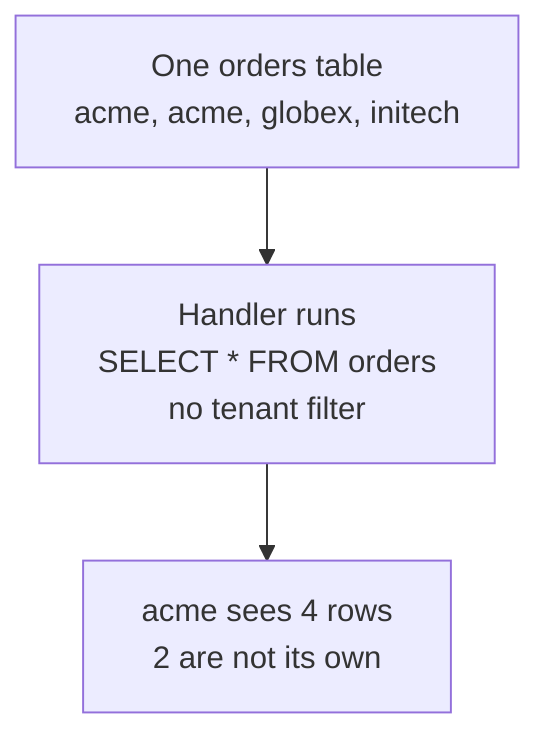
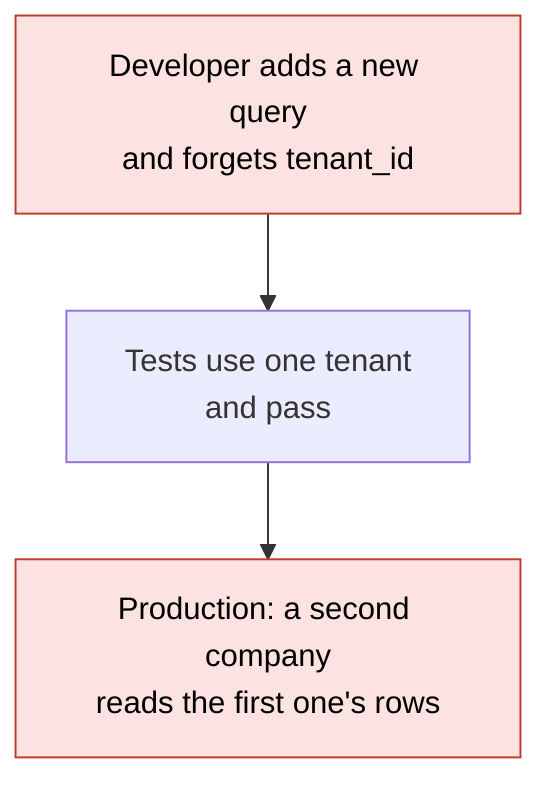
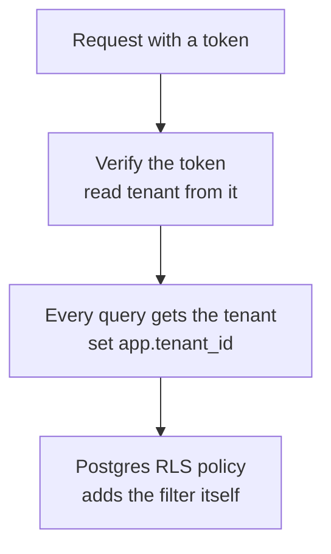
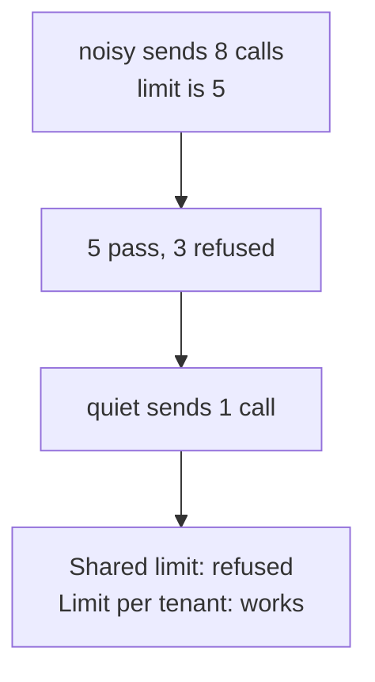
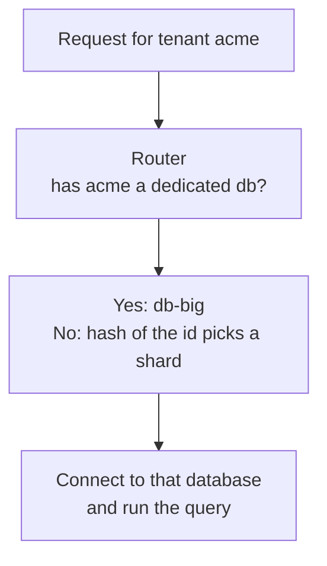

# 25. Multi-tenancy

> **Subject:** System Design · **Lesson:** 25 · **Made:** 2026-11-04 · **Status:** ready
>
> **You will be able to:** explain what a tenant is, compare the three ways to keep tenants apart (shared tables, a schema for each tenant, a database for each tenant), say how a forgotten `WHERE` leaks data and how Postgres row level security catches it, say why the tenant id comes from the token and never from the request body, and describe the noisy neighbour problem, many-tenant migrations and moving a big tenant out.
>
> **Before this:** [Consensus and Raft](24-consensus-and-raft.md) · **Next:** [SLOs and error budgets](26-slos-and-error-budgets.md)
>
> **How to read it:** one card is one idea. Look at the picture, guess, then press the orange bar to check. The blue bars (📖 More detail) hold the longer explanation. Skip them on the first read, and open them when you want more. About 15 minutes for the cards.

## 1. The idea: many companies, one system

You build one product, and many **customer companies** use it. Each company is a **tenant**. Acme must never see Globex's orders, even though both live in the same system. The easy way to build this is one table that holds everyone's rows, with a `tenant_id` column. It works until one query forgets `WHERE tenant_id = ...`. Then Acme reads Globex's data, and no error appears.



Notice that the database did exactly what it was told. The bug is a missing line, not a crash.

<details class="guess"><summary>🤔 Guess: the table has 4 rows from 3 companies. Acme's handler forgets the tenant filter, and the app's database user has no row level security. How many rows does Acme see? And after you turn row level security on, with Acme's tenant set? Press to check.</summary>

**4 rows** without the safety net, and **2 rows** (only Acme's) with row level security on and the tenant set to Acme. The forgetful query is the same in both cases. (Real run, Postgres 18.3 on my machine.)

</details>

> **Remember:** a tenant is one customer company. In a shared table, the tenant filter must be on every query, and one miss leaks data silently.

<details class="more"><summary>📖 More detail: new words, the problem drawn, and what the sources say</summary>

New words (five):

- **Tenant:** one customer company (not one user). A tenant has many users.
- **Shared tables (pool):** every tenant's rows are in the same tables, told apart by a `tenant_id` column.
- **Schema per tenant:** one Postgres schema (a named folder of tables) for each tenant, in the same database.
- **Database per tenant:** a whole database for each tenant.
- **Noisy neighbour:** one tenant that uses so much that the others slow down.

**The problem, drawn.** Everything works in the demo with one tenant. With two tenants, the one missing filter shows up.



**What the sources say (opened 2026-11-04).** The AWS SaaS whitepaper says that being signed in is not the same as isolation: "a user could be authenticated and authorized, and still access the resources of another tenant", and that isolation must use the tenant context to limit access to resources. (The page says it is kept for historical reference.) My own database guide ([database design and why](../database/database-design-and-why.md)) says the same default: shared tables with `tenant_id`, plus row level security as a safety net.

**Where the analogy stops.** An office building has locked doors for each company. A shared table has no doors: the "door" is a `WHERE` line that you must remember. That is why the rest of this lesson is about making the door automatic.

**Cost.** Every tenant model costs something: shared tables risk a leak, a schema per tenant costs migrations, a database per tenant costs money and connections (card 2).

</details>

## 2. Three ways to keep tenants apart

| | Shared tables | Schema per tenant | Database per tenant |
|---|---|---|---|
| A new tenant | one new row | create a schema and its tables | create a database |
| A forgotten filter | **leaks other tenants' rows** | stays inside the schema | stays inside the database |
| A migration | runs once | runs once for each tenant | runs once for each tenant |
| One tenant is huge | hard to move out | move one schema | move one database |
| Cost to run | lowest | middle | highest |

<details class="guess"><summary>🤔 Guess: you have 1,000 tenants, each with its own schema, and you ship a migration that adds a column. How many times does the migration run? And what is the new risk? Press to check.</summary>

**1,000 times**, once in each schema. The new risk: if run number 537 fails, 536 tenants have the new column and 464 do not, and your code must work with both until you fix it. (Real run: 1,000 schemas, the `ALTER TABLE` ran 1,000 times, in 0.1 s in total because the tables were empty.)

</details>

> **Remember:** start with shared tables plus a safety net. Give a schema or database only to the tenants that need a wall.

<details class="more"><summary>📖 More detail: what I measured, and how to choose</summary>

**What I measured** (a throwaway Postgres 18.3 on my machine, empty tables, so these are start-up costs, not big-data numbers):

```
empty database: 8.0 MB, 415 rows in pg_class (the catalog of tables and indexes)
1,000 schemas, each with 2 tables and 1 extra index:
    created in 3.1 s (3.1 ms per tenant), database 89.5 MB (about 81 KB per tenant),
    pg_class 11,415 rows (11 more rows per tenant)
"add a column" in each of the 1,000 schemas: 0.1 s in total (0.1 ms each, tiny empty tables)
1000 requests that run "set search_path" and then a query: 0.23 ms each
50 databases created in 4.4 s (87 ms each), each empty database is 7.8 MB on disk
```

Checked on 2026-11-04. The migration time is tiny only because the tables had no rows: a real `ALTER TABLE` on a big table takes longer, and it runs 1,000 times.

**How to choose.**

- **Many small tenants** (hundreds or thousands): shared tables with `tenant_id`. The catalog does not grow with each tenant.
- **A few tenants who need a wall** (a bank that demands its own database, a legal rule on where data lives): a schema or a database for them.
- **A mix:** shared tables by default, and move the big or strict tenant out (card 5).

Several blog posts I found while researching say the Postgres catalog gets heavy after a few thousand schemas. I did not test that far, so treat it as a warning, not a measured limit.

**Cost.** More walls means more to run: more connections, more backups, more migrations. Fewer walls means more care in code.

**Step through it yourself:** [open the stepper](visuals/25-multi-tenancy.html). Tab 2 is this comparison.

</details>

## 3. Shared tables, done safely

Three habits make shared tables safe. **One:** the tenant id comes from the **checked token** (the JWT you verified), never from the request body or the URL, because the caller can write anything in a body. **Two:** every data call **requires** a tenant id, so you cannot write one without it. **Three:** a safety net in the database, **row level security** (RLS): Postgres itself adds the tenant filter to every query, even the one you forgot.



<details class="guess"><summary>🤔 Guess: row level security is on and has a policy. Your app connects as the same role that owns the table, and runs `SELECT *`. What does it see? And what changes if you add `FORCE ROW LEVEL SECURITY`? Press to check.</summary>

The owner sees **all 5 rows**: table owners skip RLS unless you force it. With `FORCE ROW LEVEL SECURITY` and the tenant set to 3, the same owner sees **1 row**. A superuser and a role with `BYPASSRLS` still see **all 5**, even with FORCE. (Real run.) So: the app should connect as a plain role that does not own the tables.

</details>

> **Remember:** tenant from the token, required on every call, and RLS as a net. The app role must not be the owner, a superuser or `BYPASSRLS`.

<details class="more"><summary>📖 More detail: the SQL, the real output, the pool trap, and the index</summary>

**The setup I ran:**

```sql
CREATE TABLE orders (id serial PRIMARY KEY, tenant_id int NOT NULL, item text, total int);
ALTER TABLE orders ENABLE ROW LEVEL SECURITY;
CREATE POLICY tenant_isolation ON orders
  USING (tenant_id = current_setting('app.tenant_id', true)::int);
-- the app role: a plain role, not the owner
GRANT SELECT, INSERT, UPDATE, DELETE ON orders TO app_user;
```

**The forgetful query, as `app_user`** (rows: tenant 1 has pen and ink, tenant 2 has book, tenant 3 has lamp):

```
no RLS:                      SELECT tenant_id, item FROM orders   ->  4 rows (every company)
RLS on, app.tenant_id = '1': the same query                         ->  pen, ink
RLS on, app.tenant_id = '2': the same query                         ->  book
RLS on, tenant 2, INSERT a row for tenant 1   -> ERROR: new row violates row-level security policy
RLS on, tenant 2, UPDATE rows of tenant 1     -> UPDATE 0   (the rows are invisible)
```

The Postgres docs (opened 2026-11-04) say a policy with only `USING` also applies to rows made by `INSERT` and `UPDATE`, rows that fail it are silently left out of a read, and with RLS on and no policy, no rows are visible. They also say superusers and `BYPASSRLS` roles always skip RLS, table owners normally do, and `FORCE ROW LEVEL SECURITY` makes the owner follow the policies.

**Who skips the policy** (real run): owner without FORCE sees 5 rows; owner with FORCE and tenant 3 sees 1; superuser sees 5; a `BYPASSRLS` role sees 5.

**The pool trap.** The tenant is passed as a setting on the connection. Apps reuse connections (a pool), so the setting can leak to the next request. What I saw:

```
a fresh connection, tenant never set:           current_setting(..., true) -> null,  rows seen: 0
set_config('app.tenant_id','2', true) in a transaction (true = only this transaction):
                                                tenant 2 sees 2 rows
after COMMIT, on the same connection:           current_setting -> ""  (an empty string, not null)
                                                the plain ::int cast -> ERROR invalid input syntax for type integer: ""
SET app.tenant_id = '1' (the session version) on a pooled connection, nobody sets a tenant next:
                                                the next request still sees 2 rows of tenant 1
```

So: use `set_config(..., true)` inside each transaction (not a session-level `SET`), and write the policy as `NULLIF(current_setting('app.tenant_id', true), '')::int`, so an empty tenant gives 0 rows instead of an error. The plain cast failed closed (an error, no rows), which is safe, but noisy.

**The index: tenant_id first.** 200,000 rows, 100 tenants (2,000 rows each), best of 7, query "the newest 20 orders of one tenant":

```
no index on tenant_id                          7.15 ms
index (created_at, tenant_id), a busy tenant    0.24 ms
index (tenant_id, created_at), a busy tenant    0.17 ms
a small tenant whose rows are all old:
    index (created_at, tenant_id)               6.75 ms
    index (tenant_id, created_at)               0.19 ms    <- about 35 times faster
RLS on, query with NO where:                    0.19 ms, and the plan shows  Index Cond: (tenant_id = ...)
```

For a busy tenant the two index orders look the same, because that tenant's rows are everywhere. A small tenant exposes the difference. RLS did not slow the query: the policy filter became an index condition. (Checked on 2026-11-04. My table was small, so check your own data.)

**What RLS does not do.** The Postgres docs warn that unique and foreign key checks bypass RLS, which can leak facts in odd cases, and that a policy that reads other tables can race under `READ COMMITTED`. It is a net, not a replacement for correct code.

**Prisma and Hasura.** Hasura builds the tenant filter into its permission rules, using values from the JWT ([lesson 29](29-security-in-a-design.md) has the details). The Prisma docs mention row level security as an example use for client extensions; I only saw that mention and did not read the example.

**Cost.** RLS needs the tenant set on every connection and transaction, and testing with two tenants. Policies can slow complex queries, and I did not test that beyond the simple case above.

</details>

## 4. The noisy neighbour: a limit for each tenant

Even with perfect walls for data, tenants **share the machine**. If one tenant sends 100 calls a second, there is less for everyone. If you have one shared limit, the loud tenant uses it all, and a quiet tenant is refused for something it did not do. The fix: **a limit for each tenant**, the same idea as the rate limiter of lesson 9, with the tenant id as the key.



<details class="guess"><summary>🤔 Guess: one shared limit of 5 calls per second. "noisy" sends 8 calls and then "quiet" sends 1. What happens to quiet's call? And with a limit of 5 for each tenant? Press to check.</summary>

With one shared limit, quiet is **refused**: noisy used all 5. With a limit for each tenant, quiet is **let in**, because it has its own count of 0. (Real run of `createTenantLimiter`.)

</details>

> **Remember:** share the machine, not the limit. Count and limit for each tenant, and give a paid plan a bigger number.

<details class="more"><summary>📖 More detail: the code, the output, and what else to split</summary>

This is practice C, the limiter:

```js
function createTenantLimiter(options = {}) {
  const { limit = 100, windowMs = 1000, limits = {}, now = Date.now } = options;
  const windows = new Map();              // tenantId -> { start, count }, one window for each tenant
  // allow(tenantId): the window of THIS tenant, its own limit (limits[tenantId] or the default)
}
```

**Output** (limit 2 per second, a fake clock):

```
[ true, true, false, true ]   <- a, a, a (the third is refused), then b (its own count)
usage of a: 2
a second later: usage 0, and a is allowed again
```

Checked on 2026-11-04 with Node 26.12.1.

**What else to split for each tenant.** The same noisy neighbour hurts in other places: database connections (one tenant holding all of the pool), queue slots (one tenant's 100,000 jobs in front of everyone's), CPU, and storage. Common answers: a limit or a quota for each tenant, a separate queue or a fair share for big tenants (lesson [06](06-message-queues.md)), and a separate database for the biggest.

**When a tenant is refused.** Return a clear `429` (lesson [09](09-design-a-rate-limiter.md)), and have clients retry with backoff and jitter (lesson [23](23-timeouts-retries-and-circuit-breakers.md)), or the refused crowd comes straight back.

**Cost.** A counter for each tenant (small), and a decision on what each plan gets. Too tight a limit hurts a good customer, so alert before you refuse.

**Step through it yourself:** [open the stepper](visuals/25-multi-tenancy.html). Tab 3 is this story.

</details>

## 5. Growing: migrations, and moving a big tenant out

One day Acme is 40% of your rows and its reports slow everyone down. You want to give Acme its own database. This needs two things: a **router** that says which database a tenant lives in, and a way to **move** the data. The router is small: a tenant goes to a shard by its hash, unless it has a dedicated database.



<details class="guess"><summary>🤔 Guess: three shards, 300 tenants, and you move ONE tenant to its own database in the router. How many other tenants change database? Press to check.</summary>

**None.** Only the moved tenant changes. The hash is the same for everyone else. (Real run of the practice test: before and after, the only tenant whose route changed is the one you moved.) The hard part is not the router. It is moving the data without losing writes.

</details>

> **Remember:** route by tenant id, with an override list for big tenants. Move data first, then switch the route.

<details class="more"><summary>📖 More detail: the router code, the move steps, and migrations</summary>

```js
function createRouter({ shards, dedicated = {} }) {
  const own = new Map(Object.entries(dedicated));
  const router = {
    route(tenantId) {
      need(tenantId);
      if (own.has(tenantId)) return own.get(tenantId);      // a big tenant with its own database
      return shards[hashString(tenantId) % shards.length];
    },
    move(tenantId, db) { own.set(tenantId, db); },
  };
  return router;
}
```

**Output** (practice test, 300 tenants on 3 shards): the shards got between 80 and 120 tenants each, and after `move("tenant-7", "db-big")` the only route that changed was tenant-7's.

**A safe move, in steps** (this is the idea, I did not run a real move):

1. Copy the tenant's rows to the new database while the tenant still uses the old one.
2. Keep the copy up to date (for example from the change log, lesson [21](21-streams-vs-queues.md) and [22](22-search-indexes.md) used the same idea).
3. Pause the tenant's writes for a moment (seconds), check that both sides match, and switch the route.
4. Keep the old rows for a few days, then delete them.

**Adding a shard moves tenants too.** With `hash % shards.length`, adding a shard changes the answer for most tenants (lesson [20](20-consistent-hashing.md): going from 4 to 5 servers moved 7,986 of 10,000 keys with `key % N`). So many systems keep a **lookup table** (tenant to database) instead of a formula, or use consistent hashing.

**Migrations across many tenants.** With shared tables a migration runs once, but on a big table it needs care (lesson [database 19](../database/19-zero-downtime-migrations.md)). With a schema or a database for each tenant, the migration runs in a loop, and you need to: record each tenant's schema version, make it safe to run twice (idempotent), run in batches, stop on the first failure, and let the code work with the old and new shape for a while (expand, then contract).

**Cost.** A router is one more thing in the request path. A lookup table must be cached and kept correct, or a wrong route sends a tenant's queries to the wrong database.

</details>

## 6. Five mistakes, and what to say if you freeze

- **Wrong:** take the tenant id from the request body or a header the caller sets. **Right:** from the verified token.
- **Wrong:** shared tables and a `WHERE tenant_id` that each developer must remember. **Right:** a required argument in the data layer, plus RLS, plus a two-tenant test.
- **Wrong:** the app connects as the table owner or a superuser, so RLS does nothing. **Right:** a plain app role, and `FORCE ROW LEVEL SECURITY` where owners are used.
- **Wrong:** a session-level `SET` on a pooled connection. **Right:** `set_config(..., true)` inside each transaction.
- **Wrong:** one shared limit for all tenants. **Right:** a limit for each tenant, with a bigger one for a bigger plan.

<details class="guess"><summary>🤔 Guess: a new endpoint `GET /orders/:id` looks up the order by id only: `SELECT * FROM orders WHERE id = $1`. Tenant filter is missing, RLS is off. Acme asks for `/orders/3`, which is Globex's order. What happens, and how is it fixed in the data layer? Press to check.</summary>

Acme **gets Globex's order**. The id is enough to find the row. In the practice store the fix is `get(tenantId, id)`: the order must also belong to the tenant, and if it does not, the answer is the same as for a missing order, so Acme cannot even tell the order exists. (Real run: `get("acme", 3)` and `get("acme", 99)` both return `undefined`.)

</details>

> **Remember:** if you freeze, say "Tenant from the token, required on every call, filter in the data layer, RLS as a net, and a limit for each tenant. Shared tables by default, a schema or database only for tenants that need it."

<details class="more"><summary>📖 More detail: the mistakes in full, and the freeze plan</summary>

- **Tenant from the body.** Anyone can type another company's id. The token is signed, so it can be trusted (lesson [29](29-security-in-a-design.md)).
- **A filter to remember.** Code review misses it, tests with one tenant pass. Put the tenant in the function signature so the compiler or the tests catch it.
- **Owner or superuser.** My run: the owner saw all 5 rows, and so did a superuser even with FORCE. RLS protects only a role that is subject to it.
- **Session `SET`.** My run: after a session-level `SET`, the next request on that connection saw tenant 1's rows with nobody setting a tenant.
- **Shared limit.** The stepper's tab 3: quiet refused because noisy used the limit.

**If you freeze:**

1. Say "A tenant is a customer company. I keep their data apart with shared tables, a schema each, or a database each. I start shared."
2. Say "The tenant id comes from the verified token and is required on every data call. RLS in Postgres is a safety net, and the app role must not be the owner."
3. Say "I limit each tenant, so one loud tenant cannot slow the rest, and I can move a big tenant to its own database with a router."

</details>

## 7. Watch and play

Links were opened on 2026-11-04. I did not find a YouTube video I could check, so there is a podcast page instead.

- **Play with it:** [the stepper in this folder](visuals/25-multi-tenancy.html) - guess first, then press Next. Try all three tabs.
- **Read:** [PostgreSQL docs: Row Security Policies](https://www.postgresql.org/docs/current/ddl-rowsecurity.html) - who skips RLS, `FORCE`, `USING` and `WITH CHECK`, and the warnings.
- **Read:** [AWS whitepaper: Tenant isolation](https://docs.aws.amazon.com/whitepapers/latest/saas-architecture-fundamentals/tenant-isolation.html) - signed in is not the same as isolated. The page says it is kept for historical reference.
- **Listen:** [Postgres.FM: Multi-tenant options](https://postgres.fm/episodes/multi-tenant-options) - a 50 minute episode (June 2025) with Gwen Shapira from Nile. I read the page and did not listen to it.
- **Read:** [Prisma: Client extensions](https://www.prisma.io/docs/orm/prisma-client/client-extensions) - the page mentions row level security as an example use. I did not read the example.
- **Your own guide:** [Database design and why](../database/database-design-and-why.md), the multi-tenancy section - shared tables, `tenant_id` first in indexes, and RLS.

<details><summary>Go deeper (optional)</summary>

- **Other databases.** I only ran Postgres. MySQL has no row level security, so there the filter must live in the app or in views. I did not check this here.
- **Cells.** Some big systems run many full copies of the system, each serving a group of tenants, so one bad deploy or one noisy tenant hits only one cell. I did not cover or measure it.
- **Per-tenant encryption keys, backups and data location.** Strict customers ask for these. A database for each tenant makes them easier.
- **Tenant-aware caching and search.** A cache key must include the tenant (lesson [04](04-caching.md)), and a search index needs a tenant filter too (lesson [22](22-search-indexes.md)).
- **Not run here.** I did not run Prisma or Hasura. The Postgres numbers and the practice outputs are real runs on my machine; the AWS and Prisma points come from their pages.

</details>

## 8. Practice

**A. Predict the output** (write your answer before opening)

```js
const store = createTenantStore();
store.add("acme", { item: "pen" });
store.add("globex", { item: "book", tenantId: "acme" });
console.log(store.list("acme").length, store.get("acme", 2), store.update("acme", 1, { tenantId: "globex", item: "ink" }));
const router = createRouter({ shards: ["db1", "db2", "db3"] });
router.move("acme", "db-big");
console.log(router.route("acme"), router.route("globex"));
```

Then answer: why is `store.get("acme", 2)` not the book?

<details><summary>Answer</summary>

```
1 undefined { item: 'ink', id: 1, tenantId: 'acme' }
db-big db3
```

The second `add` is for `globex`. The `tenantId: "acme"` inside the row is ignored, because the tenant comes from the argument. So acme has only 1 row. Row 2 belongs to globex, so `get("acme", 2)` gives `undefined`, the same as for a missing row. The `update` cannot change the tenant or the id, so only `item` changes. After `move`, acme goes to `db-big`. `globex` has no override, so the hash of its name picks `db3` (the hash is the same every time). (Checked on 2026-11-04 with Node 26.12.1, using the answer to practice C.)

</details>

**B. Fix the answer**

A teammate says: "Our API reads `tenantId` from the JSON body, and each query adds `WHERE tenant_id = body.tenantId`. We have row level security on too, so we are safe. The app connects as `postgres` so it can run migrations." What is wrong, and what do you suggest?

<details><summary>Answer</summary>

Two problems. **The tenant comes from the body:** a caller can send another company's id and read its rows, and the `WHERE` filter will happily match it. Read the tenant from the verified token. **RLS does nothing here:** `postgres` is a superuser, and superusers skip RLS (my run: it saw all rows, even with `FORCE`). Suggest: connect as a plain app role that does not own the tables, and use a separate role for migrations. Set the tenant for each transaction with `set_config('app.tenant_id', ..., true)` from the token. Make the data layer require a tenant id, add an index with `tenant_id` first, and add a test where tenant A asks for tenant B's id and gets "not found".

</details>

**C. Write it yourself**

Open `learn/system-design/practice/25-multi-tenancy.js`. It has four empty functions: `createTenantStore` (card 3), `tenantOf` (card 3), `createRouter` (card 5) and `createTenantLimiter` (card 4). `hashString` is given. Write them, then run this from the repo root and make all the tests pass:

```
node --test learn/system-design/practice/25-multi-tenancy.test.js
```

<details><summary>One possible answer</summary>

```js
function hashString(text) {
  let h = 0;
  for (const ch of String(text)) h = (h * 31 + ch.charCodeAt(0)) >>> 0;
  return h;
}

function need(tenantId) {
  if (tenantId === undefined || tenantId === null || tenantId === "") throw new Error("tenant required");
}

// A shared table: every row has a tenantId, and every method needs one.
function createTenantStore() {
  const rows = new Map();                 // id -> row, rows of all tenants together
  let nextId = 1;
  const copy = (row) => ({ ...row });
  const mine = (tenantId, id) => {
    const row = rows.get(id);
    return row && row.tenantId === tenantId ? row : undefined;     // another tenant's row looks the same as no row
  };
  return {
    add(tenantId, row) {
      need(tenantId);
      const saved = { ...row, id: nextId++, tenantId };             // the tenant comes from the argument, never from the row
      rows.set(saved.id, saved);
      return copy(saved);
    },
    get(tenantId, id) {
      need(tenantId);
      const row = mine(tenantId, id);
      return row ? copy(row) : undefined;
    },
    list(tenantId, filter = {}) {
      need(tenantId);
      return [...rows.values()]
        .filter((r) => r.tenantId === tenantId)                     // the tenant filter is always there
        .filter((r) => Object.entries(filter).every(([k, v]) => k === "tenantId" || r[k] === v))
        .sort((a, b) => a.id - b.id)
        .map(copy);
    },
    update(tenantId, id, changes) {
      need(tenantId);
      const row = mine(tenantId, id);
      if (!row) return null;
      Object.assign(row, changes, { id: row.id, tenantId: row.tenantId });
      return copy(row);
    },
    remove(tenantId, id) {
      need(tenantId);
      return mine(tenantId, id) ? rows.delete(id) : false;
    },
    count(tenantId) {
      need(tenantId);
      return [...rows.values()].filter((r) => r.tenantId === tenantId).length;
    },
  };
}

// The tenant comes from the checked token, never from the body or the query.
function tenantOf(request) {
  const tenantId = request && request.auth && request.auth.tenantId;
  if (!tenantId) {
    const err = new Error("not signed in");
    err.code = "UNAUTHENTICATED";
    throw err;
  }
  return tenantId;
}

function createRouter({ shards, dedicated = {} }) {
  const own = new Map(Object.entries(dedicated));
  const router = {
    route(tenantId) {
      need(tenantId);
      if (own.has(tenantId)) return own.get(tenantId);              // a big tenant with its own database
      return shards[hashString(tenantId) % shards.length];
    },
    move(tenantId, db) { own.set(tenantId, db); },
    tenantsOn(db, ids) { return ids.filter((id) => router.route(id) === db); },
  };
  return router;
}

function createTenantLimiter(options = {}) {
  const { limit = 100, windowMs = 1000, limits = {}, now = Date.now } = options;
  const windows = new Map();              // tenantId -> { start, count }, one window for each tenant
  function current(tenantId) {
    const w = windows.get(tenantId);
    return w && now() - w.start < windowMs ? w : null;
  }
  return {
    allow(tenantId) {
      need(tenantId);
      let w = current(tenantId);
      if (!w) { w = { start: now(), count: 0 }; windows.set(tenantId, w); }
      const max = tenantId in limits ? limits[tenantId] : limit;
      if (w.count >= max) return false;
      w.count++;
      return true;
    },
    usage(tenantId) {
      const w = current(tenantId);
      return w ? w.count : 0;
    },
  };
}

module.exports = { hashString, createTenantStore, tenantOf, createRouter, createTenantLimiter };
```

Checked on 2026-11-04 with Node 26.12.1: the 26 tests fail on the empty stub and all 26 pass with this answer. I also broke the answer on purpose four times, and the tests caught each one: no tenant filter in `list` (3 tests failed), no tenant check in `get` and `remove` (4 failed), letting `update` change the tenant (1 failed), and one counter shared by all tenants in the limiter (2 failed). Two details to notice. A row of another tenant looks exactly like a missing row, so a caller learns nothing. And the tenant of `add` comes from the argument, never from the row.

</details>

## 9. Interview question

**Q:** "You are building a B2B SaaS where each customer is a company with its own users and data. How do you keep one company's data away from another's, and what if one company gets huge?"

A common follow-up: "How do you make sure a developer cannot forget the filter?" Card 3 is the answer.

<details><summary>A strong answer, in four parts</summary>

1. **Problem:** many companies share one system. A single query without a tenant filter leaks one company's data to another, with no error. And one loud tenant can slow the rest.
2. **How it works:** I start with shared tables and a `tenant_id` on every row, with `tenant_id` first in the indexes (in my test, a small tenant's "newest 20" went from 6.75 ms to 0.19 ms with the right order). The tenant id comes from the verified token, never the body, and it is a required argument of every data call. Postgres row level security is the net: a policy on `tenant_id` and the tenant set per transaction with `set_config(..., true)`. The app connects as a plain role, because owners, superusers and `BYPASSRLS` roles skip RLS (I saw it). Each tenant has its own rate limit so one loud tenant cannot use everything. A router maps a tenant to a database, so a huge tenant can move to its own database.
3. **Tradeoff:** shared tables are the cheapest and simplest to migrate, but depend on discipline and RLS. A schema or a database for each tenant gives a wall, but a migration runs once for each tenant (1,000 tenants, 1,000 runs, and run 537 can fail), and each database costs money and connections (87 ms and 7.8 MB to start an empty one in my test). Moving a tenant needs a copy, a catch-up and a short pause for writes. I test with two tenants and a case where A asks for B's id.
4. **My example:**
   - **Fact:** my DBO case study describes a B2B platform where store owners order stock from an app. The product tables are in one database called `toko`, with a `stores` table. Other databases hold `auth` and `queue`.
   - **Not known yet:** whether DBO treats each store or each brand as a tenant, or whether any query filters by a tenant column. The case study does not say. It is a platform with one set of stores, which may not need multi-tenancy at all.
   - **Idea, not a fact:** if DBO served several brands that must not see each other's stores, I would add a brand or tenant id to the tables, take it from the JWT, and use row level security as a net, since Prisma and Hasura both sit on top of Postgres. I would say it as "what I would check".

</details>

## 10. Explain it back

Close this file. Explain how you keep many companies' data apart in one system, out loud like to a new junior, in 4 parts (problem, how, tradeoff, my example). Use the story of the forgotten filter that showed 4 rows instead of 2, and the story of the noisy tenant that used the whole limit. Then write your best version below and run `/explain-check multi-tenancy` or ask the `explain-coach` agent to review it.

### My explanation

<write here>

### Coach feedback

<the explain-coach agent writes here>

## 11. Review questions (day 1, 3, 7, 21)

1. What are the three ways to keep tenants apart, and which is the usual start?
2. Where must the tenant id come from, and why not from the request body?
3. Who skips row level security, and what should the app role be?
4. Why is a session-level `SET` dangerous on a pooled connection, and what do you use instead?
5. What is a noisy neighbour, and what is the first fix?
6. You have 1,000 schemas and ship a migration. What is the work, and what can go wrong?

<details><summary>Answers</summary>

1. Shared tables with a `tenant_id`, a schema for each tenant, a database for each tenant. Start with shared tables plus a safety net, and give a schema or database only to tenants that need it.
2. From the verified token (the JWT). A body is written by the caller, so anyone can send another company's id.
3. Superusers, `BYPASSRLS` roles and (without `FORCE`) the table owner. The app should connect as a plain role that does not own the tables.
4. The setting stays on the connection, so the next request that reuses it can see the old tenant's rows (my run: 2 rows of tenant 1 with nobody setting a tenant). Use `set_config('app.tenant_id', ..., true)` inside each transaction.
5. One tenant using so much that the others slow down or are refused. First fix: a limit for each tenant instead of one shared limit.
6. The migration runs 1,000 times. If one run fails, some tenants have the new shape and some do not. Record each tenant's version, make the migration safe to run twice, and make the code work with both shapes for a while.

</details>

## Connected lessons

- [Consensus and Raft](24-consensus-and-raft.md) - the lesson before. Both are about keeping parts of a system from interfering.
- [Security in a design](29-security-in-a-design.md) - the owner check for a user, one level below the tenant. Tenant from the token.
- [Design a rate limiter](09-design-a-rate-limiter.md) - the limiter, with the tenant as the key.
- [Timeouts, retries and circuit breakers](23-timeouts-retries-and-circuit-breakers.md) - backoff for tenants that were refused.
- [Consistent hashing](20-consistent-hashing.md) - why `hash % N` moves most tenants when you add a shard.
- [Message queues](06-message-queues.md) - fair queues so one tenant's jobs do not block the rest.
- [Caching](04-caching.md) - the tenant must be part of a cache key.
- [Search indexes](22-search-indexes.md) - the search needs a tenant filter too.
- [Replication and quorums](19-replication-and-quorums.md) - a database per tenant multiplies the replicas to run.
- [Zero downtime migrations (database 19)](../database/19-zero-downtime-migrations.md) - expand then contract, needed when a migration runs in every tenant.
- [Partitioning and sharding (database 22)](../database/22-partitioning-and-sharding.md) - the tenant id is a natural shard key.
- [Database design and why](../database/database-design-and-why.md) - the short multi-tenancy section, with RLS.
