# 26. SLOs and error budgets

> **Subject:** System Design · **Lesson:** 26 · **Made:** 2026-10-17 · **Remade in short cards:** 2026-10-30 · **Status:** ready
>
> **You will be able to:** turn 99.9% into minutes per month and per year, say what an SLI, an SLO and an SLA each are, explain the error budget as permission to ship, and say why you alert on how fast the budget is going and not on CPU.
>
> **Before this:** [Multi-tenancy](25-multi-tenancy.md) · **Next:** [Safe deploys](27-safe-deploys.md)
>
> **How to read it:** one card is one idea. Look at the picture, guess, then press the orange bar to check. The blue bars (📖 More detail) hold the longer explanation. Skip them on the first read, and open them when you want more. About 15 minutes for the cards.

## 1. The idea: how much failure is fine?

An **SLO** is a number that says how often your service may fail. The failure you can still afford this month is your **error budget**. You watch how fast you spend it, and you alert on that speed. A city bus company shows it: "99 of every 100 buses on time" is the goal, the 1 late bus in 100 is the budget the manager may spend on trying a new route.

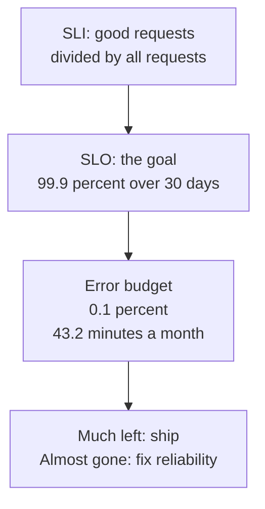

<details class="guess"><summary>🤔 Guess: the SLO is 99.9% over 30 days. How many minutes a month may the service fail? Press to check.</summary>

**43.2 minutes.** A 30 day month has 43,200 minutes, and you may fail 0.1% of them: 43,200 times 0.001.

</details>

> **Remember:** the SLI measures, the SLO is the goal, the error budget is what the SLO still allows. The SLA is a contract, and it is looser than the goal.

<details class="more"><summary>📖 More detail: new words, the big picture, the problem drawn, and the bus company</summary>

New words (four):

- **SLI:** a number that measures what users feel. Example: the share of checkout requests that finish OK in under 1 second (interview words: service level indicator).
- **SLO:** the goal for that number. Example: 99.9% of checkout requests are good, over 30 days (service level objective).
- **SLA:** a promise to a customer, with a penalty if you miss it. The penalty is usually money back (service level agreement).
- **Error budget:** the failure your SLO still allows. It is 100% minus the SLO. For 99.9% it is 0.1%.

Three plain ideas, explained now so the pictures make sense:

- **A good request** worked and was fast enough. A bad request failed or was too slow. An SLI is good requests divided by all requests.
- **Spending speed** says how fast the budget goes (interview word: burn rate). Speed 1 means the budget lasts exactly the whole month. Speed 14.4 means it is gone in about 2 days.
- **A window** is the last few minutes you look at, for example "the last hour".

Times and traffic in the pictures are example numbers.

**The big picture.** Notice the chain: measure, compare with the goal, count what is left, then decide. The SLA sits outside the chain. It is a contract, and it is looser than the goal.

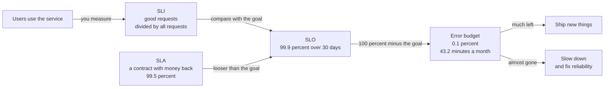

**The problem, drawn.** Two things go wrong when a team has no SLO. Notice that both end with people who stop trusting the numbers.

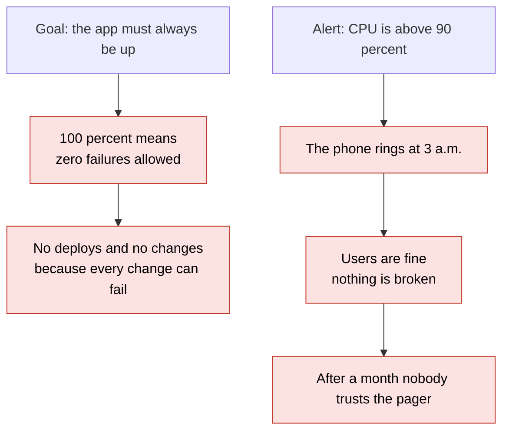

**The bus company in full.**

A city bus company. The city says: "Buses must arrive within 5 minutes of the timetable."

- **SLI:** the share of buses that were on time. Riders feel this.
- **SLO:** the company's own goal: 99 of every 100 buses on time this month.
- **Error budget:** the late buses it can afford: 1 in every 100. The manager may spend them on trying a new route.
- **Burn rate:** if 10 buses are late by 8 a.m. on day 1, the manager acts today. She does not wait for the end of the month.
- **SLA:** the city contract. If fewer than 95 of 100 buses are on time, the company pays a fine.
- **CPU:** the engine temperature. A hot engine with buses on time is fine. A cool engine with buses stuck in a jam is not.

Where the analogy stops: a rider can see a late bus. A web user who gets an error often just leaves, and nobody counts them. Also, one failure on a web service can hit every user at once, not one bus at a time.

</details>

## 2. From a percentage to minutes

Each extra nine cuts the budget by ten, and costs far more than the one before.

| SLO | Per 30 days | Per year |
|---|---|---|
| 99% | 7.2 hours | 87.6 hours |
| 99.9% | 43.2 min | 8.76 hours |
| 99.99% | 4.32 min | 52.6 min |
| 99.999% | 25.9 s | 5.26 min |

Before you pick a row, ask: "What does one hour of downtime cost the business?" A shop that earns little at night does not need the same number as a bank.

<details class="guess"><summary>🤔 Guess: a 99.9% SLO and 43.2 million requests a month. How many bad requests are allowed? Press to check.</summary>

**43,200.** 43,200,000 times 0.001. Real SLOs count bad requests, not minutes. The two views agree when failures are total outages, and differ when failures are partial.

</details>

> **Remember:** each extra nine cuts the budget by ten. Pick the number users would notice, not a nice looking number.

<details class="more"><summary>📖 More detail: the nines drawn, the arithmetic step by step, and the full table</summary>

**From a percentage to minutes.** Notice that each extra nine cuts the budget by ten.

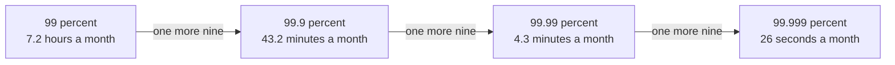

**From 99.9% to minutes.** Here is the arithmetic behind the number 43.2, one step at a time.

| Step | Calculation | Result |
|---|---|---|
| 1 | Minutes in 30 days: 30 × 24 × 60 | 43,200 minutes |
| 2 | The share you may fail: 100% minus 99.9% | 0.1%, or 0.001 |
| 3 | Minutes you may fail: 43,200 × 0.001 | **43.2 minutes** |
| 4 | Bad requests you may have, at 43.2 million requests a month: 43,200,000 × 0.001 | 43,200 bad requests |
| 5 | Spending speed when 5% fail: 0.05 ÷ 0.001 | burn rate 50 |
| 6 | Time until the budget is gone: 30 days ÷ 50 | 0.6 days, which is 14.4 hours |

**From a percentage to a time (in full).**

A 30 day month has 43,200 minutes. A year has 525,600.

| SLO | Allowed to fail | Per day | Per 30 days | Per year | Bad requests per 10 million |
|---|---|---|---|---|---|
| 99% | 1% | 14.4 min | 7.2 hours | 87.6 hours (3.65 days) | 100,000 |
| 99.9% | 0.1% | 1.44 min | **43.2 min** | 8.76 hours | 10,000 |
| 99.99% | 0.01% | 8.6 s | 4.32 min | 52.6 min | 1,000 |
| 99.999% | 0.001% | 0.86 s | 25.9 s | 5.26 min | 100 |

Before you pick a row, ask: "What does one hour of downtime cost the business?" A shop that earns little at night does not need the same number as a bank.

</details>

## 3. SLI: measure what users feel

A user does not feel CPU. A user feels an error or a slow page. A **good request** worked and was fast enough. So choose an SLI from a user action, for example "orders that answer without a server error in under 1 second, divided by all order requests". For speed, use a share or a percentile, not an average.

<details class="guess"><summary>🤔 Guess: 99 requests take 0.1 s and 1 request takes 10 s. The average is about 0.2 s. Do users feel fine? Press to check.</summary>

**No.** 1 user in 100 waited 10 seconds. The average hides the slow users. Say "99% of requests are faster than 300 ms" instead.

</details>

> **Remember:** alert on symptoms (what users feel), not causes (CPU, memory). Keep causes on a dashboard.

<details class="more"><summary>📖 More detail: choosing an SLI, percentiles, and symptoms against causes</summary>

**SLI: measure what users feel.**

A user does not feel CPU. A user feels an error or a slow page. So choose an SLI from a user action:

| User action | A good request is | The SLI |
|---|---|---|
| Place an order | Answers without a server error in under 1 second | good requests ÷ all order requests |
| Open a page | Loads in under 300 ms | requests faster than 300 ms ÷ all requests |
| Wait for an email job | The job finishes within 5 minutes of being added | jobs on time ÷ all jobs (see lesson [06](06-message-queues.md)) |

**Use a percentile for speed, not an average.** If 99 requests take 0.1 s and 1 request takes 10 s, the average is about 0.2 s. That looks fine, but 1 user in 100 waited 10 seconds. The p99 time is the time that 99 of 100 requests beat. Here it is 0.1 s for the first 99 and the slow one sits right above it. Saying "99% of requests are faster than 300 ms" is the same idea, written as a share.

**Alert on symptoms, not causes.** The Google SRE book says monitoring must answer two questions: what is broken, and why. A symptom is what users feel (errors, slow pages). A cause is why (CPU, memory, one container restarting). Page on the symptom. Keep causes on a dashboard to find the reason after the page.

</details>

## 4. Burn rate: alert on speed

**Burn rate** is the error rate divided by the allowed error rate. It says how many times faster than allowed you spend the budget.

| Burn rate | For a 99.9% SLO over 30 days |
|---|---|
| 1 | the budget lasts exactly 30 days |
| 6 | the budget is gone in 5 days |
| 14.4 | gone in about 2 days |
| 1000 | every request fails: gone in 43 minutes |

The pager rule: page when **both** the last 60 minutes and the last 5 minutes burn faster than 14.4. The long window proves the problem is real. The short window proves it is still happening, so the page stops soon after the fix.

<details class="guess"><summary>🤔 Guess: a bad deploy makes 5% of requests fail from minute 1 to minute 22, with 1,000 requests a minute. When does the pager fire, and when does it clear? Press to check.</summary>

It pages at **minute 18** (900 bad requests spent) and clears at **minute 26** (1,100 spent, 2.55% of the month). Users were hurt from minute 1. A one minute blip does not page, because the long window is still low. (Real run, Node 26.12.1.)

</details>

> **Remember:** two windows, both above the line. Big problems page fast, small ones page slowly.

<details class="more"><summary>📖 More detail: the bad deploy over time, the monitor, the code, the real output, and step by step</summary>

**How it works over time.** A bad deploy makes 5 percent of requests fail. Notice that the page does not come at minute 1. It comes when both windows agree, and it stops soon after the fix.

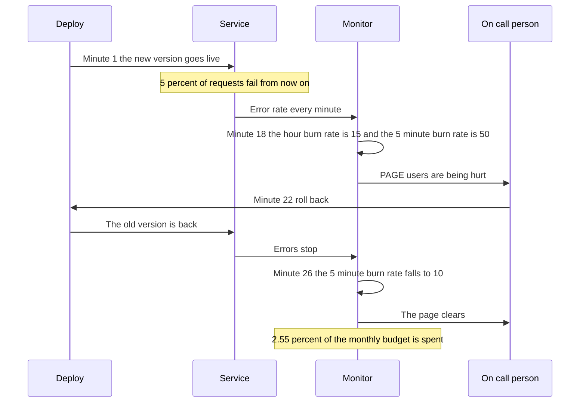

**What the monitor sees at one moment.** This is minute 18, the moment the page starts. Notice that the pager rule looks at two numbers, and both are above the line.

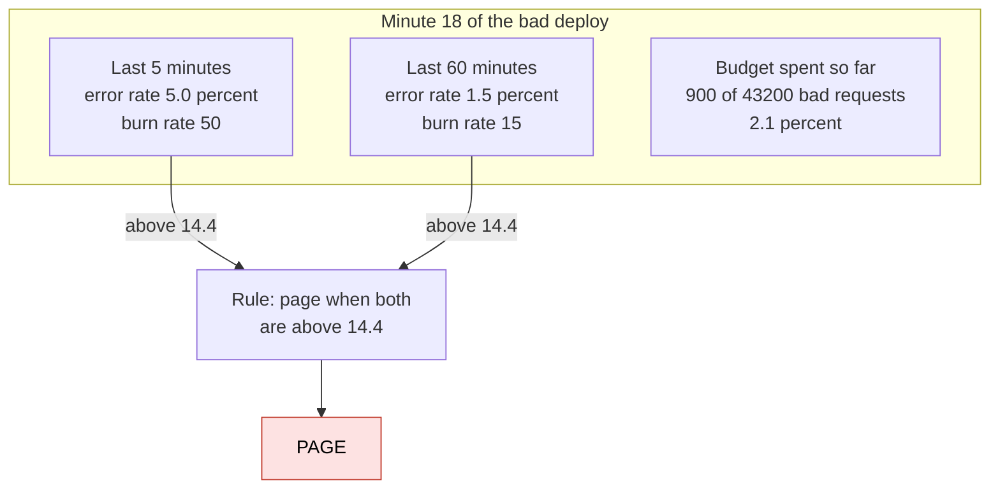

**The smallest code that shows it.**

A bad deploy makes 5 percent of requests fail from minute 1 to minute 22. The service handles 1,000 requests a minute. The code prints a line each time the pager changes state. The pager rule: both the last 60 minutes and the last 5 minutes burn faster than 14.4.

```js
const SLO = 0.999, BUDGET = 1 - SLO;                    // we may fail 0.1 percent of requests
const rate = (t) => (t >= 1 && t <= 22 ? 0.05 : 0);      // bad deploy: 5 percent fail from minute 1 to 22
const avg = (t, n) => { let s = 0; for (let i = t - n + 1; i <= t; i++) s += rate(i); return s / n; };   // error rate over the last n minutes
let spent = 0, paging = false;
for (let t = 1; t <= 30; t++) {
  spent += rate(t) * 1000;                               // 1000 requests a minute, so this many fail now
  const page = avg(t, 60) / BUDGET > 14.4 && avg(t, 5) / BUDGET > 14.4;   // both windows burn faster than 14.4
  if (page !== paging) { paging = page; console.log("minute", t, page ? "PAGE" : "page clears", "| spent", spent, "of 43200"); }
}
```

**Output:**

```
minute 18 PAGE | spent 900 of 43200
minute 26 page clears | spent 1100 of 43200
```

Checked on 2026-10-17 with Node 24.

Look at the two lines. The users were hurt from minute 1, but the page came at minute 18. It cleared at minute 26, four minutes after the fix. The 43,200 is the whole month's budget: 43.2 million requests times 0.1%.

Run again on 2026-10-30 with Node 26.12.1: the same output.

**What really happens, step by step.**

The machine here is the monitor. Each row is one minute of the loop. "Burn" is the error rate divided by 0.001. The page needs both burns above 14.4.

| Minute | Bad requests this minute | Last 5 minutes: error rate, burn | Last 60 minutes: error rate, burn | Spent (of 43,200) | Pager |
|---|---|---|---|---|---|
| 0 | 0 | 0%, 0 | 0%, 0 | 0 | quiet |
| 1 | 50 | 1.0%, 10 | 0.08%, 0.8 | 50 | quiet |
| 5 | 50 | 5.0%, 50 | 0.42%, 4.2 | 250 | quiet. The short window is high, the long window is not |
| 10 | 50 | 5.0%, 50 | 0.83%, 8.3 | 500 | quiet |
| 17 | 50 | 5.0%, 50 | 1.42%, 14.17 | 850 | quiet. Just under 14.4 |
| 18 | 50 | 5.0%, 50 | 1.50%, 15 | 900 | **PAGE**. Both are above 14.4 |
| 22 | 50 | 5.0%, 50 | 1.83%, 18.3 | 1,100 | on. The roll back happens, the last bad minute |
| 23 | 0 | 4.0%, 40 | 1.83%, 18.3 | 1,100 | on. The 5 minute window still holds 4 bad minutes |
| 25 | 0 | 2.0%, 20 | 1.83%, 18.3 | 1,100 | on |
| 26 | 0 | 1.0%, 10 | 1.83%, 18.3 | 1,100 | **page clears**. The short window is below 14.4 |
| 30 | 0 | 0%, 0 | 1.83%, 18.3 | 1,100 | quiet |

What to see:

- At minute 5 the short window screams (burn 50). The long window says "not proven yet" (burn 4.2). No page. This stops a one minute blip from waking someone.
- At minute 26 the long window is still high (18.3), because it remembers the whole hour. The short window is low, so the page clears. This is why the rule has two windows.
- Total cost: 1,100 bad requests, which is 2.55% of the month's budget. One bad deploy did not break the SLO.

**Step through it yourself:** [open the stepper](visuals/26-slos-and-error-budgets.html). It has three stories: 99.9% in minutes, a bad deploy and the page, and a month where the budget decides ship or freeze. Guess first, then press Next. Story 2 uses the same numbers as the table above.

**Burn rate: alert on speed (in full).**

Burn rate is the error rate divided by the allowed error rate (0.1% for a 99.9% SLO). It says how many times faster than allowed you spend the budget.

| Burn rate | What it means for a 99.9% SLO over 30 days |
|---|---|
| 1 | The budget lasts exactly 30 days. This is the normal pace |
| 6 | The budget is gone in 5 days |
| 14.4 | The budget is gone in about 2 days. In 1 hour you lose 2% of the month |
| 1000 | Every request fails. The budget is gone in 43 minutes |

The Google SRE Workbook suggests these alerts for a 99.9% SLO:

| Action | Long window | Short window | Burn rate | Budget used when it fires |
|---|---|---|---|---|
| Page | 1 hour | 5 minutes | 14.4 | 2% |
| Page | 6 hours | 30 minutes | 6 | 5% |
| Ticket | 3 days | 6 hours | 1 | 10% |

The math for the first row: 14.4 × 1 hour ÷ 720 hours in the month = 2%.

Why two windows? The long window proves the problem is real. The short window proves it is still happening, so the page stops soon after the fix. A good rule: make the short window one twelfth of the long window.

**Big problems page fast. Small ones page slowly.** With the first rule, in my check on 2026-10-17:

| Error rate | First page at |
|---|---|
| 100% | minute 1 |
| 5% | minute 18 |
| 2% | minute 44 |
| 1.5% | minute 58 |
| 1.44% or less | never. The slower rows (6 hours, then 3 days) catch it |

</details>

## 5. The error budget is permission to ship

Budget left? Ship features and take normal risks. Budget gone? Pause risky releases and fix reliability (the written rule is an **error budget policy**). It is agreed before the bad day, so nobody argues about it during the bad day. An **SLA** is a contract with a penalty, usually money back. Your SLO must be stricter than the SLA, so your own alarm rings first.

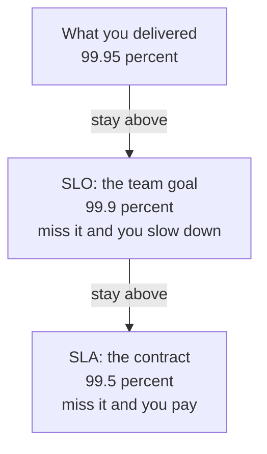

<details class="guess"><summary>🤔 Guess: the SLO is 99.9% and the SLA is also 99.9%. What goes wrong? Press to check.</summary>

The **first alarm is also the first bill.** You have no room between "we should slow down" and "we pay". Make the SLO stricter than the SLA.

</details>

> **Remember:** the budget turns "developers want speed, operators want safety" into one shared number.

<details class="more"><summary>📖 More detail: what to do with the budget, the goal and the contract, the SLA, and the costs</summary>

**What do I do with the budget?** This is story 3 of the stepper. Notice that the answer comes from one number, not from an argument.

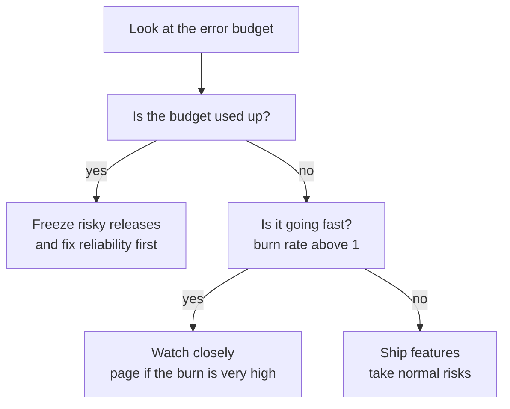

**The goal and the contract.** You should break your own goal long before you break the contract. Notice the order: real result, then goal, then contract.

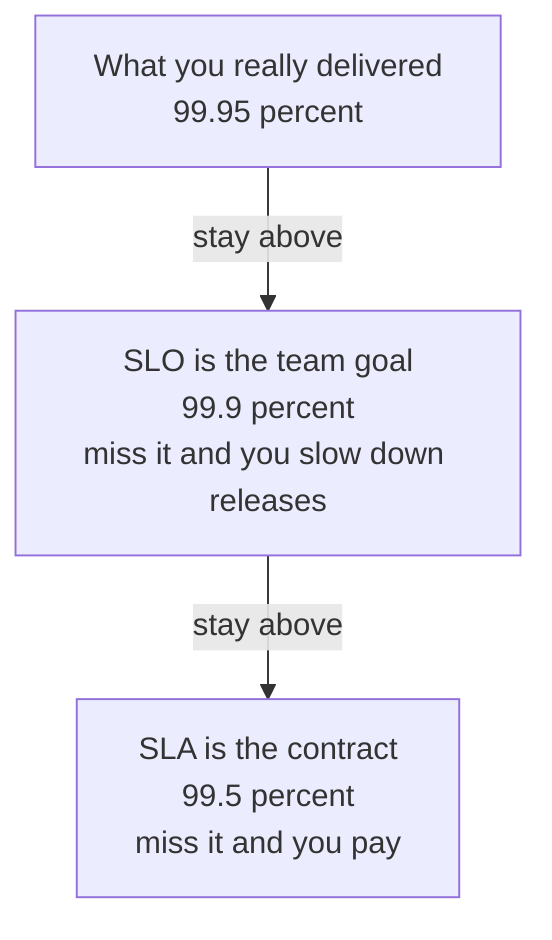

**The error budget is permission to ship.**

- Budget left? Ship features and take normal risks.
- Budget gone? Pause risky releases and fix reliability. Google calls the written rule an error budget policy.
- This turns "developers want speed, operators want safety" into one shared number.

The policy is agreed before the bad day. Then nobody argues about it during the bad day.

**SLI, SLO and SLA are not the same thing.**

An SLA is a contract. For example, the AWS EC2 region SLA commits to 99.99% a month. If AWS misses it, you get service credits: 10% back below 99.99%, 30% below 99.0%, and 100% below 95.0%. That is the "penalty" in the definition. Your SLO should be stricter than the SLA you promise, so your own alarm rings first.

**What it costs.**

| Cost | What it means | What you do |
|---|---|---|
| Measuring takes work | You need counts and timings from real requests | Start with 1 to 3 SLIs on the paths users care about most |
| Each extra nine costs more | More copies, automatic recovery, on call people | Ask what an hour of downtime costs, then pick |
| A strict SLO slows shipping | A small budget leaves little room for risk | Choose a number users notice, not a nice looking number |
| A loose SLO hides pain | 99% allows 7.2 hours of failure a month | Compare the SLO with what users complain about |
| Low traffic is noisy | With 100 requests a day, one failure is 1% | Use a longer window |
| Big problems page fast, small ones slowly | See the table above | Keep the ticket rows for slow leaks |

**Why it exists and what it costs.**

- **Problem without it:** "always up" is not a goal. 100% means you can never change anything (card 1). And alerts on CPU wake people for nothing and miss real pain (card 6).
- **How it solves it:** you choose a number that users would accept. The part left over is a budget you may spend on changes and risk (card 5). You alert when the budget goes fast (card 4).
- **Cost or tradeoff:** you must measure real user requests, and each extra nine costs far more than the one before it.

</details>

## 6. Five mistakes, and what to say if you freeze

- **Wrong:** "Our SLO is 100% uptime." **Right:** 99.9% of checkouts succeed in under 1 second, over 30 days.
- **Wrong:** "Page me when CPU is above 90%." **Right:** page when the budget burns fast, on two windows.
- **Wrong:** one window for the pager. **Right:** both windows must agree.
- **Wrong:** "The average response time is 200 ms, so users are happy." **Right:** "99% of requests are faster than 300 ms."
- **Wrong:** "SLA and SLO are the same." **Right:** the SLO is the goal, the SLA is the looser contract.

<details class="guess"><summary>🤔 Guess: a nightly job pushes CPU above 90% while users are fine. Later a bad deploy returns errors with CPU at 40%. What does an alert on CPU do with each? Press to check.</summary>

It **pages at 3 a.m. for nothing**, and **does not page for the bad deploy**, so users are hurt for an hour. An alert on how fast the budget is spent stays quiet for the job and pages after 18 minutes for the deploy.

</details>

> **Remember:** if you freeze, say "The SLO is the goal. While there is budget, we ship. When it is gone, we fix reliability. I page on burn rate, not on CPU."

<details class="more"><summary>📖 More detail: CPU against burn rate drawn, the five mistakes in full, and the freeze plan</summary>

**Right against wrong.** Both alerts watch the same two events: a nightly job that uses CPU, and a bad deploy that returns errors. Notice what each alert does with them.

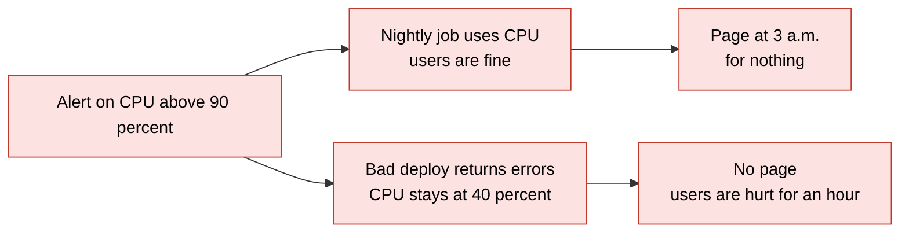

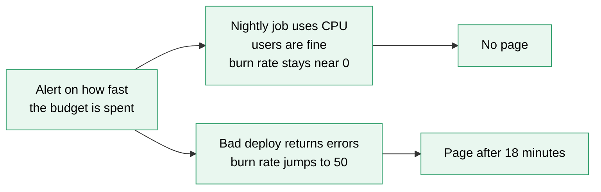

**Wrong:**

```
"Our SLO is 100% uptime."
```

**Right:**

```
"99.9% of checkouts succeed in under 1 second, over 30 days.
 That leaves 43.2 minutes of budget a month for deploys and bad days."
```

**Why:** 100% leaves no room to change anything, and nobody can reach it.

**Wrong:**

```
"Page me when CPU is above 90%."
```

**Right:**

```
"Page me when the error budget burns faster than 14.4 over 1 hour and over 5 minutes.
 Keep CPU on a dashboard to find the cause."
```

**Why:** CPU is a cause. A high CPU with happy users wastes a night. A normal CPU with failing checkouts wastes an hour of user pain (card 6). Practice B fixes a pager rule in code.

**Wrong:**

```js
if (avg(t, 5) / BUDGET > 14.4) page();      // one window only
```

**Right:**

```js
if (avg(t, 60) / BUDGET > 14.4 && avg(t, 5) / BUDGET > 14.4) page();   // both windows must agree
```

**Why:** one bad minute should not wake a person. The long window proves it is real. The short window proves it is still going.

**Wrong:**

```
"The average response time is 200 ms, so users are happy."
```

**Right:**

```
"99% of requests are faster than 300 ms."
```

**Why:** an average hides the slow users. A share, or a percentile, shows them.

**Wrong:**

```
"SLA and SLO are the same. Both are 99.9%."
```

**Right:**

```
"The SLO is our goal, 99.9%. The SLA is the contract, 99.5%, with money back.
 We want to miss our own goal long before we miss the contract."
```

**Why:** the SLA has a penalty. If the goal equals the contract, the first alarm is also the first bill.

**If you freeze:**

1. Say "The SLO is the goal, for example 99.9% of checkouts succeed over 30 days. That leaves 43 minutes of error budget a month."
2. Say "While there is budget, we ship. When it is gone, we fix reliability."
3. Say "I page when the budget burns fast, on two windows. I do not page on CPU."

</details>

## 7. Watch and play

Links were opened with a page fetch tool on 2026-10-17. For the video I read the title, channel and length from the video page. I did not watch it. If a link is broken, tell me and I will replace it.

- **Video:** [SLIs, SLOs, SLAs, oh my! (class SRE implements DevOps)](https://www.youtube.com/watch?v=tEylFyxbDLE) - Google Cloud Tech, about 8 minutes. Watch for the three words and compare them with the big picture in card 1.
- **Play with it:** [the stepper in this folder](visuals/26-slos-and-error-budgets.html) - guess first, then press Next. Try all three tabs.
- **Play with it:** [uptime.is](https://uptime.is/) - type 99.9 and see the allowed downtime per day, week, month and year. It uses an average month of about 30.4 days, so it shows 43m 50s, not 43.2 minutes.
- **Play with it:** [SLO and error budget calculator](https://architecto.dev/en/free-tools/slo-error-budget-calculator) - set 99.9% and 30 days. It shows the 43.2 minute budget and the number of bad requests. It also suggests alert levels.
- **Read:** [Google SRE Workbook: Alerting on SLOs](https://sre.google/workbook/alerting-on-slos/) - find Table 5-8 with 14.4, 6 and 1. Compare it with the burn rate table in card 4.
- **Read:** [Google SRE book: Service Level Objectives](https://sre.google/sre-book/service-level-objectives/) - the plain definitions of SLI, SLO and SLA, and the idea of an error budget.
- **Read:** [AWS EC2 service level agreement](https://aws.amazon.com/compute/sla/) - a real SLA. Find the service credit table.

<details><summary>Go deeper (optional)</summary>

**Where the alert numbers come from.** The Google SRE Workbook, chapter "Alerting on SLOs" (opened 2026-10-17), gives Table 5-8 for a 99.9% SLO: page at burn rate 14.4 (1 hour and 5 minutes, 2% of budget), page at 6 (6 hours and 30 minutes, 5%), ticket at 1 (3 days and 6 hours, 10%). It defines burn rate as "how fast, relative to the SLO, the service consumes the error budget". It says a burn rate of 1 consumes the budget so that you have exactly 0 left at the end of the period. It suggests a short window of about one twelfth of the long window. Its table of burn rate 1000 with 100% errors shows the budget gone in 43 minutes.

**The SLI formula.** The SRE Workbook chapter [Implementing SLOs](https://sre.google/workbook/implementing-slos/) (opened 2026-10-17) says to treat an SLI as the number of good events divided by the total number of events. Its two common SLIs are availability (the share of requests that got a successful response) and latency (the share of requests faster than a threshold). It also describes an error budget policy: what to do when you run out, for example pause risky releases until reliability recovers.

**Counting requests, not minutes.** "43.2 minutes" is a simple way to say it. A minute where 1% of requests fail is not a lost minute. Real SLOs count bad requests, as in card 2: 43,200 bad requests out of 43.2 million. The two views agree when failures are total outages. They differ when failures are partial.

**Rolling window or calendar month.** A rolling window of 30 days always looks back 30 days. A calendar month resets on day 1. A rolling window avoids a cliff on the first of the month. A calendar month is easier to report. Pick one and write it down.

**Do not average percentiles.** The average of two servers' p99 values is not the p99 of all requests. Collect counts of requests below each threshold, and add them up, then compute the share.

**Why two windows and not one longer window.** One long window is slow to start and slow to stop. One short window is fast but noisy. The pair gives a trustworthy start and a quick stop. You saw both in the minute 5 and minute 26 rows of the trace.

**AWS numbers.** The [EC2 SLA page](https://aws.amazon.com/compute/sla/) (opened 2026-10-17) says the region level commitment is at least 99.99% Monthly Uptime Percentage when instances run across two or more Availability Zones. Credits: 10% when below 99.99% and at or above 99.0%, 30% below 99.0% and at or above 95.0%, and 100% below 95.0%. Read the page for the exact conditions. An SLA usually has exclusions and a claim process.

**Other tools to try later.** [Another calculator, InventiveHQ](https://inventivehq.com/tools/uptime-calculator), came up in a search. Its page gave an access error when I tried to open it on 2026-10-17, so I did not use it.

**Where this meets lesson 23 and the deploy lessons.** Timeouts, retries and circuit breakers (lesson [23](23-timeouts-retries-and-circuit-breakers.md)) help you keep the SLI high. Safe deploys (lesson [27](27-safe-deploys.md)) are how you spend the budget on purpose: a canary limits how many users a bad release can touch.

</details>

## 8. Practice

**A. Predict the output** (write your answer before opening)

```js
const slo = 0.99;                              // 99 percent
const errorRate = 0.02;                        // 2 percent of requests fail, all month long
const burn = errorRate / (1 - slo);
console.log("burn", burn.toFixed(1), "budget lasts", (30 / burn).toFixed(1), "days");
```

Then answer: if nothing changes, what should the team do on day 15?

<details><summary>Answer</summary>

```
burn 2.0 budget lasts 15.0 days
```

The error rate (2%) is twice the allowed rate (1%), so the burn rate is 2 and the budget lasts half the month. On day 15 the budget is gone with 15 days still to go. The policy says to pause risky releases and fix the cause. Better: a slow burn like this should already have raised a ticket in the first days (burn rate above 1). (Checked on 2026-10-17 with Node 24.)

</details>

**B. Fix the bug**

This pager rule pages on one bad minute. At minute 10, 10 percent of requests fail for one minute only (100 bad requests, about 0.23% of the budget). Run it in your head: how many pages do you get? Then fix it.

```js
const BUDGET = 0.001;
const rate = (t) => (t === 10 ? 0.1 : 0);      // one bad minute: 10 percent of requests fail at minute 10, nothing else
const avg = (t, n) => { let s = 0; for (let i = t - n + 1; i <= t; i++) s += rate(i); return s / n; };
for (let t = 8; t <= 15; t++) {
  if (avg(t, 5) / BUDGET > 14.4) console.log("minute", t, "PAGE");    // only the short window is checked
}
```

<details><summary>Answer</summary>

It prints 5 pages, for minutes 10 to 14:

```
minute 10 PAGE
minute 11 PAGE
minute 12 PAGE
minute 13 PAGE
minute 14 PAGE
```

The 5 minute window holds the one bad minute for 5 minutes, and its error rate is 2%, a burn rate of 20. A person is woken up five times for a blip that cost 0.23% of the budget.

Fix: also check the long window. Over 60 minutes the same blip is only 0.17% errors, a burn rate of about 1.7, so there is no page.

```js
for (let t = 8; t <= 15; t++) {
  if (avg(t, 60) / BUDGET > 14.4 && avg(t, 5) / BUDGET > 14.4) console.log("minute", t, "PAGE");   // both windows must agree
}
```

This prints nothing. (Checked on 2026-10-17 with Node 24.)

</details>

**C. Write it yourself**

Open `learn/system-design/practice/26-slos-and-error-budgets.js`. It has five empty functions: `downtimeMinutes`, `burnRate`, `daysToEmpty`, `budgetLeft` and `shouldPage`. Write them, then run this from the repo root and make all the tests pass:

```
node --test learn/system-design/practice/26-slos-and-error-budgets.test.js
```

The last test replays the bad deploy from card 4 and checks that the page starts at minute 18 and clears at minute 26.

<details><summary>One possible answer</summary>

```js
function downtimeMinutes(slo, days = 30) {
  return (1 - slo) * days * 24 * 60;              // the budget share times the minutes in the period
}

function burnRate(errorRate, slo) {
  return errorRate / (1 - slo);                   // 1 means the budget lasts exactly the whole period
}

function daysToEmpty(errorRate, slo, days = 30) {
  if (errorRate === 0) return Infinity;           // nothing is spent, so it never empties
  return days / burnRate(errorRate, slo);
}

function budgetLeft(slo, totalRequests, badRequests) {
  if (totalRequests === 0) return 1;              // no traffic, nothing spent
  const allowedBad = totalRequests * (1 - slo);   // the budget, counted in requests
  return 1 - badRequests / allowedBad;            // below 0 means overspent
}

function shouldPage({ slo, longRate, shortRate, threshold = 14.4 }) {
  return burnRate(longRate, slo) > threshold && burnRate(shortRate, slo) > threshold;   // both windows must agree
}

module.exports = { downtimeMinutes, burnRate, daysToEmpty, budgetLeft, shouldPage };
```

Checked on 2026-10-17 with Node 24: the 18 tests fail on the empty stub and all 18 pass with this answer. The tests use a small tolerance, because 1 - 0.999 is not exactly 0.001 in floating point numbers.

</details>

## 9. Interview question

**Q:** "What is the difference between an SLI, an SLO and an SLA? How would you use an error budget, and what would you alert on?"

A common follow-up: "Would you page on CPU at 90%?" Card 6 is the answer.

<details><summary>A strong answer, in four parts</summary>

1. **Problem:** "Always up" is not a goal. 100% means you can never change anything, and each extra nine costs much more. Alerts on causes like CPU wake people when users are fine.
2. **How it works:** I pick an SLI from what users feel, for example the share of checkouts that succeed in under 1 second. The SLO is the goal for it, 99.9% over 30 days. The error budget is the rest: 0.1%, about 43 minutes a month. The SLA is a looser promise in a contract, with money back. While there is budget, we ship. When it is gone, we pause risky releases and fix reliability. I alert on burn rate with two windows: for example 14.4 over 1 hour and over 5 minutes means 2% of the month's budget is gone in an hour.
3. **Tradeoff:** I must measure real user requests. A stricter SLO costs more and slows shipping. A looser SLO hides pain. Big problems page in minutes, but a small steady leak pages slowly, so I add a ticket for a burn rate of 1 over 3 days. With low traffic the numbers are noisy, so I use longer windows.
4. **My example:**
   - **Fact:** my DBO case study calls point redemption a "money-like flow" and tells the incident where duplicate TADA events gave stores double points.
   - **Fact:** the case study lists observability as an upgrade to consider. It says to "alert on symptoms (error rate, queue age), not causes". It is a suggestion. It does not say DBO has SLOs or burn rate alerts.
   - **Idea, not a fact:** for DBO I would choose the SLI "share of buy and redeem requests that succeed in under 2 seconds", an SLO of 99.9% over 30 days, a ticket when the queue's oldest job is older than a set time (lesson [06](06-message-queues.md)), and a page on fast burn. I should not say DBO already has this.

</details>

## 10. Explain it back

Close this file. Explain SLOs and error budgets out loud like to a new junior, in 4 parts (problem, how, tradeoff, my example). Use the story of the bad deploy: 5 percent of requests fail, the page comes at minute 18, and it clears at minute 26. Then write your best version below and run `/explain-check slos and error budgets` or ask the `explain-coach` agent to review it.

### My explanation

<write here>

### Coach feedback

<the explain-coach agent writes here>

## 11. Review questions (day 1, 3, 7, 21)

1. A service has an SLO of 99.9% over 30 days. How many minutes may it fail? What about 99.99%? What is the error budget for?
2. Say the difference between an SLO and an SLA. Which one is stricter, and why?
3. A bad deploy makes 5% of requests fail. Why does the page come at minute 18 and not at minute 1? Why does it clear soon after the fix?
4. Draw the bad deploy over time (card 4, blue bar) from memory.

<details><summary>Answers</summary>

1. 43.2 minutes for 99.9%, and 4.32 minutes for 99.99%. The error budget is the failure you may still afford. While it lasts, you ship and take normal risks. When it is gone, you pause risky releases and fix reliability.
2. The SLO is your own goal. The SLA is a promise to a customer with a penalty, usually money back. The SLO is stricter, so your own alarm rings long before you owe money.
3. The rule needs two windows above 14.4. The short window (5 minutes) is above it at minute 5, but the long window (60 minutes) needs until minute 18 to reach 14.4. That stops a one minute blip from paging. After the fix, the short window falls below the line at minute 26, so the page clears even though the long window still remembers the hour.
4. Deploy, Service, Monitor, On call person, left to right. The new version goes live. 5 percent of requests fail. The monitor sees both windows above 14.4 at minute 18 and pages. The person rolls back at minute 22. Errors stop. At minute 26 the 5 minute burn rate falls to 10 and the page clears. 2.55 percent of the month's budget is spent.

</details>

## Connected lessons

- [Multi-tenancy](25-multi-tenancy.md) - the lesson before. One tenant's bad day can eat the shared budget, so some teams keep one SLI per tenant tier.
- [Safe deploys](27-safe-deploys.md) - the next lesson. Deploys are the biggest way to spend the budget. A canary limits the damage of one bad release.
- [Disaster recovery](28-disaster-recovery.md) - RPO and RTO are the same kind of promise, for the day things go badly wrong.
- [Observability](14-observability.md) - logs, metrics and traces are where the SLI numbers come from.
- [Latency numbers and estimation](16-latency-numbers-and-estimation.md) - how slow each hop is, which shapes the latency SLI.
- [Timeouts, retries and circuit breakers](23-timeouts-retries-and-circuit-breakers.md) - tools to keep the SLI up when a helper fails.
- [Message queues](06-message-queues.md) - the age of the oldest job is a good SLI for background work.
- [Production readiness: observability, deploys, security and cost](production-readiness-observability-security.md) and its [visual cheatsheet](production-readiness-observability-security-cheatsheet.html) - Part 4 is the deeper guide on SLI, SLO, SLA and burn rate alerts.
- [System design interview questions](senior-system-design-interview-questions.md) - question 51 asks this lesson: how do you decide how reliable a service must be?
