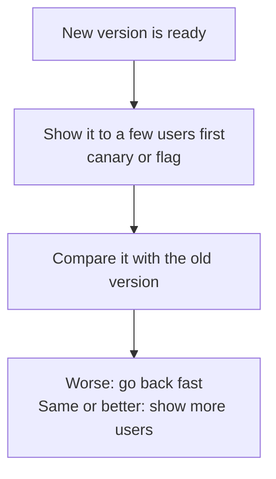
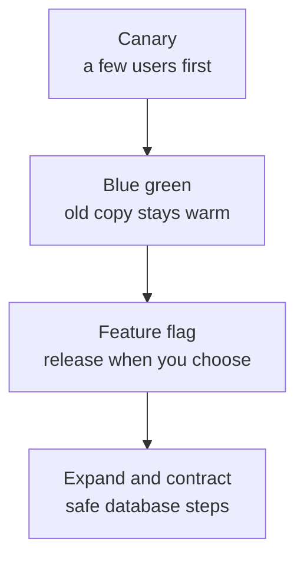
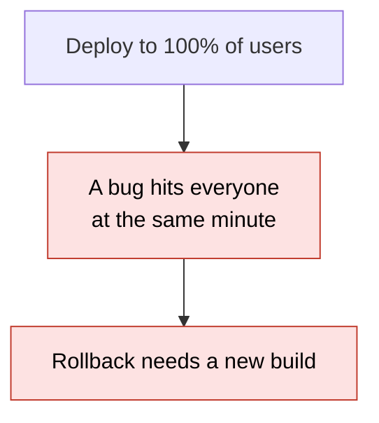
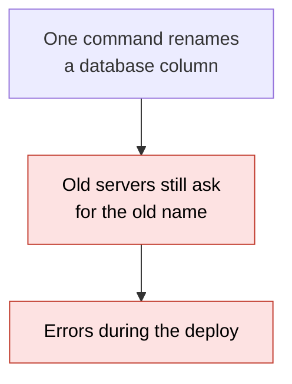
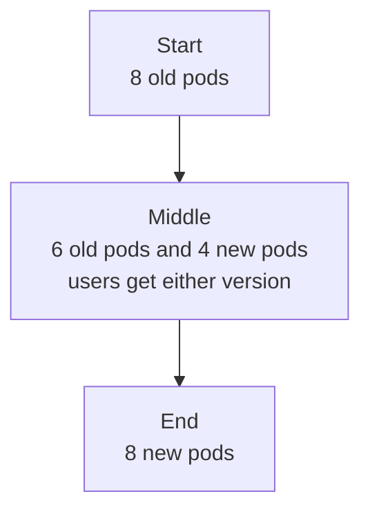
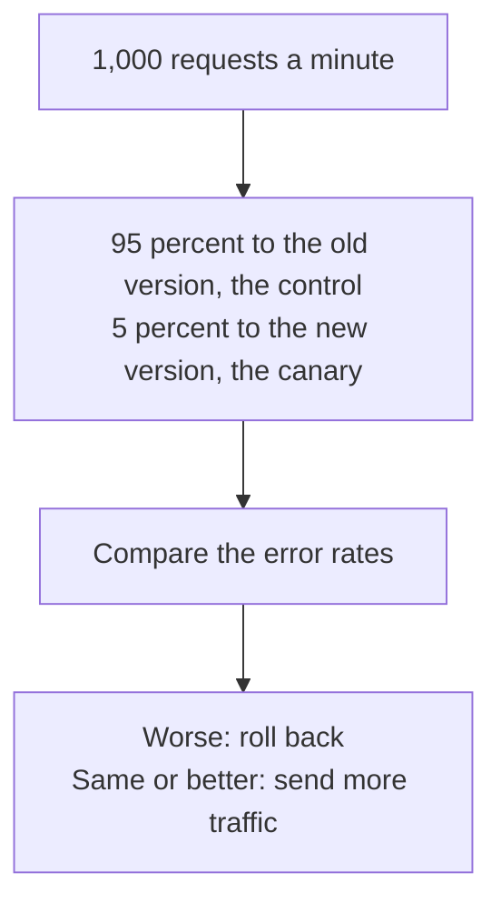
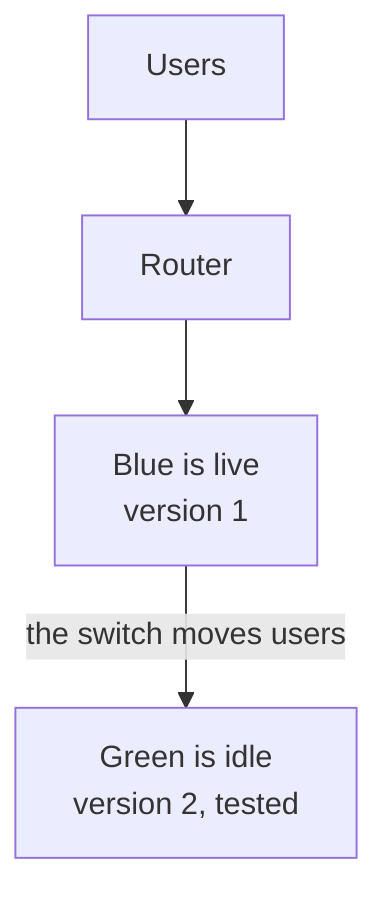
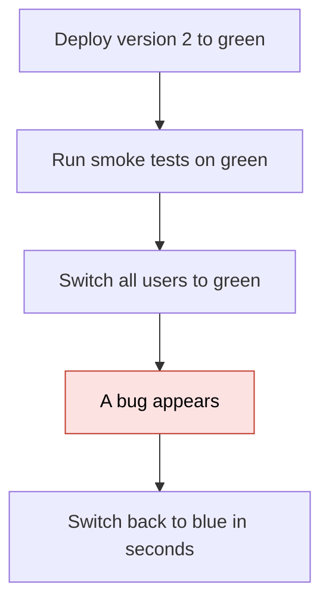
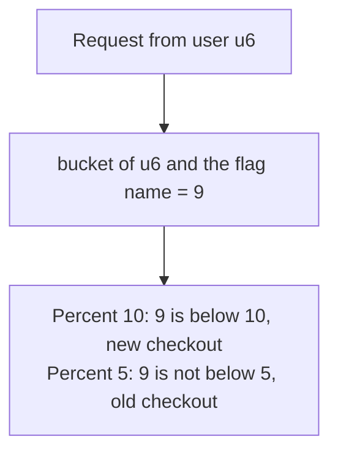
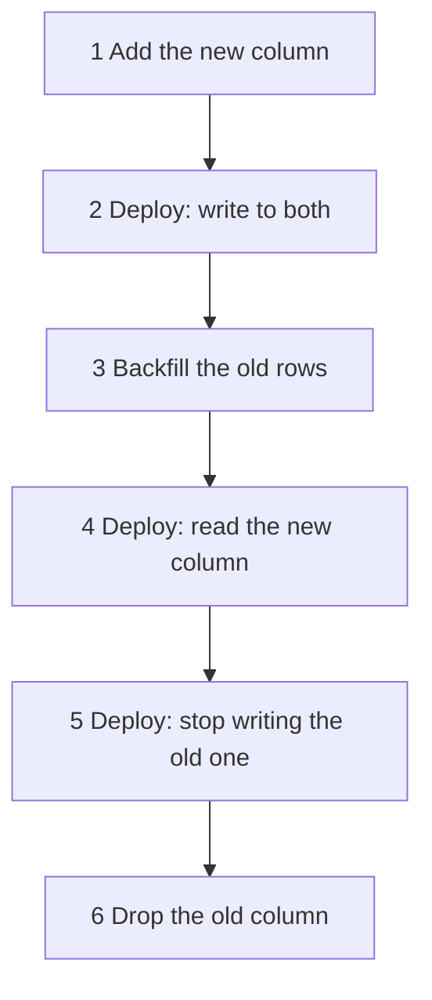

# 27. Safe deploys

> **Subject:** System Design · **Lesson:** 27 · **Made:** 2026-11-05 · **Status:** ready
>
> **You will be able to:** say why a deploy is risky, pick between a rolling update, a canary, blue green and a feature flag, explain why a canary is judged against a control, and change a database column name without breaking the servers that are still running the old code.
>
> **Before this:** [SLOs and error budgets](26-slos-and-error-budgets.md) · **Next:** [Disaster recovery](28-disaster-recovery.md)
>
> **How to read it:** one card is one idea. Look at the picture, guess, then press the orange bar to check. The blue bars (📖 More detail) hold the longer explanation. Skip them on the first read, and open them when you want more. About 15 minutes for the cards.

## 1. The idea: never show a new version to everybody at once

A deploy is the moment you change a working system, so it is the moment most things break. Safe deploys do two things: they show the new version to **few users first**, and they keep a **fast way back**. A restaurant shows the idea. The chef does not change the whole menu on Friday night. She puts one new dish on three tables, watches the plates come back, then decides.



<details class="guess"><summary>🤔 Guess: a new version fails 20% of the requests it gets, at 1,000 requests a minute. You show it to everybody and the pager rings 5 minutes later. How many requests failed? Press to check.</summary>

**1,000.** 1,000 requests times 20% is 200 failed requests every minute, for 5 minutes. A 5% canary stops the same bug after about 40 failed requests (card 3).

</details>

> **Remember:** a safe deploy limits how many users one bad release can touch, and keeps a fast way back.

<details class="more"><summary>📖 More detail: new words, the big picture, and the problem drawn</summary>

New words (five):

- **Rolling update:** replace the old servers with new ones a few at a time. It is the default in Kubernetes.
- **Canary:** send a small share of traffic to the new version first and compare it with the old one. The name comes from the canary in the coal mine.
- **Blue green:** run two full copies of the system. One serves users, the other waits with the new version. A switch moves all users.
- **Feature flag:** an if in the code that you can turn on or off without a deploy. It separates **deploying** (the code is on the servers) from **releasing** (users can use it).
- **Expand and contract:** change a database in small steps that each work with the old and the new code (interview words: parallel change).

Two plain ideas:

- **Blast radius** is how many users one bad release can touch.
- **Control** is the group that keeps the old version while the canary runs. You compare the two.

**The big picture.** Notice that each tool answers a different worry.

| Worry | Tool |
|---|---|
| A bug hits every user at once | **Canary:** a few users first |
| Rollback is slow | **Blue green:** the old copy stays warm |
| Code and release are tied together | **Feature flag:** deploy now, release later |
| The database change breaks old code | **Expand and contract:** small safe steps |



**The problem, drawn.** Two things go wrong when a team ships to everybody at once. Notice the first picture is about code and the second is about the database.





**The restaurant in full.** The chef (you) wants a new dish (the release).

- **Canary:** three tables get the dish. The other tables get the old menu, and they are the control.
- **Blue green:** a second kitchen cooks the new menu. When ready, the waiters switch to it. If it goes wrong, they switch back.
- **Feature flag:** the dish is already on the menu card, but the waiters only offer it when the manager says so. Turning it off needs no reprint.
- **Expand and contract:** change the supplier of an ingredient: order from both, move the recipes, then cancel the old supplier.

Where the analogy stops: a diner can tell you the dish is bad. A web user who gets an error mostly just leaves, so you must measure, as in lesson [26](26-slos-and-error-budgets.md).

</details>

## 2. Rolling update, and why two versions always overlap

A **rolling update** replaces servers a few at a time. It is simple and needs no extra copy of the system. In Kubernetes the defaults are `maxUnavailable: 25%` and `maxSurge: 25%`, so at least 75% of the wanted pods stay up, and at most 125% run during the update (Kubernetes docs, checked 2026-11-05). The catch is that **for a while, old and new servers run together**. Everything you ship must work with both.

<details class="guess"><summary>🤔 Guess: during a rolling update of 8 pods with the default settings, what is the most pods you can have at one moment? Press to check.</summary>

**10.** maxSurge is 25% of 8 = 2 extra pods (the number is rounded up). Old and new pods answer the same users at the same time.

</details>

> **Remember:** a rolling update is not instant. Old and new code run side by side, against the same database.

<details class="more"><summary>📖 More detail: the overlap drawn, the Kubernetes numbers, and what to do</summary>

**The overlap.** Notice that users can get either version in the middle of the update.



**The Kubernetes numbers.** From the [Deployment docs](https://kubernetes.io/docs/concepts/workloads/controllers/deployment/) (checked 2026-11-05):

| Setting | Default | Meaning |
|---|---|---|
| `maxUnavailable` | 25% (rounded down) | How many pods may be missing during the update |
| `maxSurge` | 25% (rounded up) | How many extra pods may be created |
| `progressDeadlineSeconds` | 600 | Seconds to wait before the update is reported as stuck |
| `kubectl rollout undo` | | Goes back to the previous revision. It makes a new revision, it does not erase history |

**What a rolling update does not give you.** It does not compare the new version with the old one. If the new pods start and pass their health check, the update goes on, even when 20% of the requests fail. Health checks answer "is the process alive". A canary answers "is the new version worse".

**What to do about the overlap.** Make every change work for both versions at once: new code must tolerate old data, old code must tolerate new data. For the database, this is expand and contract (card 5). For an API, add fields, do not rename them.

**The DBO case study** (suggestion, not fact): the case study says to add health check endpoints so Docker Swarm deploys are rolling, "start new, check healthy, stop old". It is a suggestion in the document, I did not check what DBO runs today.

</details>

## 3. Canary: a few users first, judged against a control

A **canary** sends a small share of traffic, for example 5%, to the new version. The rest is the **control**. You compare the two groups: the canary is bad when its error rate is higher than the control's by more than a small margin. You must also **wait for enough requests**, because 10 requests prove nothing.



<details class="guess"><summary>🤔 Guess: a canary of 1% instead of 5%. Does it fail less before you can decide? Press to check.</summary>

**No, it waits longer.** The check needs 200 canary requests. At 5% that takes 4 minutes. At 1% it takes 20 minutes. Both stop at about 40 failed requests (200 times 20%). A real run is in the blue bar. (Run on Node 26.12.1.)

</details>

> **Remember:** judge the canary against the control, not against zero, and wait for enough requests.

<details class="more"><summary>📖 More detail: the code, the real output, why a control, and what the Google book says</summary>

**The smallest code that shows it.** 1,000 requests a minute. The new version fails 20% of what it gets. The old version fails 1 in 1,000. The check rolls back when the canary error rate is more than 1 percentage point above the control's, after at least 200 canary requests.

```js
function canaryVerdict({ canary, control, minRequests = 200, maxExtra = 0.01 }) {
  if (canary.requests < minRequests) return "wait";                 // too few requests to say anything
  const canaryRate = canary.errors / canary.requests;
  const controlRate = control.requests === 0 ? 0 : control.errors / control.requests;
  return canaryRate > controlRate + maxExtra ? "rollback" : "promote";
}

function run(percent) {
  const canary = { requests: 0, errors: 0 }, control = { requests: 0, errors: 0 };
  for (let minute = 1; minute <= 60; minute++) {
    const c = 1000 * percent / 100;                                  // canary requests this minute
    canary.requests += c;  canary.errors += c * 0.2;                 // the new version fails 20 percent
    control.requests += 1000 - c;  control.errors += (1000 - c) * 0.001;
    const v = canaryVerdict({ canary, control });
    if (v !== "wait") return { percent, verdict: v, minute, failed: canary.errors };
  }
}
for (const p of [1, 5, 25, 100]) console.log(run(p));
```

**Output:**

```
{ percent: 1, verdict: 'rollback', minute: 20, failed: 40 }
{ percent: 5, verdict: 'rollback', minute: 4, failed: 40 }
{ percent: 25, verdict: 'rollback', minute: 1, failed: 50 }
{ percent: 100, verdict: 'rollback', minute: 1, failed: 200 }
```

Checked on 2026-11-05 with Node 26.12.1.

Look at the lines. A smaller canary does not give fewer failures at the verdict, it gives a **later** verdict. A bigger canary gives a fast verdict and more users touched. The 100% line is not a canary: everybody gets the bug. For comparison, the pager rule from lesson 26 (both windows above 14.4) would ring at minute 5 for a 20% error rate, after about 1,000 failed requests.

**Why a control, and not a fixed number.** A helper service goes down and both groups get 5% errors. A check "canary above 1% means roll back" blames the new release for a problem it did not cause. Comparing with the control at the same time says "promote": the new version is no worse. Practice B shows this bug.

**What the Google SRE Workbook says** ([Canarying releases](https://sre.google/workbook/canarying-releases/), opened 2026-11-05):

- A canary is "a partial and time-limited deployment of a change in a service and its evaluation". The part that gets the change is the canary, the rest is the control.
- Its worked example uses a 5% canary. It gives no fixed share or duration to copy.
- The canary must be large enough and last long enough to be representative. A handful of requests is not a signal.
- Break the metrics down by version. In a whole service total, the canary's errors are diluted.
- Run one canary at a time. A canary outside peak hours may miss a bug that appears only under load.

**What it costs.** You need traffic splitting (a gateway, a service mesh, or a tool such as [Argo Rollouts](https://argo-rollouts.readthedocs.io/en/stable/), a Kubernetes controller for canary and blue green), per version metrics, and a rule for the verdict. A small service with 20 requests a minute cannot get 200 canary requests quickly. Use a longer window or a flag.

</details>

## 4. Blue green: a second copy, a switch, and a fast way back

**Blue green** keeps two full copies. Blue serves users with version 1. You put version 2 on green, test it with no user on it, then switch the router. If version 2 is bad, you switch back. The old version never stopped running, so the way back takes seconds. The price: two copies to pay for, and **all users switch at once**.



<details class="guess"><summary>🤔 Guess: version 2 is live on green with a bug that fails 20% of requests. You notice after 3 minutes. How many requests failed, and how long is the rollback? Press to check.</summary>

**600 failed requests** (3 minutes times 200). The rollback is one change at the router, **seconds**, because blue still runs version 1. With a 5% canary the same bug would have cost about 40.

</details>

> **Remember:** blue green gives a fast way back and a test on the real setup, but it switches everyone at once and needs two full copies.

<details class="more"><summary>📖 More detail: the code, the sequence, what the database does, and cost</summary>

**The order of events.** Notice that the test happens before any user is on green.



**The code from the practice:**

```js
function createBlueGreen() {
  const colors = { blue: "v1", green: null };
  let live = "blue";
  const idle = () => (live === "blue" ? "green" : "blue");
  return {
    live: () => colors[live],
    idle: () => colors[idle()],
    deploy(version) { colors[idle()] = version; },     // the new version goes to the side with no users
    switch() {
      if (colors[idle()] === null) throw new Error("nothing is deployed on the idle side");
      live = idle();                                    // one change, all users move at once
      return colors[live];
    },
    rollback() { return this.switch(); }                // the old version is still on the other side
  };
}
```

**The database is shared.** Both sides use one database. If version 2 needs a changed table, version 1 must still work with it, or the rollback will fail. Martin Fowler's [blue green page](https://martinfowler.com/bliki/BlueGreenDeployment.html) (opened 2026-11-05) says the hard part is the schema, and suggests separating the schema change from the app upgrade: first a schema change that supports both versions, then the new app, and only when stable remove the old support. That is expand and contract (card 6).

**Blue green and canary together.** Put version 2 on green, send 5% of users to green, watch, then switch. You get both the test environment and the small first step.

| Cost | What it means | What you do |
|---|---|---|
| Two full copies | You pay double while both run | Scale the idle side down after the release, or use it for the next one |
| Everyone switches at once | A bug the tests missed hits all users | Add a canary step before the switch |
| Warm up | The new side has cold caches | Send test traffic to it first |
| In flight work | Jobs and sessions on blue when you switch | Drain blue before you stop it, and keep session data outside the servers |

</details>

## 5. Feature flags: deploy now, release later

A **feature flag** is an if in the code that you can change without a deploy. You ship the code with the flag off (a "dark launch"), then turn it on for 10% of users, then 50%, then everybody. A bug? Flip the **kill switch**, and the old behavior is back in seconds. To keep a user's experience steady, choose users by a **bucket**: a number from 0 to 99 made from a hash of the flag name and the user id. The same user always gets the same bucket.



<details class="guess"><summary>🤔 Guess: a flag goes from 10% to 50% of 10,000 users. How many users who had the feature lose it? Press to check.</summary>

**0.** At 10%, 975 users were in. At 50%, 4,967 are in, and all 975 are still in, because a bucket below 10 is also below 50. If the code chose randomly on every request, the same user would flip between old and new pages. (Real run, Node 26.12.1.)

</details>

> **Remember:** a flag separates deploying from releasing. Use a stable bucket, keep a kill switch, and remove the flag when done.

<details class="more"><summary>📖 More detail: the code, the real output, kinds of flags, and the cost</summary>

**The code from the practice:**

```js
function bucket(userId, flagName) {
  let h = 2166136261;                                   // FNV-1a, a small hash: same text, same number
  for (const ch of flagName + ":" + userId) {
    h ^= ch.charCodeAt(0);
    h = Math.imul(h, 16777619) >>> 0;
  }
  return h % 100;                                       // a number from 0 to 99
}

function isOn(flag, userId) {
  if (flag.off) return false;                           // the kill switch beats everything
  return bucket(userId, flag.name) < flag.percent;
}

let on10 = 0, on50 = 0, lost = 0;
for (let i = 1; i <= 10000; i++) {
  const a = isOn({ name: "new-checkout", percent: 10 }, "user" + i);
  const b = isOn({ name: "new-checkout", percent: 50 }, "user" + i);
  if (a) on10++;
  if (b) on50++;
  if (a && !b) lost++;
}
console.log(on10, on50, lost);
```

**Output:**

```
975 4967 0
```

Checked on 2026-11-05 with Node 26.12.1. The hash includes the flag name, so two flags put different users in the 10%. In my check, 107 of 10,000 users were in the first 10% of two flags at once (about 100 expected).

**Kinds of flags.** From Martin Fowler's [Feature Toggles](https://martinfowler.com/articles/feature-toggles.html) article (opened 2026-11-05):

| Kind | Lives | Decided |
|---|---|---|
| Release flag | A week or two | At deploy time, mostly static |
| Experiment flag | Hours to weeks | Per request, per user |
| Ops flag (kill switch) | Short, a few for years | Changed fast by an operator |
| Permission flag | Can be years (a paid feature) | Per request, per user |

**What it costs.**

| Cost | What it means | What you do |
|---|---|---|
| Two code paths | Both must be tested | Test with the flag on and off |
| Old flags pile up | Each one is a hidden version of the app | Write the removal task on the day you add the flag, and set an expiry date |
| A flag service can fail | A flag check that cannot read its value | Choose a safe default on error, usually the old behavior |
| A flag does not protect the database | A new column is still a deploy | Use expand and contract |

**Flag or canary?** A canary protects against a bad **build** (the whole new version is judged by metrics). A flag protects against a bad **feature** (you choose who sees it, and you can switch it off alone). Many teams use both.

</details>

## 6. Expand and contract: change the database in steps that always work

The database is shared by old and new servers, so a change that breaks the old code breaks the deploy. **Expand and contract** has three parts: **expand** (add the new thing, keep the old), **migrate** (move the code and the data), **contract** (remove the old thing). For a rename it takes six small steps instead of one command. In my test on Postgres 18.3, one `ALTER TABLE ... RENAME COLUMN` made the old version fail with `column "full_name" of relation "people" does not exist`.



<details class="guess"><summary>🤔 Guess: an ALTER TABLE has to wait for a long running transaction. A simple SELECT on the same table arrives after the ALTER. Does the SELECT run? Press to check.</summary>

**No, it waits too.** ALTER TABLE needs an exclusive lock and stands in line. Every later query on the table stands behind it. In my test the SELECT was still waiting after 2 seconds. With `lock_timeout = '200ms'` the ALTER gave up after 202 ms and the SELECT ran in 12 ms. (Postgres 18.3, real run.)

</details>

> **Remember:** add first, move the code, remove last. Set a lock timeout, so a migration gives up fast and does not freeze the table.

<details class="more"><summary>📖 More detail: each step, what is safe to roll back, the lock test, and the numbers</summary>

**The steps and the rollback.** Notice that rollback is safe until the old column stops being written.

| Step | What changes | Can you roll back? |
|---|---|---|
| 1 Expand | Add `name`, nullable, empty | Yes, nothing uses it |
| 2 Write both | App writes `full_name` and `name` | Yes, the old app ignores `name` |
| 3 Backfill | Copy `full_name` into `name` for old rows, in small batches | Yes |
| 4 Read new | App reads `name`, writes both | Yes, `full_name` is still correct |
| 5 Stop writing old | App uses only `name` | Careful: older code now reads stale data |
| 6 Contract | Drop `full_name` | No, the data is gone. Take a backup first |

**Order matters for the backfill.** In my test I ran the backfill, then inserted a row with the old version. That row had `name` empty. So every server must write both columns **before** the backfill that you trust. Check it with `select count(*) from people where name is null`: it should be 0.

**Real measurements on Postgres 18.3** (1 million rows, my Mac, 2026-11-05):

| Command | Time | Why |
|---|---|---|
| `ADD COLUMN plan text NOT NULL DEFAULT 'free'` | 12 ms | A fixed default is kept in the table's metadata, no rewrite |
| `ADD COLUMN created_at ... DEFAULT clock_timestamp()` | 863 ms | A default that changes per row rewrites the whole table |
| `SET NOT NULL` on a filled column | 114 ms | It scans every row, with an exclusive lock held |
| `ADD CONSTRAINT ... CHECK (x IS NOT NULL) NOT VALID`, then `VALIDATE`, then `SET NOT NULL` | 0.8 ms, 182 ms, 1.1 ms | The long scan runs in `VALIDATE`, which takes only a SHARE UPDATE EXCLUSIVE lock and does not lock out writes, and the final step skips its own scan |

The Postgres [ALTER TABLE page](https://www.postgresql.org/docs/current/sql-altertable.html) (opened 2026-11-05) says the same: a non volatile default needs no rewrite, a volatile one rewrites the table and its indexes, `SET NOT NULL` scans the table unless a valid check constraint proves there are no nulls, and ALTER TABLE takes an ACCESS EXCLUSIVE lock unless noted. On a small table all of this is fast. On 1 million rows it is the difference between milliseconds and a long freeze.

**The lock queue test.** Session A starts a transaction and reads the table, and holds it open. Session B runs `ALTER TABLE users ADD COLUMN tmpcol int` and has to wait for A. Session C runs `select 1 from users limit 1`.

```
-- no lock_timeout
simple SELECT still waiting after 2000 ms
migration ok after 2312 ms
-- lock_timeout 200ms
migration failed after 202 ms: canceling statement due to lock timeout
simple SELECT done after 12 ms
```

Without a timeout, the one waiting ALTER froze every reader. With `SET lock_timeout = '200ms'` the migration gives up, the line clears, and you try again later. The default of `lock_timeout` is 0, which means wait forever (Postgres docs, opened 2026-11-05). Run migrations with a short timeout and a retry.

**Fowler's name for it** is [parallel change](https://martinfowler.com/bliki/ParallelChange.html): expand, migrate, contract.

**The DBO case study** (suggestion, not fact): its "How do you deploy without downtime?" answer says to use expand, migrate, contract with Prisma and never ship a breaking migration in one step. I did not check how DBO runs migrations today.

</details>

## 7. Five mistakes, and what to say if you freeze

- **Wrong:** "We deploy to everybody and watch the dashboard." **Right:** a canary of 5% first, judged against the control.
- **Wrong:** "The canary has 2 errors in 10 requests, roll back." **Right:** wait for enough requests.
- **Wrong:** one `RENAME COLUMN` during a rolling deploy. **Right:** expand and contract.
- **Wrong:** choosing flag users at random on every request. **Right:** a stable bucket from the user id.
- **Wrong:** an ALTER TABLE with no `lock_timeout`. **Right:** a short timeout and a retry.

<details class="guess"><summary>🤔 Guess: a flag has been at 100% for six months and nobody removed it. What is the problem? Press to check.</summary>

**It is a hidden second version of your app.** Two code paths to test, one dead path nobody dares to delete, and a flag service that can fail. Remove the flag and the old code as soon as the release is done.

</details>

> **Remember:** if you freeze, say "Few users first, compare with a control, keep a fast way back, and change the database in small steps."

<details class="more"><summary>📖 More detail: the five mistakes in full, and the freeze plan</summary>

**Wrong:**

```
"We deploy to all servers and watch the dashboard."
```

**Right:**

```
"5% of traffic goes to the new version. After 200 canary requests I compare its error
 rate with the old version. If it is worse by more than 1 point, I roll back."
```

**Why:** the dashboard shows a mix of old and new. The canary shows the new version alone, and a bad release touches 5% of users.

**Wrong:**

```js
if (canary.errors / canary.requests > 0.01) rollback();     // 2 errors in 10 requests is 20 percent
```

**Right:**

```js
if (canary.requests >= 200 && canaryRate > controlRate + 0.01) rollback();
```

**Why:** a tiny sample is noise, and a fixed number blames the release for a problem both groups share.

**Wrong:**

```sql
ALTER TABLE people RENAME COLUMN full_name TO name;
```

**Right:** the six steps of card 6.

**Why:** during a rolling deploy the old servers still ask for `full_name`.

**Wrong:**

```js
const on = Math.random() * 100 < flag.percent;     // different every request
```

**Right:**

```js
const on = bucket(userId, flag.name) < flag.percent;   // the same every request
```

**Why:** a user would see the new page, then the old one, then the new one again.

**Wrong:**

```sql
ALTER TABLE users ADD COLUMN tmpcol int;
```

**Right:**

```sql
SET lock_timeout = '200ms';
ALTER TABLE users ADD COLUMN tmpcol int;     -- retry later if it times out
```

**Why:** without a timeout, one waiting ALTER freezes every other query on the table.

**If you freeze:**

1. Say "A deploy is the riskiest moment, so I show the new version to few users first."
2. Say "A canary is judged against a control, and I keep a fast way back: a flag, or the old copy of a blue green setup."
3. Say "For the database I add first, move the code, remove last, and I use a lock timeout."

</details>

## 8. Watch and play

Links were checked on 2026-11-05. For the videos I read the title and channel from the oEmbed data. I did not watch them. For the articles I opened the page and read the parts named below. If a link is broken, tell me and I will replace it.

- **Video:** [Deployment Strategies Explained: Blue-Green vs. Canary vs. Rolling](https://www.youtube.com/watch?v=H5z70EBtEow) - CodeLucky. Compare it with cards 2 to 4.
- **Video:** [DOP 362: Feature Flags vs Canary Deployments](https://www.youtube.com/watch?v=sL4-NJywAgA) - DevOps Paradox, a podcast episode. Listen for when you need both.
- **Play with it:** [the stepper in this folder](visuals/27-safe-deploys.html) - guess first, then press Next. Four tabs: canary, blue green, feature flag, expand and contract.
- **Read:** [Google SRE Workbook: Canarying releases](https://sre.google/workbook/canarying-releases/) - the definition of canary and control, and the advice on size and time.
- **Read:** [Martin Fowler: Blue green deployment](https://martinfowler.com/bliki/BlueGreenDeployment.html) - short, with the database caveat.
- **Read:** [Martin Fowler: Feature Toggles](https://martinfowler.com/articles/feature-toggles.html) - the four kinds of flags and how to remove them.
- **Read:** [Martin Fowler: Parallel change](https://martinfowler.com/bliki/ParallelChange.html) - expand, migrate, contract.
- **Read:** [Kubernetes: Deployments](https://kubernetes.io/docs/concepts/workloads/controllers/deployment/) - find maxSurge and maxUnavailable.
- **Read:** [PostgreSQL: ALTER TABLE](https://www.postgresql.org/docs/current/sql-altertable.html) - the notes on defaults, SET NOT NULL and locks.

<details><summary>Go deeper (optional)</summary>

**Progressive delivery tools.** [Argo Rollouts](https://argo-rollouts.readthedocs.io/en/stable/) (opened 2026-11-05) describes itself as a Kubernetes controller that adds blue green and canary strategies. It automates the steps of card 3: move 5%, check metrics, move more or go back.

**Why the canary compares with the control at the same time.** Traffic changes by the hour, and so do errors. A comparison with yesterday mixes up the release and the time of day. The Google book also says to prefer absolute measures such as your SLO, because both groups can get worse together. Using both checks catches a bug that is worse than the control and a bad day for everybody.

**Link to lesson 26.** A deploy is the biggest way to spend the error budget. A canary caps the damage of one bad release. A flag lets you stop it in seconds. If the budget is nearly gone, the policy can say: only ship behind a flag or a canary.

**Backfill in batches.** `UPDATE people SET name = full_name` on 1 million rows took 1.8 to 2.0 seconds in my test, in one transaction. On a busy table, copy 1,000 to 10,000 rows at a time, in separate transactions, with a short pause, so the locks and the write load stay small. Check the number of rows left each round.

**Indexes on a live table.** Postgres has `CREATE INDEX CONCURRENTLY`, which does not block writes. It is slower and cannot run in a transaction block. I did not measure it here. Read the [CREATE INDEX page](https://www.postgresql.org/docs/current/sql-createindex.html) before you use it.

**Health checks are not canaries.** A health check says the process answers. It does not say the new version is correct. Add a readiness check to the rolling update, and a canary check for the behavior.

</details>

## 9. Practice

**A. Predict the output** (write your answer before opening)

```js
const flag = { name: "new-checkout", percent: 10 };
console.log(isOn(flag, "u6"), isOn(flag, "u3"));      // the buckets are u6 = 9 and u3 = 14
flag.percent = 50;
console.log(isOn(flag, "u6"), isOn(flag, "u3"));
```

Then answer: is there any user who is on at 10 and off at 50?

<details><summary>Answer</summary>

```
true false
true true
```

u6 has bucket 9, below 10, so it is on at 10. u3 has bucket 14, so it is off at 10 and on at 50. No user is on at 10 and off at 50, because a bucket below 10 is below 50 too. (Checked on 2026-11-05 with Node 26.12.1.)

</details>

**B. Fix the bug**

Both the old version and the new version have 5% errors, because a helper service is down. What does this check say? Then fix it.

```js
function verdict(canary, control) {
  const canaryRate = canary.errors / canary.requests;
  return canaryRate > 0.01 ? "rollback" : "promote";     // compares with a fixed number
}
console.log(verdict({ requests: 400, errors: 20 }, { requests: 4000, errors: 200 }));
```

<details><summary>Answer</summary>

It prints `rollback`. 20 of 400 is 5%, above the fixed 1%, so the check blames the new version for a problem that the old version has too.

Fix: compare with the control, and wait for enough requests.

```js
function verdict(canary, control) {
  if (canary.requests < 200) return "wait";
  const canaryRate = canary.errors / canary.requests;
  const controlRate = control.requests === 0 ? 0 : control.errors / control.requests;
  return canaryRate > controlRate + 0.01 ? "rollback" : "promote";
}
```

This prints `promote`: 5% against 5% plus 1 point. (Checked on 2026-11-05 with Node 26.12.1.)

</details>

**C. Write it yourself**

Open `learn/system-design/practice/27-safe-deploys.js`. It has five empty pieces: `bucket`, `isOn`, `canaryVerdict`, `createBlueGreen` and `firstUnsafeStep`. Write them, then run this from the repo root and make all the tests pass:

```
node --test learn/system-design/practice/27-safe-deploys.test.js
```

`firstUnsafeStep` reads a plan for a column rename and returns the first step that comes before the step it needs, so `["add-new-column", "drop-old-column"]` gives `"drop-old-column"`.

<details><summary>One possible answer</summary>

```js
function bucket(userId, flagName) {
  let h = 2166136261;                                   // FNV-1a, a small hash that always gives the same number for the same text
  for (const ch of flagName + ":" + userId) {
    h ^= ch.charCodeAt(0);
    h = Math.imul(h, 16777619) >>> 0;
  }
  return h % 100;                                       // a number from 0 to 99
}

function isOn(flag, userId) {
  if (flag.off) return false;                           // the kill switch beats everything
  return bucket(userId, flag.name) < flag.percent;      // percent 10 turns on the users in buckets 0 to 9
}

function canaryVerdict({ canary, control, minRequests = 200, maxExtra = 0.01 }) {
  if (canary.requests < minRequests) return "wait";     // too few requests to say anything yet
  const canaryRate = canary.errors / canary.requests;
  const controlRate = control.requests === 0 ? 0 : control.errors / control.requests;
  return canaryRate > controlRate + maxExtra ? "rollback" : "promote";
}

function createBlueGreen() {
  const colors = { blue: "v1", green: null };
  let live = "blue";
  const idle = () => (live === "blue" ? "green" : "blue");
  return {
    live: () => colors[live],
    liveColor: () => live,
    idle: () => colors[idle()],
    deploy(version) { colors[idle()] = version; },      // the new version goes to the side with no users
    switch() {
      if (colors[idle()] === null) throw new Error("nothing is deployed on the idle side");
      live = idle();                                    // one change at the router, all users move at once
      return colors[live];
    },
    rollback() { return this.switch(); },               // the old version is still on the other side
  };
}

const DEPENDS_ON = {
  "add-new-column": null,
  "deploy-write-both": "add-new-column",
  "backfill": "deploy-write-both",
  "deploy-read-new": "backfill",
  "stop-writing-old": "deploy-read-new",
  "drop-old-column": "stop-writing-old",
};

function firstUnsafeStep(plan) {
  const done = new Set();
  for (const step of plan) {
    if (!(step in DEPENDS_ON)) return step;             // a step we do not know is not safe
    const need = DEPENDS_ON[step];
    if (need !== null && !done.has(need)) return step;  // it needs an earlier step that has not happened yet
    done.add(step);
  }
  return null;
}

module.exports = { bucket, isOn, canaryVerdict, createBlueGreen, firstUnsafeStep };
```

Checked on 2026-11-05 with Node 26.12.1: the 25 tests fail on the empty stub and all 25 pass with this answer.

</details>

## 10. Interview question

**Q:** "How would you ship a risky change to a service with live users, and how would you change a database column that the running code uses?"

A common follow-up: "What is the difference between a canary and a feature flag?" Cards 3 and 5 are the answer.

<details><summary>A strong answer, in four parts</summary>

1. **Problem:** A deploy is the riskiest moment. If everyone gets the new version at once, one bug hits every user, and a rollback means a new build. Also, during a rolling deploy old and new code run together against one database.
2. **How it works:** I put the new version behind a canary: 5% of traffic, compared with the old version at the same time, after at least a few hundred requests. If the error rate or latency is worse, I roll back automatically. For a risky feature I add a flag, so I can deploy the code dark, turn it on by percent with a stable bucket per user, and switch it off in seconds. If I need a fast rollback of the whole build, I use blue green. For the database I use expand and contract: add the new column, deploy code that writes both, backfill, switch reads, stop writing the old one, and drop it much later. I set a lock timeout on migrations.
3. **Tradeoff:** A canary needs traffic splitting and per version metrics, and a small service gets a slow verdict. Blue green needs two full copies and switches everybody at once. Flags add code paths and must be removed. Expand and contract takes several deploys instead of one command.
4. **My example:**
   - **Fact:** my DBO case study says the backend is four Node and TypeScript services on Docker Swarm via CapRover, with Prisma and PostgreSQL.
   - **Fact:** the case study answers "How do you deploy without downtime?" with a rolling deploy and expand, migrate, contract. It is written as a suggestion, and it does not say what DBO does today.
   - **Idea, not a fact:** for DBO I would add health checks for rolling deploys, a flag for a change to the point redemption flow (the money-like flow), and expand and contract for any column change. I should not say DBO already does this.

</details>

## 11. Explain it back

Close this file. Explain safe deploys out loud like to a new junior, in 4 parts (problem, how, tradeoff, my example). Use the story of the bad version that fails 20% of requests: a 5% canary stops it after about 40 failed requests, while everybody at once fails about 1,000 before the pager rings. Then write your best version below and run `/explain-check safe deploys` or ask the `explain-coach` agent to review it.

### My explanation

<write here>

### Coach feedback

<the explain-coach agent writes here>

## 12. Review questions (day 1, 3, 7, 21)

1. A new version fails 20% of requests. Why does a 5% canary cost about 40 failed requests, and why does a 1% canary cost the same but take longer?
2. Why do you compare a canary with a control instead of a fixed error number?
3. Blue green gives a fast rollback. Say what it costs, and what it does not protect you from.
4. Draw the six steps of a column rename from memory, and say when the rollback stops being safe.

<details><summary>Answers</summary>

1. The check waits for 200 canary requests, and 20% of 200 is 40. At 5% of 1,000 requests a minute that takes 4 minutes, and at 1% it takes 20 minutes. A smaller canary gives a later verdict, not fewer failures.
2. Both groups share bad days (a helper service down, a busy hour). A fixed number would blame the release for a shared problem. Comparing with the control at the same time shows only what the new version adds.
3. It costs two full copies, and all users switch at once, so a bug the tests missed hits everybody. It does not protect the shared database: a schema change must work for both versions, so use expand and contract.
4. Add the new column, deploy code that writes both, backfill, deploy code that reads the new column, deploy code that stops writing the old one, drop the old column. The rollback is safe until the old column stops being written (step 5), and it is impossible after the drop (step 6) without a backup.

</details>

## Connected lessons

- [SLOs and error budgets](26-slos-and-error-budgets.md) - the lesson before. A deploy is the biggest way to spend the budget, and a canary limits the cost.
- [Disaster recovery](28-disaster-recovery.md) - the next lesson. Rollback handles a bad release. Recovery handles the day the data or the region is gone.
- [Observability](14-observability.md) - the per version error rate and latency that a canary compares come from here.
- [Idempotency and retries](13-idempotency-and-retries.md) - in a rolling update some requests are retried on another version, so handlers must be safe to repeat.
- [Timeouts, retries and circuit breakers](23-timeouts-retries-and-circuit-breakers.md) - the same idea of a time limit, applied to calls. A lock timeout is its cousin for the database.
- [Load balancers](03-load-balancers.md) - the traffic split of a canary and the switch of a blue green setup happen here.
- [Production readiness: observability, deploys, security and cost](production-readiness-observability-security.md) - the deeper guide on deploy strategies.
- [System design interview questions](senior-system-design-interview-questions.md) - the deploy questions asked in senior rounds.
