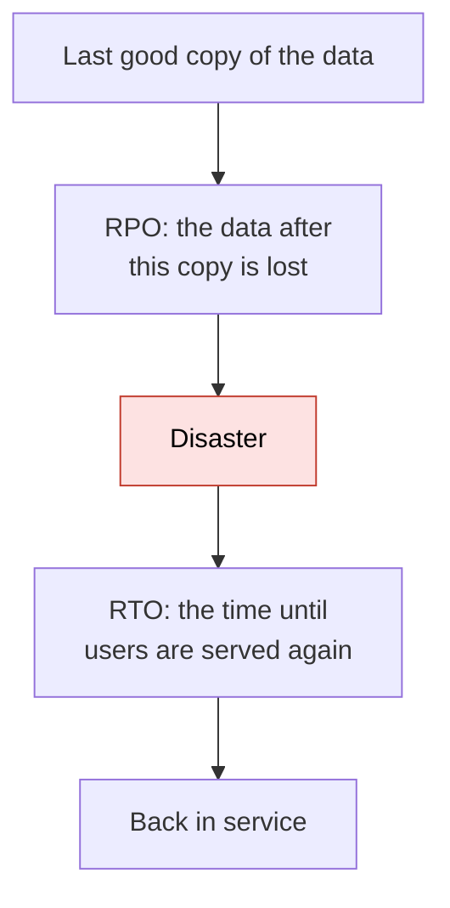
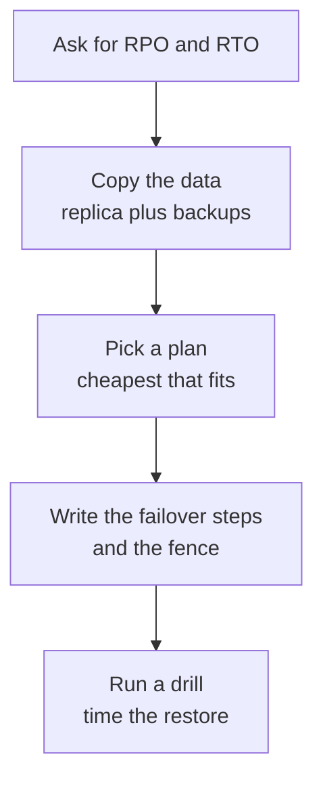
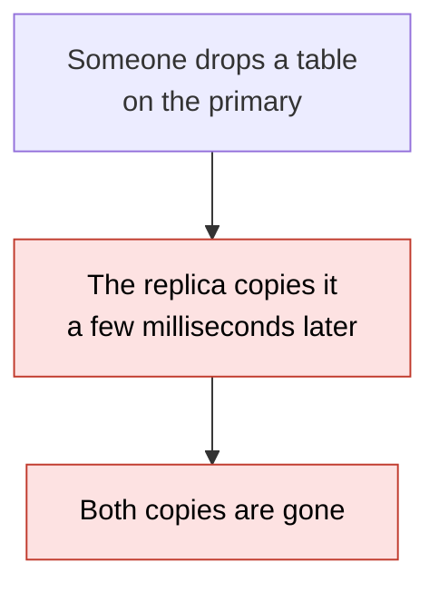
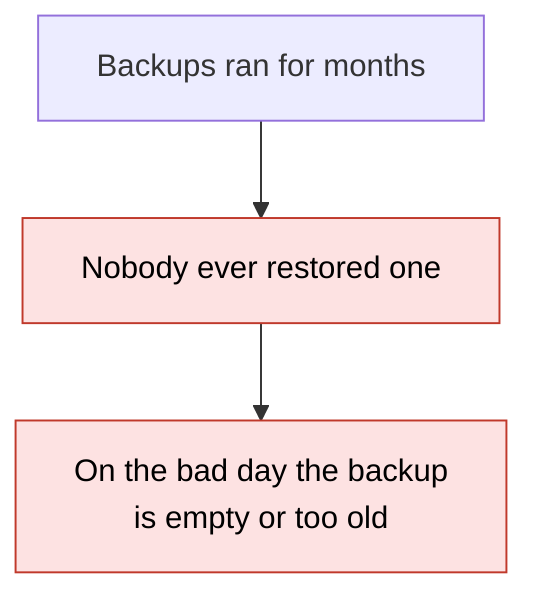
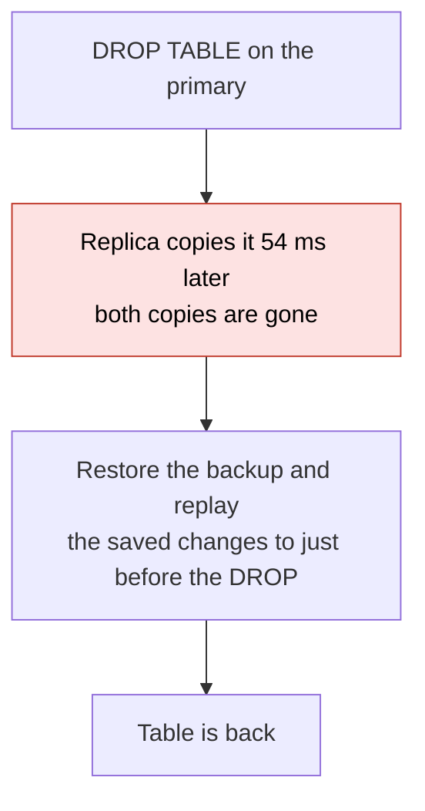
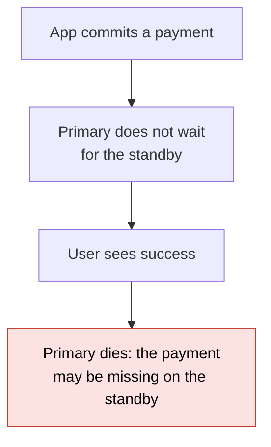
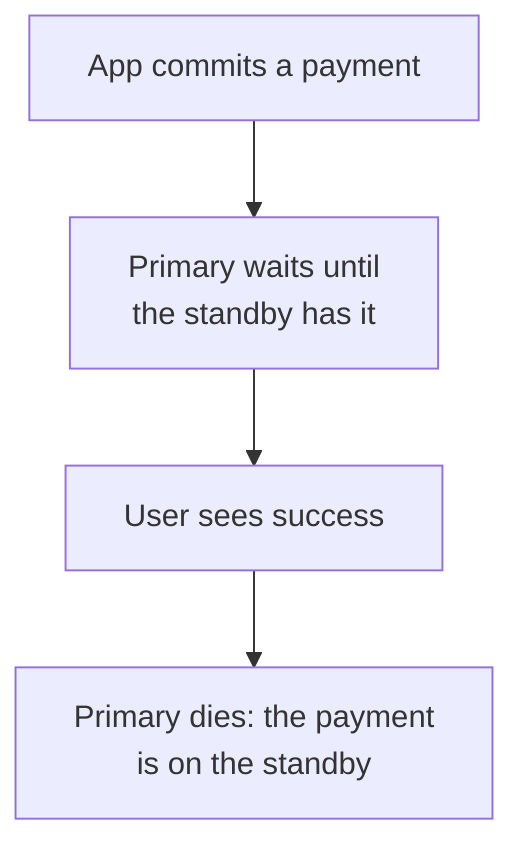
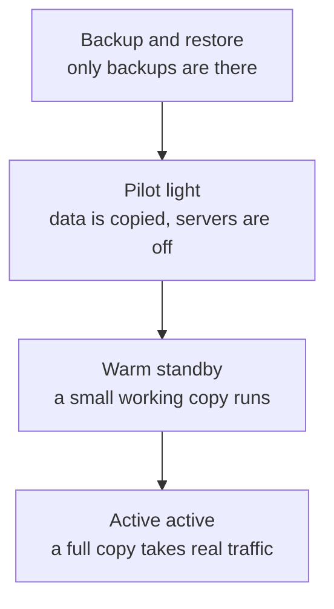
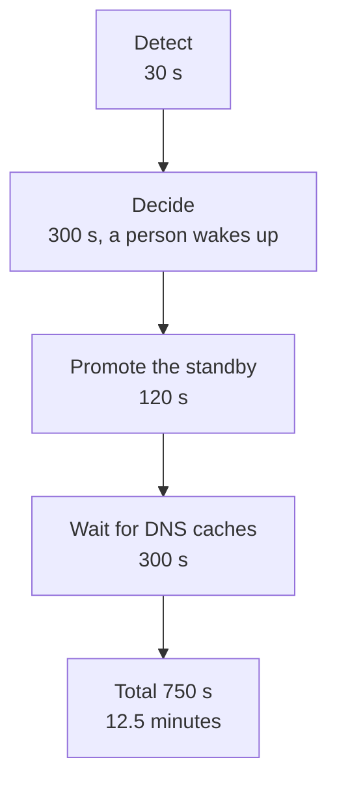

# 28. Disaster recovery

> **Subject:** System Design · **Lesson:** 28 · **Made:** 2026-11-06 · **Status:** ready
>
> **You will be able to:** say what RPO and RTO mean and who sets them, explain why a replica is not a backup, pick between multi AZ and multi region, choose one of the four recovery plans for a target, and say why a failover needs a "fence" for the old primary.
>
> **Before this:** [Safe deploys](27-safe-deploys.md) · **Next:** [Security in a design](29-security-in-a-design.md)
>
> **How to read it:** one card is one idea. Look at the picture, guess, then press the orange bar to check. The blue bars (📖 More detail) hold the longer explanation. Skip them on the first read, and open them when you want more. About 15 minutes for the cards.

## 1. The idea: two numbers, "how much can we lose" and "how long can we be down"

Sooner or later something big breaks: a data center loses power, a region goes dark, or a person runs `DROP TABLE` on the wrong database. **Disaster recovery** is the plan for that day. It starts with two numbers that the **business** gives you, not the engineers:

- **RPO** (recovery point objective): how much data can we lose, counted as time. "At most 5 minutes of orders."
- **RTO** (recovery time objective): how long can we be down. "Back within 1 hour."

Smaller numbers cost more money. So the first question in an interview is not "which tool", it is "what are the two numbers".



<details class="guess"><summary>🤔 Guess: a shop takes a backup every night at 02:00. The data center burns down at 14:00. How much data is lost, and which number is that? Press to check.</summary>

**12 hours of orders, and that is the RPO you actually got.** Backups happen every 24 hours, so the worst case is almost 24 hours. If the business said "at most 5 minutes", a nightly backup does not meet it, and no amount of fast restoring fixes that.

</details>

> **Remember:** RPO looks back from the disaster (data lost). RTO looks forward (time down). The business sets both, and your design must meet them.

<details class="more"><summary>📖 More detail: new words, the big picture, and the problem drawn</summary>

New words (five):

- **RPO / RTO:** the two numbers above. People mix them up. Say: "RPO is about data, RTO is about time."
- **Failover:** moving the work from the broken part to a standby part.
- **Point in time recovery (PITR):** restore a backup, then replay the saved changes up to the exact second you choose.
- **Fencing:** a rule that stops the old primary from writing after a failover, even if it wakes up and thinks it is still in charge.

Two plain ideas:

- **Disaster** is not only fire and floods. It is also a bad deploy, a wrong `DELETE`, a bug that corrupts data, and a stolen password. AWS says it plainly: a copy that follows every change protects you from some disasters but "may not protect you against data corruption or destruction" (AWS whitepaper, checked 2026-11-06).
- **Availability** (staying up) and **recovery** (coming back with the data) are different jobs. Lesson [26](26-slos-and-error-budgets.md) is about the first. This lesson is about the second.

**The big picture.** Each tool answers a different worry.

| Worry | Tool |
|---|---|
| One building fails | **Multi AZ:** a standby in another zone |
| A whole region fails | **Multi region:** a copy far away |
| Somebody deletes or corrupts data | **Backups with point in time recovery** |
| The standby takes too long to take over | **A stronger plan:** pilot light, warm standby, active active |
| The plan was never tried | **Drills:** restore a backup on purpose |



**The problem, drawn.** Two ideas that sound safe and are not.





**The house analogy.** Photos of your family are on your phone (the primary).

- **A replica** is the same photos on your tablet, synced live. If you delete a photo by mistake, the tablet deletes it too.
- **A backup** is a copy on a drive in a drawer. Deleting a photo does not touch it. But the drive is only as new as the last time you plugged it in (RPO).
- **A second region** is the drive in your sister's house. A fire at your home does not reach it.
- **A drill** is plugging the drive in once a year to check that the photos open.

Where the analogy stops: a phone does not have users waiting. A real system also has RTO: the time to get the drive, find the cable and copy everything back.

</details>

## 2. A replica is not a backup

A **replica** (a live copy of the database) repeats every change from the primary, including the bad ones. A **backup with point in time recovery** keeps old versions of the data, so you can go back to the second before the mistake. In my test on Postgres 18.3, the replica dropped the table **54 ms** after the primary did. The restore, which stopped about a second before the mistake, brought back all 105,000 rows.



<details class="guess"><summary>🤔 Guess: you restore to the second before the DROP. During that last second 300 more rows were added. Are they in the restored table? Press to check.</summary>

**No.** The restore stops at the time you pick, and 300 rows came after it. That gap is the data loss of this recovery. It is the same idea as RPO, and it is why you keep the saved changes (the WAL) as a stream and not only a nightly snapshot.

</details>

> **Remember:** a replica protects you from a dead server. Only a backup with saved changes protects you from a mistake. You need both.

<details class="more"><summary>📖 More detail: the real test, the commands, and the numbers</summary>

**What I ran** (Postgres 18.3, a throwaway server on my Mac, 2026-11-06). A table `orders` with 100,000 rows, a streaming replica, and WAL archiving turned on (every finished change file is copied to a folder).

1. `pg_basebackup` took the base backup: **1.4 s**, 30 MB.
2. I added 5,000 rows, waited, and wrote down the time T. The table had **105,000** rows at T.
3. One second later I added 300 more rows, then ran `DROP TABLE orders`.
4. I polled the replica: the table was gone after **54 ms**.
5. I copied the base backup into a new folder and told the server where the saved changes are and when to stop:

```
restore_command = 'cp /path/to/archive/%f %p'
recovery_target_time = '2026-11-06 05:52:58.548090 +07'     # T
recovery_target_action = 'promote'
```

and created an empty file `recovery.signal` in that folder. Then I started it.

**Output:**

```
recovery stopping before commit of transaction 755, time 2026-11-06 05:52:59.605912+07
archive recovery complete
rows in orders: 105000
rows added after T: 0
```

Copy, replay and start took **784 ms** in total. The 100,000 rows came from the base backup, and the 5,000 rows came from replaying the saved changes. The 300 rows that came after T are not there: that is the loss of this recovery.

Checked on 2026-11-06 with Postgres 18.3. This is a 30 MB toy database. A real database takes much longer to copy back, so the only honest RTO is the one you measure on your own data (card 6).

**What the Postgres docs say** ([continuous archiving](https://www.postgresql.org/docs/current/continuous-archiving.html), opened 2026-11-06): point in time recovery needs a base backup plus an unbroken series of saved WAL files from the backup until the time you want. The server replays them and can stop at a chosen time, a named point or a transaction. The target time must be after the end of the base backup.

**The managed version.** On AWS the same ideas are called snapshots and point in time restore. The AWS whitepaper lists "Backup with point-in-time recovery" for EBS, RDS, Aurora and DynamoDB, and says continuous replication gives the shortest time to copy but "may not protect against" corruption or deletion as well as point in time backups do (opened 2026-11-06).

**A real story.** GitLab lost part of its production database on 31 January 2017. Their [public postmortem](https://about.gitlab.com/blog/postmortem-of-database-outage-of-january-31/) (opened 2026-11-06) says: the nightly `pg_dump` backups had been failing (the tool was an older version than the database, the bucket was empty, and the failure emails were rejected); disk snapshots were not on for the database servers; the replica "was not intended for disaster recovery" and there was no WAL archiving. They restored from a copy about 6 hours old. GitLab.com was down about 18 hours, and they estimate at least 5,000 projects, 5,000 comments and about 700 users were affected. The lesson is not "they were careless". It is that several ways of copying the data existed on paper, and none worked on the day.

</details>

## 3. Multi AZ, multi region, and what "the copy is a little behind" costs

An **availability zone** (AZ) is one or more data centers in a region, separate from the other zones in that region. **Multi AZ** puts a standby in a second zone: it survives one building failing. **Multi region** puts a copy far away: it survives a whole region failing, and it costs a lot more work. The copy to another region is nearly always **asynchronous** (the primary does not wait), so the copy is a little behind. When the primary dies, the commits the copy did not receive are lost. That is your RPO.

Async copying:



Sync copying:



<details class="guess"><summary>🤔 Guess: the standby is cut off from the primary. With asynchronous copying, do the commits on the primary fail or wait? And with synchronous copying? Press to check.</summary>

**Async: they succeed.** In my test 1,000 commits were all acknowledged in 128 ms, and after the primary crashed and the standby was promoted, **none of the 1,000 were there**. **Sync: the commit waits.** A new commit was still waiting after 4 seconds. Sync trades availability for a smaller RPO.

</details>

> **Remember:** async means a small, nonzero RPO. Sync means RPO of zero but the primary can freeze when the standby is gone. Multi AZ is the usual choice. Add a second region only when the business needs it.

<details class="more"><summary>📖 More detail: the real test, the Postgres settings, and when to pick which</summary>

**What I ran** (Postgres 18.3, 2026-11-06, a primary and a standby on one Mac). I cut the standby off by pointing its `primary_conninfo` at a closed port and killing its WAL receiver. Then I committed 1,000 rows on the primary, killed the primary with `kill -9`, and promoted the standby.

```
standby connected to primary now? 0
1000 commits with standby cut off took 128 ms, all acknowledged
on primary: total=4000, rows added while cut off=1000
after promoting the standby: total=3000, rows added while cut off=0
```

For the synchronous run I set `synchronous_standby_names = 'replica1'`, froze the standby's receiver, and ran one insert with a 4 second time limit:

```
sync commit with standby frozen: exit code 124 after 4171 ms (124 = still waiting)
```

`ps` showed the server process in the state `INSERT waiting for 0/30A6630`: it was waiting for the standby. After I crashed and promoted, the standby had one more row than the primary had acknowledged: a commit that was never acknowledged to the client. That is allowed. What sync promises is that no **acknowledged** commit is lost.

One honest note: my first async attempt used a frozen receiver and lost nothing, because the data was already sitting in the network buffer. Cutting the connection is what shows the loss.

On one machine I could not see a speed cost for sync (3,000 commits ran at 4,700 to 10,000 per second in both modes, noisy). The Postgres docs say the minimum extra wait is the **round trip** between primary and standby ([warm standby page](https://www.postgresql.org/docs/current/warm-standby.html), opened 2026-11-06). Between zones that is about a millisecond or two. Between continents it is tens to hundreds of milliseconds on every commit, which is why cross region copies are async.

**What the docs say about the loss.** "The amount of data loss is proportional to the replication delay at the time of failover" (same page). A replica that is 30 seconds behind means up to 30 seconds lost.

**Pick one:**

| You need | Pick | Cost |
|---|---|---|
| Survive one building | Multi AZ, sync or near sync | A second server and a little commit time |
| RPO of zero | Sync copy to at least one standby | Commits wait for the standby, and a stuck standby can freeze writes (Postgres docs suggest `ANY 2 (s1, s2, s3)` style quorums so one bad standby does not stop you) |
| Survive a region | Async copy to a second region | A small RPO, more money, more work |
| Survive a mistake | Point in time backups, in a second region too | Storage |

**The AWS view.** The whitepaper says that for a well designed workload spread over several zones, a loss of one data center may need only "a backup and restore approach", and that the other three plans are for losing a region or for rules that require it (opened 2026-11-06).

**The DBO case study** (suggestion, not fact): it does not say how DBO does backups or what its RPO and RTO are. I should not make a claim. A good interview answer for DBO starts with: "I would ask what the point redemption data is worth, then set the numbers."

</details>

## 4. Four plans, from cheapest to most costly

AWS names four plans. They differ in **what already runs in the second place** before the disaster. The more that already runs, the faster you recover, and the more you pay all month.



<details class="guess"><summary>🤔 Guess: the business says RPO 5 minutes and RTO 1 hour. Which is the cheapest plan in the table below that meets both? Press to check.</summary>

**Pilot light** (RPO 5, RTO 60 in the example table). Backup and restore has an RPO of a day. Warm standby also fits, but it costs more, and the rule is to pick the **cheapest** plan that meets both numbers.

</details>

> **Remember:** pick the cheapest plan that meets both numbers. Warm standby can take traffic at once but small. Pilot light must be switched on first.

<details class="more"><summary>📖 More detail: the table, what each plan needs, and what is not in the table</summary>

**The four plans.** The "example" columns are numbers I chose for the practice code. They are not from AWS. AWS gives a picture and words, not a table of numbers; measure your own.

| Plan | What runs in the second place all the time | Example RPO | Example RTO |
|---|---|---|---|
| Backup and restore | Only backups. You rebuild servers and restore data | 1,440 min | 480 min |
| Pilot light | The data is copied and kept live. App servers are there but switched off | 5 min | 60 min |
| Warm standby | A scaled down but working copy of everything | 1 min | 15 min |
| Active active | Full copies in several places, all taking real traffic | 0 min | 1 min |

**The difference between pilot light and warm standby**, in AWS's words: pilot light "cannot process requests without additional action taken first", while warm standby "can handle traffic (at reduced capacity levels) immediately" (opened 2026-11-06).

**Active active has no failover.** The AWS paper says that because the workload already runs in more than one region, "there is no such thing as failover". But it also says that a data disaster (corruption, deletion) still needs backups, and the recovery point is "some point before the disaster was discovered". More copies do not cure a bad `DELETE`.

**Things the table hides:**

- **Infrastructure as code.** Without a script that builds the servers, backup and restore takes much longer than you planned. AWS says so directly.
- **Control plane vs data plane.** Creating servers during a regional outage uses the "control plane" of the cloud, which can be busy or broken. AWS advises that a failover should use only data plane actions where it can, for example a DNS health switch, and that restoring from backup is a control plane action, so practice it before the disaster.
- **Writes in active active.** Two regions taking writes means conflicts. AWS lists *write global* (one region takes all writes), *write local* (the closest region, last writer wins in DynamoDB global tables) and *write partitioned* (each user belongs to one region).
- **Aurora global database.** AWS says a secondary region can be promoted "in less than one minute" and usually lags under one second. That is AWS's claim from their page. I did not test it.

**Practice C turns the table into code** (`pickStrategy`).

</details>

## 5. Failover is a chain, and the old primary must be fenced

When the primary is gone, someone has to find out, decide, move the database, and move the users. Each step takes time, and **the times add up**: that sum is your real RTO. Then there is a danger. If the old primary was only slow and wakes up later, two servers think they are the primary and both accept writes. That is **split brain**. **Fencing** stops it: every failover raises a number (the epoch), and a write with an old number is refused.



<details class="guess"><summary>🤔 Guess: the target RTO is 5 minutes. Which one step in the chain above, if you changed only it, would help most? Press to check.</summary>

**Two steps matter most, and the first is cheap.** The DNS wait (300 s, the "time to live" of the old answer) and the human decision (300 s). Lower the DNS time to live ahead of time, and automate the steps so "decide" becomes pressing one button. Faster promotion alone saves only 120 s.

</details>

> **Remember:** RTO is a sum of steps, not one number. Fence the old primary with an epoch. Automate every step, and decide by hand only if a false alarm would be costly.

<details class="more"><summary>📖 More detail: the code, auto or manual failover, split brain, and the drill</summary>

**The code from the practice:**

```js
function worstCaseRto({ detect, decide, promote, dnsTtl, warmup = 0 }) {
  return detect + decide + promote + dnsTtl + warmup;     // a chain: every step adds time
}

function createFailover({ threshold }) {
  let primary = "a", standby = "b", epoch = 1, failed = 0;
  return {
    primary: () => primary,
    epoch: () => epoch,
    check(ok) {
      if (ok) { failed = 0; return "up"; }
      failed++;
      if (failed >= threshold) {
        [primary, standby] = [standby, primary];          // the standby becomes the primary
        epoch++;                                          // a new epoch so the old primary can be refused
        failed = 0;
        return "failover";
      }
      return "suspect";
    },
    write(server, serverEpoch) {
      return server === primary && serverEpoch === epoch; // fencing
    },
  };
}
```

Three failed checks in a row with `threshold: 3` gives `"suspect"`, `"suspect"`, `"failover"`. One good check in the middle resets the count. After the failover, `write("a", 1)` is refused (old primary, old epoch) and `write("b", 2)` works.

**Why a threshold.** One missed check can be a network hiccup. A failover on every hiccup is itself an outage. AWS warns that an automatic failover "should be used with caution": a false alarm costs you the data and time of a real failover, so many teams use a push button failover and automate every step behind it (opened 2026-11-06).

**Split brain.** The old primary was not dead, only cut off. After a failover it comes back and still accepts writes from clients that did not move. Now there are two histories and you must throw one away. Fencing options: the new epoch number checked by the storage or by the clients (as in the code), shutting the old machine down, or taking away its network or storage. Lesson [24](24-consensus-and-raft.md) shows how a majority vote avoids this.

**DNS is slow to move.** A client keeps the old answer until its "time to live" (TTL) runs out. With a 300 s TTL, some users go to the dead server for 5 more minutes after you switch. Lower the TTL before a planned move, or use a switch that does not rely on DNS caches (AWS names Global Accelerator and the Application Recovery Controller with Route 53 health checks as options, and notes Global Accelerator avoids DNS caching problems).

**Failback.** After the disaster, moving back is a second risky change. Many teams stay on the new primary and make the old place the new standby.

**The drill is the real test.** The AWS paper says to "regularly assess and test" the plan, and to restore from backup on a schedule so you know you can. A game day gives you three things: your real RTO (time the restore), a list of steps that were wrong (the GitLab story), and a team that has done it once. What I would write in the plan: who decides, the commands, the TTL, how to check that data is complete, and how to tell users.

**What breaks if you do nothing about the app.** Servers keep their old database connection. After a failover they need to reconnect. Connection strings that point to a name (not an IP) and short timeouts help. See lesson [23](23-timeouts-retries-and-circuit-breakers.md).

</details>

## 6. Five mistakes, and what to say if you freeze

- **Wrong:** "We have a replica, so we have backups." **Right:** a replica copies mistakes. Add point in time backups.
- **Wrong:** "We back up every night" with no RPO in mind. **Right:** ask for the RPO first. A nightly backup means up to a day of loss.
- **Wrong:** "We have backups." (never restored) **Right:** restore on a schedule and time it.
- **Wrong:** failover with no fence. **Right:** raise an epoch, and refuse the old primary.
- **Wrong:** "Multi region" for a small app with no one asking for it. **Right:** multi AZ plus tested backups, and a second region only when the RTO needs it.

<details class="guess"><summary>🤔 Guess: a nightly backup job has failed silently for six weeks. What check would have caught it, in one line? Press to check.</summary>

**A scheduled restore that fails loudly.** Do not check that the backup file exists. Restore it into a spare database and run one query. If the restore or the query fails, page someone. That is exactly the missing step in the GitLab story.

</details>

> **Remember:** if you freeze, say "Ask for RPO and RTO, copy the data two ways (replica and backups), pick the cheapest plan that fits, fence the old primary, and restore in a drill."

<details class="more"><summary>📖 More detail: the five mistakes in full, and the freeze plan</summary>

**Wrong:**

```
"We run a standby, so if someone deletes data we are safe."
```

**Right:**

```
"The standby protects me from a dead server. For a mistake I use point in time backups:
 a base backup plus the saved changes, so I can stop one second before the DELETE."
```

**Why:** in my test the replica lost the table 54 ms after the primary did.

**Wrong:**

```
"RPO and RTO are 'as low as possible'."
```

**Right:**

```
"I ask the business: how much data can you lose, and how long can you be down?
 Then I pick the cheapest plan that meets both."
```

**Why:** each step down in the numbers costs real money (card 4).

**Wrong:**

```sql
-- the backup job
pg_dump mydb > /backups/mydb.sql   -- nobody ever opens this file
```

**Right:**

```sql
-- every week, in a spare database
createdb restore_test
pg_restore -d restore_test /backups/mydb.dump
psql restore_test -c "select count(*) from orders"    -- alert if this fails or looks too small
```

**Why:** an untested backup is a hope.

**Wrong:**

```js
if (primaryIsDown()) promote(standby);        // and the old primary still accepts writes
```

**Right:**

```js
if (primaryIsDown()) { epoch++; promote(standby, epoch); }   // writes with an old epoch are refused
```

**Why:** without a fence, a slow primary that wakes up creates two histories.

**If you freeze:**

1. Say "First I ask for the two numbers: RPO is data lost, RTO is time down."
2. Say "A replica protects from a dead server, backups with saved changes protect from mistakes, so I use both."
3. Say "I pick the cheapest plan that meets both numbers, I fence the old primary on failover, and I run a restore drill."

</details>

## 7. Watch and play

Links were checked on 2026-11-06. For the videos I read the title and channel from the oEmbed data. I did not watch them. For the articles I opened the page and read the parts named below. If a link is broken, tell me and I will replace it.

- **Video:** [Disaster Recovery on AWS: RPO, RTO, DR strategies and all concepts](https://www.youtube.com/watch?v=B7IL7AuOxFQ) - Peace Of Code. Compare it with cards 1 and 4.
- **Video:** [Cloud Disaster Recovery Architecture: Backup, Pilot Light, Warm Standby, Active-Active](https://www.youtube.com/watch?v=dn4F15S4cNw) - Go Cloud Architects. The four plans side by side.
- **Play with it:** [the stepper in this folder](visuals/28-disaster-recovery.html) - guess first, then press Next. Four tabs: RPO and RTO, replica or backup, async or sync, failover and fence.
- **Read:** [AWS: Disaster recovery options in the cloud](https://docs.aws.amazon.com/whitepapers/latest/disaster-recovery-workloads-on-aws/disaster-recovery-options-in-the-cloud.html) - the four plans in order. Find the pilot light and warm standby note.
- **Read:** [AWS: Disaster recovery is different in the cloud](https://docs.aws.amazon.com/whitepapers/latest/disaster-recovery-workloads-on-aws/disaster-recovery-is-different-in-the-cloud.html) - single region with several zones, or several regions.
- **Read:** [GitLab: Postmortem of database outage of January 31](https://about.gitlab.com/blog/postmortem-of-database-outage-of-january-31/) - several backup methods, none usable on the day. Read the list of problems.
- **Read:** [PostgreSQL: Continuous archiving and point in time recovery](https://www.postgresql.org/docs/current/continuous-archiving.html) - the base backup, the archive, `recovery_target_time`.
- **Read:** [PostgreSQL: Log shipping and standby servers](https://www.postgresql.org/docs/current/warm-standby.html) - async vs sync and what each can lose.

<details><summary>Go deeper (optional)</summary>

**Backups that cannot be changed.** A copy that an attacker with your password cannot delete is worth more than a second copy that they can. AWS suggests copying backups to a different account to protect against "insider threats or account compromise", and S3 versioning against deletes (opened 2026-11-06). I did not test either.

**Backup tests at two levels.** Level 1: the file restores. Level 2: the restored data is right (row counts, a checksum of key tables, the app starts against it). Level 2 is the one that finds a wrong backup.

**Recovery of one table.** Restoring the whole database to fix one table costs the RTO of the whole database. A common trick: restore to a spare server at the target time, copy only the table back. I did not time it here.

**Link to lesson 27.** A bad deploy is a smaller disaster. Rollback handles code. Expand and contract keeps old code working with the database. A real data change that corrupts rows is what point in time recovery is for.

**Link to lesson 26.** SLOs describe the target for staying up. RPO and RTO describe the target after something large breaks. The error budget does not include a region loss, so write the numbers down separately.

**The deeper guides.** [Production readiness, Part 7](production-readiness-observability-security.md) and [database scaling and correctness](../database/database-scaling-and-correctness.md) cover the same ground with more detail.

</details>

## 8. Practice

**A. Predict the output** (write your answer before opening)

```js
const commits = [{ id: "c1", at: 10 }, { id: "c2", at: 12 }, { id: "c3", at: 15 }, { id: "c4", at: 16 }];
console.log(lostCommits(commits, 12));
console.log(checkTargets({ rpoTarget: 60, rtoTarget: 600, lastCopyAt: 0, failureAt: 3600, backAt: 4000 }));
```

<details><summary>Answer</summary>

```
[ 'c3', 'c4' ]
{ rpo: 3600, rto: 400, rpoOk: false, rtoOk: true }
```

The copy has everything up to second 12, so the commits at 15 and 16 are lost. In the second line the data copy was an hour old (RPO 3600 against a target of 60), but the system was back in 400 seconds (under 600). One target can be met while the other is missed. (Checked on 2026-11-06 with Node 26.12.1.)

</details>

**B. Fix the bug**

This function picks a plan, but it only looks at the RTO. What does it return for `{ rpo: 0, rto: 600 }`? Then fix it.

```js
function pickStrategy({ rpo, rto }) {
  const found = STRATEGIES.find(s => s.rto <= rto);       // looks only at the time
  return found ? found.name : null;
}
console.log(pickStrategy({ rpo: 0, rto: 600 }));
```

<details><summary>Answer</summary>

It prints `backup-and-restore`: its RTO of 480 minutes is under 600. But its RPO is 1,440 minutes, and the business said the RPO must be 0. A plan must meet **both** numbers.

```js
function pickStrategy({ rpo, rto }) {
  const found = STRATEGIES.find(s => s.rpo <= rpo && s.rto <= rto);
  return found ? found.name : null;
}
```

This prints `active-active`. (Checked on 2026-11-06 with Node 26.12.1.)

</details>

**C. Write it yourself**

Open `learn/system-design/practice/28-disaster-recovery.js`. It has six empty pieces: `lostCommits`, `checkTargets`, `worstCaseRto`, `pickStrategy`, `pickBackup` and `createFailover`. Write them, then run this from the repo root and make all the tests pass:

```
node --test learn/system-design/practice/28-disaster-recovery.test.js
```

`pickBackup` is the point in time idea in code: pick the latest backup taken at or before the target time, and refuse if the saved changes stop before the target.

<details><summary>One possible answer</summary>

```js
const STRATEGIES = [
  // Example numbers for this lesson, in minutes. Real values depend on your setup and must be measured.
  { name: "backup-and-restore", rpo: 1440, rto: 480 },
  { name: "pilot-light", rpo: 5, rto: 60 },
  { name: "warm-standby", rpo: 1, rto: 15 },
  { name: "active-active", rpo: 0, rto: 1 },
];

function lostCommits(commits, copiedUpTo) {
  return commits.filter(c => c.at > copiedUpTo).map(c => c.id);    // not in the copy yet
}

function checkTargets({ rpoTarget, rtoTarget, lastCopyAt, failureAt, backAt }) {
  const rpo = failureAt - lastCopyAt;                                 // data lost, as time
  const rto = backAt - failureAt;                                     // time users waited
  return { rpo, rto, rpoOk: rpo <= rpoTarget, rtoOk: rto <= rtoTarget };
}

function worstCaseRto({ detect, decide, promote, dnsTtl, warmup = 0 }) {
  return detect + decide + promote + dnsTtl + warmup;                 // a chain: every step adds time
}

function pickStrategy({ rpo, rto }) {
  const found = STRATEGIES.find(s => s.rpo <= rpo && s.rto <= rto);   // the list is cheapest first
  return found ? found.name : null;
}

function pickBackup(backups, walUntil, target) {
  const older = backups.filter(b => b.at <= target);
  if (older.length === 0) return { error: "no backup before target" };
  if (walUntil < target) return { error: "archive stops before target" };
  const best = older.reduce((a, b) => (b.at > a.at ? b : a));         // the latest one that is old enough
  return { backup: best.name };
}

function createFailover({ threshold }) {
  let primary = "a", standby = "b", epoch = 1, failed = 0;
  return {
    primary: () => primary,
    epoch: () => epoch,
    check(ok) {
      if (ok) { failed = 0; return "up"; }
      failed++;
      if (failed >= threshold) {
        [primary, standby] = [standby, primary];                      // the standby becomes the primary
        epoch++;                                                      // a new epoch so the old primary can be refused
        failed = 0;
        return "failover";
      }
      return "suspect";
    },
    write(server, serverEpoch) {
      return server === primary && serverEpoch === epoch;             // fencing
    },
  };
}

module.exports = { STRATEGIES, lostCommits, checkTargets, worstCaseRto, pickStrategy, pickBackup, createFailover };
```

Checked on 2026-11-06 with Node 26.12.1: the 23 tests fail on the empty stub and all 23 pass with this answer.

</details>

## 9. Interview question

**Q:** "Design the disaster recovery for a service that takes payments. What do you ask first, and what do you build?"

A common follow-up: "Is a database replica a backup?" Card 2 is the answer.

<details><summary>A strong answer, in four parts</summary>

1. **Problem:** Something large will break: a zone, a region, or a person with a wrong command. I need two numbers from the business: RPO (how much data can we lose) and RTO (how long can we be down). For payments the RPO is close to zero, because money records matter.
2. **How it works:** I use multi AZ with a synchronous standby for the primary database, so an acknowledged payment is on two machines. I add point in time backups (a base backup plus saved WAL) kept in another region and another account, so I can recover from a mistake or corruption. For a region failure I add an async copy in a second region, and I pick the plan from the numbers: pilot light or warm standby if the RTO is minutes to an hour. Failover is automated as steps but started by a person (or by a threshold), it raises an epoch so the old primary is fenced, and I lower the DNS time to live ahead of time. I run a restore drill every quarter and time it.
3. **Tradeoff:** Sync copying costs commit time and can freeze writes if the standby is gone. Async to another region has a small nonzero RPO. A warm standby costs money every month. Automatic failover can cause a false alarm, so I automate the steps and keep the trigger careful.
4. **My example:**
   - **Fact:** my DBO case study describes four Node and TypeScript services on Docker Swarm via CapRover with Prisma and PostgreSQL.
   - **Fact:** the case study does not say how DBO does backups, or what its RPO and RTO are.
   - **Idea, not a fact:** I should not claim DBO has a plan. I can say what I would do: ask for the numbers, turn on point in time backups for PostgreSQL, store them off the server, and test one restore. If I really did a restore drill in a real project, I should add that fact myself.

</details>

## 10. Explain it back

Close this file. Explain disaster recovery out loud like to a new junior, in 4 parts (problem, how, tradeoff, my example). Use the story of the dropped table: the replica lost it 54 ms later, the point in time restore brought back 105,000 rows, and the 300 rows from the last second were the price. Then write your best version below and run `/explain-check disaster recovery` or ask the `explain-coach` agent to review it.

### My explanation

<write here>

### Coach feedback

<the explain-coach agent writes here>

## 11. Review questions (day 1, 3, 7, 21)

1. Say what RPO and RTO mean, who sets them, and which one a nightly backup decides.
2. Why is a replica not a backup? What do you add to recover from a wrong `DELETE`?
3. A standby is cut off from the primary. What happens to a new commit with async copying, and with sync copying?
4. A failover takes 750 seconds. Name the four steps that add up to it, and say what fencing is for.

<details><summary>Answers</summary>

1. RPO is how much data you can lose, counted as time. RTO is how long you can be down. The business sets them. A nightly backup decides the RPO: up to a day of data.
2. A replica repeats every change, including the bad one (54 ms in my test). Add point in time backups: a base backup plus the saved changes, so you can stop just before the mistake.
3. Async: the commit succeeds at once, and if the primary then dies, those commits are lost (1,000 of 1,000 in my test). Sync: the commit waits for the standby, so no acknowledged commit is lost, but writes can freeze.
4. Detect (30 s), decide (300 s), promote the standby (120 s), wait for DNS caches (300 s). Fencing stops the old primary, which may wake up later, from writing after a failover: every failover raises an epoch and writes with an old epoch are refused.

</details>

## Connected lessons

- [Safe deploys](27-safe-deploys.md) - the lesson before. Rollback covers a bad release. This lesson covers the day the data or the region is gone.
- [Replication and quorums](19-replication-and-quorums.md) - sync and async copies, and how many copies must agree.
- [Consensus and Raft](24-consensus-and-raft.md) - how a group elects one leader and avoids two, the safe form of fencing.
- [SLOs and error budgets](26-slos-and-error-budgets.md) - the targets for staying up. RPO and RTO are the targets for coming back.
- [Timeouts, retries and circuit breakers](23-timeouts-retries-and-circuit-breakers.md) - what the app does while the database is switching.
- [Object storage and presigned uploads](18-object-storage-and-presigned-uploads.md) - where backups and cross region copies are usually kept.
- [Production readiness: observability, deploys, security and cost](production-readiness-observability-security.md) - Part 7 has the same plans in a shorter form.
- [System design interview questions](senior-system-design-interview-questions.md) - question 54 asks for exactly this answer.
