# 29. Security in a design

> **Subject:** System Design · **Lesson:** 29 · **Made:** 2026-10-17 · **Remade in short cards:** 2026-10-30 · **Status:** ready
>
> **You will be able to:** say the difference between who you are and what you may do, find and fix the bug where changing an id shows someone else's data, choose between roles and rules for permissions, and say where each check sits in a design.
>
> **Before this:** [Disaster recovery](28-disaster-recovery.md) · **Next:** [LLM features in a system](30-llm-features-in-a-system.md)
>
> **How to read it:** one card is one idea. Look at the picture, guess, then press the orange bar to check. The blue bars (📖 More detail) hold the longer explanation. Skip them on the first read, and open them when you want more. About 15 minutes for the cards.

## 1. The idea: a check at every door

Security in a design is a check at every door, not only at the front door. Two checks matter most. **Authentication** asks "who are you?" (the login check). **Authorization** asks "what may you do to this one thing?" (the permission check). In a hotel, the desk checks your ID and gives you a key card (authentication). Your card opens room 43 but not room 44 (authorization).

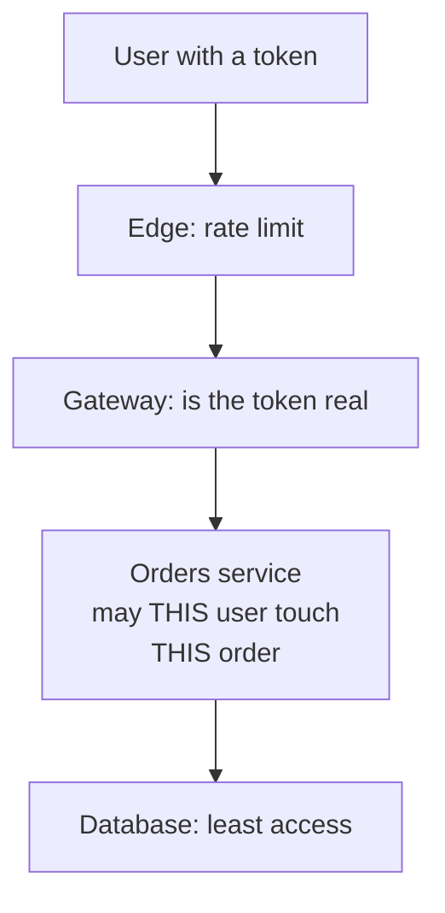

<details class="guess"><summary>🤔 Guess: Ann has a real token and asks for `GET /orders/43`, which belongs to Ben. The server only checks that the token is real. What does Ann get? Press to check.</summary>

**Ben's order**, with his total of 99. The token is real the whole time, and the server never asks if order 43 is Ann's. This bug is called **BOLA** (broken object level authorization). The older name is IDOR.

</details>

> **Remember:** a real token only says who you are. Also check, on every request, that this user may touch this object.

<details class="more"><summary>📖 More detail: new words, the big picture, the problem drawn, the hotel, and why it exists</summary>

Security in a design is a check at every door, not only at the front door. Two checks matter most: who are you, and may you do this to this one thing.

Lessons 26 to 28 kept the system running. This lesson keeps the wrong people out.

New words (four):

- **Authentication and authorization:** authentication asks "who are you?" (the login check). Authorization asks "what may you do?" (the permission check). People write authn and authz.
- **BOLA:** the bug where a user changes an id in the request and sees someone else's data. Short for broken object level authorization. The older name is IDOR.
- **Roles and rules (RBAC and ABAC):** a role is a job title that brings permissions, like "support". A rule looks at facts, like "this order belongs to this user". The long names are role based and attribute based access control.
- **mTLS:** both sides of a connection show an ID card (a certificate). Normal HTTPS shows only the server's card. The m is for mutual.

Four plain ideas, used below:

- **Edge and gateway** are the first servers a request meets. The edge can limit how many calls one client makes. The gateway can check the token.
- **A token** (a JWT, or a session id) is the proof you got when you logged in. You know it from the auth tutorial.
- **A secret** is a password or a key that must stay private, like a database password or a payment key.
- **An object** is one thing in your data, like order 43. "Object level" means the check is about that one order, not about the whole `/orders` route.

Checked on 2026-10-17: the official OWASP site still shows the API Security Top 10 **2023** as its newest edition. It does not mention a newer one.

**The big picture.** Notice that there is a check at every arrow, not one big wall at the front. The service next to the data does the most important check.

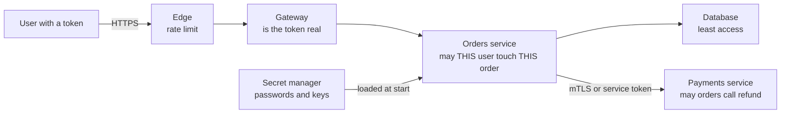

**The problem, drawn.** This is the bug. Notice that the token is real the whole time. The server never asks if order 43 is Ann's.

This is the bug. Notice that the token is real the whole time. The server never asks if order 43 is Ann's.

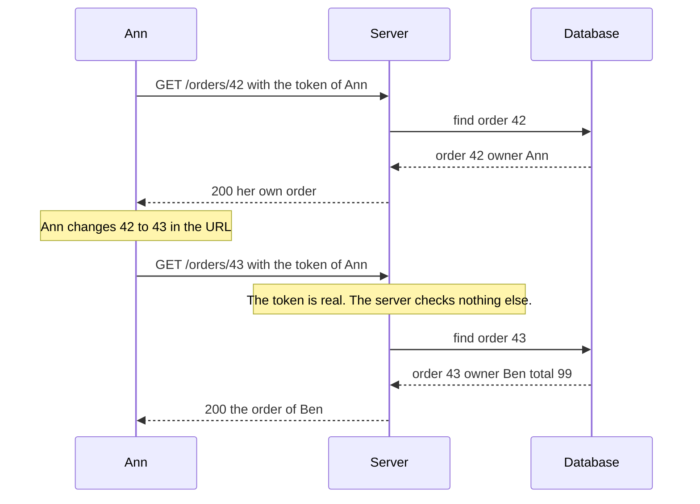

**The hotel in full.**

A hotel. At the desk you show your ID and get a key card. That is authentication. Your card opens room 43 and the gym. It does not open room 44. That is authorization. Staff cards open the staff doors. That is a role.

Now a guest walks to the desk and says "give me the key to room 44". A good desk checks the name on the booking, not only that the person is a guest. A bad desk gives the key. That is BOLA.

Where the analogy stops: a hotel has maybe 200 doors, and a thief walks to them one by one. An API has millions of ids, and a script tries 10,000 of them in a minute. Also a hotel guard sees faces. A server sees only what the request says, so it must check every time.

**Why it exists and what it costs.**

- **Problem without it:** a stranger reads or changes data that is not theirs (card 1). Anyone inside your network can call an internal route. A password in the code leaks with the code.
- **How it solves it:** a check at each door (cards 1 and 5). The service that holds the data checks the owner on every request (card 2).
- **Cost or tradeoff:** more code to write and to test. Every check must run on every route, and one missed route is a hole. See the cost table at the end of this section.

</details>

## 2. The fix for BOLA: check the owner on every request

Put the owner in the database question. Four rules (from OWASP, API1:2023): check on **every** route that takes an id; take the user from the **signed token**, never from the body, the query or a header the client can set; put the owner in the query, `where: { id, storeId: user.storeId }`, so a missing row means `404`; and write a test with **two users**.

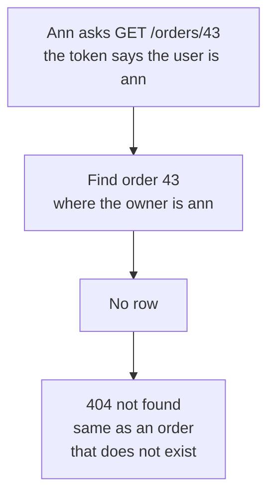

<details class="guess"><summary>🤔 Guess: the server reads the user from the query string first, and from the token second. Ann is logged in and asks for Ben's order 8 with `?user=ben`. What does she get? Press to check.</summary>

**`ok`.** The query string wins, so the server thinks the caller is Ben. Ann just became Ben. The identity must come only from the signed token. Without `?user=ben`, the same request gets `404`. (Real run, Node 26.12.1.)

</details>

> **Remember:** the user comes from the signed token. The owner is part of the database query. No row means 404. Test with two users.

<details class="more"><summary>📖 More detail: the fix over time, the table, right against wrong, the code, the real output, and step by step</summary>

**The fix, over time.** Notice that the owner check is part of the database question. Ann gets the same answer as for an order that does not exist.

Notice that the owner check is part of the database question. Ann gets the same answer as for an order that does not exist.

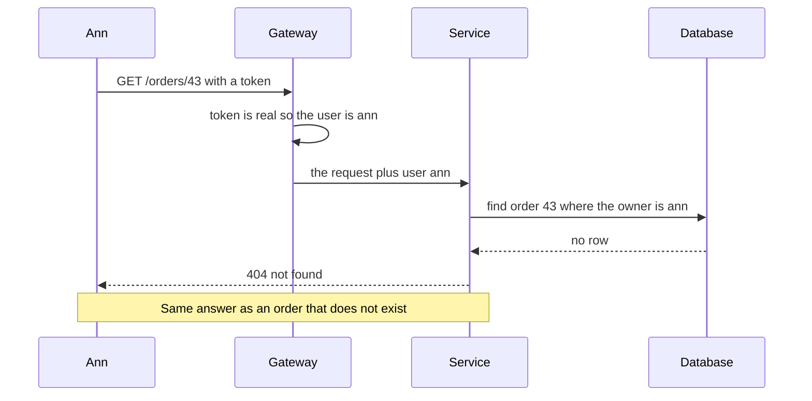

**What is true at one moment.** Three requests from Ann. Notice that the token never changes. Only the order id changes, and the owner column decides.

Three requests from Ann. Notice that the token never changes. Only the order id changes, and the owner column decides.

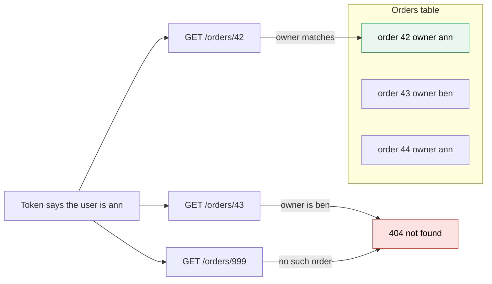

**Right against wrong.** Notice who decides the identity. On the wrong way the client decides. On the right way the signed token decides.

Notice who decides the identity. On the wrong way the client decides. On the right way the signed token decides.

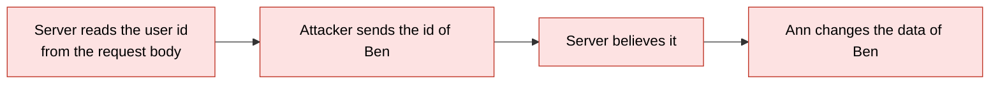

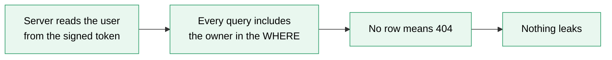

**The smallest code that shows it.**

Two servers answer the same question. The `wrong` one only needs a real token. The `right` one also asks who owns the order. The user comes from the token, not from the request.

```js
const orders = { 42: { owner: "ann", total: 30 }, 43: { owner: "ben", total: 99 } };
const wrong = (user, id) => orders[id] ?? "404";                  // never looks at the owner
const right = (user, id) => {
  const order = orders[id];
  return order && order.owner === user ? order : "404";          // the owner must match the token
};
for (const id of [42, 43]) {
  console.log("ann asks for", id, "| wrong:", JSON.stringify(wrong("ann", id)), "| right:", JSON.stringify(right("ann", id)));
}
```

**Output:**

```
ann asks for 42 | wrong: {"owner":"ann","total":30} | right: {"owner":"ann","total":30}
ann asks for 43 | wrong: {"owner":"ben","total":99} | right: "404"
```

Checked on 2026-10-17 with Node 24.

Look at the second line. The `wrong` server hands Ann the order of Ben, with his total. The `right` server says `404`, the same word it uses for an order that does not exist.

Run again on 2026-10-30 with Node 26.12.1: the same output.

**What really happens, step by step.**

The machine here is a server that answers one request at a time. The state is what Ann receives.

| Step | Code | What the server does | What Ann receives |
|---|---|---|---|
| 1 | `orders = {...}` | JavaScript puts two orders in memory. Order 42 belongs to ann. Order 43 belongs to ben | nothing yet |
| 2 | loop with `id = 42`, `wrong` | Looks up order 42 and returns it. It never reads `owner` | order 42 |
| 3 | loop with `id = 42`, `right` | Looks up order 42. `order.owner` is `"ann"`, the token user is `"ann"`. They match, so it returns the order | order 42 |
| 4 | loop with `id = 43`, `wrong` | Looks up order 43 and returns it | **order 43, owned by ben** |
| 5 | loop with `id = 43`, `right` | Looks up order 43. `order.owner` is `"ben"`, the token user is `"ann"`. No match, so it returns `"404"` | `404` |

What to see: steps 2 and 3 look the same, so a quick test with your own data passes on both servers. Only step 4 against step 5 shows the bug. You must test with a second user.

**A real handler, three requests.**

This is the shape of practice C. Two small pieces run in order: `requireLogin` (who are you) and then `getOrder` (may you read this one). Orders 42 and 43 are as above. Sam is a user with the role `support`.

| Request | `requireLogin` (authentication) | `getOrder` (authorization) | Answer |
|---|---|---|---|
| No token, order 42 | No token, so it answers at once. It never calls `next()` | does not run | `401` login required |
| Ann's token, order 42 | Token is real. Sets `req.user = ann` and calls `next()` | `order.ownerId` is ann, same as `req.user.id` | `200` order 42 |
| Ann's token, order 43 | Token is real. Sets `req.user = ann` | `ownerId` is ben, not ann. Ann is not support | `404` not found |
| Sam's token, order 43 | Token is real. Sets `req.user = sam` | `ownerId` is ben, but the role is `support` | `200` order 43 |
| Ann's token, order 999 | Token is real | No such order | `404` not found (same as Ann's token, order 43) |

What to see: the last two rows give the same answer. A stranger cannot tell if order 43 exists.

**Step through it yourself:** [open the stepper](visuals/29-security-in-a-design.html). It has three stories: Ann changes the id (a wrong server and a right server side by side), five different requests at five doors, and calls between services with and without a check. Guess first, then press Next.

**The two checks.**

| | Authentication | Authorization |
|---|---|---|
| Question | Who are you? | May you do this to this thing? |
| Proof | A token or a session | A rule, a role, or an owner column |
| Where | Gateway, then checked again in the service | In the service, next to the data |
| Failure code | `401` | `403`, or `404` to hide that it exists |

A real token only answers the first question. In the problem picture (card 1) the token was real. The bug was in the second question, which nobody asked.

**The fix for BOLA, in full.**

OWASP lists this as number 1 in the API list (API1:2023). Four rules, from the OWASP page:

1. Check on every route that takes an id. It is not enough to check on most routes.
2. Take the user from the signed token, never from the body, the query or a header the client can set.
3. Put the owner in the query: `where: { id, storeId: user.storeId }`. A missing row means `404`.
4. Write a test with two users. User A asks for the object of user B and must fail.

Random ids (a UUID instead of 43) make guessing harder. OWASP says to prefer them. They are not a fix. A leaked id, from a log or an email link, still works without the check.

A GraphQL API has one URL and many doors. The check lives in each resolver or in the data query. One check on `/graphql` is not enough.

</details>

## 3. Roles or rules?

A **role** is a job title that brings permissions, like "support". A **rule** looks at facts, like "this order belongs to this user". Most products use both: the role says what kind of action is allowed, and the rule says on which objects.

| | Role (RBAC) | Rule (ABAC) |
|---|---|---|
| Looks like | "support may read any order" | "the owner equals the user" |
| Good for | a few fixed kinds of people | "only their own", time limits |
| Weak at | one role per store | many rules are hard to test |

<details class="guess"><summary>🤔 Guess: "only my own store's orders": is that a role or a rule? Press to check.</summary>

A **rule** (an owner column). With roles you would need one role per store, called role explosion. In Hasura it is the same idea: the role picks the permission, and the permission is a WHERE clause on the session user id.

</details>

> **Remember:** the role says what kind of action is allowed. The rule says on which objects.

<details class="more"><summary>📖 More detail: roles and rules drawn, and the full table</summary>

**Roles and rules.** Notice that the two ideas answer different questions. A role says what kind of person you are. A rule says which objects are yours.

Notice that the two ideas answer different questions. A role says what kind of person you are. A rule says which objects are yours.

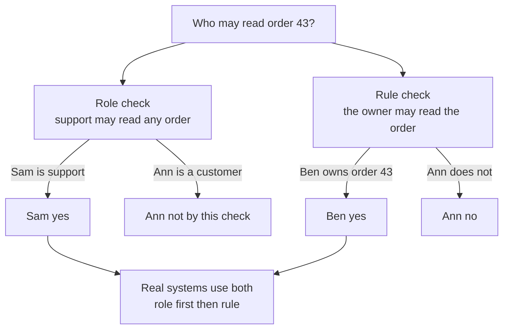

**Roles or rules?**

| | Roles (RBAC) | Rules on attributes (ABAC) |
|---|---|---|
| Looks like | "support may read any order" | "the order owner equals the user, and the order is not deleted" |
| Good for | A few fixed kinds of people, an admin CMS | "Only their own", time limits, region limits |
| Weak at | "Only my own store's orders". You need one role per store | Many rules are hard to read and to test |
| Cost | Role explosion: too many roles | Slow to explain in a review |

Most products use both. The role says what kind of action is allowed. The rule says on which objects. You know this from Hasura: a role has a permission, and the permission is a WHERE clause on the session user id. The role picks the clause. The clause picks the rows.

</details>

## 4. Internal does not mean trusted

If one container is hacked, an attacker sits inside your network and can call `POST /internal/refund`. Network location proves nothing (zero trust). Two ways to prove who a service is: **mTLS** (both sides show a certificate, an ID card), or a short lived service token. Then the receiver still checks permission.

| Caller | Proof | Rule | Answer |
|---|---|---|---|
| Intruder | no certificate | | refused |
| Orders service | certificate | orders may call refund | 200 |
| Email worker | certificate | email worker may not | 403 |

<details class="guess"><summary>🤔 Guess: the email worker has a real certificate and calls `refund`. Is it allowed? Press to check.</summary>

**No: 403.** Proving who you are is not the same as being allowed. The receiver checks the permission: "orders may call refund, the email worker may not".

</details>

> **Remember:** internal does not mean trusted. Every call between services shows a certificate or a short token, and the receiver checks the permission.

<details class="more"><summary>📖 More detail: service to service over time, and the internal text in full</summary>

**Service to service, over time.** Notice that all three callers are inside the network. Only the one with the right card and the right permission gets in.

Notice that all three callers are inside the network. Only the one with the right card and the right permission gets in.

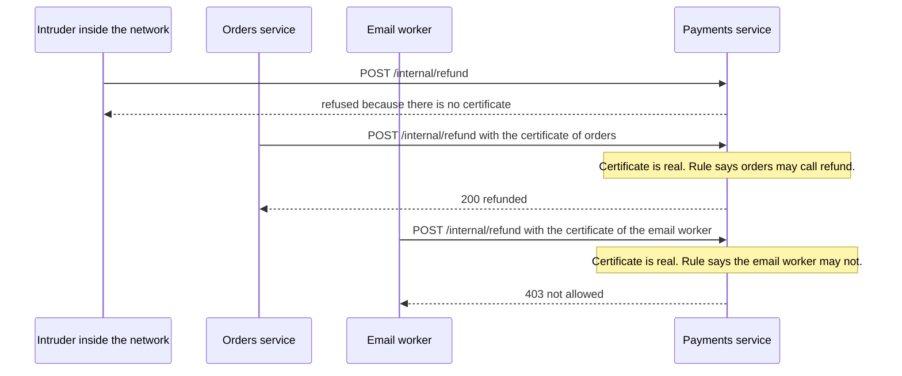

**Internal does not mean trusted.**

If one container is hacked, an attacker sits inside your network. Without a check, they call `POST /internal/refund`. The idea behind zero trust is that network location proves nothing (NIST SP 800-207). Two ways to prove who a service is:

- **mTLS:** each service has a certificate. Both sides check the other's card. Small helper programs next to each service (a service mesh, for example Istio) can do this for you. They also change the certificates often, so a stolen card stops working soon.
- **A short lived service token:** an identity service hands each service a signed token that lasts minutes. The receiver checks it.

Then the receiver checks permission: "orders may call refund, the email worker may not" (card 4). Proving who you are is not the same as being allowed.

**What the checks cost.**

| Cost | What it means | What you do about it |
|---|---|---|
| Time per request | An extra WHERE on the owner is almost free. A call to a policy service adds a network hop | Keep the owner check inside the data query. Use a policy service only for deep sharing rules |
| One missed route is a hole | There are hundreds of routes | Make the check hard to forget: put it in the data layer or a shared helper. Add the two-user test |
| `404` hides the real reason | Debugging is harder | Log the real reason inside the server. Show `404` outside |
| Token cannot be taken back | A JWT works until it expires | Short life plus a refresh token you can cancel (see the auth tutorial) |
| Certificates need care | Someone must issue and renew them | Use a mesh or a platform that does it |

</details>

## 5. Where each check goes, and secrets

Each question has one home. Who is calling? The token at the gateway and again in the service, or mTLS for services. Which object? The ownership check in the service next to the data. Which function and which fields? A role check per endpoint and an allow list of fields. What data came in? Validate on the server, and use parameters for SQL.

| Question | Home |
|---|---|
| Who is calling? | verify the token (mTLS for services) |
| Which object? | ownership check in the service next to the data |
| Which function and fields? | role check per endpoint, allow list of fields |
| What data came in? | validate on the server, parameters for SQL |

<details class="guess"><summary>🤔 Guess: a mobile app needs a payment secret key. Where does it live? Press to check.</summary>

On the **server**. A mobile app cannot keep a secret, because anyone can open the app bundle. Keep secrets out of code, images and git, in a secret manager with access per service and a log of who read what.

</details>

> **Remember:** a missed route is a hole. Put the check where it is hard to forget: in the data layer or a shared helper.

<details class="more"><summary>📖 More detail: where does each check go, and secrets and input</summary>

**Where does each check go?** This is the picture to draw in an interview. Notice that each question has one home.

This is the picture to draw in an interview. Notice that each question has one home.

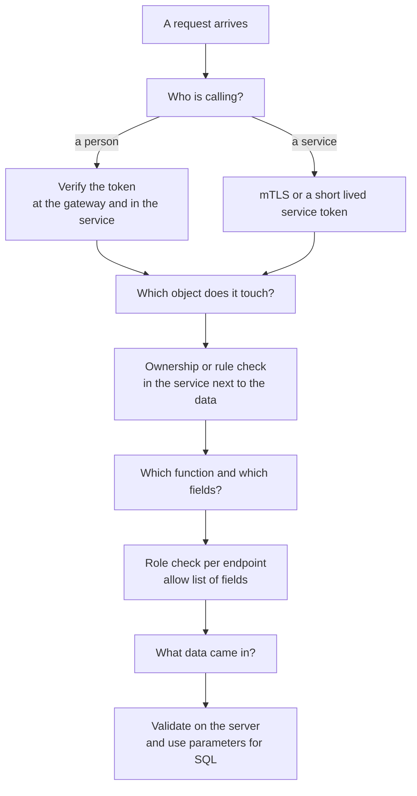

**Secrets, and the data that comes in.**

- **Secrets:** keep them out of code, images and git. Keep them in a secret manager, with access per service and a log of who read what. Change them on a schedule. Change them without downtime by letting the old and new value both work for a short time. A mobile app cannot keep a secret, because anyone can open the app bundle. Secret keys stay on the server.
- **Input:** check the shape of all data on the server. Check type, size and allowed values. Use an allow list, not a block list. Browser checks are for comfort only. Validation does not stop SQL injection. Parameters do that (OWASP Input Validation cheat sheet).

</details>

## 6. Four mistakes, and what to say if you freeze

- **Wrong:** trust the id from the request. **Right:** put the owner in the query.
- **Wrong:** hide the button and call it done. **Right:** the server checks the role itself.
- **Wrong:** "It is an internal route, so it needs no check." **Right:** every internal call shows proof, and the receiver checks permission.
- **Wrong:** answer `403 this order is not yours` for an order that exists. **Right:** answer `404`.

<details class="guess"><summary>🤔 Guess: why answer `404`, not `403`, for another user's order? Press to check.</summary>

A `403` tells a stranger that order 43 **exists**, so guessing gets easier. Log the real reason inside the server, and show `404` outside.

</details>

> **Remember:** if you freeze, say "A real token only says who you are. I also check on every request that this user may touch this object."

<details class="more"><summary>📖 More detail: the four mistakes in full, and the freeze plan</summary>

**Wrong:** trust the id from the request.

```js
// sketch, not run here
const order = await prisma.order.findUnique({ where: { id: req.params.id } });   // any logged in user gets any order
```

**Right:**

```js
// sketch, not run here
const order = await prisma.order.findFirst({ where: { id: req.params.id, storeId: req.user.storeId } });
if (!order) return res.status(404).json({ error: "not found" });                // the store id comes from the token
```

**Why:** the token proves who you are. It does not prove that the order is yours. Put the owner in the query.

**Wrong:** hide the button and call it done.

```js
// sketch, not run here
{user.role === "admin" && <Button onPress={deleteBrand} />}      // the screen hides it, the server still accepts it
```

**Right:** the server checks the role in `deleteBrand` itself. The hidden button is only for comfort.

**Why:** an attacker does not use your app. They send the request by hand.

**Wrong:** "It is an internal route, so it needs no check."

**Right:** "Every call between services shows a certificate or a short token, and the receiver checks the permission."

**Why:** one hacked container is enough to reach every internal route.

**Wrong:** answer `403 this order is not yours` for an order that exists.

**Right:** answer `404`, the same as for a missing order.

**Why:** a `403` tells a stranger that order 43 exists. Guessing then gets easier.

**If you freeze:**

1. Say "A real token only says who you are. I also check on every request that this user may touch this object."
2. Say "The user comes from the signed token. The owner is part of the database query. No row means 404."
3. Say "Services prove who they are with mTLS or a short token. Secrets live in a secret manager."

</details>

## 7. Watch and play

How the links were checked on 2026-10-17: I opened each page with a tool. For the video, the tool gave me only the title and the channel from YouTube's own data. It did not show the length, so I do not state one. The PortSwigger lab page loaded. I did not run the lab, so check what sign up it asks for.

- **Video:** [Broken Object Level Authorization - 2023 OWASP Top 10 API Security Risks](https://www.youtube.com/watch?v=nIWBp_nvzq4) (SmartBear). Compare the example with the problem picture in card 1.
- **Play with it:** [the stepper in this folder](visuals/29-security-in-a-design.html) - guess first, then press Next. Try all three tabs.
- **Play with it:** [PortSwigger lab: Insecure direct object references](https://portswigger.net/web-security/access-control/lab-insecure-direct-object-references) - the goal is to find the password of the user carlos by changing a reference. You do the attack from card 1 yourself.
- **Play with it:** [jwt.io](https://jwt.io/) - paste a token and read the claims. Find the claim that holds the user id. That is the place the server should read the user from.
- **Read:** [OWASP API1:2023 Broken Object Level Authorization](https://api-security.owasp.org/editions/2023/en/0xa1-broken-object-level-authorization) - the four prevention rules and three attack stories.
- **Read:** [OWASP Authorization Cheat Sheet](https://cheatsheetseries.owasp.org/cheatsheets/Authorization_Cheat_Sheet.html) - find "deny by default" and "validate permissions on every request".
- **Read:** [Istio security concepts](https://istio.io/latest/docs/concepts/security/) - diagrams of service identity and mutual TLS between services. Look at the identity picture.

<details><summary>Go deeper (optional)</summary>

**The OWASP API Security Top 10, 2023 edition.** I read the list on the official site on 2026-10-17 ([the list](https://api-security.owasp.org/editions/2023/en/0x11-t10)). The site shows no newer API edition. One third party glossary page listed a next API edition for 7 September 2026. The official site shows 2023 as the newest, so treat that claim as unconfirmed. OWASP also has a separate web app list and a separate LLM list. Do not mix them up in an interview. Where each risk lives in this lesson:

| Risk | In plain words | Where the fix lives |
|---|---|---|
| API1 Broken Object Level Authorization | Change an id and see another user's object | Owner check in the service (card 2) |
| API2 Broken Authentication | Weak login, no limit on guesses, tokens that never end | Gateway, rate limit, short tokens |
| API3 Broken Object Property Level Authorization | A user reads or sets a field they should not, like `role` | Allow list of fields |
| API4 Unrestricted Resource Consumption | One call costs too much: huge pages, deep GraphQL | Size, depth and rate limits |
| API5 Broken Function Level Authorization | A normal user calls an admin function | Role check per function |
| API6 Unrestricted Access to Sensitive Business Flows | Bots abuse a flow, like OTP texts that cost money | Per number and per IP limits |
| API7 Server Side Request Forgery | The server fetches a URL the attacker picks | Allow list of hosts |
| API8 Security Misconfiguration | Debug on, wide browser access rules (CORS), open ports | Safe defaults, review |
| API9 Improper Inventory Management | An old `/v1` route is still live without checks | List and remove old routes |
| API10 Unsafe Consumption of APIs | You trust data from a partner too much | Verify webhook signatures, validate their data |

**401, 403 and 404.** `401` means "I do not know who you are". `403` means "I know who you are and the answer is no". `404` means "not found". For another user's object, `404` is the safer answer, because `403` confirms the object exists. Some teams use `403` for objects the user may know about (a shared document). Pick one rule and keep it.

**Hasura.** The [row level permissions page](https://hasura.io/docs/2.0/auth/authorization/permissions/row-level-permissions/) says session variables such as `X-Hasura-User-Id` come from the JWT or a webhook, and permission rules use them. Its example shape is `{"id":{"_eq":"X-Hasura-User-Id"}}`. That is the owner check from this lesson, written as config. My [Hasura guide](../backend-api/hasura-guide.md) calls permissions "WHERE clauses you can't forget to write".

**Rules inside the database.** PostgreSQL can enforce row rules itself, with row level security. The [architecture guide](architecture-patterns-2026.md), Part 8, shows it for many customers on shared tables. I did not open the PostgreSQL docs for this lesson.

**Deep sharing rules (ReBAC).** "Ana may view order 42 because she is in a team that owns the folder." This needs a graph of links. The [production readiness guide](production-readiness-observability-security.md), Part 9.2, covers it, with Zanzibar and OpenFGA. I did not open those pages again.

**Zero trust.** The [NIST SP 800-207](https://csrc.nist.gov/pubs/sp/800/207/final) abstract says zero trust grants "no implicit trust" based only on physical or network location. Published August 2020.

**Secrets and input, the long version.** [OWASP Secrets Management Cheat Sheet](https://cheatsheetseries.owasp.org/cheatsheets/Secrets_Management_Cheat_Sheet.html): do not hardcode, centralize, rotate, give least privilege, prefer short lived secrets, and log access. [OWASP Input Validation Cheat Sheet](https://cheatsheetseries.owasp.org/cheatsheets/Input_Validation_Cheat_Sheet.html): validate on the server, use allow lists, check syntax and meaning, and put limits on size.

**More to play with.** [OWASP crAPI](https://github.com/OWASP/crAPI) is an API made weak on purpose. The page says it covers the top ten API risks. It runs with Docker. The page did not name the challenges, so I do not know which ones cover BOLA. Two more videos: [Let's Talk API Security: BOLA](https://www.youtube.com/watch?v=6HnF5s0jnQA) (AppSecEngineer) and [OWASP API Security Top 10](https://www.youtube.com/watch?v=Jmyl6GoTaao) (OWASP London, a 2019 talk about the first list). I confirmed titles and channels only. I tried Cloudflare's mTLS explainer and Smallstep's hello-mTLS. My tool could not open either, so I left them out.

**The deeper guides.** [Production readiness, Part 9](production-readiness-observability-security.md) has the OWASP list mapped to Express and GraphQL, mTLS, zero trust and supply chain. The [auth tutorial](../backend-api/express-graphql-auth-tutorial.md) and the [API and JWT cheat sheet](../backend-api/cheatsheet-api-auth-microservice.md) cover sessions, JWT and refresh tokens.

</details>

## 8. Practice

**A. Predict the output** (write your answer before opening)

The server reads the user from the query string first, and from the token second. Ann is logged in. What do the two lines print?

```js
const orders = { 7: { owner: "ann" }, 8: { owner: "ben" } };
function read(req) {
  const user = req.query?.user ?? req.tokenUser;      // the query string wins over the token
  return orders[req.id]?.owner === user ? "ok" : "404";
}
console.log(read({ id: 8, tokenUser: "ann" }));
console.log(read({ id: 8, tokenUser: "ann", query: { user: "ben" } }));
```

Then answer: what is wrong with the design, and what is the one-line fix?

<details><summary>Answer</summary>

```
404
ok
```

In the first call there is no query string, so the user is `ann` from the token, and order 8 is Ben's. The server says `404`. In the second call, Ann adds `?user=ben`. The query string wins, so the server thinks the caller is Ben and says `ok`. Ann just became Ben. The identity must come only from the signed token. Fix: `const user = req.tokenUser;`. (Checked on 2026-10-17 with Node 24.)

</details>

**B. Fix the bug**

Ann is logged in. She sends a body with `userId: "ben"`. Run it in your head: whose name changes? Then fix it so that a request can only change the name of the logged in user.

```js
const users = { ann: { name: "Ann" }, ben: { name: "Ben" } };
function updateName(req) {
  users[req.body.userId].name = req.body.name;       // which user? the body says so
  return "saved";
}
const req = { user: "ann", body: { userId: "ben", name: "Zed" } };   // Ann is logged in
console.log(updateName(req), "| ann:", users.ann.name, "| ben:", users.ben.name);
```

<details><summary>Answer</summary>

It prints `saved | ann: Ann | ben: Zed`. Ann changed the name of Ben. The body says which user to change, and the client controls the body.

Fix: use the user from the token and ignore `userId` in the body.

```js
const users = { ann: { name: "Ann" }, ben: { name: "Ben" } };
function updateName(req) {
  users[req.user].name = req.body.name;              // the user comes from the token
  return "saved";
}
const req = { user: "ann", body: { userId: "ben", name: "Zed" } };
console.log(updateName(req), "| ann:", users.ann.name, "| ben:", users.ben.name);
// saved | ann: Zed | ben: Ben
```

Now the same request changes only Ann's own name. This is the update version of BOLA from the OWASP page. (Checked on 2026-10-17 with Node 24.)

</details>

**C. Write it yourself**

Open `learn/system-design/practice/29-security-in-a-design.js`. It has two empty functions. `requireLogin` is the authentication check. `createGetOrder` is the authorization check, with the rule that a user can read only their own order, and a `support` user can read any order. The notes in the file list every case. Write them, then run this from the repo root and make all 11 tests pass:

```
node --test learn/system-design/practice/29-security-in-a-design.test.js
```

The key test is named "user A cannot read user B's order".

<details><summary>One possible answer</summary>

```js
function requireLogin(verifyToken) {
  return function (req, res, next) {
    const header = (req.headers && req.headers.authorization) || "";
    const token = header.startsWith("Bearer ") ? header.slice(7) : "";
    let user = null;
    try {
      user = token ? verifyToken(token) : null;
    } catch {
      user = null;                                   // a bad token is the same as no token
    }
    if (!user) return res.status(401).json({ error: "login required" });
    req.user = user;                                 // the identity comes from the token, nowhere else
    return next();
  };
}

function createGetOrder(orders) {
  return function (req, res) {
    if (!req.user) return res.status(401).json({ error: "login required" });
    const order = orders[req.params.id];
    const isOwner = order && order.ownerId === req.user.id;
    const isSupport = req.user.role === "support";     // a role: support may read any order
    if (!order || !(isOwner || isSupport)) {
      return res.status(404).json({ error: "not found" });   // same answer for "missing" and "not yours"
    }
    return res.status(200).json(order);
  };
}

module.exports = { requireLogin, createGetOrder };
```

Checked on 2026-10-17 with Node 24: the 11 tests fail on the empty stub and all 11 pass with this answer. I also removed the owner check on purpose, and 4 tests failed. That is how you know the tests really guard against BOLA. In a real Express app, `verifyToken` would check a JWT signature with a library, and `orders` would be a database query with the owner in the WHERE.

</details>

## 9. Interview question

**Q:** "A user changes the order id in the URL and sees another customer's order. What is this bug, how do you fix it, and where does the check live in your design?"

Common follow-ups: "Is a valid JWT enough?" and "How do your internal services trust each other?"

<details><summary>A strong answer, in four parts</summary>

1. **Problem:** this is BOLA (also called IDOR), number 1 in the OWASP API Security Top 10 (2023 edition). The server checked who the user is, but not whether this object is theirs. The attacker only changes an id.
2. **How it works:** the token gives me the user id. I never trust a user id from the body or the URL. The owner goes into the data query: find the order where the id matches and the owner is this user. No row means `404`, the same answer as a missing order. The check lives in the service next to the data, on every route, because the gateway cannot know who owns an order. Roles (a support user may read any order) sit on top as a first check. Between services I use mTLS or a short lived token, and the receiver checks the permission too. Secrets live in a secret manager.
3. **Tradeoff:** every route needs the check, so I put it in the data layer and add a two-user test that must fail for user A against user B. The `404` hides the reason, so I log the true reason on the server. Roles are simple but grow too many. Rules are exact but harder to read. A JWT cannot be taken back before it ends, so I keep it short with a refresh token that I can cancel. Random ids help but are not a fix.
4. **My example:**
   - **Fact:** my DBO case study shows a separate Auth service for login, OTP over WhatsApp and issuing JWTs. It is split out "because it's security-critical", so a break-in there reaches as little as possible.
   - **Fact:** DBO has one GraphQL API (Nexus and Prisma) that serves two kinds of callers: store owners in the mobile app and admins in the CMS. There is also a third screen, the verification admin UI, where admins check store ID documents (KTP). That is a good picture for roles on top of owner checks. My reading: a store owner may read only their own store's orders, and a CMS admin has a role that may read more.
   - **Idea, not a fact:** the owner check would be `where: { id, storeId: ctx.user.storeId }` in the order query. The case study does not say DBO's resolvers do this, so I should check the real code before I say it.
   - **Idea, not a fact:** the case study suggests a JWT check at the gateway, a signature check on webhooks, and strict limits on OTP requests. I should not say DBO has these until I check.
   - **Idea, not a fact:** for a loan system (Unloan or Skyworx), a loan officer who may see only the loans of their own branch is a rule on an attribute. My project notes do not describe the real permissions there, so I will not claim them.

</details>

## 10. Explain it back

Close this file. Explain security in a design out loud like to a new junior, in 4 parts (problem, how, tradeoff, my example). Use the story of Ann changing 42 to 43, then the story of the intruder who calls the refund route. Then write your best version below and run `/explain-check security in a design` or ask the `explain-coach` agent to review it.

### My explanation

<write here>

### Coach feedback

<the explain-coach agent writes here>

## 11. Review questions (day 1, 3, 7, 21)

1. What is the difference between authentication and authorization? Which one does a real token prove?
2. Ann changes `/orders/42` to `/orders/43` and sees the order of Ben. Name the bug, give the fix in one sentence, and say which status code Ann should get and why.
3. Your payments service has a route `/internal/refund`, and it is only reachable inside your network. Why is that not enough? Name two ways to fix it.
4. Draw where each check goes (card 5, blue bar) from memory.

<details><summary>Answers</summary>

1. Authentication asks who you are. Authorization asks what you may do. A real token proves only the first one. Whether this user may touch this object is a second question that the server must ask on every request.
2. The bug is BOLA (IDOR). Fix: take the user from the signed token and put the owner in the data query (`where id and owner`), on every route. A missing row gives `404`. Ann gets `404`, the same as for an order that does not exist, so she cannot learn that order 43 exists.
3. One hacked container inside the network can call any internal route. Network location proves nothing (zero trust). Fix 1: mTLS, where both services show a certificate. Fix 2: a short lived service token from an identity service. Then the receiver also checks permission: orders may call refund, the email worker may not.
4. Start with "A request arrives". First question: who is calling? A person gets a token check at the gateway and in the service. A service gets mTLS or a short token. Second: which object? An owner or rule check in the service next to the data. Third: which function and which fields? A role check per endpoint and an allow list of fields. Fourth: what data came in? Validate on the server and use parameters for SQL.

</details>

## Connected lessons

- [Disaster recovery](28-disaster-recovery.md) - the lesson before. Backups protect you from loss. This lesson protects you from the wrong reader.
- [LLM features in a system](30-llm-features-in-a-system.md) - the next lesson. A model that reads your data needs the same owner checks, and its output must not be trusted.
- [Proxies and API gateways](17-proxies-and-api-gateways.md) - the gateway checks the token. The service still checks the object.
- [Multi-tenancy](25-multi-tenancy.md) - the tenant id is an owner column for a whole customer. The same check, one level up.
- [Observability](14-observability.md) - an audit log of who read what, and a metric for `401` and `404` spikes, show an attack early.
- [Idempotency and retries](13-idempotency-and-retries.md) - a webhook receiver must verify the sender and handle repeats.
- [Production readiness: observability, deploys, security and cost](production-readiness-observability-security.md) - Part 9 is the deeper guide, with the OWASP list mapped to Express and GraphQL.
- [Hasura guide](../backend-api/hasura-guide.md) - permissions as WHERE clauses on the session user.
- [Express, GraphQL and auth tutorial](../backend-api/express-graphql-auth-tutorial.md) - JWT, sessions and refresh tokens, the "who are you" half.
- [DBO case study](../../interview/my-projects/dbo-b2b-platform-system-design-case-study.md) - the Auth service, the gateway ideas and the webhook rules.
