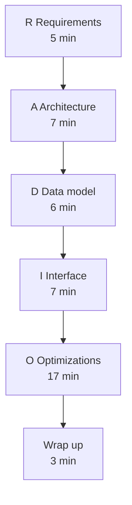
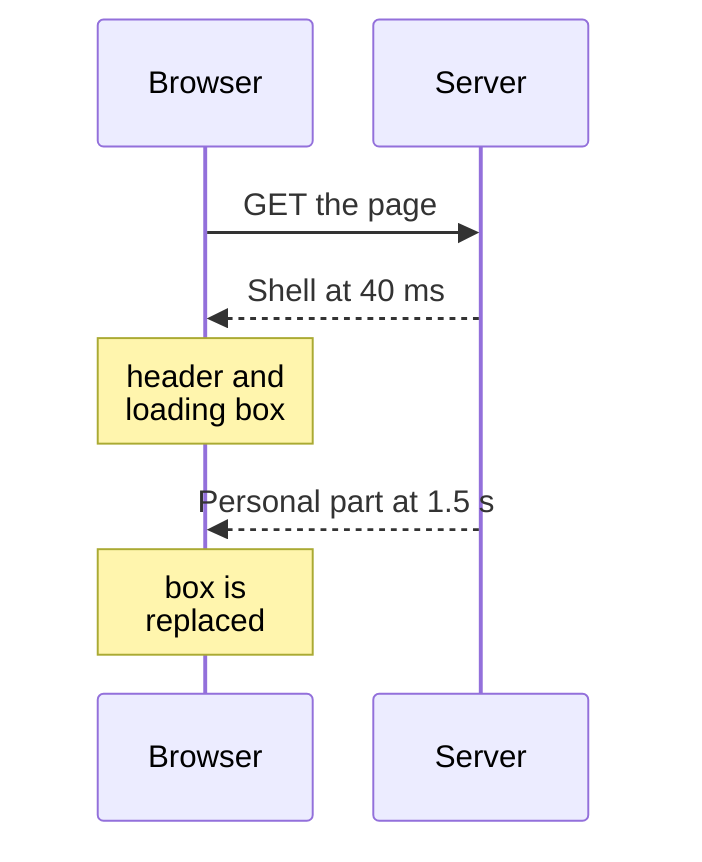
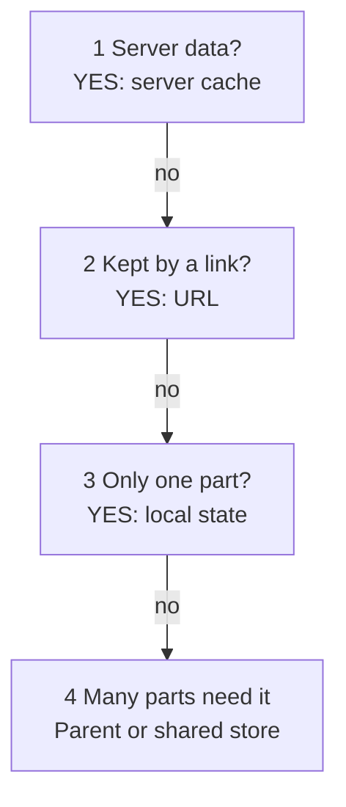
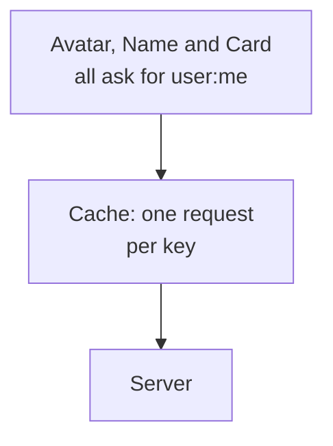
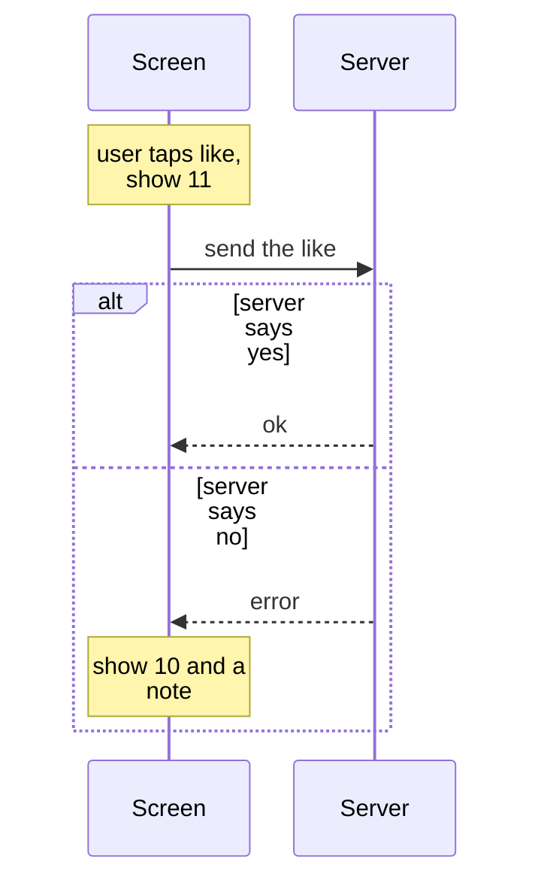
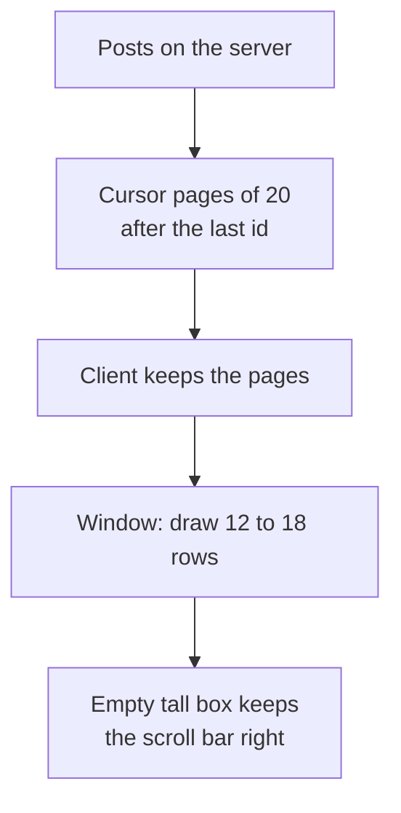
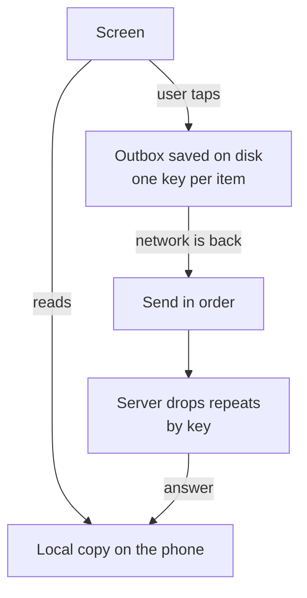

# 31. The frontend design round

> **Subject:** System Design · **Lesson:** 31 · **Made:** 2026-11-13 · **Status:** ready
>
> **You will be able to:** run a 45 minute frontend design round with a plan (RADIO); choose how each page is built; say where each piece of state lives; keep server data in one cache with one request per key; show a change before the server answers and undo it safely; draw a long list with cursor pages and a window; keep a local copy for offline; and say the three speed numbers (LCP 2.5 s, INP 200 ms, CLS 0.1).
>
> **Before this:** [LLM features in a system](30-llm-features-in-a-system.md) · **Next:** this is the last planned lesson. Go on with the [roadmap](system-design-roadmap-beginner-to-senior.md) and the [frontend system design guide](frontend-system-design.md), which has three full designs (feed, search box, chat).
>
> **How to read it:** one card is one idea. Look at the picture, guess, then press the orange bar to check. The blue bars (📖 More detail) hold the longer explanation. Skip them on the first read, and open them when you want more. About 25 minutes for the cards.

## 1. The idea: the frontend round draws the dining room, not the kitchen

In a backend round you draw the kitchen: servers, databases, queues. In a frontend round you draw the **dining room**: the screens, the parts they are made of, the data the **client** (the app on the user's phone or browser) keeps, and the calls it makes. The kitchen is a closed door with a menu. The menu is the **API** (the list of calls the server accepts). Use a fixed plan so you do not wander. A common one is **RADIO**, from GreatFrontEnd: Requirements, Architecture, Data model, Interface, Optimizations. Spend the most time on the last one.



<details class="guess"><summary>🤔 Guess: the interviewer says "design a news feed". What do you do in the first 5 minutes: draw boxes, or ask questions? Press to check.</summary>

**Ask questions.** Which devices? How many posts? Does a new post show at once? Does it work offline? Who can post? Write a short list: must have, nice to have, out of scope. The answers decide every choice later. Drawing boxes first is how you build the wrong feed.

</details>

> **Remember:** requirements first, then the parts, the data, the API, then the deep dives. Say each step out loud, and treat the server as a closed door.

<details class="more"><summary>📖 More detail: the clock, what to ask, and where each card of this lesson fits</summary>

New words (four, used in this lesson): **client** (the app on the user's device), **cache** (a saved copy you can reuse), **cursor** (a bookmark for the next page), **window** (draw only the rows in view). Words you already know from Next.js (SSR, PPR, hydration, LCP) are explained where they appear.

**The clock.** The minutes above (5, 7, 6, 7, 17, 3 of 45) are a suggestion from this repo's [frontend guide](frontend-system-design.md), not a rule from GreatFrontEnd. GreatFrontEnd calls RADIO a guide, not strict steps. If the interviewer pulls you into a deep dive early, follow them, then come back.

**What each step produces:**

| Step | You say or draw | Example for a feed |
|---|---|---|
| Requirements | Must have, nice to have, out of scope | Scroll, like, new posts pill. Not: video, ads |
| Architecture | The parts and who talks to whom | Page, list, post card, cache, API |
| Data model | The objects the client keeps, and where each lives | `Post`, `FeedPage`, the tab in the URL |
| Interface | 2 to 4 API calls with fields | `GET /feed?after=<cursor>&limit=20` |
| Optimizations | 3 or 4 deep dives | Rendering, cache, list, offline, speed numbers |

**Where the cards fit.** Card 2 (rendering) and card 3 (state) are Architecture. Cards 3 and 4 are Data model. Card 6 (cursor pages) is Interface. Cards 5, 6, 7 and 8 are Optimizations.

**Why a frontend round is different.** The interviewer wants to see that you know the browser and the phone: slow networks, small memory, taps that must answer fast. A candidate who talks about load balancers for 20 minutes has answered the other round.

Source: [GreatFrontEnd, The RADIO Framework](https://greatfrontend.com/front-end-system-design-playbook/framework). The page answered my script with HTTP 429 on 2026-11-13, so I did not re-read it today. The letters match what the search results showed today and what this repo's guide checked on 2026-10-16.

</details>

## 2. Rendering: where and when the page is built

A page has parts that are the same for everyone (header, menu) and parts that are personal (your cart). Build the first kind **ahead of time**. This is the **shell**, and the server sends it at once. Build the personal kind when asked, and **stream** it in later (send it in pieces as each piece is ready). The old way, **SSR** (server side rendering), builds the whole page on every request, so the page waits for its slowest part. **PPR** (partial prerendering) is the Next.js name for the first way. In my test, with one 1.5 second personal part, SSR sent its first byte at **1,545 ms**. PPR sent the shell at **40 ms**.



| Page | First byte | Slow part |
|---|---|---|
| Static | 45 ms | none |
| PPR | 40 ms | 1,543 ms |
| SSR | 1,545 ms | 1,545 ms |

<details class="guess"><summary>🤔 Guess: a page has one personal part that needs a 1.5 second call. When does the user first see anything with SSR? With PPR? Press to check.</summary>

**SSR: after about 1.5 s. PPR: after about 40 ms.** SSR cannot send anything until its slowest part is ready. PPR already has the shell, so it sends the shell at once and streams the personal part when it is done. Both finish at about the same time. What changes is the time to the **first thing on screen**. (Measured on one laptop with a local server. A real network adds time to both.)

</details>

> **Remember:** choose rendering per page. Same for everyone: build ahead. Personal: stream it in behind a loading box. A heavy tool behind a login can stay client side.

<details class="more"><summary>📖 More detail: the five ways, the test, the trace, and what Next.js 16.4 does now</summary>

**The ways, in plain words.** You know these names from Next.js. This is the quick refresher.

| Name | Plain meaning | First thing on screen | Good for |
|---|---|---|---|
| CSR (client side rendering) | The browser builds the page with JavaScript | Late. The HTML is nearly empty | Tools behind a login, editors |
| SSR | The server builds the whole page per request | When the slowest part is ready | Personal pages that need fresh data and search |
| SSG (static) | Built once at deploy, sent from a cache | Very early | Docs, blog, marketing |
| ISR | Static, rebuilt later by a timer or a call | Very early | Product pages, listings |
| RSC (Server Components) | Parts that run only on the server and send no JavaScript for themselves | Early | Content pages with few buttons |
| PPR | Static shell, plus streamed holes | Shell very early | Most pages in a new Next.js app |

**Hydration** is React in the browser attaching click handlers to HTML the server already sent. Before it finishes, a button looks ready and does nothing. This is the price of server HTML. I did not measure it here.

**The test** (Next.js 16.4.6, `next build` then `next start`, a client in Node 26.12.1, 2026-11-13, one laptop, `cacheComponents: true`). Three routes. The personal part waits for a real request (`connection()`), then 1,500 ms.

```jsx
// app/ppr/page.js
import { Suspense } from "react";
import { connection } from "next/server";
async function Personal() {
  await connection();
  await new Promise((r) => setTimeout(r, 1500));
  return <p>PERSONAL-PART-READY</p>;
}
export default function Page() {
  return (<main><h1>SHELL-READY</h1>
    <Suspense fallback={<p>loading-box</p>}><Personal /></Suspense></main>);
}
```

The `/ssr` route is the same page with no `Suspense`. The `/static` route has one heading and no data. I fetched each route 3 times and wrote down when the first byte came and when each marker text showed up.

| Route | The build says | First byte (3 runs) | Slow part (3 runs) | Cache header |
|---|---|---|---|---|
| `/static` | `○ Static` | 66, 43, 46 ms | none | `s-maxage=31536000`, `x-nextjs-cache: HIT` |
| `/ppr` | `◐ Partial Prerender` | 116, 41, 40 ms | 1,608, 1,542, 1,544 ms | `no-store`, `x-nextjs-postponed: 1` |
| `/ssr` | `ƒ Dynamic` | 1,549, 1,545, 1,542 ms | same as first byte | `no-store` |

The first run of each route was slower while the server warmed up. `/ppr` arrived in 14 pieces, `/ssr` in 12, `/static` in 1. I did not test CSR in a browser. Its numbers in the stepper are examples.

**A build error worth knowing.** With Cache Components on, my first version of `/ssr` did not build. The error said: `Route "/ssr": Next.js encountered uncached or runtime data during prerendering`. It named three fixes: put a `Suspense` around the access, cache it with `"use cache"`, or set `export const instant = false` to allow a blocking route. I used the last one for the comparison page. So in the new model Next.js makes you choose where the waiting goes.

**What the trace looks like** (the `/ppr` request):

| Step | What happens | On screen |
|---|---|---|
| 1 | The browser asks for the page | nothing |
| 2 | The server sends the shell built at build time (about 40 ms) | header and the loading box |
| 3 | `Personal` runs: `connection()` waits for the real request, then 1,500 ms | the same |
| 4 | The server streams the HTML for `Personal` (about 1,543 ms) | the loading box is replaced |
| 5 | The last piece arrives and the response ends (about 1,547 ms) | the full page, and after hydration, taps work |

**Step through it yourself:** [open the stepper](visuals/31-the-frontend-design-round.html). Story 1 is this card. Guess first, then press Next.

**What Next.js says now** (checked 2026-11-13):

- The latest `next` on npm is **16.4.6**, published 2026-11-09. `react` is 19.3.1.
- The Next.js caching docs (updated 2026-10-06) say new apps from `create-next-app` already have **Cache Components** and **Partial Prefetching** turned on. Older apps set `cacheComponents: true` and `partialPrefetching: true` in `next.config.ts`. Both will be on everywhere in the next major version.
- The docs call the result **Partial Prerendering**, "the default behavior with Cache Components". `"use cache"` caches a function or a component. Pair it with `cacheLife`. Anything that reads the request (`cookies()`, `headers()`, `searchParams`) or uncached data goes inside `<Suspense>`.
- Without Cache Components (the "previous model"), the docs say `fetch` requests are **not cached by default**. You opt in with `cache: "force-cache"`. Interviewers may still ask about this older model, because apps that did not turn on Cache Components still use it.
- Crawlers: the docs say Next.js detects some bots by user agent and renders the page dynamically for them, because they may not handle streamed metadata.

</details>

## 3. State has a home

Without a plan, one big part fetches, keeps, formats and draws everything. Two screens then show the same post, and one of them is old. The fix is a question order. Ask them in order. The first yes wins. Most state in a feed is **server data**, so it goes in a **cache** (a saved copy of what the server said). Filters and tabs go in the **URL**, so a shared link opens the same view. Small flags stay inside one part.



<details class="guess"><summary>🤔 Guess: a feed has the posts, the "For you" tab, one open menu on one card, and the dark mode setting. Where does each live? Press to check.</summary>

**The posts: the server cache. The tab: the URL. The open menu: local state in that card. Dark mode: a shared store** (many far away parts read it). If you put the posts in `useState` in three places, you get three copies that disagree.

</details>

> **Remember:** server data in a cache, shareable choices in the URL, small flags local, and only the rest in a shared store.

<details class="more"><summary>📖 More detail: the five homes, the cost, and what changes with Server Components</summary>

| Home | Feed page example | Why there |
|---|---|---|
| Local state | Is the "more" menu on one card open | Only that card cares |
| Parent part | Text in the composer, shared with a preview | Two sibling parts need it |
| Shared store (Context, Zustand) | Theme, signed in user | Many far away parts need it |
| Server cache (TanStack Query, Apollo) | The posts, the like counts | The server owns it, the client keeps a copy |
| URL (search params) | The tab, the search text | A shared link should open the same view |

**The cost.** More homes means more rules for the team. Write the rules down once, or every new part picks a new home.

**With Server Components.** A Server Component gets its data on the server and sends no cache to the browser. So you mostly need a client cache for data that changes in the browser: likes, live updates, forms. Say this out loud in the interview. It shows you know the 2026 split.

**Versions** (npm, 2026-11-13): `@tanstack/react-query` 5.107.1. The deeper comparison of Context, Zustand and Redux is in the [React guide](../react/react-js-frontend-interview-guide.md).

</details>

## 4. One copy of server data: the cache

Three parts of a page all need the signed in user. If each one asks the server, one page makes three calls for the same thing. Give the data a **key**, such as `user:me`. The cache keeps one running request per key and shares it. It also remembers the answer for a short time (the **fresh** time). After the user changes something, you **invalidate** the key. That means: mark it as old, so the next ask goes to the server. A failed request is never saved.



<details class="guess"><summary>🤔 Guess: three parts ask for <code>user:me</code> in the same moment. How many network calls are made? A fourth part asks 10 seconds later, and the fresh time is 30 seconds. How many now? Press to check.</summary>

**One call, then still one.** The first ask starts the request, and the cache remembers that it is running. The second and third asks get the same promise. The fourth ask finds a saved value that is 10 seconds old, which is under 30, so there is no new call. (Real run of the practice answer: `network calls: 1`.)

</details>

> **Remember:** one key, one running request, a fresh time, and invalidate after a change.

<details class="more"><summary>📖 More detail: the code, the trace, the real tools, and the cost</summary>

**The code** (`createDedupe` from the practice file, card 11):

```js
let calls = 0;
const cache = createDedupe(async (key) => {
  calls++;
  await new Promise((r) => setTimeout(r, 20));
  return "user " + key;
});
const out = await Promise.all([
  cache.get("me"), cache.get("me"), cache.get("me"),
]);
console.log(out, "network calls:", calls);
```

**Output** (Node 26.12.1):

```
[ 'user me', 'user me', 'user me' ] network calls: 1
```

**What really happens, step by step** (story 6 of the stepper, fresh time 30 s):

| Step | Who asks | What the cache does | Network calls |
|---|---|---|---|
| 1 | Nobody yet | empty | 0 |
| 2 | Avatar, sidebar, profile card at the same moment | The first ask starts a request. The other two get the same promise | 1 |
| 3 | The server answers | All three get the value. The cache saves it with the time | 1 |
| 4 | A fourth part, 10 s later | The value is 10 s old, under 30. Answers at once | 1 |
| 5 | Another part, 31 s later | 31 s is over 30. New request | 2 |
| 6 | The user edits the name, the app calls `invalidate` | The saved value is forgotten. The next ask loads again | 3 |

**Step through it yourself:** story 6 of the [stepper](visuals/31-the-frontend-design-round.html).

**The real tools.** In TanStack Query a key looks like `['user', 'me']`, and `invalidateQueries` marks keys as old. Its docs say cached data counts as stale by default, and stale queries are refetched in the background when a new part mounts, the window gets focus, or the network comes back. The docs I read do not spell out the sharing of one request per key, so I only claim it for my practice code. Apollo Client keeps one object per type and id, such as `Post:7`, so a changed post updates every query that shows it. (That comes from this repo's guide, checked 2026-10-16. I did not re-check it today.) The practice version waits for the new answer. The real libraries can show the old value first and refresh it.

**The cost.** You must name the keys well, decide how long a value stays fresh, and invalidate the right keys after every change. Forget one and a screen shows old data.

**Same idea, another layer.** Lesson [04](04-caching.md) is the cache on the server. This is the same idea in the browser.

</details>

## 5. Optimistic updates: show the change first, undo it safely

A like should feel instant. So the screen shows the new number at once and asks the server after. This is **optimistic**: you hope the server says yes. If it says no, you **roll back** (undo). A simple way is to keep a copy of the old screen and put it back on an error. That has a bug when two changes are in flight. A safer way: show the **confirmed value plus every change that is still waiting**. A failure removes only its own change.



<details class="guess"><summary>🤔 Guess: the like on post a is slow and fails. The like on post b is quick and works. Code that puts back a whole old copy on an error: what does the screen show at the end? Press to check.</summary>

**`a:10 b:5`.** The old copy was taken before the like on b was confirmed, so putting it back wipes b, even though the server said yes to b. The waiting list code ends at **`a:10 b:6`**. (Real run of my plain code and of the practice answer.)

</details>

> **Remember:** shown value = confirmed value + changes that are waiting. A failure removes only its own change. Use it only for easy, safe actions, never for money.

<details class="more"><summary>📖 More detail: the code, the trace, the real recipes, and when not to use it</summary>

**The code** (`createOptimisticStore` from the practice file):

```js
const wait = (ms, fail) => () => new Promise((ok, no) =>
  setTimeout(() => (fail ? no(new Error("no")) : ok()), ms));
const like = (id) => (s) =>
  s.map((p) => (p.id === id ? { ...p, likes: p.likes + 1 } : p));
const start = () => [{ id: "a", likes: 10 }, { id: "b", likes: 5 }];
const show = (s) => s.map((p) => p.id + ":" + p.likes).join(" ");

const store = createOptimisticStore(start());
await Promise.all([
  store.run(like("a"), wait(30, true)),
  store.run(like("b"), wait(5)),
]);
console.log(show(store.getState()));
```

**Output** (Node 26.12.1):

```
a:10 b:6
```

**What really happens, step by step** (story 4 of the stepper):

| Step | Event | Plain snapshot code shows | Waiting list store shows |
|---|---|---|---|
| 1 | Start | `a:10 b:5` | `a:10 b:5` |
| 2 | Tap like on a. The request is slow | `a:11 b:5` (saved copy 1: `a:10 b:5`) | `a:11 b:5` (1 waiting) |
| 3 | Tap like on b. The request is quick | `a:11 b:6` (saved copy 2: `a:11 b:5`) | `a:11 b:6` (2 waiting) |
| 4 | The server says yes to b | `a:11 b:6` | `a:11 b:6` (1 waiting) |
| 5 | The server says no to a | **`a:10 b:5`**, copy 1 is put back | **`a:10 b:6`**, only a is removed |

**Step through it yourself:** stories 3 and 4 of the [stepper](visuals/31-the-frontend-design-round.html). Story 3 is one like that fails and one that works.

**The real recipes** (checked 2026-11-13):

- **TanStack Query v5.** The docs show two ways. One uses the `variables` of the mutation to draw a temporary item, with no cache change. The other changes the cache: `onMutate` calls `cancelQueries` (so a running refetch cannot overwrite your guess), saves the old data with `getQueryData`, writes the new value with `setQueryData`, and returns the saved copy. `onError` puts it back. `onSettled` calls `invalidateQueries` to fetch the true value. In the current docs the handlers get `context.client`. The snapshot recipe has the bug above when changes overlap, and the final refetch is what heals it. I ran my own plain code, not TanStack.
- **React 19 `useOptimistic`.** The React docs say the optimistic state is discarded when the Action ends, and React then renders the real `value`. On failure the UI goes back to what it showed before. This is the same model as the waiting list.

**When not to use it.** Do not show "paid" before the bank says yes. Money, stock and deletes that cannot be undone wait for the server. Likes, follows and "mark as read" are good.

**What to show on a failure.** A short message and a way to try again. The user must know the number went back.

</details>

## 6. Long lists: cursor pages and a window

A feed has two jobs. First, **fetching**: how to ask for the next page. Offset pages (`?page=3`) break when the list changes, because every post moves down by one. A **cursor** (`?after=6`) is a bookmark, so it does not. Second, **drawing**: do not draw 100,000 rows. Draw only the rows in view, plus a few spare ones. This is a **window** (interview word: virtualization). A tall empty box keeps the scroll bar right.



<details class="guess"><summary>🤔 Guess: page 1 shows posts 10 to 6. Then post 11 arrives. What does page 2 show by offset 5? By cursor "after 6"? Press to check.</summary>

**Offset: 6, 5, 4, 3, 2.** Post 6 shows twice. **Cursor: 5, 4, 3, 2, 1.** The new post moved every position down by one, but post ids did not change. (Real run.) For the window: 100,000 rows of 50 px in a 600 px screen need **12 rows** drawn, or 18 with 3 spare rows each side. The empty box is 5,000,000 px tall.

</details>

> **Remember:** cursor pages for lists that change, a window for long lists, and a tall empty box so the scroll bar stays right.

<details class="more"><summary>📖 More detail: the code, the trace, the costs, and the rest of infinite scroll</summary>

**The code** (from the practice file):

```js
const feed = (n) => Array.from({ length: n }, (_, i) => ({ id: n - i }));
const ids = (list) => list.map((p) => p.id);
console.log(ids(pageByOffset(feed(11), 5, 5)));
const first = pageByCursor(feed(10), null, 5);
console.log(ids(pageByCursor(feed(11), first.nextCursor, 5).items));
console.log(visibleRange({ scrollTop: 2500000, viewportHeight: 600,
  rowHeight: 50, total: 100000, overscan: 3 }));
```

**Output** (Node 26.12.1):

```
[ 6, 5, 4, 3, 2 ]
[ 5, 4, 3, 2, 1 ]
{ start: 49997, end: 50015, offsetTop: 2499850, totalHeight: 5000000 }
```

**What really happens in the window** (story 2 of the stepper; screen 600 px, rows 50 px, 100,000 rows):

| Step | `scrollTop` | Overscan | Rows drawn (`start` to `end`, end is one past the last) | Count |
|---|---|---|---|---|
| 1 | 0 | 0 | 0 to 12 | 12 |
| 2 | 125 | 0 | 2 to 15. A row that is partly in view counts | 13 |
| 3 | 125 | 3 | 0 to 18. Spare rows above are cut at row 0 | 18 |
| 4 | 2,500,000 | 3 | 49,997 to 50,015, moved down by `offsetTop` 2,499,850 px | 18 |
| 5 | 99,999,999 (past the end) | 3 | 99,985 to 100,000. The scroll is first kept inside the list | 15 |

**Step through it yourself:** stories 2 and 5 of the [stepper](visuals/31-the-frontend-design-round.html).

**The cost of each choice.**

| Choice | Good | Cost |
|---|---|---|
| Offset | You can jump to page 50. Simple | Repeats and gaps in a live list. Deep pages are slow in the database |
| Cursor | No repeats, fast at any depth | You cannot jump to page 50 |
| Window | Memory and draw time stay small | Browser search (Ctrl+F) cannot find rows that are not drawn. Rows of different heights must be measured. Keyboard focus and screen reader order need care |

An admin table where people jump around (for example a CMS order list) can use offsets. A feed or a chat uses cursors.

**The rest of infinite scroll** (from the [frontend guide](frontend-system-design.md)): a watcher near the bottom (`IntersectionObserver`) asks for the next cursor page. Keep about 5 pages in memory and drop the rest. Do not push new posts into the list while the user reads: show a "12 new posts" pill instead. Save the scroll position when the user opens a post and comes back.

**Libraries.** For React, TanStack Virtual (3.14.26 on npm, 2026-11-13) and react-window (2.5.3) do the window. Its docs call TanStack Virtual "headless", which means it gives you numbers and you draw the rows. That is what `visibleRange` does in the practice file.

</details>

## 7. Offline: a local copy and an outbox

The phone loses the network in a lift. The user taps "Order". Without a plan the order is lost, or the user taps five times and makes five orders. The fix has two parts. The screen **reads from a local copy**, not straight from the network. Every change goes into a saved list called an **outbox**, with a unique key on each item. When the network is back, the app sends the items in order. The server uses the key to drop repeats.



<details class="guess"><summary>🤔 Guess: the user taps "Order" 3 times in the lift. The phone comes online and sends all 3 with the same request key. How many orders does the server make? Press to check.</summary>

**One.** The server saves the answer under the key and sends the same answer back for the repeats. This is lesson 13: a payment run twice with no key charged 200, and with a key charged 100 (real run there). The outbox only works because the server accepts a key.

</details>

> **Remember:** read from the local copy, write to an outbox, give every item a key, and decide what happens when both sides changed the same thing.

<details class="more"><summary>📖 More detail: how it connects to card 5, conflicts, and where to store it</summary>

**Same list, saved on disk.** The waiting list in card 5 is already an outbox in memory. Save it to the phone, add a unique key to each item, and retry after a reconnect. This is an idea, not something I built or ran for this lesson.

**When both sides changed the same thing** (a sync conflict). The [frontend guide](frontend-system-design.md) lists four rules. I did not re-check it today.

| Rule | How it works | Good for |
|---|---|---|
| Last write wins | The newest time stamp wins | Settings, profile fields |
| Version check | The server rejects an old version and the app asks the user | Orders, forms with money |
| Merge | Combine both changes field by field | Notes, carts, lists |
| Server is the truth | The phone fetches again and drops its change | Stock, prices, points |

**Where to store it.** On React Native: a small fast store for settings and a saved query cache, SQLite for many rows you search, and the Keychain or Keystore for tokens. On the web: browser storage for the saved cache. The guide has the tools and versions for React Native (checked 2026-10-16), so read Part 6 there instead of trusting a number from me.

**Old app versions.** On mobile, old versions of the app stay installed for months. So the API must keep working for them. Add fields, do not remove them.

**Stale on purpose.** If a screen can be old, say so on the screen ("saved 3 minutes ago"). A user can accept old data. A user cannot accept data that is wrong and looks fresh.

</details>

## 8. The speed budget: three numbers

Speed is three numbers, measured on real visits. **LCP** (largest contentful paint): when the biggest thing on the screen appears. **INP** (interaction to next paint): how long from a tap or key press until the screen changes. **CLS** (cumulative layout shift): how much the page jumps. Google reads the **75th percentile** of visits, split by phone and desktop. Each design choice in this lesson moves one of them.

| Number | Good | A design choice that moves it |
|---|---|---|
| LCP | 2.5 s or less | A shell on screen at once, static or streamed |
| INP | 200 ms or less | Less JavaScript, a window over long lists, optimistic updates |
| CLS | 0.1 or less | Reserved space for images and loading boxes |

<details class="guess"><summary>🤔 Guess: the page looks fast. But each tap on "Add to cart" takes 600 ms to change anything. Which of the three numbers is bad? Press to check.</summary>

**INP.** It measures the time from the tap to the next change on screen. 600 ms is over the 500 ms line, so it is "poor". Common causes: too much JavaScript running at the moment of the tap, or waiting for the server. An optimistic update (card 5) answers on the next frame, so the number drops.

</details>

> **Remember:** LCP 2.5 s, INP 200 ms, CLS 0.1, at the 75th percentile of real visits. Say which design choice moves which number.

<details class="more"><summary>📖 More detail: the full bands, what moves each number, and budgets</summary>

**The bands** (web.dev, read 2026-11-13):

| Metric | Good | Needs improvement | Poor |
|---|---|---|---|
| LCP | 2.5 s or less | 2.5 to 4.0 s | over 4.0 s |
| INP | 200 ms or less | 200 to 500 ms | over 500 ms |
| CLS | 0.1 or less | 0.1 to 0.25 | over 0.25 |

INP replaced FID (first input delay) as a Core Web Vital in 2024. INP looks at all taps and key presses in a visit and reports one value for the visit. The web.dev page says stable metrics "aren't necessarily permanent", so say "as of today" in an interview. One blog I found today claimed that Google tightened LCP to 2.0 s in March 2026. I could not confirm it, and web.dev still says 2.5 s, so I do not use it.

**What moves each number** (the advice on the web.dev optimize pages):

| Number | What helps |
|---|---|
| LCP | A fast first byte (the web.dev guide gives about 40 percent of LCP to waiting for the first byte). Serve from a CDN. Put the LCP image in the first HTML and do not lazy load it. Right sized images. Less script that blocks drawing |
| INP | Less JavaScript, no long tasks at the moment of a tap. A window over long lists. Answer at once with an optimistic update |
| CLS | Set `width` and `height` (or `aspect-ratio`) on images. Make loading boxes and skeletons the same size as the content. Do not push new content above what the user reads. A "12 new posts" pill is part of this |

**A budget** is a number you write down and a check in CI that fails the build above it. The repo guide uses "about 200 KB of gzipped JavaScript for the first load of a page" as an example. That is a team choice, not a rule from Google.

**Lab and field.** A lab test (for example in Chrome) runs one visit on your machine. The numbers Google uses come from real users. Do both. Log the three numbers from real visits (see lesson [14](14-observability.md)).

**Say this in the interview:** "I would set a budget for the three numbers, check them in CI and in real user data, and I can say which choice in my design moves which one."

</details>

## 9. Five mistakes, and what to say if you freeze

- **Wrong:** talk about load balancers and sharding for 20 minutes. **Right:** treat the server as a closed door and draw screens, state and calls.
- **Wrong:** one rendering choice for the whole app. **Right:** choose per page, and say where the waiting goes.
- **Wrong:** copy server data into `useState` in each part. **Right:** one cache, named keys, invalidate after a change.
- **Wrong:** restore a whole old copy on an error, or use an optimistic update for money. **Right:** remove only the failed change, refetch the truth, and keep money behind the server's answer.
- **Wrong:** offset pages and 100,000 drawn rows. **Right:** cursor pages and a window.

<details class="guess"><summary>🤔 Guess: you say "I would use SSR for every page, because it is good for search." What is the problem? Press to check.</summary>

**SSR waits for the slowest part of the page.** In my test the first byte came at 1,545 ms, against 40 ms for a prebuilt shell. Pages that are the same for everyone can be built ahead. Personal parts can stream in behind a loading box. Search engines matter for public pages, and a prebuilt page serves them well too. Say the choice per page, with its cost.

</details>

> **Remember:** if you freeze, say "I ask the requirements. I draw the parts and say where each piece of state lives. I name the data and the API. Then I go deep: how the page is built, one cache, safe optimistic changes, cursor pages and a window, offline, and the three speed numbers."

<details class="more"><summary>📖 More detail: the mistakes in full, and the freeze plan</summary>

**Wrong:** the cache in each part.

```js
// sketch, not run here
const [user, setUser] = useState(null);
useEffect(() => { fetchUser().then(setUser); }, []);   // three parts, three requests, three copies
```

**Right:** one key and one shared request (card 4), or fetch it in a Server Component and pass it down.

**Wrong:** a whole snapshot on error with two changes in flight (card 5). **Right:** remove only the failed change, and refetch in `onSettled`.

**If you freeze:**

1. Say "Let me ask a few questions first" and write must have, nice to have, and out of scope.
2. Say "I will draw the parts, then say where each piece of state lives." Draw the tree. Name the server cache, the URL, local state.
3. Say "Now the deep dives." Pick three: rendering, the list, optimistic or offline. Close with the three speed numbers.

</details>

## 10. Watch and play

How the links were checked on 2026-11-13: I fetched each link below and it answered `200`, except the GreatFrontEnd page, which answered my script with `429` (too many requests). For the video, YouTube's own data gave me the title and channel only, and the length comes from the Next.js docs page. I did not watch the video, run the codelab or run PageSpeed Insights. I read the web.dev, Next.js, TanStack and React pages named in the cards.

- **Video:** [Next.js Explained: Partial Prerendering (PPR)](https://www.youtube.com/watch?v=MTcPrTIBkpA) (Delba, about 10 minutes according to the Next.js docs). Compare its pictures with card 2.
- **Play with it:** [the stepper in this folder](visuals/31-the-frontend-design-round.html). Six stories: where the page is built, a window over a list, an optimistic like, two likes with one failing, offset against cursor pages, one request per key. Guess first, then press Next.
- **Play with it:** [Understanding INP, a codelab from Google](https://codelabs.developers.google.com/understanding-inp). You clone a small repo, click a button, and watch INP change while you add delays. Compare with card 8.
- **Read:** [Web Vitals on web.dev](https://web.dev/articles/vitals). The three numbers and the 75th percentile, as in card 8.
- **Read:** [Next.js docs: Caching](https://nextjs.org/docs/app/getting-started/caching). Read "Prerendering" and "Streaming uncached data" for card 2.
- **Read:** [TanStack Query: Optimistic Updates](https://tanstack.com/query/v5/docs/framework/react/guides/optimistic-updates). Compare the cache recipe with the sequence picture in card 5.
- **Read:** [GreatFrontEnd: The RADIO Framework](https://greatfrontend.com/front-end-system-design-playbook/framework). The plan in card 1. If it shows an error, try again later.

<details><summary>Go deeper (optional)</summary>

**More links that load** (`200` on 2026-11-13, not read in full): [React: useOptimistic](https://react.dev/reference/react/useOptimistic), [TanStack Virtual introduction](https://tanstack.com/virtual/latest/docs/introduction), [PageSpeed Insights](https://pagespeed.web.dev/) (paste a URL to see lab and real user numbers), [web.dev: Interaction to Next Paint](https://web.dev/articles/inp), [Next.js: use cache](https://nextjs.org/docs/app/api-reference/directives/use-cache), [Next.js: Incremental Static Regeneration](https://nextjs.org/docs/app/guides/incremental-static-regeneration).

**Next.js in your stack.** The Next.js facts in card 2 come from the docs and my test on 16.4.6. Many apps still run the older model (no Cache Components), where `fetch` is not cached unless you ask. Ask which model the interviewer means.

**What this lesson skips.** Real time (polling, SSE, WebSockets, reconnect, order and duplicates), design systems, micro-frontends, accessibility (WCAG 2.2), internationalization, where the token lives (cookie against local storage), and error monitoring. They are in the [frontend system design guide](frontend-system-design.md) with a [cheatsheet](frontend-system-design-cheatsheet.html). Lesson [30](30-llm-features-in-a-system.md) card 5 covers streaming a response over SSE, and lesson [29](29-security-in-a-design.md) covers the token.

**Three full designs.** Part 10 of the guide designs a news feed, a search box (typeahead) and a chat screen with RADIO. Do one on paper in 45 minutes with a timer.

**The numbers in the stepper.** Story 1 uses my measured numbers for static, SSR and PPR, and example numbers for CSR (HTML 40 ms, JavaScript ready at 800 ms, data 1,500 ms later). The other stories run the same code as the practice answer.

</details>

## 11. Practice

**A. Predict the output** (write your answer before opening)

Every row is 50 px tall. The screen is 600 px tall. The list has 100 rows. The user has scrolled 125 px. What does this print?

```js
const r = visibleRange({
  scrollTop: 125, viewportHeight: 600, rowHeight: 50, total: 100,
});
console.log(r.start, r.end, r.end - r.start);
```

Then answer: why is the count 13, and not 12?

<details><summary>Answer</summary>

```
2 15 13
```

125 px is the middle of row 2, so row 2 is partly in view and must be drawn. The bottom edge is at 725 px, the middle of row 14, so row 14 is drawn too. Rows 2 to 14 are 13 rows. `end` is 15 because it is one past the last row, like `slice`. (Checked on 2026-11-13 with Node 26.12.1.)

</details>

**B. Fix the bug**

Two likes are in flight. The like on a is slow and fails. The like on b is quick and works. What does this print? Then fix it, without a store, so b keeps its like.

```js
const wait = (ms, fail) => () => new Promise((ok, no) =>
  setTimeout(() => (fail ? no(new Error("no")) : ok()), ms));
const like = (id) => (s) =>
  s.map((p) => (p.id === id ? { ...p, likes: p.likes + 1 } : p));
const show = (s) => s.map((p) => p.id + ":" + p.likes).join(" ");

let state = [{ id: "a", likes: 10 }, { id: "b", likes: 5 }];
async function likeIt(id, send) {
  const snapshot = state;
  state = like(id)(state);
  try { await send(); } catch { state = snapshot; }
}
await Promise.all([likeIt("a", wait(30, true)), likeIt("b", wait(5))]);
console.log(show(state));
```

<details><summary>Answer</summary>

It prints `a:10 b:5`. The saved copy was taken before the like on b was confirmed. Putting it back wipes b. Fix: on an error, undo only that one change.

```js
const unlike = (id) => (s) =>
  s.map((p) => (p.id === id ? { ...p, likes: p.likes - 1 } : p));
async function likeIt(id, send) {
  state = like(id)(state);
  try { await send(); } catch { state = unlike(id)(state); }
}
// a:10 b:6
```

The practice file does this in a more general way: the shown value is the confirmed value plus the waiting changes. (Checked on 2026-11-13 with Node 26.12.1: the first version printed `a:10 b:5`, the fixed one `a:10 b:6`.)

</details>

**C. Write it yourself**

Open `learn/system-design/practice/31-the-frontend-design-round.js`. It has five empty functions: `visibleRange`, `pageByOffset`, `pageByCursor`, `createDedupe` and `createOptimisticStore`. There is no browser and no network. The notes in the file list every case. Write them, then run this from the repo root and make all 28 tests pass:

```
node --test learn/system-design/practice/31-the-frontend-design-round.test.js
```

The key tests are "rolling back one failed change keeps the other change that is still waiting", "a new post at the top makes OFFSET show an old post twice" and "a failed request is shared by the waiting callers but is never saved".

<details><summary>One possible answer</summary>

```js
function visibleRange({ scrollTop, viewportHeight, rowHeight, total, overscan = 0 }) {
  const totalHeight = total * rowHeight;
  const maxScroll = Math.max(0, totalHeight - viewportHeight);
  const top = Math.min(Math.max(0, scrollTop), maxScroll);          // keep the scroll inside the list
  const start = Math.max(0, Math.floor(top / rowHeight) - overscan);
  const end = Math.min(total, Math.ceil((top + viewportHeight) / rowHeight) + overscan);
  return { start, end, offsetTop: start * rowHeight, totalHeight };
}

function pageByOffset(items, offset, limit) {
  return items.slice(offset, offset + limit);
}

function pageByCursor(items, after, limit) {
  const rest = after === null ? items : items.filter((item) => item.id < after);   // items are newest first
  const page = rest.slice(0, limit);
  const nextCursor = rest.length > limit ? page[page.length - 1].id : null;
  return { items: page, nextCursor };
}

function createDedupe(load, { now = Date.now, freshMs = 0 } = {}) {
  const inFlight = new Map();
  const saved = new Map();
  return {
    get(key) {
      if (inFlight.has(key)) return inFlight.get(key);              // someone already asked: share their request
      const hit = saved.get(key);
      if (hit && now() - hit.at < freshMs) return Promise.resolve(hit.value);
      const request = Promise.resolve()
        .then(() => load(key))
        .then(
          (value) => { saved.set(key, { value, at: now() }); inFlight.delete(key); return value; },
          (error) => { inFlight.delete(key); throw error; },      // a failure is never saved
        );
      inFlight.set(key, request);
      return request;
    },
    invalidate(key) {
      saved.delete(key);
    },
  };
}

function createOptimisticStore(initial, onChange = () => {}) {
  let confirmed = initial;
  let pending = [];
  let nextId = 1;
  const view = () => pending.reduce((state, item) => item.change(state), confirmed);
  return {
    getState: view,
    async run(change, send) {
      const id = nextId++;
      pending.push({ id, change });
      onChange(view());                                               // the screen changes at once
      try {
        await send();
        confirmed = change(confirmed);
        pending = pending.filter((item) => item.id !== id);
        onChange(view());
        return { ok: true };
      } catch (error) {
        pending = pending.filter((item) => item.id !== id);          // undo only this change
        onChange(view());
        return { ok: false, error };
      }
    },
  };
}

module.exports = { visibleRange, pageByOffset, pageByCursor, createDedupe, createOptimisticStore };
```

Checked on 2026-11-13 with Node 26.12.1: the 28 tests fail on the empty stub and all 28 pass with this answer. I also broke the answer on purpose in 11 ways (no clamp on the scroll, no end limit, a failure that is saved, a cursor that uses `<=`, one waiting list that is cleared on any error, and others), and the tests failed each time. The first try of two of those did not apply, so I redid them. The dedupe has no limit on how many keys it keeps. A real cache also drops old keys.

</details>

## 12. Interview question

**Q:** "Design the frontend of a news feed for web and mobile. Walk me through the parts, the data, and how you keep it fast and smooth."

Common follow-ups: "A user taps like on a bad network. What happens?" and "How do you render the first page?"

<details><summary>A strong answer, in four parts</summary>

1. **Problem:** a feed is a long list that changes while the user reads, on slow phones and unreliable networks. A wrong design repeats posts, draws thousands of rows, shows blank screens, and feels slow on every tap.
2. **How it works:** I start with requirements (devices, size, real time, offline). Parts: a page, a list, a post card. The posts are server data, so they live in a query cache with a key per tab. The tab lives in the URL. The API is `GET /feed?after=<cursor>&limit=20`, and a cursor does not repeat posts when a new one arrives. The list draws only the rows in view, with a few spare. The first page comes from a prebuilt shell with the feed streamed in, so something shows at once. A like is optimistic: the screen changes first, a failure removes only that change and shows a message, and the cache refetches the true count. New posts show as a "12 new posts" pill, not inside the list. Offline: read from a local copy, and send likes from an outbox with a key per item.
3. **Tradeoff:** a cursor cannot jump to page 50, while an offset can but repeats posts. A window breaks browser search and needs fixed or measured row heights. Optimistic updates feel fast and need a rollback, and I would not use them for money. SSR waits for the slowest part (1,545 ms against 40 ms for a shell in my test), so I stream the personal parts. I set a budget for LCP 2.5 s, INP 200 ms and CLS 0.1 and check it on real user data.
4. **My example:**
   - **Fact:** my DBO case study says one GraphQL API (Nexus and Prisma) serves both the React Native app and the CMS admin, and the app has order history and shipping status.
   - **Fact:** my project notes do not say that I built an optimistic update, a windowed list or an offline outbox in DBO, so I will not claim it.
   - **Idea, not a fact:** in DBO, order history is a long list that grows, so it fits cursor pages. Redeeming points should wait for the server, like money. A CMS table where admins jump to a page can use offsets.
   - **Idea, not a fact:** my own practice is the five functions in `practice/31-the-frontend-design-round.js` and the Next.js timings I measured in this lesson. I can say those honestly as "I tested it", not "I shipped it".

</details>

## 13. Explain it back

Close this file. Explain how you would run a frontend design round for a news feed, out loud, like to a new junior, in 4 parts (problem, how, tradeoff, my example). Use the dining room picture, then the story of the page that waits 1.5 seconds, then the story of the two likes where one fails. Then write your best version below and run `/explain-check the frontend design round` or ask the `explain-coach` agent to review it.

### My explanation

<write here>

### Coach feedback

<the explain-coach agent writes here>

## 14. Review questions (day 1, 3, 7, 21)

1. Name the five steps of RADIO. Which one gets the most time, and what do you do in the first one?
2. A page has one personal part that needs a 1.5 second call. What does the user see with SSR, and with a prebuilt shell that streams? Which numbers did I measure?
3. A feed has the posts, a tab, one open menu and the theme. Where does each live?
4. Three parts ask for the same user at once. What does the cache do, and what do you do after the user edits their name?
5. Two likes are in flight. The first fails and the second works. Why can "put back the old copy" go wrong, and what is the fix?
6. A new post arrives between page 1 and page 2. What does offset show, and what does a cursor show? How many rows does a window draw for a 600 px screen with 50 px rows?
7. Say the three speed numbers with their good values, and which choice in your design moves each one.

<details><summary>Answers</summary>

1. Requirements, Architecture, Data model, Interface, Optimizations. Optimizations gets the most time (about 17 of 45 minutes in the repo's suggestion). In the first step you ask questions (devices, size, real time, offline) and write must have, nice to have, out of scope.
2. SSR shows nothing until the slow part is ready (first byte at about 1,545 ms in my test). The shell shows first (about 40 ms) and the personal part streams in at about 1,543 ms. That was Next.js 16.4.6 on one laptop with a local server.
3. Posts: the server cache. Tab: the URL. Open menu: local state. Theme: a shared store.
4. One request is shared, so one network call. The answer is saved for the fresh time. After the edit you invalidate the key (`user:me`), so the next ask loads again.
5. The old copy was taken before the second like was confirmed, so putting it back wipes a like that worked (`a:10 b:5` in my run). Show the confirmed value plus the waiting changes, and remove only the failed one (`a:10 b:6`). Also refetch at the end.
6. Offset shows 6, 5, 4, 3, 2 (post 6 twice). A cursor shows 5, 4, 3, 2, 1. A window draws 12 rows, or 18 with 3 spare rows on each side.
7. LCP 2.5 s or less (a shell on screen at once, a fast first byte), INP 200 ms or less (less JavaScript, a window, optimistic updates), CLS 0.1 or less (reserve space for images and loading boxes). All at the 75th percentile of real visits.

</details>

## Connected lessons

- [LLM features in a system](30-llm-features-in-a-system.md) - the lesson before. Card 5 there streams an answer over SSE, the same idea as the streamed shell in card 2.
- [Caching](04-caching.md) - the cache on the server. Card 4 is the same idea in the browser.
- [CDN](05-cdn.md) - the prebuilt shell is served from a CDN in production.
- [Idempotency and retries](13-idempotency-and-retries.md) - the key on every outbox item in card 7.
- [Observability](14-observability.md) - log the three speed numbers from real visits.
- [Security in a design](29-security-in-a-design.md) - where the token lives and who may see what.
- [Frontend system design guide](frontend-system-design.md) and its [cheatsheet](frontend-system-design-cheatsheet.html) - the deeper version with real time, design systems and three full designs.
- [Performance: web, mobile and backend](performance-optimization-web-mobile-backend.md) - more on the speed numbers.
- [React and JavaScript frontend guide](../react/react-js-frontend-interview-guide.md) - state libraries and Server Components in depth.
- [DBO case study](../../interview/my-projects/dbo-b2b-platform-system-design-case-study.md) - one GraphQL API for the app and the CMS.
