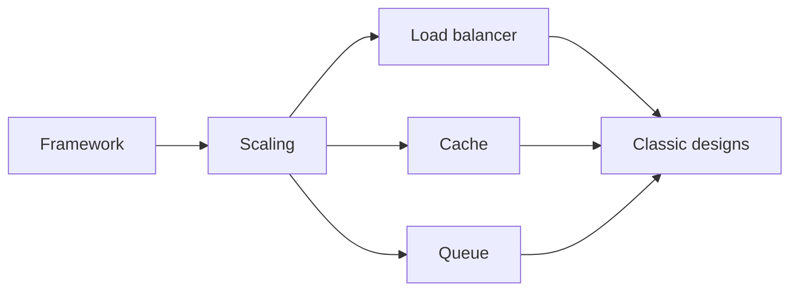

# System Design

Designing systems that scale: the building blocks, the interview framework, and classic designs.

**Why it matters in interviews:** Senior rounds almost always include one design question. They judge how you clarify, draw, and explain tradeoffs, not a perfect answer.

## The map

How the lessons connect. Learn left to right.

## Lessons, one concept per file

Each lesson is one small file made from [the lesson template](../../templates/lesson-template.md): picture first, a code trace, practice, links to watch and play, and an explain it back section.

Status: `planned` (not written yet), `ready` (written, not studied), `learning`, `can explain` (passed explain-check).

### Building blocks

| # | Lesson | You will understand | Status |
|---|---|---|---|
| 01 | The interview framework `01-the-interview-framework.md` | requirements, estimates, API, data, high level design, deep dive | planned |
| 02 | Scaling up vs out `02-scaling-up-vs-out.md` | vertical vs horizontal, stateless servers | planned |
| 03 | Load balancers `03-load-balancers.md` | L4 vs L7, algorithms, health checks | planned |
| 04 | Caching `04-caching.md` | cache aside, write through, TTL, invalidation | planned |
| 05 | CDN `05-cdn.md` | what it caches and where | planned |
| 06 | Message queues `06-message-queues.md` | why async, at least once, dead letter queues | planned |
| 07 | Consistency and CAP `07-consistency-and-cap.md` | strong vs eventual, what CAP really says | planned |

### Classic designs

| # | Lesson | You will understand | Status |
|---|---|---|---|
| 08 | Design a URL shortener `08-design-a-url-shortener.md` | hashing, storage, redirects at scale | planned |
| 09 | Design a rate limiter `09-design-a-rate-limiter.md` | algorithms and where the counter lives | planned |
| 10 | Design a chat app `10-design-a-chat-app.md` | WebSockets, message storage, delivery status | planned |
| 11 | Design a notification system `11-design-a-notification-system.md` | queues, retries, user preferences | planned |
| 12 | Design an online shop checkout `12-design-an-online-shop-checkout.md` | inventory, payments, webhooks, sagas | planned |

### Senior level

| # | Lesson | You will understand | Status |
|---|---|---|---|
| 13 | Idempotency and retries `13-idempotency-and-retries.md` | making repeated requests safe | planned |
| 14 | Observability `14-observability.md` | logs, metrics, traces | planned |
| 15 | Choosing tools and explaining why `15-choosing-tools-and-explaining-why.md` | how to defend a choice in an interview | planned |

**To make the next lesson:** in a chat with this folder open, say `/learn system-design 01` to learn it live with Claude, or ask "make lesson system-design 01" and the `research-material` agent writes the file. When a lesson file exists, its row becomes a link and the status changes to `ready`.

## Guides already here

Longer guides that cover many concepts at once. Good for revision after the lessons.

- [System design basics for a senior full stack interview](system-design-basics-senior-fullstack-interview.md)
- [System design step by step, with two full designs](system-design-step-by-step-walkthrough.md)
- [Load balancers and microservices for an online shop](load-balancers-microservices-online-shop.md)
- [Performance: web, mobile and backend](performance-optimization-web-mobile-backend.md)
- [Choosing the right tool and explaining why](choosing-the-right-tool-frontend-backend-decisions.md)

## Visual cheatsheets

Open in the browser. Everything visible on one page.

- [System design visual cheatsheet](system-design-cheatsheet.html)
- [Load balancers and microservices visual cheatsheet](load-balancers-microservices-online-shop-cheatsheet.html)

## Watch and play

Trusted places to see the ideas, not only read them. Each lesson adds its own checked video and visualizer links.

- [System Design Primer](https://github.com/donnemartin/system-design-primer) - free, with many diagrams
- [Excalidraw](https://excalidraw.com/) - draw your designs like on a whiteboard
- [roadmap.sh System Design](https://roadmap.sh/system-design) - visual map of the topics
