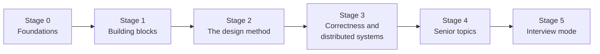
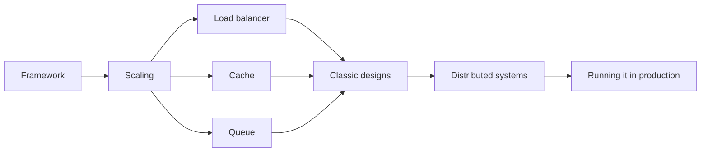

# System Design

Designing systems that scale: the building blocks, the interview framework, and classic designs.

**Why it matters in interviews:** Senior rounds almost always include one design question. They judge how you clarify, draw, and explain tradeoffs, not a perfect answer.

**Start here:** [System design roadmap, beginner to senior](system-design-roadmap-beginner-to-senior.md) ([visual version](system-design-roadmap-beginner-to-senior-cheatsheet.html)). It puts every file below in order, in six stages, with "I can..." checks and a 10 week plan that fits your weekly schedule.

## The map

How the lessons connect. Learn left to right.

Inside each stage, the lessons connect like this:

## Lessons, one concept per file

Each lesson is one small file made from [the lesson template](../../templates/lesson-template.md): picture first, a code trace, practice, links to watch and play, and an explain it back section.

Status: `planned` (not written yet), `ready` (written, not studied), `learning`, `can explain` (passed explain-check).

### Building blocks

| # | Lesson | You will understand | Status |
|---|---|---|---|
| 01 | [The interview framework](01-the-interview-framework.md) | requirements, estimates, API, data, high level design, deep dive | ready |
| 02 | [Scaling up vs out](02-scaling-up-vs-out.md) | vertical vs horizontal, stateless servers | ready |
| 03 | [Load balancers](03-load-balancers.md) | L4 vs L7, algorithms, health checks | ready |
| 04 | Caching `04-caching.md` | cache aside, write through, TTL, invalidation | planned |
| 05 | CDN `05-cdn.md` | what it caches and where | planned |
| 06 | Message queues `06-message-queues.md` | why async, at least once, dead letter queues | planned |
| 07 | Consistency and CAP `07-consistency-and-cap.md` | strong vs eventual, what CAP really says | planned |

### Classic designs

| # | Lesson | You will understand | Status |
|---|---|---|---|
| 08 | Design a URL shortener `08-design-a-url-shortener.md` | hashing, storage, redirects at scale | planned |
| 09 | Design a rate limiter `09-design-a-rate-limiter.md` | algorithms and where the counter lives | planned |
| 10 | Design a chat app `10-design-a-chat-app.md` | WebSockets, message storage, delivery status | planned |
| 11 | Design a notification system `11-design-a-notification-system.md` | queues, retries, user preferences | planned |
| 12 | Design an online shop checkout `12-design-an-online-shop-checkout.md` | inventory, payments, webhooks, sagas | planned |

### Senior level

| # | Lesson | You will understand | Status |
|---|---|---|---|
| 13 | Idempotency and retries `13-idempotency-and-retries.md` | making repeated requests safe | planned |
| 14 | Observability `14-observability.md` | logs, metrics, traces | planned |
| 15 | Choosing tools and explaining why `15-choosing-tools-and-explaining-why.md` | how to defend a choice in an interview | planned |

### More building blocks (added 2026-10-16)

Each one has a deep section in the guides below. A lesson file breaks it into one small piece.

| # | Lesson | You will understand | Status |
|---|---|---|---|
| 16 | Latency numbers and estimation `16-latency-numbers-and-estimation.md` | how slow each hop is, and requests per second from daily users | planned |
| 17 | Proxies and API gateways `17-proxies-and-api-gateways.md` | forward vs reverse proxy, what a gateway does, backend for frontend | planned |
| 18 | Object storage and presigned uploads `18-object-storage-and-presigned-uploads.md` | why files skip your server, and how the upload URL works | planned |
| 19 | Replication and quorums `19-replication-and-quorums.md` | leader and follower, sync vs async, R plus W greater than N | planned |
| 20 | Consistent hashing `20-consistent-hashing.md` | the ring, virtual nodes, why plain modulo breaks | planned |
| 21 | Streams vs queues `21-streams-vs-queues.md` | Kafka partitions and offsets against a work queue | planned |
| 22 | Search indexes `22-search-indexes.md` | the inverted index, keeping search in sync with the database | planned |

### More senior level (added 2026-10-16)

| # | Lesson | You will understand | Status |
|---|---|---|---|
| 23 | Timeouts, retries and circuit breakers `23-timeouts-retries-and-circuit-breakers.md` | backoff with jitter, the three breaker states, retry storms | planned |
| 24 | Consensus and Raft `24-consensus-and-raft.md` | leader election, majority, why split brain happens | planned |
| 25 | Multi-tenancy `25-multi-tenancy.md` | shared tables, schema per tenant, database per tenant | planned |
| 26 | SLOs and error budgets `26-slos-and-error-budgets.md` | turning 99.9% into minutes, alerting on what users feel | planned |
| 27 | Safe deploys `27-safe-deploys.md` | canary, blue green, feature flags, expand and contract | planned |
| 28 | Disaster recovery `28-disaster-recovery.md` | RPO, RTO, multi AZ vs multi region | planned |
| 29 | Security in a design `29-security-in-a-design.md` | authorization models, OWASP API Top 10, service to service auth | planned |
| 30 | LLM features in a system `30-llm-features-in-a-system.md` | RAG, LLM gateway, streaming, cost and fallbacks | planned |
| 31 | The frontend design round `31-the-frontend-design-round.md` | a framework for frontend system design, rendering and data choices | planned |

The classic designs from the workbooks (news feed, file upload, autocomplete, video, seat booking, ledger, loan workflow, job scheduler, proximity, RAG assistant) live in the two design workbooks below, with hidden answers.

**To make the next lesson:** in a chat with this folder open, say `/learn system-design 01` to learn it live with Claude, or ask "make lesson system-design 01" and the `research-material` agent writes the file. When a lesson file exists, its row becomes a link and the status changes to `ready`.

## Guides already here

Longer guides that cover many concepts at once. Listed in the roadmap order. Each part inside is tagged Beginner, Mid or Senior.

- [System design roadmap, beginner to senior](system-design-roadmap-beginner-to-senior.md) - the map: six layers, six stages, "I can..." checks, the 10 week plan. **Start here.**
- [Networking for system design](../networking/networking-for-system-design.md) - latency numbers, DNS as a design tool, proxies and gateways, real time options, cloud network layout.
- [System design basics for a senior full stack interview](system-design-basics-senior-fullstack-interview.md)
- [System design step by step, with two full designs](system-design-step-by-step-walkthrough.md)
- [Load balancers and microservices for an online shop](load-balancers-microservices-online-shop.md)
- [Performance: web, mobile and backend](performance-optimization-web-mobile-backend.md)
- [Choosing the right tool and explaining why](choosing-the-right-tool-frontend-backend-decisions.md)
- [Caching and CDN in depth](caching-and-cdn-in-depth.md) - HTTP caching, cache patterns, invalidation, stampedes and hot keys, CDNs and Next.js caching.
- [Queues, streams and event-driven design](queues-streams-and-event-driven-design.md) - delivery guarantees, dead letter queues, Kafka vs SQS vs BullMQ, sagas, CQRS and event sourcing.
- [Data storage choices for system design](data-storage-choices-for-system-design.md) - which store for which job, file uploads, search, replication, sharding, IDs at scale.
- [Distributed systems and reliability patterns](distributed-systems-and-reliability-patterns.md) - CAP and PACELC, consistency, retries with jitter, circuit breakers, consensus, cascading failures.
- [Architecture patterns in 2026](architecture-patterns-2026.md) - modular monolith vs microservices, BFF, serverless and edge, multi-tenancy, LLM features, ADRs.
- [Production readiness: observability, deploys, security and cost](production-readiness-observability-security.md) - SLOs, OpenTelemetry, canary deploys, disaster recovery, OWASP API, cost.
- [Frontend system design, web and mobile](frontend-system-design.md) - the frontend round, rendering choices, the client data layer, offline, design systems.
- [Design workbook part 1: six classic designs](design-workbook-part-1-classic-designs.md) - rate limiter, chat, news feed, file upload, autocomplete, video. Try first, then open the answer.
- [Design workbook part 2: six designs where correctness matters](design-workbook-part-2-correctness-designs.md) - seat booking, wallet ledger, loan workflow, job scheduler, proximity, RAG assistant.
- [System design interview questions, beginner to senior](senior-system-design-interview-questions.md) - the question bank, answered in four parts.

## Visual cheatsheets

Open in the browser. Everything visible on one page.

- [System design visual cheatsheet](system-design-cheatsheet.html)
- [Load balancers and microservices visual cheatsheet](load-balancers-microservices-online-shop-cheatsheet.html)
- [Roadmap cheatsheet](system-design-roadmap-beginner-to-senior-cheatsheet.html) - the stages, the plan, and "I can..." ticks
- [Networking for system design cheatsheet](../networking/networking-for-system-design-cheatsheet.html)
- [Caching cheatsheet](caching-and-cdn-in-depth-cheatsheet.html)
- [Queues and events cheatsheet](queues-streams-and-event-driven-design-cheatsheet.html)
- [Data storage cheatsheet](data-storage-choices-for-system-design-cheatsheet.html)
- [Distributed systems cheatsheet](distributed-systems-and-reliability-patterns-cheatsheet.html)
- [Architecture 2026 cheatsheet](architecture-patterns-2026-cheatsheet.html)
- [Production readiness cheatsheet](production-readiness-observability-security-cheatsheet.html)
- [Frontend system design cheatsheet](frontend-system-design-cheatsheet.html)
- [Workbook part 1 cheatsheet](design-workbook-part-1-classic-designs-cheatsheet.html)
- [Workbook part 2 cheatsheet](design-workbook-part-2-correctness-designs-cheatsheet.html)
- [System design interview drill](senior-system-design-interview-questions-cheatsheet.html) - flashcards with got it / not yet

## Watch and play

Trusted places to see the ideas, not only read them. Each lesson adds its own checked video and visualizer links.

- [System Design Primer](https://github.com/donnemartin/system-design-primer) - free, with many diagrams
- [Excalidraw](https://excalidraw.com/) - draw your designs like on a whiteboard
- [roadmap.sh System Design](https://roadmap.sh/system-design) - visual map of the topics
- [Study Route: System design track](../../study.html#track-sys) - the same notes with a step checklist and review dates
