# Architecture Patterns in 2026

- **Written:** 2026-10-16
- **Level:** Beginner to Senior (each part is tagged)
- **Why this note exists:** Interviewers ask "how would you structure this system, and why?" This note gives you the shapes to choose from, with a picture and a sentence to say for each.
- **Read with:** [Choosing the right tool](choosing-the-right-tool-frontend-backend-decisions.md) (section 7, monolith vs microservices), [Load balancers and microservices for an online shop](load-balancers-microservices-online-shop.md) (sagas), [Queues, streams and event-driven design](queues-streams-and-event-driven-design.md), [Cloud models and serverless](../devops-cloud/cloud-computing-models-serverless-guide.md), [Hasura guide](../backend-api/hasura-guide.md), [Database design and why](../database/database-design-and-why.md) (multi-tenancy section), [DBO case study](../../interview/my-projects/dbo-b2b-platform-system-design-case-study.md)
- **How links were checked:** opened or found in web search on 2026-10-16.

---

## TL;DR

- Start with **one app split into clear modules** (a modular monolith). Split a module out only when a real reason shows up: its own team, its own deploy speed, or its own scaling need.
- **Every service owns its own data.** Two services that share one database are not really two services.
- Talk **directly** (REST, GraphQL, gRPC) when the user waits for the answer. Send **events** when the work can happen a moment later.
- For B2B apps, decide early **how customers are kept apart**: one shared database with `tenant_id` and row level security is the usual start.
- In 2026, AI features are normal parts of a system. Put an **LLM gateway** in front of model providers, and build RAG on the Postgres you already have (pgvector).
- Write each big choice down in a short **architecture decision record** (ADR), so the "why" survives.

---

## The map

How the parts of this guide connect. Read top to bottom: inside one app first, then many apps, then the senior topics.

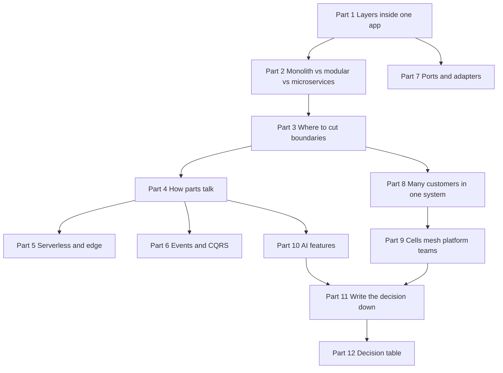

Notice: everything flows into Part 11 and 12. In an interview the goal is a reasoned choice, not a fancy shape.

| Part | Level | You will be able to |
|---|---|---|
| 1. Layers inside one app | Beginner | draw route, service and data access, and say why they help |
| 2. Monolith, modular monolith, microservices | Beginner | pick one and defend it with public cases |
| 3. Service boundaries | Mid | explain bounded context, aggregate, database per service, strangler fig |
| 4. How services talk | Mid | choose sync or async, explain gateway, BFF and GraphQL federation |
| 5. Serverless and edge | Mid | say where functions fit and where they hurt |
| 6. Event-driven and CQRS | Mid | draw an event flow and a read model |
| 7. Ports and adapters | Mid | explain hexagonal architecture and when it is too much |
| 8. Multi-tenancy | Senior | compare shared tables, schema per tenant, database per tenant |
| 9. Cells, mesh, platform, ownership | Senior | explain each in two sentences |
| 10. AI and LLM features | Senior | draw an LLM gateway and a RAG pipeline on Postgres |
| 11. Architecture decision records | Senior | write a short ADR |
| 12. Decision table | Senior | propose an architecture from team size, traffic, domain and rules |

---

## Part 1: Layers inside one app [Beginner]

**Words you will hear:** controller (the route code that reads the request and sends the reply), service layer (the code with the business rules), repository (the code that talks to the database).

### The problem

Picture first. Here is what happens when all the code lives in the route.

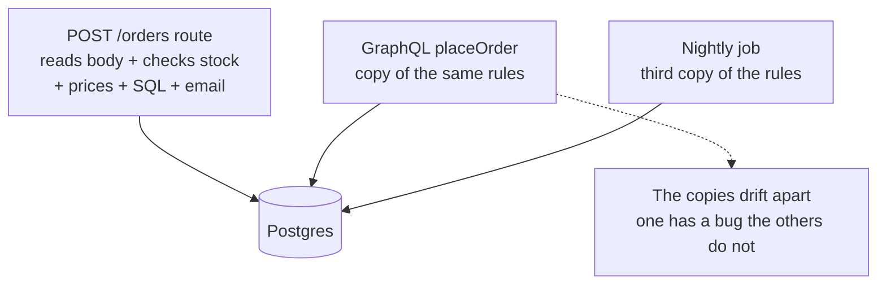

Notice: the same rule now lives in three places. You fix one and forget the other two.

- One file does five jobs. It is hard to read and hard to test.
- To test the price rule, you need a real database and a real HTTP request.
- When GraphQL or a background job needs the same rule, people copy and paste.

### The picture of how it works

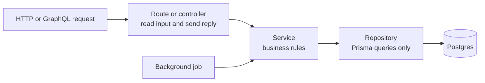

Notice: the route and the job both call the same service. The rule lives in one place.

A folder tree for Express and Prisma:

```text
src/
  routes/orders.routes.ts     reads the request, calls the service, sends JSON
  services/order.service.ts   rules: cart not empty, credit limit, prices
  repositories/order.repo.ts  Prisma queries for orders, nothing else
  lib/prisma.ts               one Prisma client for the whole app
  app.ts                      Express setup and middleware
```

The service has the rules. The route is thin.

```ts
// services/order.service.ts
export async function placeOrder(storeId: number, items: Item[]) {
  if (items.length === 0) throw new AppError("EMPTY_CART");
  const total = await priceItems(items);
  if (total > (await creditLimitFor(storeId))) throw new AppError("OVER_LIMIT");
  return orderRepo.create({ storeId, items, total });
}

// routes/orders.routes.ts
router.post("/orders", async (req, res) => {
  const order = await placeOrder(req.user.storeId, req.body.items);
  res.status(201).json(order);
});
```

### Why layers help

- **One home per rule.** REST, GraphQL and a worker all call `placeOrder`.
- **Easy tests.** You test the service with a fake repository. No server, no database.
- **Safe changes.** You can rewrite a slow query in the repository. The rules do not move.
- **Clear reading.** A new teammate knows where to look for "why was this order refused?"

### The cost

- More files and more jumps between them.
- For a simple read with no rules, the service just passes the call through. That is fine. Do not invent rules to fill a layer.

> **Say this in the interview:** "I keep routes thin. Business rules live in a service layer, and only the repository talks to Prisma. That way REST, GraphQL and background jobs share one copy of each rule, and I can test the rules without a database."

---

## Part 2: Monolith, modular monolith, microservices [Beginner]

**Words you will hear:** monolith (one program, deployed as one unit), modular monolith (one program with strong walls inside), microservices (many small programs, each deployed alone), distributed monolith (many services so tied together that they must change and deploy together).

### The problem

As the app and the team grow, two opposite things go wrong.

- **Too little separation:** 20 people edit the same files. A bug in the report screen slows down checkout. Every change waits for one big deploy.
- **Too much separation:** each small feature becomes its own service. Now a simple change touches five repos, five deploys and five network calls that can fail.

### The picture: three shapes

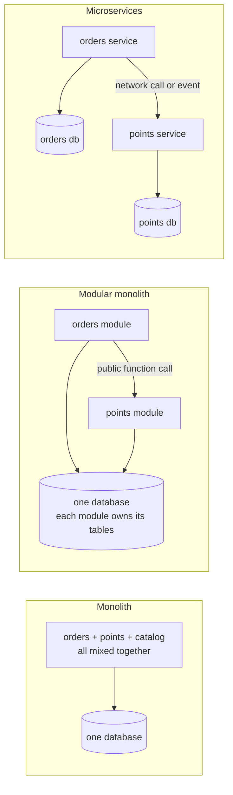

Notice: the modular monolith and microservices have the same boxes. The difference is the line between them: a function call or a network call.

- **Monolith:** one codebase, one deploy, one database. Code can reach anything.
- **Modular monolith:** still one deploy. Inside, each module has a public front (a few exported functions). Other modules may only use that front. Each module owns its own tables.
- **Microservices:** each module is its own program, deploy and database. Modules talk over the network.

**Analogy:** a monolith is one big open room. A modular monolith is one house with rooms and doors. Microservices are separate houses on one street. The analogy stops here: walking between rooms is free, but every trip between houses is a network call. It is slow, and it can fail.

### The costs side by side

| | Monolith | Modular monolith | Microservices |
|---|---|---|---|
| Deploy | one, simple | one, simple | many, each team alone |
| A bug in one part | can crash all | can crash all | stays in one service, if designed well |
| Data changes across parts | one transaction | one transaction | events or sagas (multi step undo plans) |
| Running cost | low | low | high: more servers, tracing, on-call |
| Main risk | turns into a tangle | walls get ignored | network failures, a distributed monolith |

### The honest 2026 view: public cases

- **Amazon Prime Video (2023):** one team ran a video quality checking tool as many serverless parts. Passing data between the parts through S3 (file storage) and AWS Step Functions (a workflow runner) was slow and costly. They moved the parts into one process on ECS (Amazon's container service). They reported over 90% lower infrastructure cost. Be precise in an interview: this was one tool, not all of Amazon. ([InfoQ, May 2023](https://infoq.com/news/2023/05/prime-ec2-ecs-saves-costs))
- **Segment (2018):** each of 100+ data destinations ran as its own service with its own queue. Three full-time engineers spent most of their time keeping it alive. They merged them back into one service and one repo. They also wrote down what got worse: weaker fault isolation, for example. ([Segment blog](https://twilio.com/en-us/blog/developers/best-practices/goodbye-microservices))
- **Shopify:** chose a modular monolith over microservices for its core Rails app (about 2.8 million lines of Ruby). They split code into components and built a tool, Packwerk, that checks the walls between them. ([Shopify Engineering](https://shopify.engineering/deconstructing-monolith-designing-software-maximizes-developer-productivity))

The shared lesson: **split for a reason you can name, not for fashion.**

### When to split one module out

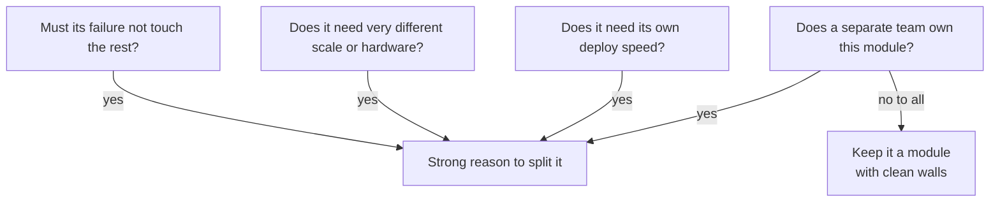

Notice: none of the questions is "is microservices modern?". Every reason is about teams, deploys, scale or failure.

- **Team size:** one team of up to about 8 to 10 people can share one deploy fine. Splits start to pay when several teams block each other.
- **Deploy independence:** if team A waits a week for team B's release, a split helps.
- **Scaling needs:** an image resizer needs lots of CPU. The API does not. Different needs, different service.
- **Failure isolation:** a third party integration that hangs must not take down login.

**DBO, the honest version (fact from your case study):** DBO split by operational need. Auth sits alone because it is security critical. Workers sit apart so background jobs do not compete with requests. Cron sits alone so jobs run once. The product domain stayed together in one API service. That is a modular monolith core with a few services around it.

> **Say this in the interview:** "I start with a modular monolith: one deploy, strong module walls, each module owning its tables. I pull a module out when I can name the reason: a separate team, a different deploy speed, a different scaling need, or failure isolation. Prime Video and Segment both moved parts back together when the split cost more than it gave."

---

## Part 3: Service boundaries [Mid]

**Words you will hear:** bounded context, aggregate, database per service, strangler fig.

### The problem

Two ways people cut services badly:

- **By technical layer.** A "database service" and a "validation service". Every feature now touches every service.
- **By sharing one database.** Two services read and write the same `orders` table.

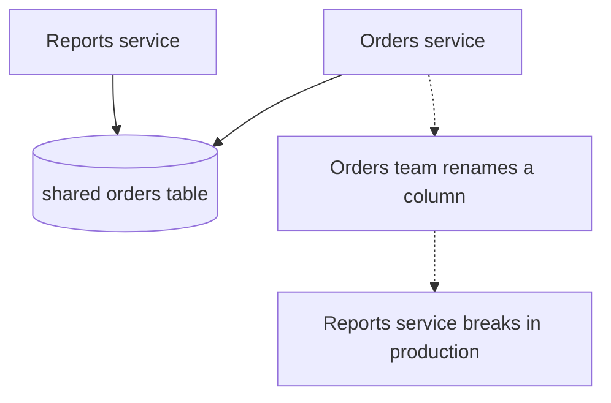

Notice: the services are "separate", but one table ties them together. Neither team can change the table alone. That is a distributed monolith.

### Domain driven design in plain words

**Bounded context:** a part of the business where each word has one clear meaning.

- In the **catalog**, "product" means name, photos and description.
- In the **warehouse**, "product" means stock count and shelf place.
- In **billing**, "product" means price and tax code.

One giant `Product` model that tries to serve all three gets messy. Each context keeps its own small model instead. Bounded contexts are the best first guess for module or service lines.

**Aggregate:** a group of data that must stay correct together, so you save it in one transaction.

- Example: an `Order` and its order lines. The total must match the lines.
- Outside code changes the group only through the main object (the "root"), here `Order`.
- Rule of thumb: one transaction changes one aggregate. Changes in other aggregates follow by event.

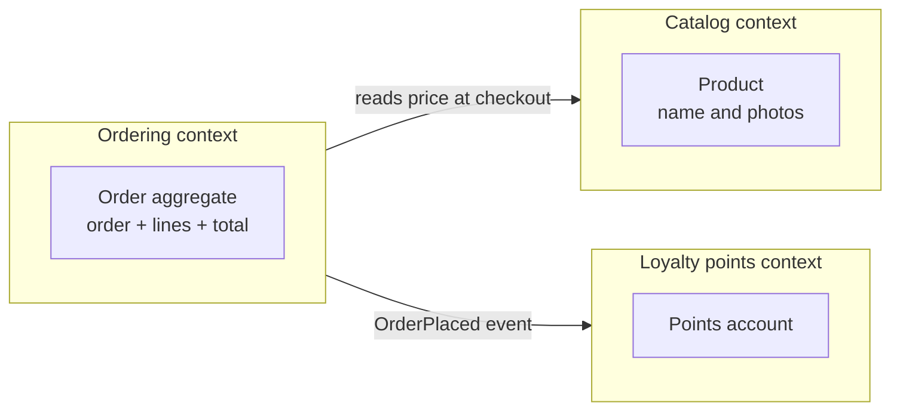

Notice: each context has its own small model. Ordering does not edit the points table. It sends an event.

### Database per service

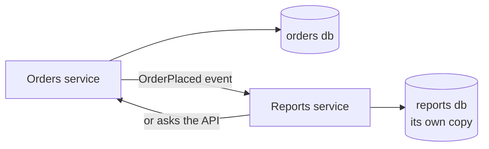

Notice: Reports never touches the orders tables. It gets data by event or by asking the orders API.

- Each service is the **only** writer and reader of its tables.
- Others ask through an API or listen to events.
- In a modular monolith you get most of this with **one schema per module** in one Postgres. Modules do not join across schemas.

**The cost:** no joins across services, and no single transaction across them. You get copies of data that are a little behind. Cross-service flows need sagas. Deep version: [load balancers and microservices, step 4](load-balancers-microservices-online-shop.md).

### Splitting a monolith: the strangler fig

The name comes from a vine that grows around a tree, slowly, until it replaces it ([Martin Fowler](https://www.martinfowler.com/bliki/StranglerFigApplication.html)).

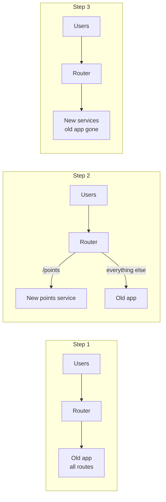

Notice: users always hit the same router. Only the router's rules change, one route at a time.

- Put a router in front first (nginx, an API gateway, or a Next.js rewrite).
- Move **one** route or feature to the new code. Watch it in production.
- If it breaks, switch the route back. Rollback is one config change.
- Repeat. The old app shrinks until you can turn it off.

**The cost:** for months you run two systems. Data often needs syncing between the old and new database during the move.

> **Say this in the interview:** "I draw service lines around bounded contexts, and each service owns its data. Sharing a database couples teams, so I would rather send an event. To split a monolith I use the strangler fig: a router in front, then move one route at a time, with rollback by switching the route back."

---

## Part 4: How services talk [Mid]

**Words you will hear:** synchronous (the caller waits for the answer), asynchronous (the caller sends a message and moves on), BFF (backend for frontend), federation (many GraphQL parts joined into one graph).

### The problem

A chain of direct calls is only as strong as its weakest link.

- Order calls stock, then points, then email. If email takes 8 seconds, the user waits 8 seconds.
- Four services that are each up 99.9% of the time: the chain is up about 99.6% (0.999 x 0.999 x 0.999 x 0.999). Each extra hop lowers it.

### Sync against async, over time

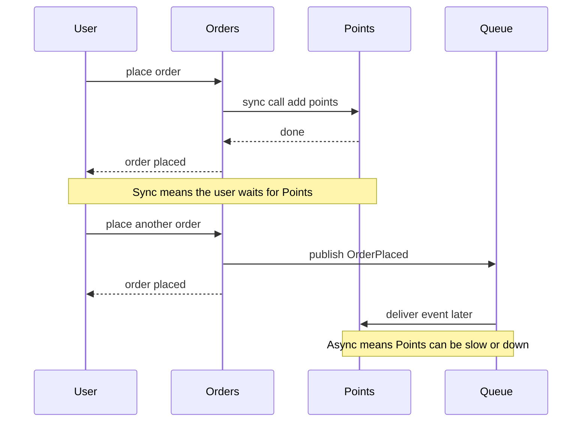

Notice: in the async version the user's answer does not wait for Points.

gRPC is Google's way of calling a function on another server. It sends compact binary data, and both sides share one typed contract file.

| Style | Good for | Watch out for |
|---|---|---|
| REST | simple APIs, public APIs, HTTP caching | many endpoints as clients differ |
| GraphQL | many clients that need different fields | N+1 queries (one extra query per list item), harder HTTP caching |
| gRPC | fast typed calls between your own services | browsers need a proxy, less easy to debug by hand |
| Events | work that can finish later, many listeners | duplicates, order of messages, harder debugging |

**Rule:** sync when the user needs the answer now (login, check stock). Async when the work can finish later (email, points, reports, search index).

### API gateway and backend for frontend

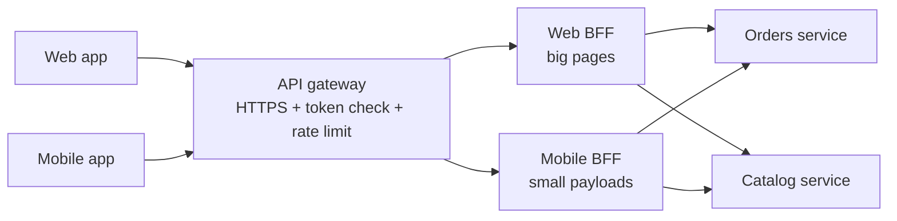

Notice: the gateway does the same checks for everyone. Each BFF shapes data for one kind of client.

- **API gateway:** one front door. It routes, ends HTTPS, checks the token is real, and limits request rates. It should **not** hold business logic. Deep version: [DBO API gateway deep dive](../../interview/my-projects/dbo-b2b-platform-system-design-case-study.md).
- **BFF:** a thin server made for one client type. Mobile wants fewer round trips and fewer bytes. Web wants richer pages.
- In your stack, a **Next.js server** often is the web BFF. Server components and route handlers call the services and shape the result.
- **GraphQL can replace several BFFs**, because each client picks its own fields.

**The cost:** each BFF is one more thing to deploy. Logic leaks into BFFs if you are not careful.

### GraphQL federation

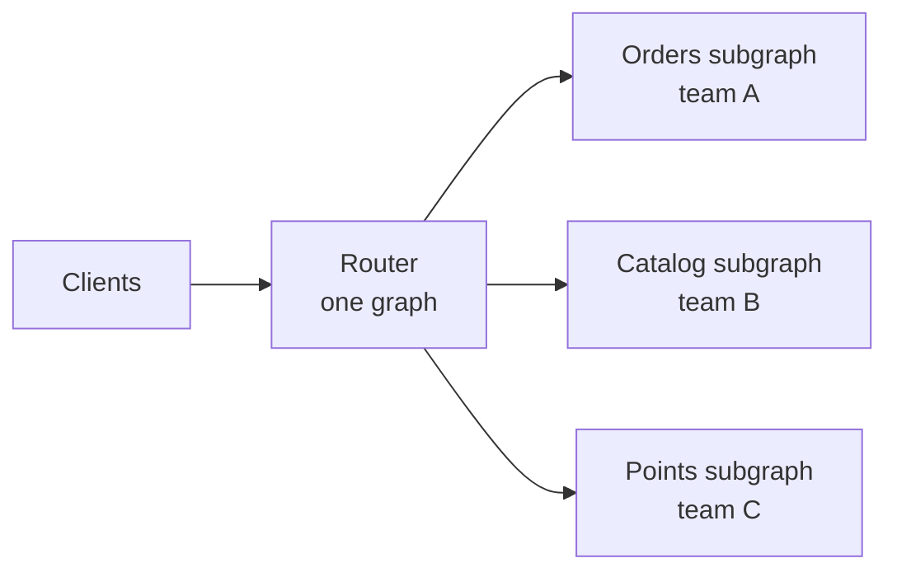

Notice: clients see one graph. Behind the router, each team owns its own piece.

- Each team owns a **subgraph** (its part of the schema). A **router** joins them into one **supergraph** and plans each query across them.
- **Apollo Federation** is the best known. In October 2026, the Apollo Router GitHub releases page shows v2.18.0 as the latest stable release, with a v3 preview.
- **Hasura v2** can join another GraphQL server into its graph with **remote schemas**. **Hasura DDN (v3)** is built around data connectors and a supergraph. The Hasura GitHub README still calls v2 "the current stable version". Deep version: [Hasura guide](../backend-api/hasura-guide.md).

**The cost:** one more hop, query planning, and shared schema rules between teams. With one team, a single GraphQL server is simpler.

> **Say this in the interview:** "I use sync calls only when the user needs the answer now, and events for everything that can finish later, because every sync hop multiplies failure. The gateway does shared checks, and a BFF or GraphQL shapes data per client. I would add federation only when several teams own parts of the graph."

---

## Part 5: Serverless and edge [Mid]

**Words you will hear:** cold start (the wait while a new copy of your function boots), edge runtime (small code that runs in many cities close to the user), connection pooler (a middleman that shares a few database connections among many callers).

Basics of serverless, cold starts and lock-in are in the [cloud guide, part 3](../devops-cloud/cloud-computing-models-serverless-guide.md). Here is where they fit in an architecture.

### The problem drawn: Postgres runs out of connections

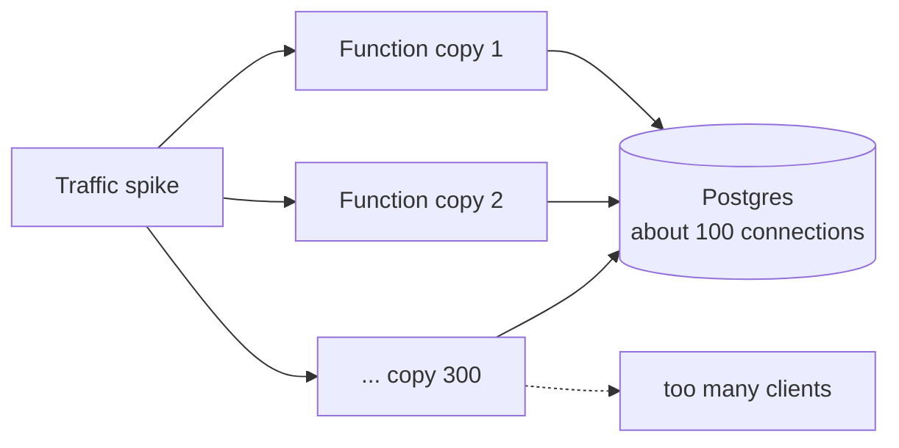

Notice: each copy opens its own connection. The database limit is the wall you hit.

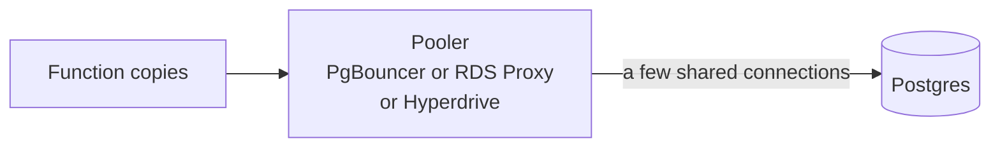

Notice: the pooler lets hundreds of callers share a few real connections.

### Where serverless and edge fit

- **Functions** (Lambda, Vercel functions): spiky or low traffic, webhooks, scheduled jobs, image resizing.
- **Managed services** (queues, auth, storage): you rent the hard parts instead of running them.
- **Edge runtimes** (Cloudflare Workers, Vercel edge): redirects, auth cookie checks, A/B splits, country based routing. They run near the user.

### Where they hurt

| Pain | What happens | Fix |
|---|---|---|
| Cold start | first request after quiet time is slow | keep functions small, or use a container |
| Connection limits | Postgres refuses new clients | pooler, HTTP database driver, Cloudflare Hyperdrive |
| Time limits | Lambda stops at 15 minutes | put long work in a queue worker |
| Edge far from data | each query crosses the world | do only light work at the edge, keep DB work near the DB |
| Lock-in | code tied to one provider's events | thin handler, rules in plain functions (Part 7) |
| Cost at steady load | per request price adds up | a container is often cheaper |

Cloudflare Hyperdrive keeps a managed connection pool for Workers and caches popular queries (Cloudflare docs, checked on GitHub 2026-10-16).

> **Say this in the interview:** "I use functions for spiky and event work, and the edge only for light checks near the user. The usual traps are Postgres connections, time limits and cold starts. So I put a pooler in front of Postgres and send long jobs to a queue worker."

---

## Part 6: Event-driven architecture and CQRS [Mid]

**Words you will hear:** event (a message that says something already happened, like `OrderPlaced`), broker (the post office that stores and delivers events, like Kafka, RabbitMQ or a Redis queue), CQRS (separate models for writing and for reading), eventual consistency (the read side catches up a moment later).

Deep version, with delivery rules and dead letter queues: [Queues, streams and event-driven design](queues-streams-and-event-driven-design.md). This is the one page overview.

### The problem

After an order, Orders must call Points, Email, Analytics and Search. A sixth team wants to know about orders. Orders must change its code again, and it fails if any of them is down.

### The picture

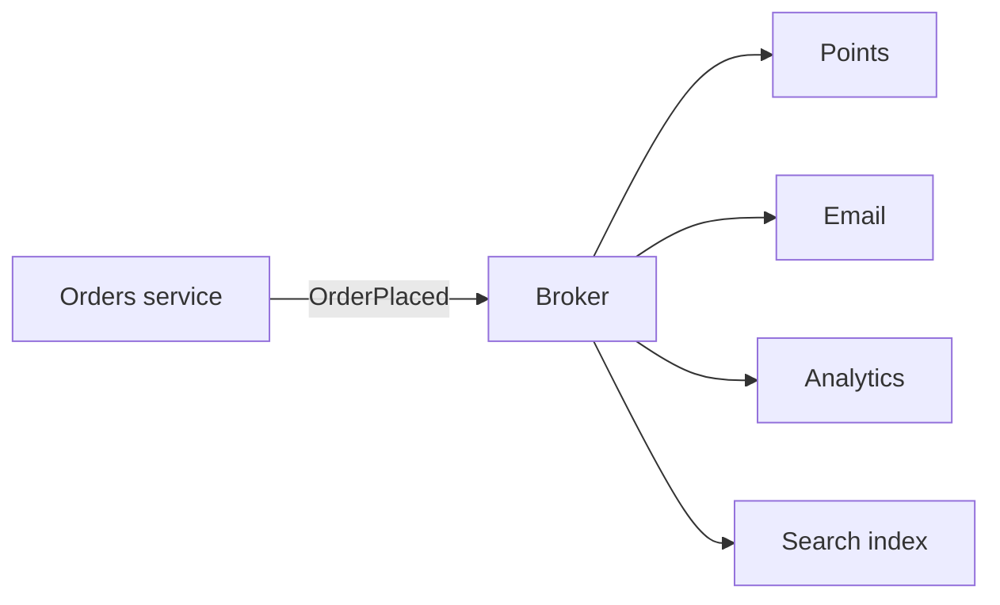

Notice: Orders publishes once. It does not know who listens. A new listener needs no change in Orders.

- An event is a **fact in the past tense**: `OrderPlaced`, not `PlaceOrder`.
- Brokers deliver **at least once**. So listeners must be safe to run twice (idempotent).
- Write the event in the same database transaction as the order (the **outbox** pattern), then a relay sends it. Otherwise you can save the order and lose the event.
- **The cost:** the flow is harder to follow. You need a request ID in every event to trace it.

### CQRS in one picture

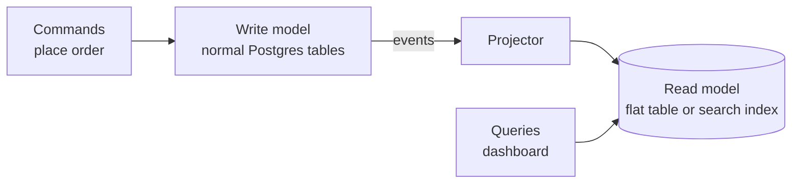

Notice: writes and reads use different shapes of data. The arrow in the middle means the read side is a moment behind.

- **When it helps:** reads look very different from writes. Example: a sales dashboard that sums thousands of orders on each view.
- **CQRS-lite:** a Postgres materialized view, or a read replica for reports. Try these first.
- **The cost:** more code, and stale reads. "I placed an order and the dashboard does not show it yet."

> **Say this in the interview:** "Events let one service announce a fact without knowing who listens, so I can add listeners without touching the producer. I use the outbox for reliable publishing and idempotent consumers. I use CQRS only when reads and writes really differ, and I try a materialized view first."

---

## Part 7: Hexagonal architecture, ports and adapters [Mid]

**Words you will hear:** port (an interface the core code defines: "I need something that can save an order"), adapter (a real piece of code that fills a port, such as a Prisma version or a fake for tests), dependency rule (outer code may import inner code, never the other way).

### The problem

Your pricing rules import Prisma, the Stripe SDK and Express's `req`. To test one rule you need a database and a server. To change email providers you edit business code.

### The picture

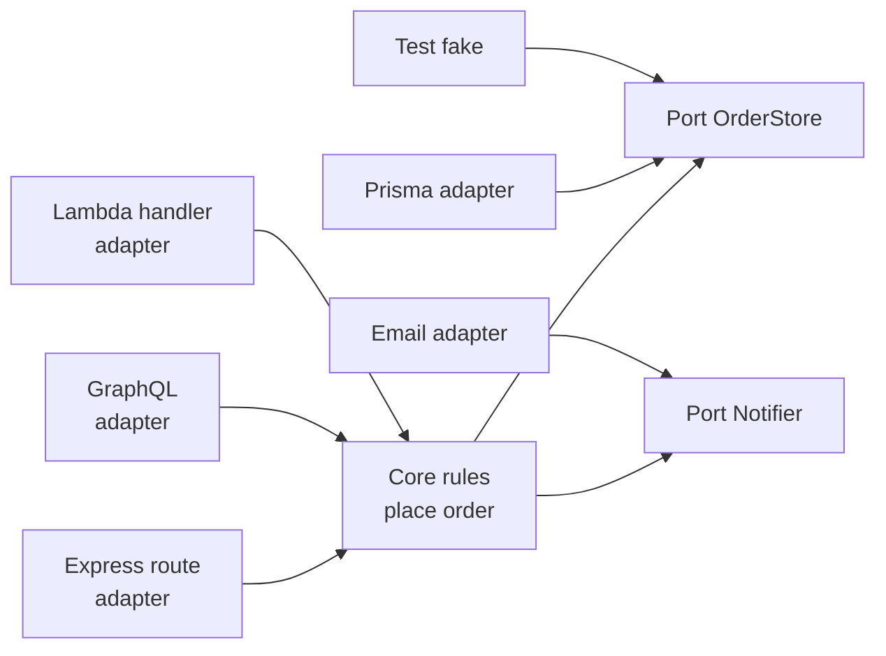

Notice: the core is in the middle and imports nothing from the outside. Adapters on both sides plug into it.

```ts
// core/ports.ts: the core says what it needs
export interface OrderStore { save(o: Order): Promise<void> }
export interface Notifier { orderPlaced(o: Order): Promise<void> }

// core/place-order.ts: rules only, no Prisma, no Express
export const makePlaceOrder = (store: OrderStore, notify: Notifier) =>
  async (o: Order) => { checkRules(o); await store.save(o); await notify.orderPlaced(o); };

// adapters/prisma-order-store.ts: one way to fill the port
export const prismaOrderStore: OrderStore = {
  save: async (o) => { await prisma.order.create({ data: toRow(o) }); },
};
```

- **Hexagonal** (also called ports and adapters): the shape name is not important. The rule is: the core does not know about the outside.
- **Clean architecture** draws the same idea as rings. Entities in the middle, then use cases, then adapters, then frameworks. Dependencies point inward.
- This is also the **lock-in fix** from Part 5: the Lambda handler is just one more adapter.

### When it is too much

- A small team with a CRUD app (create, read, update, delete) and one database: the layers from Part 1 are enough.
- Ports for things that will never change add files and no value.
- Use it for the **core with real rules**: pricing, loan approval, points. Keep simple screens simple.

> **Say this in the interview:** "Hexagonal means the business core defines interfaces, and the database, HTTP and email code plug into them. It makes rules testable without infrastructure and keeps vendors at the edge. For a small CRUD app I skip it and use plain layers, and I apply it only to the parts with real rules."

---

## Part 8: Multi-tenancy for B2B and SaaS [Senior]

**Words you will hear:** tenant (one customer company inside your system), row level security or RLS (Postgres hides rows that do not match a rule, on every query), noisy neighbor (one big tenant slows everyone else).

### The problem

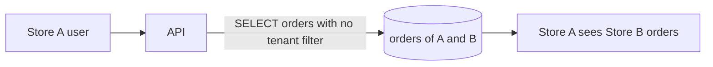

Notice: one forgotten `WHERE tenant_id = ...` is a data leak between companies. In B2B and banking, that can lose you the customer.

### The three models

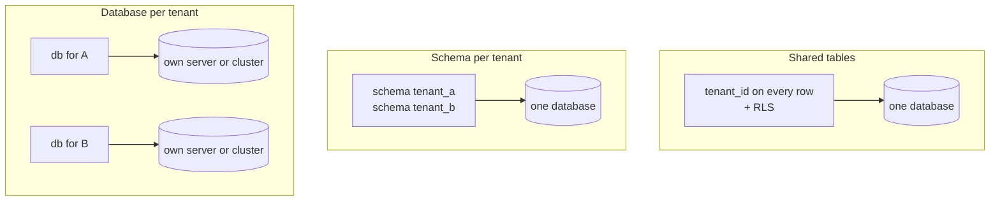

Notice: from left to right, isolation goes up and so does cost per tenant. AWS calls these pool, bridge and silo.

| | Shared tables + RLS | Schema per tenant | Database per tenant |
|---|---|---|---|
| Isolation | logical, by rule | medium | strongest |
| Cost per tenant | lowest | low | highest |
| Migrations | run once | run N times | run N times, on N servers |
| Noisy neighbor | real risk | real risk | none |
| Good for | thousands of small tenants | tens to hundreds of tenants | big or regulated tenants |

### Shared tables with RLS, the usual start

```sql
ALTER TABLE orders ENABLE ROW LEVEL SECURITY;
ALTER TABLE orders FORCE ROW LEVEL SECURITY;  -- the table owner is filtered too
CREATE POLICY tenant_only ON orders
  USING (tenant_id = current_setting('app.tenant_id')::uuid);
```

```ts
// per request: set the tenant for this transaction only
await prisma.$transaction(async (tx) => {
  await tx.$executeRaw`SELECT set_config('app.tenant_id', ${tenantId}, true)`;
  return tx.order.findMany(); // Postgres adds the tenant filter itself
});
```

- The `true` makes the setting last only for this transaction. A pooled connection will not carry tenant A into the next request.
- The app's database user must **not** be a superuser or have `BYPASSRLS`. Those skip RLS. (Prisma's RLS example, checked 2026-10-16.)
- Put `tenant_id` first in indexes, in every cache key, in every queue job, in every log line, and in every vector search.
- Deep version of the schema side: [Database design and why, section 5](../database/database-design-and-why.md).

### The hybrid most B2B systems end at

Pool by default. Move a tenant to its own database when it is very big, needs its own region, or a contract demands it. Your router looks up "which database is tenant X on?"

**Questions to ask yourself (ideas, not facts about your projects):**
- DBO: if several brands each used the platform, would each brand be a tenant?
- Skyworx: if one loan system serves several banks, does a regulator or contract require each bank's data in a separate database?

> **Say this in the interview:** "I start with shared tables, tenant_id on every row, and Postgres row level security as a safety net, because it is cheapest to run and migrate. A tenant that is huge or regulated moves to its own database. The tenant id goes into indexes, cache keys, jobs and logs."

---

## Part 9: Cells, service mesh, platform teams, ownership [Senior]

**Words you will hear:** cell (a full, small copy of your system serving a slice of customers), blast radius (how many users one failure hurts), sidecar (a helper proxy that runs next to each service), platform team (a team that builds shared tools for other teams).

### Cell-based architecture

**The problem:** one bad deploy or one poison request takes down every customer at once.

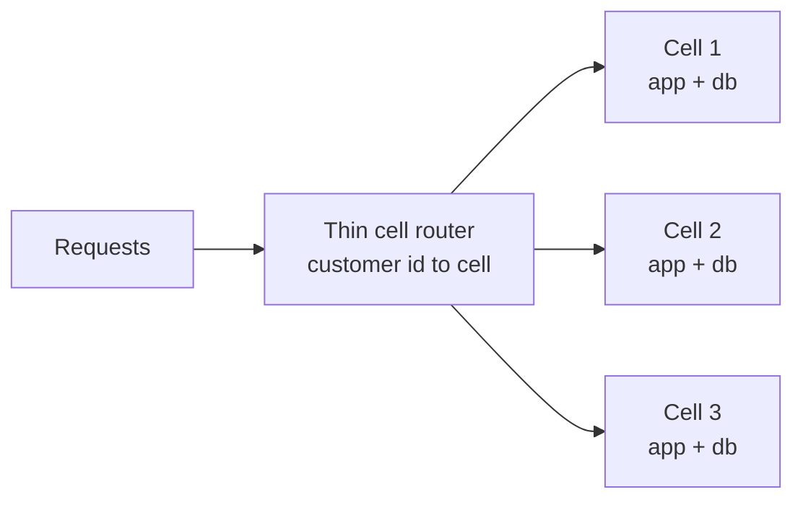

Notice: when cell 2 breaks, only its customers are hurt. The router must stay very simple, because it is shared.

- Each cell has a fixed maximum size. To grow, you add cells, not bigger cells.
- You deploy to one cell first, then the rest.
- AWS describes this in its whitepaper "Reducing the Scope of Impact with Cell-Based Architecture" (2023).
- **The cost:** many copies to run. Features across cells (global search, admin views) are hard. This is for very large scale, not for a team of five.

### Service mesh

- **The problem:** 30 services each need retries, timeouts, encryption between services and metrics. Each team writes them differently.
- **The idea:** a small proxy next to each service (a sidecar), or one per machine, does this for every call. You set the rules in one place. Istio and Linkerd are the known names.
- **The cost:** many moving parts. Worth it with many services on Kubernetes. Not worth it for four services on CapRover.

### Platform engineering and "you build it, you run it"

```mermaid
graph LR
    PT["Platform team"] --> ROAD["Shared road<br/>templates CI CD logs alerts"]
    ROAD --> T1["Orders team<br/>builds and runs orders"]
    ROAD --> T2["Payments team<br/>builds and runs payments"]
```

Notice: product teams own their service end to end. The platform team makes that easy, so each team does not rebuild the same tools.

- **Platform engineering:** one team builds the paved path: a "new service" template, CI/CD, logging, dashboards, secrets. Others use it by default.
- **You build it, you run it:** the team that writes a service also deploys it, watches it and is on call for it. The phrase is from Amazon's CTO Werner Vogels.
- **The cost:** on-call load on every team, and a platform team costs people. Below roughly three or four teams, a shared set of scripts is enough.

> **Say this in the interview:** "Cells limit blast radius by giving each slice of customers its own full copy, so one failure hurts few users. A service mesh moves retries, timeouts and encryption out of code, which pays off with many services. A platform team gives product teams a paved path, so they can build and run their own services."

---

## Part 10: AI and LLM features as part of the system [Senior]

**Words you will hear:** LLM (a large language model, like GPT or Claude, that writes text from a prompt), token (a small piece of a word; providers charge per token), embedding (a list of numbers that stands for the meaning of a text, so similar texts get close numbers), RAG (retrieval augmented generation: find the right documents first, then let the model answer from them).

### The problem

```mermaid
graph TB
    F1["Chat feature"] --> OAI["Provider A"]
    F2["Summary feature"] --> OAI
    F3["Search feature"] --> ANT["Provider B"]
    OAI -.-> P1["Provider down<br/>feature down"]
    F1 -.-> P2["No cost view<br/>keys in many places"]
```

Notice: every feature calls a provider its own way. Nobody sees the bill until the end of the month.

### 10.1 The LLM gateway

```mermaid
graph LR
    APP["Your app features"] --> GW["LLM gateway"]
    GW --> RL["Rate limit and budget<br/>per tenant"]
    GW --> CA["Cache"]
    GW --> LOG["Log tokens cost latency"]
    GW -->|first choice| PA["Provider A"]
    GW -->|fallback| PB["Provider B"]
```

Notice: one door in front of all providers. Limits, cache, logs and fallback live in one place.

- **Keys:** only the gateway holds provider keys.
- **Rate limits and budgets:** per tenant and per feature, so one customer cannot use up the month's budget.
- **Fallback:** if provider A times out, try B.
- **Cost tracking:** log model, tokens in, tokens out and cost for every call, tagged by tenant and feature.
- **Tools:** LiteLLM is an open source gateway for 100+ providers with spend tracking. Vercel AI Gateway is a hosted one. A small module in your own Node app is also fine.

```ts
const providers = [callProviderA, callProviderB];
export async function complete(tenantId: string, prompt: string) {
  await checkBudget(tenantId);                      // throws when over the limit
  for (const call of providers) {
    try {
      const res = await call(prompt, { timeoutMs: 20_000 });
      await logUsage(tenantId, res.model, res.inputTokens, res.outputTokens);
      return res.text;
    } catch { /* try the next provider */ }
  }
  throw new Error("All model providers failed");
}
```

### 10.2 The RAG pipeline on Postgres

```mermaid
graph LR
    subgraph ING["Ingest, ahead of time"]
        D["Documents"] --> CH["Split into chunks"]
        CH --> EM["Make embeddings"]
        EM --> PG[("Postgres + pgvector")]
    end
    subgraph ASK["Ask, per question"]
        Q["Question"] --> QE["Embed question"]
        QE --> SR["Find top 5 chunks<br/>for this tenant"]
        SR --> PR["Prompt = question + chunks"]
        PR --> LLM["LLM via gateway"]
        LLM --> ANS["Answer with sources"]
    end
    PG --> SR
```

Notice: the model never searches your database. Your code finds the chunks and hands them over.

```sql
CREATE EXTENSION IF NOT EXISTS vector;
CREATE TABLE doc_chunks (
  id bigserial PRIMARY KEY, tenant_id uuid NOT NULL, doc_id bigint NOT NULL,
  content text NOT NULL, embedding vector(1536) NOT NULL
);
CREATE INDEX ON doc_chunks USING hnsw (embedding vector_cosine_ops);
-- $2 is the question's embedding; <=> is cosine distance
SELECT doc_id, content FROM doc_chunks
WHERE tenant_id = $1 ORDER BY embedding <=> $2 LIMIT 5;
```

- **HNSW** is the index type that makes "find the closest vectors" fast. It is approximate: very good, not perfect.
- **Chunk:** split documents into pieces of a few hundred tokens, with a little overlap. Too big wastes tokens. Too small loses meaning.
- **Store sources:** keep `doc_id` so the answer can show where it came from.
- **Filter by tenant and permission** before the model sees anything. RAG is a new way to leak data.
- **Mix keyword search and vector search** for names and codes, like an order number. Vector search alone often misses exact codes.
- If you change the embedding model, you must embed every chunk again.
- Full system design: [Design workbook part 2, the RAG design](design-workbook-part-2-correctness-designs.md).

### 10.3 Streaming answers to the UI

```mermaid
sequenceDiagram
    participant B as Browser
    participant N as Next.js route
    participant G as LLM gateway
    participant M as Model
    B->>N: POST question
    N->>G: stream request
    G->>M: stream request
    M-->>G: first tokens
    G-->>N: first tokens
    N-->>B: first words on screen
    M-->>G: more tokens
    G-->>N: more tokens
    N-->>B: text keeps growing
    Note over B,M: User reads after a moment instead of waiting for the whole answer
```

Notice: the user sees words quickly, even though the full answer takes several seconds.

```ts
// app/api/chat/route.ts (Next.js route handler)
export async function POST(req: Request) {
  const { question } = await req.json();
  const pieces = await gateway.stream(question, { signal: req.signal }); // your gateway client
  const enc = new TextEncoder();
  const body = new ReadableStream({
    async start(ctrl) {
      for await (const piece of pieces) ctrl.enqueue(enc.encode(piece));
      ctrl.close();
    },
  });
  return new Response(body, { headers: { "Content-Type": "text/plain; charset=utf-8" } });
}
```

- `req.signal` stops the model call when the user closes the tab. You stop paying for tokens nobody reads.
- Serverless time limits still apply to long answers.
- The Vercel AI SDK (version 7 since June 2026) wraps this pattern, with `useChat` on the client.

### 10.4 Caching prompts

- **Answer cache:** same tenant, same model, same prompt gives the stored answer. The key is a hash of all three. Good for repeated questions.
- **Provider prompt caching:** big providers charge less for a long prompt start they have seen recently. Put the stable parts (instructions, documents) first and the question last.
- **Careful with "similar question" caching.** "Cancel order 12" and "cancel order 13" look alike to an embedding, but they need different answers.

### 10.5 Evals and guardrails

- **Evals:** a fixed set of test questions with the facts each answer must contain. You score the model's answers. Run them on every prompt or model change, like unit tests.
- **Input guardrails:** block or mask personal data, and limit prompt size.
- **Output guardrails:** check JSON against a schema (Zod), check that cited sources exist, and cap the length.
- **Prompt injection:** a document can contain text like "ignore your rules". Treat retrieved text and tool results as untrusted data.

### 10.6 Agents and tool calling

```mermaid
sequenceDiagram
    participant U as User
    participant A as Your app
    participant M as Model
    participant T as Your function getOrderStatus
    U->>A: where is my order 12
    A->>M: question + list of tools
    M-->>A: please call getOrderStatus with id 12
    A->>T: run it with the user's permissions
    T-->>A: shipped yesterday
    A->>M: tool result
    M-->>A: Your order shipped yesterday
    A-->>U: answer
```

Notice: the model only asks. Your code decides whether to run the tool, and checks permissions.

- An **agent** is this loop repeated: the model asks for tools until it can answer.
- Set a **max number of steps** and a budget, so a loop cannot run forever.
- Actions that change money or data (refund, approve a loan) need **human approval**.

### 10.7 Model Context Protocol (MCP) as a pattern

```mermaid
graph LR
    H1["Chat app or IDE"] --> MC["MCP client"]
    MC --> S1["MCP server for orders"]
    MC --> S2["MCP server for docs"]
    S1 --> API["Your orders API"]
    API --> DB[("Postgres")]
```

Notice: the MCP server is a thin adapter over your existing API. It is the same idea as an adapter in Part 7.

- MCP is an open standard for giving AI apps tools and data. You write one MCP server, and many AI apps can use it.
- A server offers **tools** (actions), **resources** (data to read) and **prompts** (ready made instructions).
- The **2026-07-28** version of the spec made the protocol stateless. Each request carries what it needs. So MCP servers can sit behind a normal load balancer, like any API.
- MCP is now a Linux Foundation project.
- **The rule:** the MCP server uses the same login and permission checks as your API. It never gets more rights than the user.

**Ideas (not facts about your projects):** a Q&A assistant over loan policy documents in a system like Unloan would be RAG with strict permission filters. In DBO, a store owner could ask "where is my order?" through tool calling over the order API.

> **Say this in the interview:** "I treat the model as an unreliable, costly external service. It sits behind a gateway with per-tenant budgets, fallback and cost logs. For RAG I keep vectors in Postgres with pgvector, filter by tenant before retrieval, stream answers to the UI, and run evals on every prompt change. Tools run in my code with the user's permissions, never with more."

---

## Part 11: Architecture decision records [Senior]

**Words you will hear:** ADR (a short file that records one important decision, its reason and its cost).

### The problem

A year later, nobody remembers why you chose a modular monolith. A new lead splits it into ten services. The old problems return.

```mermaid
graph LR
    P["Proposed"] --> A["Accepted"]
    A --> S["Superseded by ADR 12"]
    P --> R["Rejected"]
```

Notice: you never edit an accepted ADR. You write a new one that replaces it, so history stays.

### The template (Michael Nygard's shape, the most used)

```markdown
# ADR 0007: <decision in a few words>
- Status: Proposed | Accepted | Superseded by ADR 00XX
- Date: 2026-10-16
## Context      what is true now, the forces, the limits
## Decision     what we will do, in one or two sentences
## Consequences what gets easier, what gets harder, what we will watch
```

### Example

```markdown
# ADR 0007: Modular monolith for the B2B ordering app
- Status: Accepted, 2026-10-16
## Context
Team of 6. One product. About 2,000 store owners. Orders, catalog and points
change together often. We deploy on CapRover. No team owns a single area.
## Decision
One Node service with modules: orders, catalog, points, identity. Each module
owns its Postgres schema and exposes a public index.ts. Lint blocks deep imports.
## Consequences
+ One deploy, one transaction for order plus points, simple local setup.
- One slow module can affect all. Walls depend on discipline and the lint rule.
Watch: deploy waits between modules, CPU per module. Revisit when a second team forms.
```

- Keep ADRs in the repo (`docs/adr/0007-modular-monolith.md`) and link them in pull requests.
- One page each. If it is longer, it is a design document.

> **Say this in the interview:** "For each big choice I write a one page ADR: context, decision, consequences. It records the cost we accepted and what would make us revisit it. When we change course, I write a new ADR that replaces the old one."

---

## Part 12: The decision table [Senior]

| Situation | Propose | The sentence to say |
|---|---|---|
| 1 to 10 engineers, one product, normal traffic | modular monolith, one Postgres | "One deploy and clean module walls give speed now and clean cut lines later." |
| Same, plus spiky webhooks or image jobs | modular monolith + queue workers or functions for the spiky parts | "Only the spiky part runs separately, so it cannot slow the API." |
| 3 or more teams blocking each other's deploys | extract services along bounded contexts, strangler fig | "I split where teams collide, one route at a time, each service with its own data." |
| Web and mobile clients with different needs | BFF or GraphQL in front of the services | "Each client gets the shape it needs without new endpoints for every screen." |
| Many teams owning one GraphQL API | GraphQL federation with a router | "Each team owns its subgraph and the router joins them." |
| B2B SaaS, many small customers | shared tables + tenant_id + RLS | "Cheap to run, one migration, and the database blocks cross-tenant reads." |
| A few large or regulated customers (banks) | hybrid: pool by default, own database for those tenants | "Isolation where the contract needs it, low cost for everyone else." |
| Very large scale, an outage would hit millions | cell-based architecture | "Each cell is a full copy for a slice of customers, so one failure stays small." |
| Complex rules (pricing, loan approval) | hexagonal core inside the modules | "The rules are testable without the database, and vendors stay at the edge." |
| Adding AI features | LLM gateway + RAG on pgvector + evals | "One door for models gives cost control and fallback; Postgres already holds the data and the permissions." |

---

## Practice

Try each one before you open the answer.

**1. Predict.** Orders calls Stock, Points and Email in a row, synchronously. Each is up 99.9% of the time, and Email takes 3 seconds. What does the user feel, and what changes if Points and Email become events?

<details><summary>Answer</summary>

The user waits more than 3 seconds for every order. The chain is up about 99.6% (four services multiplied together). With events, Orders only waits for Stock, the one answer the user needs now. Points and Email happen a moment later, and their downtime no longer blocks orders.
</details>

**2. Spot the bug in the design.** "We split into an Orders service and a Reports service. Both connect to the same Postgres database and read the orders table directly."

<details><summary>Answer</summary>

They share a database, so they are not independent. A column change by the Orders team can break Reports, and heavy report queries can slow down orders. Fix: Reports gets its own copy of the data through `OrderPlaced` events (or a read replica as a first step), and only Orders touches the orders tables.
</details>

**3. Choose between two options.** A team of 5 is building a new B2B ordering app. Option A: 8 microservices on Kubernetes. Option B: a modular monolith on one Postgres. Which, and why?

<details><summary>Answer</summary>

B. Five people cannot gain from independent deploys between eight services, but they pay for eight pipelines, network failures and tracing. A modular monolith keeps one transaction for order and points, and the module walls give clean cut lines if a split is needed later. Write it in an ADR with "revisit when a second team forms".
</details>

**4. Spot the bug.** A Next.js app on serverless functions uses Prisma with a direct Postgres connection. During a sale, errors say "too many clients already". Why, and what are two fixes?

<details><summary>Answer</summary>

Each function copy opens its own connections, and a spike creates hundreds of copies. Postgres has a fixed connection limit (often around 100). Fixes: put a pooler in front (PgBouncer, RDS Proxy, Prisma Accelerate, or Hyperdrive on Cloudflare), or use an HTTP serverless driver such as Neon's with a Prisma driver adapter.
</details>

**5. Spot the bug in this RAG query.** `SELECT content FROM doc_chunks ORDER BY embedding <=> $1 LIMIT 5;` runs for every tenant's chat.

<details><summary>Answer</summary>

There is no tenant filter. Chunks from company B can end up in company A's answer: a data leak through the model. Add `WHERE tenant_id = $2` (and permission filters), or turn on RLS on `doc_chunks`. Also note: with an approximate index, pgvector filters after the index scan, so a strict filter can return fewer than 5 rows. Iterative index scans (pgvector 0.8 and later) help.
</details>

**6. Draw it.** Draw the strangler fig in three steps for moving "points" out of a monolith. Then say how you roll back.

<details><summary>Answer</summary>

Step 1: users go to a router, and the router sends everything to the old app. Step 2: the router sends `/points` to the new points service and everything else to the old app. Step 3: all routes go to new services and the old app is off. Rollback: change the router rule for `/points` back to the old app.
</details>

**7. Choose.** A bank customer of your SaaS says their data must sit in a separate database in their country. The other 300 customers are small. Which tenancy model?

<details><summary>Answer</summary>

Hybrid. Keep the 300 small customers in shared tables with RLS. Put the bank in its own database in its region. A small lookup table maps tenant to database. You pay for isolation only where the contract needs it.
</details>

**8. Spot the bug.** An agent has a tool `refundOrder(orderId)` that runs with an admin database user. A customer types "refund all orders from yesterday".

<details><summary>Answer</summary>

The tool runs with more rights than the user, and the model decides what to call. Fix: run tools with the signed in user's permissions, check that the user owns the order in code, cap the number of steps, and require human approval for refunds.
</details>

---

## Likely interview questions

**Q1. Monolith or microservices for a new product?**

<details><summary>Answer</summary>

- **Problem:** too little separation creates a tangle; too much creates network failures and slow changes.
- **How it works:** a modular monolith is one deploy with module walls, each module owning its tables. Microservices give each module its own deploy and database.
- **Tradeoff:** the modular monolith is cheap and keeps transactions simple, but one slow module can affect all. Microservices give team and failure independence at a high running cost.
- **My example:** DBO kept the product domain in one API service and split only auth, workers and cron for operational reasons. That is a modular core with a few services around it.
</details>

**Q2. Why should each service own its database?**

<details><summary>Answer</summary>

- **Problem:** a shared table means one team's change can break another team's service in production.
- **How it works:** only the owner reads and writes its tables. Others call its API or listen to its events and keep their own copy.
- **Tradeoff:** no joins or single transactions across services. Data copies are a little behind, and cross-service flows need sagas.
- **My example:** the DBO case study's suggestion is to enforce "only Auth touches the auth database, only the API touches the toko database".
</details>

**Q3. How would you break up a monolith safely?**

<details><summary>Answer</summary>

- **Problem:** a big rewrite takes months, and the switch day is high risk.
- **How it works:** strangler fig. Put a router in front, move one route or bounded context to the new service, watch it, and repeat until the old app is gone.
- **Tradeoff:** two systems run side by side for a while, and data often needs syncing during the move.
- **My example (idea):** in DBO, the points feature talks to TADA through webhooks. It would be a natural first slice to move, because it has clear edges.
</details>

**Q4. When do you use an API gateway, and when a BFF?**

<details><summary>Answer</summary>

- **Problem:** clients should not know every internal service, and web and mobile need different data shapes.
- **How it works:** the gateway is one front door for routing, TLS, token checks and rate limits. A BFF is a thin server per client type that shapes data.
- **Tradeoff:** a BFF is another deploy, and business logic can leak into it. GraphQL can replace several BFFs, because clients pick fields.
- **My example:** DBO has a mobile app, a CMS and a verification admin behind one gateway, with GraphQL serving the app and the CMS.
</details>

**Q5. What is GraphQL federation, and when is it worth it?**

<details><summary>Answer</summary>

- **Problem:** one big GraphQL server becomes a bottleneck when many teams change it.
- **How it works:** each team owns a subgraph. A router joins them into one supergraph and plans each query across them (Apollo Federation, or Hasura DDN with connectors).
- **Tradeoff:** an extra hop, query planning cost and shared schema rules. With one team, one server is simpler.
- **My example:** the DBO case study says to reach for Apollo Federation only when many teams own subgraphs.
</details>

**Q6. How do you design multi-tenancy for a B2B SaaS?**

<details><summary>Answer</summary>

- **Problem:** one missing tenant filter leaks one company's data to another.
- **How it works:** shared tables with `tenant_id`, plus Postgres RLS that filters by a per-transaction setting. Schema per tenant or database per tenant gives more isolation.
- **Tradeoff:** shared tables are cheap and have one migration, but noisy neighbors are a risk. A database per tenant isolates best, but you pay and migrate per tenant.
- **My example (idea):** for a loan platform serving several banks, I would ask whether a contract or regulator demands separate databases. If yes: a hybrid model.
</details>

**Q7. Where does serverless fit, and where does it hurt?**

<details><summary>Answer</summary>

- **Problem:** paying for idle servers for spiky or rare work, versus surprise limits under load.
- **How it works:** functions start on demand and scale with traffic. Edge runtimes run light code near users.
- **Tradeoff:** cold starts, Postgres connection limits, time limits, lock-in, and a higher cost at steady load.
- **My example (idea):** webhook receivers (like DBO's third party callbacks) are a good serverless fit. DBO actually runs on CapRover containers with BullMQ workers.
</details>

**Q8. Explain hexagonal architecture. When would you not use it?**

<details><summary>Answer</summary>

- **Problem:** business rules mixed with Prisma, Express and vendor SDKs are hard to test and hard to move.
- **How it works:** the core defines ports (interfaces). Adapters (Prisma, HTTP, email, test fakes) fill them. Dependencies point inward.
- **Tradeoff:** more files and indirection. For a CRUD app, plain layers are enough.
- **My example (idea):** points rules (earn, redeem, yearly reset) are a good core. TADA would be one adapter behind a port.
</details>

**Q9. How would you add an AI assistant to an existing Next.js and Postgres product?**

<details><summary>Answer</summary>

- **Problem:** models are slow, costly, sometimes down, and can leak data or make things up.
- **How it works:** an LLM gateway (keys, per-tenant budget, fallback, cost logs), RAG with pgvector in the same Postgres, a tenant filter before retrieval, streaming to the UI, and evals on every prompt change.
- **Tradeoff:** more parts to run and the cost per question. pgvector is simple, but a separate vector database may scale further for very large collections.
- **My example (idea):** an assistant that answers questions about loan policy documents, filtered by the user's bank and role.
</details>

**Q10. What is MCP, and how does it fit an architecture?**

<details><summary>Answer</summary>

- **Problem:** every AI app needs its own custom connection to every tool and data source.
- **How it works:** an MCP server offers tools, resources and prompts in a standard way. Any MCP-capable AI app connects to it. The 2026-07-28 spec made it stateless, so it scales behind a load balancer.
- **Tradeoff:** one more surface to secure. The server must use the user's identity and permissions, and tool output is untrusted input.
- **My example (idea):** a thin MCP server over the order API lets an assistant answer "where is my order?" with the store owner's own permissions.
</details>

**Q11. What is cell-based architecture?**

<details><summary>Answer</summary>

- **Problem:** one bad deploy or poison request takes down all customers at once.
- **How it works:** a thin router sends each customer to one cell, a full small copy of the system. Cells have a fixed max size, and you add cells to grow.
- **Tradeoff:** many copies to run, and cross-cell features are hard. It is for very large scale.
- **My example:** none at my scale. I would name AWS's cell-based whitepaper and say a pool-plus-silo tenancy model is a small step in that direction.
</details>

**Q12. How do you record and defend architecture decisions?**

<details><summary>Answer</summary>

- **Problem:** the "why" is forgotten, and later teams undo good decisions or repeat bad ones.
- **How it works:** a one page ADR per decision: context, decision, consequences. It lives in the repo, and a new ADR replaces an old one.
- **Tradeoff:** a little writing time. The value comes only if people link and read them.
- **My example (idea):** an ADR for "why DBO split auth, workers and cron but kept the product API together".
</details>

---

## What's current (2026)

All checked on 2026-10-16.

- **The modular monolith is the default advice for new products.** Public cases (Prime Video 2023, Segment 2018, Shopify) are still the ones interviewers know.
- **Apollo Router:** v2.18.0 is the latest stable on the GitHub releases page (30 Sep), and a v3.0.0 preview appeared on 3 Oct. Connectors (calling REST APIs from a GraphQL schema) are part of it.
- **Hasura:** the GitHub README calls v2 "the current stable version". It describes v3 (DDN) as GA for PostgreSQL, MongoDB, ClickHouse and SQL Server, with TypeScript, Python and Go connector SDKs.
- **pgvector:** version 0.8.7. HNSW and IVFFlat indexes. Indexes cover up to 2,000 dimensions for `vector` and 4,000 for `halfvec`. Iterative index scans since 0.8.0 help filtered searches.
- **MCP:** spec version 2026-07-28 made the protocol stateless and added header-based routing (`Mcp-Method`, `Mcp-Name`), so gateways can route and rate limit. MCP is hosted as an LF Projects (Linux Foundation) series, and search results say it sits in the Agentic AI Foundation since December 2025.
- **Vercel AI SDK:** version 7 was announced on 25 June 2026 (Node 22 and ESM required, agent features with tool approvals). The `ai` package on GitHub shows 7.0.x releases, with 5.x and 6.x still patched.
- **LLM gateways** are a normal component: LiteLLM (open source, 100+ providers, spend tracking) and hosted ones like Vercel AI Gateway.
- **Cloudflare Hyperdrive** gives Workers a managed Postgres connection pool and query cache.

<details><summary>Go deeper (optional): what to say about "AI in system design interviews"</summary>

- Treat the model like a third party API with variable latency (seconds, not milliseconds), a per-token cost and possible downtime. Put it behind a timeout, a fallback and a budget.
- Name the numbers you would watch: time to first token, tokens per request, cost per tenant per day, eval score, share of answers with sources.
- For RAG quality, the retrieval step matters more than the model. Bad chunks give confident wrong answers.
- For pgvector with filters: approximate indexes filter after the scan. With HNSW's default `ef_search` of 40, a filter that matches 10% of rows returns about 4 rows on average. Turn on `hnsw.iterative_scan`, or add a partial index per big tenant.
</details>

---

## Real-world cases to cite

| Company | What happened | Source |
|---|---|---|
| Amazon Prime Video (2023) | A video quality tool moved from serverless parts (Step Functions, Lambda, S3 between steps) to one process on ECS: over 90% lower infrastructure cost | [InfoQ](https://infoq.com/news/2023/05/prime-ec2-ecs-saves-costs) |
| Segment (2018) | 100+ destination microservices merged back into one service; they also listed what got worse | [Segment blog](https://twilio.com/en-us/blog/developers/best-practices/goodbye-microservices) |
| Shopify | Modular monolith of about 2.8 million lines of Ruby, split into components with enforced walls | [Shopify Engineering](https://shopify.engineering/deconstructing-monolith-designing-software-maximizes-developer-productivity) and [Packwerk](https://github.com/Shopify/packwerk) |
| AWS | Cell-based architecture whitepaper (2023): limit blast radius with full copies per slice of customers | [AWS whitepaper](https://docs.aws.amazon.com/wellarchitected/latest/reducing-scope-of-impact-with-cell-based-architecture/reducing-scope-of-impact-with-cell-based-architecture.html) |
| Martin Fowler | Strangler fig: replace a legacy system gradually behind a router | [martinfowler.com](https://www.martinfowler.com/bliki/StranglerFigApplication.html) |

---

## Watch and play

No video this time: video pages could not be opened or found in search from this workspace on 2026-10-16, so none is listed.

- [ByteByteGo system-design-101](https://github.com/ByteByteGoHq/system-design-101): visual guides. Open "Typical Microservice Architecture" and "API Gateway 101".
- [Domain-Driven Hexagon](https://github.com/Sairyss/domain-driven-hexagon): hexagonal and DDD in TypeScript with a big diagram. Look at the diagram, then the folder layout.
- [ChunkViz](https://github.com/gkamradt/ChunkViz): open the demo linked in the README. Paste a page of text and change the chunk size and overlap.
- [MCP Inspector](https://github.com/modelcontextprotocol/inspector): run `npx @modelcontextprotocol/inspector`, connect to a server and call a tool by hand.
- [pgvector](https://github.com/pgvector/pgvector): copy the README's first example into a local Postgres and run a nearest neighbor query.
- [Excalidraw](https://github.com/excalidraw/excalidraw): the README links the free drawing app. Draw the three shapes from Part 2 from memory.
- [ADR templates](https://github.com/joelparkerhenderson/architecture-decision-record): read the Michael Nygard template, then write ADR 0001 for one of your own choices.

---

## Review questions (day 1, 3, 7, 21)

**Day 1.** What is the difference between a modular monolith and microservices, in one sentence?

<details><summary>Answer</summary>

Both have the same modules. In a modular monolith they talk by function call inside one deploy. In microservices each one is deployed alone and they talk over the network.
</details>

**Day 3.** Name the four good reasons to split a module into its own service.

<details><summary>Answer</summary>

A separate team owns it, it needs its own deploy speed, it needs very different scale or hardware, or its failure must not affect the rest.
</details>

**Day 7.** Draw the RAG pipeline. Where does the tenant filter go, and why?

<details><summary>Answer</summary>

Ingest: documents, chunks, embeddings, then Postgres with pgvector. Ask: embed the question, search the top chunks with `WHERE tenant_id = ...`, build the prompt, call the model through the gateway, answer with sources. The filter goes in the search, before the model sees anything, because whatever reaches the prompt can appear in the answer.
</details>

**Day 21.** Compare the three multi-tenancy models on isolation, cost and migrations, and say which you would start with.

<details><summary>Answer</summary>

Shared tables: lowest isolation (by rule plus RLS), lowest cost, one migration. Schema per tenant: medium on all three, with migrations run N times. Database per tenant: strongest isolation, highest cost, migrations on N servers. Start with shared tables and RLS. Move big or regulated tenants to their own database.
</details>

---

## Explain it back

Pick one part. Explain it out loud in your own words: the problem, the picture, the cost, and your example. Then run `/explain-check architecture patterns` or ask the `explain-coach` agent to check it.

---

## Sources

- InfoQ, "Prime Video switched from serverless to EC2 and ECS to save costs", May 2023: https://infoq.com/news/2023/05/prime-ec2-ecs-saves-costs (found in search 2026-10-16)
- Segment (Twilio), "Goodbye Microservices: From 100s of problem children to 1 superstar", July 2018: https://twilio.com/en-us/blog/developers/best-practices/goodbye-microservices (found in search 2026-10-16)
- Shopify Engineering, "Deconstructing the Monolith": https://shopify.engineering/deconstructing-monolith-designing-software-maximizes-developer-productivity (found in search 2026-10-16)
- Shopify Engineering, "Under Deconstruction: The State of Shopify's Monolith": https://shopify.engineering/shopify-monolith (found in search 2026-10-16)
- Shopify, Packwerk on GitHub: https://github.com/Shopify/packwerk (opened 2026-10-16)
- Martin Fowler, "Strangler Fig", page dated 22 August 2024: https://www.martinfowler.com/bliki/StranglerFigApplication.html (found in search 2026-10-16)
- AWS, "Reducing the Scope of Impact with Cell-Based Architecture", September 2023: https://docs.aws.amazon.com/wellarchitected/latest/reducing-scope-of-impact-with-cell-based-architecture/reducing-scope-of-impact-with-cell-based-architecture.html (found in search 2026-10-16)
- Apollo Router releases: https://github.com/apollographql/router/releases (opened 2026-10-16)
- Hasura GraphQL Engine README: https://github.com/hasura/graphql-engine (opened 2026-10-16)
- pgvector README, version 0.8.7: https://github.com/pgvector/pgvector (opened 2026-10-16)
- Prisma client extensions, row level security example: https://github.com/prisma/prisma-client-extensions/tree/main/row-level-security (opened 2026-10-16)
- Cloudflare docs source, Hyperdrive: https://github.com/cloudflare/cloudflare-docs/blob/production/src/content/docs/hyperdrive/index.mdx (opened 2026-10-16)
- MCP blog, "The 2026-07-28 Specification", 28 July 2026: https://blog.modelcontextprotocol.io/posts/2026-07-28/ (opened 2026-10-16)
- MCP blog, "The New MCP Roadmap", 22 August 2026: https://blog.modelcontextprotocol.io/posts/mcp-roadmap/ (opened 2026-10-16)
- MCP governance file (LF Projects): https://github.com/modelcontextprotocol/modelcontextprotocol/blob/main/GOVERNANCE.md (opened 2026-10-16)
- Agentic AI Foundation, MCP 2026-07-28 migration post: https://aaif.io/blog/mcp-2026-07-28-whats-changing-and-how-to-migrate (found in search 2026-10-16)
- MCP Inspector: https://github.com/modelcontextprotocol/inspector (opened 2026-10-16)
- Vercel, "AI SDK 7", 25 June 2026: https://vercel.com/blog/ai-sdk-7 (found in search 2026-10-16)
- Vercel AI SDK releases: https://github.com/vercel/ai/releases (opened 2026-10-16)
- Vercel AI Gateway docs: https://examples.vercel.com/docs/ai-gateway (found in search 2026-10-16)
- LiteLLM on GitHub: https://github.com/BerriAI/litellm (opened 2026-10-16)
- LiteLLM proxy reliability docs: https://docs.litellm.ai/docs/proxy/reliability.md (found in search 2026-10-16)
- ADR templates collection: https://github.com/joelparkerhenderson/architecture-decision-record (opened 2026-10-16)
- Domain-Driven Hexagon: https://github.com/Sairyss/domain-driven-hexagon (opened 2026-10-16)
- ByteByteGo system-design-101: https://github.com/ByteByteGoHq/system-design-101 (opened 2026-10-16)
- ChunkViz: https://github.com/gkamradt/ChunkViz (opened 2026-10-16)
- Excalidraw: https://github.com/excalidraw/excalidraw (opened 2026-10-16)
- "You build it, you run it": Werner Vogels, Amazon CTO, 2006 interview. Not opened this time; general knowledge.
- AWS names for tenancy models (pool, bridge, silo): general knowledge, not opened this time.
