# Caching and CDN in Depth

- **Written:** 2026-10-16
- **Level:** Beginner to Senior (each part is tagged)
- **Why this note exists:** Almost every design round asks "where would you cache, and what goes wrong?". This note takes you from "why a cache helps" to the failure stories seniors are expected to tell.
- **Read with:** [System design basics](system-design-basics-senior-fullstack-interview.md) (the short caching part), [Database scaling and correctness](../database/database-scaling-and-correctness.md) (cache as one step on the scaling ladder), [From URL to page](../networking/networking-url-to-page-step-by-step.md) (how the browser uses its cache), [Performance optimization](performance-optimization-web-mobile-backend.md).
- **How links were checked:** opened or found in web search on 2026-10-16.

---

## TL;DR

- A cache is a **copy kept closer** to the reader. Memory answers in under a millisecond, a database in a few milliseconds, a far server in 150 ms.
- Caches live in **layers**: browser, CDN, reverse proxy, app memory, Redis, and the database's own memory. Each layer that answers saves every layer behind it.
- The default pattern is **cache aside**: read the cache, on a miss read the database, then save a copy with an expiry time. On a write, **delete** the key after the database commits.
- The hard part is not speed. It is **staleness** (old data) and **failure**: a stampede when a hot key expires, a hot key that melts one server, and Redis going down.
- Next.js 16 (current in October 2026) made caching **opt in** with `"use cache"`, `cacheLife` and `cacheTag`. GraphQL needs **persisted queries over GET** before a CDN can cache it.
- In a design round, walk the checklist: **what, where, pattern, TTL, invalidation, failure mode, metric**.

---

## The map

Read this left to right. Each box is one part of the guide.

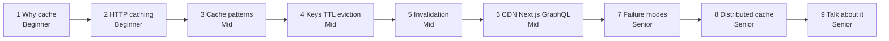

| Part | Level | You will be able to |
|---|---|---|
| 1. Why cache | Beginner | Say the speed numbers, compute a hit ratio, draw all cache layers |
| 2. HTTP caching | Beginner | Set `Cache-Control` for a public page and a private page, explain 304 |
| 3. Cache patterns | Mid | Draw cache aside, write through, write behind, refresh ahead, and pick one |
| 4. Keys, TTLs, eviction | Mid | Design a key, choose a TTL, say what never goes in a cache, size the memory |
| 5. Invalidation | Mid | Draw the stale write back race and three fixes |
| 6. CDN, Next.js, GraphQL | Mid | Explain edge vs origin shield, signed URLs, Next.js 16 caching, Apollo caching |
| 7. Failure modes | Senior | Fix stampede, hot key, penetration, avalanche, cold start, and Redis down |
| 8. Distributed cache | Senior | Compare Redis, Memcached, Valkey, explain hash slots and multi region |
| 9. Talk about it | Senior | Use a 7 step checklist in any design round |

---

## Part 1: Why cache [Beginner]

**Words you will hear:** hit (the copy was there), miss (the copy was not there), hit ratio (hits divided by all reads), TTL (time to live: how many seconds a copy may stay before it expires).

### The problem

Your product page reads the same product row thousands of times a minute. Every read goes to PostgreSQL. The database does the same work again and again.

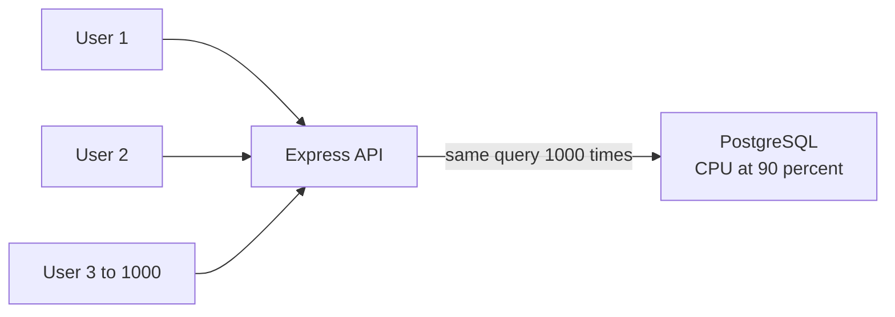

Notice: one database does the same work for every user. It is the first thing to get slow.

### How far away is the data?

Speed depends on distance. Memory is in the same machine. A database needs a network trip and maybe a disk read.

| Where the data is | Rough time | Feels like |
|---|---|---|
| App memory (a JavaScript `Map`) | about 0.0001 ms (100 ns) | your pocket |
| Redis in the same data center | about 0.2 to 1 ms (one network round trip is about 0.5 ms) | your desk |
| PostgreSQL, indexed read | about 1 to 5 ms | the next room |
| PostgreSQL, slow query | 50 ms to seconds | another building |
| A server on another continent | about 150 ms | another city |

These are rough numbers, from the classic "latency numbers" list and from the basics guide. Use them for estimates, not promises.

### The hit ratio math

Say Redis answers in 0.5 ms and the database in 5 ms. With a 95 percent hit ratio:

- 95 of 100 reads take 0.5 ms.
- 5 of 100 reads take 0.5 + 5 = 5.5 ms (check cache, miss, then database).
- Average: 0.95 × 0.5 + 0.05 × 5.5 = **0.75 ms**, down from 5 ms.
- The database now sees only 5 percent of reads. That is **20 times less load**.

The second number matters more. A cache is mainly a **shield** for the database.

### All the layers

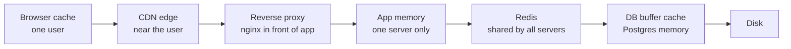

Notice: a request stops at the first layer that has a fresh copy. Every layer it skips is saved work.

- **Browser cache:** keeps files for one user. Free and fastest. You control it with HTTP headers.
- **CDN** (a network of copy servers around the world): keeps public files and pages near users.
- **Reverse proxy:** nginx or similar in front of your app. It can keep whole responses.
- **App memory:** a `Map` inside one Node process. Very fast, but each server has its own copy.
- **Redis:** one shared memory store that all your servers talk to.
- **Database buffer cache:** PostgreSQL keeps hot pages in RAM (`shared_buffers`). You get this one for free.

**The cost:** every layer is one more copy that can be old. More layers means more places to clear when data changes.

> **Say this in the interview:** "A cache is a copy that trades freshness for speed. I add it where the same data is read far more often than it changes, and I measure the hit ratio, because the real win is the load it takes off the database."

<details><summary>Go deeper (optional)</summary>

- The latency list is from about 2012. Memory and network numbers have not changed much. SSDs got faster.
- PostgreSQL also relies on the operating system's file cache. A Postgres buffer hit ratio below about 99 percent on a busy read workload is a common sign that you need more RAM or better indexes. The [database scaling guide](../database/database-scaling-and-correctness.md) covers this.
- Before adding Redis, check whether a tuned query, an index, or PgBouncer already fixes the problem. The basics guide makes this point too.

</details>

---

## Part 2: HTTP caching [Beginner]

Deep version of the browser side: [From URL to page](../networking/networking-url-to-page-step-by-step.md). This part focuses on what you set on the server.

**Words you will hear:** `Cache-Control` (the header that says who may keep a copy and for how long), shared cache (a cache many users pass through, like a CDN), ETag (a fingerprint of the response), 304 Not Modified (the server says "your copy is still good").

### The problem

Without cache headers, the browser and the CDN guess. They may keep a page you wanted fresh. Or they may fetch a big file again and again.

Worse: a CDN can keep a **private** page and show it to the wrong user.

### The picture: ETag and 304

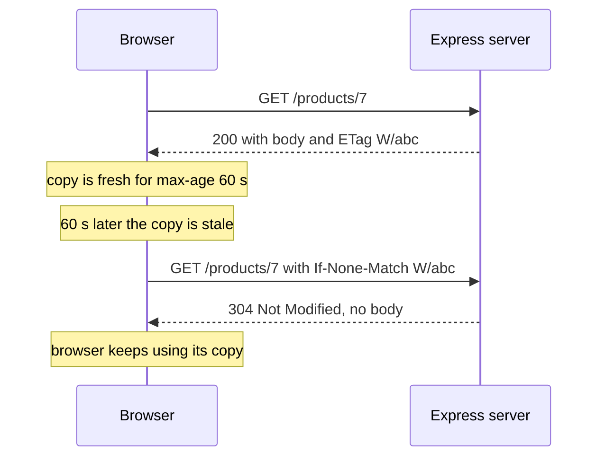

Notice: the second answer has no body. The browser asked "is my copy still good?" and the server said yes.

### The headers you need

| Directive | What it means in plain words |
|---|---|
| `max-age=60` | Any cache may use this copy for 60 seconds without asking. |
| `s-maxage=300` | Shared caches (CDN, proxy) may use it for 300 seconds. Browsers ignore this one. |
| `private` | Only the user's own browser may keep it. Never a CDN. |
| `no-cache` | You may keep it, but **ask the server first** every time. Not "do not cache". |
| `no-store` | Do not keep it anywhere. For secrets and personal data. |
| `stale-while-revalidate=30` | For 30 seconds after it goes stale, serve the old copy and fetch a new one in the background. |
| `immutable` | This file never changes. Do not even ask on reload. For hashed file names like `app.3f9a.js`. |

### Tiny Express example

```js
const express = require("express");
const app = express();

app.get("/products/:id", (req, res) => {
  res.set("Cache-Control", "public, max-age=60, s-maxage=300, stale-while-revalidate=30");
  res.json({ id: req.params.id, name: "Rice 5kg", price: 72000 });
});

app.get("/me", (req, res) => {
  res.set("Cache-Control", "private, no-store");
  res.json({ user: "store-owner-7", points: 1200 });
});

app.listen(3000);
```

What happens when you run it:

- `GET /products/7` returns `200`, your `Cache-Control`, and `ETag: W/"2a-..."`. Express adds the ETag by itself.
- Send the same request with `If-None-Match` set to that ETag. Express answers `304 Not Modified` with no body.
- `GET /me` returns `Cache-Control: private, no-store`. No CDN or browser keeps it.

Checked on 2026-10-16 with Express 5.3 on Node 22.

### The common split

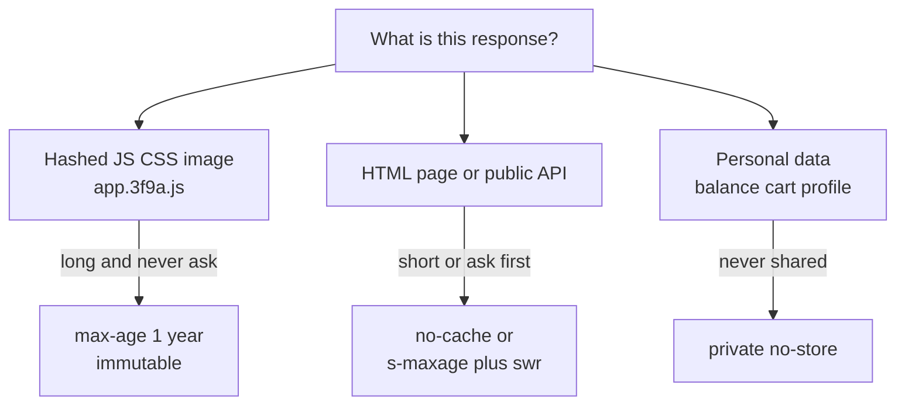

Notice: three kinds of response, three rules. File names with a hash change when the content changes, so the old copy never needs clearing.

**The cost:** long `max-age` on a URL that can change means users keep old content, and you cannot reach into their browser to clear it. Only use long lifetimes on hashed file names.

> **Say this in the interview:** "Hashed static files get a one year immutable lifetime. HTML gets no-cache so it is checked every time. Personal data gets private, no-store, so a CDN can never serve one user's data to another."

<details><summary>Go deeper (optional)</summary>

- `Vary: Accept-Language` tells caches to keep a separate copy per language. Too many `Vary` values split the cache into tiny pieces and lower the hit ratio.
- Express makes **weak** ETags (`W/` prefix) by default. Weak means "same meaning", not "same bytes". That is fine for 304 checks.
- A `304` still costs one round trip. `max-age` with `immutable` costs zero.
- If a response has no `Cache-Control`, browsers may still guess a lifetime from `Last-Modified` (heuristic caching). Always set the header on purpose.

</details>

---

## Part 3: Cache patterns [Mid]

**Words you will hear:** cache aside (the app manages the cache itself), write through (write the cache and database together), write behind (write the cache now, the database later), refresh ahead (refresh a key before it expires).

### The problem

"Add a cache" is not a design. Who fills the cache? Who updates it on a write? What if the two disagree? Each pattern answers these questions differently.

### Cache aside (also called lazy loading)

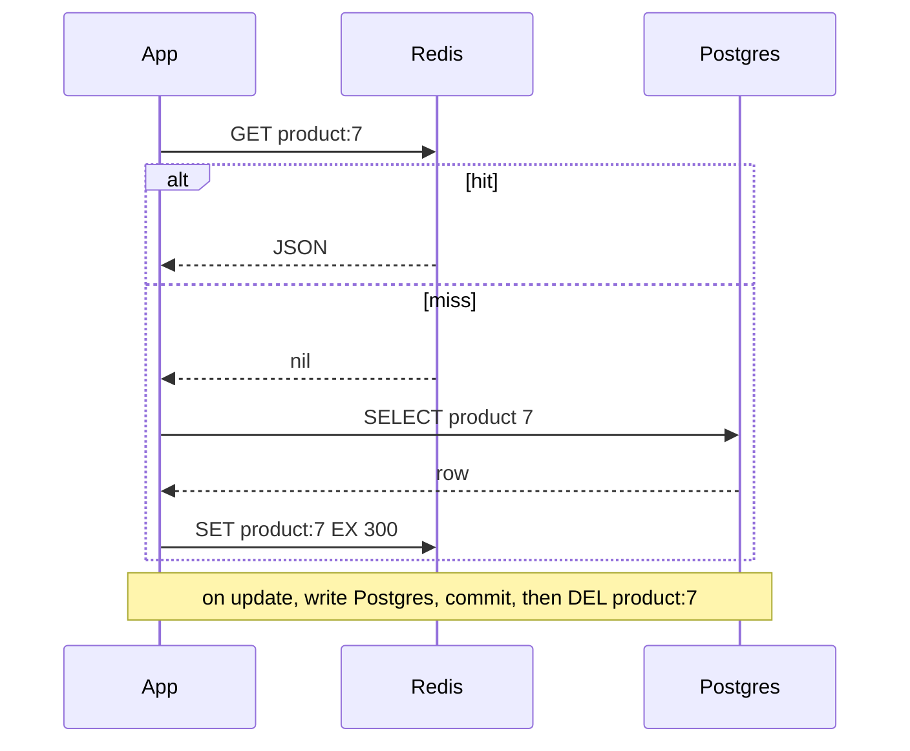

Notice: the app does all the work. Redis is only a box. If Redis dies, the app can still read Postgres.

- Only data someone asked for goes in the cache.
- First read after a change is slow (a miss).
- This is the default answer in interviews. The [database scaling guide](../database/database-scaling-and-correctness.md) shows the same picture.

### Read through

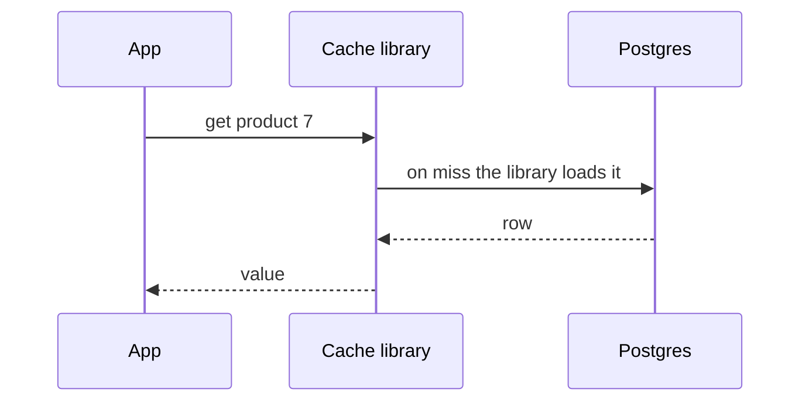

Notice: same flow as cache aside, but a library or the cache itself does the loading. The app code stays short. Examples: a `DataLoader` per request, or a cache library with a loader function.

### Write through

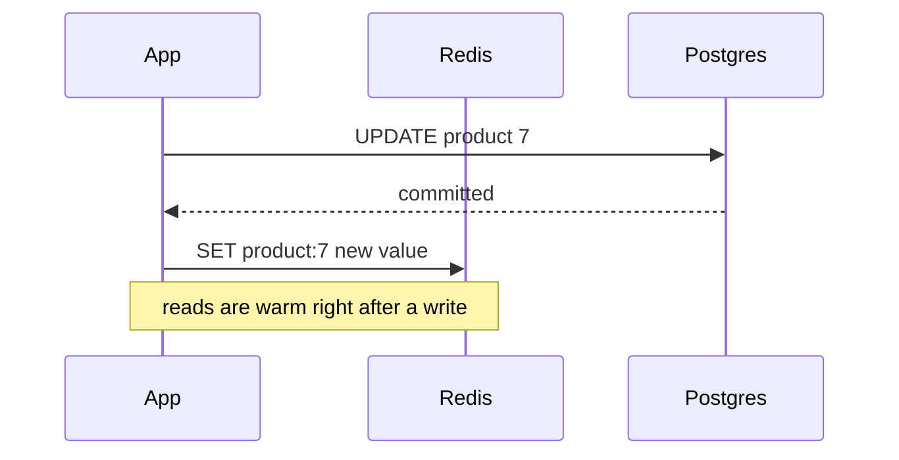

Notice: every write also fills the cache. Reads after a write are fast. But the write is slower, and you may fill the cache with data nobody reads. Setting a value (not deleting) also opens the race in Part 5.

### Write behind (write back)

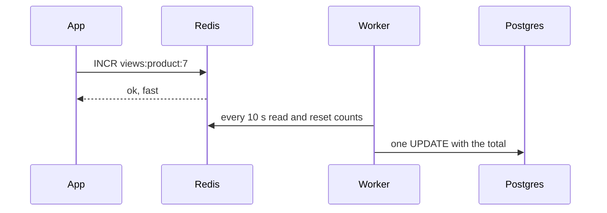

Notice: the database gets one write instead of thousands. But if Redis dies before the worker runs, those counts are lost.

- Good for view counters, likes, analytics.
- Never for money, orders or stock.

### Refresh ahead

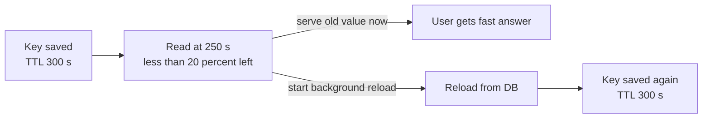

Notice: the user never waits for a miss on a popular key. The cache reloads it before it dies. This is the same idea as `stale-while-revalidate`.

### Which one to pick

| Pattern | Pick when | Cost |
|---|---|---|
| Cache aside | Default. Reads much more than writes. | First read after change is slow. Stale until delete or TTL. |
| Read through | You want the loading logic in one place. | Same as cache aside, plus a library to learn. |
| Write through | Data is read right after it is written. | Slower writes, cache full of cold data. |
| Write behind | Very many small writes, losing a few is fine. | Data loss if the cache dies. Harder to debug. |
| Refresh ahead | A few hot keys must never miss. | Extra reloads for keys nobody reads again. |

> **Say this in the interview:** "I start with cache aside and delete on write, because the cache can fail without breaking the app. I would only use write behind for counters where losing a few seconds of data is fine."

---

## Part 4: Keys, TTLs, eviction and size [Mid]

**Words you will hear:** key (the name of a cached item), eviction (Redis throwing items out when memory is full), LRU (throw out what was not used lately), LFU (throw out what is used rarely).

### The problem

Bad keys cause the worst cache bugs. If the key forgets one input, two different requests share one cached answer. If the key includes the user, a shared page is cached once per user and almost never hits.

### Key design

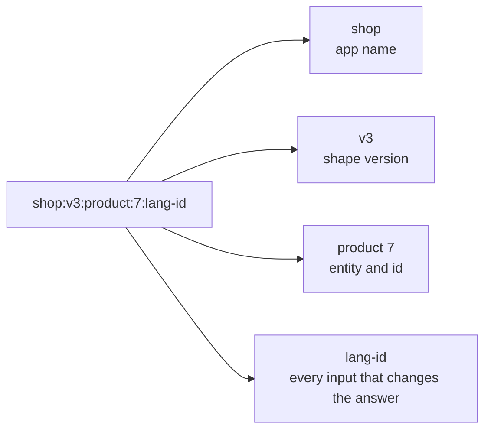

Notice: the key has every input that changes the answer, and nothing else.

- **App name first**, so two apps can share one Redis.
- **A version number** (`v3`). When you change the JSON shape in a deploy, bump it. Old keys are ignored and expire alone.
- **Every input that changes the answer:** id, language, currency, store tier. Forget one, and users see the wrong price.
- **Nothing extra:** a timestamp or request id in the key means every key is new, so nothing ever hits.

### What to cache and what never to cache

| Cache it | Never cache it (or only `private`) |
|---|---|
| Product catalog, categories, banners | Passwords, tokens, OTP codes |
| Config and feature flags | One user's data under a shared key |
| Exchange rates, shipping zones | Stock at checkout, points balance at redeem |
| Rendered public pages | Anything a law says must be fresh (loan decisions) |

Rule: cache data that can be a few seconds old. Read **decisions** (money, stock) from the database, inside the transaction.

### Choosing a TTL

- Ask: "How old can this be before a user is hurt?" That is your TTL.
- Catalog: 5 to 15 minutes. Config: 1 minute. Exchange rates: match the source.
- Always set a TTL, even when you also delete on write. The TTL is your **safety net** if a delete is missed.

### Eviction: what Redis throws out

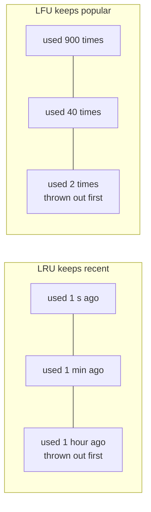

Notice: LRU (least recently used) throws out what was **not used lately**. LFU (least frequently used) throws out what is **used rarely**.

- In Redis you choose with `maxmemory-policy`. `allkeys-lru` is a common choice for a pure cache.
- LFU is better when a few keys are always popular, and a big one time scan should not push them out.
- The default policy in Redis is `noeviction`: when full, writes fail. For a cache, change it.

### Memory size estimate

Say it out loud, step by step:

- 200,000 products × 2 KB of JSON each = 400 MB.
- Only about 20 percent are popular. Cache those: about 80 MB.
- Redis adds its own overhead per key. Plan about 1.5 times: about 120 MB.
- Leave room to grow and for a replica. A 1 GB Redis is plenty.

**The cost:** a short TTL means more misses and more database load. A long TTL means older data. Too little memory means constant eviction and a low hit ratio.

> **Say this in the interview:** "My key has every input that changes the answer plus a version, my TTL is how stale the business can accept, and I set an eviction policy so a full cache drops cold keys instead of failing writes."

---

## Part 5: Invalidation [Mid]

**Words you will hear:** invalidation (removing or marking a cached copy as old), purge (removing items from a CDN), versioned key (a key with a version number inside), lease (a short permission to fill a key).

### The problem

The database changed. The cache did not. Users see old prices. This is the classic cache bug.

### The ways to clear a cache

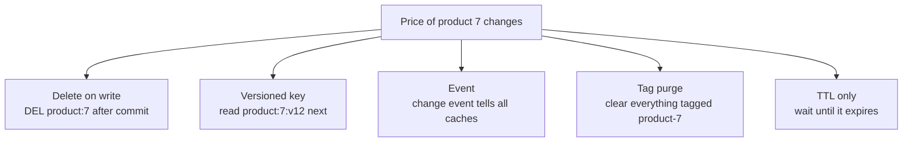

Notice: five ways, from simple to large. Most apps use delete on write plus a TTL as a safety net.

- **Delete on write:** after the database commits, the app deletes the key. The next read refills it.
- **Versioned key:** store a version number for the item. A change bumps the version, so readers ask for a new key. Old keys expire alone. Nothing needs deleting.
- **Events:** the database change produces an event (for example from an outbox table, or by reading the database's change log, interview word: CDC). A small worker deletes keys in Redis and purges the CDN. Good when many services cache the same data.
- **Tag purge:** you tag cached items ("product-7", "category-3"). One call clears every item with that tag. CDNs (surrogate keys) and Next.js (`cacheTag`) both work this way.
- **TTL only:** do nothing. Accept data that is up to TTL seconds old.

### Why delete, not set?

Two writers can set in the wrong order. Writer A sets price 100. Writer B sets price 90. If A's set arrives last, the cache says 100 forever. A delete has no value to get wrong.

### The race: a stale value comes back after the delete

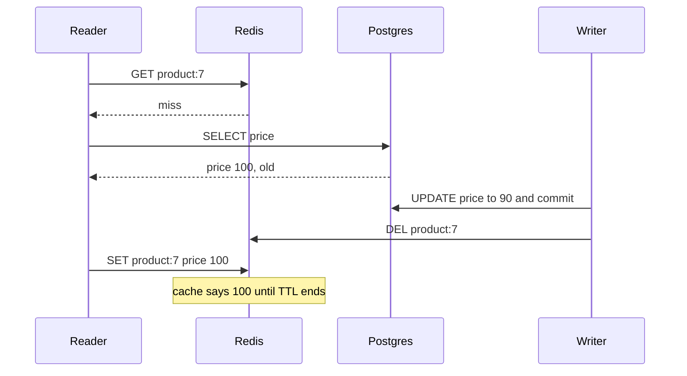

Notice: the reader was slow. It read the old row before the write, but saved it after the delete. The delete happened, and still the cache is wrong.

This is rare, because the read must be slow and the write must land in a small gap. At high traffic, rare things happen every day.

### Also wrong: delete before commit

If the writer deletes the key **before** the transaction commits, a reader can refill the key with the old row in between. Always delete **after** commit.

### The fixes

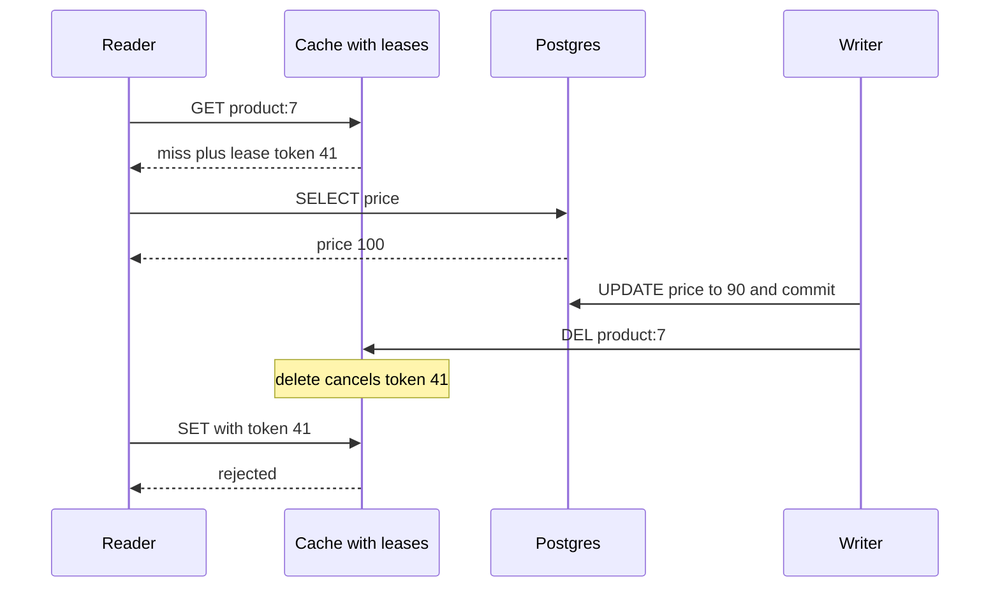

Notice: the lease token is a ticket that says "you may fill this key". The delete tears up the ticket, so the old value is refused. Facebook described this in its memcache paper (see the cases below).

Fixes you can name, simplest first:

1. **Short TTL.** The wrong value lives at most a few minutes. Often enough.
2. **Delete after commit**, never before.
3. **Delete twice:** delete now, and again about one second later (delayed double delete). It catches most slow readers.
4. **Version check:** store the row's `updated_at` or version in the cached value. Only overwrite if the new version is higher. In Redis, a small Lua script can do this check and set in one step.
5. **Lease:** the cache gives a token on a miss, and a delete cancels it. Strongest, but your cache library must support it.

**The cost:** every fix adds code. Most teams use 1 and 2, and add more only for data where staleness hurts.

> **Say this in the interview:** "On a write I commit, then delete the key, with a TTL as a safety net. I know about the race where a slow reader writes the old value back after my delete. For data where that matters I add a version check or a lease, like Facebook's memcache."

<details><summary>Go deeper (optional)</summary>

- "There are only two hard things in computer science: cache invalidation and naming things" is a well known quote attributed to Phil Karlton. Interviewers like it when you then show you know the specific race.
- With Postgres you can produce change events from the outbox table (the [database scaling guide](../database/database-scaling-and-correctness.md) explains the outbox) or by reading the write ahead log with tools like Debezium. Change events give you one place that knows about every change, even ones made by a script or by Hasura.
- If writes come from Hasura directly, your Express code never sees them. That is a strong reason for event based invalidation (Hasura event triggers) over delete in app code.

</details>

---

## Part 6: CDN, Next.js and GraphQL caching [Mid]

**Words you will hear:** edge (a CDN server near the user), origin (your own server, where the real content lives), origin shield (one middle CDN layer that protects the origin), signed URL (a link with a signature and an expiry time).

### The problem

Your server is in Singapore. A user in Jakarta waits about 20 ms per round trip, a user in Europe about 150 ms or more. Images and pages are the same for everyone, yet every request travels the whole way and hits your server.

### The picture: edge, shield, origin

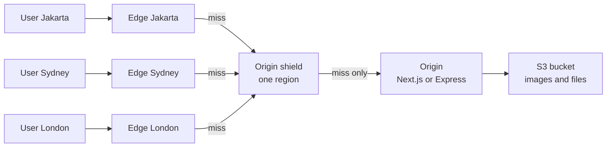

Notice: without the shield, 3 edges that miss make 3 requests to your origin. With the shield, they make 1. Cloudflare calls this Tiered Cache: lower tiers ask an upper tier, and only the upper tier talks to the origin.

### What a CDN caches

- **Always:** hashed JS and CSS, images, fonts, videos.
- **Often:** public HTML pages, public GET API responses, with `s-maxage`.
- **Never:** responses with `private` or `no-store`, or responses with `Set-Cookie` (many CDNs skip these by default).

### The cache key at the CDN

- By default: the URL (host, path, query string).
- Add only what changes the answer: `Accept-Language` or a country header, via `Vary` or CDN settings.
- Remove what does not: tracking query params like `utm_source`. Each one makes a new key and lowers the hit ratio.
- **Danger:** if the key ignores a cookie the page depends on, one user's page is served to everyone. This is the "CDN leaked a private page" incident pattern.

### Purge

- **By URL:** clear one path.
- **By tag** (surrogate key): clear every page that shows product 7. Best for catalogs.
- **Everything:** last resort. Your origin gets hit by every edge at once (see cold start in Part 7).

### Signed URLs for private files

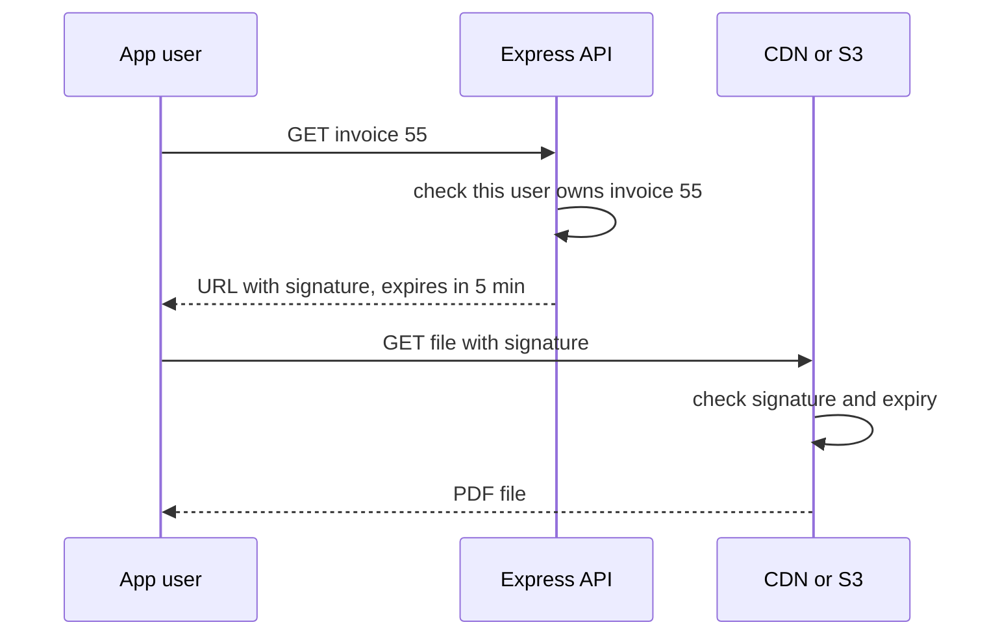

Notice: your API checks permission once, then the CDN or S3 serves the big file. Your server never streams the bytes. After 5 minutes the link stops working.

### Image optimization

A CDN or image service can resize and convert images on the fly: one upload, then `?w=400&format=webp` per device. The resized result is cached at the edge. The width and format are part of the cache key, so allow only a small list of sizes. Otherwise every random width is a new miss and a new resize. In Next.js, the `<Image>` component does this through its image endpoint.

### Next.js caching in 2026

The current release in October 2026 is **Next.js 16.4**. Its caching model is called **Cache Components**.

- Caching is **opt in**. With `cacheComponents: true` in `next.config.ts`, data is not cached unless you mark it. Parts that need request data (cookies, headers) render on each request. New `create-next-app` projects turn this mode on by default.
- You mark a function or component with the `"use cache"` directive. Its return value is cached. The arguments become part of the cache key.
- `cacheLife('hours')` sets how long. Built in profiles include `seconds`, `minutes`, `hours`, `days`, `weeks` and `max`.
- `cacheTag('product-7')` tags the entry so you can clear it later.
- Cookies and headers cannot be read inside `"use cache"`. Read them outside and pass the value in, so it becomes part of the key. `"use cache: private"` exists for per user data and stores only in the browser.

```ts
import { cacheLife, cacheTag } from "next/cache";

export async function getProduct(id: string) {
  "use cache";
  cacheLife("hours");
  cacheTag(`product-${id}`);
  return prisma.product.findUnique({ where: { id } });
}

// In a Server Action, after saving the product:
//   updateTag(`product-${id}`)      user sees the change at once
// From a webhook Route Handler:
//   revalidateTag(`product-${id}`, "max")   serve old, refresh in background
```

The two ways to clear a tag:

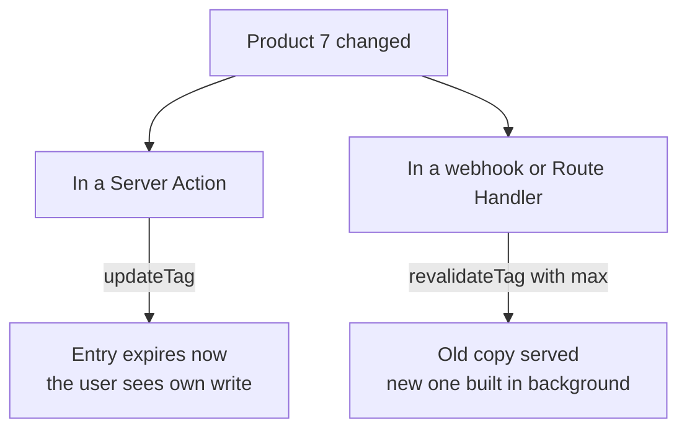

Notice: `updateTag` is for "the person who clicked Save must see it". `revalidateTag(tag, "max")` is stale while revalidate for everyone else. The one argument form `revalidateTag(tag)` is deprecated in Next.js 16.

### GraphQL and Apollo caching

The problem: GraphQL sends queries as **POST** to one URL, `/graphql`. Most CDNs only cache GET. The query text can also be too long for a URL.

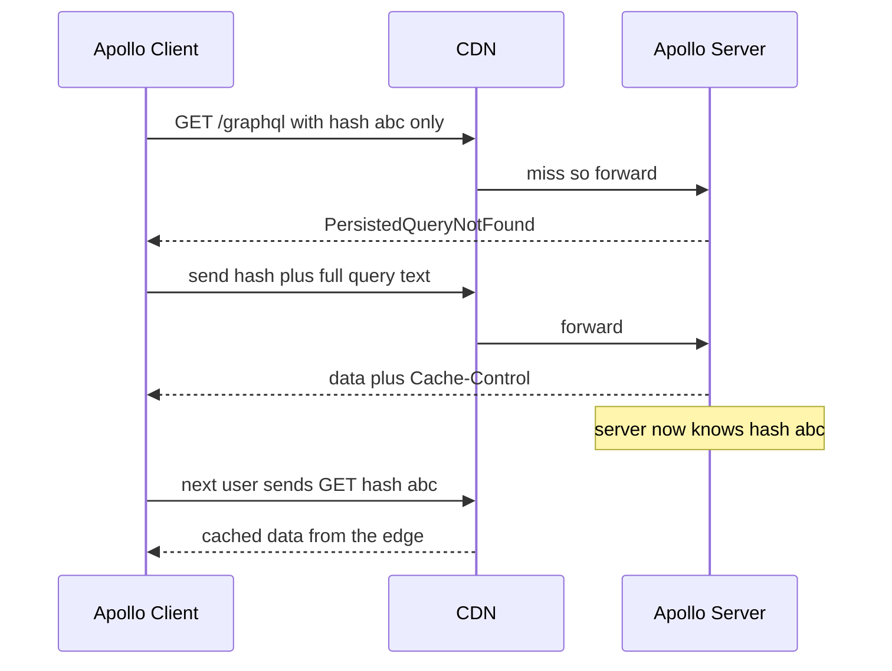

Notice: after the first time, every client sends only a short hash in a GET URL. Now the CDN can cache it like any other URL.

- This is **automatic persisted queries** (APQ). In Apollo Client you turn on `useGETForHashedQueries: true`. Mutations stay POST.
- Apollo Server builds the `Cache-Control` header from **cache hints** on your schema. Any private field makes the whole response private.
- On the client, Apollo's `InMemoryCache` **normalizes** data: it stores each object once, by `__typename` plus `id` (for example `Product:7`). Update the product in one query and every screen that shows it changes. This is a client cache, not a CDN cache.

**The cost:** CDN caching only helps public data. Most GraphQL in a logged in app is per user, so the main win there is the client cache and a server side cache (DataLoader per request, Redis for shared data).

> **Say this in the interview:** "Static files and public pages go through a CDN with an origin shield, so a miss reaches my server once, not once per edge. Private files use short lived signed URLs. For GraphQL I use persisted queries over GET so the CDN can cache public queries, and Apollo's normalized cache on the client."

<details><summary>Go deeper (optional)</summary>

- Next.js cacheLife profiles have three numbers: `stale` (how long the browser uses it without asking), `revalidate` (how often the server refreshes it in the background), and `expire` (after this with no traffic, the next request waits). For `hours`: 5 minutes, 1 hour, 1 day.
- By default, `"use cache"` stores entries in memory on each server instance. On serverless this memory is short lived. `"use cache: remote"` stores entries in a shared cache handler, at the cost of a network trip.
- `updateTag` only works inside Server Actions. In a webhook Route Handler that needs data gone right now, use `revalidateTag(tag, { expire: 0 })`.
- `cacheTag` accepts up to 128 tags per call, each up to 256 characters.
- Apollo Server's APQ store can live in memory or in Redis. With many server instances, use a shared store, or a hash registered on one server is unknown to the next one.
- Hasura can cache query responses with an `@cached` directive in its cloud and enterprise editions. Check the current Hasura docs before you claim it in an interview.

</details>

---

## Part 7: Failure modes [Senior]

**Words you will hear:** stampede (many requests miss at once and all hit the database, also called thundering herd), hot key (one key that gets a huge share of traffic), penetration (requests for data that does not exist, so the cache never helps), avalanche (many keys expire at the same moment).

Seniors are judged here. Anyone can add Redis. The question is what happens when it misbehaves.

### Stampede: one hot key expires

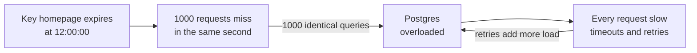

Notice: the loop at the end. Slow answers cause retries, retries cause more load. The site can fall over even though the data is the same for everyone.

Fixes:

1. **Request coalescing** (single flight): inside one server, the first request starts the load and the others wait for the same promise.
2. **A lock across servers:** `SET lock:homepage 1 NX EX 5` in Redis. Only the server that got the lock reloads. Others serve the old value or wait briefly.
3. **Serve stale while one refreshes:** keep the old value a bit longer than its TTL and refresh in the background. Same idea as `stale-while-revalidate`.
4. **Probabilistic early refresh:** each request has a small chance to refresh before expiry, and that chance grows as expiry gets close. One request refreshes early, so the key never fully expires under load.

Request coalescing in one Node process:

```js
const inFlight = new Map();

function getOnce(key, load) {
  if (inFlight.has(key)) return inFlight.get(key);
  const p = load().finally(() => inFlight.delete(key));
  inFlight.set(key, p);
  return p;
}
// 1000 calls to getOnce("product:7", loadFromDb) at the same time
// make 1 database call. Output of a test: requests: 1000 db calls: 1
```

Checked on 2026-10-16 with Node 22. Each server still loads once, so 10 servers make 10 loads. Add the Redis lock to get down to 1.

### Hot key: one key melts one server

```mermaid
graph LR
    A1["App server 1"] --> L1["Local memory<br/>copy for 5 s"]
    A2["App server 2"] --> L2["Local memory<br/>copy for 5 s"]
    L1 -->|miss only| R["Redis node 3<br/>holds flash-sale key"]
    L2 -->|miss only| R
```

Notice: the key lives on one Redis node. Without the local copy, every request for it lands on that one node. With a 5 second local copy, each app server asks Redis at most once every 5 seconds.

- **Local cache tier:** a small in memory cache (for example an LRU map) in each app server, with a very short TTL. Two levels: L1 local, L2 Redis.
- **Key splitting:** store copies as `flashsale:1` to `flashsale:10` on different nodes. Each read picks one at random. Writes must update all copies.
- **Find them first:** Redis has `redis-cli --hotkeys` (needs an LFU policy) and your metrics.

### Penetration: asking for things that do not exist

```mermaid
graph LR
    BOT["Bot asks product 999999<br/>and 999998 and more"] --> C["Redis<br/>always miss"]
    C -->|nothing to cache| DB["Postgres<br/>queried every time"]
    BOT -->|with the fix| BF["Bloom filter<br/>id surely not here"]
    BF -->|reject fast| X["404 without DB"]
```

Notice: a cache only saves you when there is something to save. Ids that do not exist always fall through to the database.

- **Cache the miss:** store "not found" for a short TTL, like 60 seconds.
- **Bloom filter:** a small memory structure that answers "surely not here" or "maybe here". If it says "surely not", skip the database. It never gives a false "no", but it can give a false "maybe".
- **Validate input and rate limit:** reject impossible ids before any lookup.

### Avalanche: many keys expire together

If you warm 50,000 keys at 09:00 with TTL 3600, they all expire at 10:00. The database gets 50,000 misses in one second.

- **Fix: TTL jitter.** Use `3600 + random(0 to 300)` seconds. Expiries spread over 5 minutes.
- Same problem if the whole Redis restarts empty.

### Cold start: after a deploy or a flush

- A new Redis, a full flush, a version bump in every key, or a CDN purge all start with **zero hits**.
- The database suddenly gets 100 percent of reads.
- **Fixes:** warm the most popular keys before switching traffic. Roll out a key version change slowly. Never purge a whole CDN at peak time. Instagram described this exact problem when bringing up new data centers with empty caches.

### What happens when Redis goes down?

```mermaid
graph TB
    REQ["Request needs product 7"] --> CB["Circuit breaker<br/>is Redis healthy"]
    CB -->|healthy| R["Read Redis<br/>timeout 50 ms"]
    CB -->|open after many errors| DB["Read Postgres directly<br/>fail open"]
    R -->|error or timeout| DB
    DB --> LIM["Limit DB calls<br/>so Postgres survives"]
```

Notice: the app treats Redis as optional. Short timeouts, and a circuit breaker stops trying Redis for a while after many errors.

- **Fail open:** skip the cache and read the database. Right for a product catalog. The site gets slower, not broken. But watch out: the database may not survive 100 percent of the load (a stampede on everything). Limit how many requests may query the database at once, or serve a smaller page.
- **Fail closed:** refuse the request. Right when Redis holds something you must not skip, such as a rate limit on OTP or login. The [DBO case study](../../interview/my-projects/dbo-b2b-platform-system-design-case-study.md) suggests this exact split for the rate limiter: fail open in general, fail closed on OTP.
- **Circuit breaker:** after N errors in a row, stop calling Redis for some seconds. This avoids waiting on timeouts for every request.
- **Prevent it:** Redis with a replica and automatic failover (Sentinel, a managed service, or cluster mode).

**The cost:** every protection adds code and settings. Pick the ones that match your traffic. A small app needs TTL jitter and fail open. A big sale needs locks, local caches and warming.

> **Say this in the interview:** "The cache must never be a single point of failure for reads. I set short timeouts and a circuit breaker, and fail open to the database for catalog reads, with a concurrency limit so Postgres survives. For hot keys I add a short local cache, and for stampedes I use single flight and TTL jitter."

<details><summary>Go deeper (optional)</summary>

- Probabilistic early refresh is often called XFetch, from a 2015 paper on optimal cache stampede prevention. The rule: refresh early if `now - delta * beta * log(random()) >= expiry`, where `delta` is how long a reload takes. You do not need the formula in an interview. Say "a random early refresh that gets more likely near expiry".
- The Redis lock with `SET NX EX` is fine for "only one reloads". It is not a safe lock for money. If correctness matters, lock in the database.
- Facebook's leases also solve stampedes: only the client with the lease reloads, others wait a moment and retry the cache.
- Redis 8 and Valkey both support client side caching with server assisted invalidation (RESP3 tracking). The client keeps a local copy and the server tells it when the key changes. This is the "local cache tier" without the 5 second staleness.

</details>

---

## Part 8: Distributed cache [Senior]

**Words you will hear:** Valkey (an open source fork of Redis), cluster (many Redis nodes that share the keys), hash slot (a numbered bucket that a key falls into), replica (a copy of a node that can take over).

### The problem

One Redis is one machine. It can run out of memory, or die. You need many nodes. Then two questions come up: which node holds which key, and which product should you run?

### Redis vs Memcached vs Valkey

| | Redis | Valkey | Memcached |
|---|---|---|---|
| Data types | Strings, hashes, lists, sets, sorted sets, streams, more | Same as Redis 7.2, plus its own additions | Strings only |
| Persistence | Yes (RDB, AOF) | Yes | No |
| Replication and failover | Yes | Yes | No (the client spreads keys) |
| Threads | Mostly single thread for commands, I/O threads | Same base, more multi thread work | Multi thread |
| License in 2026 | Redis 8 and later: choose RSALv2, SSPLv1 or AGPLv3 | BSD 3 clause, Linux Foundation | BSD |
| Pick when | You want the newest Redis features and accept the license | You want Redis behavior with a permissive license, or your cloud offers it | Pure simple cache, many cores, no extras needed |

The license story, with dates:

- **March 2024:** Redis moved from BSD to RSALv2 and SSPLv1. Neither is approved as open source.
- **2024:** the Linux Foundation started **Valkey**, forked right before the change. Cloud providers back it.
- **May 2025:** Redis 8 added **AGPLv3** as a third choice. Redis is open source again, but AGPL has a rule: if you change Redis and offer it over a network, you share your changes.
- **October 2026:** Redis is on the 8.x line (8.10 is the newest in its release list). Valkey's newest stable is 9.1, with 9.2 in release candidate.

For most app teams, both work the same from Node. Your `ioredis` or `node-redis` code does not change. The choice is about license, managed service and features.

### Redis Cluster and hash slots

```mermaid
graph LR
    K["Key product:7"] -->|CRC16 then mod 16384| S["Slot 9012"]
    S --> N2["Node B<br/>slots 5461 to 10922"]
    N1["Node A<br/>slots 0 to 5460"]
    N3["Node C<br/>slots 10923 to 16383"]
    N2 --- R2["Replica of B<br/>takes over if B dies"]
```

Notice: the key decides its slot, the slot decides its node. To add a node, Redis moves some slots, not every key. (The slot number 9012 is an example.)

- There are always **16,384 slots**. Redis turns the key into a number (CRC16) and takes the remainder after dividing by 16,384.
- **Hash tags:** only the part in `{}` is used. `{user:7}:cart` and `{user:7}:profile` land in the same slot. Then you can use them in one command or transaction.
- A command that touches keys in different slots fails in cluster mode. Plan your keys.
- Memcached has no cluster mode. The client picks the server itself, usually with consistent hashing (a way to spread keys so adding one server moves only a few keys).

### Consistency between cache and database

- The cache is **eventually consistent**: it catches up after a delete or a TTL.
- **Read your own writes:** after a user saves, they expect to see the change. Delete the key before you return the response, or read the database for that user for a few seconds. Next.js `updateTag` solves the same problem.
- **Never** let the cache be the only place data lives (unless you chose write behind for counters on purpose).

### Multi region caches

```mermaid
graph LR
    subgraph SG["Region Singapore"]
        A1["App"] --> C1["Redis SG"]
        A1 --> P["Postgres primary"]
    end
    subgraph SY["Region Sydney"]
        A2["App"] --> C2["Redis SY"]
        A2 --> RR["Postgres replica"]
    end
    P -->|replication| RR
    P -->|change event| Q["Queue"]
    Q -->|delete key| C1
    Q -->|delete key| C2
```

Notice: each region has its own Redis. A write in one region must clear keys in all regions. A change event through a queue does this.

- **Keep caches local**, never read a cache in another region. That trip costs more than a database read.
- **Invalidate everywhere:** send deletes to every region from one change stream.
- **Watch the replica lag:** if Sydney deletes its key, and then a reader refills it from a replica that is still behind, the old value comes back. Delay the delete, or delete again after the lag.
- Netflix runs its own memcached based cache, EVCache, on AWS for this kind of scale.

> **Say this in the interview:** "I use Redis or Valkey, same client code, picked by license and what my cloud offers. In cluster mode keys spread across 16,384 slots, and I use hash tags to keep related keys together. Across regions each region has its own cache, and one change stream sends deletes to all of them."

<details><summary>Go deeper (optional)</summary>

- Big clouds offer managed Valkey (for example AWS ElastiCache and Google Memorystore). Check the current product and pricing pages before you claim one is cheaper.
- Redis Cluster uses gossip between nodes and promotes a replica when a primary fails. During failover, writes to the lost primary that were not yet copied can be lost. Redis replication is asynchronous.
- Redis Sentinel gives failover without sharding, for a single primary with replicas. Good for small setups.

</details>

---

## Part 9: How to talk about caching in a design round [Senior]

### The problem

Candidates say "I'll add Redis" and stop. The interviewer then asks five follow-ups, and the candidate has no answers ready. Say these seven points in order, before they ask.

```mermaid
graph LR
    W1["1 What<br/>which data"] --> W2["2 Where<br/>which layer"]
    W2 --> W3["3 Pattern<br/>cache aside"]
    W3 --> W4["4 Key and TTL"]
    W4 --> W5["5 Invalidation"]
    W5 --> W6["6 Failure mode"]
    W6 --> W7["7 Metric to watch"]
```

Notice: seven steps, about one sentence each. The whole thing takes one minute to say.

| Step | Question to answer | Example for a product catalog |
|---|---|---|
| 1. What | Which data is read often and changes rarely? | Product details and category lists. Not stock at checkout. |
| 2. Where | Which layer? | CDN for images and public pages. Redis for product JSON. |
| 3. Pattern | Who fills it, who updates it? | Cache aside, delete on write. |
| 4. Key and TTL | What is the key, how old can it be? | `shop:v3:product:7:lang-id`, TTL 10 minutes with jitter. |
| 5. Invalidation | How does a change reach the cache? | Delete after commit. Tag purge on the CDN. |
| 6. Failure mode | What if it expires, gets hot, or dies? | Single flight, local 5 s tier for flash sale items, fail open with a limit. |
| 7. Metric | How do you know it works? | Hit ratio, p99 latency (time of the slowest 1 in 100 requests), DB queries per second, evictions, Redis memory. |

**Where this could show up in your work (ideas, not facts):** DBO has a product catalog read by many store owners in the mobile app, and DBO already runs Redis for BullMQ. A good question to ask yourself: "Which DBO reads are the same for every store owner, and which must be fresh, like points at redeem time?" Practice saying the seven steps with that example.

> **Say this in the interview:** "Before adding a cache I say what I cache and where, the pattern, the key and TTL, how changes clear it, what happens when it fails, and the metric that tells me it works."

---

## Practice

Try each one before you open the answer.

**1. Predict.** Redis answers in 1 ms, Postgres in 10 ms. Hit ratio is 90 percent. What is the average read time, and how much of the read load reaches Postgres?

<details><summary>Answer</summary>

- Hits: 0.9 × 1 = 0.9 ms.
- Misses: 0.1 × (1 + 10) = 1.1 ms.
- Average: **2 ms**, down from 10 ms.
- Postgres sees **10 percent** of reads, so 10 times less load.

</details>

**2. Spot the bug.** A team sets `Cache-Control: public, max-age=300` on `GET /api/me/orders`. What can go wrong?

<details><summary>Answer</summary>

`public` lets a CDN keep it. The CDN key is the URL, which is the same for every user. User B can get user A's orders. Use `private, no-store` (or `private, max-age=...` if the browser copy is fine).

</details>

**3. Spot the bug.** On a price update the code does: `await redis.del(key)`, then `await prisma.$transaction(...)`. What is wrong?

<details><summary>Answer</summary>

It deletes **before** the commit. A reader can miss, read the old price from Postgres (not yet committed), and put it back in the cache. Then the cache is stale until the TTL ends. Delete **after** the commit.

</details>

**4. Choose.** You count product page views. 5,000 views per second. Cache aside with Postgres `UPDATE ... SET views = views + 1` per view, or write behind with Redis `INCR` and a worker?

<details><summary>Answer</summary>

Write behind. 5,000 row updates per second on a few hot rows means lock fights in Postgres. `INCR` in Redis, then a worker writes totals every 10 seconds. Losing a few seconds of view counts when Redis dies is acceptable. You would never do this for orders or money.

</details>

**5. Choose.** A flash sale page gets 50,000 requests per second for one product. Redis CPU on one node hits 100 percent. Add more Redis nodes, or add a local cache in each app server?

<details><summary>Answer</summary>

A local cache. More nodes do not help: one key lives on one node. A local copy with a 1 to 5 second TTL in each app server cuts traffic to Redis to about one request per server per few seconds. Key splitting is the other option.

</details>

**6. Draw it.** Draw the race where a stale value comes back after a delete. Use four lanes: Reader, Redis, Postgres, Writer. Then draw where a lease token stops it.

<details><summary>Answer</summary>

Compare with the two sequence diagrams in Part 5. The key moment: the reader's `SET` arrives after the writer's `DEL`. With leases, the `DEL` cancels the reader's token, so its `SET` is rejected.

</details>

**7. Predict.** You bump every key from `v3` to `v4` in a deploy at 12:00 on a busy day. What happens to Postgres?

<details><summary>Answer</summary>

Every read misses (cold start). Postgres gets nearly 100 percent of reads at once and may fall over. Better: deploy at a quiet time, warm the top keys first, or only bump the version for the type whose shape changed.

</details>

**8. Spot the bug.** A Next.js 16 Server Action saves a product, then calls `revalidateTag("product-7", "max")`. The admin says "I clicked save and still see the old price". Why, and what is the fix?

<details><summary>Answer</summary>

`"max"` means "serve the old copy while refreshing in the background". The admin gets the old copy once. In a Server Action, use `updateTag("product-7")`, which expires it at once so the person who saved sees their own change.

</details>

---

## Likely interview questions

Each answer has four parts. Say them out loud first, then open.

### Q1. Where would you add caching in a typical web app?

<details><summary>Answer</summary>

- **Problem:** the same data is read many times, and every read costs a database trip or a long network trip.
- **How it works:** layers from the user inward. Browser cache with `Cache-Control`, CDN for static files and public pages, Redis for shared app data, and Postgres's own memory. Each layer that answers saves all layers behind it.
- **Tradeoff:** each layer is another copy that can be stale, and another place to clear.
- **My example (idea):** for a catalog app like DBO, product images on a CDN, product JSON in Redis with cache aside, and points balance always from Postgres.

</details>

### Q2. Explain cache aside. Why delete on write and not update?

<details><summary>Answer</summary>

- **Problem:** the app needs fast reads without the cache becoming the source of truth.
- **How it works:** read cache, on a miss read the database and save with a TTL. On a write: commit, then delete the key.
- **Tradeoff:** first read after a change is a miss. Setting the new value on write can be overwritten out of order by two writers; a delete has no value to get wrong.
- **My example (idea):** a Prisma update followed by `redis.del("shop:v3:product:7")` after the transaction returns.

</details>

### Q3. How do you invalidate a cache? What race conditions exist?

<details><summary>Answer</summary>

- **Problem:** the database changes and the cache does not.
- **How it works:** delete on write, versioned keys, events from the database, tag purge, or TTL only. The known race: a slow reader reads the old row, the writer commits and deletes, then the reader saves the old row back.
- **Tradeoff:** fixes add code. Short TTL and delete after commit cover most cases. Version checks or leases cover the rest.
- **My example (idea):** if Hasura writes directly to Postgres, my Express code never sees the change, so event based invalidation is safer than delete in app code.

</details>

### Q4. What is a cache stampede, and how do you prevent it?

<details><summary>Answer</summary>

- **Problem:** a hot key expires and many requests miss at once. All hit the database, which slows down, causing retries and more load.
- **How it works:** single flight in each process (one promise per key), a Redis lock across servers (`SET NX EX`), serving stale while one request refreshes, probabilistic early refresh, and TTL jitter.
- **Tradeoff:** waiting requests add a little delay. Serving stale means a few seconds of old data.
- **My example (idea):** a home page banner list read by every app user on open.

</details>

### Q5. What happens if Redis goes down?

<details><summary>Answer</summary>

- **Problem:** if the app needs Redis for every read, a Redis outage is a full outage.
- **How it works:** short timeouts, a circuit breaker, fail open to the database for cacheable reads, with a concurrency limit. Fail closed where Redis enforces a rule, such as OTP rate limits.
- **Tradeoff:** fail open protects availability but can overload Postgres. Fail closed protects rules but blocks users.
- **My example (fact from the DBO case study note):** the DBO design notes suggest the rate limiter fails open except on OTP, where it should fail closed.

</details>

### Q6. How would you cache a GraphQL API?

<details><summary>Answer</summary>

- **Problem:** GraphQL uses POST to one URL, so CDNs and browsers do not cache it by default.
- **How it works:** automatic persisted queries send a hash over GET, so a CDN can cache public queries. Apollo Server sets `Cache-Control` from cache hints. On the server, DataLoader batches per request and Redis caches shared data. On the client, Apollo's normalized cache stores each object once by type and id.
- **Tradeoff:** most logged in queries are private, so CDN caching helps less than in REST.
- **My example (idea):** DBO's API is GraphQL with Nexus and Prisma. Public catalog queries could use persisted queries; per store data would use the client cache.

</details>

### Q7. How does a CDN work, and how do you serve private files through it?

<details><summary>Answer</summary>

- **Problem:** users far from your server wait, and your server sends the same bytes again and again.
- **How it works:** edges near users keep copies keyed by URL. On a miss they ask an origin shield, which asks your origin once. Private files use signed URLs: the API checks permission and returns a link with a signature and a short expiry, and the CDN checks it.
- **Tradeoff:** purges are not instant everywhere, and a wrong cache key can leak private pages.
- **My example (idea):** invoice PDFs or loan documents served by a 5 minute signed URL instead of streaming them through Express.

</details>

### Q8. How does caching work in Next.js today?

<details><summary>Answer</summary>

- **Problem:** Next.js 14 and earlier cached `fetch` results by default, which surprised many teams with stale pages.
- **How it works:** in Next.js 16 with Cache Components, caching is opt in. You mark functions with `"use cache"`, set `cacheLife`, and tag with `cacheTag`. `updateTag` in a Server Action shows a user their own write at once. `revalidateTag(tag, "max")` refreshes in the background.
- **Tradeoff:** you must think about every cached function, and cookies cannot be read inside a cached scope.
- **My example (idea):** a product page component with `"use cache"`, tagged by product id, cleared from an admin save action.

</details>

### Q9. What is a hot key and how do you handle it?

<details><summary>Answer</summary>

- **Problem:** one key gets a huge share of traffic. It lives on one Redis node, so that node's CPU or network maxes out.
- **How it works:** a short local in memory copy in each app server, or split the key into N copies on different nodes and read one at random.
- **Tradeoff:** local copies are a few seconds stale and each server holds its own. Key splitting makes writes update N copies.
- **My example (idea):** a promo or flash sale product in a B2B commerce app.

</details>

### Q10. Redis, Memcached or Valkey?

<details><summary>Answer</summary>

- **Problem:** you need a shared in memory store and must pick a product.
- **How it works:** Memcached is simple strings, multi thread, no persistence. Redis has rich data types, persistence and replication. Since 8.0 it is under RSALv2, SSPLv1 or AGPLv3. Valkey is the Linux Foundation fork under BSD, with the same client protocol.
- **Tradeoff:** Redis has the newest features from Redis Ltd. Valkey has a permissive license and wide cloud support. Memcached has fewer features to break.
- **My example (fact):** DBO already runs Redis for BullMQ. An idea: reuse it for a small cache at first, but use a separate database number or instance so cache eviction never removes queue jobs.

</details>

### Q11. What would you never put in a cache?

<details><summary>Answer</summary>

- **Problem:** some data must be exact at the moment you decide, and some must never be shared.
- **How it works:** do not cache balances or stock at the moment of a decision. Read them in the database transaction. Do not cache secrets, tokens or OTPs in shared caches, and never put user data under a shared key.
- **Tradeoff:** those reads stay slower, but they are correct.
- **My example (idea):** at Unloan or Skyworx, a loan application status or decision is a value I would read from the database, not a cache.

</details>

### Q12. How do you know your cache is working?

<details><summary>Answer</summary>

- **Problem:** a cache can quietly stop helping (low hit ratio) or quietly hurt (stale data, evictions).
- **How it works:** watch hit ratio, p99 latency, database queries per second, evictions, memory use, and Redis errors and timeouts. Redis `INFO stats` shows `keyspace_hits` and `keyspace_misses`.
- **Tradeoff:** a high hit ratio is not enough if the misses are the expensive queries. Look at which keys miss.
- **My example (idea):** a dashboard showing Postgres queries per second falling when the cache is added proves the cache is a shield, not only a speed trick.

</details>

---

## What's current (2026)

- **Next.js 16.4 is the latest stable release** (npm, 2026-10-15). Caching is opt in with Cache Components: `"use cache"`, `cacheLife`, `cacheTag`, `updateTag`, and `revalidateTag(tag, profile)`. The one argument `revalidateTag(tag)` is deprecated. New projects from `create-next-app` have Cache Components on. (Next.js docs, checked 2026-10-16.)
- **Redis licensing:** since Redis 8.0 (May 2025), Redis Open Source is available under RSALv2, SSPLv1 or AGPLv3. Redis 7.2 and earlier stay BSD. The newest release line in the Redis GitHub release list is 8.10 (security releases in September 2026).
- **Valkey:** BSD 3 clause, Linux Foundation. Latest stable 9.1.2 (August 31, 2026). 9.2.0 release candidate 1 on September 16, 2026.
- **Postgres first:** recent writing (2025 to 2026, see the basics guide) pushes back on adding Redis by reflex. A tuned Postgres with PgBouncer can be fast enough until real scale. Saying "I would measure first" is a senior signal.
- **Apollo APQ** still uses `useGETForHashedQueries` so CDNs can cache hashed GraphQL queries over GET.

---

## Real-world cases to cite

- **Facebook: memcache leases (NSDI 2013).** Facebook used leases to stop both stale sets (the race in Part 5) and thundering herds. A miss returns a lease token, and a delete cancels it. Notes: [MIT 6.824 lecture notes on Memcache at Facebook](https://people.csail.mit.edu/alinush/6.824-spring-2015/l16-memcached.html), [6.824 memcache FAQ](https://pdos.csail.mit.edu/6.824/papers/memcache-faq.txt).
- **Instagram: thundering herds and promises (2019).** New data center clusters started with empty caches. Instagram cached a **promise** for the value, so concurrent requests waited for one load instead of all hitting the database. [Instagram Engineering post](https://instagram-engineering.com/thundering-herds-promises-82191c8af57d).
- **Cloudflare: Tiered Cache.** Lower tier data centers ask an upper tier, and only the upper tier talks to your origin. Fewer origin requests and fewer open connections. [Cloudflare docs source on GitHub](https://github.com/cloudflare/cloudflare-docs/blob/production/src/content/docs/cache/how-to/tiered-cache.mdx).
- **Netflix: EVCache.** A memcached based cache built for AWS. "Ephemeral, volatile cache": data has a TTL and can be evicted any time, so the app must handle a miss. [EVCache on GitHub](https://github.com/Netflix/EVCache).
- **Redis and Valkey: a license change splits a project (2024 to 2025).** Redis moved to source available licenses, the Linux Foundation forked Valkey, and Redis 8 added AGPLv3. Good to cite when asked "Redis or Valkey?". [The Register on Redis 8 and AGPL](https://www.theregister.com/2025/08/14/redis_redux/), [Valkey on GitHub](https://github.com/valkey-io/valkey).

---

## Watch and play

Each link has one job. Try the "do this" part.

1. [MDN HTTP caching guide (source on GitHub)](https://github.com/mdn/content/blob/main/files/en-us/web/http/guides/caching/index.md): read the private vs shared cache part, then the ETag part.
2. [MDN Cache-Control page (source on GitHub)](https://github.com/mdn/content/blob/main/files/en-us/web/http/reference/headers/cache-control/index.md): check every directive from Part 2 against it.
3. [System Design Primer, Cache section](https://github.com/donnemartin/system-design-primer#cache): look at the diagrams for cache aside, write through, write behind and refresh ahead. Redraw one from memory.
4. [ByteByteGo system-design-101](https://github.com/ByteByteGoHq/system-design-101): open the "Caching & Performance" section. Find "How Can Cache Systems Go Wrong?" and match each problem to Part 7.
5. [Next.js caching docs (source on GitHub)](https://github.com/vercel/next.js/blob/canary/docs/01-app/01-getting-started/08-caching.mdx): find `"use cache"` and `cacheLife`, then compare with the example in Part 6.
6. [Apollo automatic persisted queries](https://www.apollographql.com/docs/apollo-server/performance/apq): find `useGETForHashedQueries` and the CDN section.
7. **Play on your own machine (no link needed):** run the Express example from Part 2. Open Chrome DevTools, Network tab, reload twice, and watch `200` turn into `304`. Then run `docker run -p 6379:6379 valkey/valkey`, and in `redis-cli` try `SET product:7 hi EX 30`, `TTL product:7`, `GET product:7`, and `INFO stats` to see `keyspace_hits` change.

---

## Explain it back

Close this file. In your own words, answer out loud or in writing:

1. Draw the cache layers from browser to disk. Say what each one keeps.
2. Draw cache aside, then the stale write back race. Say why the delete did not help.
3. Say the seven step checklist for a product catalog.

Then run `/explain-check caching` or ask the `explain-coach` agent to review it.

---

## Review questions (day 1, 3, 7, 21)

**Day 1.** What is the difference between `no-cache` and `no-store`?

<details><summary>Answer</summary>

`no-cache`: you may keep a copy, but you must ask the server before using it (often answered with a 304). `no-store`: do not keep a copy anywhere.

</details>

**Day 3.** Why delete the key after the commit, not before, and not set the new value?

<details><summary>Answer</summary>

Before commit, a reader can refill the key with the old row. Setting can be overwritten out of order by two writers. A delete after commit has neither problem (only the rarer slow reader race, which a TTL limits).

</details>

**Day 7.** Name four failure modes of a cache and one fix each.

<details><summary>Answer</summary>

Stampede: single flight or lock. Hot key: local cache tier or key splitting. Penetration: cache the miss or a bloom filter. Avalanche: TTL jitter. (Also: cold start, warm the top keys. Redis down: fail open with a circuit breaker.)

</details>

**Day 21.** Draw from memory: CDN edges, origin shield, origin, and a signed URL flow for a private file.

<details><summary>Answer</summary>

Compare with the two pictures in Part 6. Edges ask the shield on a miss, the shield asks the origin once. For a private file, the API checks permission, returns a signed URL with a short expiry, and the CDN checks the signature before sending the file.

</details>

---

## Sources

- [MDN, Cache-Control (source on GitHub)](https://github.com/mdn/content/blob/main/files/en-us/web/http/reference/headers/cache-control/index.md): accessed 2026-10-16
- [MDN, HTTP caching guide (source on GitHub)](https://github.com/mdn/content/blob/main/files/en-us/web/http/guides/caching/index.md): accessed 2026-10-16
- [Latency numbers every programmer should know, Jonas Bonér gist](https://gist.github.com/jboner/2841832): numbers from about 2012, accessed 2026-10-16
- [Next.js docs, Caching (getting started)](https://github.com/vercel/next.js/blob/canary/docs/01-app/01-getting-started/08-caching.mdx): accessed 2026-10-16
- [Next.js docs, Revalidating](https://github.com/vercel/next.js/blob/canary/docs/01-app/01-getting-started/09-revalidating.mdx): accessed 2026-10-16
- [Next.js docs, revalidateTag](https://github.com/vercel/next.js/blob/canary/docs/01-app/03-api-reference/04-functions/revalidateTag.mdx): accessed 2026-10-16
- [Next.js docs, cacheLife](https://github.com/vercel/next.js/blob/canary/docs/01-app/03-api-reference/04-functions/cacheLife.mdx): accessed 2026-10-16
- [Next.js docs, cacheTag](https://github.com/vercel/next.js/blob/canary/docs/01-app/03-api-reference/04-functions/cacheTag.mdx): accessed 2026-10-16
- Next.js latest version 16.4.2 from the npm registry, published 2026-10-15, accessed 2026-10-16
- [Apollo Server, Automatic persisted queries](https://www.apollographql.com/docs/apollo-server/performance/apq): found in search 2026-10-16
- [Apollo Client, caching overview (source on GitHub)](https://github.com/apollographql/apollo-client/blob/main/docs/source/caching/overview.mdx): accessed 2026-10-16
- [Redis LICENSE.txt](https://github.com/redis/redis/blob/unstable/LICENSE.txt): accessed 2026-10-16
- [Redis releases on GitHub](https://github.com/redis/redis/releases): accessed 2026-10-16
- [Valkey on GitHub](https://github.com/valkey-io/valkey) and [Valkey releases](https://github.com/valkey-io/valkey/releases): accessed 2026-10-16
- [The Register, "Back to being FOSS, Redis delivers a new, faster version"](https://www.theregister.com/2025/08/14/redis_redux/): 2025-08-14, found in search 2026-10-16
- [Redis Cluster specification (redis/docs on GitHub)](https://github.com/redis/docs/blob/main/content/operate/oss_and_stack/reference/cluster-spec.md): accessed 2026-10-16
- [Cloudflare docs, Tiered Cache (source on GitHub)](https://github.com/cloudflare/cloudflare-docs/blob/production/src/content/docs/cache/how-to/tiered-cache.mdx): accessed 2026-10-16
- [Netflix EVCache](https://github.com/Netflix/EVCache): accessed 2026-10-16
- [Instagram Engineering, Thundering Herds and Promises](https://instagram-engineering.com/thundering-herds-promises-82191c8af57d): 2019-04-16, found in search 2026-10-16
- [Redis blog, Caches, Promises and Locks](https://redis.com/blog/caches-promises-locks/): found in search 2026-10-16
- [MIT 6.824 (2015) lecture notes, Memcache at Facebook](https://people.csail.mit.edu/alinush/6.824-spring-2015/l16-memcached.html): found in search 2026-10-16
- [MIT 6.824 memcache FAQ](https://pdos.csail.mit.edu/6.824/papers/memcache-faq.txt): found in search 2026-10-16
- [System Design Primer, Cache](https://github.com/donnemartin/system-design-primer#cache): accessed 2026-10-16
- [ByteByteGo system-design-101](https://github.com/ByteByteGoHq/system-design-101): accessed 2026-10-16
- Express ETag and 304 behavior: run locally with Express 5.3.0 on Node 22, 2026-10-16
