# Data Storage Choices for System Design

- **Written:** 2026-10-16
- **Level:** Beginner to Senior (each part is tagged)
- **Why this note exists:** In every design round you must say where each piece of data lives, and why. This note is the wide map: which kind of storage fits which job, and the general ideas behind copying and splitting data across machines.
- **Read with:** [Database design and why](../database/database-design-and-why.md), [Scaling a database and keeping data correct](../database/database-scaling-and-correctness.md), [How Postgres works inside](../database/postgres-internals-visual.md), [Distributed systems and reliability patterns](distributed-systems-and-reliability-patterns.md), [Queues, streams and event-driven design](queues-streams-and-event-driven-design.md), [Caching and CDN in depth](caching-and-cdn-in-depth.md), [DBO case study](../../interview/my-projects/dbo-b2b-platform-system-design-case-study.md)
- **How links were checked:** opened or found in web search on 2026-10-16.

This guide does **not** repeat Postgres inside details, locking, or the Postgres scaling ladder. When a topic has a Postgres deep version, you will see one line: "Deep version: ...".

## TL;DR

- **Start from the questions your app asks**, not from a product name. "Get one order by id" and "find shoes that match 'red runing'" need different storage.
- **Postgres is the default.** Add a second store only when one clear job needs it, and say which job.
- **Files go to object storage (S3), not the database.** The browser uploads straight to S3 with a short-lived signed link. Postgres keeps only the file's name and details.
- **Copies (replication) help reads and survival. Splits (sharding) help size and writes.** Copies bring stale reads. Splits bring hot spots and lost joins.
- **Use IDs that sort by time** (UUIDv7, ULID, Snowflake) when many machines make IDs. Postgres 18 has `uuidv7()` built in.
- **Data has a life:** hot, then warm, then cold, then deleted. Plan where old data goes, what it costs, and which laws apply.

---

## The map

Read left to right. Notice how each part answers one question: "where does this kind of data live?"

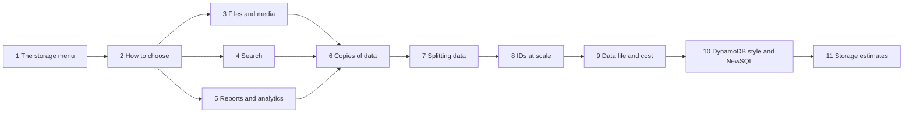

| Part | Level | You will be able to |
|---|---|---|
| 1. The storage menu | Beginner | Name 10 kinds of storage with one job each |
| 2. How to choose | Beginner | Pick storage from the app's questions and defend Postgres as the default |
| 3. Files and media | Mid | Draw the signed upload flow with S3, a CDN and Postgres |
| 4. Search | Mid | Explain an inverted index and keep search in step with the database |
| 5. Reports and analytics | Mid | Explain why reports slow the main database and where to move them |
| 6. Copies of data | Mid | Compare three replication shapes and use R + W > N |
| 7. Splitting data | Senior | Draw a hash ring, explain hot keys and moving data |
| 8. IDs at scale | Senior | Choose between auto increment, UUIDv4, UUIDv7, ULID and Snowflake |
| 9. Data life and cost | Senior | Plan hot, warm and cold storage, deletes, laws and tenants |
| 10. DynamoDB style and NewSQL | Senior | Say when a key-value store wins, and what "Postgres-like but spread out" means |
| 11. Storage estimates | Mid | Estimate storage per year out loud in one minute |

---

## Part 1: The storage menu [Beginner]

### The problem

You put everything in one Postgres table set. Photos sit in `bytea` columns. Search uses `LIKE '%shoe%'`. A monthly report reads 50 million rows during lunch traffic. Each choice works at first. Then all three slow down the one database that also takes payments.

The other mistake is the opposite. You pick five fancy databases on day one. Now you run five systems, five backups, and five things that can break at night.

### The picture

Each kind of storage is shaped for one kind of question. Notice the question written on each arrow.

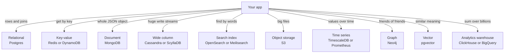

### The menu, one line each

| Kind | Shape of the data | Best for | Bad for |
|---|---|---|---|
| **Relational** (Postgres, MySQL) | Tables with rows, linked by keys | Money, orders, users, anything with rules and joins | Huge files, fuzzy word search, sums over billions of rows |
| **Key-value** (Redis, DynamoDB) | A key points to a value | Cache, sessions, counters, "get item by id" at very high speed | Questions you did not plan for, like "all orders over 100 last week" |
| **Document** (MongoDB) | One JSON object per record | Records that are read and written as one whole object, with changing fields | Many links between records, rules across records |
| **Wide column** (Cassandra, ScyllaDB) | Rows grouped by a key, sorted inside the group | Very many writes: chat messages, events, sensor data, across many machines | Joins, changing the query later, small apps |
| **Search index** (Elasticsearch, OpenSearch, Meilisearch, Typesense, Postgres full text) | A word list pointing to records | Search by words, typos, filters with counts | Being the main copy of data, money |
| **Object storage** (S3, Google Cloud Storage, Cloudflare R2) | Files in buckets, found by a name | Photos, videos, PDFs, backups, exports, data lake files | Small fast updates, queries inside files |
| **Time series** (TimescaleDB, InfluxDB, Prometheus) | A value with a time, per thing measured | Metrics, prices over time, IoT readings | General business data |
| **Graph** (Neo4j) | Points and lines between them | "Who is linked to whom", many hops: fraud rings, recommendations | Simple lists and totals |
| **Vector** (pgvector, dedicated vector databases) | A list of numbers per item that captures meaning | "Find text or images that mean something similar", AI search | Exact matches, totals |
| **Analytics warehouse** (BigQuery, Snowflake, ClickHouse, DuckDB) | Columns stored apart, read in bulk | Reports and dashboards over millions or billions of rows | Many small writes, one-row lookups for users |

**Words you will hear**

- **Access pattern:** one question your app asks the data, with how often it asks. "Get order by id, 500 times per second."
- **Source of truth:** the one store that holds the correct copy. Other stores are copies that can be rebuilt from it.

> **Say this in the interview:** "I pick storage by the question it must answer. Postgres is the source of truth. Files go to S3, search goes to a search index, and big reports go to an analytics store. Each extra store has one named job."

---

## Part 2: How to choose [Beginner]

### The problem

"We used MongoDB because it scales" is a weak answer. The interviewer asks "scales for which question?" and the answer falls apart. Choosing by name or by trend gives you a store that fights your app's real questions.

### The picture: a decision tree

Start at the top. Notice that most paths end at Postgres, often with an extension.

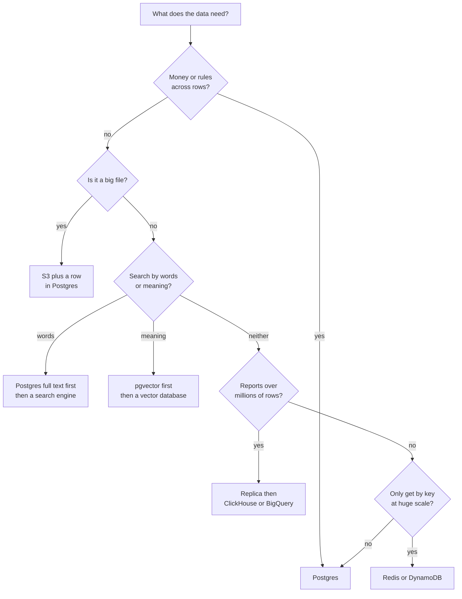

### How to use it

1. **Write the questions first.** List the top 5 screens and jobs. For each one, write the question: "orders for store 42, newest first, 20 per page".
2. **Add the numbers.** How many reads and writes per second? How big is one record? How many records per year?
3. **Add the freshness need.** Must the answer be correct this second (balance at checkout)? Or can it be a few seconds old (product list)?
4. **Then pick.** Use the tree. Name the job of each store.

### Why Postgres is the default

- It handles **transactions** (a group of changes that all happen or none happen). Money needs this.
- It does more than tables. JSONB stores documents. Full text search finds words. pgvector finds similar meaning. TimescaleDB adds time series. PostGIS adds maps.
- **One system** means one backup, one set of skills, one thing to watch at night.
- It goes very far. Large products run on Postgres with replicas and careful splitting.

Deep version, including "SQL or NoSQL" myths: [Database design and why](../database/database-design-and-why.md).

### The cost of each extra store

Every new store brings four costs. Say them out loud:

- **Keeping it in step** with Postgres (Part 4 shows how).
- **Running it:** upgrades, backups, monitoring, people who know it.
- **New failure cases:** what does the app do when it is down?
- **Money:** another bill, often per GB and per request.

> **Say this in the interview:** "I default to Postgres because most business data has rules and links, and one system is easier to run. I add a store when a named question needs it. For example, search by typo-tolerant words, or reports over a billion rows. Then I explain how I keep it in step."

---

## Part 3: Files and media [Mid]

### The problem

A store owner uploads a 6 MB photo of an ID card. The photo goes through your Node API, then into a Postgres `bytea` column. Look at what breaks.

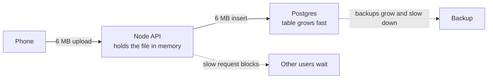

Notice the two dotted lines. The API spends memory and time on bytes it does not need to read. Postgres backups and replicas now copy every photo.

### The picture: upload straight to S3

The app asks your API for permission. Then the phone sends the file straight to S3. Notice the API never touches the file bytes.

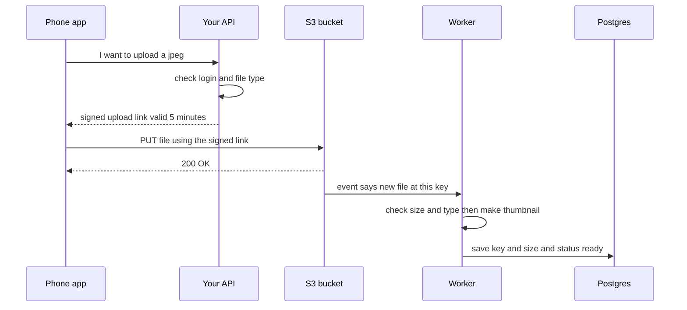

### How it works

- **Object storage** keeps files in a **bucket**. Each file has a **key**, which is its name, like `uploads/store-42/abc.jpg`.
- A **signed link** (interview word: **presigned URL**) is a normal web address with a signature inside. It allows one action, on one key, for a short time. Nobody needs your AWS password.
- S3 can send an **event** when a file arrives. The event goes to a queue or a small function. A worker then makes thumbnails, scans the file, and marks the row as ready.
- **Postgres keeps the details, not the bytes:** key, owner, size, type, status.
- A **CDN** (copies of files in many cities, close to users) sits in front of S3 for reading. Users download from the nearest copy.

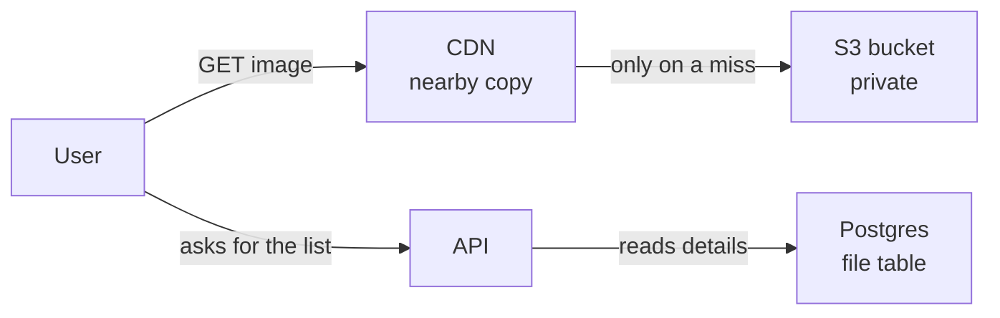

Notice that the bucket stays private. Only the CDN may read it. Deep version of CDNs: [Caching and CDN in depth](caching-and-cdn-in-depth.md).

### Tiny example: the API makes a signed link

```ts
import { S3Client, PutObjectCommand } from "@aws-sdk/client-s3";
import { getSignedUrl } from "@aws-sdk/s3-request-presigner";
import { randomUUID } from "node:crypto";

const s3 = new S3Client({ region: "ap-southeast-1" });

export async function createUploadUrl(userId: string, contentType: string) {
  const key = `uploads/${userId}/${randomUUID()}`; // the server picks the name
  const command = new PutObjectCommand({ Bucket: "my-app-media", Key: key, ContentType: contentType });
  const url = await getSignedUrl(s3, command, {
    expiresIn: 300, // 5 minutes
    signableHeaders: new Set(["content-type"]), // the phone must send this exact type
  });
  return { url, key };
}
```

The link that comes back holds `X-Amz-Expires=300` and `X-Amz-SignedHeaders=content-type;host`. If the phone sends a different file type, S3 says no. If you leave out `expiresIn`, the link lasts 900 seconds.

A small file table in Postgres:

```sql
CREATE TABLE file (
  id         uuid PRIMARY KEY DEFAULT uuidv7(),
  owner_id   bigint NOT NULL,
  s3_key     text NOT NULL UNIQUE,
  mime_type  text NOT NULL,
  size_bytes bigint,
  status     text NOT NULL DEFAULT 'pending' CHECK (status IN ('pending','ready','rejected'))
);
```

Checked on 2026-10-16: the TypeScript compiles and signs a link with the current AWS SDK v3, and the SQL runs on Postgres 18.

### The cost

- **Files nobody confirmed.** The app gets a link, uploads, then crashes. The file sits in S3 with no ready row. Fix: a bucket rule that deletes files under `uploads/` after a few days unless the worker moved them.
- **Size limits.** A signed PUT link cannot cap file size. Use a signed POST form with a size range, or check the size in the worker and reject.
- **Private files.** ID card photos must not be public. Serve them with short signed GET links, never a public bucket.
- **More moving parts.** You now have events, a worker and a "pending" state to show in the app.

**Words you will hear**

- **Presigned URL:** a time-limited link that allows one upload or download.
- **CDN:** many copies of your files in cities near users.

> **Say this in the interview:** "The client asks my API for a presigned URL, uploads straight to S3, and an S3 event starts a worker that checks the file and marks it ready in Postgres. The API never carries file bytes, and a CDN serves reads."

A full file upload design, with numbers, is in [Design workbook part 1](design-workbook-part-1-classic-designs.md).

**A question to ask yourself about DBO:** the DBO app has a profile and KTP photo upload that a verification admin approves. Does that photo pass through the API, or go straight to storage? Could you explain why?

---

## Part 4: Search [Mid]

### The problem

A shop has 2 million products. The search box runs:

```sql
SELECT * FROM product WHERE name ILIKE '%shoe%';
```

A normal index is sorted by the start of the word. `%shoe%` can start anywhere, so Postgres must read every row (interview word: **sequential scan**). It also cannot handle "shoes" against "shoe", typos, or "best match first".


### The picture: an inverted index

A book index lists words, and for each word, the pages. Search engines do the same. Notice that the search looks up the word once, then gets the list of products straight away.

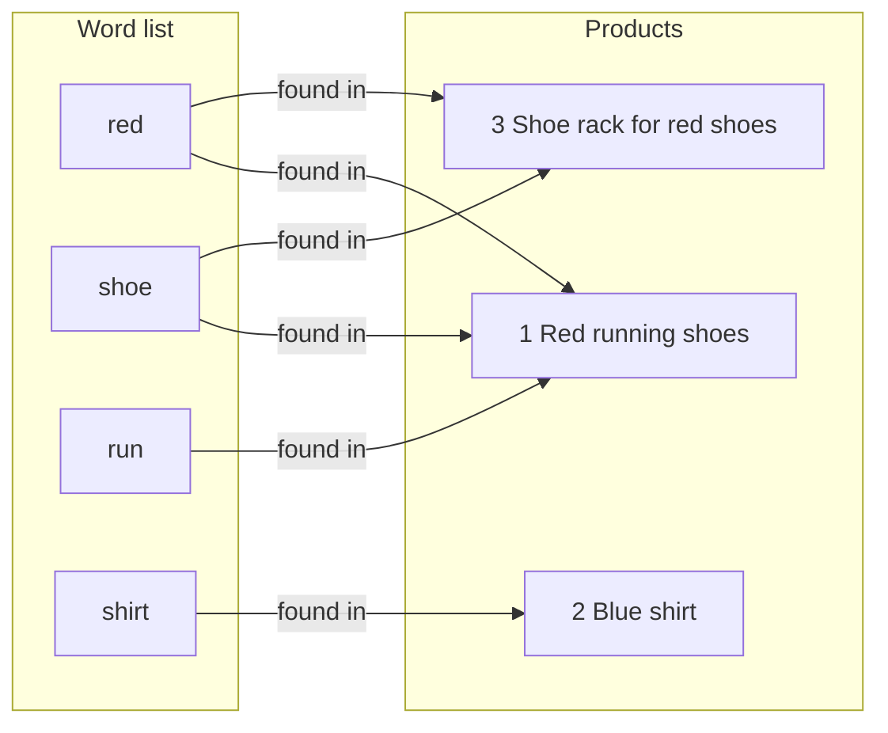

### How it works

- The engine cuts text into words. It lowercases them and cuts them to a root: "running" becomes "run", "shoes" becomes "shoe" (interview word: **stemming**).
- It keeps a list from each word to the records that hold it (interview word: **inverted index**).
- A search finds the lists for each word, joins them, and scores the best matches first.

### Step one: Postgres full text search

Before you add a new system, try this. It is often enough for up to millions of rows.

```sql
ALTER TABLE product ADD COLUMN search tsvector
  GENERATED ALWAYS AS (to_tsvector('english', name || ' ' || coalesce(description, ''))) STORED;
CREATE INDEX product_search_idx ON product USING GIN (search);

SELECT id, name FROM product
WHERE search @@ websearch_to_tsquery('english', 'red shoes')
ORDER BY ts_rank(search, websearch_to_tsquery('english', 'red shoes')) DESC
LIMIT 20;
```

- `to_tsvector('english', 'Red running shoes')` gives `'red':1 'run':2 'shoe':3`. That is the word list for one row.
- The GIN index is Postgres's own inverted index.
- For "contains these letters" search, the `pg_trgm` extension lets a GIN index serve `ILIKE '%shoe%'`.

**When to move to a search engine** (Elasticsearch, OpenSearch, Meilisearch, Typesense): typo tolerance matters a lot, you need filters with counts beside the results ("Size 42 (120)"), search traffic is heavy, or ranking needs fine tuning.

### The new problem: keeping search in step

Now the product lives in Postgres **and** in the search engine. The simple way is to write to both in the request. Notice where the crash happens.

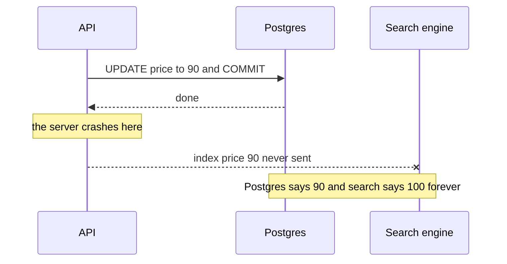

This is the **dual write problem**: two writes to two systems cannot be one safe step. One can succeed while the other fails.

### The fix: one write, then copy from it

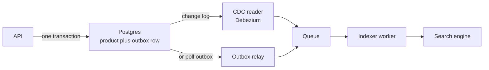

- **Outbox:** in the same transaction, write the change and a row that says "product 7 changed". A relay reads those rows and sends them on.
- **CDC** (change data capture): a tool reads the database's own change log and turns each change into an event. Debezium does this for Postgres, MySQL, MongoDB and others.
- Either way, the search index is **a copy that can be a little behind**. It is never the source of truth. If it breaks, you rebuild it from Postgres.

Deep version of the outbox: [Scaling a database and keeping data correct](../database/database-scaling-and-correctness.md). Queues: [Queues, streams and event-driven design](queues-streams-and-event-driven-design.md).

**Words you will hear**

- **Inverted index:** a list from each word to the records that hold it.
- **Dual write:** writing to two systems in one request without a safe link between them.
- **CDC:** reading the database's change log to send each change somewhere else.

> **Say this in the interview:** "I start with Postgres full text and a GIN index. If I need typo tolerance and facets, I add OpenSearch or Meilisearch, fed by an outbox or CDC, never by a dual write. The index is a rebuildable copy."

---

## Part 5: Reports and analytics [Mid]

### The problem

The finance team runs "sales per region per month for two years" at 11:00. The query reads 50 million order rows. The database's memory fills with old rows. Checkout queries now wait for disk.

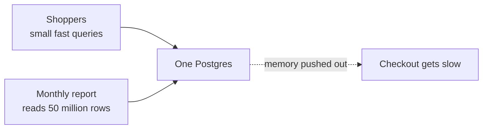

### The picture: rows against columns

The app's database stores **whole rows together**. That is great for "get order 7". A report wants **one column across all rows**. Notice what each one reads.

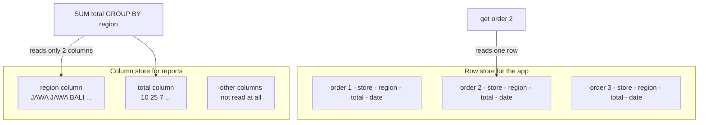

### How it works

- **OLTP** means "many small reads and writes for users". Postgres is built for this.
- **OLAP** means "few big reads for reports". Column stores are built for this. Same values sit next to each other, so they pack small and read fast.
- Your three choices, in order:

| Choice | Good | Cost | When |
|---|---|---|---|
| **Read replica** of Postgres | Same SQL, no new system | Still a row store, slow on billions of rows | Reports on millions of rows, a team that knows SQL |
| **ClickHouse** | Very fast sums over billions of rows, can run yourself | New system to run and learn | Event data, logs, product analytics |
| **Warehouse** (BigQuery, Snowflake) | Nothing to run, joins many sources | Pay per data read or per compute time | Company wide reports from many systems |
| **DuckDB** | Runs inside one process on files, like SQLite for analytics | One machine only | A notebook or a nightly job over Parquet files in S3 |

### How data gets there

- **ETL:** extract, transform, then load. You clean the data before it lands.
- **ELT:** extract, load raw, then transform inside the warehouse with SQL. This is common now, because warehouses are strong.
- **CDC** (from Part 4) streams changes from Postgres so the warehouse is minutes behind, not a day behind.

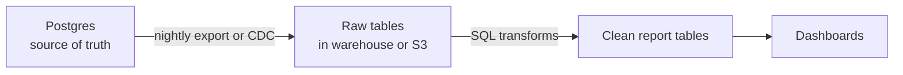

Deep version of replicas: [Scaling a database and keeping data correct](../database/database-scaling-and-correctness.md).

**Words you will hear**

- **OLTP / OLAP:** small user queries against big report queries.
- **Columnar:** each column stored apart, so reports read only the columns they need.
- **ETL / ELT:** the order of cleaning and loading data into the report store.

> **Say this in the interview:** "Reports and user traffic have different shapes, so I separate them. First a read replica. When reports cover billions of rows, I copy data with CDC into a column store like ClickHouse or BigQuery. Postgres stays fast for users."

---

## Part 6: Copies of data (replication) [Mid]

### The problem

One database machine dies. All data is gone until it comes back. Or one machine gets too many reads. Both problems have the same first fix: keep more than one copy.

### The picture: three ways to keep copies

Notice who may take a write in each shape.

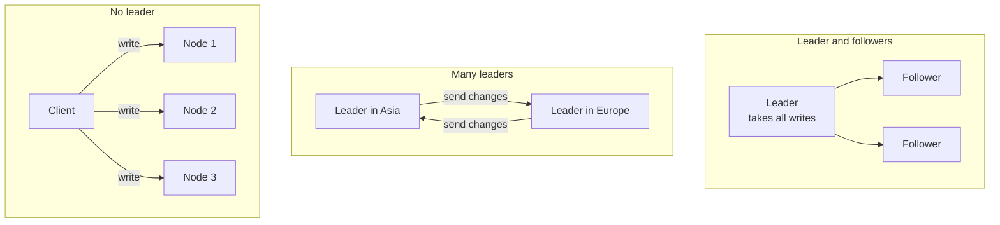

| Shape | Who takes writes | Good | Problem | Seen in |
|---|---|---|---|---|
| **Leader and followers** | One leader | Simple, no write conflicts | One leader limits writes, and switching leaders takes care | Postgres, MySQL, MongoDB |
| **Many leaders** | A leader per region | Fast local writes in each region | Two regions change the same row: who wins? | Multi-region setups, offline-first apps |
| **No leader** | Any node | Keeps working when nodes die | Needs voting rules and repair of old copies | Cassandra, ScyllaDB, the original Dynamo design |

### Wait or not wait (sync or async)

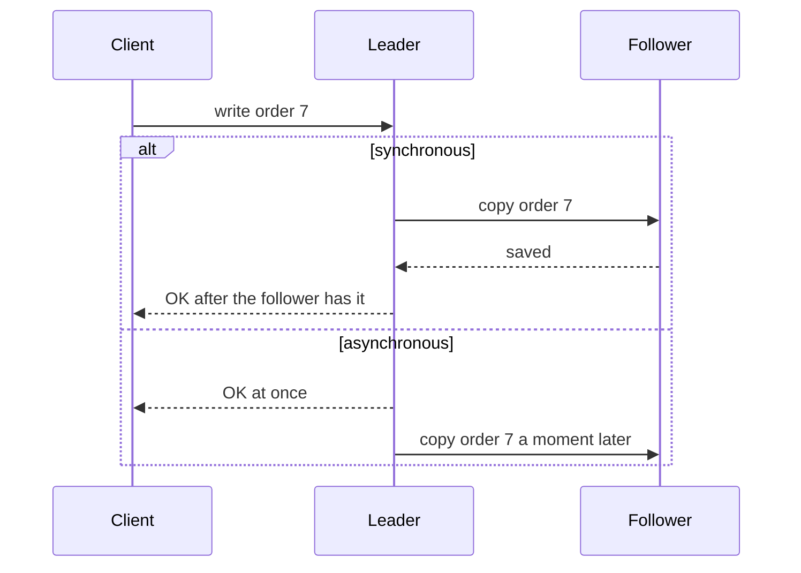

- **Synchronous:** slower writes, but no data lost if the leader dies.
- **Asynchronous:** fast writes, but the last few writes can be lost when the leader dies. Followers can also be behind (interview word: **replication lag**).

### Voting with numbers: R + W > N

In a no-leader store, you choose three numbers:

- **N** = how many copies of each item.
- **W** = how many copies must say "saved" before a write counts.
- **R** = how many copies you ask when you read.

If **R + W > N**, the nodes you read from and the nodes that saved the write always share at least one node. So a read sees the newest write.

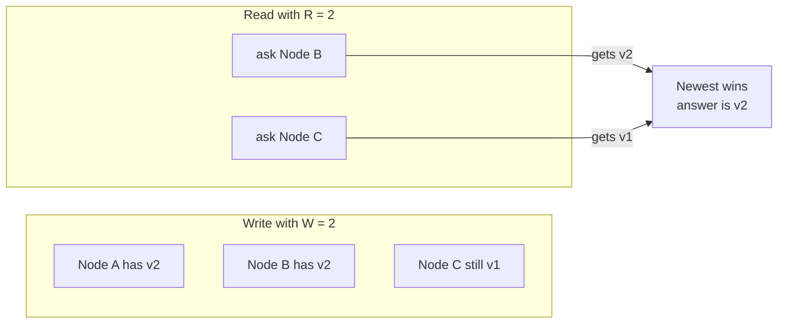

Notice: N = 3, W = 2, R = 2, so 2 + 2 = 4 is more than 3. Any two nodes you ask must include one that has v2. With W = 1 and R = 1, you might ask only Node C and get the old value.

### What lag does to users

- **Read your own writes:** a user saves, the next screen reads an old follower, and their change "disappears". Fix: read the leader for that user for a few seconds.
- **Going back in time:** two reads hit two followers with different lag. The second read shows older data than the first. Fix: keep one user on one follower.

Deep version for Postgres replicas and lag fixes: [Scaling a database and keeping data correct](../database/database-scaling-and-correctness.md). Consistency words and CAP: [Distributed systems and reliability patterns](distributed-systems-and-reliability-patterns.md).

**Words you will hear**

- **Replication lag:** how far a follower is behind the leader.
- **Quorum:** the smallest number of nodes that must agree, here W and R.

> **Say this in the interview:** "Leader and followers is the default. It is simple and has no write conflicts. A no-leader store like Cassandra uses quorums. With N equal to 3, I set W and R to 2, so R plus W is greater than N, and reads see the latest write."

---

## Part 7: Splitting data (partitioning and sharding) [Senior]

### The problem

Copies help reads. They do not help when **writes** are too many for one machine, or the data is too big for one disk. Every copy still takes every write. You must split the data, so each machine owns only a part.

### The picture: three ways to split

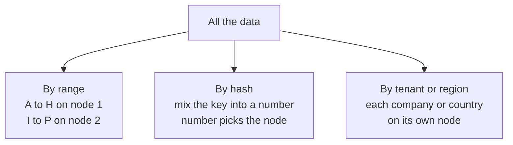

| Split by | Good | Risk |
|---|---|---|
| **Range** (names, dates) | Range queries stay on one node | New data piles onto one node, for example all of today's orders |
| **Hash** of a key | Spreads data evenly | Range queries must ask every node |
| **Tenant or region** | One customer's data and transactions stay together. Helps with laws on where data lives | One giant tenant can outgrow its node |

Words: in a general system both are called **partitions**. In Postgres, "partitioning" means splitting a table inside one database, and "sharding" means many databases. Deep version: [Scaling a database and keeping data correct](../database/database-scaling-and-correctness.md).

### Why simple hashing hurts: `hash(key) % N`

With 4 machines, a key goes to `hash % 4`. Add a fifth machine and the rule becomes `hash % 5`. Almost every key now maps to a different machine.

In a test with 100,000 keys, going from 4 to 5 machines with `% N` moved **about 80%** of keys. That is a huge copy job, and a cache would lose most of its data at once.

### The fix: consistent hashing (a ring)

Picture a clock face. Each machine gets a spot on the clock. Each key also gets a spot. A key belongs to the **next machine clockwise**.

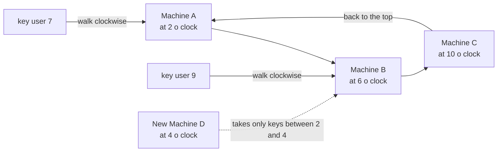

- When Machine D joins, it takes only the keys between A and D. Everything else stays.
- In the same 100,000 key test, adding a fifth machine to the ring moved **about 20%** of keys. That is the fair share for the new machine.

### Virtual nodes: fixing uneven slices

With one spot per machine, the spots land unevenly. In the test, one machine owned 55% of keys and another owned 1%.

The fix: give each machine **many spots** on the ring (interview word: **virtual nodes**). With 100 spots each, every machine owned 24% to 26% of keys. A stronger machine can get more spots.

### Hot partitions and the celebrity key

Even with a perfect ring, one key can be too popular. A famous singer posts, and millions of reads and likes hit the one partition that owns that post.

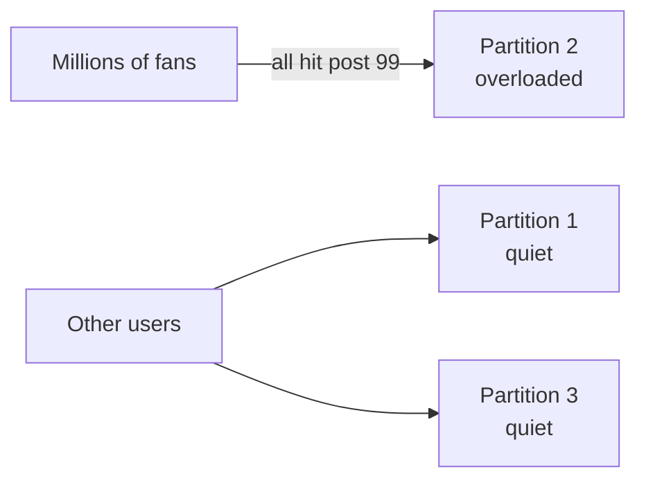

Fixes, from simple to heavy:

- **Cache the hot item** in front of the store. Reads stop reaching the partition.
- **Split the key:** store likes as `post99#0` to `post99#9`, spread over 10 partitions. Add them up when reading. Writes spread out, reads cost more.
- **Treat celebrities differently:** for example, do not copy a celebrity's post into every fan's feed. Fans fetch it when they read.

### Moving data when you add machines (rebalancing)

- **Many small fixed partitions:** make 1,000 partitions on day one, and put many on each machine. To grow, move whole partitions. You never re-hash rows.
- **Split when big:** the store splits a partition in two when it grows past a size. DynamoDB, CockroachDB and Spanner do this for you.
- Moving data uses network and disk. Do it slowly, and watch latency.

**Words you will hear**

- **Shard key:** the field that decides where a row lives.
- **Consistent hashing:** a ring, so adding a machine moves only its fair share of keys.
- **Hot partition:** one partition that gets far more traffic than others.
- **Rebalancing:** moving partitions between machines.

> **Say this in the interview:** "I split by the key most queries use, often tenant. I use consistent hashing with virtual nodes, so adding a machine moves about one Nth of the data and load stays even. For a celebrity key I cache it or split it into several sub keys."

---

## Part 8: IDs at scale [Senior]

### The problem

With one database, `bigint` auto increment is perfect: 1, 2, 3. Now you have 10 machines making orders, or a phone that creates records offline. Who hands out the next number? A single central counter becomes a bottleneck and a single point of failure.

Random IDs solve that, but bring a new problem. Postgres keeps the primary key in a **B-tree** (a sorted tree of pages, like a phone book). A random ID lands on a random page. Every insert touches a different page, so less fits in memory.

Deep version of the B-tree cost: [Database design and why](../database/database-design-and-why.md) and [How Postgres works inside](../database/postgres-internals-visual.md).

### The picture: what is inside each ID

Notice that the good choices for many machines all put **time first**. Time first means new IDs sort to the end, like auto increment.

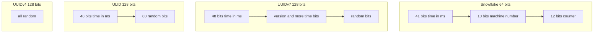

### The choices

| ID | Size | Made where | Sorted by time? | Good | Watch out |
|---|---|---|---|---|---|
| **Auto increment** `bigint` | 8 bytes | The database | Yes | Smallest, fastest | Needs one counter. Guessable in URLs |
| **UUIDv4** | 16 bytes | Anywhere | No | No coordination | Random inserts spread over the whole index |
| **UUIDv7** | 16 bytes | Anywhere | Yes, by millisecond | Standard (RFC 9562), sortable, Postgres 18 has `uuidv7()` | Shows when the row was made |
| **ULID** | 16 bytes, 26 letters as text | Anywhere | Yes | Short, readable, safe in URLs | Not a built-in Postgres type; store as `uuid` or text |
| **Snowflake** | 8 bytes | Each machine with its own machine number | Roughly | Fits in `bigint`, sortable | You must hand out machine numbers. Clock going backwards is a bug risk |

### In Postgres 18

```sql
CREATE TABLE orders (
  id    uuid PRIMARY KEY DEFAULT uuidv7(),
  total numeric(12,2) NOT NULL
);
-- uuid_extract_timestamp(id) gives back the time the id was made
```

Three rows inserted one after another got ids starting `...-633c-7fff-...`, `...-633d-7000-...`, `...-633d-7001-...`. They sort in the order they were made. Postgres 18 also adds `uuidv4()` as another name for `gen_random_uuid()`.

Checked on 2026-10-16 on Postgres 18.

**Words you will hear**

- **B-tree:** the sorted tree a database uses for an index. Sorted inserts are cheap. Random ones are not.
- **UUIDv7:** a UUID that starts with the time, so new ones sort last.

> **Say this in the interview:** "Inside one database I use bigint identity. When many services or phones make IDs, I use UUIDv7. It needs no central counter, and because time comes first, inserts go to the end of the B-tree like auto increment. Postgres 18 has uuidv7 built in. If I need 64 bits, I use a Snowflake style ID."

---

## Part 9: Data life and cost [Senior]

### The problem

An order table grows forever. Ten years of orders sit on fast, costly disks, in every replica, in every backup. Nobody reads orders from 2019, but you pay for them every month. Worse, some of that data is personal, and the law may say you must delete it.

### The picture: hot, warm, cold

```mermaid
graph LR
    HOT["Hot<br/>last 3 months<br/>Postgres on fast disk"] -->|monthly job| WARM["Warm<br/>3 months to 2 years<br/>older partitions or cheap disk"]
    WARM -->|export to Parquet| COLD["Cold<br/>older than 2 years<br/>S3 archive class"]
    COLD -->|after the legal period| DEL["Deleted"]
```

Notice that data moves one way. Each step is cheaper and slower to read.

### How it works

- **Retention:** decide how long each kind of data lives. Write it down. Logs maybe 30 days. Orders maybe the legal period for financial records in your country.
- **Archive:** export old partitions to S3 as files (Parquet is a common column file format). Then drop the partition. Deep version of time partitions: [Scaling a database and keeping data correct](../database/database-scaling-and-correctness.md).
- **S3 storage classes:** the same file can live in a standard class, an "infrequent access" class, or an archive class. Archive classes cost much less per GB, but reading back can take minutes to hours and costs extra. Bucket rules can move files between classes by age.
- **Backups are not replicas.** A replica copies your mistakes at once. A backup is a copy from before the mistake. Deep version: [Scaling a database and keeping data correct](../database/database-scaling-and-correctness.md).

### Deleting: soft or hard

| | Soft delete (`deleted_at`) | Hard delete |
|---|---|---|
| Good | Undo, audit, old links still work | Data is really gone. Needed for privacy requests |
| Cost | Every query must skip deleted rows | No undo. Backups still hold the data for a while |

A senior point: backups make "delete" slow. One fix is to encrypt each user's personal data with that user's own key. To forget the user, destroy the key (interview word: **crypto shredding**). Old backups then hold only unreadable bytes.

Deep version of soft delete: [Database design and why](../database/database-design-and-why.md).

### Laws and personal data

- **PII** (personal data): name, phone, ID card number, address. Keep it in few places. Do not copy it into logs, search indexes or analytics unless you must. Mask it in non-production copies.
- **Data residency:** some customers, often banks, require data to stay inside one country or region. That decides your cloud region, your backup region, and which third-party tools you may use.
- **Ask early:** "Which data is personal? Which country must it stay in? How long must we keep it? How fast must we delete it on request?"

**A question to ask yourself about Unloan and Skyworx:** both are about bank lending. Which data must stay in Australia or Indonesia? Who can see ID documents? Treat this as an idea to check with what you really know, not a fact.

### Tenants: who shares what

```mermaid
graph LR
    A["Shared tables<br/>tenant_id plus RLS"] -->|more isolation| B["Schema per tenant"]
    B -->|more isolation| C["Database per tenant"]
    C -->|more isolation| D["Region or account per tenant"]
```

Notice that cost and work grow to the right. Start on the left. Move one large or strict customer to the right only when they need it. Deep version with RLS (row level security, where Postgres itself filters rows by tenant): [Database design and why](../database/database-design-and-why.md).

**Words you will hear**

- **Retention:** how long you keep each kind of data.
- **Data residency:** the rule about which country the data must stay in.
- **PII:** data that identifies a person.

> **Say this in the interview:** "I plan the data's life on day one: hot data in Postgres, older partitions archived to S3 as Parquet, then deleted after the retention period. Backups are separate from replicas. For banks I ask about data residency and PII first, because they decide the region and the tools."

---

## Part 10: DynamoDB style design and NewSQL [Senior]

### When a key-value store wins

You know every question in advance. They are all "get by key" or "get a sorted range under one key". You need the same speed at 100 requests per second and at 1 million. You do not want to run servers. That is DynamoDB's job.

### The picture: one table, many kinds of items

In DynamoDB each item has a **partition key** (decides the machine) and a **sort key** (order inside the partition). Single-table design puts several kinds of items in one table, so one request gets a whole screen.

```mermaid
graph TB
    subgraph part["Partition key STORE 42"]
        I1["sort key PROFILE<br/>name and phone"]
        I2["sort key ORDER 2026-10-01 and 881<br/>total 120"]
        I3["sort key ORDER 2026-10-14 and 902<br/>total 75"]
    end
    Q["Query STORE 42<br/>sort key starts with ORDER<br/>newest first"] -->|one request| I3
    Q --> I2
```

| PK | SK | Data |
|---|---|---|
| `STORE#42` | `PROFILE` | name, phone |
| `STORE#42` | `ORDER#2026-10-14#902` | total 75 |
| `STORE#42` | `ORDER#2026-10-01#881` | total 120 |

- **Good:** steady fast reads at any size, no servers, pay per request.
- **Cost:** you design the keys around today's questions. A new question ("all orders over 100 across all stores") needs a new index or a copy elsewhere. Reports need a warehouse. A bad partition key makes a hot partition (Part 7).

### NewSQL: Postgres-like, but spread out

```mermaid
graph TB
    APP["App speaks SQL"] --> GW["Any node"]
    GW --> R1["Range 1<br/>3 copies vote"]
    GW --> R2["Range 2<br/>3 copies vote"]
    GW --> R3["Range 3<br/>3 copies vote"]
```

- **The problem:** you want SQL and transactions, but one Postgres primary cannot take your writes, or you need many regions with strong correctness.
- **How it works:** the data is split into ranges. Each range has copies that **vote** on every write (a consensus method such as Raft or Paxos). Transactions across ranges are handled by the database, not by you.
- **Examples:** CockroachDB and YugabyteDB (speak the Postgres protocol), Google Spanner (also offers a PostgreSQL interface), Amazon Aurora DSQL (serverless, Postgres compatible).
- **The cost:** every write waits for a vote, often across zones or regions, so single writes are slower than one local Postgres. Some Postgres features are missing. Conflicts can force a transaction to retry, so your code must retry safely.
- **Aurora DSQL in 2026:** its release notes show features arriving through the year: sequences and identity columns (March 2026), and foreign keys (August 2026). Check the current feature list before you promise a feature in an interview.

> **Say this in the interview:** "If every question is a known key lookup at huge scale, DynamoDB with single-table design wins. If I need SQL and transactions beyond one primary, NewSQL like CockroachDB, Spanner or Aurora DSQL gives that, but each write waits for a vote, so I only pay that cost when one Postgres truly is not enough."

---

## Part 11: Storage estimates [Mid]

### The problem

The interviewer asks "how much storage per year?" You freeze, or you say "a lot". A rough number, said out loud with its steps, is what they want.

### The formula

```mermaid
graph LR
    A["records per day"] --> M["x 365"]
    M --> B["x bytes per record<br/>plus index overhead"]
    B --> C["x number of copies"]
    C --> T["storage per year"]
```

**storage per year = records per day x 365 x bytes per record x copies**

- Add about 50% to the row size for indexes.
- Copies: the primary plus each replica. Backups are extra, often in cheaper storage.
- Round hard. 1 day is about 100,000 seconds. 1 year is about 400 days if you want easy maths.

### Worked example (made-up numbers for a shop app)

| Item | Number |
|---|---|
| Stores | 10,000 |
| Orders per store per day | 20 |
| Orders per day | 10,000 x 20 = **200,000** |
| Orders per year | 200,000 x 365 = **73 million** |
| Bytes per order row | about 300 |
| With indexes (+50%) | about 450, call it **0.5 KB** |
| Raw size per year | 73 million x 0.5 KB = **about 37 GB** |
| Primary plus 2 replicas | 37 x 3 = **about 110 GB** |
| Photos: 2,000 uploads a day x 2 MB | 4 GB a day = **about 1.5 TB per year in S3** |

**What to notice:** the order rows are small, so one Postgres handles years of them. The photos are 13 times bigger than all the order copies together. That is the number that tells you files belong in object storage.

> **Say this in the interview:** "200,000 orders a day at half a KB is about 37 GB a year, about 110 GB with two replicas. One Postgres holds that for years. Photos are about 1.5 TB a year, so they go to S3 with a lifecycle rule, not into the database."

---

## Practice

Try each one before you open the answer.

**1. Predict.** You cache data on 4 servers using `hash(key) % 4`. You add a fifth server and change it to `% 5`. About what share of keys now live on a different server? And with a hash ring?

<details><summary>Answer</summary>

About 80% move with `% N`. With a hash ring, about 20% move, which is the fair share for the new server. In a cache, 80% moving means 80% misses at once, and the database takes the full load.

</details>

**2. Spot the bug in this design.** "The mobile app sends the ID card photo to `POST /profile/photo`. The Express server reads the body and saves it in a `bytea` column. The CMS shows it with `SELECT photo FROM profile`."

<details><summary>Answer</summary>

- The API holds every file in memory and blocks a worker during slow phone uploads.
- Postgres grows with photos, so backups, replicas and restores get slow and costly.
- Fix: presigned PUT to a private S3 bucket, an S3 event to a worker that checks the file, a `file` row in Postgres with the key and status, and short signed GET links for the CMS. ID cards are personal data, so the bucket must never be public.

</details>

**3. Choose between two options.** A B2B shop has 40,000 products. Users search by product name and brand, with simple filters. Postgres full text, or OpenSearch?

<details><summary>Answer</summary>

Postgres full text with a GIN index, plus `pg_trgm` for partial words. 40,000 rows is small. No second system, no sync problem. Move to OpenSearch or Meilisearch later if you need strong typo tolerance, facet counts, or search traffic grows a lot.

</details>

**4. Predict.** A no-leader store has N = 3. You set W = 1 and R = 1 for speed. Can a read return an old value? What about W = 2 and R = 2?

<details><summary>Answer</summary>

With W = 1 and R = 1, yes: 1 + 1 = 2 is not more than 3. The write may have reached Node A and your read may ask only Node C. With W = 2 and R = 2, 2 + 2 = 4 is more than 3, so at least one node you read from has the new value.

</details>

**5. Spot the bug in this code.**

```ts
await prisma.product.update({ where: { id }, data: { price: 90 } });
await searchClient.index({ index: "products", id, document: { price: 90 } });
```

<details><summary>Answer</summary>

This is a dual write. If the process crashes, or the search call fails after the database commit, search shows the old price forever. Fix: write an outbox row in the same transaction as the update, and let a relay or CDC send it to an indexer worker that retries. The index is a copy you can rebuild.

</details>

**6. Draw it.** Draw the life of an `orders` row from day 1 to year 10 for a bank-like product. Show where it lives, and when it moves.

<details><summary>Answer</summary>

```mermaid
graph LR
    H["Hot<br/>0 to 3 months<br/>Postgres primary and replicas"] --> W["Warm<br/>3 months to 2 years<br/>older partitions"]
    W --> C["Cold<br/>2 years to the legal limit<br/>Parquet in S3 archive class"]
    C --> D["Deleted<br/>after the legal period"]
```

Also say: backups are kept apart from replicas, personal fields may be removed or masked earlier, and the region is fixed by data residency rules.

</details>

**7. Estimate.** A chat app has 1 million daily users. Each sends 40 messages a day. A message row is about 200 bytes with indexes. You keep 3 copies. Storage per year?

<details><summary>Answer</summary>

1 million x 40 = 40 million messages a day. 40 million x 200 bytes = 8 GB a day. x 365 = about 2.9 TB a year. x 3 copies = about 8.8 TB a year. That is past a comfortable single Postgres, so a wide column store like Cassandra or ScyllaDB, split by conversation id, is a fair choice to discuss.

</details>

**8. Choose between two options.** Public order numbers show in URLs and emails. You want them hard to guess, and you do not want random inserts in the primary key index. UUIDv4 or UUIDv7?

<details><summary>Answer</summary>

UUIDv7. It is hard to guess, and it starts with the time, so inserts go to the end of the B-tree. The cost: anyone can read the creation time from the id. If that time is secret, keep a bigint primary key and show a separate random public code.

</details>

---

## Likely interview questions

**Q1. How do you choose a database for a new feature?**

<details><summary>Answer</summary>

- **Problem:** picking by trend gives a store that fights the real questions, and every store costs time to run.
- **How it works:** I list the top questions (access patterns), their read and write rates, data size, and how fresh the answer must be. Money and rules go to Postgres. Files go to S3. Word search goes to Postgres full text, then a search engine. Big reports go to a column store.
- **Tradeoff:** one Postgres is simpler and safer. Each extra store adds sync work, a new failure case and a bill.
- **My example:** idea, not a claim: in DBO, products, orders and points are relational with rules, so Postgres fits. Redis is already there for BullMQ, which is a clear separate job.

</details>

**Q2. Design file uploads for a mobile app.**

<details><summary>Answer</summary>

- **Problem:** sending files through the API wastes memory and time, and storing them in the database bloats backups.
- **How it works:** the app asks the API for a presigned PUT URL. The API checks the user and file type, picks the key, and signs a link for 5 minutes. The app uploads to S3. An S3 event starts a worker that checks size and type, makes thumbnails, and marks the Postgres row as ready. A CDN serves public files. Private files use short signed GET links.
- **Tradeoff:** more parts: events, a worker, a pending state, and a cleanup rule for files never confirmed.
- **My example:** a question to check: DBO has a KTP photo upload that a verification admin approves. How is it stored today, and would this flow improve it?

</details>

**Q3. Search is slow. It uses `LIKE '%term%'`. What do you do?**

<details><summary>Answer</summary>

- **Problem:** a leading `%` cannot use a normal index, so Postgres reads every row, and there is no ranking or word matching.
- **How it works:** add a `tsvector` column with a GIN index, which is an inverted index from words to rows. Use `websearch_to_tsquery` and `ts_rank`. For partial words, `pg_trgm` with a GIN index. If I need typo tolerance and facets, add OpenSearch or Meilisearch, fed by an outbox or CDC.
- **Tradeoff:** Postgres full text is one system but has simpler ranking. A search engine is stronger but is a copy that lags and must be kept in step.
- **My example:** idea: a product search in the DBO app could start with Postgres full text.

</details>

**Q4. Reports are slowing down the main database. Fix it.**

<details><summary>Answer</summary>

- **Problem:** reports read millions of rows. They push user data out of memory, so user queries wait for disk.
- **How it works:** step 1, send reports to a read replica. Step 2, for billions of rows, copy data with CDC or a nightly job into a column store (ClickHouse, BigQuery, Snowflake). Column stores read only the needed columns, packed tight.
- **Tradeoff:** replicas and warehouses are behind by seconds to hours. A warehouse is a new system and a new bill.
- **My example:** the DBO case study suggests read replicas for CMS reports and order history. That is the first step here.

</details>

**Q5. Explain leader-follower, multi-leader and leaderless replication.**

<details><summary>Answer</summary>

- **Problem:** one copy means one machine failure loses service, and one machine limits reads.
- **How it works:** leader-follower: one leader takes writes and streams changes to followers. Multi-leader: each region has a leader, and they swap changes. Leaderless: clients write to several nodes, and quorums decide (R + W > N).
- **Tradeoff:** leader-follower is simple but writes are limited to one leader. Multi-leader gives local writes but has conflicts. Leaderless survives node loss but needs quorums and repair of old copies.
- **My example:** idea: Postgres with replicas is the leader-follower shape, as the DBO case study suggests for heavy reads.

</details>

**Q6. How does consistent hashing work? Why virtual nodes?**

<details><summary>Answer</summary>

- **Problem:** with `hash % N`, changing N moves about 80% of keys (4 to 5 servers).
- **How it works:** servers and keys get spots on a ring. A key belongs to the next server clockwise. A new server takes only the keys just before it, about one Nth. Virtual nodes give each server many spots, so slices even out.
- **Tradeoff:** more logic in the client or router. Virtual nodes add a bigger lookup table. A single hot key is still a problem.
- **My example:** idea: if DBO ever split Redis over several nodes, a ring keeps most cached keys in place when a node is added.

</details>

**Q7. One key gets far more traffic than all others. What do you do?**

<details><summary>Answer</summary>

- **Problem:** a hot partition. One node is overloaded while others are idle, and adding nodes does not help.
- **How it works:** cache the hot item. Split its key into sub keys (`post99#0` to `post99#9`) and add them up on read. Treat celebrities differently, for example fetch their posts at read time instead of copying them to every fan.
- **Tradeoff:** split keys make reads cost more. Caches add staleness.
- **My example:** idea: a big promotion item in a shop app could become a hot key for stock and views.

</details>

**Q8. Which ID type do you use for primary keys?**

<details><summary>Answer</summary>

- **Problem:** auto increment needs one central counter. Random UUIDv4 spreads inserts across the whole B-tree index.
- **How it works:** UUIDv7 puts a millisecond time first, then random bits. New IDs sort last, so inserts go to the end of the index. Any machine can make them. Postgres 18 has `uuidv7()`. Snowflake fits in 64 bits: 41 bits time, 10 bits machine, 12 bits counter.
- **Tradeoff:** UUIDv7 is 16 bytes and shows the creation time. Snowflake needs machine numbers and a clock you trust.
- **My example:** idea: internal tables in a single Postgres can keep bigint identity. IDs shared across services or shown to users can use UUIDv7.

</details>

**Q9. Data grows forever and the bill grows with it. What is your plan?**

<details><summary>Answer</summary>

- **Problem:** old data on fast disks, in every replica and backup, costs money every month and adds legal risk.
- **How it works:** set retention per data type. Partition big tables by time. Export old partitions to S3 as Parquet and drop them. Use S3 lifecycle rules to move files to cheaper classes. Delete after the legal period. Keep backups separate from replicas.
- **Tradeoff:** archived data is slower and costs more to read back. Hard delete removes undo.
- **My example:** idea: a points history table in a loyalty app grows every day. Old rows could move to S3 after a set period.

</details>

**Q10. When would you choose DynamoDB over Postgres?**

<details><summary>Answer</summary>

- **Problem:** some workloads are only key lookups, at a scale or spikiness where running Postgres is hard.
- **How it works:** DynamoDB spreads items by partition key and sorts by sort key. Single-table design stores related items under one partition key, so one query returns a whole screen.
- **Tradeoff:** keys are designed for known questions. New questions need new indexes or a copy elsewhere. No joins, and reports need a warehouse.
- **My example:** idea: session data or a "last seen" store for a mobile app is a clean key-value job. Orders and money stay in Postgres.

</details>

**Q11. What is NewSQL and when would you use it?**

<details><summary>Answer</summary>

- **Problem:** you need SQL and transactions, but one primary cannot take the writes, or you need strong correctness across regions.
- **How it works:** data is split into ranges. Each range has copies that vote on every write (Raft or Paxos). The database runs transactions across ranges for you. Examples: CockroachDB, Spanner, Aurora DSQL, YugabyteDB.
- **Tradeoff:** each write waits for a vote, so it is slower than one local Postgres. Some Postgres features are missing. Transactions may need retries.
- **My example:** idea: a multi-region banking product with strict correctness is where I would compare NewSQL with a single-region Postgres plus a standby.

</details>

**Q12. How do you isolate tenants' data, for example for bank customers?**

<details><summary>Answer</summary>

- **Problem:** one missing `WHERE tenant_id` can leak a customer's data to another customer.
- **How it works:** shared tables with `tenant_id` and row level security by default. Schema or database per tenant for customers with stronger needs. A separate region or account when data residency requires it.
- **Tradeoff:** more isolation means more cost and more migrations to run.
- **My example:** idea: for bank lending work like Unloan or Skyworx, ask which country the data must stay in. That may decide the isolation level.

</details>

---

## What's current (2026)

- **PostgreSQL 18** was released on 25 September 2025. It added a built-in `uuidv7()` function, an `uuidv4()` alias for `gen_random_uuid()`, and `uuid_extract_timestamp()` support for version 7. Checked by running it on Postgres 18 on 2026-10-16.
- **PostgreSQL 19** was in beta during 2026. A September 2026 report says some planned features were pulled from beta 4. Searches on 2026-10-16 did not find a release announcement, so check postgresql.org before you name it.
- **pgvector** is at version 0.8.7 on its GitHub page. It offers HNSW and IVFFlat indexes. The `vector` type can be indexed up to 2,000 dimensions.
- **Amazon Aurora DSQL** release notes for 2026 list sequences and identity columns (March 2026), indexes on expressions (August 2026), and foreign key constraints (26 August 2026).
- **AWS SDK for JavaScript v3:** `getSignedUrl` from `@aws-sdk/s3-request-presigner` defaults to 900 seconds when you give no `expiresIn`.
- **Debezium** captures changes from MySQL, MariaDB, MongoDB, Oracle, PostgreSQL and SQL Server. For Postgres it uses logical decoding (`pgoutput`).

<details><summary>Go deeper (optional): what else to know</summary>

- **Signed POST instead of PUT:** `@aws-sdk/s3-presigned-post` makes a form policy with a `content-length-range`, so S3 itself rejects files that are too big. A signed PUT link cannot do that.
- **ULID** is 128 bits: 48 bits of millisecond time and 80 random bits, written as 26 characters in Crockford base32. Inside the same millisecond, order is only kept if you use its "monotonic" mode.
- **Snowflake** (Twitter, 2010) used 41 bits of millisecond time from a custom start date (about 69 years of IDs), 10 bits for the machine (1,024 machines), and 12 bits for a counter (4,096 IDs per millisecond per machine). IDs are only roughly sorted across machines.
- **Leaderless repair:** when a read finds an old copy, the client writes the new value back to it (read repair). A background job also compares copies (anti-entropy).
- **Hash ring test:** 100,000 keys, MD5 hash, 4 to 5 machines. `% N` moved 79.7%. Ring with 1 spot each moved 17.3% but loads ranged from 1% to 55%. Ring with 100 spots each moved 19.6% with loads of 24% to 26%.

</details>

---

## Real-world cases to cite

| Company | What they did | Why it matters here | Source |
|---|---|---|---|
| **YouTube** | Built Vitess to split MySQL into many shards. It was a core part of YouTube's databases from 2011 | Sharding a relational database instead of leaving SQL | [Vitess on GitHub](https://github.com/vitessio/vitess), [ByteByteGo write-up](https://blog.bytebytego.com/p/how-youtube-supports-billions-of) |
| **Slack, Square, JD.com** | Adopted Vitess from 2015 to scale MySQL | Shows the same pattern outside Google | [Vitess on GitHub](https://github.com/vitessio/vitess) |
| **Twitter** | Built Snowflake in 2010: 64-bit IDs from many machines, roughly sorted by time | The classic "IDs at scale" answer | [Snowflake on GitHub](https://github.com/twitter-archive/snowflake/tree/snowflake-2010) |
| **Vimeo** | Used consistent hashing with bounded loads in HAProxy, so no server takes too many keys | Consistent hashing and hot spots in a real system | [Vimeo engineering blog](https://medium.com/vimeo-engineering-blog/improving-load-balancing-with-a-new-consistent-hashing-algorithm-9f1bd75709ed) |

More Postgres sharding cases (Notion, Figma) are in [Scaling a database and keeping data correct](../database/database-scaling-and-correctness.md).

---

## Watch and play

How these were checked is at the top of the file.

- **Video:** [7 Database Paradigms](https://www.youtube.com/watch?v=W2Z7fbCLSTw) by Fireship, about 10 minutes. A fast tour of key-value, wide column, document, relational, graph and search. Watch it after Part 1.
- **Video:** [How To Choose The Right Database?](https://www.youtube.com/watch?v=kkeFE6iRfMM) by ByteByteGo, short. Database types with pictures. Watch it after Part 2.
- **Play:** [Consistent Hash Ring](https://gallery.selfboot.cn/en/algorithms/hashring). Add and remove nodes, change the virtual node count, and watch keys move. Do it after Part 7.
- **Play:** [Consistent hashing virtual lab](https://dsys2-iiith.vlabs.ac.in/exp/consistent-hashing/procedure.html) from IIIT Hyderabad. Set machines, items and virtual nodes, then count how many items move.
- **Pictures:** [Consistent Hashing Explained](https://bytebytego.com/guides/consistent-hashing/) by ByteByteGo. The ring, step by step.
- **Pictures:** [A Crash Course in Database Sharding](https://bytebytego.com/guides/a-crash-course-in-database-sharding/) by ByteByteGo. Range and hash splits drawn.
- **Read:** [System Design Primer, Database section](https://github.com/donnemartin/system-design-primer#database). Replication, sharding, and NoSQL types with diagrams.

---

## Review questions (day 1, 3, 7, 21)

**Day 1.** Why should a photo upload not pass through your API server? Draw the four arrows of the presigned flow.

<details><summary>Answer</summary>

The API would hold the bytes in memory and stay busy during slow uploads, and storing them in Postgres bloats backups. Arrows: app asks API for a link; app uploads to S3; S3 event goes to a worker; worker saves the key and status in Postgres.

</details>

**Day 3.** What is the dual write problem, and what are two fixes?

<details><summary>Answer</summary>

Writing to Postgres and to a search engine in one request can half fail, so they disagree forever. Fixes: an outbox row written in the same transaction, sent on by a relay; or CDC reading the database change log. Both feed a worker that retries.

</details>

**Day 7.** N = 3. Give one W and R pair that sees the newest write, and one that may not. Why?

<details><summary>Answer</summary>

W = 2, R = 2: 4 is more than 3, so the read set and the write set share a node. W = 1, R = 1: 2 is not more than 3, so the read may hit only a node that missed the write.

</details>

**Day 21.** Draw the hash ring from memory. Show what happens when a machine joins, and what virtual nodes fix.

<details><summary>Answer</summary>

Machines and keys sit on a circle. A key goes to the next machine clockwise. A new machine takes only the keys just before it, about one Nth (about 20% for the fifth machine, against about 80% with `% N`). Virtual nodes give each machine many spots, so each one owns an even share.

</details>

---

## Explain it back

Write your own explanation of one part in [my explanations](../../my-learning/my-explanations.md), or record it on the website. Then run `/explain-check data storage choices` or ask the `explain-coach` agent.

Good first prompts:

- "Where do files go, and why not in the database?"
- "Why does `% N` move most keys, and how does a ring fix it?"
- "When would I leave Postgres for a second store?"

---

## Sources

- [PostgreSQL 18 uuidv7 overview, Nile blog](https://thenile.dev/blog/uuidv7), found in search 2026-10-16. Release date and functions also confirmed by running `uuidv7()`, `uuidv4()` and `uuid_extract_timestamp()` on Postgres 18 on 2026-10-16.
- [UUIDv7 in PostgreSQL 18, DbVisualizer](https://www.dbvis.com/thetable/uuidv7-in-postgresql-18-what-you-need-to-know/), found in search 2026-10-16.
- [PostgreSQL 19 Beta 1 news](https://postgresql.org/about/news/postgresql-19-beta-1-released-3313/), found in search 2026-10-16.
- [PostgreSQL 19: what's new, what got reverted, DevX](https://www.devx.com/cybersecurity/postgresql-19-new-features-release-date/), found in search 2026-10-16.
- [Aurora DSQL release notes](https://docs.aws.amazon.com/aurora-dsql/latest/userguide/release-notes.html), found in search 2026-10-16.
- [aws-sdk-js-v3 s3-request-presigner README](https://github.com/aws/aws-sdk-js-v3/tree/main/packages/s3-request-presigner), opened 2026-10-16. Example code compiled and run with the current npm packages on 2026-10-16.
- [Generate presigned URL with the modular AWS SDK for JavaScript, AWS Developer Tools Blog](https://aws.amazon.com/blogs/developer/generate-presigned-url-modular-aws-sdk-javascript/), found in search 2026-10-16.
- [pgvector on GitHub](https://github.com/pgvector/pgvector), opened 2026-10-16.
- [Debezium on GitHub](https://github.com/debezium/debezium), opened 2026-10-16.
- [ULID spec on GitHub](https://github.com/ulid/spec), opened 2026-10-16.
- [Twitter Snowflake, 2010 tag](https://github.com/twitter-archive/snowflake/tree/snowflake-2010), opened 2026-10-16.
- [Vitess on GitHub](https://github.com/vitessio/vitess), opened 2026-10-16.
- [How YouTube supports billions of users with MySQL and Vitess, ByteByteGo](https://blog.bytebytego.com/p/how-youtube-supports-billions-of), found in search 2026-10-16.
- [Improving load balancing with a new consistent hashing algorithm, Vimeo engineering](https://medium.com/vimeo-engineering-blog/improving-load-balancing-with-a-new-consistent-hashing-algorithm-9f1bd75709ed), found in search 2026-10-16.
- [System Design Primer](https://github.com/donnemartin/system-design-primer), opened 2026-10-16.
- [ByteByteGo: Consistent Hashing Explained](https://bytebytego.com/guides/consistent-hashing/), [How to choose the right database](https://bytebytego.com/guides/how-to-choose-the-right-database/), [A Crash Course in Database Sharding](https://bytebytego.com/guides/a-crash-course-in-database-sharding/), found in search 2026-10-16.
- Videos: [7 Database Paradigms, Fireship](https://www.youtube.com/watch?v=W2Z7fbCLSTw) and [How To Choose The Right Database?, ByteByteGo](https://www.youtube.com/watch?v=kkeFE6iRfMM), title and channel found in search 2026-10-16.
- Interactive: [Consistent Hash Ring](https://gallery.selfboot.cn/en/algorithms/hashring) and [IIIT Hyderabad consistent hashing lab](https://dsys2-iiith.vlabs.ac.in/exp/consistent-hashing/procedure.html), found in search 2026-10-16.
- Hash ring numbers: own simulation with 100,000 keys in Node.js, 2026-10-16.
- Postgres full text and `pg_trgm` examples: run on Postgres 18 on 2026-10-16.
