# Design Workbook, Part 1: Six Classic Designs

- **Written:** 2026-10-16
- **Level:** Beginner to Senior (each part is tagged)
- **Why this note exists:** You learn system design by doing designs, not by reading about them. This workbook gives you six classic interview prompts to try on paper first, then a full answer to check yourself against.
- **Read with:** [System design, step by step](system-design-step-by-step-walkthrough.md) (the seven steps, plus the URL shortener and the notification system, fully solved), [Load balancers and the online shop](load-balancers-microservices-online-shop.md) (the online shop, fully solved), [System design basics](system-design-basics-senior-fullstack-interview.md), [Scaling a database and keeping data correct](../database/database-scaling-and-correctness.md), [DBO case study](../../interview/my-projects/dbo-b2b-platform-system-design-case-study.md).
- **How links were checked:** opened or found in web search on 2026-10-16.

## TL;DR

- Every design here uses the same seven steps from the walkthrough: requirements, estimation, API, data model, high level, deep dive, failure and ops.
- **Try first, then look.** Set a 45 minute timer, draw on paper, then open the answer. Reading an answer you did not try teaches you almost nothing.
- **One number picks the hard part.** In each design, one number (open connections, bytes, followers, milliseconds) tells you where to spend the deep dive.
- **Six designs, a few building blocks.** Cache, queue, CDN, fan out, presigned URL, WebSocket, sharding. Each word is explained in the part where it first matters. The table at the end shows which design used which.
- **The senior move is the same every time:** name two options, say what each costs, pick one, say what would change your mind.
- Already solved elsewhere, so not repeated here: URL shortener and notification system (walkthrough), online shop (load balancers guide).

## The map

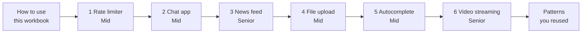

Notice: news feed comes third even though it is Senior. It builds straight on chat (both push one message to many people).

| Part | Level | You will be able to |
|---|---|---|
| How to use this workbook | Beginner | Practice a design in 45 minutes with the seven steps |
| 1 Rate limiter | Mid | Draw token bucket and sliding window, and keep one shared count in Redis |
| 2 Chat app | Mid | Keep a live connection per user, store messages in order, deliver to offline users |
| 3 News feed | Senior | Choose fan out on write or read, and fix the celebrity problem |
| 4 File upload and sharing | Mid | Let big files skip your servers, resume broken uploads, make thumbnails in the background |
| 5 Search autocomplete | Mid | Answer every keystroke in a few milliseconds from a ready-made list |
| 6 Video streaming | Senior | Turn one upload into many qualities, and let the player switch quality as the network changes |
| Patterns you reused | Senior | Spot the same building block in a new problem |

---

## How to use this workbook [Beginner]

The seven steps, with the minutes from the walkthrough:

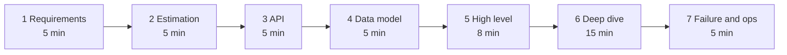

Notice: the deep dive gets the most time. That is where your level is decided.

**For each design, do this:**

1. Read the "Try it first" box. Say the prompt out loud, like the interviewer would.
2. Set a timer for **45 minutes**.
3. Draw on paper or in [Excalidraw](https://excalidraw.com) first. Write the seven step names down the left side of the page.
4. Answer the three clarifying questions yourself. Write your answers down.
5. When the timer ends, open the answer. Mark what you missed in red.
6. The next day, redraw only the high level picture from memory.

**Words you will hear (in every design):**

- **Requests per second (interview word: QPS):** how many requests arrive in one second.
- **p99:** 99 of 100 requests are faster than this time. It shows how the slowest users feel.
- **Shard:** one slice of the data, when you split it across many databases. Splitting is called sharding.
- **CDN (content delivery network):** many copy servers near users around the world. They keep copies of files, so users download from a server close to them.

Estimation trick from the walkthrough: a day has 86,400 seconds. Round it to **100,000**. So "X per day" divided by 100,000 is "per second".

| # | Design | Level | The main lesson | Building blocks |
|---|---|---|---|---|
| 1 | Rate limiter | Mid | One shared count for many servers, changed in one step | Redis, Lua script, middleware |
| 2 | Chat app | Mid | A live connection per user, and "save first, then deliver" | WebSocket, queue, push |
| 3 | News feed | Senior | Do the work when posting or when reading, and the mix of both | Fan out, cache, cursor |
| 4 | File upload and sharing | Mid | Big bytes skip your servers | Presigned URL, queue, CDN |
| 5 | Search autocomplete | Mid | Answer from a list you made earlier | Prefix index, cache, offline job |
| 6 | Video streaming | Senior | Slow work in a pipeline, and the player picks the quality | Queue, CDN, segments |

---

## Part 1: Rate limiter [Mid]

> **Try it first**
>
> **The interviewer says:** "Our public API is getting hammered. One customer's script sent 2 million requests in an hour and slowed everyone down. Design a rate limiter."
>
> **Ask these three questions:**
> 1. Who do we limit: a logged in user, an API key, or an IP address?
> 2. Is it one limit for everything, or different limits per route (login is stricter than reading products)?
> 3. If the limiter itself breaks, should requests be let through or blocked?

**Words you will hear:**

- **Rate limiter:** a guard that counts each client's requests and says "no" after a limit.
- **Token bucket:** a bucket of tickets. Each request takes one ticket. Tickets refill at a steady speed.
- **Sliding window:** count requests in "the last 60 seconds", measured from right now.
- **Atomic:** done in one step, so nobody can cut in halfway.

<details><summary>Open the answer</summary>

### 1. Requirements

**Functional:**

- Limit each client to N requests per time window. The client is the user id, the API key, or the IP for logged out traffic.
- Different limits per route. Login and OTP get a strict limit. Reading products gets a loose one.
- Over the limit: answer `429 Too Many Requests` and say when to come back.

**Non functional:**

- Adds very little time to every request: about 1 ms.
- Works across many API servers. They must share one count.
- If the limiter breaks, most routes keep working.
- A small error is fine. Letting 101 through instead of 100 hurts nobody.

**Cut (say it out loud):** monthly billing quotas, and network level attack protection. A service like Cloudflare or AWS handles the big floods before they reach you.

### 2. Estimation

- 10M daily users × 50 API calls = 500M requests a day.
- 500M ÷ 100,000 = **5,000 requests per second**. Peak × 3 = **15,000 per second**.
- Every request makes one Redis call, so Redis sees 15,000 calls per second.
- One Redis server handles 100,000+ simple calls per second. So **one Redis primary is enough**, about 15% busy.
- Memory: one key with two numbers is about 100 bytes. 10M clients × 100 bytes = **1 GB**. Fits easily.

**The driver:** not size, not speed of Redis. The driver is that **every request pays this cost**, and **many servers must share one count**.

### 3. API

The limiter is mostly a middle step inside your API, not a public API. It has three faces:

```http
# inside the app (one function call per request)
checkLimit(clientKey, rule) -> { allowed, remaining, retryAfterSeconds }

# what the client sees when it is over the limit
HTTP/1.1 429 Too Many Requests
Retry-After: 12

# admin, to change limits without a deploy
PUT /admin/rate-limit-rules/login   { "capacity": 5, "refillPerSecond": 0.1 }
```

`Retry-After` can be a number of seconds or a date. Good clients wait that long before they try again.

### 4. Data model

- **Redis, the live count:** key `rl:{rule}:{clientKey}`, value a small hash `{ tokens, lastRefillMs }`, with an expiry so idle clients disappear.
- **Postgres, the rules:** `rate_limit_rules(route, client_type, capacity, refill_per_second)`. Each API server keeps a copy in memory and reloads it every 30 seconds.

### 5. High level

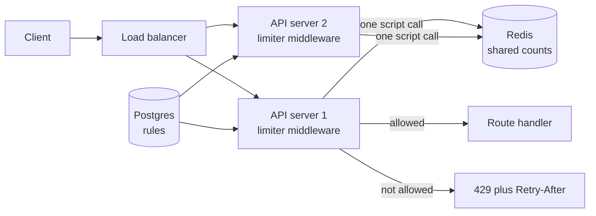

Notice: the count lives in Redis, not in each server. Two servers see the same number.

Walk one request: it arrives, the middleware builds the key (`rl:login:user42`), runs one Redis script, and gets back "yes" or "no". On "yes" the handler runs. On "no" the client gets 429 at once.

### 6. Deep dive A: which counting method

**The problem first.** The simplest method counts per clock minute (interview word: fixed window). It breaks at the edge of the minute:

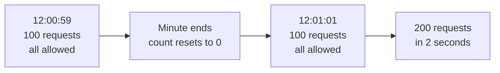

Notice: the limit says 100 per minute, but the client got 200 in two seconds.

**Fix 1: token bucket.**

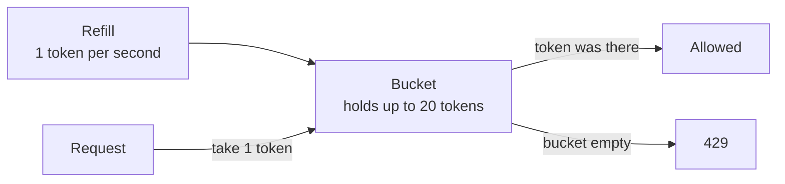

Notice: a full bucket allows a short burst of 20. After that, the client gets 1 per second, the refill speed.

- You store only two numbers per client: tokens left, and the last refill time.
- You do not run a timer. On each request you compute "how many tokens grew since last time", add them, then take one.
- Two knobs: bucket size (how big a burst) and refill speed (the long run average).
- Stripe described using a token bucket for its main request limiter, kept in Redis.

**Fix 2: sliding window counter.** Keep the count for this minute and the last minute. Then guess the last 60 seconds:

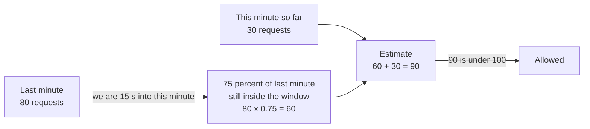

Notice: two counters per client, and no edge burst. The guess assumes last minute's requests were spread evenly.

- Cloudflare wrote about using this two-counter guess for rate limiting across millions of domains.
- The exact version (interview word: sliding window log) stores a time for every request. It is exact, but costs memory per request.

| Method | Memory per client | Allows bursts? | Edge problem? | Best for |
|---|---|---|---|---|
| Fixed window | 1 counter | Yes, up to 2× at the edge | Yes | Simple internal limits |
| Sliding window log | 1 entry per request | No | No | Small limits that must be exact (5 logins) |
| Sliding window counter | 2 counters | A little | Almost none | "N per minute" for public APIs |
| Token bucket | 2 numbers | Yes, on purpose | No | APIs where short bursts are normal |

**Say this in the interview:** "I'd use a token bucket: two numbers per client, it allows honest bursts, and it has no edge problem. For strict login limits I'd use a sliding window."

### 6. Deep dive B: where the count lives, and the race

**The problem.** Two API servers check the same client at the same moment:

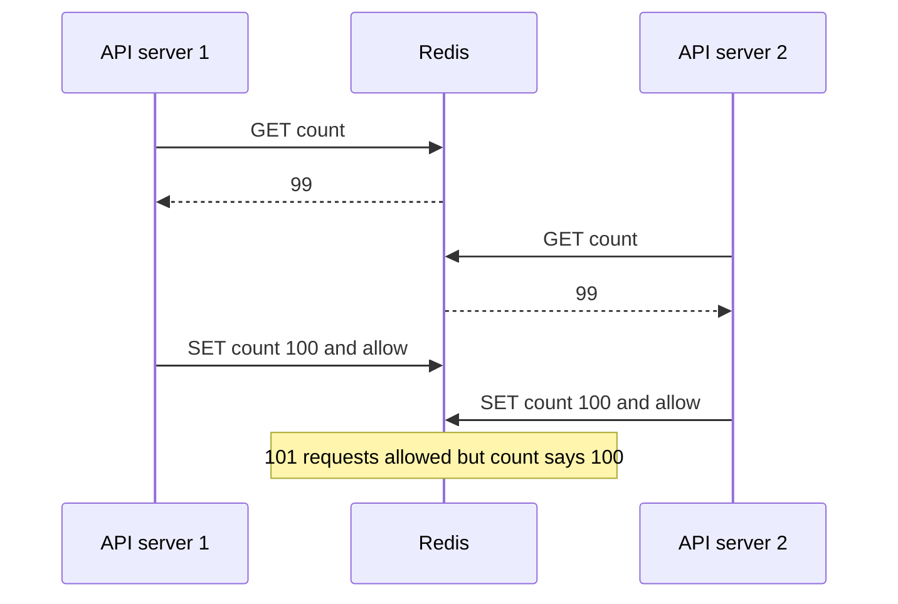

Notice: both servers read 99 before either one wrote. One request slipped through and the count is wrong.

**The fix:** do the read, the math, and the write **inside Redis, in one step**. Two ways:

- For a simple counter, `INCR` already is one step. It adds 1 and returns the new number.
- For a token bucket, send a small **Lua script** (a short program Redis runs). Redis runs it from start to end with nothing else in between.

```lua
-- KEYS[1] = bucket key. ARGV = capacity, tokens per second, now in ms
local cap, rate, now = tonumber(ARGV[1]), tonumber(ARGV[2]), tonumber(ARGV[3])
local b = redis.call('HMGET', KEYS[1], 'tokens', 'ts')
local tokens = tonumber(b[1]) or cap
local ts = tonumber(b[2]) or now
tokens = math.min(cap, tokens + (now - ts) / 1000 * rate)
local ok = 0
if tokens >= 1 then tokens = tokens - 1; ok = 1 end
redis.call('HSET', KEYS[1], 'tokens', tokens, 'ts', now)
redis.call('PEXPIRE', KEYS[1], math.ceil(cap / rate * 1000))
return {ok, math.floor(tokens)}
```

With capacity 3 and 1 token per second, five calls at time 0 return allowed, allowed, allowed, blocked, blocked. A call at 1,500 ms is allowed again. Checked on 2026-10-16 with a local Redis.

**Why not count in each server's memory?** With 4 servers, each one allows 100, so the client really gets 400. A per-server limit is "limit × number of servers".

<details><summary>Go deeper (optional)</summary>

- **Whose clock?** The script above takes `now` from the API server. If server clocks differ, counts drift a little. You can call Redis `TIME` inside the script instead.
- **Many Redis servers:** put the client key in the key name, so one client always lands on the same Redis shard. No cross-shard work is needed.
- **Stripe's four limiters:** the Stripe post describes a request rate limiter, a limit on requests running at the same time, and two "load shedders" that drop low priority traffic when the whole system is overloaded. That last idea is worth naming: a limiter protects you from one client, a load shedder protects you from everyone at once.
- **New standard headers:** the IETF draft "RateLimit header fields for HTTP" (draft 11, May 2026) defines `RateLimit-Policy` and `RateLimit` headers. It is still a draft, so many APIs still send their own `X-RateLimit-Remaining` style headers.

</details>

### 7. Failure and ops

- **Redis is down.** Most routes **fail open**: let requests through and alert loudly. Login and OTP **fail closed**: block, because there the limiter protects money and accounts.
- **Redis is slow.** Give the call a short timeout, about 5 ms. On timeout, treat it like "Redis is down".
- **A softer fallback:** each server keeps a local limiter set to "limit ÷ number of servers". Rough, but better than nothing.
- **Monitor:** 429 count per route, Redis p99 latency, limiter errors.
- **Alert:** 429s jump five times in five minutes. That is an attack, or a bad rule change.
- **Many regions:** each region counts on its own by default. A true global limit means calls across regions, which is slow. Say you would accept "limit per region".

### Tradeoffs

| Choice | You gain | You pay |
|---|---|---|
| Shared Redis count | One true count for all servers | About 1 ms per request, and Redis becomes critical |
| Count in each server | No network call | Real limit is limit × servers |
| Fail open | API stays up when Redis dies | Abusers get through for a while |
| Fail closed | No abuse ever | Redis outage becomes an API outage |
| Limit at the gateway | One place, protects all services | Cannot see inside a GraphQL query |

### Follow-ups the interviewer will ask

- **"How do you limit a GraphQL API?"** One request can ask for a huge tree. So also limit query depth and a "cost" score per query, not only the request count.
- **"What do you limit logged out users by?"** The IP address. But many people can share one IP (an office, a mobile network), so keep that limit loose.
- **"How does the client know its limit?"** Send headers with what is left, and `Retry-After` on 429.
- **"What about a burst at 9:00 every morning?"** Token bucket size is your answer: let short bursts through, hold the average.

</details>

### Where your stack fits

- **Express:** the limiter is middleware. Run the Lua script with `ioredis` (`defineCommand` loads it once). Or use a ready package with a Redis store, as long as it is shared across servers.
- **Next.js:** middleware runs before your routes. If it runs on an edge runtime (a small, limited runtime close to users), a normal Redis client may not work there, so you would need an HTTP based Redis service. Check this for your hosting.
- **GraphQL:** add depth and cost limits inside the server. A gateway sees only "one POST to /graphql".
- **A question to ask yourself about DBO:** DBO sends OTP codes over WhatsApp, and each one costs money. What stops one phone number from asking for 1,000 codes? Which limit, per phone and per IP, would you put there?

**Say this in the interview:** "A token bucket per client, stored in Redis and changed by one Lua script, so many servers share one count with no race. Fail open on normal routes, fail closed on login."

---

## Part 2: Chat app, 1:1 and groups [Mid]

> **Try it first**
>
> **The interviewer says:** "Design a chat app like WhatsApp. People can chat one to one and in groups. Messages should show sent, delivered and read."
>
> **Ask these three questions:**
> 1. How many users, and how big can a group be (10 people or 100,000)?
> 2. Do we need history on a new phone, or only on the device that got the message?
> 3. Are photos and voice notes in scope, or only text?

**Words you will hear:**

- **WebSocket:** one connection that stays open, so the server can send to the phone at any time. Normal HTTP only answers when the phone asks.
- **Connection server:** a server whose main job is to hold many open WebSockets.
- **Ack:** a small "I got it" reply.
- **Push notification:** a message sent through Apple or Google to wake up a phone that is not connected.

<details><summary>Open the answer</summary>

### 1. Requirements

**Functional:**

- Send a text message to one person or a group (up to 500 members).
- See ticks: sent (server saved it), delivered (the phone got it), read (the person opened it).
- If the receiver is offline, they get a push notification, and the message appears when they come back.
- Scroll back through history.

**Non functional:**

- Delivery in under half a second when both people are online.
- **Never lose a message** after the sender sees "sent".
- Messages in one chat appear in the same order for everyone.
- 50M daily users.

**Cut:** photos and voice (they reuse Part 4: upload the file, send a link), end to end encryption, voice calls.

### 2. Estimation

- 50M users × 40 messages a day = 2B messages a day.
- 2B ÷ 100,000 = **20,000 messages per second**. Peak × 3 = **60,000 per second**.
- Storage: 2B × 200 bytes (text plus ids and times) = **400 GB a day**, about **146 TB a year**, before copies.
- Open connections: say 20% of users are online at the busy hour. That is **10M open WebSockets**.
- Plan for about 100,000 connections per Node server to be safe. That is **100 connection servers**.

**The driver:** two numbers. **10M open connections** (so you need a fleet of connection servers and a way to find "which server is Bob on"). And **146 TB a year that only grows** (so one Postgres table will not hold messages for long).

### 3. API

Over the WebSocket (events both ways):

```text
client -> server  send      { chatId, clientMsgId, text }
server -> client  ack       { clientMsgId, messageId, sentAt }      // one tick
server -> client  message   { chatId, messageId, senderId, text }
client -> server  delivered { chatId, upToMessageId }                // two ticks
client -> server  read      { chatId, upToMessageId }                // blue ticks
```

Over plain HTTP:

```http
GET  /chats/:chatId/messages?before=<messageId>&limit=50   (history, cursor based)
POST /chats                    { memberIds, name }          (new group)
POST /devices                  { pushToken, platform }      (save the phone's push token)
```

`clientMsgId` is made by the phone. If the phone sends twice after a bad network, the server sees the same id and saves only once.

### 4. Data model

```sql
-- messages: one partition per chat per time bucket (Discord's shape)
messages(chat_id, bucket, message_id, sender_id, text, created_at)
  PRIMARY KEY ((chat_id, bucket), message_id)   -- newest first inside a chat

chat_members(chat_id, user_id, last_delivered_id, last_read_id)
user_chats(user_id, chat_id, last_message_at)   -- the inbox list
```

- **Redis:** `conn:{userId}` holds "which connection server is this user on". It has a short expiry, refreshed by a heartbeat.
- **Ticks without a row per person per message:** store only "the last message this member read". Everything with a smaller id is read too. A group of 500 then needs 500 small numbers, not 500 rows per message.
- **Message ids that sort by time:** each id starts with the time, then a machine number, then a counter. Discord and Twitter call this a Snowflake id. Sorting by id is sorting by time.
- **Why a wide-column store** (a database that keeps rows grouped by a partition key, like Cassandra): the main question is "the latest 50 messages of chat X". Partitioning by `(chat_id, bucket)` keeps one chat's recent messages together on one disk. Discord stores messages this way, first on Cassandra and now on ScyllaDB.

### 5. High level

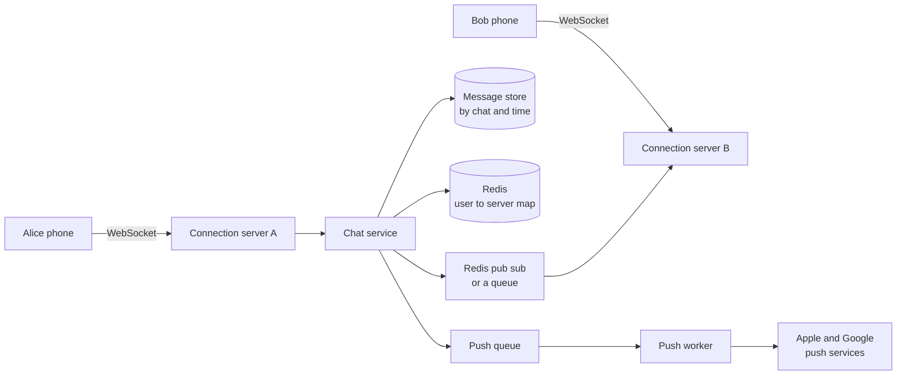

Notice: Alice and Bob are on different servers. The chat service looks up Bob's server, then hands the message across.

- **Pub sub** (publish and subscribe): one server posts a message to a named channel, and every server listening on that channel gets it. Here each connection server listens on its own channel.

### 6. Deep dive A: one message, step by step

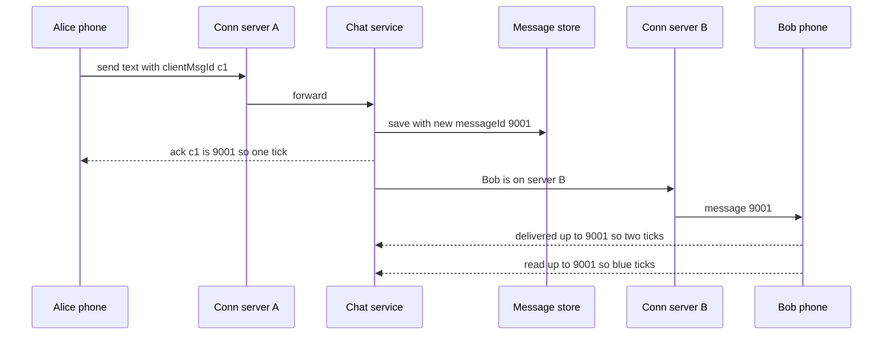

Notice: the server **saves first, then delivers**. "Sent" means "it is on disk". If anything later fails, the message is still there.

- **Order:** the message store hands out ids that grow with time. Every phone sorts by id, so everyone sees the same order.
- **Strict order in a busy group:** two servers can make ids in the same millisecond. If the order must be perfect, give each chat its own counter (for example Redis `INCR chat:{id}:seq`). The cost: one more call per message.
- **No duplicates:** the unique `clientMsgId` per sender makes a resend harmless.

### 6. Deep dive B: offline users and groups

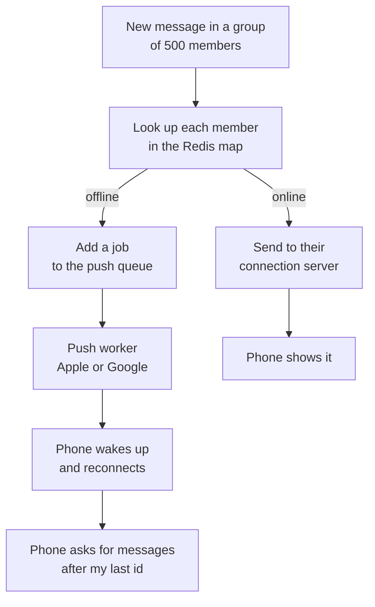

Notice: the push only says "you have a message". The real message comes from the store when the phone reconnects and asks "what is after my last id?".

- **Queue:** a waiting line of jobs. Workers take jobs one by one. Push sending is slow and can fail, so it goes through a queue with retries.
- **Group fan out (copying one message to many people):** for 500 members you send to each online member's server. For huge groups (100,000) you do not push to everyone. Members fetch the latest messages when they open the group.
- **Many phones per user:** the map holds a list of connections per user. Each device keeps its own "last id I have".

### 7. Failure and ops

- **A connection server dies.** 100,000 phones lose their connection. They reconnect to other servers, each waiting a random short time first (interview word: jitter), so they do not all hit at the same second. Then each phone asks "messages after my last id". Nothing is lost, because messages were saved before delivery.
- **The Redis map is out of date.** Entries expire if heartbeats stop. If a send to Bob's server fails, treat Bob as offline and push.
- **Message store is slow.** Sends fail. The phone shows "sending" and retries with the same `clientMsgId`.
- **Monitor:** open connections per server, time from send to deliver (p99), push failures, reconnect rate.
- **Alert:** p99 delivery above 1 second for 5 minutes; reconnects jump (a server or a deploy went bad).

### Tradeoffs

| Choice | You gain | You pay |
|---|---|---|
| WebSocket | Instant, both directions, small overhead per message | Many open connections; servers are no longer stateless |
| Long polling (phone asks, server waits up to 30 s) | Works everywhere, plain HTTP | More requests and more delay |
| Save before deliver | Never lose a sent message | A database write on the hot path |
| Per-chat counter | Perfect order | One more call per message |
| "Last read id" per member | Tiny storage for ticks | Cannot mark one old message as unread |

### Follow-ups the interviewer will ask

- **"How do you show 'Bob is online'?"** Heartbeats every 30 seconds update a Redis key with an expiry. Send presence only to people who have the chat open, not to all contacts.
- **"How do you deploy a connection server without dropping everyone?"** Stop sending new connections to it, then close old ones slowly over minutes. Phones reconnect elsewhere.
- **"Why not Postgres for messages?"** At small scale, Postgres is fine (partition the table by month). At 146 TB a year, a store built for "append and read the latest in one partition" is easier to grow.
- **"WebSocket or Server-Sent Events?"** Server-Sent Events only go server to phone. Chat needs both ways, so WebSocket.

</details>

### Where your stack fits

- **Node:** Node is good at holding many quiet connections. Use the `ws` package or Socket.IO on dedicated connection servers, separate from your normal API.
- **Redis:** the "user to server" map, presence keys, and pub sub between servers.
- **Postgres:** chat members, groups and inbox lists. For messages at small scale, a `messages` table with an index on `(chat_id, id DESC)`.
- **GraphQL:** GraphQL subscriptions run over WebSocket too. They fit small apps; for a big chat fleet, a plain WebSocket protocol is simpler to scale.
- **React Native:** reconnect with backoff when the app comes back to the foreground, then sync "after my last id".
- **A question to ask yourself about DBO:** the DBO app has order and shipping status updates. If store owners wanted live status without refreshing, would you use push, polling, or a WebSocket? Why?

**Say this in the interview:** "Connection servers hold WebSockets; a Redis map says who is where. I save the message first, then deliver, so 'sent' means 'on disk'. Offline users get a push, and phones sync from their last message id."

---

## Part 3: News feed [Senior]

> **Try it first**
>
> **The interviewer says:** "Design the home feed for a social app like Instagram or X. You see posts from people you follow."
>
> **Ask these three questions:**
> 1. How many users, and what is the most followers one account can have?
> 2. Newest first, or ranked by what you are likely to like?
> 3. How fast must a new post appear in followers' feeds: one second, or one minute?

**Words you will hear:**

- **Fan out:** copying one thing to many places. Here, putting one new post into many followers' feeds.
- **Fan out on write:** do the copying when someone posts. Interview word: push model.
- **Fan out on read:** do the work when someone opens their feed. Interview word: pull model.
- **Cursor:** a bookmark that says "I stopped at this post, give me the ones after it".

<details><summary>Open the answer</summary>

### 1. Requirements

**Functional:** create a post, follow a user, see a home feed of followed accounts, scroll down for more.

**Non functional:**

- The feed loads in under 300 ms (p99).
- A new post can take a few seconds, even a minute, to show up. That is fine (interview word: eventual consistency).
- 200M daily users. Reads are much more common than posts.

**Cut:** comments, likes, ads, stories, search.

### 2. Estimation

- Feed reads: 200M users × 10 opens = 2B a day. ÷ 100,000 = **20,000 per second**, peak **60,000**.
- Posts: 200M × 0.5 = 100M a day = **1,000 posts per second**.
- Average 200 followers. Fan out on write = 1,000 × 200 = **200,000 feed inserts per second**.
- A celebrity with **50M followers** posts once: 50M inserts. At 200,000 per second, that one post takes **250 seconds** of the whole fan out system.
- Feed cache: keep the newest 500 post ids per user. About 10 bytes each = 5 KB per user. × 200M = **1 TB**, so a Redis cluster of a few dozen servers.

**The driver:** reads are heavy, so feeds should be ready before you open the app. But the **celebrity** breaks "copy to everyone".

### 3. API

```http
POST /posts                         { text, mediaUrl }
POST /users/:id/follow
GET  /feed?limit=20&cursor=<lastPostId>
  -> { posts: [...], nextCursor: "1834..." }
```

In GraphQL this is a connection: `feed(first: 20, after: $cursor) { edges { node { id text author { name } } } pageInfo { endCursor hasNextPage } }`.

### 4. Data model

```sql
posts(id BIGINT PRIMARY KEY, author_id, text, media_url, created_at)  -- id sorts by time
  INDEX (author_id, id DESC)                    -- "latest posts by this author"
follows(follower_id, followee_id, created_at)
  PRIMARY KEY (follower_id, followee_id)        -- "who do I follow"
  INDEX (followee_id)                           -- "who follows me" for fan out
-- Redis: feed:{userId} = list of post ids, newest first, max 500
```

Only **post ids** go into the feed cache. The post text lives once, in a post cache. This keeps 50M copies small.

### 5. High level

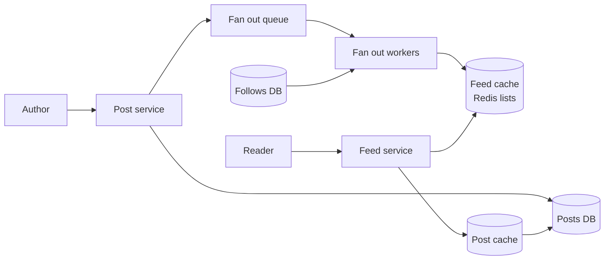

Notice: posting returns as soon as the post is saved and a job is queued. Workers fill followers' feeds in the background.

### 6. Deep dive A: fan out on write or on read

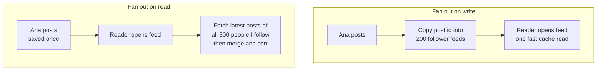

Notice: write does the work once per post. Read does the work every time someone opens the app.

| | Fan out on write | Fan out on read |
|---|---|---|
| Post cost | High: one insert per follower | Low: one insert |
| Feed open cost | Low: one cache read | High: many queries plus a merge |
| Fresh? | A little late (workers) | Always fresh |
| Wasted work | Copies to people who never open the app | None |
| Breaks on | Celebrities | Users who follow thousands |

### 6. Deep dive B: the celebrity problem and the mix

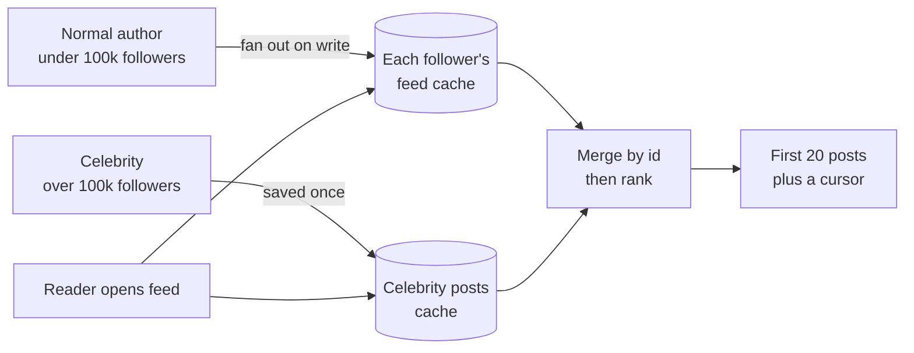

Notice: most posts are copied ahead of time. Only the few big accounts are fetched at read time, and a reader follows only a handful of them.

- **The mix (interview word: hybrid):** fan out on write for normal accounts, fan out on read for celebrities. The cut-off (say 100,000 followers) is a number you tune.
- **Skip inactive users:** do not copy into feeds of users who have not opened the app in 30 days. Build their feed on read when they come back.
- **Ranking, briefly:** take the merged list of a few hundred candidate posts. Give each a score from recency, how often you interact with the author, and how many likes it has. Sort by score. Big apps use a trained model for the score; in the interview, naming the inputs is enough.
- Twitter described fanning out tweets into home timelines kept in Redis, capped at about 800 entries, and talked about the high cost of fan out for accounts with millions of followers.

**Pagination with a cursor:**

```sql
SELECT id, author_id, text FROM posts
WHERE author_id = ANY($1) AND id < $2      -- $2 = the cursor, last id you saw
ORDER BY id DESC LIMIT 20;
```

With `OFFSET 20`, a new post at the top pushes everything down by one. The reader then sees one post twice. Deep pages are also slow, because the database still walks past all skipped rows. A cursor has neither problem.

### 7. Failure and ops

- **Feed cache server lost.** Those users' feeds are rebuilt on read (the slow path), then cached again. The app is slower, not broken.
- **Fan out queue backs up** (a celebrity slipped under the cut-off). Posts show up late. Workers scale out; the queue holds the jobs safely.
- **Posts DB down.** Feeds still load from cache, posting fails. Say this asymmetry out loud.
- **Monitor:** fan out lag (time from post to "in followers' feeds"), feed p99, cache hit rate, queue depth.
- **Alert:** fan out lag over 60 seconds for 10 minutes.

### Tradeoffs

| Choice | You gain | You pay |
|---|---|---|
| Write model | Very fast reads | Huge writes for big accounts, wasted copies |
| Read model | Simple, always fresh | Slow feed opens at scale |
| Hybrid | Fast reads, celebrities handled | Two code paths and a merge |
| Ids only in cache | Small cache, edits show at once | A second lookup for post content |
| Cursor paging | No duplicates, fast deep pages | Cannot jump to "page 37" |

### Follow-ups the interviewer will ask

- **"A user unfollows someone. What happens?"** Remove that author's ids from the feed cache in the background, or filter them out at read time. Filtering is simpler.
- **"A post is deleted."** Ids in caches point to a deleted post. The post lookup returns nothing, so the feed skips it.
- **"How do you get the first feed for a new user?"** Fan out on read once, then cache it.
- **"Where does ranking run?"** In the feed service after the merge, on a few hundred candidates, not on the whole database.

</details>

### Where your stack fits

- **Postgres:** posts and follows. With a few thousand users, fan out on read is one SQL query with the cursor above and an index on `(author_id, id DESC)`. Start there.
- **Redis:** feed lists (`LPUSH` then `LTRIM feed:42 0 499`), and the post cache.
- **Queue and workers:** fan out jobs, for example BullMQ on Redis, with retries.
- **GraphQL:** the connection shape (`edges`, `pageInfo`, `endCursor`) is cursor pagination already. Use DataLoader to load authors for 20 posts in one query, not 20.
- **A question to ask yourself about DBO:** if DBO showed store owners a feed of brand news and promotions, how many followers would the biggest brand have? Would you need fan out at all, or is one SQL query enough?

**Say this in the interview:** "Fan out on write for normal accounts so feeds are ready, fan out on read for the few huge accounts, merged at read time. Only ids in the cache, and cursor paging so new posts do not shift pages."

---

## Part 4: File upload and sharing [Mid]

> **Try it first**
>
> **The interviewer says:** "Design a simple Google Drive. Users upload files, see them in folders, and share them with other people. Images get thumbnails."
>
> **Ask these three questions:**
> 1. What is the largest file: 20 MB photos or 5 GB videos?
> 2. Do we need folder sync across devices (like the Dropbox app), or only upload and download in the browser?
> 3. Sharing: with named users, with a public link, or both? View only or edit?

**Words you will hear:**

- **Object storage:** a huge, cheap file store reached over HTTP, like Amazon S3. You put and get whole files by name.
- **Presigned URL:** a link your server signs that allows one upload or download, for a short time, with no password.
- **Multipart upload:** sending one big file as many small parts, then joining them.
- **Thumbnail:** a small preview picture made from a big image.

<details><summary>Open the answer</summary>

### 1. Requirements

**Functional:** upload files up to 5 GB, list files in folders, download, share with users (viewer or editor) or by link, thumbnails for images.

**Non functional:** an upload that breaks at 90% must not start again from 0; files are never lost; private files stay private; 10M daily users.

**Cut:** desktop folder sync with conflict handling (a follow-up), editing documents together, file versions.

### 2. Estimation

- 10M users × 2 uploads = 20M uploads a day. ÷ 100,000 = **200 uploads per second**, peak **600**.
- Average file 1 MB. 20M × 1 MB = **20 TB a day**, about **7.3 PB a year**.
- Upload traffic: 200 per second × 1 MB = 200 MB/s, about **1.6 Gbit/s**, peak about **5 Gbit/s**.
- File rows: 20M × 500 bytes = 10 GB a day, about 3.6 TB a year. Postgres can hold this, sharded by owner later.

**The driver:** **bytes**. Gigabits per second must not flow through your Node servers. The app should handle small metadata only.

### 3. API

```http
POST /files/uploads   { name, size, mimeType, folderId }
  -> { fileId, uploadId, partUrls: ["https://bucket...?X-Amz-Signature=..."] }
PUT  <partUrl>        (the browser sends bytes straight to storage)
POST /files/:id/complete   { parts: [{ partNumber, etag }] }
GET  /files/:id/download   -> 302 to a short-lived signed URL
POST /files/:id/shares     { userId, role: "viewer" | "editor" }
GET  /folders/:id/files?cursor=...
```

### 4. Data model

```sql
files(id, owner_id, folder_id, name, size, mime_type,
      storage_key, status,            -- 'uploading' | 'ready' | 'failed'
      checksum, created_at)
file_shares(file_id, user_id, role)   PRIMARY KEY (file_id, user_id), INDEX (user_id)
share_links(token, file_id, role, expires_at)
thumbnails(file_id, size, storage_key)
```

The file row exists **before** the bytes arrive, with status `uploading`. It turns `ready` only after storage confirms the upload.

### 5. High level

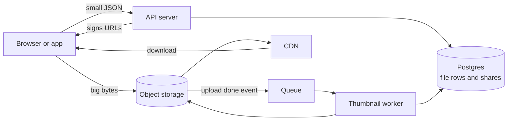

Notice: two paths. Small JSON goes to your API. Big bytes go straight to storage, and back out through the CDN.

### 6. Deep dive A: the presigned upload

**The problem:** if the browser sends 5 GB to Express, and Express sends it on to S3, your server holds the bytes, ties up memory and a connection for minutes, and you pay for the traffic twice.

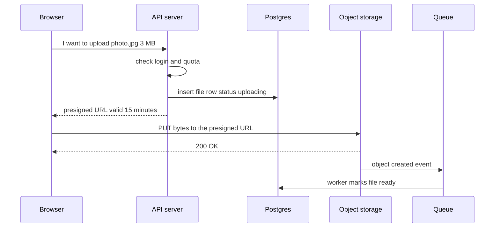

Notice: the API never touches the bytes. It only checks "may this user upload?" and signs a link.

- The signed link allows **one action on one file name** until it expires. AWS SDKs allow up to 7 days; use minutes.
- Your server picks the file name in storage (`users/42/files/<fileId>`). Never let the user pick it, or they could overwrite someone else's file.
- Do not trust the browser's "I finished". Trust the storage event, or check the object exists before marking `ready`.

### 6. Deep dive B: big files, broken networks

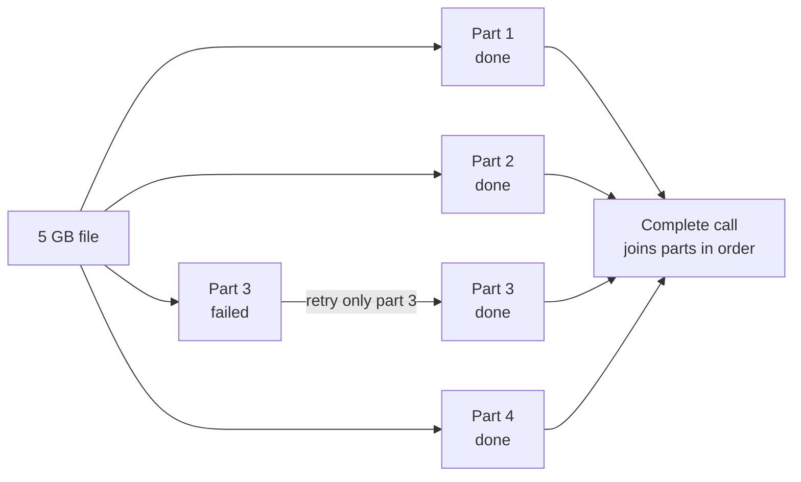

Notice: a failure costs one part, not the whole file. The browser can send several parts at once to go faster.

- S3 multipart upload: parts from 5 MiB to 5 GiB, up to 10,000 parts. A 5 GB file in 10 MB parts is 500 parts.
- **Resume after closing the tab:** save `uploadId` and finished part numbers (in the browser or in your DB). On return, ask storage which parts it has and send only the rest. The tus protocol is an open standard for this.
- **Dropbox's version:** Dropbox splits every file into 4 MB blocks and names each block by its SHA-256 hash (a fingerprint of the content). If a block with that hash already exists, it is not uploaded again. Change one line in a big file, and only one block moves.
- **Clean up:** uploads that never finish leave parts behind, and you pay for them. Add a storage rule that deletes unfinished multipart uploads after a few days, and a job that marks old `uploading` rows as `failed`.

**Thumbnails:** the storage event goes to a queue. A worker downloads the image, makes 3 sizes (for example with the `sharp` library), saves them, and writes the `thumbnails` rows. The job writes to fixed names (`thumbs/<fileId>/256.jpg`), so running it twice is harmless.

**Permissions and the CDN:** private files cannot sit on a public CDN URL. On download, the API checks `owner_id` or `file_shares`, then returns a **signed CDN URL** that lasts a few minutes. The CDN checks the signature, not your database.

### 7. Failure and ops

- **Thumbnail worker crashes:** the job goes back to the queue and runs again. The file is still `ready`; only the preview is late.
- **API is down:** nobody can start uploads, but uploads already running finish, because they talk to storage directly.
- **A signed URL leaks:** it dies in minutes. For share links, store them in `share_links` so you can delete them.
- **Monitor:** upload success rate, time from "upload done" to "ready", queue age, storage cost per day.
- **Alert:** upload success under 98% for 15 minutes; thumbnail queue older than 10 minutes.
- **Security:** check file type and size on the server side; scan uploads for viruses in a worker before sharing.

### Tradeoffs

| Choice | You gain | You pay |
|---|---|---|
| Presigned direct upload | Servers stay small, no double traffic | Harder to check content before it is stored |
| Upload through your API | Easy to check and change the file | Your servers carry every byte |
| Multipart | Resume, parallel parts | A complete step and clean-up jobs |
| Content hash blocks (Dropbox) | No duplicate bytes, small sync | More metadata, more complex client |
| Signed CDN URLs | Fast private downloads | Short expiry means re-asking the API |

### Follow-ups the interviewer will ask

- **"How do two devices stay in sync?"** Each device keeps a "last change id". The server keeps a change log per user. Devices ask "what changed after id X?". Dropbox describes running upload and download at the same time for big files ("streaming sync").
- **"Two people edit the same file offline."** Keep both: save the second as "photo (conflicted copy).jpg". Simple and safe.
- **"How do you stop the bucket filling with junk?"** Quotas per user, checked when signing the URL.
- **"How do you share a folder?"** Share rows on the folder; permission checks walk up the folder tree. Cache the result.

</details>

### Where your stack fits

- **Express or Next.js route:** `POST /files/uploads` uses the AWS SDK presigner to return URLs. The bytes never reach Node.
- **Postgres with Prisma:** `File`, `FileShare`, `ShareLink` models. A unique index on `(file_id, user_id)` for shares.
- **Queue:** the thumbnail and virus scan jobs, for example BullMQ workers.
- **React Native:** upload with a background upload library, so the upload survives the app going to the background.
- **A question to ask yourself about DBO:** DBO has a KTP photo upload for store verification. Did the photo pass through the API server, or go straight to storage? What size limit did it have? What would you change for a 5 GB file?

**Say this in the interview:** "The API only handles metadata and signs short-lived URLs. Bytes go straight to object storage in parts, so uploads resume. A storage event starts thumbnail work in a queue, and downloads go through a CDN with signed URLs."

---

## Part 5: Search autocomplete, or typeahead [Mid]

> **Try it first**
>
> **The interviewer says:** "When a user types in the search box, show the top 10 suggestions under it, like Google does."
>
> **Ask these three questions:**
> 1. Suggestions by popularity for everyone, or personal to each user?
> 2. How fresh: should today's trending words show up within minutes, or is daily fine?
> 3. How many languages, and do we filter rude words?

**Words you will hear:**

- **Prefix:** the start of a word. "car" is a prefix of "carpet".
- **Trie:** a tree where each step down adds one letter. Interview word, said "try".
- **Top k:** the k most popular items, here the 10 best suggestions.
- **Debounce:** wait until the user stops typing for a moment, then send one request.

<details><summary>Open the answer</summary>

### 1. Requirements

**Functional:** for a typed prefix, return up to 10 suggestions, most popular first. Popularity comes from past searches. Rude suggestions are filtered.

**Non functional:**

- Feels instant: **under 100 ms** from key press to list. Facebook's typeahead post said over 100 ms makes it "stutter".
- Very read heavy. Popularity can update daily, with an optional faster path for trends.

**Cut:** personal suggestions, spelling fixes, multiple languages.

### 2. Estimation

- 100M daily users × 5 searches × about 10 key presses = 5B a day = **50,000 per second**. Too many.
- With **debounce**, about 4 requests per search: 2B a day = **20,000 per second**, peak **60,000**.
- Data: keep the top 10M queries. They make about 50M different prefixes. Each prefix stores 10 suggestions × 30 bytes = 300 bytes. 50M × 300 B = **15 GB**. That fits in the memory of one server.

**The driver:** **time**. Every answer must come back in a few milliseconds. The data is small and changes slowly, so **compute the answers ahead of time**.

### 3. API

```http
GET /suggest?q=car&limit=10
  -> 200 { "suggestions": ["car rental", "carpet", "car insurance", ...] }
Cache-Control: public, max-age=300
```

One read endpoint. The cache header lets the browser and the CDN keep answers for 5 minutes.

### 4. Data model

```text
search_log(query, user_id, searched_at)     -- raw events, append only
query_counts(query, day, count)              -- built by a nightly job
prefix_top(prefix PRIMARY KEY, suggestions)  -- "car" -> ["car rental", "carpet", ...]
```

`prefix_top` is the serving table. It is built offline and replaced as a whole.

### 5. High level

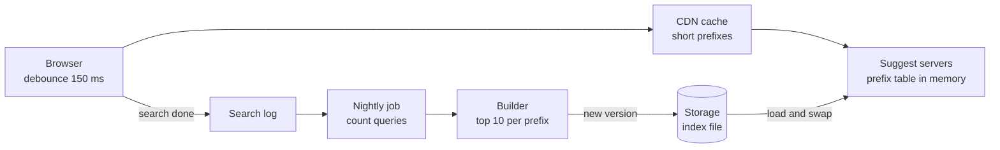

Notice: two loops. The fast loop answers keystrokes from memory. The slow loop counts searches and builds a new table once a day.

### 6. Deep dive A: trie or prefix table

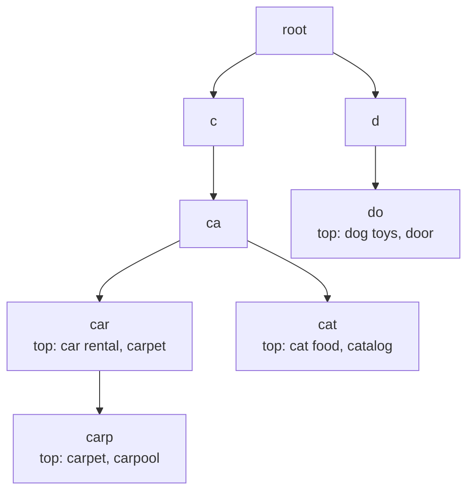

Notice: each node keeps its own top list. To answer "car" you walk 3 steps and read the list. You never search the whole tree.

- **Without stored top lists**, a trie must visit every word under "c" and sort them. That is slow for short prefixes.
- **With stored top lists**, the answer is ready. The cost: more memory, and rebuilding when counts change.
- **Prefix table** (a plain key value map, `prefix -> top 10`) gives the same answer with one lookup. It is easy to put in Redis or a file. It uses more memory than a trie, because shared starts are stored again in each key.
- **Database search** (`WHERE query LIKE 'car%' ORDER BY count DESC LIMIT 10`) on every key press is the version to avoid at this scale.

**Say this in the interview:** "I precompute the top 10 for every prefix offline, so serving is one lookup in memory. A trie with top lists per node or a flat prefix table both work; I'd pick the flat table for simple sharding and caching."

### 6. Deep dive B: fewer requests, faster answers

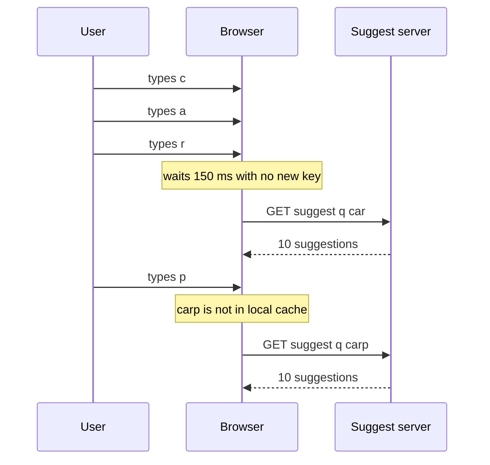

Notice: three key presses became one request. The browser also keeps answers it already has, so deleting a letter costs nothing.

- **Debounce** in the client cuts requests by more than half.
- **Cache short prefixes hard.** One and two letter prefixes are few and very popular. The CDN serves them.
- **Cancel old requests.** If "car" comes back after "carp", ignore it. Show only the answer for the latest text.
- **Fresh trends:** add a small hourly job for the last hour's searches, and merge its top list with the daily one.

### 7. Failure and ops

- **The nightly build fails.** Keep serving yesterday's table. Each build is a new version; servers switch only after a check passes (row count, sample queries).
- **A suggest server dies.** Every server holds the whole 15 GB table, so the load balancer sends traffic to others.
- **Bad suggestion goes live.** A block list is checked at build time and at serve time, so you can remove a phrase in minutes.
- **Monitor:** p99 latency, requests per search (is debounce working?), cache hit rate, build age.
- **Alert:** table older than 36 hours; p99 over 50 ms on the server.

### Tradeoffs

| Choice | You gain | You pay |
|---|---|---|
| Precompute top 10 | One lookup per key press | Stale until the next build |
| Live counting | Fresh trends at once | Heavy writes on the hot path |
| Trie in memory | Less memory | Custom code, harder to shard |
| Prefix table | Simple, shard by prefix, fits Redis | More memory |
| Long cache time | Fewer requests | Trends appear later |

### Follow-ups the interviewer will ask

- **"Make it personal."** Keep a small list of the user's recent searches on the device. Merge it on top of the global list. No server change needed.
- **"The table does not fit one machine."** Shard by prefix (a to f, g to m...). Watch for hot shards: "s" is much bigger than "x", so split by real size.
- **"How do counts get updated without slowing searches?"** Searches go into a log. Counting happens later in a batch job, never in the request.

</details>

### Where your stack fits

- **Next.js or Express:** `GET /suggest` reads from an in-memory map loaded from a JSON file at start, or from a Redis hash. Very little code.
- **Postgres:** the nightly count job is one `GROUP BY query` over the log table. For a small catalog, a prefix index on product names, or `pg_trgm` (a Postgres add-on for fuzzy text search), may be all you need.
- **React or React Native:** a `useDebouncedValue` hook plus `AbortController` to cancel old requests.
- **A question to ask yourself about ZWS:** ZWS was a store app on Shopify. Did product search already come from Shopify? If you built it yourself, would product names alone be enough for suggestions?

**Say this in the interview:** "The data is small and slow to change, so I compute the top 10 for each prefix offline and serve from memory. Debounce and caching cut requests; the build is versioned so a bad build never goes live."

---

## Part 6: Video streaming, YouTube lite [Senior]

> **Try it first**
>
> **The interviewer says:** "Design YouTube. Users upload videos, and others watch them on phones and TVs, even on a bad connection."
>
> **Ask these three questions:**
> 1. How many uploads and views a day, and how long is a typical video?
> 2. Do we need live streaming, or only uploaded videos?
> 3. How soon after upload must a video be watchable: one minute or one hour?

**Words you will hear:**

- **Transcoding:** turning one video file into other sizes and formats. Interview word: encoding.
- **Rendition:** one version of the video at one quality, for example 720p at 3 Mbps.
- **Segment:** a short piece of video, a few seconds long. The player downloads segments one after another.
- **Adaptive bitrate (ABR):** the player picks a lower or higher quality for the next segment, based on how fast the network is right now. HLS (from Apple) and DASH (an open standard) are the two common formats.

<details><summary>Open the answer</summary>

### 1. Requirements

**Functional:** upload a video, process it into several qualities, watch it on any device, see a view count.

**Non functional:**

- Playback starts in under 2 seconds, and rarely stops to load (interview word: rebuffering).
- A new video is watchable within minutes.
- Uploads are never lost.
- The view count can be a few minutes behind.

**Cut:** live streaming, comments, recommendations, ads.

### 2. Estimation

- 500,000 uploads a day ÷ 100,000 = **5 uploads per second**.
- Average 5 minutes, about 300 MB raw. 500,000 × 300 MB = **150 TB a day** of raw video. The renditions add about the same again: **300 TB a day**, about **110 PB a year**.
- Transcoding: say one worker makes one rendition in about real time. 5 renditions × 5 minutes = 25 worker minutes = 1,500 worker seconds per video. 5 videos per second × 1,500 = **7,500 workers busy all the time**.
- Watching: 1B views a day × 300 seconds watched = 3 × 10^11 viewer seconds. ÷ 100,000 = **3M people watching at once**. × 3 Mbps = **9 Tbps** going out.

**The driver:** two numbers. **9 Tbps out**, which only a CDN can serve. And **7,500 busy workers**, which means transcoding must be a queue with many workers, not a step in the upload request.

### 3. API

```http
POST /videos                 { title }  -> { videoId, uploadId, partUrls }  (Part 4 again)
POST /videos/:id/complete    { parts }  -> 202 Accepted  (processing starts)
GET  /videos/:id             -> { title, status, manifestUrl, views }
POST /videos/:id/views       { watchedSeconds }   (sent by the player)
```

`202 Accepted`, not `201`: you took the work, it is not done yet.

### 4. Data model

```sql
videos(id, owner_id, title, status,       -- 'uploaded' | 'processing' | 'ready' | 'failed'
       duration_s, raw_key, manifest_key, created_at)
renditions(video_id, height, bitrate_kbps, playlist_key)
transcode_jobs(id, video_id, chunk_no, rendition, status, attempts)
video_views(video_id PRIMARY KEY, views BIGINT)   -- updated in batches
```

### 5. High level

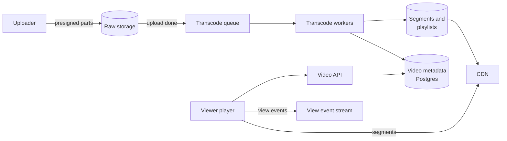

Notice: upload reuses Part 4 (presigned parts). Watching hits the API once for the details, then talks only to the CDN.

### 6. Deep dive A: the transcoding pipeline

```mermaid
graph LR
    RAW["Raw video<br/>5 minutes"] --> SPLIT["Split into<br/>10 s chunks"]
    SPLIT --> Q["Queue<br/>one job per chunk<br/>per rendition"]
    Q --> W1["Worker<br/>1080p"]
    Q --> W2["Worker<br/>720p"]
    Q --> W3["Worker<br/>480p"]
    W1 --> SEG["Segments plus<br/>one playlist each"]
    W2 --> SEG
    W3 --> SEG
    SEG --> MAN["Master playlist<br/>lists all qualities"]
    MAN --> READY["Mark video ready"]
```

Notice: chunks are done in parallel by many workers. A 5 minute video does not wait 25 minutes; it waits about as long as one chunk takes.

- **Why a queue:** transcoding takes minutes and uses a lot of CPU. It must never run inside a web request. The queue also absorbs the evening upload peak.
- **Why chunks:** 30 chunks × 3 qualities = 90 small jobs. Many workers finish them at once, and a failed job redoes 10 seconds, not the whole film.
- **Fast first:** make 360p and 720p first and mark the video watchable. Make 1080p and 4K after.
- **Safe to run twice (interview word: idempotent):** each job writes to a fixed name (`v/123/720p/seg_007.ts`). A job that runs twice writes the same file.
- **Netflix's lesson:** Netflix wrote (2015) that one fixed quality ladder wastes bits. A cartoon needs far fewer bits than an action film for the same look. So it picks the ladder per title. Later posts describe going further, per shot.

### 6. Deep dive B: how the player changes quality

```mermaid
sequenceDiagram
    participant P as Player
    participant C as CDN
    P->>C: GET master playlist
    C-->>P: 1080p and 720p and 480p are available
    P->>C: GET 720p segment 1
    C-->>P: segment 1 arrived fast
    P->>C: GET 1080p segment 2
    C-->>P: segment 2 arrived slowly
    Note over P: network got worse
    P->>C: GET 480p segment 3
    C-->>P: segment 3 arrived fast
```

Notice: the server does nothing clever. The **player** measures each download and picks the next segment's quality. Every segment is a plain file, so any CDN can cache it.

- The **master playlist** (an `.m3u8` file in HLS) lists the qualities. Each quality has its own playlist of segments.
- Segments that line up in time at every quality let the player switch at any segment edge.
- **Short segments** (2 seconds) start fast and switch fast, but mean more files and more requests. **Long segments** (10 seconds) are the opposite.

**View counts at scale:**

```mermaid
graph LR
    PL["Players<br/>10k view events per second"] --> ST["Event stream<br/>or queue"]
    ST --> AG["Counter workers<br/>add up per video<br/>for 10 seconds"]
    AG -->|one UPDATE per video| DB[("video_views")]
    AG --> RC[("Redis<br/>live counts")]
```

Notice: 50,000 people starting one viral video become one `UPDATE views = views + 50000` every 10 seconds, not 50,000 updates fighting over one row.

### 7. Failure and ops

- **A worker dies mid-job:** the job is not acked, so the queue gives it to another worker. Same output name, so no harm.
- **A video keeps failing:** after 3 attempts the job goes to a dead letter queue (a holding area for jobs that keep failing). The video shows "processing failed", and an engineer gets a ticket.
- **CDN region has trouble:** the player's playlist can list a second CDN; players switch after errors.
- **Storage cost:** old, rarely watched videos move to cheaper, slower storage. Keep only the most watched qualities hot.
- **Monitor:** time from upload to ready, queue age, rebuffer rate, start time p99, CDN hit rate, egress cost.
- **Alert:** queue age over 15 minutes; rebuffer rate doubles in a region.

### Tradeoffs

| Choice | You gain | You pay |
|---|---|---|
| Many renditions | Smooth play on any network | More transcode time and storage |
| Chunked parallel transcode | Fast time to ready | A join step and more jobs to track |
| Short segments | Fast start and switching | More requests and files |
| Per-title ladder | Fewer bits for the same look | Extra analysis per video |
| Batched view counts | Database survives viral videos | Count lags by seconds |

### Follow-ups the interviewer will ask

- **"How do you stop people counting their own views a million times?"** Count a view only after N seconds watched, and drop repeats from the same user or IP in a short window. Fraud checks run later, in batch.
- **"How does the CDN get a new video?"** On the first request, the CDN fetches from your storage (interview word: origin) and keeps it. For an expected hit, you can push it to the CDN ahead of time.
- **"Private or paid videos?"** Signed URLs or signed cookies on the CDN, like Part 4. For paid films, add encryption of the segments (DRM).
- **"How do you resume a video on another device?"** The player sends its position every few seconds; store the last position per user and video.

</details>

### Where your stack fits

- **Upload:** same as Part 4: Next.js or Express signs multipart URLs.
- **Workers:** Node runs the queue logic; the heavy work is `ffmpeg` in a container. A managed transcoding service is a valid answer too.
- **Postgres:** `videos`, `renditions`, `transcode_jobs`. At small scale, `SELECT ... FOR UPDATE SKIP LOCKED` lets many workers each grab a different job row, so Postgres itself is the queue.
- **Redis:** live view counts with `INCRBY`, flushed to Postgres every 10 seconds.
- **React Native:** the native video player on iOS and Android plays HLS. On the web, a library like hls.js does it in the browser.
- **An idea, not a fact:** for any of your past apps, a product video or a training video library would use exactly this pipeline at small size: presigned upload, one queue job, HLS output, a CDN.

**Say this in the interview:** "Upload with presigned parts, then a queue of chunk jobs turns one file into several qualities as short segments. The CDN serves plain files, and the player switches quality per segment. View counts are added up in memory and written in batches."

---

## Patterns you reused [Senior]

Each building block below showed up in more than one design. When you see a new prompt, look for these first.

| Building block | Rate limiter | Chat | News feed | File upload | Autocomplete | Video |
|---|---|---|---|---|---|---|
| **Cache (Redis or memory)** | The count | Who is online, which server | Feed lists, post cache | | Prefix table, CDN for short prefixes | Live view counts |
| **Queue and workers** | | Push notifications | Fan out jobs | Thumbnails, virus scan | Nightly build (batch) | Transcode jobs, view counts |
| **CDN** | | (photos, via Part 4) | Images in posts | Downloads with signed URLs | Popular prefixes | Every video segment |
| **Fan out** | | Group messages | The whole design | | | |
| **Presigned URL** | | (photos) | (images) | The whole upload | | Raw video upload |
| **WebSocket** | | The whole design | (optional: "new posts" banner) | | | |
| **Sharding** | Redis by client key | Messages by chat | Feed cache by user | File rows by owner | Prefix table by prefix | Metadata by video id |
| **Atomic step in the store** | Lua script | Message id per chat | | Complete multipart | Swap to new version | `views = views + N` |
| **Cursor pagination** | | History "before id" | Feed "after id" | Folder listing | | |

```mermaid
graph TB
    Q1["Is the slow part bytes"] -->|yes| A1["Presigned URL plus CDN"]
    Q2["Is the slow part<br/>work that takes minutes"] -->|yes| A2["Queue plus workers"]
    Q3["Is one write read<br/>by many people"] -->|yes| A3["Fan out plus cache"]
    Q4["Must the server talk first"] -->|yes| A4["WebSocket or push"]
    Q5["Do many servers share<br/>one number"] -->|yes| A5["Atomic step in Redis or SQL"]
```

Notice: each question points to one building block. Ask these five questions at the end of your estimation step.

---

## Practice [Mid]

**1. Predict.** A token bucket holds 5 tokens and refills 1 token per second. It starts full. A client sends 8 requests at time 0, then 2 requests at time 3 seconds. How many are allowed in total?

<details><summary>Answer</summary>

At time 0: 5 allowed (the bucket empties), 3 blocked. By time 3, 3 tokens have grown back. Both requests at time 3 are allowed, and 1 token is left. **Total: 7 allowed.**

</details>

**2. Predict.** Sliding window counter, limit 100 per minute. Last minute had 84 requests. This minute has 36 so far. You are 15 seconds into this minute. Is the next request allowed?

<details><summary>Answer</summary>

45 of the last 60 seconds of the old minute are still inside the window: 84 × 45/60 = 63. Estimate = 63 + 36 = **99**. 99 is under 100, so **allowed**. The request after it gives 63 + 37 = 100, so it is blocked.

</details>

**3. Spot the bug.** "The browser posts the 2 GB video to our Express route with multer. Express then uploads it to S3 and returns the URL."

<details><summary>Answer</summary>

Every byte passes through your server twice (in and out). Memory, disk and connections are held for minutes, and a server restart kills the upload with no resume. Fix: the API returns presigned multipart URLs, the browser sends parts straight to S3, and a storage event marks the file ready.

</details>

**4. Choose.** A B2B app: 50,000 store owners each follow about 30 brands. Brands post a few times a day. Fan out on write, fan out on read, or the hybrid?

<details><summary>Answer</summary>

Fan out on read, with one SQL query: `WHERE author_id = ANY(my 30 brands) AND id < cursor ORDER BY id DESC LIMIT 20`, with an index on `(author_id, id DESC)`. At this size there is nothing to keep in sync and no cache to rebuild. The senior point: do not build the X design for 50,000 users. Name the number where you would switch (feed p99 too slow, or users following thousands).

</details>

**5. Spot the bug.** A feed uses `?page=3` with `OFFSET 40 LIMIT 20`. Users complain they see the same post twice while scrolling.

<details><summary>Answer</summary>

New posts arrive at the top while the user scrolls, so every older post moves down. Page 3 now starts with the last post of page 2. Fix: cursor paging, `WHERE id < lastSeenId ORDER BY id DESC LIMIT 20`.

</details>

**6. Spot the bug.** An autocomplete runs `SELECT query FROM searches WHERE query LIKE $1 || '%' GROUP BY query ORDER BY count(*) DESC LIMIT 10` on every key press.

<details><summary>Answer</summary>

It counts the whole search history on every key press. At thousands of requests per second the database melts, and short prefixes like "a" are the worst. Fix: count offline in a nightly job, store `prefix -> top 10`, serve from memory, and debounce in the client.

</details>

**7. Draw it.** Bob's phone is off. Alice sends him a message. Ten minutes later Bob turns his phone on. Draw every box and arrow, in order.

<details><summary>Answer</summary>

Alice → her connection server → chat service saves message 9001 → ack to Alice (one tick) → Redis map has no live entry for Bob → push job → push worker → Apple or Google → Bob's phone shows a notification. Later: Bob's app opens a WebSocket → asks "messages after my last id 8990" → gets 9001 → sends "delivered up to 9001" → Alice sees two ticks.

</details>

**8. Choose.** HLS segments of 2 seconds or 10 seconds for a mobile app with users on weak networks?

<details><summary>Answer</summary>

Shorter (2 to 4 seconds). The player can switch quality sooner when the network drops, and playback starts faster. The cost is more files and more requests, which the CDN handles well. Long segments fit stable home networks better.

</details>

---

## Likely interview questions

<details><summary>1. How do you rate limit across 20 API servers?</summary>

- **Problem:** if each server counts on its own, a client gets 20 × the limit.
- **How it works:** one shared count in Redis per client key. A Lua script does read, math and write in one step, so two servers cannot both use the last token.
- **Tradeoff:** about 1 ms per request and Redis becomes critical. Fail open on normal routes, fail closed on login.
- **My example:** an idea, not a fact: DBO sends paid WhatsApp OTP codes. A per-phone and per-IP token bucket in the Redis it already runs for BullMQ would protect that cost.

</details>

<details><summary>2. Token bucket or sliding window?</summary>

- **Problem:** a counter per clock minute lets a client send 2 × the limit around the minute edge.
- **How it works:** token bucket keeps "tokens left" and "last refill time", and grows tokens on each request. Sliding window counter guesses the last 60 seconds from this minute's and last minute's counts.
- **Tradeoff:** token bucket allows bursts on purpose; sliding window is smoother but stricter. Both need only two numbers.
- **My example:** an idea: token bucket for normal API routes, sliding window for "5 login tries per 15 minutes".

</details>

<details><summary>3. How do chat messages stay in order and never duplicate?</summary>

- **Problem:** phones retry on bad networks, and two servers can save messages at the same moment.
- **How it works:** the phone sends a `clientMsgId`; a unique constraint saves it once. The server gives each message an id that grows with time (or a per-chat counter), and phones sort by it.
- **Tradeoff:** a per-chat counter is perfect but adds a call; time-based ids are cheaper but can tie within a millisecond.
- **My example:** an idea: the same "unique key, save once" rule is how duplicate webhooks are handled in the DBO case study.

</details>

<details><summary>4. How does a message reach someone who is offline?</summary>

- **Problem:** there is no open connection to send on.
- **How it works:** the message is saved first. A push job goes through a queue to Apple or Google. When the app opens, it asks for "messages after my last id".
- **Tradeoff:** push is not reliable or ordered, so it is only a wake-up call. The store is the truth.
- **My example:** an idea: a React Native app saves its push token with `POST /devices` at login, the same as any push setup.

</details>

<details><summary>5. Fan out on write or read? What about celebrities?</summary>

- **Problem:** feeds must open fast, but copying one post to 50M followers takes minutes.
- **How it works:** copy post ids into followers' cached feeds for normal accounts; for accounts over a cut-off, store posts once and merge them in at read time.
- **Tradeoff:** two code paths and a merge, in return for fast reads and bounded writes.
- **My example:** an idea: for a small B2B app, plain fan out on read with one indexed SQL query is enough. Say the number where you would switch.

</details>

<details><summary>6. How do you upload a 5 GB file reliably?</summary>

- **Problem:** one long request breaks on a bad network, and passing bytes through your server is costly.
- **How it works:** the API signs multipart URLs; the client sends parts in parallel straight to storage, retries failed parts, and calls "complete".
- **Tradeoff:** extra steps, and clean-up rules for unfinished uploads.
- **My example:** a question for DBO: the KTP photo upload is small, so one presigned PUT would be enough there.

</details>

<details><summary>7. How do you make autocomplete answer in under 100 ms?</summary>

- **Problem:** counting searches on every key press is too slow.
- **How it works:** a nightly job builds `prefix -> top 10`; servers keep it in memory; the client debounces and caches; the CDN caches short prefixes.
- **Tradeoff:** suggestions are up to a day old unless you add an hourly trends layer.
- **My example:** an idea: product search in a store app could use the same table built from product names and order counts.

</details>

<details><summary>8. How does adaptive bitrate streaming work?</summary>

- **Problem:** one quality is too big for a weak network and too poor for a strong one.
- **How it works:** the video is cut into short segments at several qualities. The player reads a master playlist and picks each next segment's quality from the measured download speed.
- **Tradeoff:** more storage and transcode work, in return for fewer stalls.
- **My example:** an idea: React Native video players on iOS and Android play HLS natively, so the app only needs the playlist URL.

</details>

<details><summary>9. How do you count views on a viral video?</summary>

- **Problem:** 50,000 updates per second on one row lock each other up.
- **How it works:** view events go to a stream; workers add up counts per video in memory and write one `UPDATE views = views + N` every few seconds.
- **Tradeoff:** the count lags by seconds; a worker crash can lose a few seconds of counts unless events are replayed.
- **My example:** an idea: the same batching fits any hot counter, such as points in a loyalty system.

</details>

---

## What's current (2026)

- **Rate limit headers:** the IETF draft "RateLimit header fields for HTTP" is at draft 11 (May 2026). It defines `RateLimit-Policy` and `RateLimit`. It is still a draft, not an RFC, as checked on 2026-10-16.
- **429 and Retry-After:** `429 Too Many Requests` comes from RFC 6585. `Retry-After` can be seconds or an HTTP date (MDN, checked 2026-10-16).
- **Stripe's published limits:** Stripe's docs list a basic limit of 100 operations per second in live mode and 25 in sandbox (checked 2026-10-16).
- **S3 uploads:** presigned URLs made with the AWS CLI or SDKs can last up to 7 days. Multipart parts are 5 MiB to 5 GiB, up to 10,000 parts. The current English limits page lists the maximum object size as 48.8 TiB; older and translated pages still say 5 TiB (checked 2026-10-16).
- **Discord messages:** Discord moved its message store from Cassandra (177 nodes) to ScyllaDB (72 nodes), and describes Rust "data services" that merge identical requests into one database query (post from 2023, still the latest on this topic as found on 2026-10-16).
- **Video encoding:** Netflix moved from per-title encoding (2015) to shot-based encoding (later posts). Picking the quality ladder per video, instead of one fixed ladder, is the normal answer now.

---

## Real-world cases to cite

| Company | What they did | Source |
|---|---|---|
| Stripe | Several layers of limiters (token bucket in Redis) and load shedders to keep the API up | [Scaling your API with rate limiters](https://stripe.com/blog/rate-limiters) |
| Discord | Messages partitioned by channel and time bucket; moved from Cassandra to ScyllaDB; request merging in Rust services | [How Discord Stores Trillions of Messages](https://discord.com/blog/how-discord-stores-trillions-of-messages) |
| Twitter | Fan out on write into Redis home timelines; the cost of huge follower counts | [Timelines at Scale, InfoQ](https://www.infoq.com/presentations/Twitter-Timeline-Scalability) |
| Dropbox | Files split into 4 MB blocks named by SHA-256; upload and download at the same time for big files | [Streaming File Synchronization](https://dropbox.tech/infrastructure/streaming-file-synchronization) |
| Netflix | Each title gets its own bitrate ladder | [Per-Title Encode Optimization](https://netflixtechblog.com/per-title-encode-optimization-7e99442b62a2) |
| Facebook | Typeahead must answer within about 100 ms or it "stutters" | [The Life of a Typeahead Query](https://engineering.fb.com/2010/05/17/web/the-life-of-a-typeahead-query/) |

---

## Watch and play

- **Video:** [Inside Stripe's Multi-Tier Rate Limiter Architecture](https://arpitbhayani.me/videos/stripe-multi-tier-rate-limiter-architecture/) by Arpit Bhayani. Watch after Part 1. Listen for "rate limiter" versus "load shedder".
- **Video (conference talk, long):** [Timelines at Scale](https://www.infoq.com/presentations/Twitter-Timeline-Scalability) by Raffi Krikorian, QCon SF 2012 on InfoQ. Watch after Part 3. Listen for the write path and the read path.
- **Play:** [Rate limiting playground](https://system-design.space/en/visuals/rate-limiting/) on System Design Space. Set bucket size and refill speed, predict what happens, then run it.
- **Play:** [hls.js demo player](https://hlsjs.video-dev.org/demo) (linked from the hls.js README). Play a stream and watch the quality level change in the stats.
- **Draw:** [Excalidraw](https://excalidraw.com). Do every "Try it first" here, then compare with the answer.
- **Pictures:** [How Discord Stores Trillions of Messages](https://bytebytego.com/guides/how-discord-stores-trillions-of-messages/) by ByteByteGo. One page of diagrams for Part 2's data model.
- **Pictures:** [Streaming File Synchronization](https://dropbox.tech/infrastructure/streaming-file-synchronization) on the Dropbox tech blog. Diagrams of blocks moving between devices, for Part 4.

---

## Review questions (day 1, 3, 7, 21)

<details><summary>Day 1: Why does a rate limiter need Redis, and why a Lua script?</summary>

Many API servers must share one count, so it lives in Redis. A Lua script does read, math and write in one step, so two servers cannot both take the last token.

</details>

<details><summary>Day 3: In chat, why save the message before delivering it?</summary>

So "sent" means "on disk". If the receiver's server, the push, or the network fails later, the phone still gets the message when it syncs "after my last id".

</details>

<details><summary>Day 7: What is the celebrity problem and the fix?</summary>

Fan out on write copies a post into every follower's feed. For 50M followers that is 50M writes for one post. Fix: copy for normal accounts, fetch celebrity posts at read time and merge.

</details>

<details><summary>Day 21: Draw from memory the upload path for a 5 GB file, and the watch path for a video.</summary>

Upload: client asks API → API saves row and signs part URLs → client sends parts straight to storage → complete → storage event → queue → workers (thumbnails or transcoding) → mark ready. Watch: player gets details from the API → master playlist from the CDN → segments from the CDN, choosing quality per segment.

</details>

---

## Explain it back

Pick one design. Without looking, explain it in 2 minutes: the driver number, the high level picture, and one deep dive with its tradeoff. Write it in your own words, then check it with `/explain-check` or the `explain-coach` agent.

---

## Sources

- [Scaling your API with rate limiters](https://stripe.com/blog/rate-limiters), Stripe. Accessed 2026-10-16.
- [Rate limits](https://docs.stripe.com/rate-limits), Stripe docs. Accessed 2026-10-16.
- [How we built rate limiting capable of scaling to millions of domains](https://blog.cloudflare.com/counting-things-a-lot-of-different-things/), Cloudflare, 2017. Accessed 2026-10-16.
- [Rate limiting, AI Gateway docs](https://developers.cloudflare.com/ai-gateway/features/rate-limiting), Cloudflare (fixed vs sliding window example). Accessed 2026-10-16.
- [RateLimit header fields for HTTP, draft 11](https://www.ietf.org/archive/id/draft-ietf-httpapi-ratelimit-headers-11.html), IETF, May 2026. Accessed 2026-10-16.
- [429 Too Many Requests](https://developer.mozilla.org/docs/Web/HTTP/Reference/Status/429), MDN. Accessed 2026-10-16.
- [Rate limiting with Lua, fixed window](https://redis.io/learn/develop/java/spring/rate-limiting/fixed-window/reactive-lua), Redis tutorial. Accessed 2026-10-16.
- [How Discord Stores Trillions of Messages](https://discord.com/blog/how-discord-stores-trillions-of-messages), Discord, 2023. Accessed 2026-10-16.
- [How Discord Stores Trillions of Messages](https://bytebytego.com/guides/how-discord-stores-trillions-of-messages/), ByteByteGo guide. Accessed 2026-10-16.
- [Timelines at Scale](https://www.infoq.com/presentations/Twitter-Timeline-Scalability), Raffi Krikorian, InfoQ, QCon SF 2012. Accessed 2026-10-16.
- [The architecture Twitter uses to deal with 150M active users](https://highscalability.com/the-architecture-twitter-uses-to-deal-with-150m-active-users/), High Scalability (summary of the talk). Accessed 2026-10-16.
- [Streaming File Synchronization](https://dropbox.tech/infrastructure/streaming-file-synchronization), Dropbox tech blog, 2014. Accessed 2026-10-16.
- [Uploading objects with presigned URLs](https://docs.aws.amazon.com/AmazonS3/latest/userguide/PresignedUrlUploadObject.html), AWS S3 user guide. Accessed 2026-10-16.
- [Amazon S3 multipart upload limits](https://docs.aws.amazon.com/us_en/AmazonS3/latest/userguide/qfacts.html), AWS S3 user guide. Accessed 2026-10-16.
- [The Life of a Typeahead Query](https://engineering.fb.com/2010/05/17/web/the-life-of-a-typeahead-query/), Facebook engineering, 2010. Accessed 2026-10-16.
- [Per-Title Encode Optimization](https://netflixtechblog.com/per-title-encode-optimization-7e99442b62a2), Netflix tech blog, 2015. Accessed 2026-10-16.
- [Optimized shot-based encodes: Now Streaming!](https://medium.com/netflix-techblog/optimized-shot-based-encodes-now-streaming-4b9464204830), Netflix tech blog. Accessed 2026-10-16.
- [hls.js on GitHub](https://github.com/video-dev/hls.js), README with the demo link. Opened 2026-10-16.
- [Excalidraw on GitHub](https://github.com/excalidraw/excalidraw), README with the app link. Opened 2026-10-16.
- [Rate limiting playground](https://system-design.space/en/visuals/rate-limiting/), System Design Space. Accessed 2026-10-16.
- [Inside Stripe's Multi-Tier Rate Limiter Architecture](https://arpitbhayani.me/videos/stripe-multi-tier-rate-limiter-architecture/), Arpit Bhayani. Accessed 2026-10-16.
- [System design, step by step](system-design-step-by-step-walkthrough.md), this workspace, 2026-09-18.
