# Distributed Systems and Reliability Patterns

- **Written:** 2026-10-16
- **Level:** Beginner to Senior (each part is tagged)
- **Why this note exists:** Senior rounds do not stop at boxes and arrows. They ask "what happens when this box dies, or gets slow?" This note gives you the pictures and the plain words to answer calmly.
- **Read with:** [System design basics](system-design-basics-senior-fullstack-interview.md), [Scaling a database and keeping data correct](../database/database-scaling-and-correctness.md) (isolation levels, locks, outbox, replicas), [Load balancers and microservices for an online shop](load-balancers-microservices-online-shop.md) (sagas, payments, webhooks), [DBO case study](../../interview/my-projects/dbo-b2b-platform-system-design-case-study.md).
- **How links were checked:** opened or found in web search on 2026-10-16.

## TL;DR

- **Many machines bring three new problems:** machines die, the network drops or delays messages, and clocks disagree. Every pattern here answers one of these.
- **Count the nines.** Parts in a row multiply their downtime. Copies side by side remove it. 99.9% is 44 minutes down per month; 99.99% is 4.4 minutes.
- **Make every call safe:** a timeout, a few retries with backoff and jitter, a retry budget, and an idempotency key so a retry never charges twice.
- **Protect yourself from sick neighbors:** circuit breaker, bulkheads, load shedding, backpressure, and a plan for showing less instead of failing.
- **Agreement needs a majority.** Raft picks one leader per term and commits a write only when most nodes have it. That majority rule is what stops split brain.
- **Senior answers think in failures:** blast radius, retry storms, and a fixed checklist for "what happens when X dies?"

## The map

Read from left to right. Each box is one part of this guide.

```mermaid
graph LR
    P1["1 What distributed means<br/>Beginner"] --> P2["2 Nines and redundancy<br/>Beginner"]
    P2 --> P3["3 Consistency and CAP<br/>Mid"]
    P3 --> P4["4 Safe calls<br/>timeouts retries keys<br/>Mid"]
    P4 --> P5["5 Protect yourself<br/>breaker bulkhead shedding<br/>Mid"]
    P5 --> P6["6 Health checks<br/>Mid"]
    P6 --> P7["7 Consensus and Raft<br/>Senior"]
    P7 --> P8["8 Time and order<br/>Senior"]
    P8 --> P9["9 Distributed transactions<br/>Senior"]
    P9 --> P10["10 Failure thinking<br/>Senior"]
    P10 --> P11["11 Worked example<br/>slow payment provider"]
```

| Part | Level | You will be able to |
|---|---|---|
| 1. What "distributed" means | Beginner | Name the three new problems and the 8 false beliefs |
| 2. Single point of failure and the nines | Beginner | Turn 99.9% into minutes, and compute parts in a row or side by side |
| 3. Consistency models, CAP, PACELC | Mid | Explain four consistency levels with a picture, and state CAP correctly |
| 4. Safe calls | Mid | Set a timeout, write retry with backoff and jitter, explain retry budgets and idempotency keys |
| 5. Protect yourself | Mid | Draw a circuit breaker, a bulkhead, load shedding, backpressure and degradation |
| 6. Health checks | Mid | Tell liveness from readiness, and explain the readiness trap |
| 7. Replication and consensus | Senior | Explain split brain, quorum, and Raft with a picture |
| 8. Time and order | Senior | Explain clock drift, Lamport clocks, why last write wins loses data, and fencing tokens |
| 9. Distributed transactions | Senior | Explain why services avoid two phase commit, and what they use instead |
| 10. Failure thinking | Senior | Talk about blast radius, cells, retry storms, metastable failures and chaos tests |
| 11. Worked example | Senior | Walk through "the payment provider is slow" step by step |

---

## Part 1: What "distributed" means [Beginner]

### The problem

One server is simple. It has one clock. A function call never gets lost. If it dies, everything is down, but you know it is down.

Now you split the work over many machines. You get more power and fewer total outages. You also get three new problems.

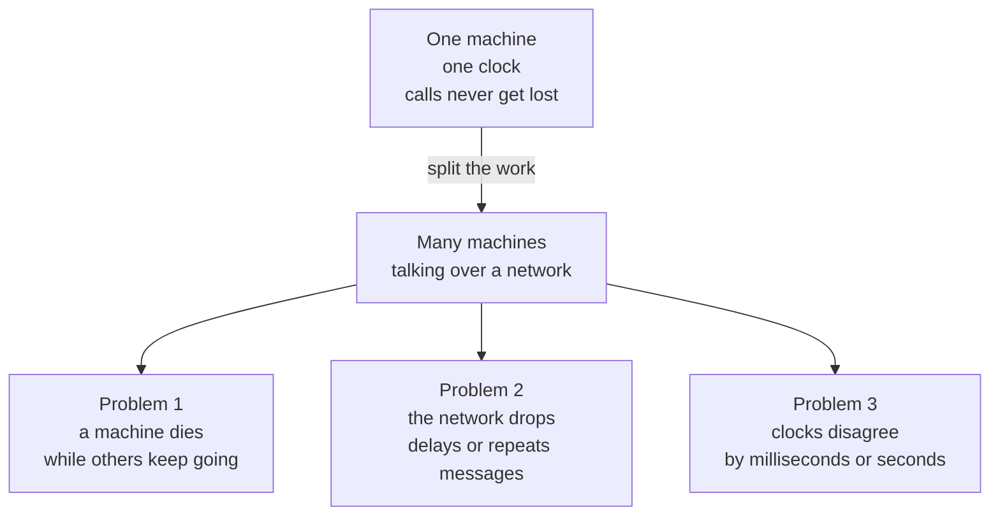

Notice: every pattern in this guide fixes one of these three boxes.

- **A machine dies, but only part of the system dies.** The rest keeps running and must cope. This is called a partial failure.
- **The network is not a wire you can trust.** A message can arrive late, twice, or never.
- **You cannot tell "slow" from "dead".** If a server does not answer in 2 seconds, it may be dead. It may also be busy, or the answer may be on its way.
- **Clocks drift.** Server A says 10:00:00.000, server B says 10:00:00.250. "Which write came first?" gets hard.

**Words you will hear**

- **Node:** one machine or one process in the system.
- **Partition (network partition):** the network splits, so some nodes cannot reach others.
- **Latency:** how long one message or request takes.

### The 8 false beliefs (fallacies of distributed computing)

Engineers at Sun Microsystems wrote down 8 beliefs that new distributed systems quietly assume. All 8 are false.

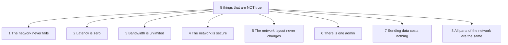

Notice: the first two cause most interview follow-ups. "What if the call fails?" and "What if it is slow?"

- In code, the first false belief looks like `await fetch(url)` with no timeout and no retry.
- The second looks like a loop that makes 50 small calls to another service, one after another.

> **Say this in the interview:** "Once there is a network between two parts, I assume calls can fail, be slow, or happen twice. So every remote call gets a timeout, a retry plan, and a way to be safe if it runs twice."

---

## Part 2: Single point of failure and the nines [Beginner]

### The problem: one thing that takes everything down

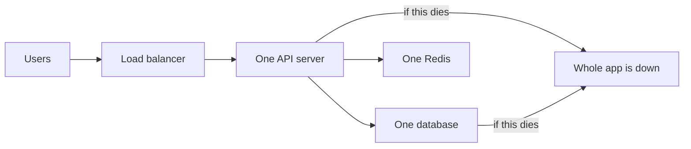

Notice: any box with no copy is a **single point of failure**. If it dies, users see the error.

### The fix: redundancy

Run two or more copies, and send traffic only to the healthy ones.

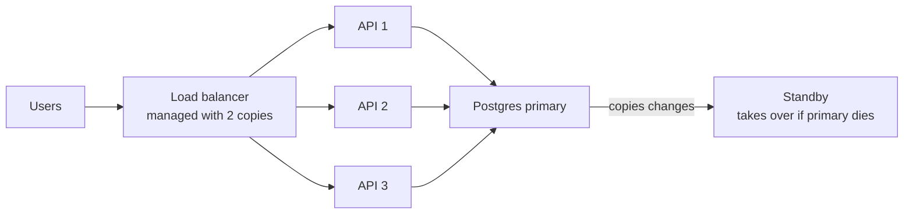

Notice: the API copies are easy because they keep no data. The database copy is hard, because two copies must agree. Parts 3 and 7 are about that.

### The nines: how much downtime is allowed

Availability is the share of time the system works. Turn the percent into minutes. Interviewers love this.

| Availability | Down per year | Down per month | Plain meaning |
|---|---|---|---|
| 99% ("two nines") | 3.65 days | 7.3 hours | A bad day every month |
| 99.9% ("three nines") | 8.8 hours | 44 minutes | One slow deploy gone wrong |
| 99.95% | 4.4 hours | 22 minutes | Common cloud database promise |
| 99.99% ("four nines") | 53 minutes | 4.4 minutes | Needs a copy that takes over by itself, no humans in the loop |
| 99.999% ("five nines") | 5.3 minutes | 26 seconds | Very hard and very expensive |

Each extra nine cuts allowed downtime by 10 times. It also costs much more to build and run.

### Parts in a row versus parts side by side

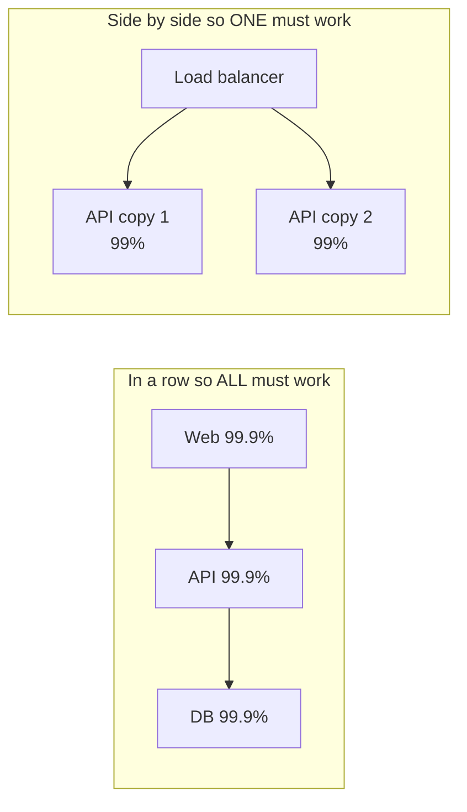

Notice: a row makes you weaker than your weakest part. Copies side by side make you stronger than any single copy.

- **In a row (series):** multiply. 0.999 × 0.999 × 0.999 = 0.997. That is 99.7%, about **2.2 hours down per month**. Three good parts made a worse system.
- **Side by side (parallel):** the system fails only if all copies fail at once. Two copies at 99%: 1 − (0.01 × 0.01) = 0.9999. That is **99.99%**.

**Worked example.** A load balancer (99.99%), then two API copies (99.9% each), then one database (99.95%).

1. Two API copies side by side: 1 − (0.001 × 0.001) = 0.999999.
2. Now the row: 0.9999 × 0.999999 × 0.9995 = 0.9994.
3. 99.94% is about **26 minutes down per month**. The single database is now the weak link. That tells you where to spend money next.

**The cost and the catch**

- Copies cost money, and data copies must agree.
- The math assumes copies fail **independently**. Two servers in the same data center, with the same bad config, fail together. Real redundancy means different zones, and rolling out changes slowly.
- Every call your request needs is a part "in a row". Ten services in a chain at 99.9% each give about 99%.

**Words you will hear**

- **Single point of failure:** a part with no copy. If it dies, users see it.
- **Redundancy:** extra copies, so one can die without users noticing.
- **Failover:** a copy takes over when the main one dies.

> **Say this in the interview:** "Availability multiplies along the request path, so a long chain of services is fragile. I remove single points of failure with copies in different zones, and I check that the copies do not share one hidden dependency."

---

## Part 3: Consistency models, CAP and PACELC [Mid]

### The problem: one write, many copies

As soon as data has copies (replicas, caches, other regions), a read can hit a copy that has not received the latest write yet.

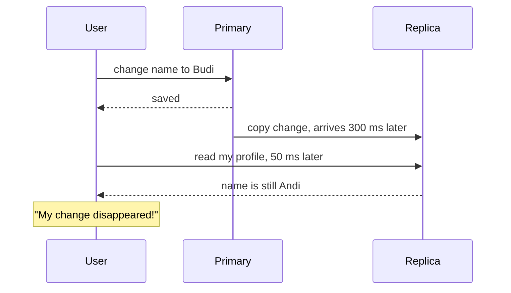

Notice: nothing crashed. The data is just not everywhere yet. Deep fixes for replica lag: [Scaling a database, step 4](../database/database-scaling-and-correctness.md#step-4-read-replicas).

### Four promises, from strongest to weakest

A **consistency model** is the promise the system makes about what a read can return.

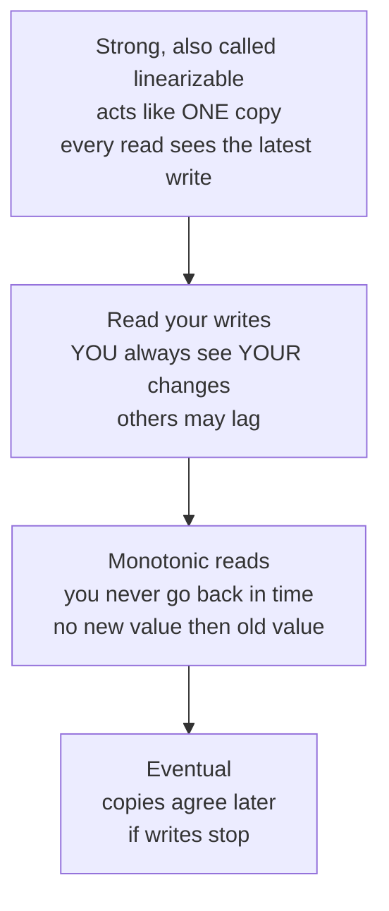

Notice: going down the ladder, the promise gets weaker and the system gets faster and more available.

| Model | Plain promise | Without it, the user sees | Typical use |
|---|---|---|---|
| Strong (linearizable) | Behaves like one copy. A finished write is visible to every later read. | Two people buy the last item | Payments, stock at checkout, points balance |
| Read your writes | You see your own changes at once | "I saved my address and it is gone" | Profile, settings, my orders |
| Monotonic reads | Your reads never go backward in time | A comment appears, then disappears on refresh | Feeds, comment lists |
| Eventual | All copies agree after a while | Like count is a bit behind | Counters, search index, analytics |

How each is built, in short:

- **Strong:** read and write on one leader (a single Postgres primary), or wait for a majority (Part 7).
- **Read your writes:** for a few seconds after a user writes, send that user's reads to the primary.
- **Monotonic reads:** keep each user on the same replica (pick it by a hash of the user id).
- **Eventual:** do nothing special. Copies catch up.

### CAP, stated correctly

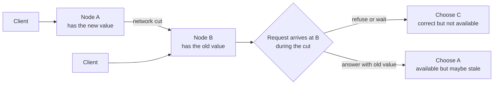

Notice: the choice only exists **while the network is cut**. With no cut, you can have both.

- **C** in CAP means linearizable: every read sees the latest write.
- **A** means every working node answers every request.
- **P** means the network can split. In real networks it will, so P is not something you can drop.
- So CAP says: **during a partition, pick C or A.**

### PACELC: the part people forget

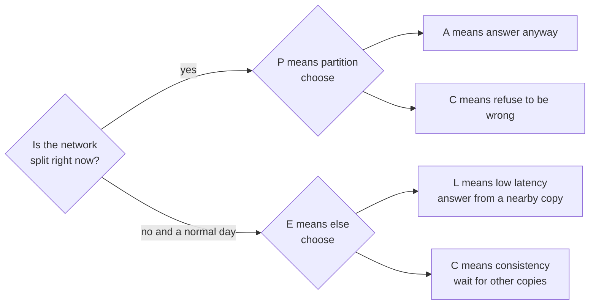

Notice: most of the time there is no partition. The everyday tradeoff is **speed against freshness**.

- Synchronous replication waits for the copy before saying "saved". Consistent, but every write is slower.
- Asynchronous replication says "saved" first. Fast, but a read from a copy can be old.

### Common wrong answers

| Wrong | Right |
|---|---|
| "Pick any 2 of 3." | You cannot give up P. The choice is C or A, and only during a partition. |
| "Postgres is a CA system." | One Postgres server is not distributed, so CAP does not really apply. Add replicas and it does. |
| "C in CAP is the C in ACID." | ACID's C means your rules and constraints hold. CAP's C means every read sees the latest write. |
| "A in CAP means 99.99% uptime." | CAP's A is stricter: every working node must answer. Uptime is a different number. |
| "MongoDB is CP, Cassandra is AP, done." | Settings and each query change it. Choose per feature, not per database. |

**Cost:** stronger promises need more waiting or more refusals. Weaker promises need the app (and the user) to cope with old data.

**Words you will hear**

- **Replica:** a copy of the data on another node.
- **Linearizable:** the strongest promise. The system behaves as if there is one copy.
- **Stale:** old, not yet updated.

> **Say this in the interview:** "CAP only bites during a partition: then I either refuse to answer or answer with maybe old data. PACELC adds the everyday tradeoff: even without a partition, waiting for copies costs latency. I choose per feature: checkout and points need strong reads from the primary; like counts can be eventual."

---

## Part 4: Safe calls: timeouts, retries, budgets, idempotency keys [Mid]

This part is about **one call** from your service to another service. Part 5 is about protecting your whole service.

**Words you will hear**

- **Timeout:** the most time you will wait for an answer before giving up.
- **Backoff:** waiting longer after each failed try.
- **Jitter:** a random part added to the wait, so clients do not retry at the same moment.
- **Idempotency key:** a unique label on a request, so doing it twice has the same effect as doing it once.

### 4.1 Timeouts

**The problem: waiting forever**

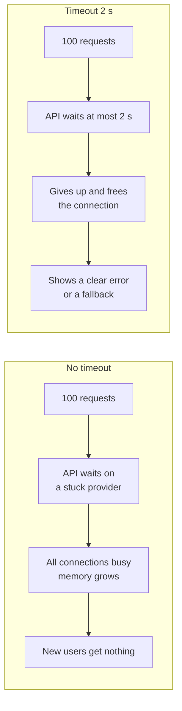

Notice: without a timeout, one stuck dependency slowly eats all your connections. Then even healthy pages fail.

- **Every network call gets a timeout.** HTTP calls, database queries, Redis calls.
- **How long?** Look at how fast the other service usually answers. A useful start from AWS: pick how many false timeouts you accept, say 1 in 1,000, and use that latency point. "p99.9" means 999 of 1,000 requests finish within that time.
- **Inner timeouts are shorter than outer ones.** If the user's request has 5 seconds in total, the payment call cannot have 10.
- In Node, `fetch` does not cut a slow call short for you. Pass `AbortSignal.timeout(2000)`.

**Cost:** too short, and you cancel calls that would have worked. Too long, and you pile up waiting requests.

### 4.2 Retries with exponential backoff and jitter

**The problem:** many failures are short blips: a restart, a dropped packet. One more try a moment later often works. But retries add load, and badly timed retries hit together.

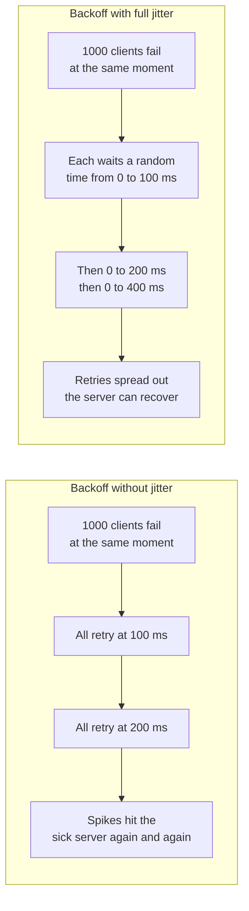

Notice: backoff alone keeps everyone in step. The random part breaks the step.

**The formula (full jitter):**

```text
wait = random between 0 and min(cap, base × 2^attempt)
base = 100 ms, cap = 5 s  →  ceilings 100, 200, 400, 800, 1600, 3200, 5000 ms
```

**In TypeScript:**

```ts
function backoffMs(attempt: number, baseMs = 100, capMs = 5_000): number {
  const ceiling = Math.min(capMs, baseMs * 2 ** attempt); // 100, 200, 400 ...
  return Math.random() * ceiling;                          // full jitter: 0..ceiling
}

async function withRetry<T>(call: (signal: AbortSignal) => Promise<T>, maxTries = 3): Promise<T> {
  for (let attempt = 0; ; attempt++) {
    try {
      return await call(AbortSignal.timeout(2_000)); // every try has its own timeout
    } catch (err) {
      if (attempt + 1 >= maxTries) throw err;       // give up, let the caller decide
      await new Promise((r) => setTimeout(r, backoffMs(attempt)));
    }
  }
}
```

Checked on 2026-10-16 with Node 22 (`--experimental-strip-types`). A call that fails twice succeeds on try 3. A call that always hangs gives up with a `TimeoutError`.

**When to retry, and when not to:**

| Retry | Do not retry |
|---|---|
| Timeout, connection reset | 400 bad request, 401, 403, 404, validation errors |
| 503 service unavailable | Anything that changes data, **unless** it has an idempotency key |
| 429 too many requests, after the `Retry-After` time | When your retry budget is empty |

In real code, also check the error type before retrying. The snippet keeps that out to stay short.

### 4.3 Retry budgets

**The problem: retries multiply through layers.**

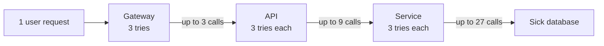

Notice: three layers with three tries each can turn 1 request into 27 calls at the bottom. Five layers give 3^5 = 243. The sick part gets the most load, exactly when it is weakest.

**The fix:**

- **Retry in one layer only.** Usually the layer closest to the user, or the one that knows if the action is safe to repeat. The other layers fail fast.
- **Set a retry budget.** Retries may be at most a small share of normal traffic, for example 10%. When the budget is used up, stop retrying and fail fast. Google's SRE book describes this idea, and some service proxies (Envoy) support it.
- **Always cap the number of tries.** Two or three is normal.

**Cost:** a budget means some requests fail that one more try might have saved. That is the price of not making an outage worse.

### 4.4 Idempotency keys

**The problem: a retry that charges twice.**

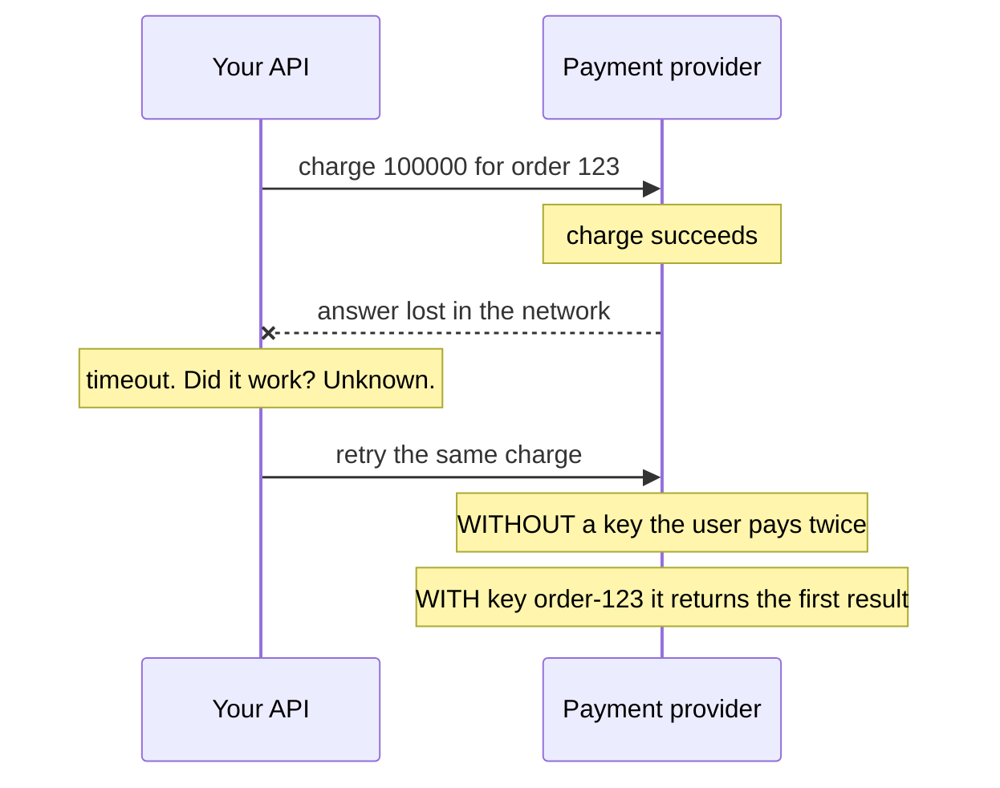

Notice: after a timeout you do not know if the call worked. Only an idempotency key makes the retry safe.

- The **client** creates the key once, for example from the order id, and sends it with every try.
- The **server** saves the key and the result. If the same key comes again, it returns the saved result and does nothing new.
- Stripe does this with the `Idempotency-Key` header. Full payment flow: [online shop guide, step 3](load-balancers-microservices-online-shop.md#step-3-third-party-integrations-done-right).
- On your own server, a unique constraint does the work. Deep version: [unique constraint and ON CONFLICT](../database/database-scaling-and-correctness.md#the-toolbox-from-simplest-to-heaviest).

```sql
CREATE TABLE idempotency_key (key text PRIMARY KEY, response jsonb, created_at timestamptz DEFAULT now());
INSERT INTO idempotency_key (key) VALUES ($1) ON CONFLICT DO NOTHING RETURNING key;
-- 1 row: first time, do the work and save the response. 0 rows: seen before, return the saved response.
```

**Cost:** you must store keys, and delete them after a day or a week. Two tries with the same key at the same moment need care. The second one should wait, or get "still in progress".

> **Say this in the interview:** "Every remote call gets a timeout based on the other service's p99.9. I retry only temporary errors, two or three times, with exponential backoff and full jitter, and only in one layer, under a retry budget. Anything that changes money or data carries an idempotency key, so a retry after a timeout cannot do the action twice."

---

## Part 5: Protect yourself when a neighbor is sick [Mid]

Part 4 made one call safe. Now: what if a dependency is sick for minutes, or traffic is too high?

**Words you will hear**

- **Circuit breaker:** a switch that stops calling a failing service for a while.
- **Bulkhead:** a wall that keeps one part's trouble from using up everything.
- **Load shedding:** saying "no" early to extra requests so the rest stay fast.
- **Backpressure:** a slow consumer telling a fast producer "slow down".

### 5.1 Circuit breaker

**The problem:** the provider is down. Every request still waits the full timeout, then retries. Your API is busy waiting, and the provider gets hammered while it tries to restart.

**The fix: three states.**

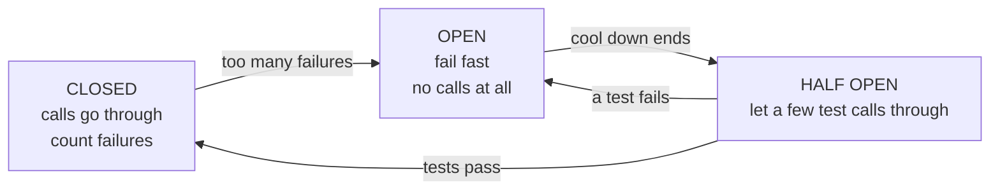

Notice: OPEN protects both sides. You answer fast, and the sick service gets quiet time to recover.

- Typical settings: open when 50% of the last 20 calls failed; stay open 30 seconds; then let 1 to 5 test calls through.
- While open, do something useful: show cached data, queue the work, or show a clear message (see 5.5).
- One breaker **per dependency**, not one for everything. In Node, the `opossum` library does this.
- Like the breaker in your house: it cuts the power before the wire burns. Where it stops being true: a house breaker needs a human to reset it. This one tests and closes by itself.

**Cost:** settings need tuning. Each API copy has its own breaker and sees slightly different numbers. While open, some calls fail that might have worked.

### 5.2 Bulkheads

**The problem:** one shared pool of connections. The slow provider takes all of them, so the fast features starve too.

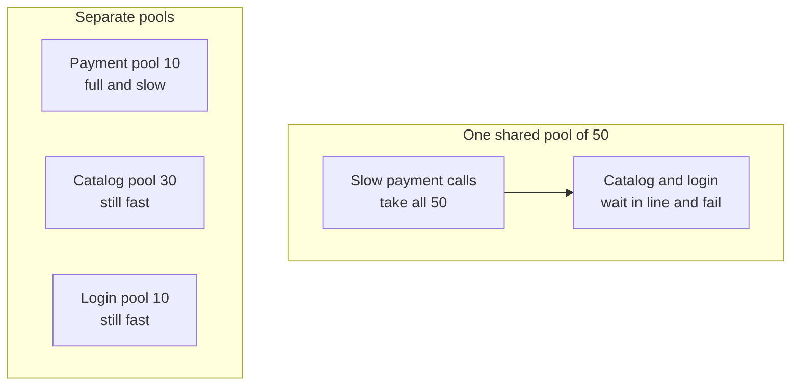

Notice: separate pools keep the damage in one room. A ship has walls inside for the same reason: one hole floods one room, not the whole ship.

- In Node: a separate HTTP agent with its own `maxSockets` per provider, a limit on calls in flight, separate database pools, separate queues and workers.
- At the big end: separate containers or separate clusters for different jobs.

**Cost:** pools sized too small waste capacity on quiet days. You must pick sizes and watch them.

### 5.3 Rate limiting and load shedding

- **Rate limiting** caps each **client**: "user 42 may make 100 requests per minute." Algorithms (token bucket) are in [system design basics](system-design-basics-senior-fullstack-interview.md#q-design-a-rate-limiter).
- **Load shedding** protects the **server**, whoever is calling. When it is full, it says no early.

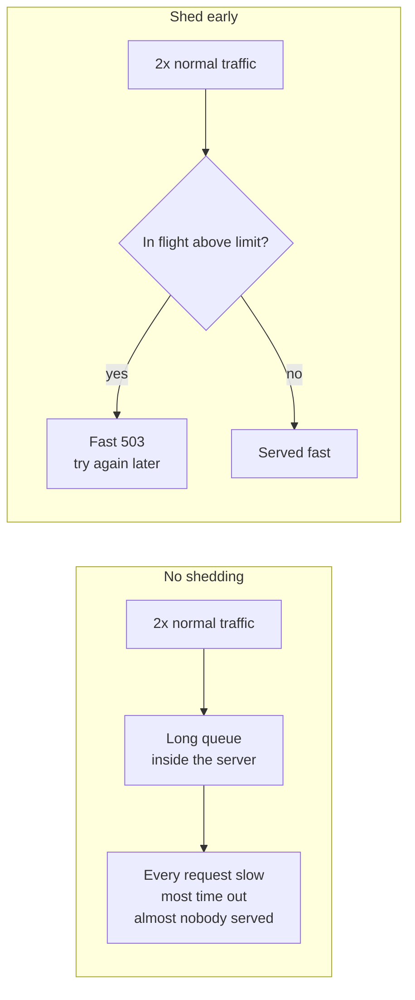

Notice: without shedding, the server does work for requests that will time out anyway. That work is wasted.

- Reject **before** doing expensive work. A fast "no" costs almost nothing.
- Shed the least important traffic first: analytics, prefetch, background sync. Keep checkout and login.

**Cost:** some users get "try again later" on purpose. That is better than every user getting a timeout.

### 5.4 Backpressure

**The problem:** the producer is faster than the consumer, and the buffer between them has no limit.

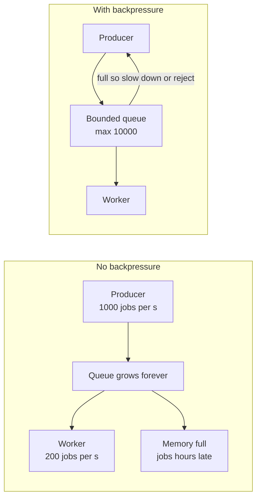

Notice: a queue does not remove work. It only moves the waiting somewhere else. Without a limit, the waiting grows forever.

- Node streams have this built in: `write()` returns `false` when the buffer is full, and `pipe()` pauses the source.
- With BullMQ, watch **queue depth** and **age of the oldest job**. Alert when they grow.
- Options when full: slow the producer, reject new work, or add workers.

**Cost:** someone upstream must wait or get an error. You choose where the waiting happens.

### 5.5 Graceful degradation

**The problem:** the recommendations service is down, and the whole product page shows an error.

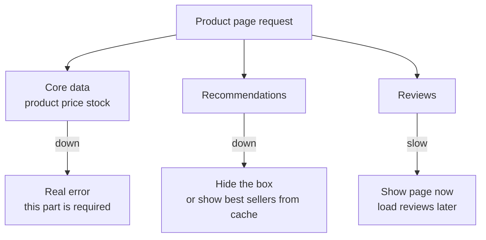

Notice: decide in advance which parts are **required** and which are **nice to have**. Only required parts may break the page.

- Ways to degrade: hide a section, serve old cached data, switch to read only mode, queue the action for later.
- Test your fallback. Code that runs only during outages is often broken when you finally need it.

**Cost:** more code paths to build and test. Users may see old or partial data.

> **Say this in the interview:** "Timeouts and retries protect one call. To protect the service, I add a circuit breaker per dependency so we fail fast, bulkheads so one slow provider cannot use every connection, load shedding so overload gives fast 503s instead of slow timeouts, bounded queues for backpressure, and a planned degraded mode for each non-required feature."

---

## Part 6: Health checks: liveness and readiness [Mid]

**The problem:** the load balancer keeps sending traffic to an instance that is broken, or one that is still starting.

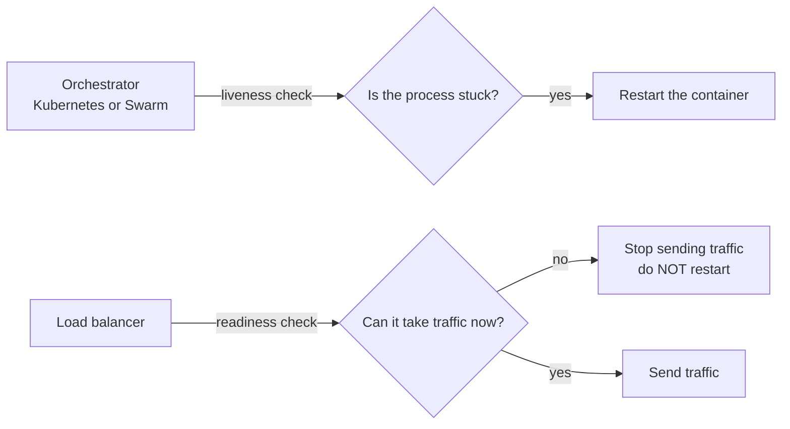

Notice: liveness answers "should I restart it?" Readiness answers "should I send it traffic?" Different questions, different actions.

| Check | Question | When it fails | Should check |
|---|---|---|---|
| Liveness | Is the process stuck, waiting forever? | Restart | Only the process itself. Very cheap. |
| Readiness | Can this instance serve right now? | Remove from the load balancer | Its own state: started, warmed up, not shutting down |
| Startup | Has a slow app finished starting? | Wait longer before the other checks | Only at start |

### The trap: a readiness check that checks the database

```mermaid
sequenceDiagram
    participant LB as Load balancer
    participant A as API 1 2 and 3
    participant DB as Database
    Note over DB: DB slow for 20 seconds
    LB->>A: readiness check
    A->>DB: SELECT 1
    DB--xA: timeout
    A-->>LB: not ready
    Note over LB: ALL copies say not ready
    Note over LB: zero backends left
    Note over LB: 100 percent of users get errors
```

Notice: a slow database would have made **some** requests fail. The readiness check turned it into **all** requests failing, including pages that never touch the database.

- All copies share the same database, so they all fail the check at the same moment.
- A liveness check that checks the database is worse. Every container restarts in a loop, and all reconnect at once when the database recovers.
- AWS's advice: if the whole fleet looks unhealthy at once, **fail open** and keep sending traffic. Some load balancers (AWS ELB) do this. A Kubernetes Service does not: it is simply left with no instances to send to.

**The fix**

```ts
let ready = false;   // true after warm up, false again when shutting down
app.get("/livez", (_req, res) => res.send("ok"));               // process answers = alive
app.get("/readyz", (_req, res) =>
  ready ? res.send("ready") : res.status(503).send("not ready")  // own state only, no DB call
);
```

- Handle database trouble **per request**: timeouts, circuit breaker, a clear error.
- Watch the database with monitoring and alerts, not with the load balancer.

**Cost:** an instance with a truly broken database connection may still get traffic. Fix that with an alert and a per instance error rate, not with a fleet wide switch.

**Words you will hear**

- **Liveness probe:** the check that decides restarts.
- **Readiness probe:** the check that decides traffic.
- **Fail open:** when the safety check itself looks broken everywhere, let traffic through instead of blocking all of it.

> **Say this in the interview:** "Liveness means restart me, so it checks only that the process answers. Readiness means send me traffic, so it checks my own state, like warm up and shutdown. I never put a shared dependency like the database in those checks, because when it blips every copy fails together and a partial outage becomes a full one."

---

## Part 7: Replication and consensus [Senior]

**Words you will hear**

- **Leader:** the one node that accepts writes and tells the others what to copy.
- **Split brain:** two nodes both believe they are the leader, and both accept writes.
- **Quorum:** a majority of nodes, more than half.
- **Consensus:** nodes agreeing on one value, or one order of writes, even when some fail.

### Why picking a leader is hard

One leader keeps writes in one order. Simple. But when the leader goes quiet, the others must pick a new one. They cannot see **why** it went quiet.

```mermaid
graph TB
    subgraph east["Side 1 of the cut"]
        L1["Old leader<br/>still alive<br/>still accepts writes"]
        U1["Users in the east"] --> L1
    end
    subgraph west["Side 2 of the cut"]
        L2["New leader<br/>elected because the old one<br/>looked dead"]
        U2["Users in the west"] --> L2
    end
    L1 -->|network cut| L2
    L1 --> BAD["Two different histories<br/>which writes are real?"]
    L2 --> BAD
```

Notice: the old leader was never dead. It was only cut off. Now both sides accept writes, and someone must merge them by hand.

This really happened. In October 2018, GitHub lost the link between its East Coast hub and main data center for **43 seconds**. Its failover tool moved writes to the West Coast. Some writes on the East Coast had not been copied yet. Fixing the two histories caused **24 hours and 11 minutes** of degraded service.

### Quorum: the rule that prevents two leaders

```mermaid
graph LR
    subgraph five["5 nodes, a leader needs 3 votes"]
        A["Node 1"]
        B["Node 2"]
        C["Node 3"]
        D["Node 4"]
        E["Node 5"]
    end
    A --> M1["Side with 3 nodes<br/>can elect and commit"]
    B --> M1
    C --> M1
    D --> M2["Side with 2 nodes<br/>cannot reach 3<br/>stops accepting writes"]
    E --> M2
```

Notice: two groups of 3 out of 5 always share at least one node. So two leaders can never both win a majority in the same round.

| Nodes | Majority needed | Failures you survive |
|---|---|---|
| 1 | 1 | 0 |
| 3 | 2 | 1 |
| 4 | 3 | 1 (no better than 3) |
| 5 | 3 | 2 |
| 7 | 4 | 3 |

That is why clusters have 3 or 5 nodes. An even number adds cost but no safety.

### Raft, step by step

Raft is a consensus method designed to be easy to understand. It splits the job into: pick a leader, copy the log, keep it safe.

**1. Roles and terms**

```mermaid
graph LR
    F["Follower<br/>listens to the leader"] -->|no heartbeat before its random timeout| CA["Candidate<br/>term plus 1<br/>votes for itself<br/>asks for votes"]
    CA -->|gets a majority| LE["Leader<br/>sends heartbeats<br/>copies the log"]
    CA -->|sees a higher term| F
    LE -->|sees a higher term| F
```

Notice: the term number goes up with every election. A leader that sees a higher term steps down at once.

- A **term** is like a numbered period in office. Each term has at most one leader.
- Each node votes **once** per term.
- The leader sends a small "I am alive" message, a **heartbeat**, every short while.
- Each follower waits a **random** time (the Raft paper suggests 150 to 300 ms) before starting an election. The randomness means one node usually starts first and wins. Same idea as jitter in Part 4.

**2. Copying a write (log replication)**

```mermaid
sequenceDiagram
    participant C as Client
    participant L as Leader term 5
    participant F1 as Follower 1
    participant F2 as Follower 2
    C->>L: set x to 7
    L->>L: add to log at slot 42
    L->>F1: append slot 42
    L->>F2: append slot 42
    F1-->>L: stored
    Note over L: 2 of 3 have it so it is a majority
    L->>L: commit slot 42 and apply x to 7
    L-->>C: OK
    F2-->>L: stored, a bit later
```

Notice: the leader answers "OK" after a **majority** stored the write. It does not wait for the slowest node.

**3. Why the old leader cannot do damage.** An old leader cut off with a minority cannot get a majority to store its writes. So it cannot commit anything. When the cut heals, it sees the higher term and steps down. Its uncommitted writes are thrown away.

**4. Who can win.** A node only votes for a candidate whose log is at least as up to date as its own. So a new leader always has every committed write.

**Where Raft runs (worth naming):**

- **etcd:** the store that holds the state of a Kubernetes cluster.
- **Consul:** service discovery and config.
- **Kafka KRaft:** Kafka's own metadata now uses a Raft based controller. Kafka 4.0 (March 2025) removed ZooKeeper completely.
- **CockroachDB:** splits data into ranges, and each range is its own small Raft group.
- Postgres failover tools like Patroni keep the "who is primary" fact in etcd or Consul. So a Raft store guards which Postgres is primary. See [high availability in the DB guide](../database/database-scaling-and-correctness.md#high-availability).

**Cost:** every write waits for a round trip to a majority. Across regions that is tens of milliseconds or more. And if most nodes are gone, the cluster stops taking writes. That is choosing C in CAP.

Play with it: the guided [Raft animation](http://thesecretlivesofdata.com/raft) and the [Raft site](https://raft.github.io/), where you can stop servers and watch an election.

> **Say this in the interview:** "Leader election is hard because a node cannot tell a dead leader from a cut off one, which risks split brain. Raft fixes this with terms and majorities: a leader needs votes from more than half, and a write is committed only when more than half stored it. Two majorities always overlap, so two leaders cannot both commit. That is why etcd, Consul and Kafka's KRaft use it, and why clusters have 3 or 5 nodes."

---

## Part 8: Time and order [Senior]

**Words you will hear**

- **Clock drift:** a server's clock slowly running fast or slow.
- **Logical clock:** a counter that orders events without using real time.
- **Last write wins:** keep the write with the latest timestamp, drop the other.
- **Fencing token:** a number that goes up each time a lock is given out, so old lock holders can be rejected.

### Why wall clocks lie

- Each server has its own clock crystal. It drifts a little every day.
- **NTP** (the network time protocol) asks time servers and corrects the clock. A correction can make the clock **jump**, even backward.
- Across servers, clocks often differ by milliseconds, sometimes much more after a bad sync.
- For measuring how long something took, use a clock that only moves forward: `performance.now()` or `process.hrtime.bigint()` in Node, not `Date.now()`.

### Why "last write wins" loses data

```mermaid
sequenceDiagram
    participant A as Server A clock 100 ms fast
    participant DB as Store using last write wins
    participant B as Server B clock correct
    A->>DB: set stock to 5 with time 12.200
    Note over A,B: 50 ms later in real time
    B->>DB: set stock to 4 with time 12.150
    Note over DB: 12.150 looks older than 12.200
    Note over DB: B's newer write is silently dropped
```

Notice: nobody got an error. The newer write just vanished, because one clock was fast.

- Some databases settle conflicts this way by default (Cassandra is the usual example).
- Safer options: a version number check ([optimistic locking](../database/database-scaling-and-correctness.md#the-toolbox-from-simplest-to-heaviest)), one leader that orders writes (Part 7), or keep both values and merge them.

### Logical clocks (Lamport clocks), in short

Instead of real time, each node keeps a counter.

```mermaid
sequenceDiagram
    participant A as Node A
    participant B as Node B
    Note over A: counter 1 for a local event
    A->>B: message carries counter 2
    Note over B: own counter was 0 so take max of 0 and 2 then add 1 giving 3
    Note over B: counter 4 for a local event
```

The rules:

1. Before each event, add 1 to your counter.
2. Send your counter with every message.
3. On receive, set your counter to the bigger of yours and the one in the message, then add 1.

What you get: if event X caused event Y, X has a smaller number. What you do not get: real time, or a way to tell that two events happened independently. Vector clocks add that (see Go deeper).

### Fencing tokens: why a lock with a timer is not enough

**The problem:** a lock that expires by itself (a lease). Client 1 takes it, then freezes. A long garbage collection (GC) pause, when the runtime stops to free memory, can do this. The lock expires. Client 2 takes it and writes. Client 1 wakes up, still thinks it holds the lock, and writes too.

```mermaid
sequenceDiagram
    participant C1 as Client 1
    participant LS as Lock service
    participant C2 as Client 2
    participant S as Storage
    C1->>LS: get lock
    LS-->>C1: OK with token 33
    Note over C1: frozen for 40 s by a GC pause
    Note over LS: lock expires after 30 s
    C2->>LS: get lock
    LS-->>C2: OK with token 34
    C2->>S: write with token 34
    S-->>C2: accepted, highest seen is now 34
    C1->>S: write with token 33
    S-->>C1: rejected because 33 is lower than 34
```

Notice: the **storage** does the final check, not the lock. The lock alone could not stop client 1, because client 1 did not know it had been frozen.

### The Redis lock debate, in one paragraph

In 2016, Martin Kleppmann wrote that Redlock, a Redis locking method that uses several Redis servers, is not safe when correctness matters. His points: it hands out no fencing token, and it depends on timing (pauses, network delay, clock jumps) staying within limits. Salvatore Sanfilippo (antirez), who created Redis, replied that the timing assumptions are reasonable in practice. The practical lesson most teams take from both: **a Redis lock is fine for efficiency.** Use it to stop two workers doing the same job, when doing it twice only wastes time. **For correctness, the resource itself must guard.** That means a database row lock, a unique constraint, a version check, or a fencing token from a consensus store like etcd.

> **Say this in the interview:** "I do not trust wall clocks to order events across servers, because they drift and NTP can jump them. Last write wins can silently drop the newer write. For locks I separate efficiency from correctness: a Redis lock is fine to avoid duplicate work, but for correctness the storage must reject stale writers, with a fencing token or a database constraint."

---

## Part 9: Distributed transactions [Senior]

**The problem:** placing an order touches the order service, the payment provider and the stock service. One must not succeed while another fails. Inside one Postgres, one transaction does this. Across services, there is no shared transaction.

### Two phase commit (2PC), and why services avoid it

```mermaid
sequenceDiagram
    participant CO as Coordinator
    participant O as Orders DB
    participant S as Stock DB
    CO->>O: phase 1 prepare
    CO->>S: phase 1 prepare
    O-->>CO: yes, locks held
    S-->>CO: yes, locks held
    Note over CO: coordinator crashes here
    Note over O,S: both wait with locks held and cannot decide alone
    CO->>O: phase 2 commit, once it is back
    CO->>S: phase 2 commit, once it is back
```

Notice: after saying "yes", a participant must wait for the coordinator. If the coordinator is gone, everyone waits with locks held.

Why services avoid it:

- **It blocks.** A coordinator crash leaves locks held for a long time.
- **Every participant must be up.** That is availability "in a row" from Part 2.
- **Third parties cannot join.** Stripe will not take part in your 2PC.
- Postgres supports it (`PREPARE TRANSACTION`), but it is off by default (`max_prepared_transactions = 0`).

### What services use instead

- **Saga:** a chain of local steps, each with an undo step. "Reserve stock, charge, ship. If the charge fails, release the stock and cancel the order." Deep version: [sagas in the online shop guide](load-balancers-microservices-online-shop.md#step-4-communication--sync-vs-async-and-sagas).
- **Outbox:** save the change and the "message to send" in one local transaction. A relay sends it later. Deep version: [outbox in the DB guide](../database/database-scaling-and-correctness.md#never-call-another-service-inside-a-transaction).
- **Idempotent receivers** (Part 4), because the relay and the queue may deliver twice.

### Exactly once is a myth (mostly)

```mermaid
graph LR
    P["Producer"] -->|sends and may resend| Q["Queue<br/>at least once delivery"]
    Q -->|message may arrive twice| C["Consumer"]
    C --> D{"Seen this message id?"}
    D -->|yes| SKIP["Skip, return saved result"]
    D -->|no| DO["Do the work and save the id<br/>in the same DB transaction"]
```

Notice: the network cannot promise exactly once **delivery**. You get the same **effect** as once by making the receiver skip repeats.

- Kafka's "exactly once" feature covers reading from Kafka, processing, and writing back to Kafka. It does **not** cover side effects outside Kafka, like sending an email or calling Stripe.
- So the honest formula is: **at least once delivery + idempotent processing = effectively once.**

**Cost:** sagas mean in between states ("order pending payment") that users can see, and undo steps you must build and test. That is the price of not locking several services together.

> **Say this in the interview:** "I avoid two phase commit across services because it blocks when the coordinator fails and needs every service up at once. I use a saga with undo steps, an outbox so events are never lost after commit, and idempotent consumers, because delivery is at least once. Exactly once is really at least once plus deduplication."

---

## Part 10: Failure thinking [Senior]

**Words you will hear**

- **Blast radius:** how much breaks when one thing breaks.
- **Cascading failure:** one failure causes the next, which causes the next.
- **Metastable failure:** the system stays broken even after the first cause is gone.
- **Chaos engineering:** breaking things on purpose, in a controlled way, to learn.

### Blast radius and cells

**The problem:** one bad change, or one bad customer, hits everyone. In November 2025, a Cloudflare bug produced a bad Bot Management feature file. The file spread across Cloudflare's network, and many sites failed for hours.

```mermaid
graph TB
    R["Thin router<br/>customer id to cell"] --> C1["Cell 1<br/>full copy of the app<br/>own database<br/>customers A to H"]
    R --> C2["Cell 2<br/>full copy<br/>own database<br/>customers I to P"]
    R --> C3["Cell 3<br/>full copy<br/>own database<br/>customers Q to Z"]
    C2 --> X["Cell 2 breaks<br/>only a third of customers hurt"]
```

Notice: each cell is a complete, separate copy. A failure, or a bad deploy, stays inside one cell.

- **Cell based architecture:** split customers across many identical, independent copies. Cells share no database and do not call each other. AWS documents this pattern.
- Roll out changes **one cell at a time**, so a bad change hurts one cell first.
- **Cost:** more copies to run and watch. Features that span customers are harder. The router must stay very simple, because it is shared by everyone.

### Cascading failures and the retry storm

```mermaid
graph LR
    S["DB gets slow"] --> T["API calls time out"]
    T --> RT["Clients and API retry<br/>3 times each"]
    RT --> MORE["DB gets 3x to 9x<br/>more requests"]
    MORE --> S
    MORE --> POOL["API connection pools fill"]
    POOL --> DOWN["API fails health checks<br/>copies removed"]
    DOWN --> FEW["Fewer API copies<br/>more load on each"]
    FEW --> T
```

Notice: two loops feed themselves. Retries make the database slower. Removed copies make the remaining ones busier.

A real one: in June 2025, a Google Cloud service crashed worldwide. When it restarted in a large region, tasks all hit their database at once. Google's report says the service did not have **randomized exponential backoff**. The crowd of restarts overloaded the database and slowed recovery.

### Metastable failures

```mermaid
graph LR
    OK["Normal<br/>fast and stable"] -->|trigger like a deploy or a short spike| BAD["Overloaded"]
    BAD -->|retries and timeouts keep load high| BAD
    BAD -->|only if load is cut hard| OK
```

Notice: the trigger is already gone, but the system stays broken. Its own retries keep it overloaded.

- Example: a cache empties after a restart. Every request goes to the database. The database is slow, so requests time out and retry. The cache never fills, because requests never finish.
- The fix is to **cut load hard**: shed traffic, stop retries, open breakers, warm the cache slowly. Then let traffic back in steps.
- Prevent it with retry budgets, jitter, load shedding, and spare capacity.

### Chaos engineering

- Netflix made this well known with Chaos Monkey, which turns off servers during work hours.
- The method: state what you expect ("if Redis dies, users can still log in"), break one thing in a small, controlled way, and check.
- Start small: a "game day" in staging. Stop Redis, slow the database, block a third party. Watch what users would see.

### The checklist: "What happens when X dies?"

Think of a fire in a building. Answer six questions, in this order.

| # | Question | Fire picture | Example answer for "Redis dies" in a Node app with BullMQ |
|---|---|---|---|
| 1 | **Who notices?** | Smoke alarm | Alert on Redis connection errors and on queue job age |
| 2 | **What do users see?** | People in the building | Cached pages are slower; background jobs (emails) stop |
| 3 | **How far does it spread?** | Fire doors | Login and checkout must not depend on the cache: fall back to the database |
| 4 | **What happens to data?** | The important papers | Queued jobs may be lost if Redis keeps nothing on disk. Turn on persistence |
| 5 | **How does it recover?** | Firefighters | Restart or fail over; workers reconnect with backoff and jitter |
| 6 | **What happens when it comes back?** | Moving back in | An empty cache means a rush to the database: warm it, add jitter to cache expiry times |

> **Say this in the interview:** "When asked what happens if X dies, I go through six questions: who notices, what users see, how far it spreads, what happens to the data, how it recovers, and what happens when it comes back. The last one matters most at scale, because retry storms and cold caches cause the second outage."

---

## Part 11: Worked example: "the payment provider is slow" [Senior]

**The setup:** a Next.js checkout calls your Node API. The API calls the payment provider to create a payment. Normally it answers in 300 ms. Today it takes 8 to 20 seconds, and some calls fail.

**What goes wrong if you did nothing:**

- Each checkout waits 20 seconds or more. Users click "Pay" again.
- API connections fill with waiting payment calls. Catalog and login get slow too.
- Retries without keys may create two payments.

**The layered answer:**

```mermaid
graph TB
    U["User clicks Pay"] --> O["Save order<br/>status PENDING_PAYMENT"]
    O --> BH{"Payment pool<br/>has a free slot?"}
    BH -->|no| Q["Queue the payment job"]
    BH -->|yes| CB{"Breaker open?"}
    CB -->|yes| Q
    CB -->|no| CALL["Call provider<br/>timeout 3 s<br/>idempotency key = order id"]
    CALL -->|OK| DONE["Show payment page"]
    CALL -->|timeout or 503| RT["One retry with jitter<br/>same key"]
    RT -->|OK| DONE
    RT -->|fails| Q
    Q --> MSG["Tell the user<br/>order saved and payment<br/>being confirmed"]
```

Notice: every path ends with a saved order and an honest message. No path ends with a 30 second spinner or a double charge.

Step by step:

1. **Save the order first** as `PENDING_PAYMENT`. "Provider is slow" becomes a normal state, not a crash.
2. **Timeout:** 3 seconds, set from the provider's normal p99.9 with some room.
3. **Retry once** with jitter, with the **same idempotency key** (the order id). A retry can never create a second payment.
4. **Bulkhead:** payment calls get their own small pool, for example 20 in flight. When it is full, new payments go to the queue. Catalog and login stay fast.
5. **Circuit breaker:** when half the recent payment calls fail, it opens for 30 seconds. Checkouts skip the provider and go straight to the queue.
6. **Queue fallback:** a worker (BullMQ, for example) tries again later with backoff, under a limit, so it does not flood the provider when it recovers.
7. **User message:** "We have your order. Payment is being confirmed, and we will notify you." If the business needs payment before the order counts, say "Payment is slow right now. Your cart is saved. Try again in a minute."
8. **Truth comes from webhooks and a reconciliation job**, not from the first response. A scheduled job asks the provider about every order still pending, and fixes any difference.
9. **Watch it:** alert on breaker open, payment p99 latency, queue depth, and the age of the oldest pending payment.

```mermaid
sequenceDiagram
    participant U as User
    participant API as API
    participant CB as Breaker
    participant P as Provider
    participant Q as Queue
    U->>API: Pay for order 123
    API->>API: save PENDING_PAYMENT
    API->>CB: may I call
    CB-->>API: yes, closed
    API->>P: create payment with key order-123
    Note over API,P: 3 s timeout hits
    API->>P: retry once with key order-123
    Note over API,P: timeout again and breaker counts failures
    API->>Q: add job pay order-123
    API-->>U: order saved and payment being confirmed
    Q->>P: later try with key order-123
    P-->>Q: success
    P->>API: webhook payment succeeded
    API->>U: notify order confirmed
```

Notice: the same key, order-123, travels with every try. That one detail makes all the retries safe.

> **Say this in the interview:** "I save the order as pending first, then call the provider with a 3 second timeout, one jittered retry, and the order id as idempotency key. Payment calls have their own bulkhead, and a circuit breaker sends checkouts to a queue when the provider is failing. The user gets an honest message, and webhooks plus a reconciliation job decide the final state."

---

## Practice

Try each one before you open the answer. Say your answer out loud, or draw it.

**1. Predict the number.** A checkout path: CDN (99.99%), then two API copies side by side (99.5% each), then one database (99.95%), then the payment provider (99.9%). What is the availability, and the downtime per month? Which part should you fix first?

<details><summary>Answer</summary>

- Two API copies: 1 − (0.005 × 0.005) = 0.999975.
- Row: 0.9999 × 0.999975 × 0.9995 × 0.999 = **0.9984**, about **71 minutes down per month**.
- The provider (99.9%, about 44 minutes) is the weakest part, then the database (about 22 minutes). You cannot add a copy of the provider, so you make its failures hurt less: queue the payment and confirm later (Part 11). For the database, add a standby with automatic failover.

</details>

**2. Predict the multiplication.** Four layers call each other. Each layer tries twice (1 call plus 1 retry). The bottom service is down. How many calls reach it for one user request?

<details><summary>Answer</summary>

2 × 2 × 2 × 2 = **16 calls**. Fix: retry in one layer only, and add a retry budget.

</details>

**3. Spot the bug in this design.** "Each API container has `/health`. It runs `SELECT 1` on Postgres and `PING` on Redis. Kubernetes uses it as the liveness probe and the readiness probe."

<details><summary>Answer</summary>

- As **readiness**: when Postgres or Redis blips, every copy fails at once, so the Service has no endpoints. A partial problem becomes a full outage.
- As **liveness**: every container restarts in a loop, and all reconnect at once when the database comes back. A connection storm.
- Fix: liveness checks only that the process answers. Readiness checks its own state (warmed up, not shutting down). Dependencies are watched by alerts and handled per request with timeouts and breakers.

</details>

**4. Fix the bug.**

```ts
for (let i = 0; i < 5; i++) {
  try { return await fetch(url, { method: "POST", body }); }
  catch { await new Promise((r) => setTimeout(r, 1000 * 2 ** i)); }
}
```

<details><summary>Answer</summary>

Three bugs:

1. **No timeout** on `fetch`, so one try can hang for a long time. Add `signal: AbortSignal.timeout(2000)`.
2. **No jitter.** Every client waits exactly 1, 2, 4, 8 seconds, in step. Use `Math.random() * ceiling`.
3. **A POST retried without an idempotency key.** If the first try worked but the answer was lost, this creates the thing twice. Add an `Idempotency-Key` header that stays the same for all tries.

Also: 5 tries is a lot. Two or three, under a retry budget, is safer.

</details>

**5. Choose.** For each, strong or eventual: (a) stock count at the moment of checkout, (b) "people viewing this product" counter, (c) a user's own address right after they edit it, (d) the search results page.

<details><summary>Answer</summary>

- (a) **Strong.** Read from the primary inside the transaction, or overselling happens.
- (b) **Eventual.** Being a few seconds behind hurts nobody.
- (c) **Read your writes** is enough. Send this user's reads to the primary for a few seconds.
- (d) **Eventual.** Search indexes are always a little behind.

</details>

**6. Draw it.** Five Raft nodes, term 7, leader is node 1. The network splits: nodes 1 and 2 on one side, nodes 3, 4 and 5 on the other. A client writes to node 1. What happens on each side? What happens when the network heals?

<details><summary>Answer</summary>

- Side with 1 and 2: node 1 still thinks it is the leader, but only 2 of 5 can store the write. It cannot reach a majority of 3, so the write is **never committed**. The client times out.
- Side with 3, 4, 5: one of them times out first, starts term 8, gets 3 votes, and becomes leader. Writes there commit normally.
- When it heals: node 1 sees term 8, steps down, and throws away its uncommitted write. Node 2 also follows the term 8 leader. Only one history survives.

</details>

**7. Spot the bug.** "Before changing a store's points balance, the worker takes a Redis lock with `SET lock:store:42 me NX PX 10000`, reads the balance, computes the new one, and writes it back."

<details><summary>Answer</summary>

- If the worker pauses more than 10 seconds (GC, slow network, a busy CPU), the lock expires. A second worker takes it. Both write, and one change is lost.
- The lock gives no fencing token, and the database does not check anything.
- Fix: let the database guard it. Use an atomic update like `SET balance = balance - 50 WHERE id = 42 AND balance >= 50`, or a row lock, or a version check. Keep the Redis lock only to avoid duplicate work. See [the toolbox in the DB guide](../database/database-scaling-and-correctness.md#the-toolbox-from-simplest-to-heaviest).

</details>

**8. Choose.** Order service, stock service and a Stripe payment must all succeed together. Two phase commit or a saga?

<details><summary>Answer</summary>

**Saga.** Stripe cannot take part in your 2PC. 2PC would also hold locks across services and block if the coordinator dies. The saga: reserve stock with a time limit, create the payment with the order id as idempotency key, confirm the order on the webhook. If payment fails or times out, release the stock and cancel the order.

</details>

**9. Choose.** Traffic is 3 times normal during a sale. Option A: make the request queue in front of the API 10 times bigger. Option B: when more than 200 requests are in flight per copy, return a fast 503 for low priority routes. Which helps more?

<details><summary>Answer</summary>

**B.** A bigger queue only makes everyone wait longer, and most queued requests time out before they are served, so the work is wasted. Shedding low priority traffic early keeps checkout fast. Add autoscaling as well, but shedding protects you during the minutes before new copies are ready.

</details>

---

## Likely interview questions

Answer each in four parts out loud first: problem, how it works, tradeoff, my example.

### Q1. What does CAP really say? Is your system CP or AP?

<details><summary>Answer</summary>

- **Problem:** data has copies on several nodes, and the network between them can split.
- **How it works:** during a split, a node that cannot reach the others must either refuse (keep consistency) or answer with possibly old data (stay available). Without a split, PACELC says you still trade latency against consistency.
- **Tradeoff:** refusing loses requests; answering may show old data. The choice is per feature, not per company.
- **My example (idea):** a question to ask about DBO: points and redeem should read the primary database, while a product list or order history screen could come from a cache or a read copy and be a few seconds old.

</details>

### Q2. How do you call an unreliable third party safely?

<details><summary>Answer</summary>

- **Problem:** the provider can be slow, fail, or succeed while the answer is lost.
- **How it works:** a timeout on every call from its p99.9; retry only temporary errors, 2 or 3 times, with exponential backoff and full jitter; an idempotency key so retries are safe; a circuit breaker per provider; a bulkhead so it cannot use every connection.
- **Tradeoff:** more code and settings to tune; some requests fail fast that might have worked.
- **My example (fact plus idea):** DBO calls three third parties: TADA for points, Manager for orders and Jatis for WhatsApp OTP. A good question to ask myself: does each call have a timeout, and does a retry to TADA carry a key so points cannot be redeemed twice?

</details>

### Q3. Why add jitter to backoff?

<details><summary>Answer</summary>

- **Problem:** many clients fail at the same moment. With plain backoff, they all retry at the same moments, in waves.
- **How it works:** wait a random time between 0 and the backoff ceiling. The retries spread out, and the server sees a smooth load.
- **Tradeoff:** a single client may wait a bit longer or shorter than needed. Overall recovery is much faster.
- **My example (real case):** Google Cloud's June 2025 report says a service lacked randomized exponential backoff, so restarting tasks overloaded their database and slowed recovery.

</details>

### Q4. Explain a circuit breaker.

<details><summary>Answer</summary>

- **Problem:** a dependency is down, and every request still waits the full timeout, piling up and hammering it.
- **How it works:** closed (calls go through, failures counted), open after too many failures (fail fast, no calls), half open after a cool down (a few test calls). Success closes it; a failure opens it again.
- **Tradeoff:** settings need tuning; each instance has its own view; some calls fail that might have worked.
- **My example (idea):** if Manager were down, a breaker per provider would let DBO fail fast and queue orders for later instead of stacking long timeouts on every API copy.

</details>

### Q5. Liveness or readiness: what goes in each, and should readiness check the database?

<details><summary>Answer</summary>

- **Problem:** the platform must know when to restart a container and when to stop sending it traffic.
- **How it works:** liveness decides restarts and checks only the process. Readiness decides traffic and checks the instance's own state. Startup gives slow apps time.
- **Tradeoff:** if readiness checks a shared database, a database blip makes every copy unready at once, and a partial outage becomes total. Keep shared dependencies out, and handle them per request.
- **My example (idea):** DBO runs on Docker Swarm through CapRover. A useful check: do the services have health endpoints, and do those endpoints call Postgres or Redis? If they do, one Redis blip could take every container out.

</details>

### Q6. How does Raft pick a leader and avoid split brain?

<details><summary>Answer</summary>

- **Problem:** a node cannot tell a dead leader from a cut off one, so two leaders could accept writes.
- **How it works:** followers wait a random time for a heartbeat. One becomes candidate, raises the term, and needs votes from a majority. Each node votes once per term. Writes commit only when a majority stored them. Two majorities always overlap, so only one side can commit.
- **Tradeoff:** every write waits for a majority round trip, and without a majority the cluster stops taking writes.
- **My example (real case):** etcd (Kubernetes), Consul, Kafka's KRaft and CockroachDB use Raft. GitHub's 2018 incident shows what split histories cost: 43 seconds of network trouble, 24 hours of degraded service.

</details>

### Q7. Why is a Redis lock not enough? What is a fencing token?

<details><summary>Answer</summary>

- **Problem:** a lock that expires can be held by two clients when one pauses longer than the lock time.
- **How it works:** the lock service hands out an increasing number with each lock. The storage remembers the highest number it has seen and rejects lower ones.
- **Tradeoff:** the storage must support the check. A plain Redis lock gives no such number. Kleppmann and antirez disagreed on Redlock in 2016; the safe practice is Redis locks for efficiency, database guards for correctness.
- **My example (idea):** DBO has a cron service for scheduled jobs like the yearly points reset. If a lock ever guarded such a job, the job itself should still be safe to run twice.

</details>

### Q8. Two phase commit or saga?

<details><summary>Answer</summary>

- **Problem:** one business action changes data in several services, and there is no shared transaction.
- **How it works:** 2PC asks everyone to prepare, then commit. A saga runs local steps one by one, with an undo step for each.
- **Tradeoff:** 2PC blocks when the coordinator fails and needs all services up; third parties cannot join. Sagas show in between states and need undo logic.
- **My example (idea):** an online shop checkout: reserve stock, create payment with the order id as key, confirm on webhook, release stock if payment fails.

</details>

### Q9. How do you get exactly once processing from a queue?

<details><summary>Answer</summary>

- **Problem:** queues deliver at least once. A worker can crash after doing the work but before saying "done", so the job runs again.
- **How it works:** give each message an id. The worker saves the id in the same database transaction as the work, with a unique constraint. A repeat finds the id and skips.
- **Tradeoff:** you store ids, and side effects outside your database (emails, API calls) need their own idempotency key.
- **My example (fact plus idea):** DBO uses BullMQ on Redis for background jobs. BullMQ can retry failed jobs, so each job handler should be safe to run twice.

</details>

### Q10. Five services in a chain, each 99.9%. What is the availability, and how do you improve it?

<details><summary>Answer</summary>

- **Problem:** availability multiplies along the request path.
- **How it works:** 0.999^5 = 0.995, about 99.5%, roughly 3.6 hours down per month. Improve by removing parts from the hot path (async through a queue), adding copies in different zones, and caching or degrading non required calls.
- **Tradeoff:** async and degradation add eventual consistency and more code paths.
- **My example (idea):** for any system I work on, I can draw the request path for the most important action and count the boxes in a row.

</details>

### Q11. Redis dies. Walk me through what happens.

<details><summary>Answer</summary>

- **Problem:** Redis often holds cache, sessions, rate limit counters and queue jobs. Each role fails differently.
- **How it works:** use the six question checklist. Notice (alerts), users (slower pages, jobs paused), spread (login and checkout must not depend on cache), data (jobs lost without persistence), recover (failover, reconnect with backoff), return (cold cache rush, so warm it and add jitter to expiry).
- **Tradeoff:** making Redis highly available costs money; making the app work without it costs code.
- **My example (fact plus idea):** DBO uses BullMQ on Redis. The DBO case study suggests treating Redis as critical: persistence on, because it holds queued jobs and schedules.

</details>

### Q12. What is a metastable failure, and how do you get out of one?

<details><summary>Answer</summary>

- **Problem:** a short trigger pushes the system into overload, and it stays there after the trigger is gone.
- **How it works:** retries, timeouts and cold caches keep the load above capacity. It is a loop that feeds itself.
- **Tradeoff:** escaping means cutting load hard (shed traffic, stop retries, open breakers) and letting users back in steps. That means some users are refused on purpose.
- **My example (real case):** the AWS outage in October 2025 started with DNS records for DynamoDB, but recovery took many more hours as backlogs and health check problems worked through other services. That shows why recovery needs its own plan.

</details>

---

## What's current (2026)

All checked on 2026-10-16.

- **Kafka no longer needs ZooKeeper.** Kafka 4.0 (released March 2025) runs only in KRaft mode, a Raft based controller. Older answers that say "Kafka uses ZooKeeper" are out of date.
- **Big 2025 outages taught the patterns in this guide again:**
  - Google Cloud, 12 June 2025: a crash spread worldwide, and restarts without randomized backoff overloaded a database.
  - AWS us-east-1, 19 to 20 October 2025: a DNS problem for DynamoDB, then health check failures in Network Load Balancers, then long backlogs.
  - Cloudflare, 18 November 2025: a bad generated Bot Management file spread across the network fast.
- **Cell based architecture is mainstream guidance.** AWS publishes a Well-Architected guide on it (first published September 2023).
- **"Metastable failure" is now a named idea.** Research from 2021 and 2022 gave it the name. A 2022 study looked at 22 such failures from 11 organizations.
- **For Node:** `AbortSignal.timeout()` gives every `fetch` a timeout in one line, and Node 22 can run the TypeScript snippet above with `--experimental-strip-types`.

---

## Real-world cases to cite

| Company and year | What happened | Lesson | Source |
|---|---|---|---|
| GitHub, Oct 2018 | 43 seconds of network trouble. Failover moved writes to the West Coast before East Coast writes were copied. | Split brain and failover across regions. 24 hours 11 minutes degraded. | [GitHub post-incident analysis](https://github.blog/2018-10-30-oct21-post-incident-analysis/) |
| Google Cloud, Jun 2025 | A bad policy record crashed a core service worldwide. Restarts lacked randomized backoff and overloaded a database. | Jitter on restarts and retries. Feature flags on risky code. | [Google Cloud incident report](https://status.cloud.google.com/incidents/ow5i3PPK96RduMcb1SsW) |
| AWS, Oct 2025 | DynamoDB DNS lookups failed in us-east-1. Load balancer health checks failed too. Recovery took most of a day. | Hidden shared dependencies; health checks can make things worse. | [AWS post-event summary](https://aws.amazon.com/message/101925) |
| Slack, Jan 2021 | First work day of the year: cold client caches pulled more data, network problems hit, and Slack's own dashboards went down. | Plan for the rush after a quiet period; keep monitoring separate. | [Slack engineering postmortem](https://slack.engineering/slacks-outage-on-january-4th-2021/) |
| Cloudflare, Nov 2025 | A bug in generating a Bot Management feature file made a bad file that spread across the network. | Blast radius: roll out config in stages, like code. | [Cloudflare post-mortem list](https://blog.cloudflare.com/tag/post-mortem) |
| Stripe | Every request that changes money accepts an idempotency key. | Safe retries after a timeout. | [Stripe: idempotency](https://stripe.com/blog/idempotency) |

---

## Watch and play

How these links were checked: opened or found in web search on 2026-10-16.

- [The Secret Lives of Data: Raft](http://thesecretlivesofdata.com/raft): a guided animation. Click through an election and a write being copied. (Linked from the project's GitHub page.)
- [Raft Consensus Algorithm site](https://raft.github.io/): a live cluster you can poke. Stop the leader and watch a new term start.
- [AWS Builders' Library: Timeouts, retries and backoff with jitter](https://aws.amazon.com/builders-library/timeouts-retries-and-backoff-with-jitter): how Amazon picks timeouts and limits retries. Read the part on retries in layers.
- [Martin Kleppmann: How to do distributed locking](https://martin.kleppmann.com/2016/02/08/how-to-do-distributed-locking.html): the paused client and fencing token story. Redraw his two timelines.
- [Google SRE book: Addressing cascading failures](https://sre.google/sre-book/addressing-cascading-failures/): how overload spreads, and how to stop it.
- [Marc Brooker: Metastable failures](https://brooker.co.za/blog/2021/05/24/metastable/): a short blog post on systems that stay broken.

No video is listed yet: none could be confirmed on 2026-10-16. Add one after checking its title and channel.

---

## Review questions (day 1, 3, 7, 21)

**Day 1.** What is 99.9% in minutes per month, and what happens to availability when three 99.9% parts are in a row?

<details><summary>Answer</summary>

About 44 minutes per month. Three in a row: 0.999^3 = 99.7%, about 2.2 hours per month.

</details>

**Day 3.** Write the backoff formula with full jitter, and say why jitter matters.

<details><summary>Answer</summary>

`wait = random(0, min(cap, base × 2^attempt))`. Without the random part, all clients that failed together retry together, in waves that hit the sick server again.

</details>

**Day 7.** Why can a readiness check that calls the database take the whole fleet down?

<details><summary>Answer</summary>

All copies share the database. When it blips, every copy fails readiness at the same moment, the load balancer has no backends, and a partial problem becomes a full outage.

</details>

**Day 21.** Draw Raft with 5 nodes and a network split of 2 and 3. Which side can commit, and why can the other not?

<details><summary>Answer</summary>

The side with 3 can elect a leader and commit, because 3 is a majority of 5. The side with 2 cannot get a majority, so nothing it writes is committed. When the split heals, the old leader sees the higher term and steps down.

</details>

**Draw from memory:** the circuit breaker's three states, and the fencing token timeline.

**Explain it back:** without looking, explain "the payment provider is slow" in your own words: problem, how each pattern helps, what it costs, and one link to your own work. Then run `/explain-check circuit breaker` or `/explain-check raft`, or ask the `explain-coach` agent to review it.

---

## Go deeper (optional)

<details><summary>Go deeper: vector clocks and CRDTs</summary>

- A **vector clock** keeps one counter per node. By comparing two vectors you can tell "A happened before B", "B happened before A", or "they happened independently". Lamport clocks cannot tell the last case.
- When two writes happened independently, a system can keep both and ask the app to merge (like a shopping cart that keeps items from both versions).
- **CRDTs** are data types designed to merge automatically without conflicts: counters, sets, text for collaborative editors. They give strong eventual consistency: copies that saw the same updates hold the same value.

</details>

<details><summary>Go deeper: how to pick circuit breaker and timeout numbers</summary>

- Timeout: start at the dependency's p99.9 latency, then check it fits inside the caller's total time budget.
- Breaker: use a failure rate over a sliding window (for example 50% of the last 20 calls) and a minimum number of calls, so 1 failure out of 2 does not open it.
- Open time: long enough for a restart, for example 30 to 60 seconds. Half open: allow 1 to 5 calls.
- Watch the breaker state as a metric. A breaker that opens often is telling you about a real problem.

</details>

<details><summary>Go deeper: what Raft keeps on disk, and why</summary>

- Each node keeps its current term, who it voted for in that term, and its log, on disk, before answering.
- If a node forgot its vote after a restart, it could vote twice in one term, and two leaders could win.
- The log index plus term of each entry is how followers find where their log disagrees with the leader's, so the leader can overwrite the wrong part.

</details>

<details><summary>Go deeper: the Redis lock debate in more detail</summary>

- Kleppmann's point: correctness depends on timing (pauses, delays, clock jumps) staying inside limits, and Redlock gives no number the storage can check.
- antirez's reply: the pause problem exists for any lock with expiry, and in normal setups the timing assumptions hold.
- What people do today: for correctness, use a store built on consensus (etcd, ZooKeeper) that gives an increasing number, and make the storage check it. Or skip the lock and use the database's own guards.

</details>

---

## Sources

- [Raft Consensus Algorithm site](https://raft.github.io/), found in web search 2026-10-16.
- [The Secret Lives of Data project on GitHub](https://github.com/benbjohnson/thesecretlivesofdata), opened 2026-10-16 (its README links the Raft animation).
- [Raft (algorithm), Wikipedia](https://en.wikipedia.org/wiki/Raft_(algorithm)), found in web search 2026-10-16.
- [Martin Kleppmann: How to do distributed locking (8 Feb 2016)](https://martin.kleppmann.com/2016/02/08/how-to-do-distributed-locking.html), found in web search 2026-10-16.
- [antirez: Is Redlock safe? (2016)](https://antirez.com/news/101), found in web search 2026-10-16.
- [AWS Builders' Library: Timeouts, retries and backoff with jitter (Marc Brooker)](https://aws.amazon.com/builders-library/timeouts-retries-and-backoff-with-jitter), found in web search 2026-10-16.
- [AWS Builders' Library: Implementing health checks](https://aws.amazon.com/builders-library/implementing-health-checks/), found in web search 2026-10-16.
- [Kubernetes: Configure liveness, readiness and startup probes](https://www.kubernetes.io/docs/tasks/configure-pod-container/configure-liveness-readiness-probes/), found in web search 2026-10-16.
- [Google SRE book, chapter 22: Addressing cascading failures](https://sre.google/sre-book/addressing-cascading-failures/), found in web search 2026-10-16.
- [Stripe: Designing robust and predictable APIs with idempotency](https://stripe.com/blog/idempotency), found in web search 2026-10-16.
- [AWS: Reducing the scope of impact with cell-based architecture (Sept 2023)](https://docs.aws.amazon.com/wellarchitected/latest/reducing-scope-of-impact-with-cell-based-architecture/what-is-a-cell-based-architecture.html), found in web search 2026-10-16.
- [AWS Well-Architected REL10-BP03: Use bulkhead architectures](https://docs.aws.amazon.com/wellarchitected/latest/reliability-pillar/rel_fault_isolation_use_bulkhead.html), found in web search 2026-10-16.
- [Marc Brooker: Metastable failures in distributed systems (May 2021)](https://brooker.co.za/blog/2021/05/24/metastable/), found in web search 2026-10-16.
- [Metastable failures in the wild, OSDI 2022](https://www.usenix.org/conference/osdi22/presentation/huang-lexiang), found in web search 2026-10-16.
- [GitHub: October 21 post-incident analysis (Oct 2018)](https://github.blog/2018-10-30-oct21-post-incident-analysis/), found in web search 2026-10-16.
- [Google Cloud incident report, 12 June 2025](https://status.cloud.google.com/incidents/ow5i3PPK96RduMcb1SsW), found in web search 2026-10-16.
- [AWS: Summary of the DynamoDB service disruption in us-east-1 (Oct 2025)](https://aws.amazon.com/message/101925), found in web search 2026-10-16.
- [Slack engineering: Slack's outage on January 4th 2021](https://slack.engineering/slacks-outage-on-january-4th-2021/), found in web search 2026-10-16.
- [Cloudflare blog, post-mortem tag (lists the 18 Nov 2025 outage post)](https://blog.cloudflare.com/tag/post-mortem), found in web search 2026-10-16.
- [SoftwareMill: Apache Kafka 4.0.0 released (2025)](https://softwaremill.com/apache-kafka-4-0-0-released-kraft-queues-better-rebalance-performance/), found in web search 2026-10-16.
