# Frontend System Design (Web and Mobile)

- **Written:** 2026-10-16
- **Level:** Beginner to Senior (each part is tagged)
- **Why this note exists:** Many companies now run a frontend system design round. You build React, Next.js and React Native apps every day, so this round should be your strongest one, once you have a plan to follow.
- **Read with:** [System design roadmap](system-design-roadmap-beginner-to-senior.md), [React and JavaScript frontend guide](../react/react-js-frontend-interview-guide.md), [React Native guide](../react-native/react-native-interview-guide.md), [Performance: web, mobile, backend](performance-optimization-web-mobile-backend.md), [Express, GraphQL and auth tutorial](../backend-api/express-graphql-auth-tutorial.md), [URL to page, step by step](../networking/networking-url-to-page-step-by-step.md)
- **Visual version:** [frontend-system-design-cheatsheet.html](frontend-system-design-cheatsheet.html)
- **How links were checked:** opened or found in web search on 2026-10-16. Library versions were read from the npm registry on the same day.

---

## TL;DR

- A frontend round is about the **client**: the screens, the parts they are made of, the data they keep, and the calls they make. The server is a black box with an API.
- Follow **RADIO**: Requirements, Architecture, Data model, Interface, Optimizations. Spend most of the time on the last two.
- Put each piece of state in the right home: inside one part, in a parent, in a shared store, in the server cache, or in the URL.
- Pick the rendering style **per page**, not per app. In Next.js 16.4 the new model is a static shell plus streamed parts (Partial Prerendering).
- On mobile, the network fails often and old app versions live for months. So keep a local copy, queue changes, and never break the API for old apps.
- Senior extras: a shared component kit, monorepo before micro-frontends, flags, bundle budgets, accessibility, security, and error tracking.

---

## The map

Notice that the guide goes left to right: first the plan, then the parts, then the hard senior topics, then three full designs.

```mermaid
graph LR
  P1["1 How the round works<br/>RADIO"] --> P2["2 Component tree<br/>and state homes"]
  P2 --> P3["3 Rendering styles"]
  P3 --> P4["4 Client data layer"]
  P4 --> P5["5 Real time"]
  P5 --> P6["6 Offline and mobile"]
  P6 --> P7["7 Design systems"]
  P7 --> P8["8 Large frontend<br/>architecture"]
  P8 --> P9["9 Accessibility security<br/>monitoring"]
  P9 --> P10["10 Three full designs<br/>feed search chat"]
```

| Part | Level | You will be able to |
|---|---|---|
| 1. How the round works | Beginner | Run a 45 minute round with RADIO and a clock |
| 2. Component tree and state | Beginner | Draw a feed page as parts and say where each piece of state lives |
| 3. Rendering styles | Mid | Draw when HTML arrives and when the page works, for CSR, SSR, SSG, ISR, streaming, RSC and PPR |
| 4. Client data layer | Mid | Explain cache, invalidation, optimistic updates with rollback, cursor pages, dedupe |
| 5. Real time | Mid | Choose polling, SSE or WebSockets and handle reconnect, order and duplicates |
| 6. Offline and mobile | Mid | Design an offline queue and explain why APIs must stay compatible with old apps |
| 7. Design systems | Mid | Explain tokens, primitives, headless parts, Storybook and sharing across web and mobile |
| 8. Large architecture | Senior | Say when micro-frontends are worth it, and use flags and bundle budgets |
| 9. Cross cutting | Senior | Cover WCAG 2.2, i18n, XSS, CSP, token storage, CSRF and Sentry |
| 10. Worked designs | Senior | Design a news feed, a search box and a chat screen end to end |

---

## Part 1: How a frontend design round works [Beginner]

**Words you will hear**

- **Client:** the app that runs on the user's device, in the browser or on the phone.
- **API contract:** the agreed shape of each request and reply between client and server.
- **RADIO:** a five step plan for the round, from GreatFrontEnd.

### The problem: you answer the wrong round

Notice the two rounds look at different halves of the same system.

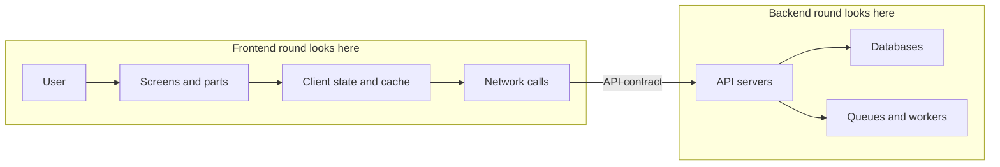

- In a backend round you draw servers, databases, queues and scaling.
- In a frontend round you draw **screens, parts, state, and calls**.
- GreatFrontEnd says to treat the server as a black box that exposes APIs over HTTP or WebSockets.
- A common mistake: you talk about load balancers and sharding for 20 minutes. The interviewer wanted the component tree and the cache.

### The picture: RADIO

Notice the arrow back from O to R. The steps are a guide, and you can go back.

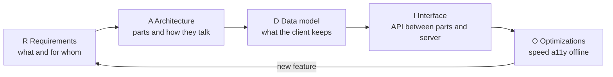

- **Requirements:** ask what the product does, which devices, how many items, real time or not, offline or not.
- **Architecture:** draw the parts. View, controller, client store, server. Say who talks to whom.
- **Data model:** list the data the client keeps. Say where each piece lives.
- **Interface:** write the API calls with fields. Also the props between big parts.
- **Optimizations:** go deep on the hard bits. Performance, accessibility, offline, security, edge cases.

### The clock for a 45 minute round

This split is a suggestion from this guide, not from GreatFrontEnd.

| Minutes | Step | What you produce |
|---|---|---|
| 0 to 5 | Requirements | A short list: must have, nice to have, out of scope |
| 5 to 12 | Architecture | One box picture of the parts and the server |
| 12 to 18 | Data model | Types for the main objects and where each lives |
| 18 to 25 | Interface | 2 to 4 API calls with request and reply fields |
| 25 to 42 | Optimizations | 3 or 4 deep dives: list speed, a11y, offline, errors |
| 42 to 45 | Wrap up | Tradeoffs you made and what you would add next |

**The cost:** a fixed plan can feel stiff. If the interviewer pulls you into a deep dive early, follow them, then come back.

**Say this in the interview:** "I'll use five steps: requirements, the parts, the client data, the API, then deep dives. I'll treat the server as a black box and focus on the client."

---

## Part 2: The component tree and where state lives [Beginner]

**Words you will hear**

- **Component tree:** the parts of a screen, drawn as parents and children.
- **Container part:** a part that gets data and handles actions (interview word: container component).
- **Display part:** a part that only shows what it gets in props (interview word: presentational component).
- **Server cache:** the client's saved copy of server data, like TanStack Query or Apollo keeps.

### The problem: one big part does everything

Without a plan, one `FeedPage` file fetches, stores, formats and draws everything. One small change re-draws the whole page. Nobody can test the post card alone.

### The picture: a feed page as a tree

Notice that only the yellow parts talk to data. The rest only draw what they get.

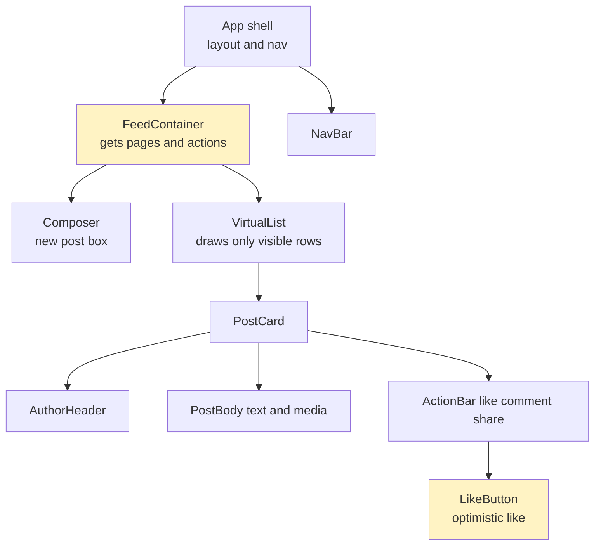

- **Container parts** get data and pass handlers down. `FeedContainer` calls the API through a hook.
- **Display parts** like `PostCard` only take props and draw. You can test them alone and show them in Storybook.
- In 2026 you often get the "container" job from a hook (`useFeed()`) or a Server Component, not from a class. The idea is the same: keep fetching apart from drawing.

### Where each piece of state lives

Notice the question order. Ask the top question first.

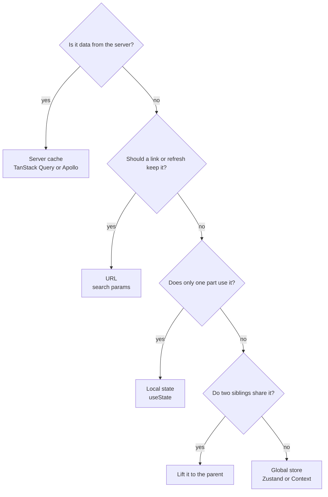

| Home | Feed page example | Why there |
|---|---|---|
| Local | Is the "more" menu on a card open | Only that card cares |
| Lifted to parent | Text in the composer, shared with a preview | Two siblings need it |
| Global store | Theme, signed in user, drawer open | Many far away parts need it |
| Server cache | The posts, the like counts | The server owns it, the client keeps a copy |
| URL | Tab "Following" or "For you", search text | A shared link should open the same view |

**The cost:** more homes means more rules for the team. Write the rules down once.

**Say this in the interview:** "Most of the state in a feed is server data, so it goes in the query cache. Filters go in the URL. Only small UI flags stay local. A global store holds what is left, like the theme."

Deep version of state libraries (Context vs Zustand vs Redux): [React guide 3.7](../react/react-js-frontend-interview-guide.md).

---

## Part 3: Rendering styles in 2026 [Mid]

**Words you will hear**

- **Hydration:** React in the browser attaches click handlers to HTML that the server already sent. Before that, buttons look ready but do nothing.
- **Static shell:** the part of a page that is the same for everyone. Next.js builds it ahead of time.
- **Streaming:** the server sends the page in pieces, as each piece is ready.
- **Server Component (RSC):** a React part that runs only on the server and sends no JavaScript for itself.

### The problem: blank screen or a page that looks ready but is not

Notice the two different waits. The user sees nothing, or the user sees a page that ignores taps.

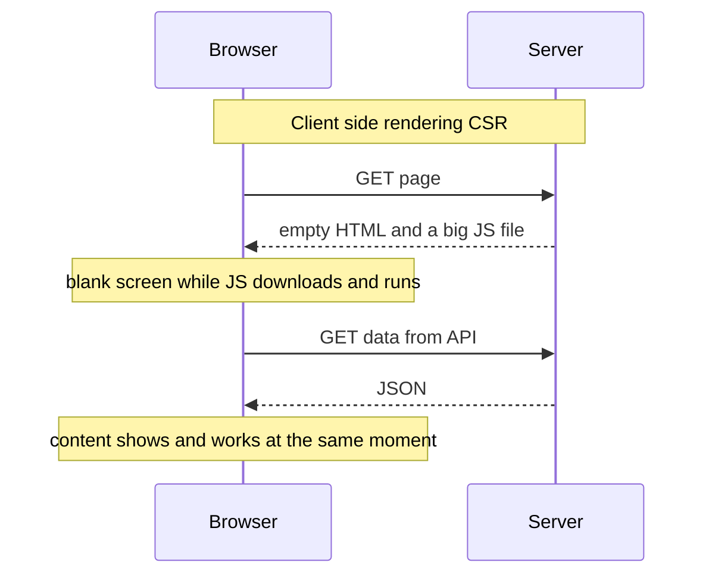

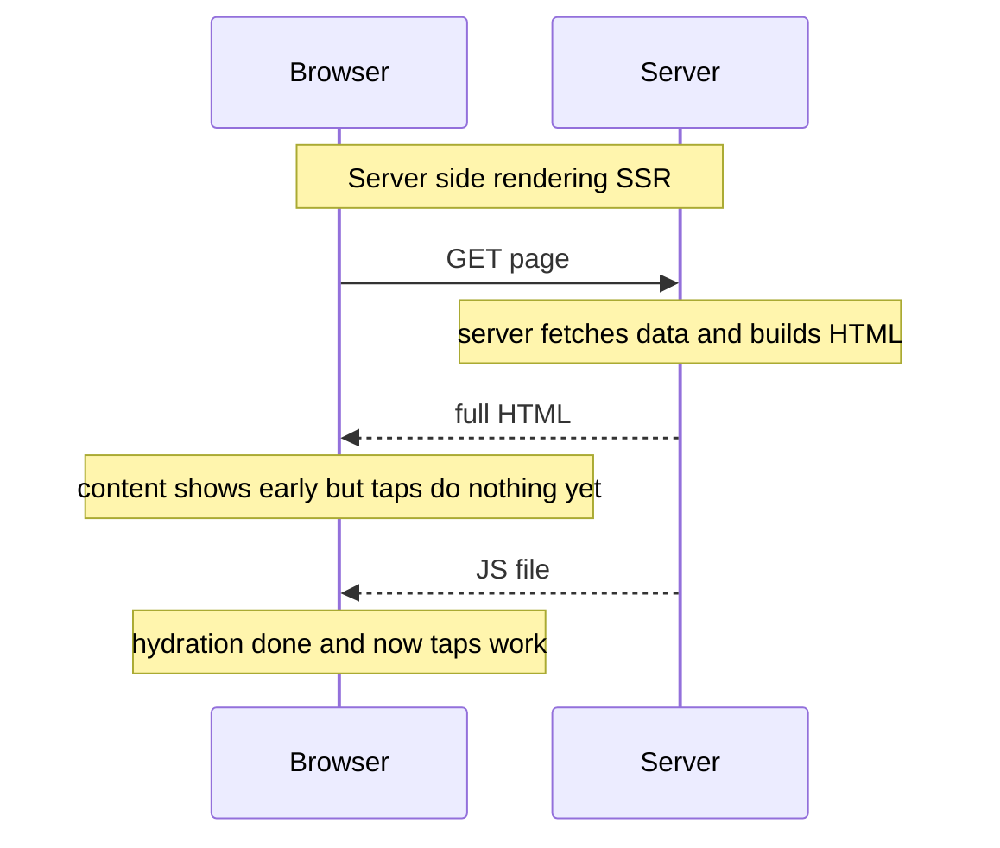

- **CSR:** the browser builds the page. Simple to host. First paint is slow, and search engines may see less.
- **SSR:** the server builds HTML on every request. First paint is fast and fresh. The server pays for each request. There is a gap before hydration ends.

### The picture: prebuilt pages, streaming, and the static shell

Notice in the second picture that the shell comes from the CDN at once, and only the personal part waits.

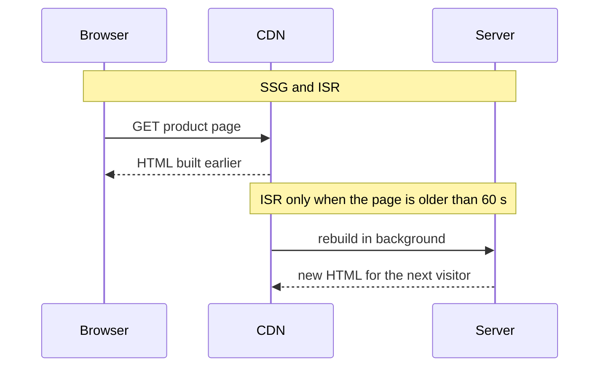

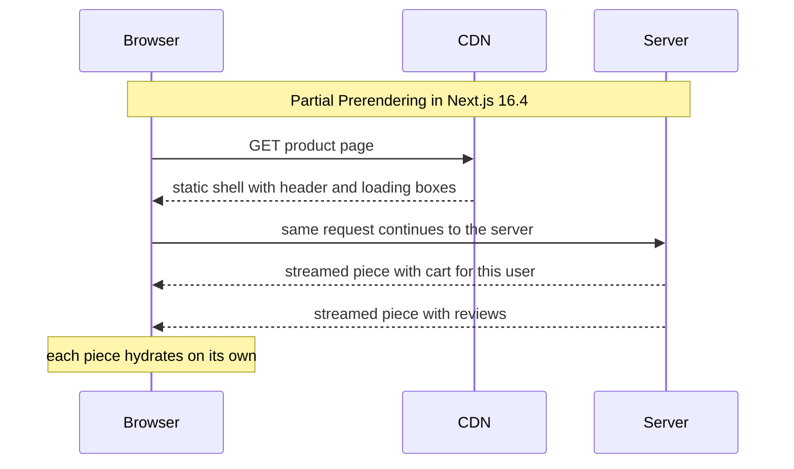

- **CDN:** servers around the world that keep copies of your files near the user. A copy from a CDN arrives in a few milliseconds.
- **SSG (built at deploy):** the fastest. Only for pages that are the same for everyone.
- **ISR (rebuilt in the background):** SSG plus a timer or a "rebuild now" call. Good for product pages.
- **Streaming SSR:** the server sends the top of the page at once. Slow parts come later inside `<Suspense>` boxes.
- **Server Components:** the parts with no clicks run only on the server. They can read the database. They send no JS for themselves. Deep version: [React guide 2.11](../react/react-js-frontend-interview-guide.md).
- **Partial Prerendering (PPR):** one page mixes all of this. The shell is prebuilt and sits on the CDN. Personal parts stream in. In Next.js 16.4 this is what you get when you turn on Cache Components.

### When the HTML arrives and when the page works

| Style | HTML arrives | Page works | Server cost | Pick it for |
|---|---|---|---|---|
| CSR | Late, after JS runs | Same moment as content | Very low | Tools behind login, editors, dashboards |
| SSR | Early, after server work | After hydration | Every request | Personal pages that need fresh data and search |
| SSG | Very early, from CDN | After hydration | Only at build | Docs, blog, marketing |
| ISR | Very early, from CDN | After hydration | One rebuild per period | Product pages, listings |
| Streaming SSR | Top very early, rest in pieces | Piece by piece | Every request | Pages with one slow part |
| RSC | Early | Only the client parts hydrate | Every request, less JS | Content heavy pages with few buttons |
| PPR | Shell very early, rest streams | Piece by piece | Only for the dynamic holes | Most pages in a new Next.js app |

### Which one to pick

Notice there is no "best". You choose per page.

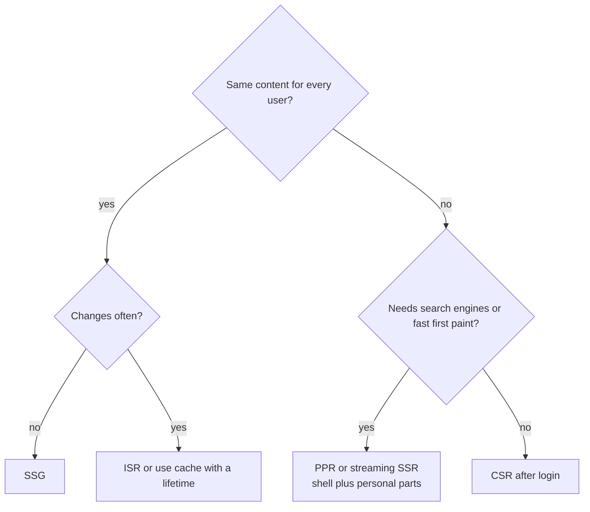

**The cost:** every server style needs a server and good caching. Hydration still costs JS. RSC adds a second mental world (server and client parts).

**Say this in the interview:** "I pick rendering per page. Marketing is static. Product pages are static with a rebuild. Logged in pages use a prebuilt shell with streamed personal parts. A heavy editor is client only."

<details><summary>Go deeper (optional): Next.js 16.4 facts, checked 2026-10-16</summary>

- Latest stable Next.js is **16.4.2** (GitHub releases and npm, 2026-10-16). React on npm is **19.3.1**.
- The Next.js caching docs say: new apps from `create-next-app` already have **Cache Components** and **Partial Prefetching** turned on. Older apps add `cacheComponents: true` and `partialPrefetching: true` in `next.config.ts`.
- The docs call the result **Partial Prerendering (PPR)**, "the default behavior with Cache Components".
- The docs say both features will be on everywhere in the next major release, and the options will be removed.
- `'use cache'` marks a function or part as cached. Pair it with `cacheLife('hours')` to set its lifetime. Anything uncached must sit inside `<Suspense>`, or Next.js shows an error at build time.
- If you have an older app without Cache Components, the docs keep a "previous model" guide. Interviewers may still ask about `revalidate` and `fetch` caching from Next.js 13 to 15.

</details>

Performance numbers like LCP and INP are in the [performance guide](performance-optimization-web-mobile-backend.md). This guide does not repeat them.

---

## Part 4: The client data layer [Mid]

**Words you will hear**

- **Mutation:** a request that changes data on the server, like "like this post".
- **Normalized cache:** a cache that keeps one copy of each object by its type and id.
- **Optimistic update:** you change the screen before the server says yes, and undo it if the server says no.
- **Cursor:** a bookmark the server gives you, so you can ask for "the next 20 after this one".

### REST or GraphQL, seen from the client

| | REST | GraphQL |
|---|---|---|
| Calls per screen | Often several | Usually one |
| Shape of the reply | The server decides | The client asks for the fields it needs |
| Browser and CDN caching | Easy, by URL | Harder, most calls are POST to one URL |
| Client cache | Per URL or query key | Can be normalized by type and id |
| Typical client | TanStack Query, SWR | Apollo Client, urql, Relay |

You know this from DBO: one GraphQL API serves both the React Native app and the CMS, and each client asks for its own fields.

### The problem: the same post in two places

A post shows in the feed and on its detail page. The user likes it on the detail page. They go back, and the feed still shows the old count.

### The picture: two ways to keep one truth

Notice the left side keeps a copy per query. The right side keeps one object that both queries point to.

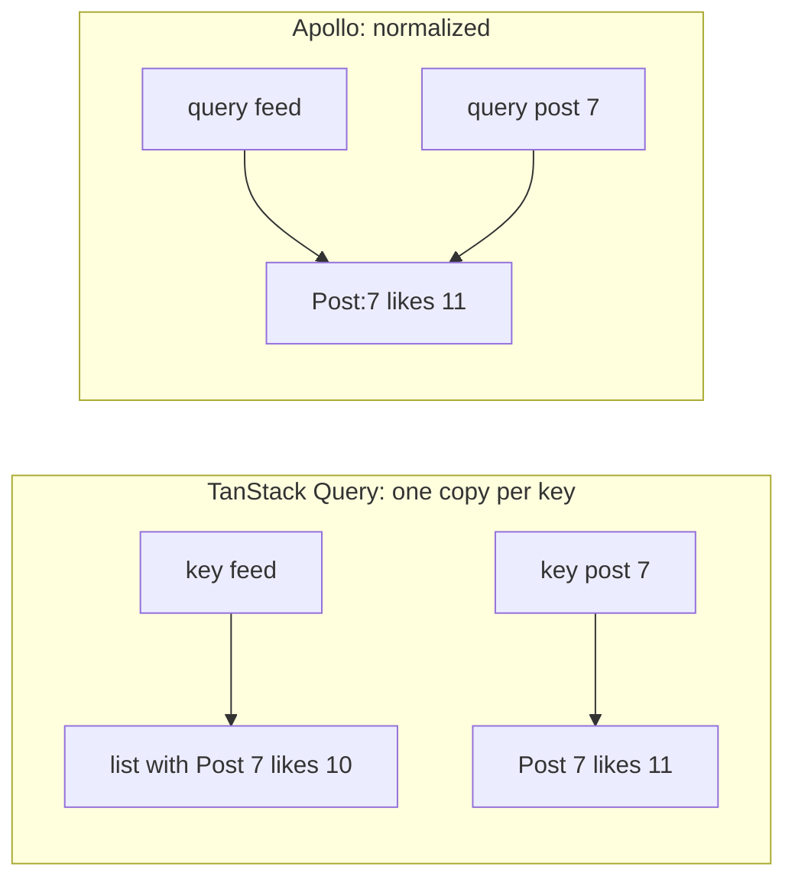

- **TanStack Query** keeps each reply under a key, like `['feed']`. It does not know that two keys hold the same post. After a change, you tell it which keys are old: `invalidateQueries({ queryKey: ['feed'] })`. It then fetches them again.
- **Apollo Client** splits each reply into objects. It gives each object a cache id, which by default is `__typename` and `id`, like `Post:7`. When a mutation reply contains `Post:7` with new likes, every query that shows `Post:7` updates by itself.
- Apollo cannot do this for new or deleted items in a list. For those you still update the list by hand or fetch again.

**The cost:** a normalized cache is more magic and more setup (ids on every type, rules for lists). A key based cache is simple, but you must name which keys to refresh.

### Optimistic update with rollback

Notice the "alt" box. On error the client puts the old snapshot back.

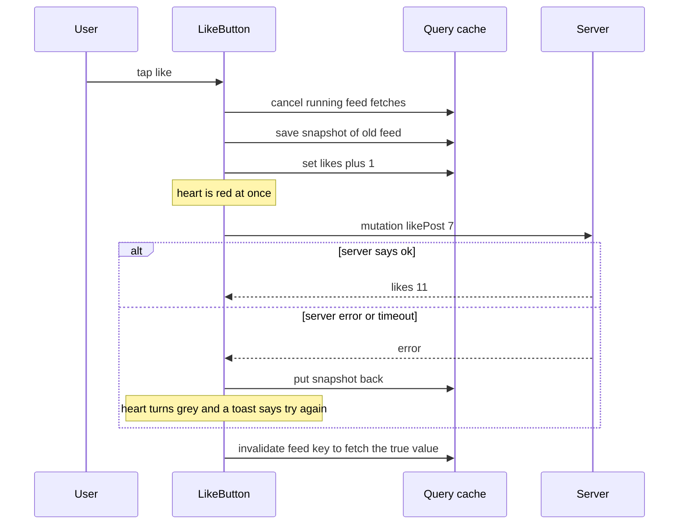

The same flow in TanStack Query v5 (under 15 lines):

```ts
useMutation({
  mutationFn: (id: string) => api.likePost(id),
  onMutate: async (id, ctx) => {
    await ctx.client.cancelQueries({ queryKey: ['feed'] })
    const previous = ctx.client.getQueryData<Post[]>(['feed'])
    ctx.client.setQueryData<Post[]>(['feed'], (old = []) =>
      old.map(p => (p.id === id ? { ...p, likes: p.likes + 1, liked: true } : p)))
    return { previous }
  },
  onError: (_e, _id, result, ctx) => ctx.client.setQueryData(['feed'], result?.previous),
  onSettled: (_d, _e, _id, _r, ctx) => ctx.client.invalidateQueries({ queryKey: ['feed'] }),
})
```

- Use optimistic updates when the action almost always works and is easy to undo: like, follow, mark read.
- Do not use them for money or stock. A user must not see "paid" before the bank says yes.
- React 19 also has `useOptimistic` for the same idea inside forms and Actions.

### Pagination: offset or cursor

Notice the duplicate. A new post at the top pushes everything down by one.

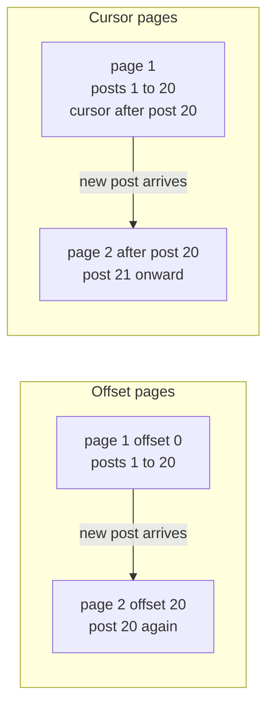

- **Offset** (`?page=3`): simple, you can jump to page 50. Items shift when data changes. The database also gets slow on deep pages.
- **Cursor** (`?after=abc&limit=20`): no duplicates or gaps, fast at any depth. You cannot jump to page 50.
- Feeds and chats use cursors. Admin tables (like a CMS order list) often use offsets, so users can jump.
- **Infinite scroll** = cursor pages + a watcher at the bottom of the list + a list that draws only visible rows. Deep version: [React guide 3.1 and 3.2](../react/react-js-frontend-interview-guide.md).

### Request dedupe

Notice three parts ask, and the network sees one request.

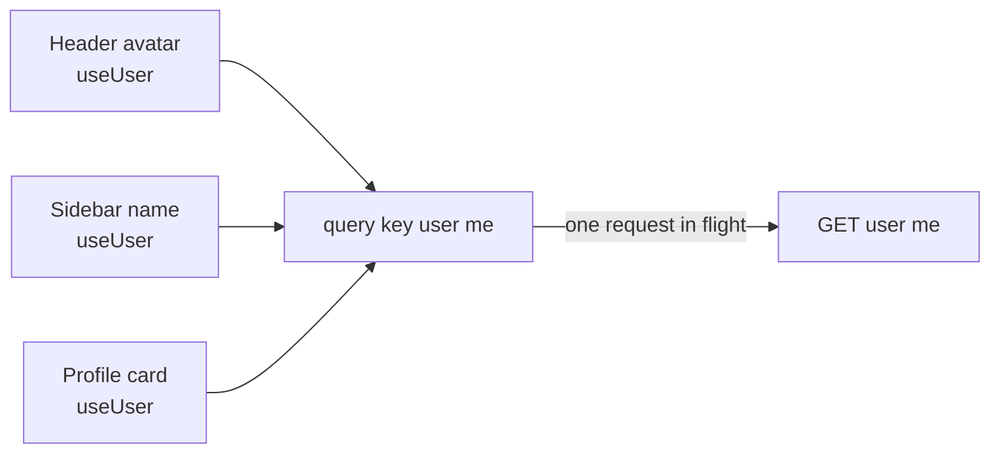

- TanStack Query and Apollo share one request per key while it is running. All three parts get the same reply.
- Without this, a page with 10 parts that need the user makes 10 calls.

**Say this in the interview:** "I keep server data in a query cache with clear keys. Likes are optimistic with a snapshot and rollback. The feed uses cursor pages, and the cache shares one request per key."

---

## Part 5: Real time on the client [Mid]

**Words you will hear**

- **Polling:** the client asks "anything new?" every few seconds.
- **SSE (server sent events):** one long HTTP reply that the server keeps writing events into. One way only, server to client.
- **WebSocket:** one open two way pipe between client and server.
- **Backoff:** wait longer after each failed reconnect, plus a small random extra (interview word: jitter).

### The problem: "new message" should show at once

A chat that only fetches when you pull to refresh feels broken. But a live pipe for every screen costs servers and battery.

### The picture: three ways to hear news

Notice the arrow directions. Only WebSockets send both ways on one pipe.

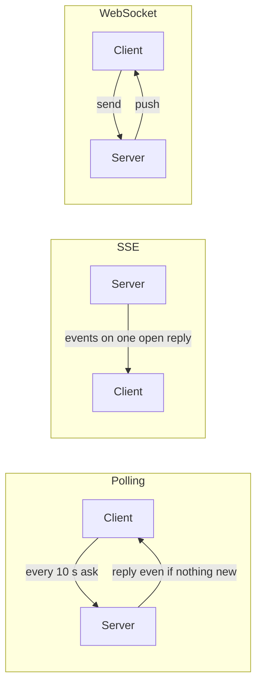

| | Polling | SSE | WebSocket |
|---|---|---|---|
| Direction | Client asks | Server to client | Both ways |
| Built on | Plain HTTP | Plain HTTP | Own protocol after an upgrade |
| Reconnect | Not needed | Browser does it, can resume with last event id | You write it |
| Good for | Order status, "fresh enough" | Notifications, live scores, AI text streams | Chat, typing, games, editors |
| Cost | Wasted calls | One open connection per user | One open connection, user stays on one server |

- MDN notes a limit: over HTTP/1.1, a browser allows only **6** SSE connections per domain across all tabs. Over HTTP/2 the limit is much higher (100 by default).
- SSE events can carry an `id`. On reconnect the browser sends the last id, so the server can resend what you missed. The `retry` field sets the wait in milliseconds.
- For sending a message in chat, many apps use a normal POST, and the WebSocket only for receiving. That keeps retries and auth simple.

### Reconnect with backoff

Notice the waits grow, and each has a random extra, so a million phones do not reconnect in the same second.

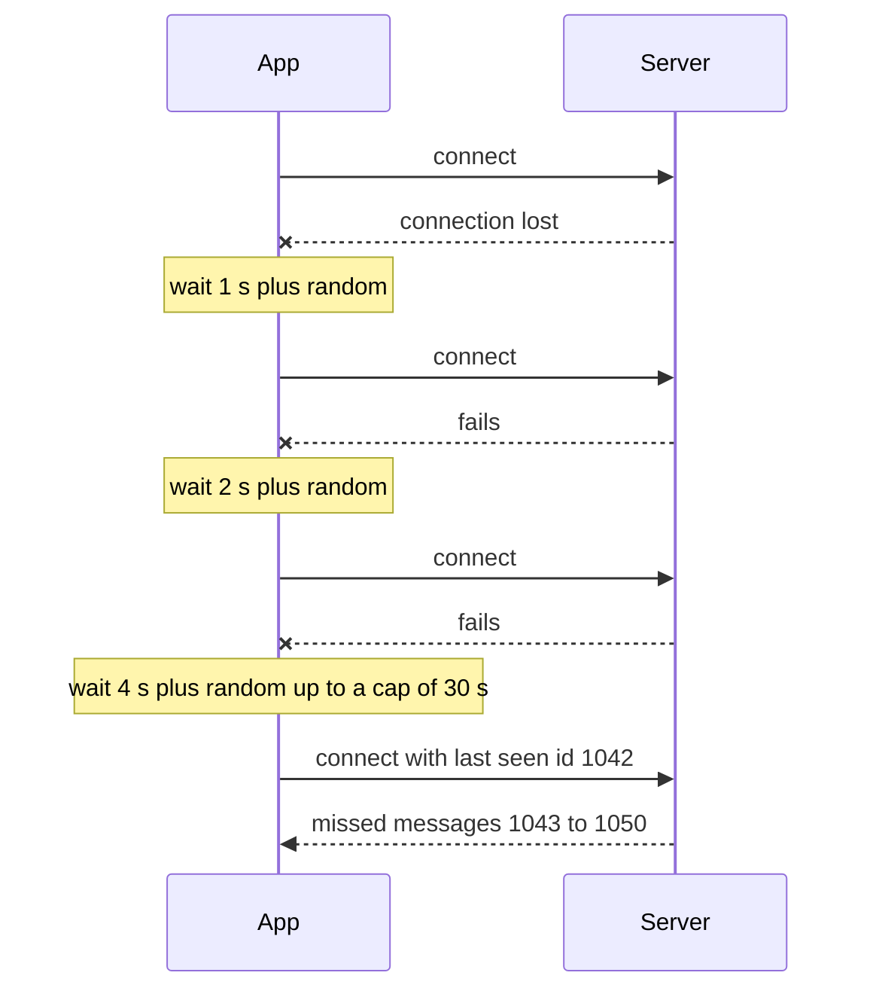

### Order and duplicates

- Messages can arrive twice (a retry) or out of order (two servers).
- Give each message a **unique id** from the server. Keep a set of ids you have seen. Drop repeats.
- Give each message a **sequence number** or server time per conversation. Insert by that number, not by arrival time.
- After a reconnect, ask for "everything after id 1042". This closes the gap.

### Presence (who is online)

- The app sends a small "I am here" message every 30 seconds or so (a heartbeat).
- The server marks a user offline after it misses two or three heartbeats.
- Do not send every presence change to everyone. Send only for users on the current screen.

**The cost:** open connections hold server memory. The load balancer must keep each user on the same server while the pipe is open (sticky sessions). Phones close them when the app goes to the background. So mobile apps also need push notifications (Part 6).

**Say this in the interview:** "I use the least powerful tool that works. Polling for order status, SSE for one way live updates, WebSockets for chat. I reconnect with backoff and jitter, resume from the last id, and drop duplicates by message id."

Deep version of rendering many live updates (batching, throttling): [React guide 3.10](../react/react-js-frontend-interview-guide.md).

---

## Part 6: Offline and mobile [Mid]

**Words you will hear**

- **Offline queue:** a saved list of changes the user made with no network. The app sends them later (interview word: outbox).
- **Sync conflict:** the same item changed on the phone and on the server, and you must pick a winner.
- **OTA update:** a new JavaScript bundle that the app downloads without the app store (over the air).
- **Backward compatible API:** a new server version that still works for old app versions.

### The problem: the phone loses the network in a lift

The store owner taps "Order" in a basement. The request fails. Without a plan the order is lost, or the user taps five times and makes five orders.

### The picture: an offline queue

Notice the screen reads from the local copy, never straight from the network.

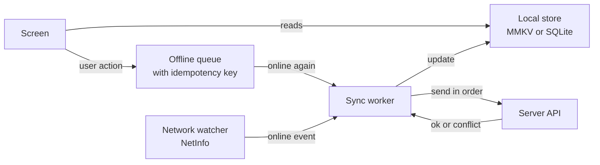

- The screen shows the local copy at once. It does not wait for the network.
- Each change goes into a queue saved on disk. Each item carries a unique key, so the server can drop a repeat (an idempotency key).
- A network watcher (`NetInfo`) tells the sync worker when the phone is back online.
- The worker sends items in order and updates the local store with the server's reply.

### Where to store data on the phone

| Need | Tool (checked 2026-10-16) | Notes |
|---|---|---|
| Small settings, flags, saved query cache | **MMKV** (react-native-mmkv 4.x) | Fast and synchronous. Can encrypt. V4 is a Nitro Module |
| Many rows you search and sort | **SQLite** (expo-sqlite, or a layer like WatermelonDB) | Real tables and queries on the phone |
| Tokens and secrets | **Keychain or Keystore** via expo-secure-store | The OS protects them |
| Simple old apps | AsyncStorage | Slower, still common |

Real example: the Bluesky app saves its TanStack Query cache with a persister and uses MMKV. Mattermost's chat app keeps messages in WatermelonDB, which runs on SQLite (both from their public `package.json`, 2026-10-16).

### Sync conflicts

| Rule | How it works | Good for |
|---|---|---|
| Last write wins | The newest time stamp wins | Settings, profile fields |
| Version check | Server rejects if your version is old, the app asks the user | Orders, forms with money |
| Merge | Combine both changes field by field | Notes, carts, lists |
| Server is the truth | Phone re-fetches and drops its change | Stock, prices, points |

### Push notifications

Notice that your server never talks to the phone directly. Apple and Google do the last step.

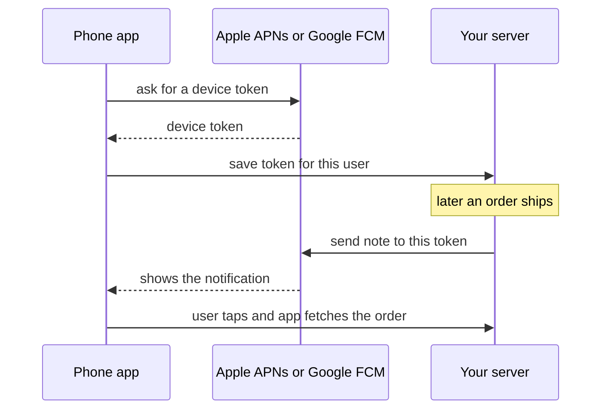

- Keep the push small. Send "order 123 shipped", then let the app fetch details.
- Tokens change. Save the new one each time the app starts. Remove tokens the service says are dead.

### The problem only mobile has: old app versions live for months

Notice that one server must serve all three versions at the same time.

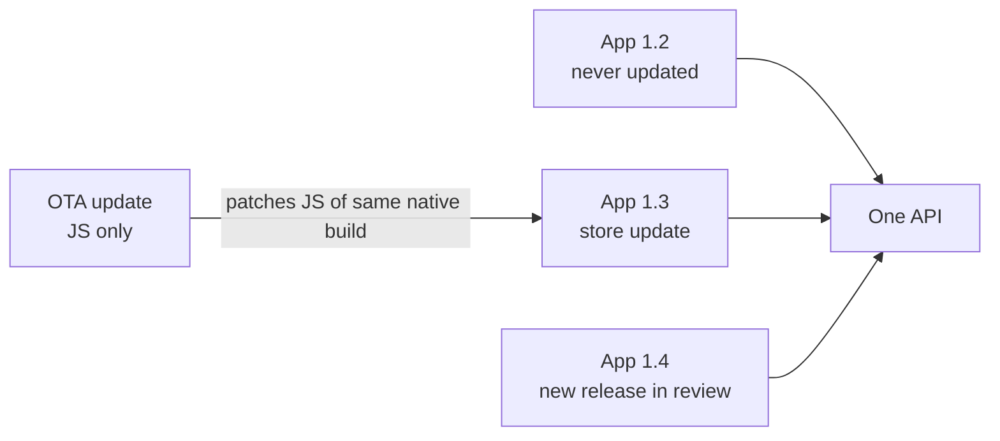

- A web deploy reaches every user on the next page load. A store app does not.
- Apple and Google review each native release. Users update late or never.
- OTA updates (Expo EAS Update) can ship JS fixes in minutes. But they only reach builds with the same **runtime version**, which Expo says "guarantees compatibility between a build's native code and an update".
- So the API must stay **backward compatible**. Add fields, never rename or remove them while old apps use them.
- Keep a **minimum supported version**. The app checks it at start and shows "please update" if it is too old.

**The cost:** offline support is real work: queues, conflicts, migrations of the local database. Only build it where users really work offline.

**Say this in the interview:** "On mobile I assume the network fails. The screen reads from a local store, changes go to a saved queue with idempotency keys, and the API only adds fields, because old app versions stay in use for months."

Deep version of the release process and OTA: [React Native guide](../react-native/react-native-interview-guide.md).

---

## Part 7: Design systems and component libraries [Mid]

**Words you will hear**

- **Design token:** one named design value, like `color.primary` or `space.4`.
- **Primitive:** a small base part like Button, Text, Stack.
- **Variant:** a named version of a part, like `size="sm"` or `tone="danger"`.
- **Headless part:** a part that brings behavior and accessibility but no styles (Radix style).

### The problem: 14 kinds of blue button

Three teams build the same button three ways. Each one has a different focus ring. One is not reachable by keyboard. A brand color change takes a month.

### The picture: layers of a design system

Notice tokens sit at the bottom and are shared by web and mobile.

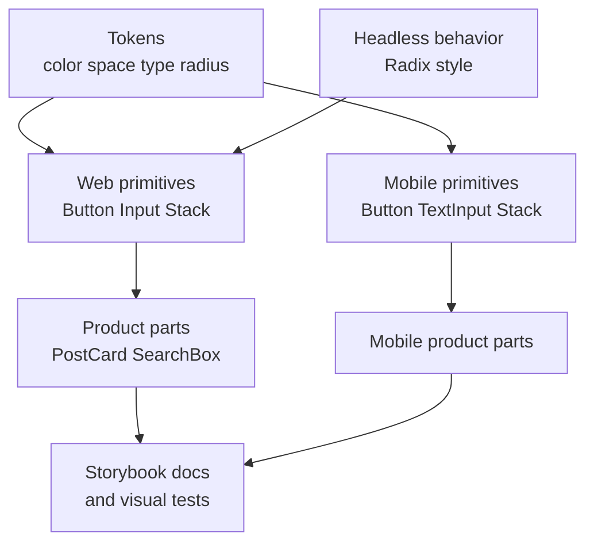

- **Tokens** are plain data (JSON). A build step turns them into CSS variables for web and a TS object for React Native.
- **Primitives** use only tokens. Each one has **variants**, not free style props.
- **Accessibility is built in:** labels, focus rings, keyboard support and touch size live inside the primitive. Teams get them for free.
- **Headless libraries** like Radix give you the hard behavior (menus, dialogs, focus traps). shadcn/ui copies styled source code into your repo. Its README says "Use this to build your own component library".
- **Storybook** (10.x on npm, 2026-10-16) shows each part in each state. Teams use it for docs, reviews and screenshot tests.
- **Versioning:** publish the kit as a package with version numbers like 2.4.1 (major.minor.patch, interview word: semver). Breaking changes need a major version and a migration note.
- **Sharing:** a monorepo with Turborepo or Nx holds `packages/tokens`, `packages/ui-web`, `packages/ui-native`, and the apps.

```ts
// packages/tokens/index.ts
export const tokens = {
  color: { primary: '#1f6feb', danger: '#d1242f', text: '#1f2328' },
  space: { 1: 4, 2: 8, 3: 12, 4: 16 },
  radius: { sm: 4, md: 8 },
} as const
```

**The cost:** a design system is a product. It needs owners, docs and a release process. Too early, and it slows a small team down.

**Why companies build one:** the same look everywhere, accessibility fixed once, faster screens, and one place to change the brand.

**Say this in the interview:** "I share tokens across web and React Native, build primitives with variants and built-in accessibility, document them in Storybook, and ship them as versioned packages from a monorepo."

Real case: Shopify archived its Polaris React library and released Polaris Web Components on 1 October 2025, so the system works with any framework.

---

## Part 8: Large frontend architecture [Senior]

**Words you will hear**

- **Monorepo:** many apps and packages in one git repo, with one set of tools.
- **Micro-frontend:** a part of the UI that one team builds and deploys alone, loaded into a host page at run time.
- **Feature flag:** a switch, read at run time, that turns a feature on for some users.
- **Bundle budget:** a size limit for JS per page that fails the build when you go over.

### The problem: 8 teams, one app, one release train

Every team waits for the slowest team. One bad change blocks everyone's release.

### The picture: two ways to split

Notice the left side builds once. The right side loads parts at run time from other servers.

```mermaid
graph LR
  subgraph MONO["Monorepo modular app"]
    F1["feature checkout"] --> APP1["One build<br/>one deploy"]
    F2["feature search"] --> APP1
    UI1["shared ui package"] --> F1
    UI1 --> F2
  end
  subgraph MFE["Micro-frontends"]
    HOST["Host shell"] -->|loads at run time| R1["checkout app<br/>team A deploys"]
    HOST -->|loads at run time| R2["search app<br/>team B deploys"]
  end
```

- **Start with a monorepo.** Turborepo (2.x) or Nx (23.x) cache builds and run only what changed. Lint rules stop features from reaching into each other.
- **Micro-frontends** with Module Federation load another team's code at run time. The `@module-federation/enhanced` package (2.x) calls itself "Module Federation 2.0" with a runtime and type hints.
- **When they are worth it:** many teams, a hard need to deploy alone, or a slow move from an old app to a new one piece by piece.
- **Their cost:** two copies of React if you share badly, a look that drifts between teams, harder debugging, and slower first load.

### Feature flags and A/B tests

Notice the same build serves both groups. The flag service decides who sees what.

```mermaid
graph LR
  U["User 42"] --> APP["App"]
  APP -->|ask flags for user 42| FS["Flag service"]
  FS -->|new checkout on for 10 percent| APP
  APP --> A["Old checkout"]
  APP --> B["New checkout"]
  B -->|events| AN["Analytics<br/>compare conversion"]
  A -->|events| AN
```

- Flags let you merge unfinished code, roll out to 1 percent, and turn a feature off without a deploy.
- An A/B test is a flag plus measurement. Assign users by a stable id, so a user always sees the same version.
- Clean up old flags. Each one doubles the paths you must test.

### Bundle budgets and code splitting

- Split by route first (free in Next.js), then lazy load heavy parts like charts and editors.
- Add a size check to CI. Example rule: the first load of a page stays under about 200 KB of gzipped JS. The build fails above it.
- Deep version with code: [React guide 3.4](../react/react-js-frontend-interview-guide.md).

**Say this in the interview:** "I would start with a monorepo with clear feature boundaries. I'd move to micro-frontends only when teams truly need to deploy alone, because they cost load time and consistency. Flags give safe rollouts, and a bundle budget in CI stops slow creep."

---

## Part 9: Cross cutting concerns [Senior]

**Words you will hear**

- **XSS:** an attacker gets their script to run on your page (cross site scripting).
- **CSRF:** another site makes the user's browser send a request to your site, with the user's cookies attached.
- **CSP:** a response header that lists which scripts the browser may run (content security policy).
- **i18n:** making the app ready for many languages and regions (internationalization).

### Accessibility: WCAG 2.2

WCAG 2.2 became a W3C Recommendation on **5 October 2023**. New items at levels A and AA:

| New rule | Level | What it means for your UI |
|---|---|---|
| Focus Not Obscured | AA | A sticky header or chat bubble must not hide the focused item |
| Dragging Movements | AA | Anything you can drag, you can also do with a click |
| Target Size (Minimum) | AA | Click targets at least 24 by 24 CSS pixels, or enough space around them |
| Accessible Authentication | AA | No memory puzzles at login. Allow paste and password managers |
| Consistent Help | A | Help links sit in the same place on every page |
| Redundant Entry | A | Do not ask for the same info twice in one flow |

- Use real elements: `<button>`, `<label>`, `<nav>`. They come with keyboard and screen reader support.
- Test with the keyboard only, and with a screen reader (VoiceOver, TalkBack).

### Internationalization

- Keep text in message files with keys, never in the code.
- Use `Intl.NumberFormat` and `Intl.DateTimeFormat` for money and dates. Rupiah and Australian dollars look different.
- Plan for longer text (German) and right to left languages (Arabic). Use CSS logical properties like `margin-inline-start`.
- Plurals differ by language. Use a library that supports plural rules (ICU messages).

### Security: where the token lives

Notice the red path. Any script that runs on the page can read localStorage. The green cookie is hidden from scripts.

```mermaid
graph LR
  XSS["Injected script"] -->|reads| LS["localStorage token"]
  LS -->|sent to attacker| EVIL["Attacker server"]
  XSS -->|tries to read| CK["httpOnly cookie<br/>hidden from scripts"]
  CK -->|sent by browser only to your API| API["Your API"]
  style LS fill:#fde2e4
  style CK fill:#d8f3dc
```

- OWASP says: do not store session ids in localStorage, because JavaScript can always read it. An `httpOnly` cookie hides it from scripts.
- A cookie is sent by the browser on its own, so you must stop CSRF. Use `SameSite=Lax` or `Strict`, and a CSRF token for risky forms.
- XSS: React escapes text by default. The danger is `dangerouslySetInnerHTML`, `href="javascript:..."`, and third party scripts. Clean HTML with a sanitizer like DOMPurify.
- Add a CSP as a second wall, so an injected script cannot run:

```
Content-Security-Policy: default-src 'self'; script-src 'self' 'nonce-r4nd0m';
  object-src 'none'; base-uri 'self'; frame-ancestors 'none'
```

Deep version of JWT, sessions and refresh tokens: [Express GraphQL auth tutorial](../backend-api/express-graphql-auth-tutorial.md).

### Error monitoring and real user metrics

- Send errors to a tool like **Sentry** (`@sentry/react` 11.x, `@sentry/react-native` for mobile).
- Upload **source maps** per release, so you see your real file and line, not minified code.
- Tag each error with release, route and app version. On mobile this tells you if only old builds crash.
- Wrap each big screen area in an **error boundary**, so one broken widget does not blank the page.
- Collect Core Web Vitals from real users. The metrics and fixes are in the [performance guide](performance-optimization-web-mobile-backend.md).

**Say this in the interview:** "Auth tokens go in an httpOnly, Secure, SameSite cookie, with a CSP against XSS. I meet WCAG 2.2 AA, including 24 pixel targets. Errors go to Sentry with source maps, and I watch real user vitals per route."

---

## Part 10: Three worked designs [Senior]

Each design follows RADIO in short form.

### Design 1: News feed with infinite scroll

**Requirements:** a list of posts with text and images. Like and comment. Load more as you scroll. New posts show as a "12 new posts" pill. Web and mobile.

**Architecture**

Notice the store sits between the parts and the API. The list never calls the API itself.

```mermaid
graph TB
  PAGE["FeedPage"] --> PILL["NewPostsPill"]
  PAGE --> LIST["VirtualList"]
  LIST --> CARD["PostCard"]
  LIST --> SENT["Bottom watcher<br/>IntersectionObserver"]
  PAGE --> STORE["Query cache<br/>useInfiniteQuery feed"]
  SENT -->|near bottom| STORE
  STORE -->|GET feed after cursor| API["Feed API"]
  CARD -->|like| MUT["Like mutation<br/>optimistic"]
  MUT --> API
```

**Data model**

```ts
type Post = { id: string; author: User; text: string; media: Media[];
  likes: number; likedByMe: boolean; createdAt: string }
type FeedPage = { items: Post[]; nextCursor: string | null }
// client cache: pages under key ['feed', tab]; URL holds the tab
```

**Interface**

- `GET /feed?tab=following&after=<cursor>&limit=20` returns a `FeedPage`.
- `POST /posts/:id/like` with an idempotency key, returns `{ likes, likedByMe }`.
- `GET /feed/new-count?since=<newestId>` every 30 seconds, or an SSE event.

**Optimizations**

- Draw only visible rows. Keep about 5 pages in memory and drop the rest.
- Images: right size per screen, lazy load below the fold, fixed width and height to stop layout jumps.
- Do not push new posts into the list while the user reads. Show the pill. Tap it to scroll up and insert.
- Save scroll position when the user opens a post and comes back.
- First page: server rendered or a cached shell for a fast first paint.

### Design 2: Search autocomplete (typeahead)

**Requirements:** suggestions while typing. Keyboard works. Fast. No wrong results from old requests.

**The problem drawn:** you type "rea". The request for "re" is slow and comes back last. It overwrites the right results.

```mermaid
sequenceDiagram
  participant U as User
  participant B as SearchBox
  participant C as Cache
  participant S as Suggest API
  U->>B: types r e a quickly
  Note over B: debounce waits 250 ms after last key
  B->>C: have rea
  C-->>B: no
  B->>S: GET suggest q rea with AbortController
  U->>B: types c
  B->>S: abort the rea request
  B->>S: GET suggest q reac
  S-->>B: results for reac
  B->>C: save reac results for 5 min
  Note over B: list shows reac results only
```

**Data model:** `cache: Map<string, Suggestion[]>`, `activeIndex: number`, `status: idle | loading | error`.

**Interface:** `GET /suggest?q=reac&limit=8` returns `[{ id, label, type }]`.

**Optimizations**

- **Debounce** about 200 to 300 ms. Deep version: [React guide 1.6](../react/react-js-frontend-interview-guide.md).
- **Cancel stale requests** with `AbortController`, or ignore any reply whose query is not the current text.
- **Cache** by query text. Backspace from "reac" to "rea" then shows results at once.
- **Keyboard and screen readers:** the input has `role="combobox"`, the list has `role="listbox"`, arrow keys move `aria-activedescendant`, Enter picks, Escape closes.
- Highlight the matched letters. Show "no results" and an error state.

### Design 3: Chat screen

**Requirements:** send and receive messages, see delivery status, scroll back through history, works on poor mobile networks.

**Architecture**

```mermaid
graph TB
  SCREEN["ChatScreen"] --> HIST["MessageList<br/>virtualized newest at bottom"]
  SCREEN --> INPUT["Composer"]
  HIST --> BUB["MessageBubble<br/>with status tick"]
  INPUT -->|send| OUT["Outbox<br/>optimistic message"]
  OUT -->|POST message with clientId| API["Chat API"]
  WS["WebSocket"] -->|new message or receipt| STORE["Message store<br/>by conversation"]
  API -->|ack with server id| STORE
  STORE --> HIST
  STORE -->|save| DISK["Local SQLite"]
```

**Delivery status**

Notice the "failed" box loops back. The user can retry the same message, with the same client id.

```mermaid
graph LR
  SENDING["sending<br/>clock icon"] -->|server ack| SENT["sent<br/>one tick"]
  SENT -->|other phone got it| DELIV["delivered<br/>two ticks"]
  DELIV -->|other user opened chat| READ["read<br/>blue ticks"]
  SENDING -->|timeout or error| FAILED["failed<br/>tap to retry"]
  FAILED -->|retry same clientId| SENDING
```

**Data model**

```ts
type Message = { clientId: string; serverId?: string; conversationId: string;
  senderId: string; text: string; seq?: number; sentAt: string;
  status: 'sending' | 'sent' | 'delivered' | 'read' | 'failed' }
```

**Interface**

- `POST /conversations/:id/messages { clientId, text }` returns `{ serverId, seq }`. The server drops a repeat `clientId`.
- `GET /conversations/:id/messages?before=<seq>&limit=50` for history.
- WebSocket events: `message.new`, `message.receipt`, `typing`.

**Optimizations**

- **Optimistic send:** the bubble shows at once with a `clientId`. The server ack swaps in `serverId` and `seq`.
- **Virtualized list,** newest at the bottom. Load older pages when the user scrolls to the top, and keep their position.
- **Order** by `seq`, not by arrival. **Dedupe** by `serverId`.
- **Reconnect** with backoff and ask for messages after the last `seq`.
- Keep the last 200 messages per chat in local SQLite, so the screen opens without a network.

---

## Practice

Try each one before you open the answer.

**1. Predict.** A user likes a post. The server returns 500. You used the TanStack Query `onMutate` snapshot pattern. What does the user see, step by step?

<details><summary>Answer</summary>

The heart turns red at once and the count goes up by 1. When the error comes back, `onError` puts the saved snapshot back, so the heart turns grey and the count goes back down. Then `onSettled` invalidates the feed key, so the app fetches the true value. You should also show a short message like "Could not like, try again".

</details>

**2. Spot the bug in this design.** "Our feed uses `?page=2&size=20`. New posts arrive every few seconds. Users say they see the same post twice when they scroll."

<details><summary>Answer</summary>

Offset pages shift when a new post is added at the top. Post 20 becomes post 21, so page 2 starts with a post the user already saw. Fix: use cursor pages, `?after=<id of last post>&limit=20`. As a backup, dedupe by post id on the client.

</details>

**3. Choose.** A loan status screen (think Unloan or a Skyworx loan system, as an idea) shows "In review", "Approved" or "Rejected". The status changes a few times per day. Polling, SSE or WebSocket?

<details><summary>Answer</summary>

Polling every 30 to 60 seconds, plus a refetch when the user comes back to the tab or app. Changes are rare and only flow one way. SSE would also work, but an always open connection is not worth it here. A WebSocket is too much. On mobile, add a push notification for "Approved".

</details>

**4. Spot the bug.** "We renamed the GraphQL field `price` to `unitPrice` and deployed the server. The web app was updated the same day. Now the support team gets crash reports from the mobile app."

<details><summary>Answer</summary>

Old mobile versions still ask for `price`, which no longer exists. Mobile users update late, and store review delays new builds. Fix: add `unitPrice` and keep `price` (mark it deprecated in the schema). Remove `price` only when no supported app version uses it. Also set a minimum supported version in the app.

</details>

**5. Draw it.** Draw the timeline for SSR and for PPR on the same page: when the first pixels show, and when the "Add to cart" button works.

<details><summary>Answer</summary>

SSR: request goes to the server, the server fetches all data, then sends full HTML. First pixels show after all data is ready. The button works after the JS downloads and hydration ends.

PPR: the CDN sends the static shell at once (header, product info, loading boxes). First pixels show very early. Personal parts like the cart stream in after. The button works when its own piece hydrates, which can happen before slow parts like reviews arrive.

</details>

**6. Choose.** A team of 6 engineers builds one Next.js app. A consultant says "use micro-frontends with Module Federation". What do you say?

<details><summary>Answer</summary>

No, not yet. Six people in one team do not need to deploy apart. Micro-frontends add run time loading, version clashes, drift in look and feel, and harder debugging. Use a monorepo with clear feature folders and lint rules for boundaries. Revisit when several teams truly block each other's releases.

</details>

**7. Spot the bug.** "Our autocomplete shows results for an older query sometimes."

<details><summary>Answer</summary>

Replies arrive out of order. The slow reply for an older query lands last and overwrites the list. Fix: cancel the old request with `AbortController`, or check that the reply's query equals the current input before you show it. Add a debounce to send fewer requests.

</details>

---

## Likely interview questions

**1. How is a frontend system design round different from a backend one?**

<details><summary>Answer</summary>

- **Problem:** if you draw servers and databases, you miss what the interviewer scores: the client.
- **How it works:** I follow RADIO. Requirements, then the part tree, then client data, then the API, then deep dives on speed, accessibility and offline. The server is a black box with an API.
- **Tradeoff:** a fixed plan keeps me on time, but I let the interviewer pull me into a deep dive early.
- **My example:** for DBO, I could draw the React Native app's order screens, what the app caches, and the GraphQL calls to the API service, without drawing the backend services.

</details>

**2. Where should state live in a large React app?**

<details><summary>Answer</summary>

- **Problem:** state in the wrong place causes stale copies and too many re-renders.
- **How it works:** server data in a query cache. Shareable view state in the URL. One part's state local. Shared UI state lifted, or in a small global store.
- **Tradeoff:** more homes means more rules, but each kind of state gets the right tool.
- **My example (idea):** in a CMS order list, filters in the URL make a link shareable, and orders live in the GraphQL client cache.

</details>

**3. CSR, SSR, SSG, ISR, streaming, RSC: how do you choose?**

<details><summary>Answer</summary>

- **Problem:** one style for every page gives a slow first paint, or a high server bill, or stale data.
- **How it works:** I draw when HTML arrives and when the page works. Static for the same content, ISR for content that changes, a static shell plus streamed parts for personal pages, CSR for tools behind login.
- **Tradeoff:** server styles need servers and caching. CSR is cheap to host but slow to first paint.
- **My example (idea):** a public loan rate page could be static with a rebuild. A logged in application page could use a shell with a streamed status part.

</details>

**4. What is Partial Prerendering and what changed in Next.js 16?**

<details><summary>Answer</summary>

- **Problem:** a page was either fully static or fully dynamic. One cookie read made the whole page dynamic.
- **How it works:** with Cache Components, Next.js prebuilds a static shell. `'use cache'` parts join the shell. Uncached parts sit in `<Suspense>` and stream at request time. In 16.4, `create-next-app` turns this on by default, and the docs say it will be on everywhere in the next major.
- **Tradeoff:** you must mark caching on purpose and think in boundaries. In return, the shell comes from a CDN.
- **My example (idea):** a product page in a store like ZWS could prebuild the product info and stream the cart and the subscription status.

</details>

**5. TanStack Query or Apollo Client?**

<details><summary>Answer</summary>

- **Problem:** the same object shows in several places and must stay in sync after a change.
- **How it works:** TanStack Query stores replies by key, and you invalidate keys after a mutation. Apollo normalizes by `__typename` and `id`, so an updated object changes every query that uses it.
- **Tradeoff:** Apollo updates more by itself but needs ids and list rules. TanStack is simpler and works with REST and GraphQL.
- **My example:** DBO's app and CMS talk to a GraphQL API. A question to ask yourself: which client cache did we use, and how did a changed order update the order list?

</details>

**6. Walk me through an optimistic update with rollback.**

<details><summary>Answer</summary>

- **Problem:** waiting for the server makes taps feel slow.
- **How it works:** cancel running fetches, save a snapshot, change the cache, send the request. On error, put the snapshot back and show a message. In the end, invalidate to get the true value.
- **Tradeoff:** the user may briefly see something false. Never use it for payments or stock.
- **My example (idea):** marking a notification as read in the DBO app is a good fit. Redeeming points is not.

</details>

**7. Polling, SSE or WebSockets?**

<details><summary>Answer</summary>

- **Problem:** users need fresh data, but open connections cost servers and battery.
- **How it works:** polling asks on a timer. SSE keeps one HTTP reply open for server to client events and the browser reconnects itself. WebSockets give a two way pipe.
- **Tradeoff:** more power means more to run. WebSockets need sticky servers and your own reconnect.
- **My example (idea):** DBO shipping status changes rarely, so polling plus a push notification fits better than a WebSocket.

</details>

**8. How do you design a React Native app for flaky networks?**

<details><summary>Answer</summary>

- **Problem:** requests fail in lifts and basements. Changes get lost or sent five times.
- **How it works:** the screen reads a local store (MMKV or SQLite). Changes go to a saved queue with idempotency keys. A network watcher starts sync. Conflicts follow clear rules per data type.
- **Tradeoff:** queues, conflicts and local migrations take real work. Build them only where users work offline.
- **My example (idea):** DBO store owners may order from a shop with a weak signal. A queued order with an idempotency key avoids double orders.

</details>

**9. Why must your API stay backward compatible with old app versions?**

<details><summary>Answer</summary>

- **Problem:** web deploys reach everyone at once. Store apps do not. Old versions keep calling the API for months.
- **How it works:** only add fields, mark old ones deprecated, set a minimum supported version, and use OTA updates for JS fixes on the same runtime version.
- **Tradeoff:** the API carries old fields for a while.
- **My example:** DBO has a React Native app and a CMS on one API. A question to ask yourself: when the CMS needed a schema change, how did we keep the store owners' older app working?

</details>

**10. Should we use micro-frontends?**

<details><summary>Answer</summary>

- **Problem:** many teams in one app block each other's releases.
- **How it works:** a host loads other teams' bundles at run time with Module Federation. Each team deploys alone.
- **Tradeoff:** slower first load, duplicate libraries, drifting UX, harder debugging. A monorepo with boundaries solves most problems first.
- **My example (idea):** DBO has three frontends (app, CMS, verification UI). They are separate apps, not micro-frontends. A shared UI package in a monorepo would fit before any run time loading.

</details>

**11. Where do you store auth tokens in the browser?**

<details><summary>Answer</summary>

- **Problem:** any successful XSS can read localStorage and steal the token.
- **How it works:** an httpOnly, Secure, SameSite cookie. Scripts cannot read it. SameSite and CSRF tokens stop forged requests. A CSP limits which scripts can run.
- **Tradeoff:** cookies need CSRF care and work best on the same site as the API.
- **My example:** link to the auth tutorial. On mobile there are no browser cookies for this, so tokens go in the Keychain or Keystore.

</details>

**12. Design a search autocomplete.**

<details><summary>Answer</summary>

- **Problem:** too many requests, and old replies overwrite new ones.
- **How it works:** debounce 250 ms, cancel old requests, cache by query, combobox roles and arrow keys for accessibility.
- **Tradeoff:** a longer debounce sends fewer requests but feels slower.
- **My example (idea):** a product search in the DBO app, where store owners search brands and items.

</details>

---

## What's current (2026)

All checked on 2026-10-16.

- **Next.js 16.4** shipped in early October 2026. The latest patch is 16.4.2 (GitHub releases). New apps get **Cache Components** and **Partial Prefetching** by default. The docs call the rendering result **Partial Prerendering**. Both options will be on everywhere in the next major release.
- **React 19.3.1** is the latest on npm. Server Components, Actions and `useOptimistic` are standard in Next.js apps.
- **TanStack Query 5.104** (npm). The optimistic update guide uses `onMutate`, `onError` and `onSettled`, with a rollback snapshot.
- **Apollo Client 4.3** (npm). The cache is still normalized by `__typename` and `id`.
- **React Native 0.88** and **Expo SDK 58** (npm). OTA updates match by runtime version.
- **react-native-mmkv 4.x** is now a Nitro Module (its README).
- **WCAG 2.2** (W3C Recommendation, 5 October 2023) is the version to name in interviews.
- **Storybook 10.6**, **Turborepo 2.11**, **Nx 23.3**, **Module Federation 2.x**, **Sentry React 11.8** (npm).
- **Shopify** moved its design system from a React library to Polaris Web Components on 1 October 2025.

---

## Real-world cases to cite

- **The Guardian, partial hydration ("islands").** The site sends server HTML and only hydrates marked parts. Making a new island is now two steps: wrap it in `Island` and name the file `.island.tsx`. They also moved from React to Preact and cut the bundle from about 93 KB to about 66 KB. Sources: [ADR 026](https://github.com/guardian/dotcom-rendering/blob/main/dotcom-rendering/docs/architecture/026-better-partial-hydration.md) and [ADR 019](https://github.com/guardian/dotcom-rendering/blob/main/dotcom-rendering/docs/architecture/019-react-to-preact.md).
- **Bluesky, one codebase for web, iOS and Android.** The app is React Native with React Native Web. Its `package.json` shows TanStack Query with a persister, MMKV and expo-updates. Source: [bluesky-social/social-app](https://github.com/bluesky-social/social-app).
- **Mattermost Mobile, an offline friendly chat app.** React Native with WatermelonDB (a database on SQLite) and FlashList for long lists. Self-built apps also need their own push notification proxy. Source: [mattermost/mattermost-mobile](https://github.com/mattermost/mattermost-mobile).
- **Shopify Polaris, a design system that changed tech.** The React library is archived. Polaris Web Components came out on 1 October 2025, so the system works with any framework. Source: [Shopify/polaris](https://github.com/Shopify/polaris).
- **Microsoft Fluent UI React Native, one design system across platforms.** Fluent design controls built on React Native for Windows, macOS, iOS and Android. Source: [microsoft/fluentui-react-native](https://github.com/microsoft/fluentui-react-native).

---

## Watch and play

All links were opened or found in web search on 2026-10-16.

- [The RADIO Framework (GreatFrontEnd)](https://greatfrontend.com/front-end-system-design-playbook/framework): read once, then run Part 10 designs with it.
- [Front End System Design Questions (GreatFrontEnd)](https://www.greatfrontend.com/questions/formats/system-design): pick news feed, autocomplete or chat and design it on paper in 45 minutes.
- [Selective Hydration (patterns.dev)](https://patterns.dev/react/react-selective-hydration): diagrams of streaming SSR and hydrating parts one by one.
- [Caching with Cache Components (Next.js docs)](https://nextjs.org/docs/app/getting-started/caching): read the "Prerendering" section to see the static shell idea.
- [Optimistic Updates (TanStack Query v5 docs)](https://tanstack.com/query/v5/docs/framework/react/guides/optimistic-updates): compare the code with the sequence picture in Part 4.
- [Throttle and Debounce with a click demo (Codeminer42)](https://blog.codeminer42.com/codetips10-throttle-and-debounce/): click fast and watch when each one fires.
- [Microfrontends Anti-Patterns, talk by Luca Mezzalira (InfoQ, about 47 min)](https://www.infoq.com/presentations/microfrontend-antipattern): for Part 8. Watch the first 15 minutes for when micro-frontends hurt.

---

## Review questions (day 1, 3, 7, 21)

**Day 1.** What are the five RADIO steps, and which one gets the most time?

<details><summary>Answer</summary>

Requirements, Architecture, Data model, Interface, Optimizations. Optimizations gets the most time, about 15 to 17 minutes of 45.

</details>

**Day 3.** Draw the optimistic update with rollback from memory. Which three hooks does TanStack Query use?

<details><summary>Answer</summary>

`onMutate` (cancel fetches, save snapshot, change cache), `onError` (put snapshot back), `onSettled` (invalidate to fetch the truth).

</details>

**Day 7.** Why does offset pagination show duplicates in a live feed, and what fixes it?

<details><summary>Answer</summary>

A new post at the top pushes all items down, so the next page starts with an item you already saw. Cursor pages ("after this id") fix it.

</details>

**Day 21.** Why must a mobile app's API stay backward compatible, and name two tools that help.

<details><summary>Answer</summary>

Old app versions stay installed for months, and store review delays new builds. Help: add fields without removing old ones (deprecate first), a minimum supported version check, and OTA updates for JS fixes on the same runtime version.

</details>

---

## Explain it back

Pick one of the three designs. Explain it out loud in 3 minutes, using RADIO. Then use `/explain-check frontend system design` or the `explain-coach` agent.

---

## Sources

- [The RADIO Framework, GreatFrontEnd](https://greatfrontend.com/front-end-system-design-playbook/framework), accessed 2026-10-16
- [Front End System Design Questions, GreatFrontEnd](https://www.greatfrontend.com/questions/formats/system-design), accessed 2026-10-16
- [Next.js docs: Caching (Cache Components)](https://nextjs.org/docs/app/getting-started/caching) and [source on GitHub, tag v16.4.2](https://github.com/vercel/next.js/blob/v16.4.2/docs/01-app/01-getting-started/08-caching.mdx), accessed 2026-10-16
- [Next.js docs: Cache Components](https://nextjs.org/docs/app/getting-started/cache-components), accessed 2026-10-16
- [Next.js 16.4 blog post](https://nextjs.org/blog/next-16-4), October 2026, and [Next.js releases on GitHub](https://github.com/vercel/next.js/releases), accessed 2026-10-16
- [patterns.dev: Selective Hydration](https://patterns.dev/react/react-selective-hydration), accessed 2026-10-16
- [TanStack Query v5: Optimistic Updates](https://tanstack.com/query/v5/docs/framework/react/guides/optimistic-updates) and [source on GitHub](https://github.com/TanStack/query/blob/main/docs/framework/react/guides/optimistic-updates.md), accessed 2026-10-16
- [Apollo Client: Caching overview, source on GitHub](https://github.com/apollographql/apollo-client/blob/main/docs/source/caching/overview.mdx), accessed 2026-10-16
- [MDN: Using server-sent events, source on GitHub](https://github.com/mdn/content/blob/main/files/en-us/web/api/server-sent_events/using_server-sent_events/index.md), accessed 2026-10-16
- [W3C WAI: What's New in WCAG 2.2, source on GitHub](https://github.com/w3c/wai-website/blob/main/pages/standards-guidelines/wcag/new-in-22.md), accessed 2026-10-16
- [OWASP HTML5 Security Cheat Sheet](https://github.com/OWASP/CheatSheetSeries/blob/master/cheatsheets/HTML5_Security_Cheat_Sheet.md), accessed 2026-10-16
- [OWASP CSRF Prevention Cheat Sheet](https://github.com/OWASP/CheatSheetSeries/blob/master/cheatsheets/Cross-Site_Request_Forgery_Prevention_Cheat_Sheet.md), accessed 2026-10-16
- [Expo docs: Runtime versions and updates, source on GitHub](https://github.com/expo/expo/blob/main/docs/pages/eas-update/runtime-versions.mdx), accessed 2026-10-16
- [react-native-mmkv README](https://github.com/mrousavy/react-native-mmkv), accessed 2026-10-16
- [shadcn/ui README](https://github.com/shadcn-ui/ui), accessed 2026-10-16
- [Module Federation core README](https://github.com/module-federation/core), accessed 2026-10-16
- [Guardian dotcom-rendering ADR 026](https://github.com/guardian/dotcom-rendering/blob/main/dotcom-rendering/docs/architecture/026-better-partial-hydration.md) and [ADR 019](https://github.com/guardian/dotcom-rendering/blob/main/dotcom-rendering/docs/architecture/019-react-to-preact.md), accessed 2026-10-16
- [Bluesky social-app](https://github.com/bluesky-social/social-app), [Mattermost Mobile](https://github.com/mattermost/mattermost-mobile), [Shopify Polaris](https://github.com/Shopify/polaris), [Fluent UI React Native](https://github.com/microsoft/fluentui-react-native), accessed 2026-10-16
- [Codeminer42: Throttle and Debounce](https://blog.codeminer42.com/codetips10-throttle-and-debounce/), accessed 2026-10-16
- [InfoQ: Microfrontends Anti-Patterns, Luca Mezzalira](https://www.infoq.com/presentations/microfrontend-antipattern), accessed 2026-10-16
- npm registry `latest` versions for next, react, @tanstack/react-query, @apollo/client, react-native, expo, react-native-mmkv, storybook, turbo, nx, @module-federation/enhanced, @sentry/react, read 2026-10-16
