# Production Readiness: Observability, Deploys, Security and Cost

- **Written:** 2026-10-16
- **Level:** Beginner to Senior (each part is tagged)
- **Why this note exists:** In senior design rounds, the last 5 minutes are often "how do you run this in production?". This note gives you the pictures and the words for that part, from your first log line to a disaster plan.
- **Read with:** [System design step by step, Step 7](system-design-step-by-step-walkthrough.md) · [Container orchestration guide](../devops-cloud/container-orchestration-guide.md) · [API, JWT and microservices cheat sheet](../backend-api/cheatsheet-api-auth-microservice.md) · [Express, GraphQL and auth tutorial](../backend-api/express-graphql-auth-tutorial.md) · [Database design and why](../database/database-design-and-why.md) · [Database scaling and correctness](../database/database-scaling-and-correctness.md) · [Load balancers and microservices](load-balancers-microservices-online-shop.md) · [DBO case study](../../interview/my-projects/dbo-b2b-platform-system-design-case-study.md)
- **How links were checked:** opened or found in web search on 2026-10-16. Video sites could not be reached from the sandbox that day, so no video link is listed (see "Watch and play").
- **Visual version:** [production-readiness-observability-security-cheatsheet.html](production-readiness-observability-security-cheatsheet.html)

---

## TL;DR

- **See it:** logs say *what happened*, metrics say *how much and how fast*, traces say *where the time went*. One trace id ties them together.
- **Measure it:** watch latency, traffic, errors and fullness. Use p95 and p99, never only the average.
- **Promise it:** pick a target (SLO) like 99.9%. That leaves about 43 minutes of failure per month. Alert when you burn that budget too fast.
- **Ship it safely:** small steps (canary), a switch to turn features off (flag), and database changes in two halves (expand, then contract).
- **Protect it:** check *who* the user is and *what they may touch* on every object. Limit what one request can cost. Keep secrets out of code.
- **Survive and pay for it:** know how much data you may lose (RPO) and how long you may be down (RTO). Know your three biggest cost lines.

---

## The map

The guide follows the life of a system after you draw it: first you see it, then you protect it, then you plan for the worst.

```mermaid
graph LR
    A["1 See it<br/>logs metrics traces"] --> B["2 Measure it<br/>signals and p99"]
    B --> C["3 OpenTelemetry"]
    C --> D["4 Promise it<br/>SLO and budget"]
    D --> E["5 Ship it safely"]
    E --> F["6 Config and secrets"]
    F --> G["7 Survive disaster"]
    G --> H["8 Respond to incidents"]
    H --> I["9 Security by design"]
    I --> J["10 Cost"]
    J --> K["11 The checklist"]
```

Notice: the arrows go from Beginner on the left to Senior on the right.

| Part | Level | You will be able to |
|---|---|---|
| 1 Logs, metrics, traces | Beginner | say what each one answers, and follow one request with a trace id |
| 2 Golden signals and percentiles | Mid | pick the four numbers to watch and explain why averages lie |
| 3 OpenTelemetry | Mid | set it up in Node in 10 lines and say where the data goes |
| 4 SLI, SLO, SLA, error budget | Mid | turn "99.9%" into minutes and into an alert |
| 5 Deploying safely | Mid | compare rolling, blue green, canary, flags, and plan a rollback |
| 6 Config and secrets | Mid | keep secrets out of code and change them without downtime |
| 7 Disaster recovery | Senior | choose between four recovery plans by cost and RTO |
| 8 Incident response | Senior | run an incident and write a blameless postmortem |
| 9 Security by design | Senior | cover auth, permissions, OWASP API risks and supply chain |
| 10 Cost | Senior | give a rough monthly bill and name the big cost lines |
| 11 Checklist | Senior | close any design round in 60 seconds |

---

## Part 1: Logs, metrics, traces [Beginner]

### The problem

A store owner says "checkout is slow". The request touched five boxes. Which one was slow?

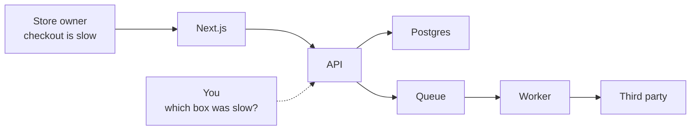

Notice: without tools, you guess. You open five log files and search by time. That is slow and often wrong.

### The fix: give every request a name tag

The first box makes a random id for the request (interview word: **trace id**). Every box passes it on, and writes it in every log line.

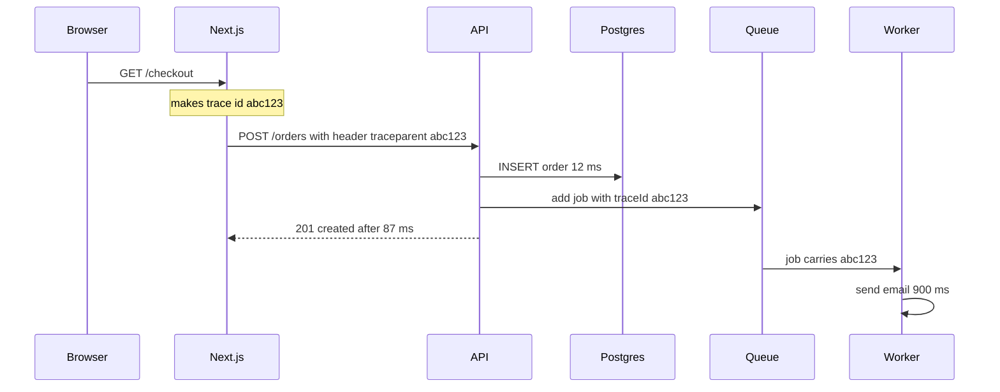

Notice: the id rides in an HTTP header between services. It rides inside the job data through the queue. Now one search for `abc123` shows the whole story.

- The standard header is called `traceparent` (from the W3C Trace Context standard). OpenTelemetry adds it for you over HTTP (Part 3).
- Queues do not carry headers by themselves. You put the id into the job data yourself, or use a library that does it.
- Each step inside the trace (one SQL query, one HTTP call) is a **span**: a timed box with a start and an end.

### Three tools, three questions

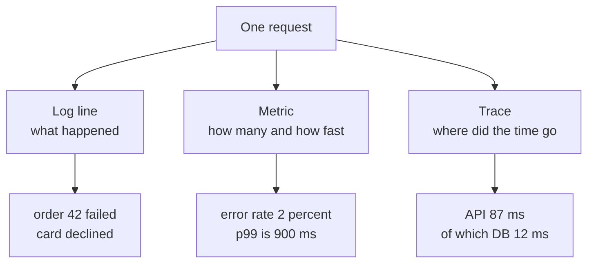

Notice: each tool answers a different question. You need all three.

| Tool | Answers | Cheap or costly? | Example |
|---|---|---|---|
| **Metric** | "Is something wrong? How much?" | Cheap. A few numbers per minute. | `http_errors_total` went from 2 to 200 per minute |
| **Log** | "What exactly happened to this one request?" | Costly at high traffic. One line per event. | `{"level":"error","orderId":42,"msg":"card declined"}` |
| **Trace** | "Which box was slow, and why?" | Costly, so you keep only some (sampling, Part 3). | API 87 ms: DB 12 ms, TADA call 60 ms |

Say the flow in this order: **metrics tell you something is wrong, traces tell you where, logs tell you why.**

### Structured logs: write logs for machines

The problem: `console.log("order failed for " + id)` makes a sentence. A computer cannot filter sentences well. "Show me all errors for order 42 in the last hour" becomes a text search.

The fix: write each log line as JSON, with fields (interview word: **structured log**). Pino is a fast JSON logger for Node.

```js
const pino = require('pino');
const logger = pino({
  level: 'info',
  redact: ['req.headers.authorization', 'user.password'],
});
const log = logger.child({ traceId: 'a1b2c3', service: 'api' });
log.debug('cache check');
log.info({ orderId: 42, ms: 87 }, 'order created');
log.warn({ user: { id: 7, password: 'hunter2' } }, 'login retry');
```

The output (checked on 2026-10-16 with pino 10.4.0, time and pid shortened):

```text
{"level":30,"traceId":"a1b2c3","service":"api","orderId":42,"ms":87,"msg":"order created"}
{"level":40,"traceId":"a1b2c3","service":"api","user":{"id":7,"password":"[Redacted]"},"msg":"login retry"}
```

What to notice:

- The `debug` line did not print. The level is `info`, so pino drops anything less important.
- `child()` stamps `traceId` and `service` on every line. You set it once per request.
- `redact` replaced the password with `[Redacted]`. Pino does this before the line leaves the process.

**Log levels, most to least serious:**

| Level | Use it when | Example |
|---|---|---|
| `fatal` | the process is about to die | cannot connect to the database at startup |
| `error` | one request failed and a human may need to look | payment provider returned 500 |
| `warn` | something odd, but the request worked | retry 2 of 3 succeeded |
| `info` | normal business events | order created, user logged in |
| `debug` | details for developers | cache hit for key X |

Production usually runs at `info`. You turn on `debug` for a short time when you hunt a bug.

**Never log secrets or personal data.** Personal data means anything that points to a real person: name, phone, email, ID card number, address (interview word: **PII**, personally identifiable information).

- Logs are copied to many places: the log tool, backups, laptops. A password in a log is a leaked password.
- Never log: passwords, tokens, the `Authorization` header, card numbers, OTP codes, ID card photos.
- Log the *id* of a thing, not the thing. Log `userId: 7`, not the user's phone number.
- Use `redact` as a safety net, not as the plan. The plan is to not pass the data to the logger.

**The cost:** logs are the line that grows fastest on the bill (Part 10). Log events, not every step of every loop.

> **Say this in the interview:** "Every request gets a trace id at the edge. Every service writes JSON logs with that id, and puts it into queue jobs too. So one search shows the whole path of one request."

**Words you will hear:** trace id (the request's name tag), span (one timed step), structured log (a JSON log line), PII (data that points to a real person).

**A question to ask yourself about DBO:** a points redeem goes from the API to a BullMQ worker to TADA, and TADA answers with a webhook. If it fails, could you find every log line for that one redeem? The [DBO case study](../../interview/my-projects/dbo-b2b-platform-system-design-case-study.md) lists this as an improvement idea (Improvement 6).

---

## Part 2: What to measure: golden signals, RED, USE and percentiles [Mid]

### The problem

You can measure hundreds of numbers. If you watch all of them, you watch none of them. You need a short list that tells you "users are hurting".

### The four golden signals

Google's SRE book (SRE means site reliability engineering, Google's name for its operations engineers) says: if you can only measure four things about a service users touch, measure these.

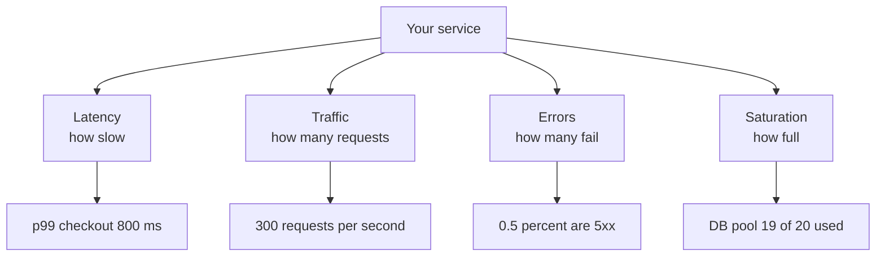

Notice: the first three are what users feel. Saturation is the warning *before* users feel it.

- **Latency:** how long a request takes. Track failed requests apart from good ones. A fast error is not a good request.
- **Traffic:** how much work comes in. Requests per second, or jobs per minute.
- **Errors:** how many requests fail. Count 5xx answers. Also count "wrong answers", like a 200 with an empty cart.
- **Saturation:** how full the tightest resource is. Not average CPU. Look at the *one* thing that runs out first: DB connections, memory, queue length.

### RED and USE: two short versions

Two smaller lists come from the same idea. Use the right one for the right thing.

| Method | Use it for | The three numbers |
|---|---|---|
| **RED** | things that answer requests: API, GraphQL server, worker | **R**ate (requests per second), **E**rrors, **D**uration (latency) |
| **USE** | things that are resources: CPU, disk, DB pool, Redis memory | **U**tilization (% busy), **S**aturation (waiting work), **E**rrors |

A simple rule: RED for every service, USE for every machine and pool. Add one business number: orders per minute, or OTPs sent per minute. A drop in orders can show a bug that no error counter sees.

For a queue, the most useful number is **the age of the oldest waiting job**. Queue length can look fine while one job waits for an hour.

### Percentiles: why averages lie

The problem: an average mixes fast and slow users into one number that nobody felt.

Here are 100 checkout requests:

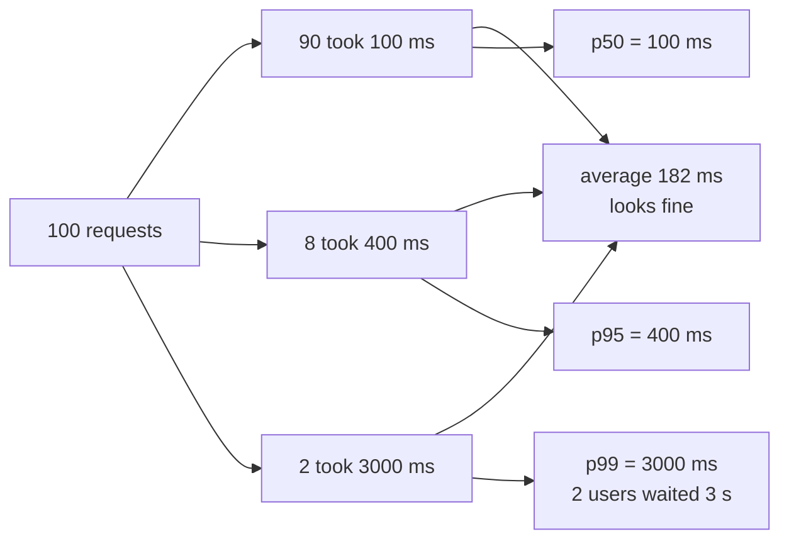

Notice: the average says 182 ms. No user felt 182 ms. Two users waited three seconds, and the average hides them.

- Sort all the times from fast to slow.
- **p50** (the median): half the requests were faster than this. Here: 100 ms.
- **p95**: 95 of 100 were faster than this. Here: 400 ms.
- **p99**: 99 of 100 were faster. Here: 3,000 ms. This is your unhappy tail.
- The math: (90 × 100 + 8 × 400 + 2 × 3000) ÷ 100 = 18,200 ÷ 100 = 182 ms average.

**Why p99 matters more than it sounds:** one page often calls many services. If a page calls 10 services, and each is slow 1% of the time, then about 1 page in 10 is slow (1 minus 0.99¹⁰ ≈ 9.6%). Your p99 becomes a normal user's experience.

**The cost:** percentiles need more data than averages. Tools keep "buckets" of times (interview word: histogram) to compute them cheaply. You cannot average two p99 numbers together. Compute the p99 again from the combined buckets.

> **Say this in the interview:** "I watch the four golden signals per service, RED for services and USE for resources, plus queue age. For latency I use p95 and p99, because the average hides the slow users, and slow tails add up when one page calls many services."

**Words you will hear:** golden signals, saturation (how full the tightest resource is), percentile (p99), histogram (buckets of times).

---

## Part 3: OpenTelemetry [Mid]

### The problem

Every monitoring company used to have its own agent and its own format. If you put the Datadog library in your code, moving to Grafana meant changing code in every service.

### The fix: one standard way to collect, many places to send

OpenTelemetry (often written OTel) is a free, open standard plus libraries. Your code speaks OTel once. A middle box sends the data wherever you want.

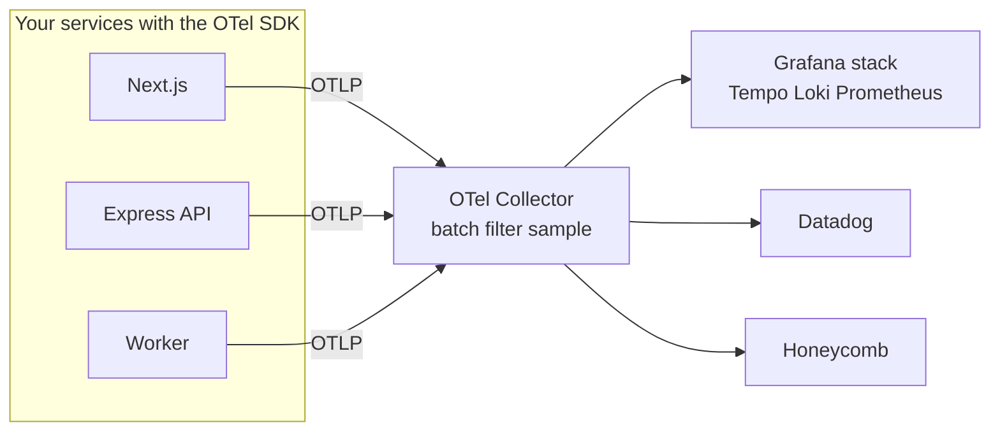

Notice: your code only knows about the Collector. To change vendors, you change the Collector's settings, not your code.

- **SDK:** the library inside your app. It creates spans and metrics.
- **Auto instrumentation:** plugins that wrap common libraries (http, express, pg, Prisma, Redis) for you. You get spans without writing them.
- **OTLP:** the format OTel uses to send data over the network.
- **Collector:** a separate small program. It receives data, groups it in batches, removes secrets, drops some traces, and forwards the rest.

### A minimal Node setup

```js
// otel.js - start your app with: node --require ./otel.js server.js
const { NodeSDK } = require('@opentelemetry/sdk-node');
const { getNodeAutoInstrumentations } = require('@opentelemetry/auto-instrumentations-node');
const { OTLPTraceExporter } = require('@opentelemetry/exporter-trace-otlp-http');

const sdk = new NodeSDK({
  serviceName: 'orders-api',
  traceExporter: new OTLPTraceExporter({ url: 'http://localhost:4318/v1/traces' }),
  instrumentations: [getNodeAutoInstrumentations()],
});
sdk.start();
process.on('SIGTERM', () => sdk.shutdown());
```

- The file must load **before** your app code. That is why it uses `--require`. The plugins must wrap `http` and `express` before your app loads them.
- Port 4318 is the usual Collector port for OTLP over HTTP.
- `sdk.shutdown()` sends the last spans before the container stops.
- Checked on 2026-10-16: this file runs with `@opentelemetry/sdk-node` 0.223.0 on Node 22.

**Sampling: you cannot keep every trace.** At 1,000 requests per second, full traces are a lot of data. Two common choices:

- **Head sampling:** decide at the start. "Keep 10% of traces." Cheap, but you may drop the one slow request you needed.
- **Tail sampling:** the Collector waits until the trace ends. "Keep all errors and all slow traces, plus 5% of the rest." Better data, but the Collector needs memory.

**Where to send it:** the Grafana stack, Datadog, Honeycomb, New Relic and the big clouds all accept OTLP.

**Status in October 2026:** OTel is a CNCF graduated project. The CNCF (Cloud Native Computing Foundation) also looks after Kubernetes, and "graduated" is its top maturity level. In JavaScript, traces and metrics are stable. Logs are the newest part, so keep pino for logs and add the trace id to each line. Details are in "What's current".

**The cost:** OTel adds a little CPU per request, and a Collector to run. The vendor bill grows with the amount of data you send. Sampling and dropping noisy spans keep the bill small.

> **Say this in the interview:** "I would instrument with OpenTelemetry, so the code is not tied to a vendor. Services send OTLP to a Collector, which does tail sampling: keep every error and every slow trace, and a small share of the rest. Then it forwards to Grafana or Datadog."

**Words you will hear:** OpenTelemetry (the standard), Collector (the middle box), OTLP (its wire format), sampling (keeping only some traces).

<details><summary>Go deeper (optional): backends, metrics and logs through OTel</summary>

- Backends: the Grafana stack is Tempo for traces, Loki for logs, and Prometheus or Mimir for metrics. You can host it yourself or use Grafana Cloud. Jaeger is a common free choice for traces only.
- Logs status detail: the opentelemetry.io language data lists JS logs as "development". The opentelemetry-js GitHub README lists the logs API and SDK as stable. The npm logs packages are still on the 0.x version line (0.223.0 on 2026-10-16).
- Metrics: add a `metricReader` with an OTLP metric exporter to the same `NodeSDK`. Auto instrumentation gives you HTTP duration histograms for free.
- Logs: OTel has instrumentation packages that copy the active trace id into pino and winston log lines. Check the package status before you depend on it, because the logs side still moves fastest.
- Next.js has built in OTel support through its `instrumentation.ts` file. Vercel also offers a helper package. Check the Next.js docs for the version you use.
- Context inside one Node process: OTel uses Node's `AsyncLocalStorage` to remember "which trace am I in" across `await`. That is why it can stamp the right trace id without you passing it around.

</details>

---

## Part 4: SLI, SLO, SLA and error budgets [Mid]

### The problem

The business says "the app must always be up". That is not possible, and it is not a useful goal. 100% means you can never deploy, never change anything. You need a number everyone agrees on.

### Three words that build on each other

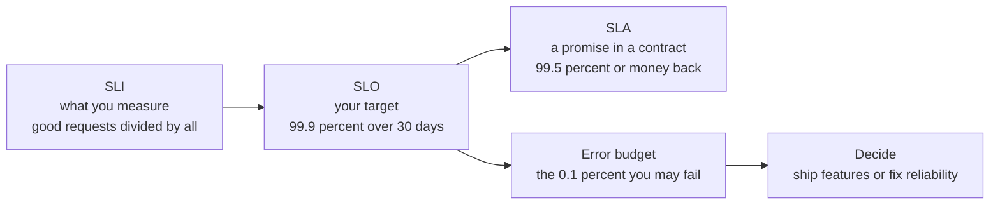

Notice: the SLA is looser than the SLO. You want to break your own target long before you break the contract.

- **SLI** (service level indicator): a measurement. "The share of checkout requests that return non-5xx in under 1 second."
- **SLO** (service level objective): your internal target for that SLI. "99.9% of them, over 30 days."
- **SLA** (service level agreement): a promise to customers, with a penalty. Lawyers and sales care about this one.
- **Error budget:** 100% minus the SLO. It is the amount of failure you are *allowed*.

### Worked example: what 99.9% means

A 30 day month has 30 × 24 × 60 = **43,200 minutes**.

| SLO | Failure allowed | Per 30 days | If you serve 10 million requests a month |
|---|---|---|---|
| 99% | 1% | 7.2 hours | 100,000 may fail |
| 99.9% | 0.1% | **43.2 minutes** | 10,000 may fail |
| 99.95% | 0.05% | 21.6 minutes | 5,000 may fail |
| 99.99% | 0.01% | 4.3 minutes | 1,000 may fail |

How a team uses the budget:

- Budget left? Ship features. Take some risk.
- Budget spent? Slow down. Fix reliability before new features.
- This turns "dev wants speed, ops wants safety" into one shared number.

Each extra nine costs much more money. 99.99% usually needs a second region and an on-call team that answers in minutes. Ask: "What does one hour of downtime cost the business?" before you pick the number.

### Alerting: symptoms, not causes

The problem: if you page a person for "CPU is 90%", they wake up at 3 a.m. and users are fine. After a month of this, people ignore pages.

- **Alert on symptoms:** what users feel. Error rate up, latency up, queue age up.
- **Do not page on causes:** CPU, memory, one pod restarting. Show those on dashboards. Use them to debug, not to wake people.
- Every page must need a human *now*. If it can wait until morning, make it a ticket.

### Burn rate alerts, in short

**Burn rate** is how fast you spend the error budget. A burn rate of 1 spends the whole budget in exactly 30 days. A burn rate of 14.4 spends it in about 50 hours.

| Alert | Rule | Why this rule |
|---|---|---|
| **Page now** | burn rate over 14.4 for the last 1 hour, and also over the last 5 minutes | You lost 2% of the month's budget in one hour |
| **Page** | burn rate over 6 for the last 6 hours, and also over the last 30 minutes | You lost 5% in six hours |
| **Ticket** | burn rate over 1 for the last 3 days | A slow leak. Fix it this week |

- Why two windows? The long window proves it is real. The short window proves it is still happening, so the alert stops soon after you fix it.
- The math for the first row: 14.4 × 1 hour ÷ 720 hours in 30 days = 0.02 = 2%.
- These numbers come from the Google SRE Workbook chapter "Alerting on SLOs".

> **Say this in the interview:** "I would set an SLO like 99.9% of checkouts succeed under one second, which leaves about 43 minutes of budget a month. I page on fast budget burn, not on CPU. That way every page means users are hurting."

**Words you will hear:** SLI, SLO, error budget, burn rate.

---

## Part 5: Deploying safely [Mid]

### The problem

Most outages start with a change: new code, new config, a new migration. You cannot stop changing things. So you make each change small, watched, and easy to undo.

### The pipeline

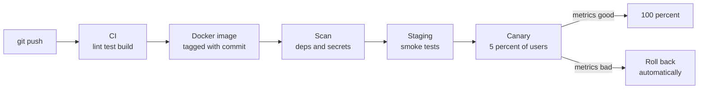

Notice: the same image moves through every step. You never rebuild for production. You only change config.

- **CI** (continuous integration): every push runs tests and builds one image.
- **CD** (continuous delivery or deployment): the image moves to staging, then production, with checks between steps.
- Tag the image with the git commit. Then "what is running?" has an exact answer.

### Four ways to replace the old version

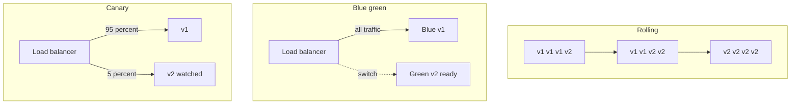

Notice: rolling changes servers one by one. Blue green flips all traffic at once. Canary sends a small slice first.

| Strategy | How it works | Rollback speed | Extra cost | Pick it when |
|---|---|---|---|---|
| **Rolling** | Replace instances one at a time, with health checks | Slow: roll forward or roll back one by one | Almost none | Default for stateless services |
| **Blue green** | Run a full copy with v2, then flip the load balancer | Instant: flip back | Double the servers during the switch | You need instant rollback |
| **Canary** | Send 1 to 5% of traffic to v2, compare its metrics with v1, then grow | Fast: only 5% saw it | Small, but needs traffic splitting and good metrics | Risky changes at high traffic |
| **Feature flag** | v2 code is deployed but off. Turn it on for some users from a dashboard | Instant: turn the flag off | A flag service, and old flags to clean up | Separate "deploy" from "release" |

Deep version of rolling updates, health checks and `maxSurge`: [container orchestration guide, section 3.13](../devops-cloud/container-orchestration-guide.md). Health checks and connection draining: [load balancers guide](load-balancers-microservices-online-shop.md).

### Feature flags and dark launches

- **Feature flag:** an `if` around new code, controlled from outside the code. `if (flags.newCheckout(user)) { ... }`.
- **Kill switch:** a flag that turns a risky feature off in seconds, without a deploy.
- **Dark launch:** run the new code path in production, but hide the result from users. Example: send real search requests to the new search service too, compare answers, show users only the old one. You test with real load at zero user risk.
- **The cost:** every flag is a branch in your code. Old flags pile up and confuse people. Give each flag an owner and a removal date. (Knight Capital lost 460 million dollars partly because an old flag was reused. See the cases section.)

### Database changes: the part people forget

During a rolling or canary deploy, **old and new code run at the same time, on the same database.**

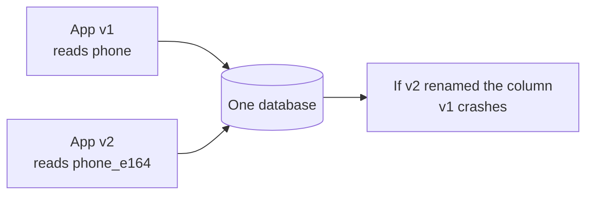

Notice: a schema change must work for *both* versions. So you never rename or drop in one step.

- **Expand:** add the new thing. Old code ignores it.
- **Migrate:** write to both, copy old rows in small batches, switch reads.
- **Contract:** when no old code is left, remove the old thing, in a later deploy.

Deep version, with Postgres rules like `CREATE INDEX CONCURRENTLY` and `lock_timeout`: [database design and why, "Changing the Schema Without Downtime"](../database/database-design-and-why.md).

### The rollback plan

Before every deploy, answer: "If this goes wrong, what exactly do I do?"

- **Code only:** roll back to the previous image tag. Keep the last few images.
- **Behind a flag:** turn the flag off. Fastest option.
- **With a migration:** because of expand and contract, the old code still works with the new schema. So you roll back the code and *leave the schema*. You almost never roll back a migration in production.
- **Data was changed wrongly:** you need a fix forward script or a restore (Part 7). Write that plan before the deploy.

> **Say this in the interview:** "I deploy with a canary and automatic rollback on error rate and p99. Risky features sit behind a flag, so release is separate from deploy. Schema changes use expand and contract, so I can roll back code without rolling back the database."

**Words you will hear:** CI/CD, canary, feature flag, expand and contract.

---

## Part 6: Config and secrets [Mid]

### The problem

A developer puts the database password in `config.ts` and pushes it. Now the password is in git history forever. Every person and every tool with repo access has it. Bots scan public repos for keys within minutes.

### The fix: config comes from outside the image

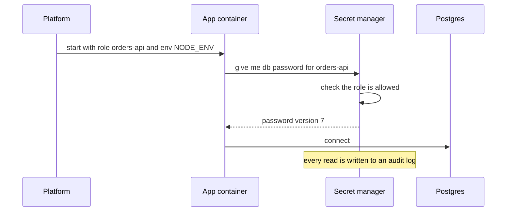

Notice: the image holds no secret. The app proves *who it is* (its role), and the secret manager decides what it may read.

- **Plain config** (not secret): log level, feature defaults, URLs of other services. Environment variables are fine.
- **Secrets:** DB passwords, JWT signing keys, API keys for TADA or a payment provider. Keep them in a **secret manager**: AWS Secrets Manager, HashiCorp Vault, Google Secret Manager, Azure Key Vault.
- The platform can still put the secret into an environment variable at start. That is common and OK. The point is: the *source of truth* is the secret manager, with access rules and an audit log.

<details><summary>Go deeper (optional): CI, Kubernetes and CapRover</summary>

- In CI, use short lived credentials (OIDC from GitHub Actions to AWS), not a long lived key stored in the CI settings.
- Kubernetes Secrets are only base64 encoded by default, not encrypted. Deep version: [container orchestration guide, section 3.7](../devops-cloud/container-orchestration-guide.md).
- CapRover keeps per app environment variables. They do not separate secret from non secret values. That gap is described in the same section.

</details>

### Rotation: changing a secret without downtime

Rotation means changing a secret on a schedule, or right after a leak. The problem: if you change the DB password, every running app instance breaks at once.

The fix is **two valid secrets for a short time:**

1. Create the new password. Both old and new work.
2. Apps pick up the new one (restart, or reread every few minutes).
3. When no app uses the old one, remove it.

For JWT signing keys, the same idea uses a **key id** (`kid`). The auth service signs new tokens with key 2. Verifiers accept key 1 and key 2 until old tokens expire. Then key 1 is removed.

**The cost:** a secret manager costs a little per secret and per call. Cache the secret in memory for a few minutes, so you do not call it on every request.

> **Say this in the interview:** "No secrets in code or images. Secrets live in a secret manager with access per service and an audit log. I rotate with two valid versions overlapping, and JWT keys rotate with a key id."

**Words you will hear:** secret manager, rotation, key id (kid).

---

## Part 7: Disaster recovery [Senior]

### The problem

A replica is not a backup. If someone runs `DELETE FROM orders` without a `WHERE`, the replica deletes the rows too, a few milliseconds later. And if a whole data center or region goes dark, both copies in it are gone.

### Two numbers the business must give you

- **RPO** (recovery point objective): how much data can we lose? "At most 5 minutes of orders."
- **RTO** (recovery time objective): how long can we be down? "Back within 1 hour."
- The business sets them. Your design must meet them. Lower numbers cost more money.

Deep version of backups, point in time restore and RPO and RTO for Postgres: [database scaling and correctness, Part C](../database/database-scaling-and-correctness.md).

### How far can the disaster reach?

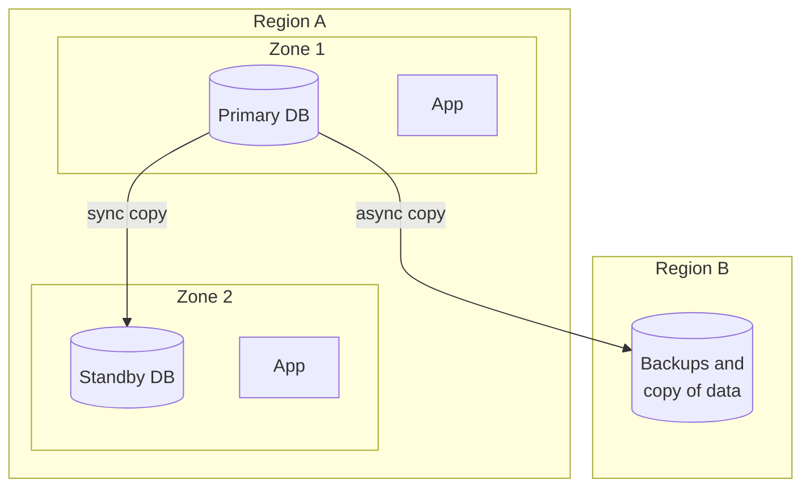

Notice: two zones protect you from one building failing. Only a second region protects you from a whole region failing.

- **Availability zone (AZ):** one or more data centers, close to other zones in the same region. Copies between them are fast enough to be synchronous.
- **Multi-AZ:** the normal choice. A managed database with a standby in a second zone fails over in about a minute or two. Cheap insurance.
- **Multi-region:** a second region far away. Copies are asynchronous, so a failover can lose a few seconds of data. Much more work: DNS failover, data copies, testing.

### Active-passive vs active-active

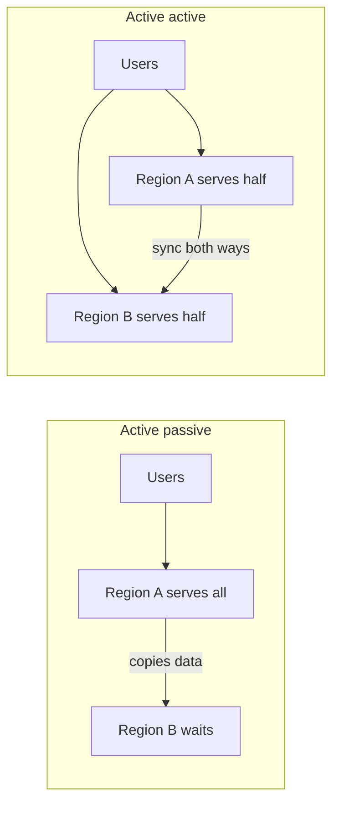

Notice: in active-active, both regions take writes. Now two people can change the same row in two places at once. That conflict is the hard part.

- **Active-passive:** one region works, the other waits. Simple. Failover takes minutes.
- **Active-active:** both regions work. Near zero downtime, but you must handle write conflicts (or split users so each user lives in one region).

### Four recovery plans, cheapest to most costly

These four names come from the AWS whitepaper "Disaster Recovery of Workloads on AWS".

| Plan | What runs in the second region all the time | RPO | RTO | Monthly cost |
|---|---|---|---|---|
| **Backup and restore** | Only backups | hours | hours (rebuild everything) | $ |
| **Pilot light** | Data copies, plus core pieces switched off | minutes | tens of minutes | $$ |
| **Warm standby** | A small but working copy of the whole system | seconds to minutes | minutes (scale it up) | $$$ |
| **Multi-site active-active** | A full copy that takes real traffic | near zero | near zero | $$$$ |

Most companies need **multi-AZ plus tested backups**. Pick a second region when the business says the RTO must survive a region failure, or when a regulator asks for it.

### Game days: a plan you never tested is a wish

A **game day** is a planned drill. You break something on purpose, in a safe way, and watch what happens.

- Restore last night's backup into a fresh database. Time it. That time is your real RTO.
- Turn off one zone in staging. Does the app keep working?
- Kill Redis. Do the queue and the cache fail the way you expect?
- Write down what surprised you. Fix it. Repeat every quarter.

> **Say this in the interview:** "I would ask the business for RPO and RTO first. For most systems, multi-AZ plus point in time backups in a second region is enough. I would restore a backup in a drill every quarter, because a backup you have never restored is not a backup."

**Words you will hear:** RPO, RTO, availability zone, game day.

---

## Part 8: Incident response [Senior]

### The problem

Something breaks at 2 a.m. Five people jump into a chat. Two of them restart things at the same time. Nobody tells customers. Nobody writes down what happened. Next month it happens again.

### The flow of an incident

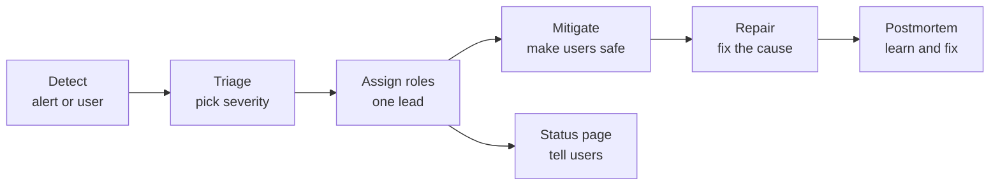

Notice: "mitigate" comes before "fix the cause". Mitigate means: make users safe first. Roll back, turn off the flag, fail over. Find the root cause later, when nobody is hurting.

### The pieces

- **On-call:** one person per week carries the pager, with a backup person. Pages must be rare and real (Part 4), or people burn out.
- **Runbook:** a short page per alert. "This alert means X. Check Y. If Z, do this." It turns a 3 a.m. panic into steps.
- **Roles:** an **incident lead** decides and coordinates. They do not type fixes. One person fixes. One person talks to customers and the business.
- **Status page:** a public page that says "we know, we are working on it, next update in 30 minutes". It saves your support team from 500 tickets.

**Severity levels** (each company names them a little differently):

| Level | Meaning | Example | Response |
|---|---|---|---|
| SEV1 | Most users cannot use the core product, or data is at risk | Checkout down, data leak | Page now, all hands, status page, updates every 30 min |
| SEV2 | A big feature is broken for many users | Points redeem fails | Page on-call, status page |
| SEV3 | Small feature broken, a workaround exists | Export to CSV fails | Ticket, fix in working hours |
| SEV4 | Cosmetic | Wrong icon | Backlog |

### The blameless postmortem

After every SEV1 and SEV2, write a postmortem. **Blameless** means you ask "how did our system let a person make this mistake?", not "who did it?". If people fear blame, they hide facts, and you learn nothing.

```markdown
# Postmortem: points redeem failing, 2026-03-04
Severity: SEV2 · Duration: 47 min · Users hit: about 1,200
## Summary (3 lines a manager can read)
## Timeline (UTC): detected, escalated, users safe, fixed
## Impact: who, how many, money, data
## Root cause and what made it worse
## What went well / what went badly / where we got lucky
## Action items: owner, due date, ticket link
```

The action items are the point. A postmortem without owners and dates changes nothing.

> **Say this in the interview:** "In an incident, one lead coordinates, and the first goal is to mitigate: roll back or flip a flag. We keep users informed on a status page. Afterwards we write a blameless postmortem with owned action items, so the same failure cannot happen the same way twice."

**Words you will hear:** runbook, incident lead, severity, blameless postmortem.

---

## Part 9: Security by design [Senior]

Security is not one box on the diagram. It is a question at every arrow: "who is calling, and are they allowed?"

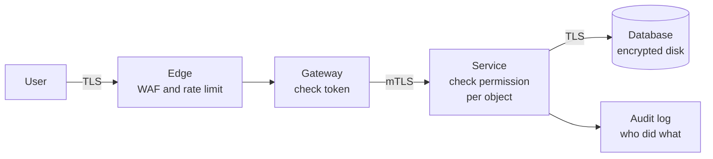

Notice: there is a check at every step, not only at the front door. The WAF (web application firewall) is a filter that blocks known bad requests. This "check everywhere" idea is called **zero trust** (explained in 9.5).

### 9.1 Authentication at scale: who are you?

You already know sessions and JWTs. Deep versions: [Express, GraphQL and auth tutorial](../backend-api/express-graphql-auth-tutorial.md) and [API and JWT cheat sheet](../backend-api/cheatsheet-api-auth-microservice.md). Here is the scale view only.

| | Server sessions | JWT access token |
|---|---|---|
| Where the truth lives | A session store (Redis or DB) | Inside the signed token |
| Check cost | One Redis lookup per request | Local signature check, no network |
| Log out or ban now | Easy: delete the session | Hard: token stays valid until it expires |
| Best at | One web app, instant logout | Many services checking the same user |

The common senior answer: **short JWT access tokens** (5 to 15 minutes), plus a **refresh token** stored on the server that you can revoke. That gives fast checks and a way to cut someone off.

**OAuth 2.1 and OpenID Connect (OIDC):**

- **OAuth** answers "may this app act for this user?". **OIDC** adds "who is this user?" on top, with an ID token.
- **OAuth 2.1** is a cleanup of OAuth 2.0. It removes the risky "implicit" and "password" flows, and requires PKCE for the authorization code flow. PKCE is a one-time secret that proves the app that started login is the app that finishes it.
- **Status (checked 2026-10-16):** OAuth 2.1 is still an IETF draft (the IETF writes internet standards). It is not a final standard (an RFC) yet. Revision 15 was posted on 2026-03-02. Its rules are already the best practice, so build to them.

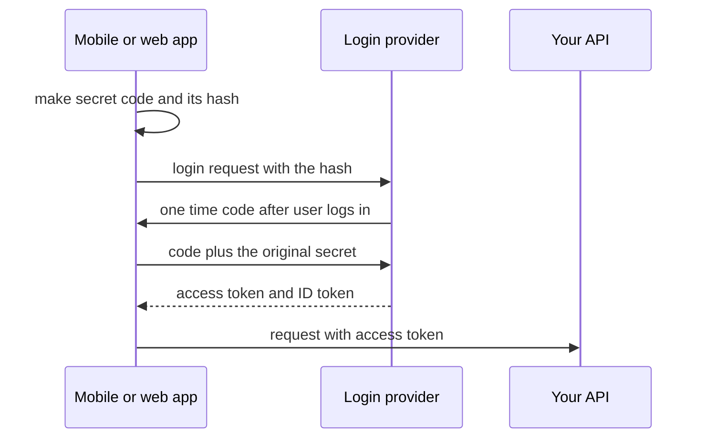

Notice: a thief who steals the one time code cannot use it. They do not have the original secret. That is PKCE.

**Passkeys in 2026:** a passkey is a login key kept on the phone or laptop, unlocked by a fingerprint or face. There is no password to steal or phish. The FIDO Alliance estimated about 5 billion passkeys in use in May 2026. Offer passkeys first, keep a fallback, and protect account recovery, because attackers go there next.

### 9.2 Authorization: what may you touch?

The problem: the token says "this is user 7". It does not say "user 7 may see order 42".

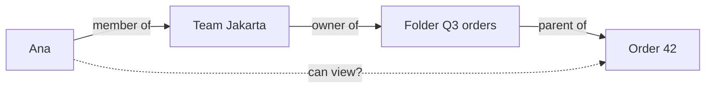

Notice: Ana can view order 42 because of a chain of links. This is relationship based permission (ReBAC).

| Model | The rule looks like | Good for | Weak at |
|---|---|---|---|
| **RBAC** (roles) | "admins can edit any product" | Small fixed set of roles, admin CMS | "only *their own* store's orders" |
| **ABAC** (attributes) | "user.region == order.region and hour < 18" | Rules with conditions, compliance | Hard to read and test as rules grow |
| **ReBAC** (relationships) | "viewer of doc if member of a team that owns the folder" | Sharing, teams, nested folders, B2B tenants | Needs a separate permission service |

- ReBAC comes from Google's **Zanzibar** paper, the system behind Google Drive sharing.
- **OpenFGA** is an open source version, inspired by Zanzibar. It became a CNCF incubating project in October 2025. SpiceDB is another one.
- Most products start with RBAC plus "owner checks" in code. Move to ReBAC when sharing rules get deep.

### 9.3 Service to service: are you really the orders service?

The problem: inside the network, anyone who gets in can call `POST /internal/refund`. "It is internal" is not a security model.

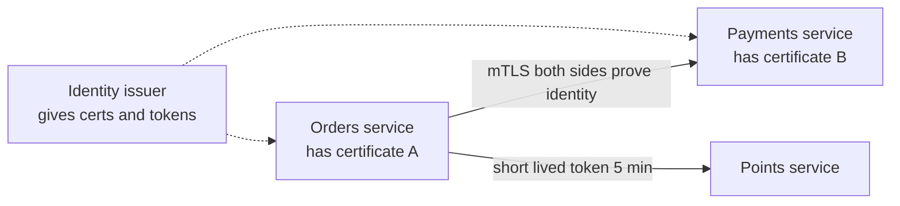

Notice: both sides show an ID card. Cards expire fast, so a stolen card is useless soon.

- **mTLS** (mutual TLS): normal TLS proves the server. mTLS also proves the client. A service mesh (small proxies next to every service, like Istio or Linkerd) can do it for you.
- **Short lived tokens:** each service gets a token that lasts minutes, from an identity issuer. No long lived API keys shared in env vars.
- Then check permissions on the receiving side: "orders may call refund, the email worker may not."

### 9.4 OWASP API Security Top 10, mapped to your stack

OWASP is a nonprofit that lists the most common security mistakes. The **API Security Top 10 2023** is still the current API list in October 2026. (OWASP released a new *web app* Top 10 in November 2025. That is a different list.)

| Risk | What it looks like in Express or GraphQL | Fix |
|---|---|---|
| **API1 Broken object level authorization (BOLA)** | `order(id: 42)` returns any order to any logged in user | Check ownership on every object: `where: { id, storeId: user.storeId }` |
| **API2 Broken authentication** | No rate limit on login or OTP; JWT `alg` not pinned; tokens that never expire | Rate limit, pin the algorithm, short expiry |
| **API3 Broken object property level authorization** | GraphQL exposes `User.passwordHash` or lets a user set `role` in an update | Only expose and accept allowed fields |
| **API4 Unrestricted resource consumption** | A deeply nested GraphQL query, `first: 1000000`, unlimited file upload | Depth and cost limits, max page size, body size limits, timeouts |
| **API5 Broken function level authorization** | A store owner calls the admin mutation `deleteBrand` | Check role per mutation, not only in the UI |
| **API6 Unrestricted access to sensitive business flows** | Bots request thousands of OTPs (each one costs money) | Per number and per IP limits, cooldowns |
| **API7 Server side request forgery** | "Give us your avatar URL" and the server fetches `http://169.254.169.254` | Allow list of hosts, block internal addresses |
| **API8 Security misconfiguration** | GraphQL introspection and stack traces on in production, wide CORS | Turn them off, strict CORS |
| **API9 Improper inventory management** | An old `/v1` endpoint without checks is still live | List every endpoint and version, remove old ones |
| **API10 Unsafe consumption of APIs** | Trusting a webhook body without checking its signature | Verify signatures, validate third party data |

**BOLA is number one** because it is easy to miss. A small Prisma example:

```ts
// Wrong: any logged in user can read any order
const order = await prisma.order.findUnique({ where: { id } });

// Right: the store id comes from the token, not from the request
const order = await prisma.order.findFirst({
  where: { id, storeId: ctx.user.storeId },
});
if (!order) throw new NotFoundError(); // 404, do not say "exists but forbidden"
```

**GraphQL resource limits.** One GraphQL query can ask for friends of friends of friends. That is thousands of database calls from one request. Limit the depth:

```js
const depthLimit = require('graphql-depth-limit');
// Apollo Server: new ApolloServer({ schema, validationRules: [depthLimit(5)] })
// A query 6 levels deep now fails before any database call:
// "'' exceeds maximum operation depth of 5"
```

Checked on 2026-10-16 with `graphql-depth-limit` 1.1.0 and `graphql` 17. Add a **cost limit** too (`graphql-query-complexity`), a max for `first` and `limit` arguments, and a per user rate limit.

### 9.5 Encryption, personal data, audit logs and zero trust

- **In transit:** TLS everywhere, including inside your network (DB connections, Redis, service calls).
- **At rest:** encrypted disks and backups. Managed databases do this with one setting. The keys live in a key service (KMS), and access to the keys is logged. For the most sensitive columns (ID card number, bank account), the app can encrypt the field itself, so even a DB admin sees only random bytes.
- **Personal data:** collect less, keep it shorter, mask it in admin screens, never in logs. Know where every copy lives (backups, analytics, the log tool).
- **Audit log:** an append-only record of "who did what, to what, when, from where". It answers "who changed this loan's interest rate?". Store it so normal app code cannot edit or delete it. Patterns for this: [database design and why, "Audit trail"](../database/database-design-and-why.md).
- **Zero trust, in one paragraph:** the old model trusted anything inside the company network. One stolen laptop or one hacked container then reached everything. Zero trust says: the network location proves nothing. Every request must prove who it is, and must be allowed for that one action, every time. In practice that means mTLS or tokens between services, permission checks in each service, and the least access each piece needs. NIST describes the model in its publication SP 800-207.

### 9.6 Supply chain: the npm packages you did not write

The problem: your app has maybe 30 direct packages and 1,000 hidden ones underneath. One bad update to any of them runs code on your laptop, in CI and in production.

In September 2025 this really happened: bad versions of `chalk` and `debug`, then the **Shai-Hulud** worm, which stole tokens and used them to publish more bad packages. The story and npm's answer are in "Real-world cases" and "What's current".

What you do:

- Commit the lockfile. Use `npm ci` in CI, so CI installs exactly the locked versions.
- Run `npm audit` or a scanner (Dependabot, Snyk, Socket) in CI.
- Wait a few days before taking brand new versions. Many bad versions are found within days.
- Turn off install scripts where you can (`npm ci --ignore-scripts`), and check the ones you allow.
- Give CI the fewest secrets possible. Stolen CI tokens are exactly what worms like Shai-Hulud look for.

### 9.7 Notes for banks (general facts, not about your projects)

Banks add rules on top of everything above: a long audit trail, data kept in the country, and two people for every production change.

<details><summary>Go deeper (optional): the four bank rules in more detail</summary>

- **Audit trail:** regulators expect you to show who changed what and when, for money and customer data. Keep it for years, append only.
- **Data residency:** many countries require some customer or financial data to stay inside the country. This decides your cloud region and where backups and logs go. Ask the compliance team early.
- **Separation of duties:** the person who writes the code should not be the only one who approves and deploys it to production.
- **Vendor risk:** every third party (OTP provider, cloud, log tool) is checked, because their breach becomes your breach.

</details>

**Where this could show up:** Unloan was a home loan platform for an Australian bank, and Skyworx builds loan systems for Indonesian banks. A good question to prepare: "What did audit logging and data location look like in those projects?" Answer only with what you know is true.

> **Say this in the interview:** "Authentication proves who you are. I check authorization on every object, which is the number one OWASP API risk. For GraphQL I add depth and cost limits. Services prove their identity to each other with mTLS or short lived tokens. Secrets, personal data and the audit log each get their own protection."

**Words you will hear:** BOLA, ReBAC, mTLS, zero trust.

---

## Part 10: Cost awareness [Senior]

### The problem

A design can be correct and still too expensive. In 2026, senior rubrics expect you to say roughly what a design costs, and which part of it grows fastest. Teams call this practice FinOps (finance plus operations).

### Where the money goes

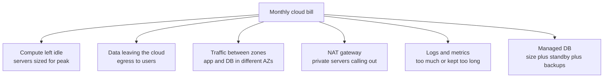

Notice: only one of these is "the servers". Several lines are about moving data or keeping data.

| Cost line | Rough price, AWS us-east-1 list | How to cut it |
|---|---|---|
| Internet egress | about $0.09 per GB for the first 10 TB a month | CDN (copies of files on servers near users), compression, smaller responses |
| Cross AZ traffic | about $0.01 per GB in each direction | Keep chatty services in one zone, read from the same zone replica |
| NAT gateway processing | about $0.045 per GB, plus an hourly fee | VPC endpoints (a private path to S3 and other AWS services) |
| Log ingestion (CloudWatch standard) | about $0.50 per GB | Drop debug logs, sample, shorter retention |
| Idle compute | you pay for the peak 24 hours a day | Autoscaling, smaller instances, serverless for spiky jobs |

Prices are list prices from third party pricing guides in 2026. Check the AWS pricing pages or the AWS calculator before you quote them.

### A rough monthly estimate, out loud

Say the method, not exact numbers. Here is a checkout API with 5 million requests a day.

| Line | Math | Per month |
|---|---|---|
| Egress | 5M requests × 20 KB = 100 GB a day → 3 TB × $0.09 | about $270 |
| Logs | 2 lines × 1 KB × 5M = 10 GB a day → 300 GB × $0.50 | about $150 |
| Cross AZ | 50 GB a day app to DB → 1.5 TB × $0.02 (both ways) | about $30 |
| Compute and DB | 3 small app containers, a managed Postgres with a standby, Redis | a few hundred dollars (my rough guess: check the calculator) |

What this shows:

- Logs cost about half as much as all user traffic. That surprises people.
- Cache hit rate is a cost lever. Every cache hit is a DB query you did not pay for.
- The "a few hundred dollars" line is honest. You show the method and say where you would check.

> **Say this in the interview:** "At this scale the bill is mostly egress, logs and the database. I would put a CDN in front, keep logs at info with 14 days of hot storage, and keep the app and database in the same zone. I would tag every resource by team, so we can see who spends what."

**Words you will hear:** FinOps, egress, NAT gateway.

---

## Part 11: The production readiness checklist [Senior]

Say this at the end of any design. You do not need every item every time. Pick the ones that matter for this system.

1. **SLO:** "99.9% of checkouts succeed in under 1 second." It gives about 43 minutes of budget per month.
2. **Golden signals** per service, p95 and p99, plus queue age and one business metric.
3. **Trace id** across every service and queue job. JSON logs with no secrets.
4. **Alerts** on symptoms and budget burn, each with a runbook.
5. **Health checks** for "alive" and "ready". Finish open requests when the platform asks the app to stop (SIGTERM).
6. **Canary or rolling deploys** with automatic rollback. Risky features behind flags.
7. **Expand and contract** for every schema change.
8. **Secrets** in a secret manager, rotated. Least access per service.
9. **Authorization on every object** (BOLA). Rate limits and GraphQL depth and cost limits.
10. **TLS everywhere**, encryption at rest, audit log for sensitive actions.
11. **Backups** with point in time restore, copied to another region, restored in a drill.
12. **RPO and RTO** agreed with the business. Multi-AZ by default.
13. **Incident process:** on-call, severity levels, status page, blameless postmortems.
14. **Cost:** rough monthly estimate, the top three cost lines, budgets and alerts on spend.

**The 60 second version** (practice saying it out loud):

> "To run this in production: first, an SLO, say 99.9% of checkouts under a second, which is about 43 minutes of budget a month. I would watch latency at p99, traffic, errors and saturation, with OpenTelemetry traces, and a trace id that also rides inside queue jobs. Alerts fire on budget burn, not CPU, and each has a runbook. Deploys go out as a canary with automatic rollback, risky features sit behind flags, and schema changes use expand and contract. Security: authorization on every object, rate limits and GraphQL cost limits, secrets in a secret manager, TLS everywhere, and an audit log. For disaster: multi-AZ, point in time backups in a second region, and a restore drill every quarter. And cost: at this scale the bill is mostly egress, logs and the database, so a CDN and log sampling are the first levers."

---

## Practice

Try each one before you open the answer.

**1. Predict.** 1,000 requests: 950 take 50 ms, 40 take 200 ms, 10 take 5,000 ms. What are the average, the p50, the p95 and the p99?

<details><summary>Answer</summary>

- Average: (950 × 50 + 40 × 200 + 10 × 5000) ÷ 1000 = (47,500 + 8,000 + 50,000) ÷ 1000 = **105.5 ms**.
- p50 = **50 ms** (request 500 in the sorted list).
- p95 = **50 ms** (request 950 is still a 50 ms one).
- p99 = **200 ms** (request 990 is the last 200 ms one).
- Only p99.9 (request 999) shows the **5,000 ms** users. The lesson: even p99 can hide a bad tail, and the average (105 ms) hides everything. Watch the max or p99.9 for critical paths.

</details>

**2. Compute.** Your SLO is 99.95% over 30 days. You serve 2 million requests a month. How many minutes of downtime, and how many failed requests, does the budget allow?

<details><summary>Answer</summary>

- 0.05% of 43,200 minutes = **21.6 minutes**.
- 0.05% of 2,000,000 = **1,000 failed requests**.
- If one bad deploy fails 600 requests, you used 60% of the month's budget. Time to slow down.

</details>

**3. Spot the bug in this deploy.** A team renames `store.phone` to `store.phone_e164` in one migration. The migration runs, then a rolling deploy replaces the app containers one by one.

<details><summary>Answer</summary>

During the rolling deploy, old containers still run. They query `phone`, which no longer exists. Every request on an old container fails until it is replaced. If the deploy is rolled back, the old code fails everywhere. Fix: expand and contract. Add `phone_e164`, write both, backfill, switch reads, and drop `phone` in a later deploy.

</details>

**4. Spot the bug in this log line.**

```js
log.info({ headers: req.headers, body: req.body }, 'login request');
```

<details><summary>Answer</summary>

- `req.headers` includes `Authorization` (the token) and cookies.
- `req.body` on a login route includes the password, and maybe a phone number.
- Fix: log only safe fields, like `{ route: '/login', userId, ip }`. Add `redact` for `req.headers.authorization` and `req.headers.cookie` as a safety net.

</details>

**5. Choose between two options.** You change how points are calculated. The change also adds a new column. Blue green or canary with a flag?

<details><summary>Answer</summary>

Canary plus a flag. The flag lets you deploy the code with the new logic switched off, then turn it on for 1% of stores and compare totals. Blue green flips 100% of users at once, so a wrong calculation hits everyone before you notice. The new column goes out first, in an expand step, which both versions can live with.

</details>

**6. Spot the security bug.**

```ts
order: (_, { id }, ctx) => {
  if (!ctx.user) throw new AuthError();
  return prisma.order.findUnique({ where: { id } });
}
```

<details><summary>Answer</summary>

This checks *who* the user is, but not *whether this order is theirs*. Any logged in store owner can read any order by changing the id. That is BOLA, OWASP API1. Fix: `findFirst({ where: { id, storeId: ctx.user.storeId } })`, and return 404 when nothing comes back.

</details>

**7. Choose a recovery plan.** An internal admin tool. The business says: we can lose 15 minutes of data, and we can be down for 4 hours. The budget is small.

<details><summary>Answer</summary>

Backup and restore is enough. Use a managed database with point in time restore (RPO of minutes) and copy backups to a second region. A 4 hour RTO gives time to rebuild from infrastructure code. Pilot light or warm standby would cost more for a target you already meet. Then test the restore once, and write down how long it took.

</details>

**8. Draw it.** On paper, draw one request from the browser through Next.js, the API, Postgres, a queue and a worker. Mark where the trace id is created, how it crosses each arrow (header or job data), and which box writes which log line.

<details><summary>Answer</summary>

Compare with the sequence diagram in Part 1. Check three things. The id is created at the first box. It crosses HTTP in the `traceparent` header. It crosses the queue inside the job data, because queues do not carry headers by themselves.

</details>

---

## Likely interview questions

Answer out loud first: problem, how it works, tradeoff, your example. Then open.

**Q1. How would you know this system is healthy in production?**

<details><summary>Answer</summary>

- **Problem:** "It works on my machine" says nothing about real users. You need numbers that show users are hurting before they tell you.
- **How it works:** an SLO per user journey (99.9% of checkouts under 1 second). Golden signals per service: p99 latency, traffic, errors, saturation. Queue age for background work. One business number, like orders per minute.
- **Tradeoff:** more metrics cost more money and attention. A short list you trust beats a hundred dashboards.
- **My example (idea):** for a DBO-like system I would add queue age for the BullMQ workers, because a stuck points job does not show up as an API error.

</details>

**Q2. Logs, metrics and traces: what is the difference, and when do you use each?**

<details><summary>Answer</summary>

- **Problem:** one request crosses many services. One tool cannot answer "is it broken, where, and why".
- **How it works:** metrics are cheap numbers over time, so alerts use them. Traces show the timed path of one request across services. Logs record the details of one event. A trace id links all three.
- **Tradeoff:** logs and traces cost money per event, so you use levels and sampling. Metrics cannot tell you about one specific request.
- **My example (idea):** for a redeem that goes from API to queue to a third party, the trace shows which hop was slow, and the log line with the same trace id shows the error message.

</details>

**Q3. Why do you use p99 instead of the average?**

<details><summary>Answer</summary>

- **Problem:** the average mixes fast and slow requests into a number nobody felt.
- **How it works:** sort the times. p99 is the time 99% of requests beat. With 90 requests at 100 ms, 8 at 400 ms and 2 at 3 s, the average is 182 ms but p99 is 3 s.
- **Tradeoff:** percentiles need histograms. You cannot average two p99 values together.
- **My example (idea):** a mobile screen that calls 10 APIs will hit someone's p99 about 1 time in 10, so the tail is what users feel on slow networks.

</details>

**Q4. What is an SLO and an error budget? How do you alert on it?**

<details><summary>Answer</summary>

- **Problem:** "always up" is impossible, and it blocks every change. Teams fight about speed against safety.
- **How it works:** the SLI is the measured share of good requests. The SLO is the target, like 99.9% over 30 days. The budget is the 0.1%, about 43 minutes. Alert when the burn rate is high: 14.4 times normal over an hour means 2% of the month's budget is gone.
- **Tradeoff:** each extra nine costs much more. The SLA in the contract is set looser than the SLO.
- **My example (idea):** for a loan application flow, an SLO on "application submitted successfully" matters more than CPU on any server.

</details>

**Q5. How do you deploy without downtime, and how do you roll back?**

<details><summary>Answer</summary>

- **Problem:** most outages start with a change.
- **How it works:** one image per commit. Rolling or canary deploys with readiness checks and graceful shutdown. Watch error rate and p99 on the canary, roll back automatically if worse. Risky features go behind flags.
- **Tradeoff:** canaries need traffic splitting and good metrics. Blue green gives instant rollback but doubles servers during the switch. Flags add code branches to clean up.
- **My example:** the [container guide](../devops-cloud/container-orchestration-guide.md) notes that CapRover on Docker Swarm does rolling deploys. Talk about what you have done with them, and say canary is the next step.

</details>

**Q6. How do you change a database schema with zero downtime?**

<details><summary>Answer</summary>

- **Problem:** old and new code run at the same time during a deploy, on the same database.
- **How it works:** expand (add the new column), migrate (write both, backfill in batches, switch reads), contract (drop the old column in a later deploy). Build indexes concurrently and set `lock_timeout`.
- **Tradeoff:** three deploys instead of one, and dual writes for a while. In return, you can roll back code at any step.
- **My example (idea):** with Prisma, each step is its own migration file. Never put the rename and the code change in the same release.

</details>

**Q7. How do you manage secrets?**

<details><summary>Answer</summary>

- **Problem:** secrets in code or images leak through git history, logs and laptops.
- **How it works:** a secret manager with access per service and an audit log. The app proves its identity and reads the secret at start. CI uses short lived OIDC credentials. Rotation keeps two valid versions for a short overlap.
- **Tradeoff:** another service to run and pay for. Cache secrets in memory for a few minutes.
- **My example (idea):** for DBO, the JWT signing key and the TADA and Jatis API keys are the first secrets I would move into a manager with rotation. The DBO case study notes CapRover does not separate secret from plain env vars.

</details>

**Q8. Backups or replicas? Walk me through your disaster plan.**

<details><summary>Answer</summary>

- **Problem:** hardware fails, regions fail, and people run bad deletes.
- **How it works:** replicas protect against a dead machine (fast failover). Backups with point in time restore protect against bad deletes. Ask for RPO and RTO. Then pick backup and restore, pilot light, warm standby, or active-active.
- **Tradeoff:** each step up costs more. Active-active needs a plan for write conflicts.
- **My example (idea):** for most systems, multi-AZ plus backups copied to another region, with a quarterly restore drill. GitLab's 2017 incident shows why the drill matters.

</details>

**Q9. Tell me how you handle a production incident.**

<details><summary>Answer</summary>

- **Problem:** in a panic, people repeat work, nobody updates users, and nobody learns.
- **How it works:** pick a severity. One incident lead. Mitigate first (roll back, flag off, fail over), then find the cause. Status page updates. Blameless postmortem with owners and dates.
- **Tradeoff:** process takes time, so small incidents get a light version.
- **My example:** use a real incident from your own work, told with STAR. If you have none, say how you would run one, and say clearly that it is a plan.

</details>

**Q10. How do you secure a GraphQL API?**

<details><summary>Answer</summary>

- **Problem:** one endpoint, very flexible queries. One query can read too much or cost too much.
- **How it works:** check ownership per object in the data layer (BOLA). Allow only safe fields (API3). Depth and cost limits, max page size, per user rate limits (API4). Turn off introspection and stack traces in production (API8).
- **Tradeoff:** strict limits can block a legitimate heavy admin query. Give the CMS its own higher limits or a separate endpoint.
- **My example:** the [DBO case study](../../interview/my-projects/dbo-b2b-platform-system-design-case-study.md) lists a query depth and complexity limit for the GraphQL API, and strict limits on OTP requests, because each OTP costs money.

</details>

**Q11. Sessions or JWT at scale? And how do services trust each other?**

<details><summary>Answer</summary>

- **Problem:** many services must know who the user is, and some calls are only between services.
- **How it works:** short JWT access tokens checked locally with a public key, plus a revocable refresh token. Between services: mTLS or short lived service tokens, and a permission check on the receiving side.
- **Tradeoff:** JWTs cannot be revoked instantly, so keep them short. mTLS needs certificate management, usually a mesh.
- **My example (idea):** the [API cheat sheet](../backend-api/cheatsheet-api-auth-microservice.md) shows services verifying JWTs locally without calling the auth service. Add "service identity" as the next step.

</details>

**Q12. How do you think about cost in a design?**

<details><summary>Answer</summary>

- **Problem:** a correct design can still be too expensive, and some costs grow faster than traffic.
- **How it works:** estimate the big lines: compute, the database, egress, cross-AZ traffic, NAT, logs. Show the math for one or two. Name the levers: CDN, cache hit rate, log levels and retention, autoscaling.
- **Tradeoff:** cheaper often means less redundancy. Say which redundancy you keep and why.
- **My example (idea):** 5 million requests a day at 20 KB is about 3 TB of egress a month, about $270. Logs at 10 GB a day add about $150.

</details>

---

## What's current (2026)

Each claim was checked on 2026-10-16.

- **OpenTelemetry** became a CNCF graduated project on 2026-05-21. In JavaScript, traces and metrics are stable (SDK 2.x). The official language data lists JS logs as "development", while the opentelemetry-js README lists the logs API and SDK as stable. The logs packages are still on 0.x versions (0.223.0).
- **OWASP API Security Top 10 2023** is still the current API list. The OWASP GitHub repo has only the 2019 and 2023 editions. OWASP released a new general web app Top 10 in November 2025, which added "software supply chain failures" as its own category.
- **OAuth 2.1** is still an IETF draft. Revision 15 was posted on 2026-03-02. It is not an RFC yet.
- **Passkeys:** the FIDO Alliance's 2026 report (2026-05-07) estimates about 5 billion passkeys in use. 75% of surveyed consumers have one on at least one account.
- **OpenFGA** (a Zanzibar style permission service) became a CNCF incubating project in October 2025.
- **npm supply chain:** after the September 2025 `chalk` and `debug` takeover and the Shai-Hulud worm, npm revoked all classic tokens on 2025-12-09, capped write tokens at 90 days, and recommends trusted publishing from CI.
- **AWS list prices** quoted by 2026 pricing guides: internet egress about $0.09 per GB (first 10 TB), cross AZ about $0.01 per GB each way, NAT gateway about $0.045 per GB processed, CloudWatch Logs standard ingestion about $0.50 per GB.
- **Package versions seen on npm on 2026-10-16:** pino 10.4.0, `@opentelemetry/sdk-node` 0.223.0, `graphql` 17.0.2, `express` 5.3.0.

---

## Real-world cases to cite

The case summaries come from Dan Luu's public list of postmortems on GitHub, which links to each original write-up.

- **Knight Capital (2012): deploys and old flags.** A new version reached only some servers, and an old feature flag was reused for new code. The old code woke up and traded wildly. The loss was about 460 million dollars. Cite it for: "deploy the same version everywhere, delete old flags, have a kill switch." Source: [danluu/post-mortems](https://github.com/danluu/post-mortems).
- **Cloudflare (July 2019): config is code.** One bad regular expression in a firewall rule went to every server at once and used up the CPU. Sites went down worldwide. Cite it for: "config changes need canaries too." Source: [danluu/post-mortems](https://github.com/danluu/post-mortems).
- **AWS S3 (February 2017): a command with too much power.** During debugging, a typo in a command removed more servers than intended in us-east-1. Cite it for: "tools should limit how much one command can remove, and runbooks need safe steps." Source: [danluu/post-mortems](https://github.com/danluu/post-mortems).
- **GitLab (January 2017): backups you never restored.** A tired engineer deleted the wrong database directory. Several backup methods turned out not to work. About six hours of data was lost. Cite it for: "test restores in a drill." Source: [danluu/post-mortems](https://github.com/danluu/post-mortems).
- **CrowdStrike (July 2024): a content push to everyone.** A content update with errors passed a broken validator and was sent to customer machines. Cite it for: "staged rollout for every kind of change." Source: [danluu/post-mortems](https://github.com/danluu/post-mortems).
- **npm `chalk`, `debug` and Shai-Hulud (September 2025): supply chain.** A phished maintainer, then a worm that stole tokens and spread. Cite it for: "lockfiles, scanning, few CI secrets, trusted publishing." Sources: [AWS Security Blog](https://aws.amazon.com/blogs/security/defending-against-supply-chain-attacks-like-chalk-debug-and-the-shai-hulud-worm), [GitHub: our plan for a more secure npm supply chain](https://github.blog/security/supply-chain-security/our-plan-for-a-more-secure-npm-supply-chain/).

---

## Watch and play

How these were checked: opened, or found in web search, on 2026-10-16. No video is listed: video sites could not be reached from the sandbox that day, so no video could be confirmed. When you search yourself, try "SLIs SLOs SLAs" on the Google Cloud Tech YouTube channel and "OpenTelemetry" talks from KubeCon. Check the channel name before you watch.

- [OpenTelemetry Demo (Astronomy Shop)](https://github.com/open-telemetry/opentelemetry-demo) - **play:** run it with Docker Compose, buy something, then open the trace and follow one request across many services.
- [Google SRE book, chapter 6: Monitoring Distributed Systems](https://sre.google/sre-book/monitoring-distributed-systems/) - the original golden signals, and why you page on symptoms.
- [Google SRE Workbook, chapter 5: Alerting on SLOs](https://sre.google/workbook/alerting-on-slos/) - **diagrams:** charts of each alert type, ending with the multi-window burn rate alert.
- [AWS: Disaster recovery options in the cloud](https://docs.aws.amazon.com/whitepapers/latest/disaster-recovery-workloads-on-aws/disaster-recovery-options-in-the-cloud.html) - **diagrams:** the four recovery plans drawn side by side.
- [OWASP API Security Top 10 2023](https://owasp.org/API-Security/editions/2023/en/0x00-toc/) - each risk with an attack example and how to stop it. Read API1 and API4 first.
- [pino redaction docs](https://github.com/pinojs/pino/blob/main/docs/redaction.md) - **play:** copy the example, run it with Node, and try `remove: true`.

---

## Review questions (day 1, 3, 7, 21)

**Day 1.** What does each of logs, metrics and traces answer? How does the trace id cross a queue?

<details><summary>Answer</summary>

Metrics: is something wrong, and how much. Traces: where the time went across services. Logs: what exactly happened in one event. Over HTTP the id rides in the `traceparent` header. Through a queue you put it inside the job data yourself.

</details>

**Day 3.** Your SLO is 99.9% over 30 days. How many minutes is the budget, and what does a burn rate of 14.4 for one hour mean?

<details><summary>Answer</summary>

43,200 × 0.001 = 43.2 minutes. A burn rate of 14.4 for one hour uses 14.4 ÷ 720 = 2% of the month's budget. At that speed the whole budget is gone in about 50 hours, so you page someone.

</details>

**Day 7.** Why can you roll back code after an expand and contract migration, but not after a rename in one step?

<details><summary>Answer</summary>

After the expand step, the old column still exists, so old code still works. Rolling back only changes the code. A rename in one step removes the old column, so old code breaks during the deploy and after any rollback.

</details>

**Day 21.** Draw from memory: the four recovery plans with their RTO, and the path of a request with security checks at each arrow. Then say the 60 second checklist out loud.

<details><summary>Answer</summary>

Backup and restore (hours), pilot light (tens of minutes), warm standby (minutes), active-active (near zero). Request path: TLS to the edge with a firewall and rate limit, token check at the gateway, mTLS to the service, a permission check per object in the service, TLS to an encrypted database, and an audit log entry. Then compare your spoken checklist with Part 11.

</details>

**Explain it back:** in your own words, explain "how do you run this in production?" in 60 seconds. Then use `/explain-check production readiness` or the `explain-coach` agent.

---

## Sources

- [OpenTelemetry JavaScript client, GitHub README (feature status table)](https://github.com/open-telemetry/opentelemetry-js) - opened 2026-10-16
- [opentelemetry.io language status data (instrumentation.yaml, JS logs "development")](https://github.com/open-telemetry/opentelemetry.io/blob/main/data/instrumentation.yaml) - opened 2026-10-16
- [OpenTelemetry JavaScript docs](https://opentelemetry.io/docs/languages/js/) - found in search 2026-10-16
- [CNCF: OpenTelemetry graduation announcement, 2026-05-21](https://www.cncf.io/announcements/2026/05/21/cloud-native-computing-foundation-announces-opentelemetrys-graduation/) - found in search 2026-10-16
- [OpenTelemetry Demo](https://github.com/open-telemetry/opentelemetry-demo) - opened 2026-10-16
- [pino redaction docs](https://github.com/pinojs/pino/blob/main/docs/redaction.md) - opened 2026-10-16
- [Google SRE book, chapter 6: Monitoring Distributed Systems](https://sre.google/sre-book/monitoring-distributed-systems/) - found in search 2026-10-16
- [Google SRE Workbook, chapter 5: Alerting on SLOs](https://sre.google/workbook/alerting-on-slos/) - found in search 2026-10-16
- [AWS whitepaper: Disaster recovery options in the cloud](https://docs.aws.amazon.com/whitepapers/latest/disaster-recovery-workloads-on-aws/disaster-recovery-options-in-the-cloud.html) - found in search 2026-10-16
- [OWASP API Security Top 10 2023, list (GitHub source)](https://github.com/OWASP/API-Security/blob/master/editions/2023/en/0x11-t10.md) - opened 2026-10-16
- [OWASP API Security Top 10 2023, table of contents](https://owasp.org/API-Security/editions/2023/en/0x00-toc/) - found in search 2026-10-16
- [OWASP API Security editions folder (2019 and 2023 only)](https://github.com/OWASP/API-Security/tree/master/editions) - opened 2026-10-16
- [OWASP Top 10:2025 (web apps)](https://owasp.org/Top10/2025/) - found in search 2026-10-16
- [IETF draft: The OAuth 2.1 Authorization Framework](https://datatracker.ietf.org/doc/draft-ietf-oauth-v2-1/) - found in search 2026-10-16
- [FIDO Alliance: passkey adoption report, World Passkey Day 2026](https://fidoalliance.org/fido-alliance-reports-accelerating-global-passkey-adoption-on-world-passkey-day-2026/) - found in search 2026-10-16
- [CNCF: OpenFGA becomes a CNCF incubating project, 2025-11-11](https://www.cncf.io/blog/2025/11/11/openfga-becomes-a-cncf-incubating-project/) - found in search 2026-10-16
- [OpenFGA on GitHub (inspired by Zanzibar)](https://github.com/openfga/openfga) - opened 2026-10-16
- [GitHub changelog: npm classic tokens revoked, 2025-12-09](https://github.blog/changelog/2025-12-09-npm-classic-tokens-revoked-session-based-auth-and-cli-token-management-now-available/) - found in search 2026-10-16
- [GitHub: our plan for a more secure npm supply chain](https://github.blog/security/supply-chain-security/our-plan-for-a-more-secure-npm-supply-chain/) - found in search 2026-10-16
- [AWS Security Blog: defending against chalk, debug and Shai-Hulud](https://aws.amazon.com/blogs/security/defending-against-supply-chain-attacks-like-chalk-debug-and-the-shai-hulud-worm) - found in search 2026-10-16
- [AWS data transfer costs in a nutshell (2026)](https://blog.besharp.it/aws-data-transfer-costs-in-a-nutshell/) - found in search 2026-10-16 (third party price summary)
- [AWS NAT Gateway pricing guide](https://cloudburn.io/blog/aws-nat-gateway-pricing) - found in search 2026-10-16 (third party price summary)
- [Amazon CloudWatch pricing guide](https://cloudburn.io/blog/amazon-cloudwatch-pricing) - found in search 2026-10-16 (third party price summary)
- [Dan Luu: a collection of postmortems](https://github.com/danluu/post-mortems) - opened 2026-10-16
- npm registry versions (pino, @opentelemetry/*, graphql, graphql-depth-limit, express) - checked with `npm view` on 2026-10-16. The pino, OTel and depth limit examples were run on Node 22.22.0.
