# Queues, Streams and Event-Driven Design

- **Written:** 2026-10-16
- **Level:** Beginner to Senior (each part is tagged)
- **Why this note exists:** Almost every design question has a moment where the interviewer says "this part is slow" or "what if it runs twice?". The answer is a queue, and a senior answer also explains what the queue costs and how it fails.
- **Read with:** [Scaling a database and keeping data correct](../database/database-scaling-and-correctness.md) (races, the outbox pattern), [Load balancers and microservices for an online shop](load-balancers-microservices-online-shop.md) (webhooks, sagas), [Distributed systems and reliability patterns](distributed-systems-and-reliability-patterns.md) (timeouts, retries, circuit breakers), [DBO case study](../../interview/my-projects/dbo-b2b-platform-system-design-case-study.md).
- **How links were checked:** opened or found in web search on 2026-10-16. The BullMQ and SQL examples were run on 2026-10-16 (BullMQ 6.3.15 with Redis, PostgreSQL 16).

## TL;DR

- **Problem:** slow work inside a request (email, PDF, a payment call) makes the user wait and fail with it. **Fix:** the API writes a small note (a job) into a queue and answers at once. A separate worker does the slow part.
- **A queue gives you three things:** it absorbs spikes, it retries for you, and it lets the API and the worker fail separately. **It costs:** one more system to run, results that arrive later, and harder debugging.
- **Almost every queue delivers "at least once".** So a job can run twice. "Exactly once" in practice means: at least once delivery plus a worker that is safe to run twice (idempotent).
- **Retry with growing waits plus randomness** (backoff and jitter). After the last try, move the job to a "failed jobs" pile (dead letter queue) so one bad job never blocks the rest.
- **Queue, stream and pub/sub are three different shapes.** A queue hands each job to one worker and deletes it. A stream (Kafka) keeps a log you can read again. Pub/sub copies one message to many listeners. Order is only kept per key.
- **Senior signals:** watch how far behind the workers are (consumer lag) and how long the oldest job has waited. Save each event in the same transaction as the data (outbox), so it is never lost. Version your events. Say when splitting read and write models, or storing only events (CQRS, event sourcing), is overkill. It usually is.

---

## The map

Read from left to right. Each box is one part of this guide.

```mermaid
graph LR
    P1["1 Sync vs async<br/>Beginner"] --> P2["2 Gifts and costs<br/>Beginner"]
    P2 --> P3["3 Delivery and acks<br/>Mid"]
    P3 --> P4["4 Retries and DLQ<br/>Mid"]
    P4 --> P5["5 Queue stream pub/sub<br/>Mid"]
    P5 --> P6["6 Choosing a tool 2026<br/>Mid"]
    P6 --> P7["7 Backpressure and scaling<br/>Mid"]
    P7 --> P8["8 Event-driven design<br/>Senior"]
    P8 --> P9["9 Outbox inbox CDC CQRS<br/>Senior"]
    P9 --> P10["10 Failure stories<br/>Senior"]
    P10 --> P11["11 Your work<br/>ideas"]
```

Notice: the first two parts are about why. Parts 3 to 7 are about how a queue behaves. Parts 8 to 10 are about whole systems built on events.

| Part | Level | You will be able to |
|---|---|---|
| 1. Sync vs async | Beginner | Draw producer, queue, job and worker, and write a tiny BullMQ example |
| 2. What a queue gives and costs | Beginner | Name three gifts and three costs, with an example each |
| 3. Delivery guarantees and acks | Mid | Explain at most once, at least once, "exactly once", acks and the visibility timeout |
| 4. Retries, dead letters and poison messages | Mid | Set a retry policy with backoff and jitter, and explain the dead letter queue |
| 5. Queue vs stream vs pub/sub | Mid | Draw all three, explain partitions, offsets, consumer groups and per key order |
| 6. Choosing a tool in 2026 | Mid | Pick between BullMQ, SQS, RabbitMQ, Kafka, NATS and a Postgres queue, with a reason |
| 7. Backpressure and scaling consumers | Mid | Compute how many workers you need, scale on queue depth, respect third party limits |
| 8. Event-driven architecture | Senior | Tell events from commands, pick a payload style, version events, choose orchestration or choreography |
| 9. Outbox, inbox, CDC, CQRS, event sourcing | Senior | Explain each in one picture and say when it is worth it |
| 10. Failure stories and monitoring | Senior | Handle duplicates, wrong order, replay after a bug and a worker that falls behind |
| 11. Where queues show up in your work | Ideas | Ask the right questions about DBO, Unloan, ZWS and Skyworx |

---

## Part 1: Sync vs async, the slow call problem [Beginner]

**Words you will hear:**
- **Job (or message):** a small note that says "please do this", for example `{ orderId: 42 }`.
- **Queue:** a waiting line for jobs. First in, first out (mostly).
- **Producer:** the code that puts a job in the queue. Usually your API.
- **Consumer (or worker):** the code that takes a job out and does the work.

### The problem: the user waits for things they do not need

A store owner taps "Place order". The API saves the order. Then, in the same request, it sends an email, builds a PDF invoice and calls a payment or loyalty partner.

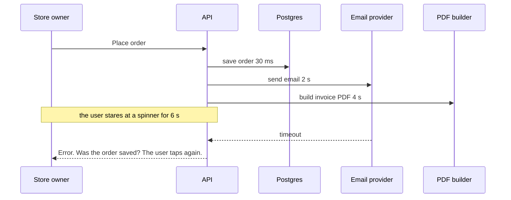

Notice: the order was saved after 30 ms. The other 6 seconds were for work the user did not need to watch. And when the email provider failed, the whole order looked like it failed.

Three things break here:

- **Speed.** The user waits for the slowest outside service.
- **Failure spreads.** If the email provider is down, ordering is down.
- **Double actions.** The user taps again and may create a second order.

### The picture: a waiting line between two programs

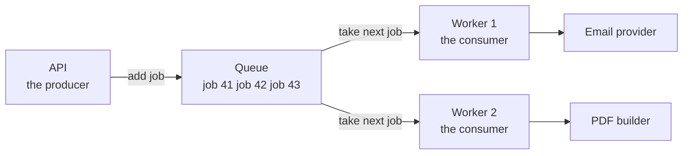

Notice: the API never talks to the email provider. It only drops a job into the line. Workers pick jobs at their own speed.

**Everyday picture:** a restaurant. The waiter writes your order on a ticket and pins it to the rail. The waiter goes back to the tables at once. The cooks take tickets one by one. Where this stops being true: a real cook never "loses" a ticket by crashing halfway. A worker can. Part 3 is about that.

### After: the API answers in milliseconds

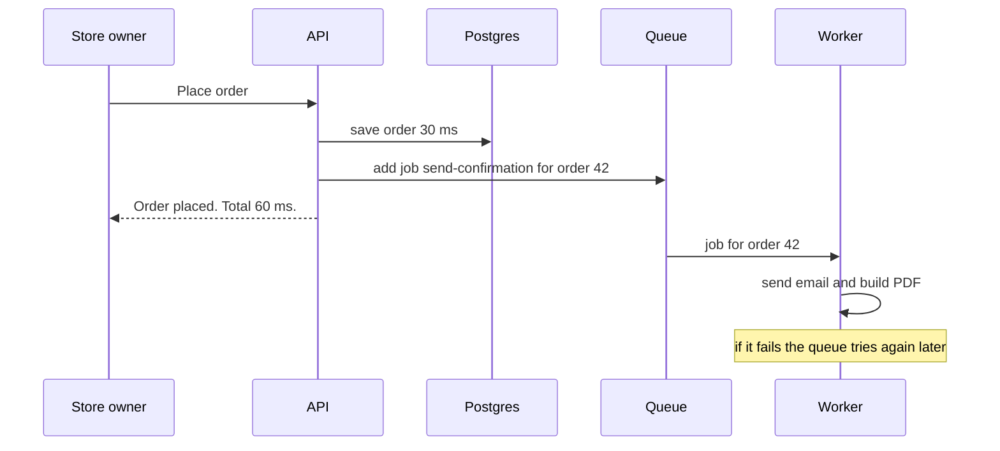

Notice: the user gets the answer as soon as the important part (the saved order) is done.

### Tiny example in TypeScript with BullMQ

BullMQ is a job queue for Node that keeps its jobs in Redis. The producer lives in your API. The worker usually runs in a separate process.

```ts
// producer.ts: runs inside the API (an ES module, so top level await works)
import { Queue } from "bullmq";
import IORedis from "ioredis";
const connection = new IORedis({ maxRetriesPerRequest: null });

const emails = new Queue("emails", { connection });
await emails.add("order-confirmation", { orderId: 42 }, {
  attempts: 3,                                         // try up to 3 times
  backoff: { type: "exponential", delay: 1000, jitter: 0.5 },
});
```

```ts
// worker.ts: a separate process
import { Worker } from "bullmq";
import IORedis from "ioredis";
const connection = new IORedis({ maxRetriesPerRequest: null });

new Worker("emails", async (job) => {
  await sendOrderEmail(job.data.orderId);              // your slow code
}, { connection });
```

Real output from a demo version of this code. The demo logs each try and uses a fake provider that fails twice:

```text
try 1 order 42 at 12ms
failed 1 email provider timeout attemptsMade 1
try 2 order 42 at 785ms
failed 1 email provider timeout attemptsMade 2
try 3 order 42 at 1989ms
completed 1 sent
```

Notice: the waits grew (about 0.8 s, then about 1.2 s). BullMQ did the retries. The API did nothing extra.

<details><summary>Go deeper (optional): two BullMQ 6 setup traps</summary>

- You install `ioredis` yourself now (`npm install bullmq ioredis`). It became an optional package.
- A worker connection needs `maxRetriesPerRequest: null`. BullMQ throws an error without it.

</details>

**The rule to say out loud:** if the user is waiting for the answer, call it directly. If nobody is waiting, put it in a queue.

**Cost:** the user no longer sees the email result. You need a way to show "processing" and a way to notice failures (Part 10).

> **Say this in the interview:** "Anything the user does not need to see right now goes to a queue. The API saves the order, adds a job, and answers in milliseconds. A worker sends the email and retries if the provider is down."

---

## Part 2: What a queue gives you, and what it costs [Beginner]

**Words you will hear:**
- **Spike:** a short burst of much more traffic than normal, like a flash sale.
- **Decoupled:** two parts that can fail, deploy and scale without each other.
- **Eventual consistency:** the result is correct, but a little later, not at the same moment.

### The problem: traffic comes in bursts, workers have a fixed speed

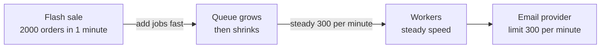

Notice: without the queue, 2,000 calls would hit the email provider in one minute. It would block most of them. With the queue, the line grows for a few minutes, then drains.

### The three gifts

| Gift | What it means | Example |
|---|---|---|
| **Absorbs spikes** | The queue holds the extra work. Workers keep a steady speed. | Flash sale emails go out over 7 minutes instead of failing |
| **Retries for you** | A failed job comes back later, with growing waits | The PDF service restarts; jobs finish after it is back |
| **Decoupled parts** | The API does not care if workers are down for a minute | You deploy the worker. Orders still work. |

### The three costs

| Cost | What it means | What you do about it |
|---|---|---|
| **One more system** | Redis, SQS or Kafka must be running, backed up and watched | Pick a managed service, or a Postgres queue if you only need a little |
| **Results come later** | The user sees "processing", not "done" (eventual consistency) | Show a status, send a push or email when done, or poll |
| **Harder debugging** | One user action now spans API, queue and worker logs | Put a request id in every job, and log it in the worker |

Where the analogy stops: a waiting line in a shop is visible. A queue in Redis is not. If nobody watches it, it can grow for hours before anyone notices.

> **Say this in the interview:** "A queue absorbs spikes, retries for me, and lets parts fail on their own. I pay with one more system, later results and harder tracing. So I put a request id in every job and alert on queue age."

---

## Part 3: Delivery guarantees, acks and the visibility timeout [Mid]

**Words you will hear:**
- **Ack (acknowledgement):** the worker tells the queue "I finished this job, you can delete it".
- **Visibility timeout (lock):** while a worker holds a job, the queue hides it from other workers for a set time.
- **At least once:** every job runs one or more times. Never zero, sometimes two.
- **Idempotent:** safe to run twice. Running it again gives the same result as running it once.

### The problem: the worker crashes in the middle

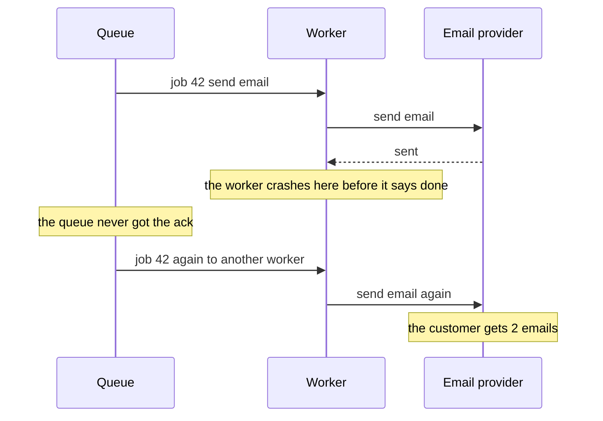

Notice: the queue cannot know if the work happened. It only knows nobody said "done". So it must choose: run it again (maybe twice) or drop it (maybe zero times).

### How it works: hide, wait for the ack, or give it back

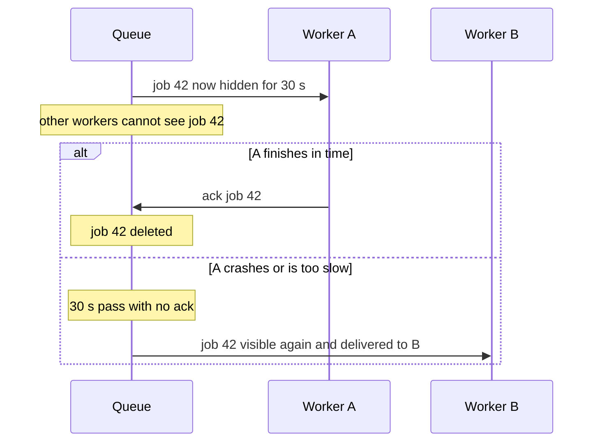

Notice: the timer is the safety net. It also causes the duplicates. If A was only slow, not dead, then A and B both run job 42.

How each tool names this timer:

| Tool | Name | Default |
|---|---|---|
| Amazon SQS | visibility timeout | 30 seconds, up to 12 hours |
| BullMQ | lock, and "stalled job" check | a stalled job goes back to waiting; the stall check runs about every 30 s |
| RabbitMQ | unacked message, returned when the connection closes | no timer by default, the connection matters |
| Kafka | the committed offset (Part 5) | the consumer saves its position after it works |

**Rule:** set the timer longer than your slowest normal job. For BullMQ, also keep CPU heavy work short. A blocked Node event loop cannot renew the lock, so BullMQ thinks the job stalled.

### The three promises

| Promise | When you ack | What can go wrong | Use for |
|---|---|---|---|
| **At most once** | before the work | crash = job lost, runs 0 times | metrics, "user is typing" signals |
| **At least once** | after the work | crash after work = job runs twice | almost everything: emails, orders, points |
| **"Exactly once"** | after the work, plus dedupe in the worker | needs a dedupe key and a database | money, points, stock |

Why "exactly once" has quotes: across a network, nobody can promise the job is *delivered* exactly once. A message or an ack can always get lost. What you can build is exactly once *effect*:

**exactly once effect = at least once delivery + an idempotent worker**

### The picture: an idempotent worker

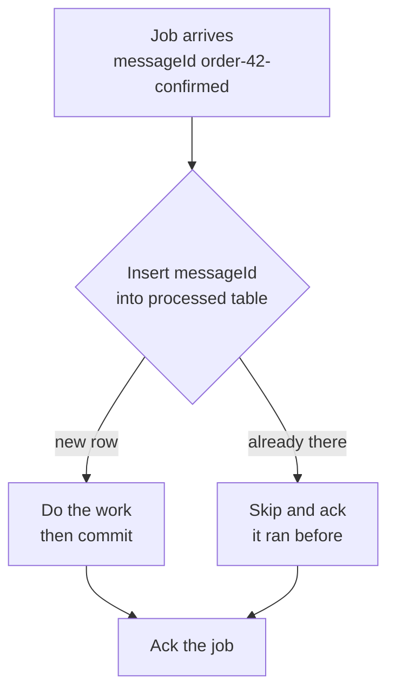

Notice: the check and the write are one database step. No "read, then decide, then write" gap. That gap caused the DBO double refund.

```sql
CREATE TABLE processed_message (
  consumer   text NOT NULL,
  message_id text NOT NULL,
  processed_at timestamptz NOT NULL DEFAULT now(),
  PRIMARY KEY (consumer, message_id)
);
-- in the SAME transaction as the real work:
INSERT INTO processed_message (consumer, message_id)
VALUES ('email-worker', 'order-42-confirmed')
ON CONFLICT DO NOTHING
RETURNING message_id;   -- 1 row = first time, 0 rows = duplicate, skip
```

Ran on PostgreSQL 16: the first insert returned the row, the second returned zero rows.

**The tricky part, a senior point:** an email is not inside your database transaction. So the dedupe row and the email cannot commit together. Two common answers:

- Pass a key to the provider if it accepts one (an idempotency key). The provider then drops the second copy.
- Accept a very small chance of a second email, but never a second charge. Put the strict guard on money, points and stock.

Deep version of the database side (locks, unique constraints, the ledger): [Scaling a database and keeping data correct](../database/database-scaling-and-correctness.md).

> **Say this in the interview:** "Queues give at least once delivery. A worker can crash after the work but before the ack. So I make the worker idempotent: it inserts a unique message id in the same transaction as the work. Exactly once is really at least once plus idempotency."

---

## Part 4: Retries, dead letter queues and poison messages [Mid]

**Words you will hear:**
- **Exponential backoff:** wait longer after each failure, for example 1 s, 2 s, 4 s, 8 s.
- **Jitter:** a random part added to each wait, so many workers do not retry at the same moment.
- **Dead letter queue (DLQ):** a separate pile for jobs that failed every try. A human or a tool looks at them later.
- **Poison message:** a job that can never succeed, for example bad data. Retrying it only wastes time.

### The problem: retrying too fast, all at once, forever

When the email provider goes down, 5,000 jobs fail at the same second. If every worker retries after exactly 1 second, all 5,000 retries hit the provider at the same moment again. When it comes back up, this burst knocks it down again.

### How it works: growing waits, random spread, then a separate pile

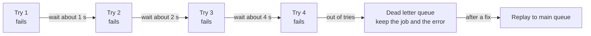

Notice: each wait doubles. Jitter makes "about 2 s" a random time, for example between 1 s and 2 s. The dead letter pile keeps the job, so nothing is lost.

In BullMQ, the wait before a retry is `2^(attemptsMade - 1) × delay`. With `delay: 1000` that is 1 s, 2 s, 4 s. With `jitter: 0.5` each wait becomes a random value between half and the full wait. That is why the run in Part 1 showed about 0.8 s and 1.2 s.

How the "failed pile" looks in each tool:

| Tool | Where failed jobs go |
|---|---|
| BullMQ | the queue's **failed** list. You can read `failedReason` and call `job.retry()` |
| SQS | a second queue set as DLQ. After `maxReceiveCount` receives (default 10 in the console), SQS moves the message there |
| RabbitMQ | a dead letter exchange you set on the queue |
| Kafka | no built in DLQ for normal consumers. Teams write failed records to a separate "retry" or "dlq" topic |

### Poison messages: right against wrong

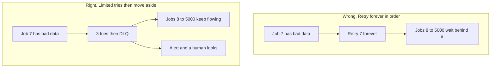

Notice: one bad job must never stop the whole line. This matters most where order is strict (one partition in Kafka, one FIFO group in SQS).

**Two kinds of errors, two answers:**

- **Will pass later** (timeout, 503, rate limited): retry with backoff.
- **Will never pass** (invalid data, 400, missing customer): fail at once, straight to the DLQ. In BullMQ you can throw an `UnrecoverableError` for this.

**Cost and care:**

- A DLQ that nobody watches is a slow data loss. Alert when its size is above zero.
- When you replay DLQ jobs, the worker must still be idempotent. Some of them may have half worked.
- Keep DLQ messages longer than main queue messages, so they do not expire before you look.

General retry rules for any network call (timeouts, retry budgets, circuit breakers): [Distributed systems and reliability patterns](distributed-systems-and-reliability-patterns.md).

> **Say this in the interview:** "Temporary errors get exponential backoff with jitter, for a few tries. Permanent errors skip retries. After the last try, the job goes to a dead letter queue with its error. We alert on its size and replay after the fix. Replay is safe because the worker is idempotent."

---

## Part 5: Queue vs stream vs pub/sub [Mid]

**Words you will hear:**
- **Partition:** one slice of a Kafka topic. Each slice is its own ordered log.
- **Offset:** the position number of a message inside a partition, like a line number.
- **Consumer group:** a team of consumers that share the work of one topic. Each partition goes to one member.
- **Fan out:** one message is copied to many listeners.

### The problem: "queue" means three different shapes

People say "put it in a queue" for three different things. They behave very differently. If you pick the wrong one, you cannot replay data, or two services fight over the same messages.

### Shape 1: the work queue (SQS, RabbitMQ, BullMQ)

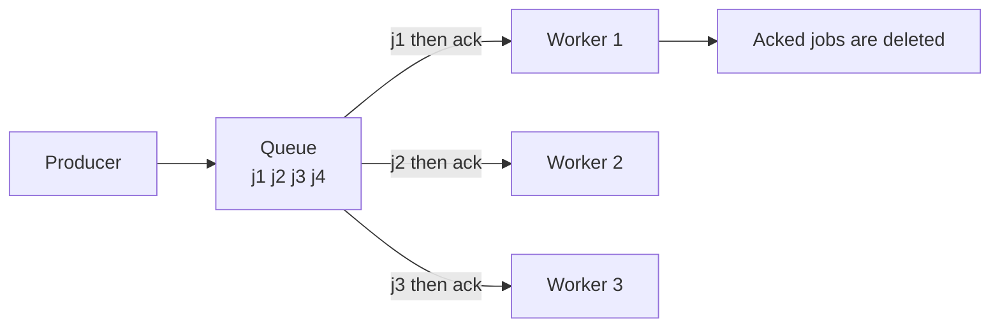

Notice: each job goes to **one** worker. After the ack it is gone. More workers means faster draining.

Good for: "do this task once": send email, build PDF, resize image.

### Shape 2: the log you can replay (Kafka, Kinesis, Redpanda)

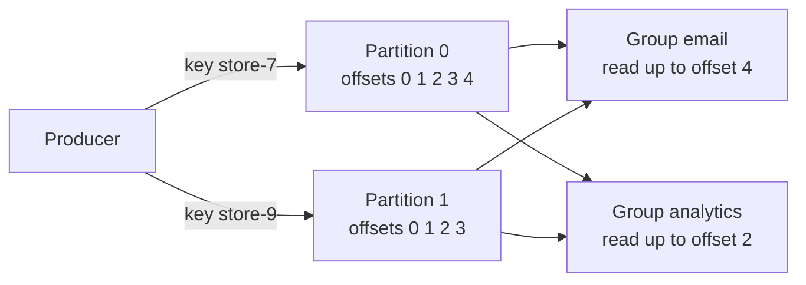

Notice: messages are **not deleted** when read. Each consumer group keeps its own bookmark (the offset). The analytics group is behind; the email group is not. Both read the same data.

How it works, in bullets:

- A topic is split into partitions. The producer picks the partition from a **key**, for example the store id.
- The broker keeps messages for a set time (for example 7 days), read or not.
- Each consumer group saves "I have read up to offset N" per partition (commits the offset).
- To read again after a bug, you move the offset back. That is a **replay**.
- In a classic consumer group, one partition goes to one consumer. So 6 partitions means at most 6 busy consumers in that group.

<details><summary>Go deeper (optional): share groups, Kafka as a work queue</summary>

Kafka 4.2 (early 2026) made **share groups** ready for production. A share group lets many consumers take records from the same partition. Each record gets its own ack, like a work queue. It gives up ordering to do that.

</details>

### Shape 3: pub/sub fan out (SNS, Redis pub/sub, Google Pub/Sub)

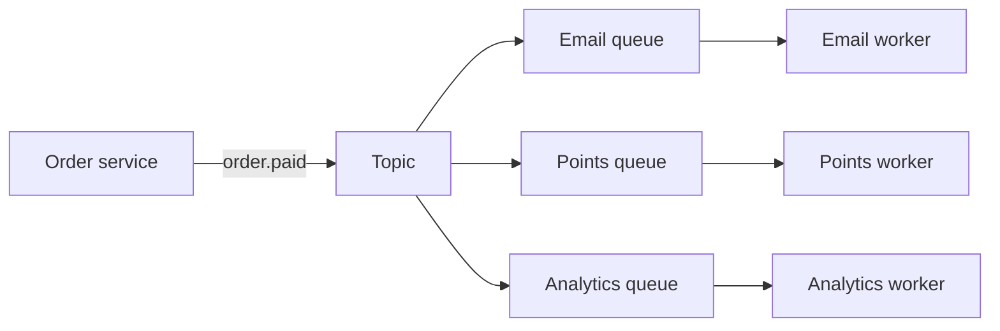

Notice: one message becomes three copies. Each listener gets its own copy and works at its own speed. A common AWS shape is SNS in front of one SQS queue per listener.

Watch out: **Redis pub/sub keeps nothing.** If a listener is offline, it misses the message forever. It is fine for "refresh this screen" signals, not for orders. Redis Streams is the Redis feature that keeps messages.

### Ordering: only per key

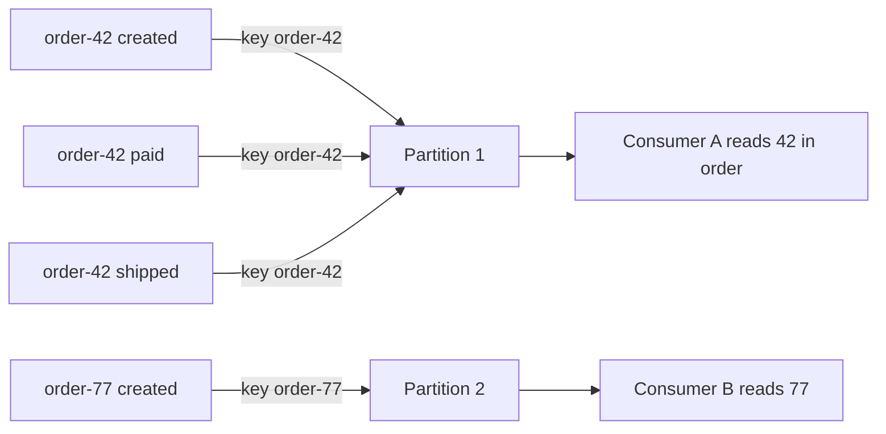

Notice: all events of order 42 share one key, so they land in one partition, in order. Order 42 and order 77 have no order between them, and they do not need one.

- Kafka keeps order **inside a partition only**.
- SQS FIFO keeps order **inside a message group** only.
- A normal SQS queue or a BullMQ queue with many workers gives **no strict order**.
- Retries break order too: job 1 fails and waits, job 2 runs first.

| | Work queue | Log or stream | Pub/sub |
|---|---|---|---|
| A message goes to | one worker | every group, each at its own pace | every subscriber |
| After reading | deleted | kept for days | gone, unless each listener has a queue |
| Replay | no | yes, move the offset | no |
| Order | weak | per partition key | none or per key |
| Examples | SQS, RabbitMQ, BullMQ | Kafka, Kinesis, Redpanda | SNS, Redis pub/sub, Google Pub/Sub |
| Use for | tasks | event history, many readers, analytics | "tell everyone this happened" |

> **Say this in the interview:** "A work queue hands each job to one worker and deletes it. A log like Kafka keeps events, so many groups can read them and I can replay after a bug. Pub/sub copies one event to many listeners. Order is only guaranteed per key, so I key by order id."

---

## Part 6: Choosing a tool in 2026 [Mid]

**Words you will hear:**
- **Managed service:** the cloud company runs the servers. You only use it.
- **SKIP LOCKED:** a Postgres option that says "skip rows another transaction has locked". It turns a table into a safe job queue.

### The problem: picking Kafka because it sounds senior

Kafka is great for event streams. It is heavy for "send an email later". Interviewers listen for the reason, not the brand. Start from your needs.

### The decision picture

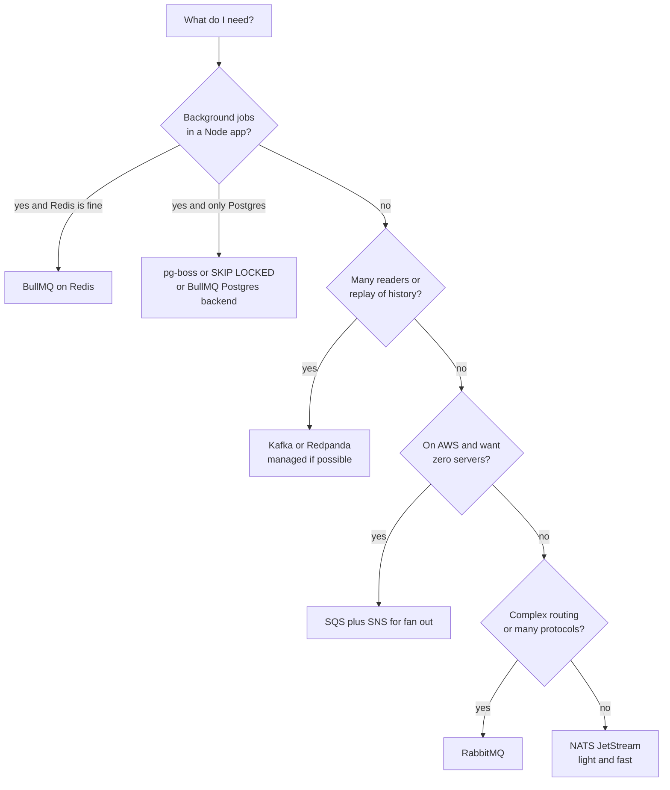

Notice: the first question is "what do I already run?". Adding no new system is often the best answer.

### The tools, with checked facts

| Tool | Shape | Checked facts (2026) | Pick when |
|---|---|---|---|
| **BullMQ** | work queue on Redis | Version 6.3.x (Oct 2026). `ioredis` is now a separate install. v6 removed old repeatable jobs; use Job Schedulers. Has an optional **PostgreSQL backend**, about 1.5 to 2 times slower than Redis by its own docs. | Node app, background jobs, you already run Redis |
| **Postgres queue** (pg-boss, or your own table) | work queue in your database | pg-boss uses `SKIP LOCKED`, needs Node 22.12+ and Postgres 13+ | Low to medium volume, you want jobs in the same transaction as your data |
| **Amazon SQS** | managed work queue | Max message size raised to 1 MiB (Aug 2025). Visibility timeout default 30 s, max 12 h. Fair queues for many tenants (Jul 2025). | On AWS, want no servers to run |
| **RabbitMQ** | broker with routing | 4.0 removed classic mirrored queues; quorum queues are the safe replicated type. Amazon MQ supports 4.2 (Nov 2025). | Complex routing rules, priorities, many languages |
| **Apache Kafka** | log you can replay | 4.0 (Mar 2025) removed ZooKeeper (the old separate helper service). Kafka now stores its own cluster info (KRaft). 4.2 made share groups ("queues for Kafka") production ready. 4.3 out around May 2026. | Event history, many consumer teams, high volume, replay |
| **Managed Kafka** | same, run for you | IBM completed buying Confluent on 17 Mar 2026. Redpanda is a Kafka compatible option. | You want Kafka without running it |
| **NATS JetStream** | light streams and work queues | Server 2.12 (2025) added delayed message scheduling; 2.14 came out Apr 2026 | Small, fast, many services, edge devices |

### A Postgres job queue in one query

```sql
WITH next AS (
  SELECT id FROM job
  WHERE status = 'waiting' AND run_at <= now()
  ORDER BY id
  FOR UPDATE SKIP LOCKED
  LIMIT 1
)
UPDATE job SET status = 'active', started_at = now()
FROM next WHERE job.id = next.id
RETURNING job.id, job.payload;
```

What happened when two workers ran it at the same time on PostgreSQL 16: worker A took job 1 and held its lock. Worker B did not wait. It skipped job 1 and took job 2. Job 3 stayed waiting.

**Cost of a Postgres queue:** every job is a row that gets updated and deleted. At high volume this adds load and table bloat to your main database. It is a great start, not the answer for millions of jobs per hour.

> **Say this in the interview:** "I start from what we already run. In a Node stack with Redis, BullMQ covers background jobs. If I only have Postgres and low volume, a SKIP LOCKED queue keeps jobs in the same transaction as the data. I reach for Kafka only when I need many readers or replay."

---

## Part 7: Backpressure and scaling consumers [Mid]

**Words you will hear:**
- **Consumer lag:** how far behind the workers are. In a queue, the number of waiting jobs. In Kafka, newest offset minus committed offset.
- **Age of the oldest message:** how long the oldest waiting job has waited. The best single alarm.
- **Backpressure:** a way for a slow part to tell a fast part "slow down".
- **Autoscaling:** adding or removing workers automatically, based on a number.

### The problem: jobs arrive faster than workers finish

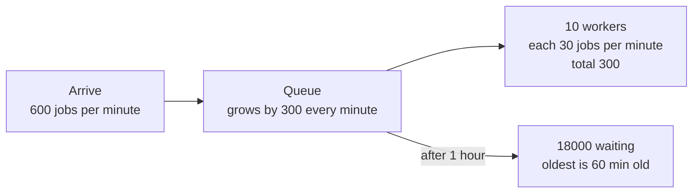

Notice: the queue does not fail loudly. It just grows. Emails arrive an hour late, and nobody gets an error.

### The simple math

- Each job takes 2 seconds, so one worker does 30 jobs per minute.
- 600 jobs arrive per minute.
- Workers needed: 600 / 30 = **20**, plus some extra room, so about 25.
- With 10 workers, the line grows by 300 each minute.

### How to keep up

- **Scale on queue depth or oldest age,** not on CPU. Workers waiting on an email API use little CPU but are still too few.
- **Kafka limit:** in a classic consumer group, workers above the partition count sit idle. Plan partitions ahead, or use share groups.
- **Concurrency per worker:** in Node, one BullMQ worker can run several jobs at once (`concurrency: 10`) because the jobs mostly wait on the network.
- **Cap the queue when you must.** If lag can never be cleared, shed load: reject new non urgent jobs, or answer 503 so callers try later. That is backpressure.

### Rate limits toward third parties

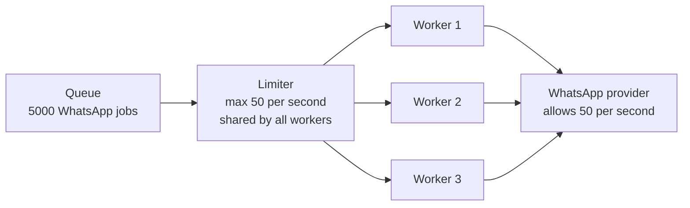

Notice: adding workers does not help if the partner allows only 50 calls per second. The limit must be shared by all workers. In BullMQ, the `limiter` option on the Worker is global for the queue.

```ts
new Worker("whatsapp", sendOtp, {
  connection,
  concurrency: 20,
  limiter: { max: 50, duration: 1000 },   // 50 jobs per second for the whole queue
});
```

- When the partner answers 429 (too many requests), wait the time it asks (the `Retry-After` header).
- Group by tenant when one big customer can fill the line. SQS fair queues (2025) do this with a message group id.

> **Say this in the interview:** "I alert on consumer lag and the age of the oldest message. I autoscale workers on queue depth, not CPU. More workers do not help past the partition count or the partner's rate limit. So I put one shared limiter in front of each third party."

---

## Part 8: Event-driven architecture [Senior]

**Words you will hear:**
- **Event:** a fact about the past. "OrderPaid". Anyone may listen. The sender does not care who.
- **Command:** a request for the future. "SendInvoice". One receiver is expected to do it.
- **Event-carried state transfer:** the event holds all the data the listener needs, so it never calls back.
- **Schema registry:** a shared store of event shapes that checks a new version will not break readers.

### The problem: services that call each other in a long chain

The order service calls points, then email, then analytics, then shipping. Each new listener means changing the order service. If one is slow, the order is slow.

### Events against commands

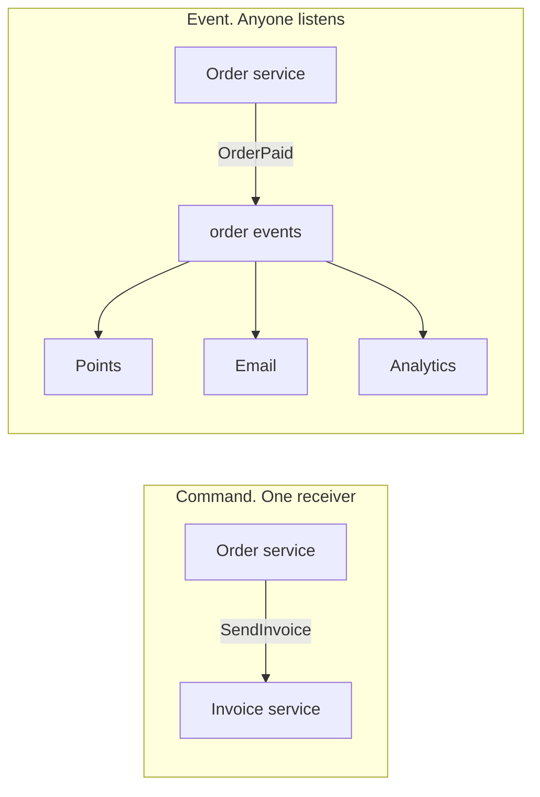

Notice: with a command, the sender knows the receiver. With an event, the sender only states a fact. A new listener needs no change in the order service.

Name events in the past tense (`OrderPaid`). Name commands as orders (`ChargeCard`). If you cannot name it in the past tense, it is probably a command.

### Two ways to fill an event

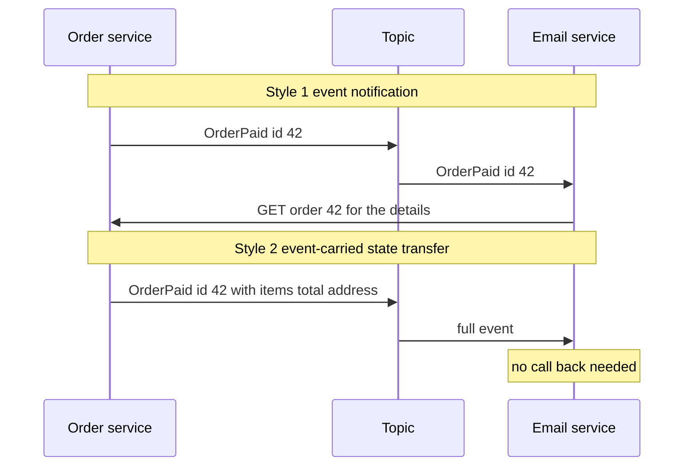

| | Notification (thin) | State transfer (fat) |
|---|---|---|
| Event size | small | bigger |
| Listener calls back | yes, extra load on the sender | no |
| Works if sender is down | no | yes |
| Risk | many call backs at once | shares more fields, harder to change |

### Changing an event without breaking readers

Old readers will read new events, and new readers will read old events (after a replay). So:

- Only **add** fields, and make them optional. Never rename or remove in place.
- Put a version in every event: `{ "type": "OrderPaid", "version": 2, ... }`.
- For a real breaking change, publish `OrderPaid.v2` next to v1 for a while.
- In Kafka setups, a **schema registry** with Avro, Protobuf or JSON Schema rejects a producer that would break readers.
- In a TypeScript monorepo, a shared types package with Zod checks is the light version.

### Choreography against orchestration, in one picture

When one business action spans several services, you need a **saga**: a chain of local steps, where each step has an undo step (a compensation). The full story with the online shop is in [Load balancers and microservices](load-balancers-microservices-online-shop.md). Here is the orchestration version, because it is the one for money flows.

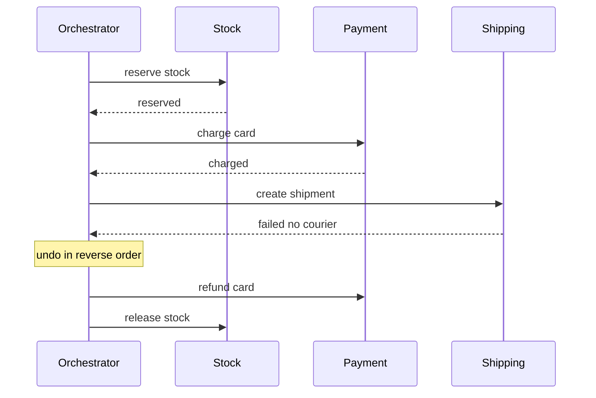

Notice: the undo steps run in **reverse** order, newest first. One place knows the whole state of order 42.

- **Choreography:** no leader. Each service reacts to events. Simple for 2 or 3 steps. Hard to answer "where is order 42 stuck?".
- **Orchestration:** one coordinator runs the steps and the undos. Easier to see, retry and time out.
- **Workflow engines** make the orchestrator durable. It survives crashes and continues where it stopped.
  - **Temporal:** open source, started as a fork of Uber's Cadence. Has a TypeScript SDK with a saga sample.
  - **AWS Step Functions:** managed workflows on AWS. AWS points to it when one SQS job needs longer than 12 hours.

**Cost:** an event-driven system is harder to follow. A flow lives in many services and logs. You need tracing (a request id in every event) and a picture of who listens to what.

> **Say this in the interview:** "An event states a past fact, and anyone can listen. A command asks one service to act. I only add fields and I version events, so old readers keep working. For money across services, I use an orchestrated saga with undo steps in reverse order, often in Temporal."

---

## Part 9: Outbox, inbox, CDC, CQRS and event sourcing [Senior]

**Words you will hear:**
- **Inbox:** a table on the receiving side that stores processed message ids, to skip duplicates.
- **CDC (change data capture):** a tool reads the database's own change log and turns each row change into an event.
- **CQRS:** separate models for writing and for reading.
- **Event sourcing:** you store the list of events as the truth. The current state is computed from them.

### Outbox and inbox: both ends of one safe path

The outbox is explained in depth in the database guide. Short version: write the business row and the "event to send" row in **one** transaction. A relay sends it later. Deep version: [Scaling a database and keeping data correct](../database/database-scaling-and-correctness.md).

```mermaid
graph LR
    subgraph SENDER["Sender. One transaction"]
        BIZ["orders row<br/>status PAID"]
        OUT["outbox row<br/>OrderPaid 42"]
    end
    SENDER --> RELAY["Relay or CDC<br/>reads outbox"]
    RELAY --> BUS["Queue or Kafka"]
    BUS --> IN{"Receiver inbox<br/>seen id before?"}
    IN -->|new| WORK["Do the work<br/>same transaction"]
    IN -->|seen| SKIP["Skip"]
```

Notice: the outbox stops **lost** events. The inbox stops **double** events. You need both, because the relay itself is at least once.

### CDC with Debezium

```mermaid
graph LR
    APP["App writes rows"] --> PG["Postgres"]
    PG -->|change log| DBZ["Debezium"]
    DBZ --> K["Kafka topics"]
    K --> S1["Search index"]
    K --> S2["Cache refresh"]
    K --> S3["Other service"]
```

Notice: the app does not publish anything. Debezium reads Postgres' change log (logical replication of the WAL, the write-ahead log) and creates the events.

- Good for: an outbox relay without polling, feeding search, filling a data warehouse.
- Cost: you run Kafka Connect and Debezium. You watch a replication slot, because a stuck slot keeps WAL and fills the disk.
- Another cost: raw row events show your table design to other teams. Using CDC only on an outbox table avoids this.

### CQRS and event sourcing

```mermaid
graph LR
    CMD["Commands<br/>RedeemPoints"] --> WM["Write side<br/>append event"]
    WM --> ES["Event store<br/>Earned 100 Redeemed 30"]
    ES -->|project| RM["Read model<br/>balance 70 fast to query"]
    Q["Screens ask<br/>what is my balance"] --> RM
    ES -->|replay all| NEW["New read model<br/>built later"]
```

Notice: the truth is the list of events. The balance is computed from them. You can build a new read model later by replaying the events from the start.

| Idea | What it is | Worth it when | Overkill when |
|---|---|---|---|
| **CQRS** | separate write and read models | reads need a very different shape: search, dashboards, heavy reports | a normal CRUD admin screen |
| **Event sourcing** | events are the truth, state is computed | you need a full audit trail and history: ledgers, points, bank accounts | most apps; it makes simple changes and fixes hard |
| **Light version** | an append only ledger table plus a cached balance | points or money in a normal Postgres app | rarely |

The light version is often the senior answer. The DBO case study already suggests an append only `point_transactions` ledger. That gives most of the audit value with no event store.

> **Say this in the interview:** "The outbox stops lost events. The inbox table stops duplicates. Debezium can replace the polling relay. CQRS and event sourcing pay off for audit heavy domains like ledgers. For most apps, an append only ledger table in Postgres gives that audit trail with far less work."

---

## Part 10: Failure stories and how to watch a queue [Senior]

**Words you will hear:**
- **Out of order:** events arrive in a different order than they happened.
- **Replay:** reading old messages again, on purpose, to redo work.
- **Monotonic state:** a status that can only move forward, never back.

### Story 1: duplicate processing

- **What happens:** a webhook or job arrives twice. Both copies run.
- **Real example:** DBO received the same TADA refund event twice at almost the same moment, and stores got double points. The fix used a row lock, and the case study suggests a unique event id and a ledger on top.
- **Defense:** inbox table with a unique id, guarded status changes (`UPDATE ... WHERE status = 'PENDING'`), and idempotency keys toward partners.

### Story 2: out of order events

```mermaid
graph TB
    S1["Courier sends shipped first"] --> NET["Network and retries"]
    S2["Courier sends delivered 5 min later"] --> NET
    NET --> A1["delivered arrives first"]
    NET --> A2["shipped arrives second"]
    A2 --> BAD["Wrong. Status goes back to shipped"]
    A2 --> GOOD["Right. Shipped is older so ignore it"]
```

Notice: the late event is real, but old. A status that only moves forward ignores it.

- Give statuses a rank: created 1, paid 2, shipped 3, delivered 4. Only update if the new rank is higher.
- Or keep a version number per entity and ignore events with a lower version.
- Or key the events by entity id so one partition keeps them in order.

### Story 3: reprocessing after a bug

- **What happens:** a worker bug wrote wrong totals for 2 hours.
- **With Kafka:** fix the code, then move the consumer group's offset back to before the bug, and let it read again. This only works if the worker is idempotent and writes "set to X", not "add X".
- **With a work queue:** acked jobs are gone. You rebuild from your own data: an events table, the outbox history, or the partner's API. This is a big reason teams keep an outbox or events table for some days.

### Story 4: a consumer that falls behind

- **What happens:** traffic doubles, or a partner gets slow. Lag grows quietly for hours.
- **Signs:** oldest message age climbs; DLQ grows if timeouts start; users ask "where is my email?".
- **Fixes:** scale workers, raise concurrency, batch work, fix the slow call, or shed non urgent jobs. In Kafka, check that you have enough partitions.

### What to put on the dashboard

```mermaid
graph TB
    D["Queue dashboard"] --> M1["Waiting jobs or lag<br/>per queue or group"]
    D --> M2["Age of oldest message<br/>alarm above your promise"]
    D --> M3["DLQ or failed count<br/>alarm above 0"]
    D --> M4["Job time and error rate<br/>slowest 5 percent per job type"]
    D --> M5["Worker count and<br/>partner 429 responses"]
```

Notice: the **age** of the oldest message is the alarm that matches what users feel. "1,000 waiting" can be fine. "Oldest waited 40 minutes" is never fine for an order email.

> **Say this in the interview:** "Queues fail quietly. So I alert on the age of the oldest message, consumer lag and DLQ size. Idempotent workers make duplicates and replays safe. Statuses only move forward, so a late event cannot undo a newer one. I keep event history, so I can replay after a bug."

---

## Part 11: Where queues show up in your work (ideas, not facts)

These are questions to ask yourself. Only the DBO points marked "known" come from your case study.

**DBO (B2B commerce):**
- Known: DBO uses BullMQ on Redis with separate workers for email, points and webhooks, and a cron service. Known: duplicate TADA webhooks once caused double refunds.
- Question: which jobs in DBO are safe to run twice today, and which are not? Can you name the dedupe key for each?
- Question: what would you alert on? The case study suggests queue depth and job age.
- Idea: order confirmation emails in a flash sale. How many workers? What is the email provider's rate limit?

**Unloan (home loan platform):**
- Idea: generating loan documents or calling credit and identity checks are slow steps. Would they fit a queue with a status the user can see?
- Question to ask yourself: which steps must happen in order for one application? What would the key be?

**ZWS (React Native store on Shopify with subscriptions):**
- Idea: Shopify sends webhooks for orders and subscriptions. The V-D-Q-A recipe (verify, dedupe, queue, ack fast) from the online shop guide fits here.
- Question: what happens if two subscription events for the same customer arrive in the wrong order?

**Skyworx (loan systems for Indonesian banks):**
- Idea: nightly batch jobs, repayment reminders, or calls to bank systems with strict rate limits. Where would a limiter and a DLQ help?
- Question: for money movements, would you choose an orchestrated saga? Which steps need an undo?

---

## Practice

Try each one before opening the answer.

**1. Predict.** A BullMQ job has `attempts: 4` and `backoff: { type: "exponential", delay: 500 }`, no jitter. It fails every time. When do the tries happen, and where does the job end up?

<details><summary>Answer</summary>

Try 1 at 0 s. Waits are `2^(n-1) × 500`: 0.5 s, 1 s, 2 s. So tries at about 0 s, 0.5 s, 1.5 s and 3.5 s. After try 4 fails, the job moves to the queue's **failed** list with its `failedReason`. Nothing is lost; you can call `job.retry()` after a fix.

</details>

**2. Spot the bug in this design.** "The worker reads the job, acks it at once so the queue stays small, then charges the card."

<details><summary>Answer</summary>

Acking before the work is **at most once**. If the worker crashes after the ack and before the charge, the job is gone and the customer is never charged (or the order is never completed). Ack after the work, and make the charge idempotent with a key like the order id.

</details>

**3. Choose.** You need: the order service publishes `OrderPaid`. Email, points and analytics all need it. Analytics wants to reread the last 7 days after a bug. Work queue, pub/sub, or Kafka?

<details><summary>Answer</summary>

Kafka (or another log). Three readers each need their own copy, and analytics needs replay. A work queue gives each message to only one worker. Plain pub/sub cannot replay. On AWS without Kafka, SNS to three SQS queues covers fan out but not replay.

</details>

**4. Spot the bug.** A Kafka topic has 4 partitions. Lag is growing, so the team scales the consumer group from 4 to 12 consumers. Lag keeps growing.

<details><summary>Answer</summary>

In a classic consumer group, one partition is read by only one consumer. 8 of the 12 consumers sit idle. Fix: more partitions (plan this ahead, since changing it moves keys), faster processing per record, or a share group if order does not matter.

</details>

**5. Compute.** 1,200 PDF jobs arrive per minute. Each takes 3 seconds and uses one worker slot. How many slots do you need?

<details><summary>Answer</summary>

One slot does 60 / 3 = 20 jobs per minute. 1,200 / 20 = **60 slots**, plus extra room, so about 70 to 75. If PDF building is CPU heavy, those slots must be real processes or containers, not `concurrency` in one Node process.

</details>

**6. Spot the bug.** The courier sends `delivered` then a late retry of `shipped`. The handler does `UPDATE shipment SET status = $1 WHERE id = $2`.

<details><summary>Answer</summary>

The late `shipped` overwrites `delivered`. Make the status only move forward: `UPDATE shipment SET status = $1, rank = $2 WHERE id = $3 AND rank < $2`. Zero rows updated means the event is old; ack it and move on.

</details>

**7. Draw it.** Draw the full safe path for "order paid, send receipt": the order service with its outbox, the relay, the queue, and the email worker with its inbox and the DLQ.

<details><summary>Answer</summary>

```mermaid
graph LR
    TX["One transaction<br/>order PAID plus outbox row"] --> R["Relay"]
    R --> Q["Queue"]
    Q --> W{"Email worker<br/>inbox seen id?"}
    W -->|new| SEND["Send with key order-42"]
    W -->|seen| ACK["Ack and skip"]
    SEND -->|fails 5 times| DLQ["DLQ plus alert"]
```

</details>

**8. Choose.** A small Node and Postgres app sends about 2,000 emails per day. The team has no Redis. BullMQ on new Redis, or a Postgres queue?

<details><summary>Answer</summary>

A Postgres queue (pg-boss, or BullMQ with its Postgres backend). 2,000 jobs per day is tiny. You add no new system, and you can add the job in the same transaction as the business row, which gives you an outbox for free. Move to Redis or SQS when volume or latency needs it.

</details>

---

## Likely interview questions

Each answer has four parts: Problem, How it works, Tradeoff, My example.

**Q1. When would you use a queue instead of doing the work in the request?**

<details><summary>Answer</summary>

- **Problem:** slow or unreliable work (email, PDF, partner calls) makes the user wait and makes failures spread.
- **How it works:** the API saves the important data, adds a job, and answers. Workers take jobs and retry on failure.
- **Tradeoff:** faster answers and isolation, but results come later, there is one more system, and tracing is harder.
- **My example (fact):** DBO runs BullMQ on Redis with workers for email, points and webhooks, so background load does not slow the API.

</details>

**Q2. What does "at least once" mean, and how do you get "exactly once"?**

<details><summary>Answer</summary>

- **Problem:** a worker can crash after doing the work but before the ack, so the queue delivers again.
- **How it works:** delivery is at least once. You make the effect exactly once with an idempotent worker: a unique message id inserted in the same transaction as the work, guarded status updates, idempotency keys toward partners.
- **Tradeoff:** a dedupe table to keep and clean, and side effects outside the database (email) still need a provider key or an accepted small risk.
- **My example (fact):** duplicate TADA webhooks caused double refunds in DBO. The fix serialized the handlers with a row lock; a unique event id is the next layer.

</details>

**Q3. Explain the visibility timeout. What happens if it is too short?**

<details><summary>Answer</summary>

- **Problem:** the queue must hide a job while one worker has it, but also bring it back if that worker dies.
- **How it works:** on receive, the job is hidden for N seconds. An ack deletes it. No ack in time means it becomes visible again. SQS default is 30 s, max 12 h.
- **Tradeoff:** too short means a slow but alive worker loses the job and a second worker runs it too (duplicates). Too long means a dead worker's job waits long before retry.
- **My example (idea):** for a PDF job that takes 40 s, I would set the timeout well above 40 s, or extend it while the job runs.

</details>

**Q4. How do you design retries for a job that calls a third party?**

<details><summary>Answer</summary>

- **Problem:** fast, synchronized retries hit a recovering partner all at once and knock it down again.
- **How it works:** a few tries with exponential backoff and jitter; permanent errors (400, bad data) go straight to the DLQ; respect `Retry-After` on 429; a shared rate limiter for all workers.
- **Tradeoff:** more tries means more delay before the human sees a failure; fewer means more manual replays.
- **My example (idea):** WhatsApp OTP sends through Jatis in DBO happen in the auth service; if they moved to a queue, a global limiter would protect the cost and the partner limit.

</details>

**Q5. What is a dead letter queue and how do you operate it?**

<details><summary>Answer</summary>

- **Problem:** a job that always fails (a poison message) either blocks others or retries forever.
- **How it works:** after N tries, the job moves to a separate pile with its error. You alert when it is above zero, look, fix the cause, then replay.
- **Tradeoff:** a DLQ nobody watches is silent data loss. Replays need idempotent workers.
- **My example (idea):** in BullMQ the failed list plays this role; a daily check of `getFailedCount()` plus an alert would be the first step.

</details>

**Q6. Kafka or a work queue like SQS or RabbitMQ?**

<details><summary>Answer</summary>

- **Problem:** "queue" means different shapes; the wrong one blocks replay or fan out.
- **How it works:** a work queue gives each job to one worker and deletes it. Kafka keeps a log per partition; each consumer group has its own offset, and you can move it back to replay.
- **Tradeoff:** Kafka gives replay, many readers and high volume, but it is heavier to run and order is only per partition. Work queues are simpler and fit tasks.
- **My example (idea):** sending order emails is a work queue job. A stream of order events read by points, analytics and search would fit Kafka.

</details>

**Q7. How do you keep events in order?**

<details><summary>Answer</summary>

- **Problem:** retries, many workers and many partitions all reorder messages.
- **How it works:** order is only kept per key: Kafka partition key, SQS FIFO message group id. Key by the entity (order id). Also make status changes monotonic, so a late old event is ignored.
- **Tradeoff:** one key's events are handled one at a time, so a hot key limits speed. Global order across all keys does not scale.
- **My example (fact plus idea):** the DBO case study notes that "shipped" can arrive after "delivered" from Manager webhooks and suggests status changes that never go backwards.

</details>

**Q8. Your queue is growing and emails are an hour late. What do you do?**

<details><summary>Answer</summary>

- **Problem:** jobs arrive faster than workers finish; lag grows quietly.
- **How it works:** check arrival rate vs finish rate, the time of the slowest jobs, partner errors and 429 answers. Scale workers or concurrency, fix the slow call, batch, or shed non urgent jobs. Alert on oldest message age.
- **Tradeoff:** more workers can hit the partner's rate limit or the database connection limit.
- **My example (idea):** for DBO, queue depth and job age are the metrics the case study already lists as the first to watch.

</details>

**Q9. Events or commands? Thin or fat events?**

<details><summary>Answer</summary>

- **Problem:** long call chains couple services; every new listener changes the sender.
- **How it works:** an event states a past fact anyone can use; a command asks one service to act. Thin events carry an id and listeners call back; fat events carry the data.
- **Tradeoff:** thin events cause call backs and need the sender up; fat events share more fields and are harder to change, so I version them and only add fields.
- **My example (idea):** `OrderPaid` with items and totals lets email and points work even if the order service is down.

</details>

**Q10. Choreography or orchestration for a multi-service flow?**

<details><summary>Answer</summary>

- **Problem:** no shared transaction across services, so a failure halfway leaves partial work.
- **How it works:** a saga runs local steps with undo steps in reverse order. Choreography: services react to events. Orchestration: one coordinator, often a workflow engine such as Temporal or AWS Step Functions.
- **Tradeoff:** choreography is loose but hard to trace; orchestration is visible and retryable but adds a central piece.
- **My example (idea):** DBO point redemption (mark pending, call TADA, confirm or roll back) is the kind of money flow where orchestration helps.

</details>

**Q11. What are the outbox and CDC, and when would you use CDC?**

<details><summary>Answer</summary>

- **Problem:** "save to the database, then publish" can half fail and lose the event.
- **How it works:** write the event to an outbox table in the same transaction; a relay or Debezium (reading the Postgres change log) publishes it. Receivers dedupe.
- **Tradeoff:** a polling relay is simple but adds delay and load; CDC is fast but needs Kafka Connect and watching the replication slot.
- **My example (idea):** BullMQ jobs added after commit can be lost if the process dies in between; an outbox table with a small relay closes that gap.

</details>

**Q12. When are CQRS and event sourcing worth it?**

<details><summary>Answer</summary>

- **Problem:** some domains need full history and very different read shapes.
- **How it works:** CQRS splits write and read models. Event sourcing stores events as the truth and builds state by replaying them.
- **Tradeoff:** big gain in audit and flexible reads; big cost in complexity, schema changes and fixing bad events. Overkill for CRUD.
- **My example (idea):** for points, the DBO case study's append only ledger gives most of the audit value without a full event store.

</details>

---

## What's current (2026)

Each claim is dated. Checked on 2026-10-16.

- **Kafka has no ZooKeeper.** Kafka 4.0 (March 2025) removed ZooKeeper; KRaft (Kafka storing its own cluster info) is the only mode. Clusters move to 3.9 and migrate before going to 4.0.
- **Queues for Kafka are real.** KIP-932 share groups were early access in 4.0 and became production ready in Kafka 4.2 (early 2026). A 4.2.1 patch fixed a deadlock in share groups. Kafka 4.3 followed around May 2026, and 4.3.1 in June 2026.
- **Confluent is part of IBM.** IBM completed the purchase on 17 March 2026 (about 11 billion USD).
- **BullMQ 6.x** is current (6.3.15 on 14 Oct 2026). v6 removed the old repeatable jobs in favor of Job Schedulers, made `ioredis` an optional install, and ships an optional PostgreSQL backend.
- **Amazon SQS:** max message size went from 256 KiB to 1 MiB (Aug 2025). Fair queues for many tenant workloads arrived in July 2025.
- **RabbitMQ 4.x:** classic mirrored queues are gone since 4.0; quorum queues are the replicated type. Amazon MQ added RabbitMQ 4.2 in Nov 2025.
- **NATS:** server 2.12 (2025) added atomic batch publish and delayed message scheduling; 2.14 came out in April 2026.
- **Postgres as a queue keeps growing:** pg-boss (SKIP LOCKED, Node 22.12+, Postgres 13+) and the BullMQ Postgres backend let small teams skip Redis.
- **Debezium 3.6** is the current stable line (3.6.1 in August 2026), with 3.7 in preview.
- **Durable workflows:** Temporal (a fork of Uber's Cadence) keeps growing and runs a yearly Replay conference (May 2026). Netflix archived the public Conductor repo in December 2023 and kept an internal fork.

---

## Real-world cases to cite

- **LinkedIn, Burrow (consumer lag):** LinkedIn open sourced Burrow to watch Kafka consumer offsets. It judges a group over a sliding window with "no thresholds", because a fixed lag number gives false alarms. Cite it when you say "lag is the main metric". [github.com/linkedin/Burrow](https://github.com/linkedin/Burrow)
- **Shopify, job-iteration (long jobs and deploys):** Shopify found that with frequent deploys, a long job "will be either lost or restarted from the beginning". Their library makes jobs save progress and resume. Cite it for "keep jobs short or resumable". [github.com/Shopify/job-iteration](https://github.com/Shopify/job-iteration)
- **Uber, Cadence, and Temporal (workflow engines):** Uber built Cadence for long running, fault tolerant workflows. Temporal started as a fork of it. Cite it when you suggest orchestration. [github.com/uber/cadence](https://github.com/uber/cadence), [github.com/temporalio/temporal](https://github.com/temporalio/temporal)
- **Netflix, Conductor (orchestration):** Netflix built Conductor "to orchestrate workflows that span across microservices", then archived the public repo in 2023 and kept an internal fork. Cite it for "big companies also choose orchestration". [github.com/Netflix/conductor](https://github.com/Netflix/conductor)
- **Debezium outbox example (example design):** an order service writes to an outbox table, Debezium streams it to Kafka, and the shipment service skips event ids it has seen. Outbox plus CDC plus inbox in one runnable project. [github.com/debezium/debezium-examples/tree/main/outbox](https://github.com/debezium/debezium-examples/tree/main/outbox)
- **Your own: DBO duplicate TADA webhooks:** a real at least once delivery story. See the [DBO case study](../../interview/my-projects/dbo-b2b-platform-system-design-case-study.md).

---

## Watch and play

Videos: no video link this time. Video pages could not be opened or found in search from this workspace on 2026-10-16, and only checked links are listed.

1. **[bull-board](https://github.com/felixmosh/bull-board)**: a dashboard for BullMQ. Run `npx @bull-board/cli -r redis://localhost:6379`, add jobs, and watch them move to active, completed and failed.
2. **[BullMQ retry guide](https://github.com/taskforcesh/bullmq/blob/master/docs/gitbook/guide/retrying-failing-jobs.md)**: change `delay` and `jitter`, then predict the waits before you run them.
3. **[Kafbat UI](https://github.com/kafbat/kafka-ui)**: a web UI for Kafka. Look at partitions, offsets and per partition consumer lag with your own eyes.
4. **[System Design Primer, Asynchronism](https://github.com/donnemartin/system-design-primer#asynchronism)**: a short page with a diagram of message queues, task queues and back pressure.
5. **[Temporal TypeScript saga sample](https://github.com/temporalio/samples-typescript/tree/main/saga)**: read how the undo steps run in reverse order, in TypeScript.
6. **[Debezium outbox example](https://github.com/debezium/debezium-examples/tree/main/outbox)**: run outbox plus CDC plus inbox with Docker Compose.
7. **[NATS by Example, work queue stream](https://examples.nats.io/examples/jetstream/workqueue-stream/deno)**: short runnable example of a work queue on NATS JetStream.

---

## Review questions (day 1, 3, 7, 21)

**1. Why can a job run twice, even with a good queue?**

<details><summary>Answer</summary>

The worker can finish the work and crash before the ack. The queue cannot tell, so the visibility timeout ends and another worker gets the job. That is at least once delivery. The fix is an idempotent worker.

</details>

**2. What are the three shapes of messaging, and one tool for each?**

<details><summary>Answer</summary>

Work queue (one job to one worker, deleted after ack): SQS, RabbitMQ, BullMQ. Log or stream (kept, replayable, consumer groups with offsets): Kafka. Pub/sub (copied to every listener): SNS, Redis pub/sub.

</details>

**3. Which single number would you alert on for a queue, and why?**

<details><summary>Answer</summary>

The age of the oldest waiting message. It matches what users feel ("my email is 40 minutes late"). Queue size alone can look scary during a normal spike.

</details>

**4. Draw the picture from memory:** producer, queue, two workers, the ack, the visibility timeout bringing a job back, the retry waits growing, and the DLQ.

<details><summary>Answer</summary>

```mermaid
graph LR
    P["Producer"] --> Q["Queue"]
    Q --> W1["Worker 1"]
    Q --> W2["Worker 2"]
    W1 -->|ack after work| Q
    Q -->|no ack in 30 s so job comes back| W2
    W2 -->|fails and waits 1 2 4 s| Q
    Q -->|out of tries| DLQ["Dead letter queue"]
```

</details>

**Explain it back:** in your own words, explain "why exactly once is really at least once plus idempotency", using the DBO TADA story. Then run `/explain-check queues` or ask the `explain-coach` agent to check it.

---

<details><summary>Go deeper (optional)</summary>

- **Kafka producer side:** `acks=all` plus idempotent producers stop duplicates between the producer and the broker. Kafka "exactly once" transactions cover read from Kafka, process, write to Kafka. They do not cover your email or your Postgres write. That is why the idempotent consumer still matters.
- **Share groups detail:** share groups use an internal state topic that wants 3 brokers by default. They count delivery attempts per record and support a RENEW ack for long processing (Kafka 4.2).
- **SQS FIFO:** keeps order per message group id and removes duplicate sends within a 5 minute window. That dedupe is on the sending side only; your consumer can still see a message twice after a visibility timeout.
- **BullMQ in production:** set Redis `maxmemory-policy` to `noeviction` (the only safe setting for queues), turn on AOF persistence, close workers on SIGTERM so jobs do not stall, and set how many completed and failed jobs to keep (by default they are kept forever).
- **Postgres queue at scale:** the job table gets many updates and deletes, so autovacuum must keep up. Partition by day or delete in batches. LISTEN/NOTIFY can wake workers, but it does not work through PgBouncer in transaction mode.
- **Ordering plus parallel work:** you can keep per key order and still run in parallel by giving each key its own lane (Kafka partitions, SQS FIFO message groups).

</details>

---

## Sources

- [BullMQ, Retrying failing jobs (GitHub docs)](https://github.com/taskforcesh/bullmq/blob/master/docs/gitbook/guide/retrying-failing-jobs.md), accessed 2026-10-16
- [BullMQ, Connections (GitHub docs)](https://github.com/taskforcesh/bullmq/blob/master/docs/gitbook/guide/connections.md), accessed 2026-10-16
- [BullMQ, Stalled jobs (GitHub docs)](https://github.com/taskforcesh/bullmq/blob/master/docs/gitbook/guide/jobs/stalled.md), accessed 2026-10-16
- [BullMQ, Rate limiting (GitHub docs)](https://github.com/taskforcesh/bullmq/blob/master/docs/gitbook/guide/rate-limiting.md), accessed 2026-10-16
- [BullMQ, Going to production (GitHub docs)](https://github.com/taskforcesh/bullmq/blob/master/docs/gitbook/guide/going-to-production.md), accessed 2026-10-16
- [BullMQ, PostgreSQL backend (GitHub docs)](https://github.com/taskforcesh/bullmq/blob/master/docs/gitbook/guide/postgresql.md), accessed 2026-10-16
- [BullMQ, Migrate from v5 to v6](https://docs.bullmq.io/guide/migrations/migrate-from-v5-to-v6), accessed 2026-10-16
- [BullMQ releases](https://github.com/taskforcesh/bullmq/releases), v6.3.15 dated 2026-10-14, accessed 2026-10-16
- [pg-boss](https://github.com/timgit/pg-boss), accessed 2026-10-16
- [Apache Kafka 4.2.0 release announcement](https://kafka.apache.org/blog/2026/02/17/apache-kafka-4.2.0-release-announcement/), 2026
- [Apache Kafka 4.3.1 release announcement](https://kafka.apache.org/blog/2026/06/25/apache-kafka-4.3.1-release-announcement/), 2026-06-25
- [Apache Kafka 4.0.0 released, SoftwareMill](https://softwaremill.com/apache-kafka-4-0-0-released-kraft-queues-better-rebalance-performance/), 2025
- [Apache Kafka 4.3 now available, Curated SQL](https://curatedsql.com/2026/06/03/apache-kafka-4-3-now-available/), 2026-06-03
- [IBM completes 11bn Confluent acquisition, ChannelWeb](https://www.channelweb.co.uk/news-network/2026/ibm-completes-11bn-confluent-acquisition), 2026
- [Amazon SQS increases maximum message payload size to 1 MiB](https://aws.amazon.com/about-aws/whats-new/2025/08/amazon-sqs-max-payload-size-1mib), 2025-08-04
- [Amazon SQS introduces fair queues for multi-tenant workloads](https://aws.amazon.com/about-aws/whats-new/2025/07/amazon-sqs-introduces-fair/), 2025-07-21
- [Configuring queue parameters, Amazon SQS Developer Guide](https://docs.aws.amazon.com/en_en/AWSSimpleQueueService/latest/SQSDeveloperGuide/sqs-configure-queue-parameters.html), accessed 2026-10-16
- [Amazon MQ now supports RabbitMQ version 4.2](https://aws.amazon.com/about-aws/whats-new/2025/11/amazon-mq-rabbitmq-42), 2025-11
- [RabbitMQ 4.0.0-rc.2 notes (classic mirroring removed)](https://github.com/rabbitmq/rabbitmq-server/discussions/12321), 2024
- [NATS 2.12, what's new](https://docs.nats.io/release-notes/whats_new/whats_new_212), 2025
- [NATS Server 2.14 release](https://nats.io/blog/nats-server-2.14-release/), 2026-04
- [Debezium blog](https://debezium.io/blog/page/2), accessed 2026-10-16
- [Debezium](https://github.com/debezium/debezium) and [Debezium outbox example](https://github.com/debezium/debezium-examples/tree/main/outbox), accessed 2026-10-16
- [Temporal](https://github.com/temporalio/temporal) and [Temporal TypeScript samples](https://github.com/temporalio/samples-typescript), accessed 2026-10-16
- [Temporal Replay 2026](https://temporal.io/replay/2026), 2026
- [Uber Cadence](https://github.com/uber/cadence), accessed 2026-10-16
- [Netflix Conductor (archived)](https://github.com/Netflix/conductor), accessed 2026-10-16
- [LinkedIn Burrow](https://github.com/linkedin/Burrow), accessed 2026-10-16
- [Shopify job-iteration](https://github.com/Shopify/job-iteration), accessed 2026-10-16
- [System Design Primer](https://github.com/donnemartin/system-design-primer), accessed 2026-10-16
- [bull-board](https://github.com/felixmosh/bull-board) and [Kafbat UI](https://github.com/kafbat/kafka-ui), accessed 2026-10-16
- [NATS by Example, work queue stream](https://examples.nats.io/examples/jetstream/workqueue-stream/deno), accessed 2026-10-16
- [DBO case study (your own project notes)](../../interview/my-projects/dbo-b2b-platform-system-design-case-study.md), 2026-07-05
