# System Design Interview Questions, Beginner to Senior

- **Written:** 2026-10-16
- **Level:** Beginner to Senior (each part and each question is tagged)
- **Size:** 60 questions in 10 parts. Each answer has six pieces: the problem, how it works, the tradeoff, my example, the follow-up they will ask, and the weak answer to avoid.
- **Why this note exists:** You forget answers you only read. This bank makes you say each answer out loud first, with a picture and a reason, and only then check it.
- **Read with:** [System design roadmap](system-design-roadmap-beginner-to-senior.md), [System design step by step](system-design-step-by-step-walkthrough.md), [Senior database interview questions](../database/senior-database-interview-questions.md), [DBO case study](../../interview/my-projects/dbo-b2b-platform-system-design-case-study.md).
- **How links were checked:** opened or found in web search on 2026-10-16.

## TL;DR

- Every answer has the same four steps: **problem, how it works, tradeoff, my example**. Learn the shape once. Fill it per question.
- Say each answer out loud in **60 to 90 seconds** before you open it. Reading is not practice.
- Put **one number** in every answer: "99.9% means about 43 minutes of downtime a month".
- Put **one cost** in every answer. A choice with no cost sounds memorized.
- Your best real story is the **DBO double refund** (duplicate webhooks, fixed with a row lock). It answers about six questions in this bank.
- No time? Drill the **10 questions at the end** first.

## How to drill: say it out loud first, then open

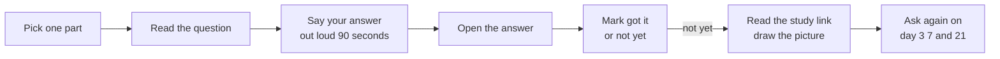

*Notice: the answer is opened only after you have spoken. The "not yet" pile is the real study list.*

1. Do one part per day. That is about 20 minutes.
2. Use a timer. Stop at 90 seconds even if you are not finished. Interviewers stop you too.
3. Say it, do not think it. Thinking feels like knowing. Speaking shows the gaps.
4. Use the **flashcard drill** (the visual cheatsheet for this note). It saves your "got it" and "not yet" marks.
5. Draw the picture from memory on paper or in [Excalidraw](https://excalidraw.com/) after each "not yet".
6. Any question you meet in a real interview: add it here with your best answer.

### The four-part answer

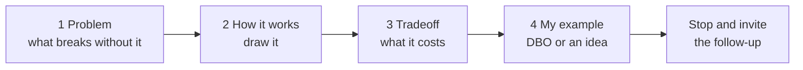

*Notice: you end by stopping. Say "I can go deeper on any part". Then wait.*

**About "My example":** only DBO facts from the [DBO case study](../../interview/my-projects/dbo-b2b-platform-system-design-case-study.md) are said as facts. Everything else is marked **Idea**: something you could do, not something you did. Never say an idea as if you built it.

## The map

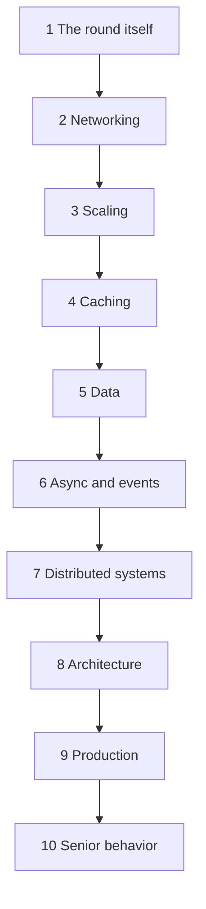

*Notice: the parts go from the round itself, through the parts of a system, to how a senior behaves.*

| Part | Level | Questions | You will be able to | Study more |
|---|---|---|---|---|
| [1. The round itself](#part-1-the-round-itself-beginner) | Beginner | 1 to 5 | Start a round, ask the right questions, estimate, and recover when stuck | [Step by step walkthrough](system-design-step-by-step-walkthrough.md) |
| [2. Networking for designers](#part-2-networking-for-designers-beginner-to-mid) | Beginner to Mid | 6 to 12 | Explain DNS, load balancers, CDN, live updates, and timeouts | [URL to page](../networking/networking-url-to-page-step-by-step.md), [Networking for system design](../networking/networking-for-system-design.md) |
| [3. Scaling and load balancing](#part-3-scaling-and-load-balancing-beginner-to-mid) | Beginner to Mid | 13 to 16 | Scale out stateless servers and keep users logged in | [Load balancers in depth](load-balancers-microservices-online-shop.md) |
| [4. Caching](#part-4-caching-mid) | Mid | 17 to 22 | Pick a cache pattern and handle stale data, stampedes and hot keys | [Caching and CDN in depth](caching-and-cdn-in-depth.md) |
| [5. Data](#part-5-data-mid) | Mid | 23 to 29 | Choose a store, use replicas, shard, make ids, and handle uploads | [Data storage choices](data-storage-choices-for-system-design.md), [Database scaling](../database/database-scaling-and-correctness.md) |
| [6. Async and events](#part-6-async-and-events-mid-to-senior) | Mid to Senior | 30 to 36 | Use queues safely: repeats, failures, outbox, sagas, order | [Queues and streams](queues-streams-and-event-driven-design.md) |
| [7. Distributed systems and reliability](#part-7-distributed-systems-and-reliability-senior) | Senior | 37 to 43 | Explain CAP, retries, breakers, leaders, locks, and chain failures | [Distributed systems and reliability](distributed-systems-and-reliability-patterns.md) |
| [8. Architecture](#part-8-architecture-mid-to-senior) | Mid to Senior | 44 to 50 | Defend monolith or services, BFF, federation, serverless, tenants, AI features | [Architecture patterns 2026](architecture-patterns-2026.md) |
| [9. Production](#part-9-production-senior) | Senior | 51 to 56 | Set targets, trace requests, deploy safely, recover, and secure APIs | [Production readiness](production-readiness-observability-security.md) |
| [10. Senior behavior in design](#part-10-senior-behavior-in-design-senior) | Senior | 57 to 60 | Talk tradeoffs, disagree well, think about cost, and lead reviews | [Choosing the right tool](choosing-the-right-tool-frontend-backend-decisions.md) |

---

## Part 1: The round itself [Beginner]

**Words you will hear:** **requirements** (what the system must do), **QPS** (requests per second), **deep dive** (the 15 minutes where you go into one hard part), **non-functional** (how well it must work: fast, always up, correct).

### 1. "Design a URL shortener." Where do you start? [Beginner]

<details><summary>Open the answer</summary>

**Problem:** The prompt is vague on purpose. If you draw boxes in minute two, you design the wrong thing. You also run out of time before the interesting part.

**How it works:** You follow seven steps in a fixed order, like a clock. Requirements, estimate, API, data, high-level picture, deep dive, failure and operations. You say the plan out loud in one sentence first, so the interviewer can follow you.

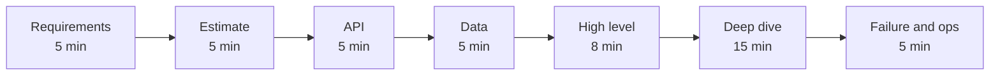

*Notice: the deep dive gets the most time. The round is won there, not in the first boxes.*

**Tradeoff:** A fixed order can feel slow. But it stops you from skipping requirements, which is the most common reason people get a lower level.

**My example:** I would say: "First I will agree the scope, then size it, then the API and data, then one picture, then go deep on the hardest part."

**Follow-up they will ask:** "You have 45 minutes. Which step would you cut if time is short?"

**Weak answer to avoid:** "I would use microservices and Kafka." Tools before the problem.

</details>

### 2. What questions do you ask before you design anything? [Beginner]

<details><summary>Open the answer</summary>

**Problem:** One prompt can mean many systems. 100 requests per second and 100,000 per second are different designs. Asking nothing looks careless. Asking 15 questions wastes time.

**How it works:** Ask two kinds of questions. First, what users must be able to do (2 to 4 lines). Then the four that change the design: how many users, how fast it must answer, how exact the data must be, and how much downtime is allowed. Say defaults for the rest, and cut scope out loud.

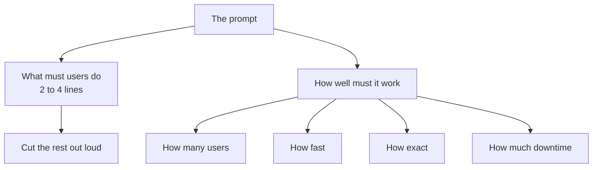

*Notice: the four "how" questions each change the drawing. That is why you ask them first.*

**Tradeoff:** Each question costs time. So propose a default with each one: "I will assume 10 million users and reads much more than writes. Is that right?"

**My example:** For a points system like the one in DBO, "how exact" is the key question. A points balance must be exact. A "popular products" list can be a few minutes old.

**Follow-up they will ask:** "Why does the consistency question change your design?"

**Weak answer to avoid:** Asking no questions, or asking a long list and never using the answers.

</details>

### 3. Estimate the traffic and storage for this system. [Mid]

<details><summary>Open the answer</summary>

**Problem:** Without numbers you cannot say if you need one server or a hundred. Every later choice would be a guess.

**How it works:** Round hard, and do it out loud. A day has 86,400 seconds; call it 100,000. Then: writes per second = writes per day / 100,000. Reads = writes times the read to write ratio. Peak = average times 2 to 3. Storage per year = writes per day times row size times 365. Then **say what the number means**.

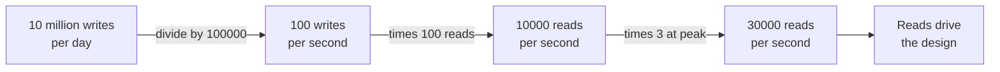

*Notice: the last box is the point. The estimate picks your deep dive.*

**Tradeoff:** Rounding makes the numbers wrong by 10 to 20 percent. That is fine. You only need the size, like 10 GB or 10 TB.

**My example:** 10 million new links a day at 500 bytes is 5 GB a day, about 1.8 TB a year. One Postgres server holds that. 30,000 reads per second does not fit one server, so I add a cache.

**Follow-up they will ask:** "Which number decides your design here, and why?"

**Weak answer to avoid:** Calculating for three minutes and never using the result.

</details>

### 4. You do not know the technology the interviewer just named. What do you say? [Beginner]

<details><summary>Open the answer</summary>

**Problem:** A bare "I don't know" ends the topic and scores zero. Faking it is worse: the next follow-up shows it.

**How it works:** Use a four-part script. Say what you have not used. Say what you do know that is close. Reason out loud to a best guess. Say how you would check.

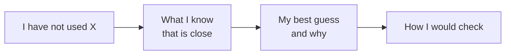

*Notice: the interviewer scores your thinking, so the guess and the "why" are the valuable part.*

**Tradeoff:** It takes 30 seconds longer than "I don't know". It shows how you work on a new problem, which is what a senior does every week.

**My example:** "I have not run Cassandra. I know it spreads data by a key over many nodes, like sharding. So I guess a query without that key is slow. I would check the docs on partition keys."

**Follow-up they will ask:** They usually help you. Listen for the hint and use it.

**Weak answer to avoid:** "Skip." Or long talk that never reaches a guess.

</details>

### 5. "We have 10 minutes left and you are still on the API." What do you do? [Mid]

<details><summary>Open the answer</summary>

**Problem:** Many candidates spend 30 minutes on details and never show a full picture or a deep dive. The interviewer cannot score what you never reached.

**How it works:** Say it out loud, then move. "I will park the rest of the API." Draw the full picture in 2 minutes. Pick the hardest part and go deep for 6 minutes. Name the top two failure cases in the last 2 minutes. Ask "shall I go deeper here or move on?" at each step so the interviewer can steer you.

**Tradeoff:** You leave some parts thin. A complete, thin design with one deep part scores better than a perfect half.

**My example:** I keep a small clock on paper: 5, 10, 15, 20, 28, 43 minutes. When the clock passes a mark, I move on.

**Follow-up they will ask:** "What would you do with another 30 minutes?" Have an answer: the second deep dive and how you would test it.

**Weak answer to avoid:** Ignoring the time hint and continuing the API.

</details>

---

## Part 2: Networking for designers [Beginner to Mid]

**Words you will hear:** **TTL** (time to live: how long a saved answer may be used), **L4 and L7** (the network layer a load balancer reads: the address only, or the full HTTP request), **CDN** (copies of your files on servers near users), **round trip** (a message there and the reply back).

### 6. How does DNS caching affect a deploy or a failover? [Mid]

<details><summary>Open the answer</summary>

**Problem:** You move your service to a new IP address. Some users still go to the old one for minutes or hours. During a failure, the "move" is not instant.

**How it works:** DNS turns a name into an IP address. The resolver (the DNS server your phone or office asks) keeps each answer for its TTL. Until the TTL runs out, it keeps giving the old address. Some programs also keep the answer longer than the TTL.

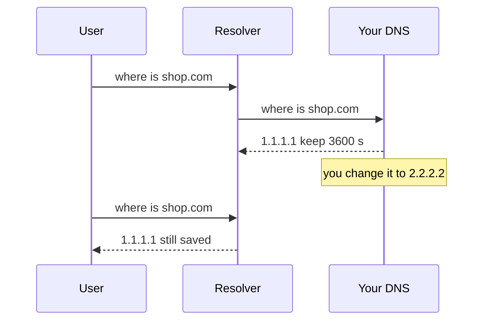

*Notice: your change is done, but the resolver still answers from its saved copy until the hour is over.*

**Tradeoff:** A short TTL (60 to 300 seconds) means faster moves but many more DNS lookups. A long TTL is cheap but slow to change. For fast failover, put a load balancer with a stable address in front, and move servers behind it instead.

**My example:** Before a planned move, lower the TTL a day early, move, then raise it again. In October 2025 an empty DNS record for an AWS database service caused a long outage across many AWS services.

**Follow-up they will ask:** "Your Node server cached the old IP. Why, and what do you do?"

**Weak answer to avoid:** "DNS changes are instant."

</details>

### 7. What is the difference between an L4 and an L7 load balancer? [Beginner]

<details><summary>Open the answer</summary>

**Problem:** You have many servers. Something must spread requests across them. How much it reads from each request decides what it can do.

**How it works:** An L4 load balancer reads only the address and port, like a mail sorter who reads the envelope. It is very fast. An L7 load balancer opens the HTTP request and reads the path, headers and cookies. So it can send `/graphql` to one group and `/images` to another, limit requests, and check tokens.

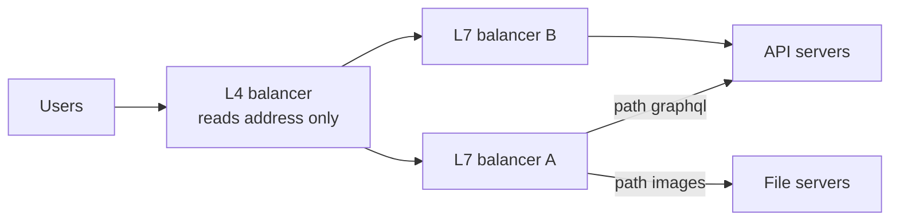

*Notice: big systems chain both. The fast L4 spreads load. The smart L7 makes route choices.*

**Tradeoff:** L7 is smarter but does more work per request and must decrypt HTTPS. L4 is faster but blind to the content.

**My example:** For web apps L7 is the default: nginx, Traefik, AWS ALB. CapRover, which DBO runs on, comes with nginx as its built-in L7 front door.

**Follow-up they will ask:** "Is the load balancer itself a single point of failure?"

**Weak answer to avoid:** "L7 is newer so it is better."

</details>

### 8. What does a CDN do, and what should you never cache there? [Beginner]

<details><summary>Open the answer</summary>

**Problem:** Users far from your server wait for every round trip. Indonesia to a US server can be 200 ms per round trip. Your server also serves the same image a million times.

**How it works:** A CDN keeps copies of your responses on servers in many cities. A user's request goes to the nearest one. If it has a fresh copy, it answers at once. If not, it asks your server once and keeps the copy. Your `Cache-Control` header tells it how long the copy stays fresh.

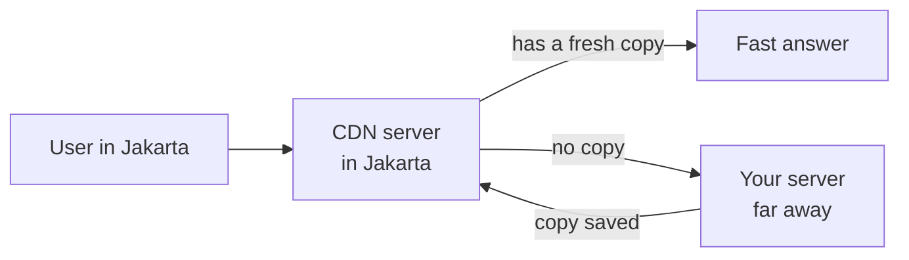

*Notice: only the first request travels far. The rest are answered nearby.*

**Tradeoff:** Copies can be old. You must clear them (purge) or use file names that change with each build. A wrong setting can show one user's page to another.

**My example:** Cache images, JS and CSS for a long time with a hash in the file name. Never cache personal pages, like a points balance or an order list, as shared copies. **Idea** for DBO: product images in the mobile app through a CDN.

**Follow-up they will ask:** "How does the CDN decide that two requests are for the same thing?"

**Weak answer to avoid:** "The CDN makes everything faster", with no word about stale or private data.

</details>

### 9. WebSockets, server-sent events, or polling: how do you pick for live updates? [Mid]

<details><summary>Open the answer</summary>

**Problem:** The server has news (a new message, an order status). Plain HTTP only answers when the client asks. So how does the news reach the screen quickly?

**How it works:** Polling: the client asks every few seconds. Simple, but wasteful and slow. Server-sent events (SSE): the client opens one HTTP request, and the server keeps sending events down it. One way only, with automatic reconnect. WebSocket: one long two-way connection. Both sides can send at any time.

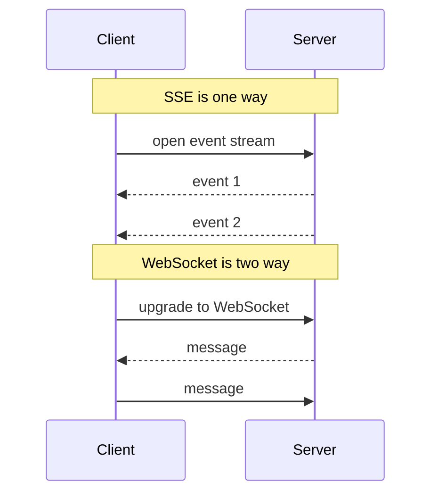

*Notice: SSE only flows from server to client. WebSocket flows both ways.*

**Tradeoff:** Long connections are state on one server. When you have many servers, a message for user A may arrive at the wrong server, so you add a shared message channel like Redis pub/sub. WebSockets also need the load balancer to allow long connections.

**My example:** Chat needs two-way, so WebSocket. A live order status or a streamed AI answer is one-way, so SSE. **Idea** for DBO: SSE for shipping status updates, fed by the Manager webhooks.

**Follow-up they will ask:** "You have 10 servers and 1 million open connections. How does a message find its user?"

**Weak answer to avoid:** "WebSockets for everything."

</details>

### 10. What changed from HTTP/1.1 to HTTP/2 to HTTP/3, and why does it matter for design? [Mid]

<details><summary>Open the answer</summary>

**Problem:** A page needs 50 files. With HTTP/1.1 each connection carries one request at a time, so browsers open about 6 connections and the rest wait.

**How it works:** HTTP/2 sends many requests at the same time over one TCP connection (TCP: the usual reliable connection). But TCP delivers bytes in strict order. One lost packet stalls every request on that connection. HTTP/3 runs on QUIC, which is built on UDP (a simpler way to send packets, with no order promise). A lost packet only delays its own request. Setup also needs fewer round trips, and the connection survives a switch from Wi-Fi to mobile data.

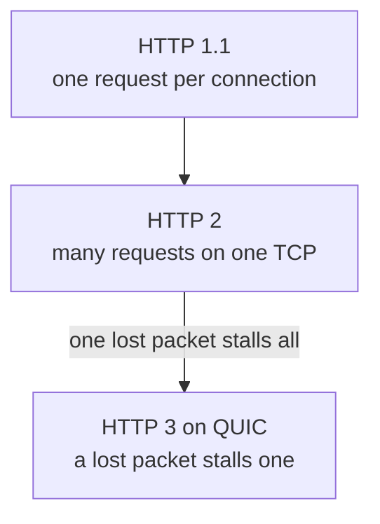

*Notice: each version fixes the waiting problem of the one before it.*

**Tradeoff:** HTTP/3 costs more CPU, and some networks block UDP, so browsers keep TCP as a backup. About 4 in 10 websites supported HTTP/3 in September 2026.

**My example:** HTTP/3 helps most on weak mobile networks. **Idea** for DBO: store owners use the app on mobile data, so turning on HTTP/3 at the CDN is a cheap win.

**Follow-up they will ask:** "Why did they build HTTP/3 on UDP instead of fixing TCP?"

**Weak answer to avoid:** "HTTP/3 is just faster."

</details>

### 11. What does an API gateway do, and what should it not do? [Mid]

<details><summary>Open the answer</summary>

**Problem:** You have several services. Without one front door, every service must repeat HTTPS, token checks, limits and logs. And internal services become visible to the internet.

**How it works:** The gateway is the one public door. It ends HTTPS, routes each path to a service, checks that the login token is real, limits requests, sets size limits and timeouts, and adds a request id for logs. Services behind it stay private.

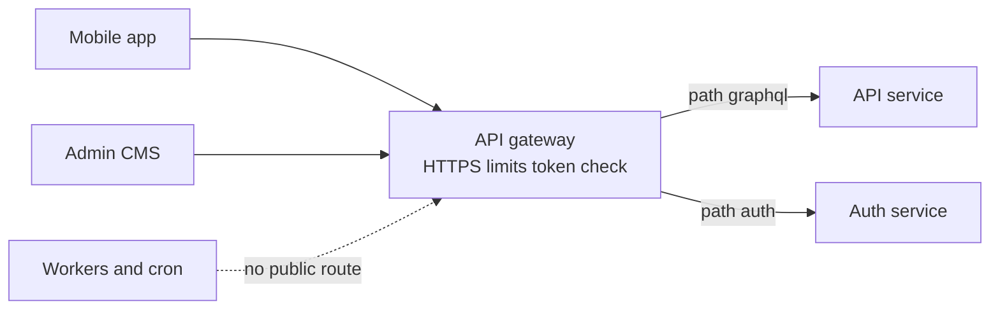

*Notice: workers and cron have no public route. The gateway decides who gets in, not what the business does.*

**Tradeoff:** The gateway is one more hop and one more thing that can fail. If you put business logic in it, it becomes a second monolith that every team must change.

**My example:** In DBO, three clients enter through one gateway to the API and Auth services. My rule: the gateway checks "is this token real", and the service checks "may this user do this".

**Follow-up they will ask:** "What is the difference between an API gateway and a load balancer?"

**Weak answer to avoid:** Putting data joins and business rules in the gateway.

</details>

### 12. How do you choose timeouts between services? And what is the difference between a 502 and a 504? [Senior]

<details><summary>Open the answer</summary>

**Problem:** A call with no timeout can wait forever. Waiting requests hold memory and connections until the server falls over. Badly set timeouts also mean the caller gives up while the work still runs.

**How it works:** Start from the user's total budget, for example 2 seconds. Each hop gets less time than the hop above it. Set each timeout a little above the normal slow time of that service (its p99: the time 99 of 100 requests beat). A 502 means the proxy got a broken answer or a closed connection. A 504 means the proxy waited and gave up.

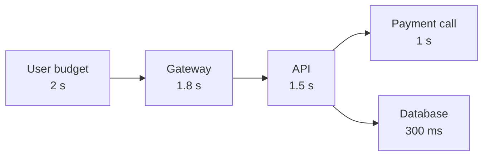

*Notice: each inner timeout is shorter than the outer one. Otherwise the outer one gives up first and the inner work is wasted.*

**Tradeoff:** Too short: you fail good requests on a slow day. Too long: one slow service drags everything down. Retries inside the budget must fit too.

**My example:** **Idea** from the DBO case study: 2 to 5 seconds on calls to TADA, Manager and Jatis, so a slow OTP provider cannot hang the login.

**Follow-up they will ask:** "Users see 504s at peak. Where do you look first?"

**Weak answer to avoid:** "30 seconds everywhere."

</details>

---

## Part 3: Scaling and load balancing [Beginner to Mid]

**Words you will hear:** **vertical scaling** (a bigger machine), **horizontal scaling** (more machines), **stateless** (the server keeps nothing about a user between requests), **autoscaling** (adding and removing machines automatically).

### 13. Vertical or horizontal scaling: what is the difference and which first? [Beginner]

<details><summary>Open the answer</summary>

**Problem:** One server is full. CPU is at 90% and requests get slow.

**How it works:** Vertical: move to a bigger machine with more CPU and memory. No code change. Horizontal: run several copies behind a load balancer. It has no top limit and survives one machine dying, but the app must be stateless.

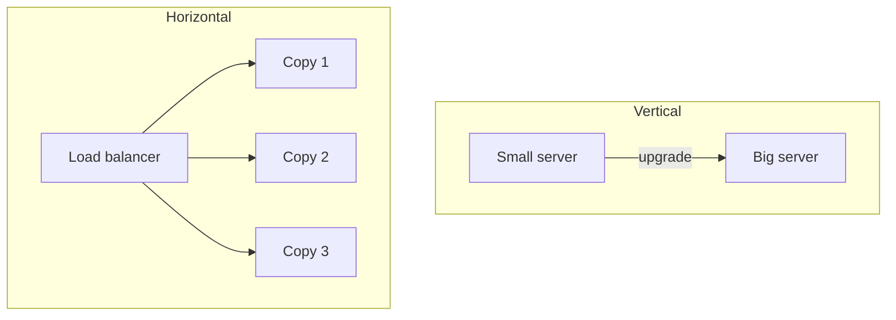

*Notice: vertical still has one machine, so one failure stops everything. Horizontal has spares.*

**Tradeoff:** Vertical is simple but has a ceiling and one point of failure. Horizontal needs stateless code and a load balancer. Databases are usually scaled up first, app servers out first.

**My example:** In DBO the services run as Docker containers on CapRover, so app servers can scale out by adding copies. The database usually grows by a bigger machine first.

**Follow-up they will ask:** "Why are databases harder to scale out than app servers?"

**Weak answer to avoid:** "Always horizontal, it is more modern."

</details>

### 14. What does "stateless" mean and why does it matter for scaling? [Beginner]

<details><summary>Open the answer</summary>

**Problem:** You add a second server. Users get logged out, or their cart disappears, because their data was in the memory of server 1.

**How it works:** A stateless server keeps nothing about a user between requests. Everything a request needs comes with it (a token) or lives in a shared place (a database or Redis). Then any copy can answer any request, and copies can be added or removed at any time.

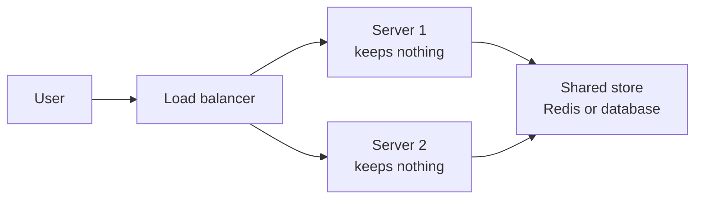

*Notice: the state moved to one shared place. The servers became copies you can replace.*

**Tradeoff:** Every request now reads the shared store, which adds a little time and makes that store important. It must be fast and must not go down.

**My example:** In DBO, the Auth service issues JWTs (signed login tokens), and the API validates the token on each request. That lets the API run as several copies, as long as it keeps nothing in its own memory.

**Follow-up they will ask:** "Where else does state hide? Think of uploaded files and timers."

**Weak answer to avoid:** "Stateless means no database."

</details>

### 15. How do you keep users logged in across many servers: sticky sessions, a session store, or JWT? [Mid]

<details><summary>Open the answer</summary>

**Problem:** Login state must be found by whichever server gets the next request.

**How it works:** Three options. Sticky sessions: the load balancer sends a user to the same server every time. A shared session store: a session id in a cookie, and the data in Redis. JWT: a signed token that holds the user id; any server can check the signature without a lookup.

**Tradeoff:** Sticky sessions break when that server dies or you scale down. A session store is one lookup per request, but logout is instant. JWTs need no lookup, but you cannot cancel one before it expires. So keep access tokens short (5 to 15 minutes) with a refresh token that you can cancel.

**My example:** DBO uses JWT from its own Auth service, so the API stays stateless. A fair follow-up is how a stolen token is cancelled: short life plus refresh tokens stored server side is the usual answer.

**Follow-up they will ask:** "A user changes their password. How do you log out their other devices?"

**Weak answer to avoid:** "JWT is always better than sessions."

</details>

### 16. How does autoscaling work, and what goes wrong with it? [Mid]

<details><summary>Open the answer</summary>

**Problem:** Traffic at 9 a.m. is ten times traffic at 3 a.m. Paying for peak all day is waste. Too few servers at peak means slow pages.

**How it works:** A controller watches a signal and adds or removes copies. For web servers, the signal is CPU or requests per copy. For workers, it is how many jobs wait in the queue and how old the oldest one is. New copies need time to start before they help.

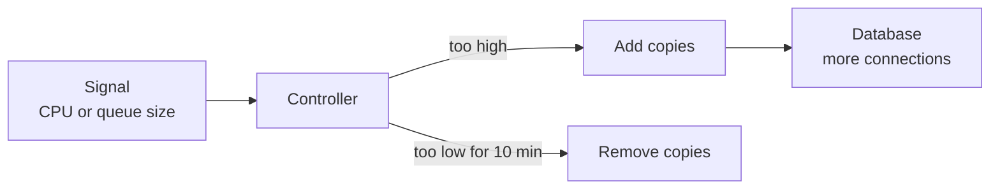

*Notice: more app copies means more database connections. The database can become the new limit.*

**Tradeoff:** Scaling is slow for a sudden spike, because start time can be a minute. Each copy opens its own database pool, so 20 copies times 10 connections is 200 connections. Removing copies too fast causes up-and-down flapping.

**My example:** **Idea** for DBO: scale workers on queue age, not CPU. Put PgBouncer (a tool that lets many app connections share a few real database connections) in front of Postgres before adding many API copies.

**Follow-up they will ask:** "A flash sale starts at 12:00. Autoscaling is too slow. What do you do?"

**Weak answer to avoid:** "Autoscaling handles any load."

</details>

---

## Part 4: Caching [Mid]

**Words you will hear:** **cache hit and miss** (the copy was there, or not), **cache-aside** (the app reads the cache first and fills it on a miss), **invalidation** (removing a copy that is now wrong), **stampede** (many requests rebuild the same missing copy at once).

### 17. Where can you cache, and how does cache-aside work? [Beginner]

<details><summary>Open the answer</summary>

**Problem:** The same data is read again and again from the database. The database does the same work every time and becomes slow.

**How it works:** You can cache in the browser, at the CDN, in the app's memory, or in Redis. Cache-aside is the usual Redis pattern. The app asks the cache. On a miss, it reads the database, saves the result in the cache with a time limit, and returns it.

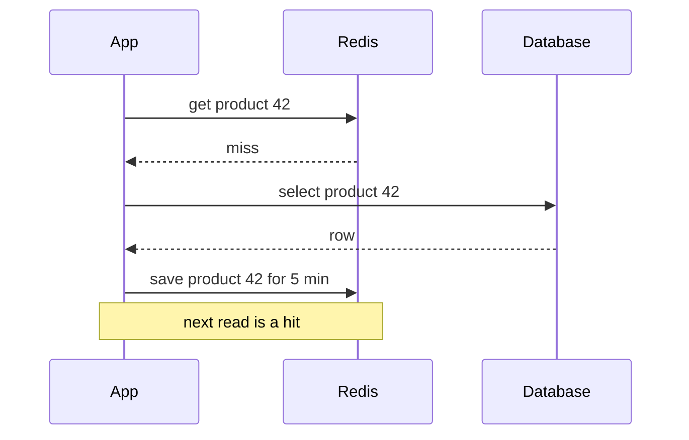

*Notice: the app does all the work. The cache does not know about the database.*

**Tradeoff:** The first read is slower, and the copy can be old for up to its time limit. You also have one more system to run.

**My example:** **Idea** for DBO: cache the product catalog, which many store owners read and admins rarely change. Never cache the points balance used to approve a redeem.

**Follow-up they will ask:** "What happens to the cached copy when an admin changes the product price?"

**Weak answer to avoid:** "Cache everything for an hour."

</details>

### 18. Cache-aside, write-through, or write-back: when do you use each? [Mid]

<details><summary>Open the answer</summary>

**Problem:** Writes change data. The cache and the database must not drift apart, and you must not lose writes.

**How it works:** Cache-aside: the app writes the database, then deletes the cache key. Write-through: every write goes to the cache and the database together, so the cache is always warm. Write-back: the write goes to the cache only, and the cache writes to the database later in batches.

**Tradeoff:** Cache-aside is simple and safe, but the first read after a change is a miss. Write-through makes every write slower and fills the cache with data nobody reads. Write-back is the fastest for writes, but if the cache dies before it flushes, the writes are lost.

**My example:** Cache-aside is my default. Write-back fits counters where losing a few seconds is fine, like view counts. **Idea:** never use write-back for orders or points.

**Follow-up they will ask:** "Why delete the key instead of updating it with the new value?"

**Weak answer to avoid:** Naming the three patterns without saying when each one loses data.

</details>

### 19. How do you keep the cache and the database in sync? [Mid]

<details><summary>Open the answer</summary>

**Problem:** After an update, readers may still see the old value. Worse, a slow reader can put an old value back into the cache after you deleted it.

**How it works:** Write the database first, then delete the key. Always set a time limit, so any mistake heals itself. The race: reader A misses and reads the old row, writer B updates and deletes the key, then A saves the old row into the cache.

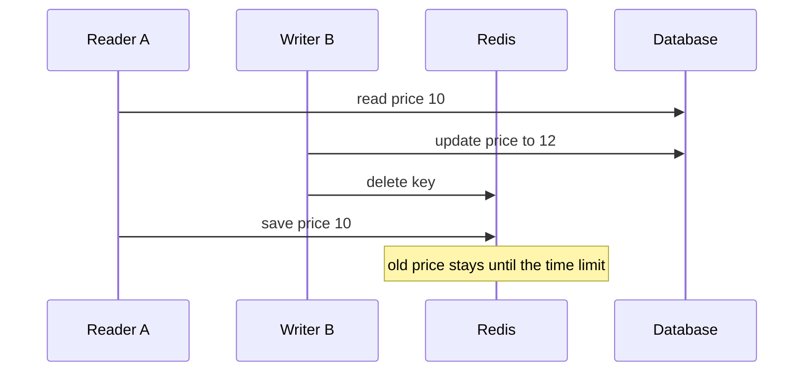

*Notice: the delete happened in the middle. The slow reader wrote the old price back after it.*

**Tradeoff:** Fixes add work. Short time limits cost more misses. Deleting a second time a moment later closes most of the race. Reading database changes (the change log) and deleting keys from it is the strongest fix, but it is one more system.

**My example:** **Idea** for DBO: product prices with cache-aside, a 5 minute limit, and delete on update from the CMS. For money decisions, always read the database.

**Follow-up they will ask:** "Why not update the database and the cache in one step?"

**Weak answer to avoid:** "We just set a long TTL."

</details>

### 20. A popular key expires and the database falls over. What happened and how do you prevent it? [Senior]

<details><summary>Open the answer</summary>

**Problem:** A cache stampede. A hot key (the home page) expires. In the same second, 5,000 requests miss and all go to the database for the same row.

**How it works:** Let only one request rebuild the key. The others wait a moment or get the old copy. Other fixes: refresh a little before the time limit, add a random spread to time limits so keys do not expire together, and serve the old copy while one request refreshes it.

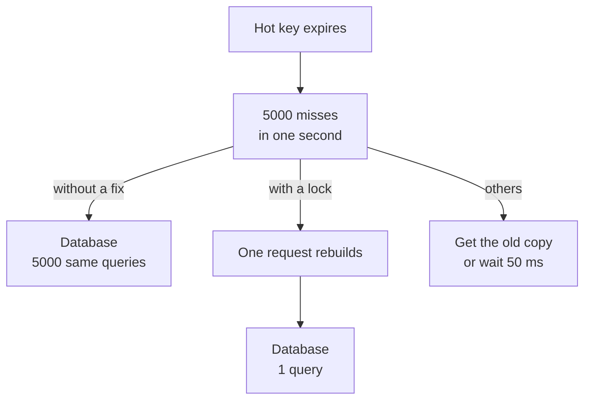

*Notice: the fix turns 5,000 database queries into one.*

**Tradeoff:** Locks add code and a short wait. Serving old copies means some users see slightly old data for a few seconds.

**My example:** **Idea** for DBO: the home banner list read by every store owner when the app opens. One rebuild with a short Redis lock and a random 10% spread on time limits.

**Follow-up they will ask:** "What if the request holding the lock crashes?"

**Weak answer to avoid:** "Make the TTL longer." The stampede still comes, just later.

</details>

### 21. One key gets so much traffic that one Redis node is overloaded. What do you do? [Senior]

<details><summary>Open the answer</summary>

**Problem:** A hot key. In a Redis cluster each key lives on one node. A flash sale product read 200,000 times a second puts all of that on one node, while the others sit idle.

**How it works:** Three fixes. Keep a tiny copy in each app server's memory for 1 to 5 seconds, so most reads never reach Redis. Or copy the key under several names (`product:42#1` to `#10`) on different nodes and read a random one. Or add read copies of that Redis node.

**Tradeoff:** Memory copies can be a few seconds old, and each app server has its own copy. Several names mean you must update all of them on change.

**My example:** **Idea:** a flash sale in DBO for one product. I would first measure which keys are hot. Redis has a command-line option to find hot keys. Then add a 2 second in-memory copy.

**Follow-up they will ask:** "How do you find the hot key before it hurts?"

**Weak answer to avoid:** "Add more Redis nodes." The key still lives on one node.

</details>

### 22. Redis goes down. What happens to your system? [Senior]

<details><summary>Open the answer</summary>

**Problem:** If the cache is a speed layer, the database suddenly gets all reads. But Redis often holds more than cache: sessions, rate limits and job queues.

**How it works:** List what Redis does, then plan each. Cache: fall back to the database, but with short Redis timeouts (about 50 ms) and a limit, so the database is not flooded. Rate limits: usually let requests through, with an alert. Queues: jobs stop until Redis is back, so turn on Redis saving to disk.

```mermaid
graph TB
    R["Redis is down"] --> C["Cache"]
    R --> L["Rate limits"]
    R --> Q["Job queue"]
    C -->|fall back with limits| DB["Database"]
    L -->|let through and alert| OK["Requests continue"]
    Q -->|jobs wait| W["Saved to disk<br/>restart safely"]
```

*Notice: one failure has three different effects. A senior answer names each one.*

**Tradeoff:** Letting requests through keeps the site up but removes protection. On a route that costs money, you may choose to block instead.

**My example:** In DBO, BullMQ jobs run on Redis, so emails, point sync and webhook processing stop if Redis dies. **Idea** from the case study: keep the buying flow on the database so it still works, keep Redis saving to disk, and block the OTP route instead of letting it through, because each OTP message costs money.

**Follow-up they will ask:** "How would you even know the cache is down if the site still works?"

**Weak answer to avoid:** "It is only a cache, nothing happens."

</details>

---

## Part 5: Data [Mid]

**Words you will hear:** **read replica** (a copy of the database that only reads), **replication lag** (how far behind the copy is), **sharding** (splitting data across several databases by a key), **CDC** (change data capture: reading the database's change log to copy changes elsewhere).

### 23. SQL or NoSQL for this system? [Beginner]

<details><summary>Open the answer</summary>

**Problem:** Picking a store by trend causes pain later. Each store is built for different reads and writes.

**How it works:** Start with how the data is read and written. Relational data, transactions, money, and unknown future queries: Postgres. One simple key lookup at huge scale: a key-value or document store like DynamoDB. Full-text search: a search engine. Big reports: a column store. Cache and queues: Redis.

```mermaid
graph TB
    Q["How is the data used"] --> A["Joins and transactions"]
    Q --> B["One key lookup<br/>at huge scale"]
    Q --> C["Text search"]
    Q --> D["Big reports"]
    A --> PG["Postgres"]
    B --> KV["Key value store"]
    C --> S["Search engine"]
    D --> COL["Column store"]
```

*Notice: the arrows start from how data is used, never from the name of a product.*

**Tradeoff:** Each extra store needs backups, monitoring and syncing. Postgres can go far with indexes, replicas and partitions.

**My example:** DBO uses Postgres for product data and Redis for BullMQ jobs, in three Postgres databases split by owner (auth, queue, toko).

**Follow-up they will ask:** "When would you pick DynamoDB over Postgres?"

**Weak answer to avoid:** "NoSQL scales and SQL does not."

</details>

### 24. How do read replicas work, and what problem do they bring? [Mid]

<details><summary>Open the answer</summary>

**Problem:** One database server can only answer so many reads. Most apps read far more than they write.

**How it works:** The main database (the primary) takes all writes. It streams its change log to copies, which replay it and answer reads. You send heavy or not-urgent reads to the copies.

```mermaid
sequenceDiagram
    participant U as User
    participant P as Primary
    participant R as Replica
    U->>P: change my address
    P-->>U: saved
    P->>R: change log 200 ms later
    U->>R: show my address
    R-->>U: old address
```

*Notice: the user saved and read back too early. The copy had not caught up yet.*

**Tradeoff:** Copies are behind by some milliseconds or seconds (lag). A user may not see what they just wrote. Writes are still limited to one primary.

**My example:** **Idea** from the DBO case study: send CMS reports and order history to a replica. Read from the primary for a few seconds after a user writes. Checkout and redeem always read the primary.

**Follow-up they will ask:** "How do you watch the lag, and what do you do when it is high?"

**Weak answer to avoid:** Not mentioning lag at all.

</details>

### 25. How would you shard this database, and how do you pick the shard key? [Senior]

<details><summary>Open the answer</summary>

**Problem:** One primary cannot take all the writes, or the data is too big for one machine, even after replicas and partitions.

**How it works:** Split the rows across several databases by a key, like `store_id`. A small router uses the key to find the right database. A good key has many different values, spreads load evenly, and keeps most queries inside one shard.

```mermaid
graph LR
    APP["App"] --> RT["Router<br/>which shard for store 42"]
    RT --> S1["Shard 1<br/>stores 1 to 1000"]
    RT --> S2["Shard 2<br/>stores 1001 to 2000"]
    RT --> S3["Shard 3<br/>stores 2001 and up"]
```

*Notice: a query that knows the store id touches one shard. A query without it must ask all three.*

**Tradeoff:** You lose joins and transactions across shards, and unique rules across all data. Moving data when you add shards is hard. A key based on time puts all new writes on the last shard.

**My example:** **Idea** for DBO: shard by `store_id` only if one primary cannot take the writes. Almost every query is "orders of this store", so most queries stay in one shard. Before that: indexes, PgBouncer, replicas, and monthly partitions (one big table split into a table per month, inside one database).

**Follow-up they will ask:** "One store is 100 times bigger than the others. What now?"

**Weak answer to avoid:** "Shard by user id" without saying why, or sharding as the first step.

</details>

### 26. What is consistent hashing and why is it used? [Senior]

<details><summary>Open the answer</summary>

**Problem:** You spread keys over servers with `hash(key) % N`. You add one server, N changes, and almost every key moves. The cache is suddenly empty, or a lot of data moves.

**How it works:** Put servers and keys on a circle by their hash. Each key belongs to the next server clockwise. Adding a server only takes the keys between it and the server before it. About 1 of every N keys moves, not almost all. Each server sits on the circle many times (virtual nodes) so the load is even.

```mermaid
graph LR
    K1["key A"] -->|clockwise| S1["Server 1"]
    K2["key B"] -->|clockwise| S2["Server 2"]
    K3["key C"] -->|clockwise| S3["Server 3"]
    NEW["New server 4"] -.->|takes only keys<br/>just before it| S3
```

*Notice: the new server only takes keys from one neighbor. Everyone else keeps their keys.*

**Tradeoff:** It is more complex than modulo, and without virtual nodes the load is uneven. Range queries across keys do not work, because hashing scatters them.

**My example:** **Idea:** a cache cluster where cache servers come and go. Real systems use it: DynamoDB-style stores, Cassandra, and some load balancers to keep a user on the same server.

**Follow-up they will ask:** "Why do we need virtual nodes?"

**Weak answer to avoid:** "It is a hash that is consistent."

</details>

### 27. How do you make unique ids when many servers create rows at the same time? [Mid]

<details><summary>Open the answer</summary>

**Problem:** One auto-increment counter lives in one database. With several databases or offline mobile clients, you need ids that never clash, and that do not slow down the index.

**How it works:** Auto-increment: small and ordered, but only one database can hand them out. Random UUID (v4): made anywhere, but random order spreads inserts all over the index. UUIDv7: starts with the time, so new ids go to the end of the index. Postgres 18 has `uuidv7()`. Snowflake-style 64-bit id: time, machine number, and a counter.

```mermaid
graph LR
    S["Snowflake id<br/>64 bits"] --> T["41 bits<br/>time in ms"]
    S --> M["10 bits<br/>machine number"]
    S --> C["12 bits<br/>counter"]
```

*Notice: the counter allows 4,096 ids per millisecond per machine. Time first means ids sort by time.*

**Tradeoff:** UUIDs are 16 bytes against 8 bytes for a bigint. Time-ordered ids show when a row was made. Snowflake needs a unique machine number for each server.

**My example:** **Idea** for DBO: bigint ids inside the database, and a UUIDv7 public id for anything in URLs or shared with TADA or Manager.

**Follow-up they will ask:** "Why exactly are random UUIDs slower to insert?"

**Weak answer to avoid:** "UUIDs are always better because they are unique."

</details>

### 28. You add a search engine next to Postgres. How do you keep it in sync? [Mid]

<details><summary>Open the answer</summary>

**Problem:** The app writes Postgres, then writes the search engine. If the second write fails, search shows old or missing products. Writing two systems in one request (a dual write) always has this gap.

**How it works:** Write only to Postgres. Then copy changes to search from one reliable source: an outbox table (a "send this later" table, see Q34) written in the same transaction, or CDC that reads the Postgres change log. A worker reads the changes and updates the search index. If the worker fails, it continues from where it stopped.

```mermaid
graph LR
    APP["App"] -->|one write| PG["Postgres"]
    PG -->|change log| CDC["CDC or outbox reader"]
    CDC --> W["Index worker"]
    W --> ES["Search engine"]
```

*Notice: the app writes once. Search is filled from Postgres, so it can always catch up.*

**Tradeoff:** Search is a few seconds behind. You run one more system. Ask first: Postgres full-text search may be enough for a small catalog.

**My example:** **Idea** for DBO: start with Postgres full-text search for the product catalog. Move to a search engine fed by an outbox only if relevance or speed is not good enough.

**Follow-up they will ask:** "How do you rebuild the whole index without downtime?"

**Weak answer to avoid:** "Write to both in the API handler."

</details>

### 29. How do users upload large files, like photos or videos? [Mid]

<details><summary>Open the answer</summary>

**Problem:** If a 50 MB upload goes through your API server, it holds memory and a connection for the whole upload. Many uploads at once can stop the API.

**How it works:** The API checks the user, then asks object storage (like S3) for a pre-signed URL: a link that allows one upload, to one path, for a few minutes. The client uploads straight to storage. Storage tells your app when it is done, or the client confirms. A worker then checks the file (type, size, virus scan) and makes thumbnails.

```mermaid
sequenceDiagram
    participant C as Client
    participant A as API
    participant S as Storage
    participant W as Worker
    C->>A: I want to upload a photo
    A-->>C: signed URL valid 5 min
    C->>S: upload file directly
    S->>W: file arrived
    W->>A: checked and ready
```

*Notice: the big file never passes through the API. The API only hands out permission.*

**Tradeoff:** More steps, and you must clean up uploads that were started but never confirmed. The storage bucket must stay private, and you must limit size in the signed policy.

**My example:** In DBO, store owners upload a KTP photo for verification. **Idea:** a pre-signed URL to a private bucket, with a strict size limit, and admins see it through a short-lived signed link.

**Follow-up they will ask:** "How do you stop users from uploading a 5 GB file or a script?"

**Weak answer to avoid:** "Send the file as base64 in the GraphQL mutation."

</details>

---

## Part 6: Async and events [Mid to Senior]

**Words you will hear:** **at-least-once** (a message may arrive more than once, but is never lost), **idempotent** (doing it twice has the same result as doing it once), **DLQ** (dead letter queue: a side shelf for messages that keep failing), **outbox** (a table where you save "send this later" in the same transaction as the change).

### 30. Why put a queue between two parts of a system? [Beginner]

<details><summary>Open the answer</summary>

**Problem:** The API sends an email inside the request. The email service is slow, so the user waits. If it is down, the order fails, even though the order itself was fine.

**How it works:** The API saves the order and puts a job on a queue. It answers the user at once. A worker takes jobs from the queue and does the slow work. If the worker fails, the job stays and is tried again.

```mermaid
graph LR
    U["User"] --> A["API<br/>save order"]
    A -->|job| Q["Queue"]
    A -->|fast answer| U
    Q --> W1["Worker 1"]
    Q --> W2["Worker 2"]
    W1 --> E["Email service"]
```

*Notice: the user never waits for the email. Spikes wait in the queue instead of crashing the workers.*

**Tradeoff:** The work happens a little later (eventual). You must handle repeats and failures, and watch the queue size. Debugging spans more parts.

**My example:** DBO has a Queue service with BullMQ on Redis and separate workers for email, points and webhooks. Background load does not compete with request traffic.

**Follow-up they will ask:** "What should stay synchronous and never go on a queue?"

**Weak answer to avoid:** "Queues make things faster." They make the request faster, not the work.

</details>

### 31. Queue or stream: what is the difference between something like RabbitMQ or SQS and Kafka? [Mid]

<details><summary>Open the answer</summary>

**Problem:** Both move messages. But they keep them differently, so they solve different problems.

**How it works:** A queue hands each message to one worker. After the worker confirms, the message is deleted. A stream is a log kept for days. Each reader group keeps its own position, so many groups can read the same messages, and you can replay from the start. Order is kept inside one partition (a slice of the log).

```mermaid
graph TB
    subgraph QQ["Queue"]
        Q1["Message"] --> W1["One worker<br/>then deleted"]
    end
    subgraph SS["Stream"]
        L["Log kept 7 days"] --> G1["Billing reads<br/>at position 120"]
        L --> G2["Search reads<br/>at position 98"]
    end
```

*Notice: in a stream, two readers can be at different places in the same log.*

**Tradeoff:** Queues are simple and good for jobs with retries per message. Streams are good for many readers, replay and high volume, but they cost more to run and order is only per partition.

**My example:** DBO uses BullMQ, a job queue, which fits jobs like emails and webhook handling. **Idea:** a stream only makes sense if many teams need the same order events. In 2026 Kafka also has a queue-style mode (share groups), production-ready since Kafka 4.2.

**Follow-up they will ask:** "Why can a slow message in a Kafka partition block the ones behind it?"

**Weak answer to avoid:** "Kafka is a faster queue."

</details>

### 32. Your queue delivers at least once. How do you stop a job from running twice? [Mid]

<details><summary>Open the answer</summary>

**Problem:** Workers crash after doing the work but before confirming. Webhook senders retry on timeouts. So the same message arrives twice. Paying or giving points twice is a real bug.

**How it works:** Make the handler idempotent. Save the message id with a unique rule in the same transaction as the work. If the insert finds the id already there, stop. Or change state with a guarded update: `UPDATE ... WHERE status = 'PENDING'`, and only the first one wins.

```mermaid
sequenceDiagram
    participant T as TADA
    participant H1 as Handler copy 1
    participant H2 as Handler copy 2
    participant D as Database
    T->>H1: refund event 77
    T->>H2: same event 77
    H1->>D: insert event 77
    D-->>H1: inserted so do the refund
    H2->>D: insert event 77
    D-->>H2: already there so stop
```

*Notice: the database's unique rule decides who wins. No check in the app can be raced.*

**Tradeoff:** You need a table of seen ids and must decide how long to keep them. Calls to outside APIs need their own idempotency key.

**My example:** This is the real DBO incident. TADA sent the same refund event twice at almost the same moment. Both handlers passed the "already refunded?" check, so stores got double points. We fixed balances with a script and added `SELECT ... FOR UPDATE` so the second handler waits and then sees the first result. The unique event id is the next layer I would add.

**Follow-up they will ask:** "What if the side effect is an email, not a database row?"

**Weak answer to avoid:** "Our queue guarantees exactly once."

</details>

### 33. What is a dead letter queue, and what do you do with a message that always fails? [Mid]

<details><summary>Open the answer</summary>

**Problem:** A message with bad data fails every time (a poison message). If it is retried forever, it wastes workers. In an ordered log, it blocks every message behind it.

**How it works:** Retry a few times with growing waits. After the limit (for example 5 tries), move the message to a side shelf: the dead letter queue. Alert when the shelf is not empty. A person looks, fixes the bug or the data, and sends the messages back (a redrive).

```mermaid
graph LR
    Q["Queue"] --> W["Worker"]
    W -->|fails| R["Retry with<br/>growing wait"]
    R --> W
    W -->|5 failures| DLQ["Dead letter queue"]
    DLQ --> AL["Alert"]
    DLQ -->|after the fix| Q
```

*Notice: the shelf keeps the bad message safe. Nothing is lost, and the main queue keeps moving.*

**Tradeoff:** A dead letter queue nobody watches is a silent data loss. The redrive must be idempotent too, because the messages run again.

**My example:** In BullMQ, jobs have a number of tries and a wait setting, and failed jobs stay in a failed list that works like a DLQ. **Idea** for DBO: alert when the failed list for webhook jobs grows.

**Follow-up they will ask:** "How do you tell a bug from a temporary outage of the other service?"

**Weak answer to avoid:** "Retry forever."

</details>

### 34. You save an order and must also publish an "order created" event. How do you make sure both happen? [Senior]

<details><summary>Open the answer</summary>

**Problem:** Two systems, two writes. Save then publish: the app may crash between them, and the event is lost. Publish then save: the save may fail, and the event is a lie.

**How it works:** The transactional outbox. In one database transaction, save the order and insert a row into an `outbox` table. Both commit or neither does. A separate relay reads new outbox rows, publishes them, and marks them sent.

```mermaid
graph LR
    A["API"] -->|one transaction| T["orders table<br/>and outbox table"]
    T --> R["Relay reads<br/>new outbox rows"]
    R -->|publish| Q["Queue or stream"]
    R -->|mark sent| T
    Q --> C["Consumers"]
```

*Notice: the order and the "send this" note are saved together. The relay can retry for as long as it needs.*

**Tradeoff:** The event leaves a moment later. If the relay crashes after publishing but before marking it sent, it publishes again. So consumers must be idempotent.

**My example:** **Idea** for DBO: when an order is created, call Manager from a BullMQ job fed by an outbox row, not inside the GraphQL mutation's transaction.

**Follow-up they will ask:** "Polling the outbox or reading the change log: which and why?"

**Weak answer to avoid:** "Wrap the database write and the publish in a try-catch."

</details>

### 35. An order spans payment, stock and shipping in three services. How do you keep them consistent without one big transaction? [Senior]

<details><summary>Open the answer</summary>

**Problem:** You cannot lock rows in three databases at once in a safe way. If payment succeeds and stock fails, the customer paid for nothing.

**How it works:** A saga: a list of local steps, each with an undo step (a compensation). If step 3 fails, run the undo for steps 2 and 1. One coordinator can drive the steps (orchestration), or each service reacts to the last event (choreography). The order has clear states: pending, paid, reserved, confirmed, or cancelled.

```mermaid
graph LR
    A["Create order<br/>pending"] --> B["Charge payment"]
    B --> C["Reserve stock"]
    C -->|fails| U1["Refund payment"]
    U1 --> X["Order cancelled"]
    C -->|ok| D["Confirm order"]
```

*Notice: there is no rollback across services. You write the undo as a normal step.*

**Tradeoff:** Users can see in-between states. Undo steps can fail too, so they must be retried and idempotent. It is much more code than one transaction.

**My example:** In DBO, a redeem already spans two systems: we lower the points in our database, call TADA, and TADA reports the result by webhook. **Idea** from the case study: treat it as a small saga, with a "pending" redeem and an undo if TADA fails or never answers.

**Follow-up they will ask:** "Orchestration or choreography for this case, and why?"

**Weak answer to avoid:** "Use a distributed transaction across all services."

</details>

### 36. Do messages arrive in order? What if they do not? [Senior]

<details><summary>Open the answer</summary>

**Problem:** "Shipped" arrives after "delivered". If you apply events in arrival order, the order goes back to "shipped" and the user is confused.

**How it works:** Most queues do not promise order once there are retries or several workers. A stream keeps order only inside one partition, so you send all events for one order with the same key. Inside the handler, protect yourself anyway: give events a version or time, and only move state forward.

```mermaid
graph LR
    E1["Event delivered<br/>version 3"] --> H["Handler"]
    E2["Event shipped<br/>version 2"] --> H
    H -->|version 3 is newer| OK["Save delivered"]
    H -->|version 2 is older| SKIP["Ignore"]
```

*Notice: the handler compares versions, so arrival order stops mattering.*

**Tradeoff:** Full order means one worker per key, which limits speed. Version checks need a version in every event.

**My example:** DBO gets order and shipping status from Manager by webhook. **Idea** from the case study: only allow status to move forward, and never let a late event lower it.

**Follow-up they will ask:** "Two workers take two events for the same order at once. What happens?"

**Weak answer to avoid:** "The queue keeps them in order."

</details>

---

## Part 7: Distributed systems and reliability [Senior]

**Words you will hear:** **partition** (in this part: the network between servers breaks, and they cannot talk), **consensus** (servers agree on one value, like who is the leader), **jitter** (a small random wait so clients do not retry at the same moment), **circuit breaker** (a switch that stops calls to a failing service for a while).

### 37. Explain CAP in plain words. Then what does PACELC add? [Mid]

<details><summary>Open the answer</summary>

**Problem:** Your data is copied to two places. The network between them breaks. A user writes on side A. What does side B answer?

**How it works:** CAP says: during a network break, you choose. Either refuse answers that may be wrong (consistency), or answer with possibly old data (availability). You cannot have both while the break lasts. PACELC adds the normal day: when there is no break, you still choose between fast answers (latency) and up-to-date answers (consistency).

```mermaid
graph TB
    Q["Is the network broken"] -->|yes| P["Choose"]
    P --> C["Refuse and stay correct"]
    P --> A["Answer and maybe stale"]
    Q -->|no| E["Still choose"]
    E --> L["Fast answer"]
    E --> C2["Wait for copies<br/>to agree"]
```

*Notice: the "no" side is the PACELC part, and it is the choice you make every day.*

**Tradeoff:** Choosing correct means some users get errors during a break. Choosing available means some users see old data.

**My example:** A points balance should choose correct: refuse rather than allow a double spend. A product list can choose available. **Idea:** in DBO, I would say this per feature, not once for the whole system.

**Follow-up they will ask:** "Is Postgres with async replicas CP or AP?"

**Weak answer to avoid:** "Pick two of three." Breaks are not optional, so the real choice is only during a break.

</details>

### 38. What consistency levels exist, and which does each feature need? [Mid]

<details><summary>Open the answer</summary>

**Problem:** "Consistent" means different things. If you do not name the level, you either pay too much or show users wrong data.

**How it works:** From strongest to weakest. **Strong:** every read sees the latest write, as if there were one copy. **Read your own writes:** you always see your own changes; others may lag. **Monotonic reads:** you never see time go backwards. **Eventual:** if writes stop, all copies agree after some time.

**Tradeoff:** Stronger levels need more waiting, more round trips, or reading from one primary. Weaker levels are fast and survive failures, but show old data.

**My example:** **Idea** for DBO: points balance and redeem need strong (read from the primary). A store's own order list needs read-your-own-writes (primary for a few seconds after a change). The "popular products" list can be eventual.

**Follow-up they will ask:** "How do you build read-your-own-writes on top of replicas?"

**Weak answer to avoid:** "We use eventual consistency" for everything, with no feature named.

</details>

### 39. A service is failing. How should clients retry, and how can retries make it worse? [Senior]

<details><summary>Open the answer</summary>

**Problem:** A short failure happens. Every client retries at once, in sync. The service was almost back, and the retry wave knocks it down again. With retries at many layers, the load multiplies.

**How it works:** Retry only safe (idempotent) calls. Wait longer each time (exponential backoff: 100 ms, 200 ms, 400 ms), with a cap. Add jitter, a random part of the wait, so clients spread out. Limit retries to about 3, and retry at one layer only. Use a retry budget: stop retrying when many calls already fail.

```mermaid
graph TB
    U["User"] --> A["Layer 1<br/>3 tries"]
    A --> B["Layer 2<br/>3 tries"]
    B --> C["Layer 3<br/>3 tries"]
    C --> D["Database<br/>up to 27 calls"]
```

*Notice: 3 tries at each of 3 layers is 3 x 3 x 3 = 27 calls for one user click.*

**Tradeoff:** Retries hide short failures but add load. Longer waits mean slower recovery for each user.

**My example:** **Idea** from the DBO case study: calls to TADA and Manager retry with jittered backoff, only after the call is made idempotent with an idempotency key, so a retry cannot redeem twice.

**Follow-up they will ask:** "Why is jitter needed if you already back off?"

**Weak answer to avoid:** "Retry 5 times immediately."

</details>

### 40. What is a circuit breaker and when do you use one? [Mid]

<details><summary>Open the answer</summary>

**Problem:** The payment service is down. Every request still waits for a 5 second timeout. Your threads and connections fill up with waiting calls, and your own service gets slow for everyone.

**How it works:** A switch around the call. Closed: calls go through, and failures are counted. Open: after too many failures, calls fail at once, with no waiting. Half-open: after a cool-down, a few test calls go through. If they work, it closes again.

```mermaid
graph LR
    C["Closed<br/>calls go through"] -->|too many failures| O["Open<br/>fail at once"]
    O -->|after 30 s| H["Half open<br/>a few test calls"]
    H -->|tests pass| C
    H -->|tests fail| O
```

*Notice: while open, nobody waits. Your service stays fast and gives a fallback answer.*

**Tradeoff:** While open, even a working request fails. You need a fallback: a cached answer, a "try later" message, or a queue that sends later. Bad thresholds open too often or too late.

**My example:** **Idea** from the DBO case study: one breaker per provider. If Manager is down, fail fast and keep the orders in a queue for later, instead of stacking timeouts across all API copies.

**Follow-up they will ask:** "Circuit breaker and retries together: in which order?"

**Weak answer to avoid:** "It restarts the failing service."

</details>

### 41. How do servers agree on a leader? Explain Raft simply. [Senior]

<details><summary>Open the answer</summary>

**Problem:** Several servers keep the same data. Exactly one must take writes. If two think they are the leader, data splits and is lost.

**How it works:** In Raft, the leader sends heartbeats. If a follower hears nothing for a random short time (around 150 to 300 ms in the paper), it becomes a candidate and asks for votes for a new term. A server needs votes from a majority to lead. A write is final only when a majority has saved it.

```mermaid
sequenceDiagram
    participant A as Server A
    participant B as Server B
    participant C as Server C
    Note over A: leader stops sending heartbeats
    B->>A: vote for me in term 5
    B->>C: vote for me in term 5
    C-->>B: yes
    Note over B: 2 of 3 is a majority so B leads
    B->>C: heartbeat term 5
```

*Notice: a majority is needed. Two halves of a broken network cannot both have a majority, so there is never two leaders.*

**Tradeoff:** You need an odd number of servers. 3 servers survive 1 failure, 5 survive 2. Each write waits for a majority, which adds time, more so across regions.

**My example:** I would not write Raft. I would use a system built on it: etcd (used by Kubernetes) and Kafka's controller (KRaft). **Idea:** in an interview, say "I use etcd or the database for this, not my own code".

**Follow-up they will ask:** "Why must the number of servers be odd?"

**Weak answer to avoid:** "The servers just pick one."

</details>

### 42. Two workers must not process the same thing at once. Can you use a Redis lock? [Senior]

<details><summary>Open the answer</summary>

**Problem:** A lock in Redis has a time limit (a lease) so it frees itself if the holder dies. But a worker can pause (a long cleanup pause, a slow network) past the time limit. Now two workers think they hold the lock.

**How it works:** Ask what the lock is for. To avoid duplicate work (efficiency), a simple Redis lock is fine: `SET key value NX PX 30000` means "set only if missing, and free it after 30 seconds"; a rare double run only wastes time. For correctness, the storage itself must refuse old holders: each lock comes with a number that goes up (a fencing token), and the database rejects writes with an older number. Or use the database's own locks and unique rules.

```mermaid
sequenceDiagram
    participant W1 as Worker 1
    participant L as Lock
    participant W2 as Worker 2
    participant D as Database
    W1->>L: take lock token 33
    Note over W1: long pause and lock time runs out
    W2->>L: take lock token 34
    W2->>D: write with token 34
    W1->>D: write with token 33
    D-->>W1: rejected because 33 is old
```

*Notice: the database, not the lock, stops the old worker. That is what fencing means.*

**Tradeoff:** Fencing needs the storage to check the token. Database locks are safe but tie up connections.

**My example:** In DBO, the double refund was fixed with `SELECT ... FOR UPDATE` on the store row: the database's own lock, inside the same transaction as the check and the write.

**Follow-up they will ask:** "What is the Redlock debate about?"

**Weak answer to avoid:** "Redis is single-threaded so the lock is always safe."

</details>

### 43. One slow service took down the whole system. How does that happen, and how do you stop it? [Senior]

<details><summary>Open the answer</summary>

**Problem:** A cascading failure. Service C gets slow. B's calls to C wait, so B's connections fill up. A's calls to B now wait too. Retries add more load. Soon everything is down, though only C had a problem.

**How it works:** Break the chain at each link. Timeouts so nobody waits forever. Separate connection pools per dependency (bulkheads, like walls in a ship), so a slow C cannot use up the pool for D. Circuit breakers to fail fast. Load shedding: reject extra requests early with a 503 instead of queuing them. Limited retries with jitter.

```mermaid
graph LR
    U["Users"] --> A["Service A<br/>waiting"]
    A --> B["Service B<br/>pool full"]
    B --> C["Service C<br/>slow"]
    B --> D["Service D<br/>fine but starved"]
```

*Notice: D is healthy but gets no connections. A separate pool for D would have saved it.*

**Tradeoff:** Each guard rejects some good requests on purpose, to keep the rest working. It must be tuned and tested, for example with planned failure tests.

**My example:** In October 2025, an empty DNS record for one AWS database service spread to many other AWS services; full recovery took about 15 hours. **Idea** for DBO: a hanging Jatis OTP call must not block the whole Auth service, so it gets its own timeout and limit.

**Follow-up they will ask:** "Why can retries make a cascading failure worse?"

**Weak answer to avoid:** "Add more servers." More servers send more waiting calls to the slow service.

</details>

---

## Part 8: Architecture [Mid to Senior]

**Words you will hear:** **modular monolith** (one deployed app, split inside into modules with strict borders), **BFF** (backend for frontend: a small backend made for one client), **federation** (several GraphQL services joined into one graph by a router), **RAG** (retrieval-augmented generation: find your own documents first, then give them to the AI model with the question).

### 44. Monolith or microservices for a new product? [Mid]

<details><summary>Open the answer</summary>

**Problem:** Splitting too early gives you network calls, many deploys and broken transactions, with no benefit. Not splitting ever can mean one huge app that every team must change at once.

**How it works:** Start with a monolith with clear modules. Split out a service only when there is a real reason: a part needs very different scale, different security, its own release speed, or a separate team.

```mermaid
graph LR
    M["Modular monolith"] -->|needs its own scale| S1["Split out service"]
    M -->|needs strong isolation| S2["Split out service"]
    M -->|separate team| S3["Split out service"]
    M -->|no reason| K["Keep it inside"]
```

*Notice: every arrow to a new service has a reason on it. No reason means no split.*

**Tradeoff:** Services give independent deploys and scaling, but cost network failures, distributed data, and more operations work. A monolith is simple, but needs discipline to keep modules apart.

**My example:** In DBO the split was by operational need, not domain: Auth for security, Queue and workers so background load does not slow requests, and Cron so scheduled jobs run once. The product domain stayed in one API service. Public case: Amazon Prime Video moved one workload back to a monolith in 2023 and cut its cost by about 90%.

**Follow-up they will ask:** "What signal would make you split the API service?"

**Weak answer to avoid:** "Microservices because Netflix uses them."

</details>

### 45. What is a modular monolith, and how do you keep the modules apart? [Mid]

<details><summary>Open the answer</summary>

**Problem:** Monoliths turn into a mess when any code can call any other code and read any table. Then nothing can be changed or split out safely.

**How it works:** One app, one deploy, but split into modules like orders, points and profile. Each module has a small public interface. Other modules may only call that, never its inside code or its tables. A lint rule or build check enforces the borders.

```mermaid
graph TB
    subgraph APP["One deployed API"]
        O["Orders module"] -->|public interface only| P["Points module"]
        O -->|public interface only| PR["Profile module"]
        O -.->|no direct table access| PT["Points tables"]
    end
```

*Notice: orders may ask points through its interface, but may not touch points tables.*

**Tradeoff:** Borders need discipline and tooling. A bad module can still slow the whole app, because they share one process and one deploy.

**My example:** **Idea** from the DBO case study: keep the API service whole, but organize it into orders, points, profile and content modules with no imports of each other's inside code. Then one can be extracted later if a real reason appears. Shopify is the public example of a large modular monolith.

**Follow-up they will ask:** "How would you extract one module into a service later?"

**Weak answer to avoid:** "It is a monolith with folders."

</details>

### 46. What is a BFF, and when would you add one? [Mid]

<details><summary>Open the answer</summary>

**Problem:** A mobile app and an admin website need different data shapes. One general API makes the app download too much on mobile data, or forces many calls per screen.

**How it works:** A backend for frontend is a thin backend made for one client. The mobile BFF calls the core services and returns exactly what each screen needs. The admin BFF does the same for the admin site. The BFF has no business rules of its own.

```mermaid
graph LR
    APP["Mobile app"] --> B1["Mobile BFF"]
    WEB["Admin site"] --> B2["Admin BFF"]
    B1 --> CORE["Core services"]
    B2 --> CORE
```

*Notice: each client has its own small backend. The core stays the same for both.*

**Tradeoff:** More services to deploy, and logic can get copied into each BFF. GraphQL often solves the same problem, because each client asks for exactly its fields.

**My example:** In DBO one GraphQL API serves both the app and the CMS, and GraphQL already lets each client pick its fields. **Idea** from the case study: run the same API image as two deployments, one for app traffic and one for CMS traffic, so a heavy admin action cannot slow store owners.

**Follow-up they will ask:** "Who owns the BFF: the frontend team or the backend team?"

**Weak answer to avoid:** "A BFF is an API gateway."

</details>

### 47. When would you use GraphQL federation? [Senior]

<details><summary>Open the answer</summary>

**Problem:** Many teams each own part of the data. One shared GraphQL server becomes a place where every team waits for every other team.

**How it works:** Each team runs its own GraphQL service (a subgraph). A router joins them into one graph (the supergraph). A type like `Order` can get fields from several subgraphs. The router plans each query: which subgraph to call, in which order.

```mermaid
graph LR
    C["Client"] --> R["Router"]
    R --> S1["Orders subgraph<br/>team A"]
    R --> S2["Points subgraph<br/>team B"]
    R --> S3["Products subgraph<br/>team C"]
```

*Notice: the client still sees one graph. The router hides that three teams own it.*

**Tradeoff:** One more hop, query plans to debug, extra calls between subgraphs, and rules for changing the shared schema. It pays off for many teams, not for one.

**My example:** For DBO, my view is that federation is overkill: one team, one API service. Knowing when not to use it is the senior signal. **Idea:** consider Apollo Federation only when several teams own separate parts of the graph.

**Follow-up they will ask:** "How do you stop one subgraph change from breaking the client?"

**Weak answer to avoid:** "Federation for every GraphQL API with more than one service."

</details>

### 48. When is serverless a bad fit? [Mid]

<details><summary>Open the answer</summary>

**Problem:** Functions like AWS Lambda scale to zero and need no servers to manage. But they have hard limits that break some designs.

**How it works:** Know the limits. On AWS Lambda: a function runs at most 15 minutes, gets up to 10,240 MB of memory, and takes at most 6 MB of request and 6 MB of response for normal calls (streamed responses can be larger). The first call after a quiet time is slower (a cold start). Each function copy opens its own database connections.

```mermaid
graph TB
    F["Many function copies"] -->|each opens connections| DB["Postgres<br/>connection limit"]
    F --> P["Proxy or pooler"]
    P -->|few real connections| DB
```

*Notice: 500 function copies can open 500 connections. A pooler in between protects the database.*

**Tradeoff:** Good: spiky traffic, small event handlers, little ops work. Bad: long jobs, steady high traffic (it costs more than servers), long-lived connections like WebSockets, and very low latency needs.

**My example:** **Idea:** for DBO, a webhook receiver or image thumbnail job could be serverless. The GraphQL API with steady traffic and Prisma connections fits containers better.

**Follow-up they will ask:** "How do you stop Lambda from opening too many database connections?"

**Weak answer to avoid:** "Serverless is always cheaper."

</details>

### 49. Your product serves many companies. How do you keep their data apart? [Senior]

<details><summary>Open the answer</summary>

**Problem:** Many customers (tenants) share one product. One missing filter shows company A's data to company B. One big customer can slow everyone down (a noisy neighbor).

**How it works:** Three models. Shared tables with a `tenant_id` on every row, plus Postgres Row Level Security (database rules that hide rows from the wrong tenant) as a safety net. A schema per tenant. A database per tenant. Add per-tenant rate limits so one tenant cannot use all capacity.

```mermaid
graph LR
    A["Shared tables<br/>tenant id on every row"] --> B["Schema per tenant"]
    B --> C["Database per tenant"]
    A -.->|cheapest| X["Cost"]
    C -.->|strongest isolation| Y["Isolation"]
```

*Notice: moving right buys isolation and costs money and migration work.*

**Tradeoff:** Shared tables are cheap and simple, but a bug can leak data. A database per tenant is the safest, but 1,000 tenants means 1,000 migrations. Many products mix: shared for small tenants, separate for the biggest.

**My example:** **Idea:** if DBO served several brands, each brand would be a tenant with `brand_id` and Row Level Security policies, with `brand_id` first in the indexes.

**Follow-up they will ask:** "How do you test that a tenant can never read another tenant's data?"

**Weak answer to avoid:** "A database per tenant by default" for thousands of small customers.

</details>

### 50. Design an AI assistant feature that answers questions from your own documents. [Senior]

<details><summary>Open the answer</summary>

**Problem:** A language model does not know your private data, and it can make answers up. Calls are slow (seconds) and cost money per word.

**How it works:** RAG. First, split documents into small pieces and store them with a vector (a list of numbers that captures the meaning). On a question: find the closest pieces, filtered by what this user may see. Put them in the prompt with the question. Stream the answer back word by word over SSE. Log the question, pieces and answer to check quality later.

```mermaid
graph LR
    U["User question"] --> API["API<br/>check user and limits"]
    API --> V["Vector search<br/>with user filter"]
    V --> P["Prompt with<br/>found pieces"]
    P --> M["AI model"]
    M -->|streamed words| U
    M --> L["Logs and quality checks"]
```

*Notice: the permission filter is on the search step. The model only sees pieces this user may read.*

**Tradeoff:** Cost and time grow with prompt size. Answers can still be wrong, so you need test sets and checks. Text in documents can try to give the model orders (prompt injection), so the model gets no powers the user does not have.

**My example:** **Idea** for DBO: a product helper for store owners that answers from product sheets, using pgvector (the Postgres add-on for vector search) in the existing Postgres, with token limits per store.

**Follow-up they will ask:** "How do you know the answers are good, and how do you control the cost?"

**Weak answer to avoid:** "Send all the documents to the model every time."

</details>

---

## Part 9: Production [Senior]

**Words you will hear:** **SLO** (service level objective: a target like "99.9% of requests succeed"), **error budget** (the failures the target still allows), **trace** (the path of one request across services, with times), **RPO and RTO** (how much data you can lose, and how long until you are back).

### 51. How do you decide how reliable a service must be? [Mid]

<details><summary>Open the answer</summary>

**Problem:** "It should never go down" is not a plan. 100% is impossible, and each extra 9 costs much more.

**How it works:** Pick what users feel, and measure it (the SLI): for example, the share of requests that succeed in under 500 ms. Set a target (the SLO): 99.9% over 30 days. The rest is the error budget: 0.1% of a month is about 43 minutes. While budget remains, ship features. When it is used up, work on reliability.

```mermaid
graph LR
    I["Measure what users feel<br/>good requests"] --> O["Target<br/>99.9 percent in 30 days"]
    O --> B["Error budget<br/>about 43 minutes"]
    B -->|budget left| F["Ship features"]
    B -->|budget used| R["Fix reliability"]
```

*Notice: the budget turns reliability into a shared decision between product and engineering.*

**Tradeoff:** 99.99% is about 4 minutes a month and needs much more redundancy and cost. An SLA is a promise in a contract, with money back, so it is set looser than the SLO.

**My example:** **Idea** for DBO: an SLO on "order placed successfully" and "redeem completed", alerting when the budget burns fast, not on every error.

**Follow-up they will ask:** "Which would you alert on: CPU at 90% or the error budget burning fast? Why?"

**Weak answer to avoid:** "100% uptime."

</details>

### 52. How do you debug a slow request that crosses five services? [Mid]

<details><summary>Open the answer</summary>

**Problem:** Each service has its own logs. A request is slow, but you cannot tell which hop was slow, or even which log lines belong to it.

**How it works:** Use three signals. Metrics show that something is wrong (error rate, p99 time). Traces show where: each service adds a span (a timed step) with the same trace id, passed along in a `traceparent` header. Logs show why, with the trace id in every line. OpenTelemetry is the standard way to collect all three without tying you to one vendor.

```mermaid
graph LR
    G["Gateway<br/>trace 9f2 starts"] -->|traceparent header| A["API span<br/>40 ms"]
    A --> Q["Queue job<br/>trace id in payload"]
    Q --> W["Worker span<br/>2100 ms"]
    W --> T["TADA call span<br/>2000 ms"]
```

*Notice: one id links every step. The slow part is now easy to see: the TADA call.*

**Tradeoff:** Tracing every request costs storage and money, so you keep a sample (for example 10%, plus all errors). Teams must add the id to queue messages by hand.

**My example:** DBO requests cross API, queue, worker and TADA webhooks. **Idea** from the case study: a request id created at the gateway, passed into every service and into BullMQ job payloads, plus queue size and job age as metrics. OpenTelemetry became a CNCF graduated project in May 2026.

**Follow-up they will ask:** "Metrics, logs and traces: which do you open first during an incident?"

**Weak answer to avoid:** "I search the logs for the error."

</details>

### 53. How do you deploy a change without downtime, including a database change? [Senior]

<details><summary>Open the answer</summary>

**Problem:** During a deploy, old and new code run at the same time. A database change that the old code does not understand breaks it. A bad release can hit all users at once.

**How it works:** For code: rolling deploys (start new copy, wait for its health check, stop an old one), canary (send 5% of users to the new version first and watch errors), and feature flags (ship the code switched off). For the database: expand and contract. Add the new column, write to both, copy old data in batches, switch reads, stop the old writes, then remove the old column.

```mermaid
graph LR
    E1["Add new column"] --> E2["Write to both"]
    E2 --> E3["Copy old rows<br/>in batches"]
    E3 --> E4["Read from new"]
    E4 --> E5["Stop old writes"]
    E5 --> E6["Drop old column"]
```

*Notice: at every step, both the old and the new code still work. That is why each step is safe to deploy.*

**Tradeoff:** More deploys and some temporary code. Canary needs good metrics to see a problem in 5% of traffic.

**My example:** DBO deploys containers on Docker Swarm through CapRover. **Idea** from the case study: health-check endpoints so deploys are rolling, workers that finish their current jobs before stopping, and multi-step Prisma migrations for live tables.

**Follow-up they will ask:** "How do you roll back a release that already changed the database?"

**Weak answer to avoid:** "We deploy at night."

</details>

### 54. What is your disaster recovery plan? Explain RPO and RTO. [Senior]

<details><summary>Open the answer</summary>

**Problem:** Machines die, a region fails, or someone runs a delete without a WHERE. A copy that follows every change will copy the delete too.

**How it works:** RPO is how much data you may lose, measured in time. RTO is how long until you are back. Backups plus the change log give point-in-time recovery: restore to one minute before the mistake. A standby with automatic failover covers a dead machine. A copy in another region covers a region failure. And you test restores on a schedule.

```mermaid
graph LR
    L["Last good copy"] -->|RPO data lost| X["Disaster"]
    X -->|RTO time down| B["Back online"]
```

*Notice: RPO looks back from the disaster. RTO looks forward to recovery.*

**Tradeoff:** Lower RPO and RTO cost more: synchronous copies slow down writes, and a hot second region doubles the cost. A replica alone is not a backup.

**My example:** **Idea** for DBO's toko database: managed point-in-time recovery with a 7 to 30 day window, a restore test into staging each quarter, and a written target like RPO 5 minutes and RTO 1 hour.

**Follow-up they will ask:** "When did you last test a restore, and how long did it take?"

**Weak answer to avoid:** "We have a replica, so we are backed up."

</details>

### 55. What are the most common API security problems, and how do you prevent them? [Mid]

<details><summary>Open the answer</summary>

**Problem:** APIs are attacked directly, not through your screens. The most common bug is simple: changing an id in the request and getting someone else's data.

**How it works:** The OWASP API Security Top 10 (2023 edition, still the latest in 2026) lists the main risks. Number 1 is broken object level authorization: you check that the user is logged in, but not that this order belongs to them. Others: weak login, returning too many fields, no limits on resource use, and missing checks on admin functions.

```mermaid
sequenceDiagram
    participant U as User of store 7
    participant A as API
    participant D as Database
    U->>A: get order 1001
    A->>D: select order 1001
    D-->>A: order of store 9
    Note over A: wrong if it returns it
    A-->>U: 403 not your order
```

*Notice: the user is logged in. The check that matters is "does this order belong to you".*

**Tradeoff:** Ownership checks on every object add code to every resolver. Central rules or Row Level Security help, but must be tested.

**My example:** **Idea** for DBO: every GraphQL resolver that takes an order id checks it against the store from the token. Plus GraphQL depth and cost limits, and strict limits on OTP requests, because each WhatsApp OTP sent through Jatis costs money.

**Follow-up they will ask:** "How do you test for this bug across 200 endpoints?"

**Weak answer to avoid:** "We use HTTPS and JWT, so it is secure."

</details>

### 56. Authentication and authorization across services: where is each check done? [Senior]

<details><summary>Open the answer</summary>

**Problem:** Who are you (authentication) and what may you do (authorization) are different checks. If every service repeats the login logic, rules drift apart. If only the gateway checks, a service called from inside trusts anyone.

**How it works:** One auth service issues short-lived signed tokens. The gateway checks that the token is real. Each service checks permissions for its own data: roles (RBAC: "admin can edit products") and ownership ("this store owns this order"). Services can check token signatures locally with a public key, with no network call.

```mermaid
graph LR
    U["User"] --> AU["Auth service<br/>issues token"]
    U -->|token| GW["Gateway<br/>is token real"]
    GW --> S["Service<br/>may this user do this"]
    S --> D["Data<br/>owned by this user"]
```

*Notice: two different questions, asked at two different places.*

**Tradeoff:** Local checks are fast, but a token cannot be cancelled until it expires. Central policy is consistent, but one more call or service.

**My example:** In DBO, the Auth service owns login, OTP and JWT issuing, and the API validates JWTs. **Idea** from the case study: verify the JWT locally with a shared public key instead of calling Auth, and keep fine-grained rules in the API.

**Follow-up they will ask:** "How does service A prove its identity when it calls service B?"

**Weak answer to avoid:** "The gateway handles security."

</details>

---

## Part 10: Senior behavior in design [Senior]

**Words you will hear:** **ADR** (architecture decision record: a one-page note of a decision and why), **design review** (the team checks a design before it is built), **total cost** (money plus people's time to run it), **reversible decision** (a choice you can undo cheaply).

### 57. "Why did you choose X over Y?" How do you answer tradeoff questions? [Senior]

<details><summary>Open the answer</summary>

**Problem:** You answer "because it is better" or "the team already used it". That sounds like you never compared options, which is the main thing seniors are hired for.

**How it works:** Use four parts. The need (what must be true). The options you compared (two or three). What each costs. Why your choice fit this need, and what would make you change it.

```mermaid
graph LR
    N["The need"] --> O["Options compared"]
    O --> C["What each costs"]
    C --> W["Why this one here"]
    W --> R["What would<br/>change my mind"]
```

*Notice: the last box is what makes it senior. It shows the choice depends on facts, not taste.*

**Tradeoff:** It takes longer than a one-word answer. That is fine: 60 seconds with reasons beats 5 seconds without.

**My example:** The shape, with DBO: "We used BullMQ on Redis for background jobs: email, points and webhooks. It gives retries and backoff, and it keeps background load away from request traffic." **Idea:** add the comparison only if you really made it: "Kafka adds replay and many readers. We did not need those yet. If several teams needed the same order events, I would look at a stream."

**Follow-up they will ask:** "What did that choice cost you in practice?"

**Weak answer to avoid:** "It is the industry standard."

</details>

### 58. The interviewer says your design is wrong. What do you do? [Senior]

<details><summary>Open the answer</summary>

**Problem:** Often the interviewer pushes on purpose, to see if you can discuss calmly. Giving in at once looks weak. Arguing looks hard to work with.

**How it works:** First ask what worries them. Repeat it in your words. If they are right, say so and change the design. If you still think your choice fits, explain the tradeoff and say what would change your mind. Then offer both options and let them choose the direction.

```mermaid
graph TB
    P["Interviewer pushes back"] --> A["Ask what worries them"]
    A --> B["Repeat it back"]
    B -->|they are right| C["Agree and change it"]
    B -->|you still disagree| D["Explain the tradeoff<br/>offer both options"]
```

*Notice: both paths start with a question. Listening first is what is scored.*

**Tradeoff:** Changing your mind costs nothing in an interview; refusing to listen costs a lot. But changing everything at once makes you look unsure.

**My example:** "You are right that one Redis is a single point of failure. For the queue, I would turn on saving to disk and add a replica. For the cache, I would accept it, because the database can take the load for a short time."

**Follow-up they will ask:** "Tell me about a real time you disagreed with a technical decision."

**Weak answer to avoid:** "OK, I will change it" with no question, or defending every detail.

</details>

### 59. How does cost change your design? [Senior]

<details><summary>Open the answer</summary>

**Problem:** A design that works but costs ten times more than needed is a bad design. In 2026, interviewers ask about cost directly.

**How it works:** Name the big costs: servers, databases, data transfer, third-party calls (AI tokens, SMS), and people's time to run each system. Use rough numbers. Choose the cheapest design that meets the requirements, and say when you would spend more.

**Tradeoff:** Saving money often costs reliability or speed: one region instead of two, fewer copies, smaller machines. Say which risk you accept.

**My example:** In DBO, each OTP is a paid WhatsApp message through Jatis, so OTP abuse is a direct money risk. **Idea:** strict limits per phone number and per IP on the OTP route. **Idea:** for a small team, CapRover on a few servers costs far less to run than Kubernetes, in money and in people's time.

**Follow-up they will ask:** "Which part of your design costs the most, and how would you cut it in half?"

**Weak answer to avoid:** Never mentioning cost, or "cloud is cheap".

</details>

### 60. How do you record design decisions and use design reviews to grow your team? [Senior]

<details><summary>Open the answer</summary>

**Problem:** A year later nobody remembers why a choice was made, so it is either feared or undone by mistake. Juniors also never learn how decisions are made if seniors decide alone.

**How it works:** Write a short ADR for each important decision: the context, the options, the decision, and the cost. Keep it in the repo. In design reviews, ask questions instead of giving answers ("what happens if this call fails twice?"), let a junior write the first draft, and spend more time on decisions that are hard to undo.

```mermaid
graph LR
    D["Draft by a junior"] --> R["Review with questions"]
    R --> F["Improved design"]
    F --> A["ADR in the repo<br/>context options decision cost"]
```

*Notice: the junior writes and the senior asks. That is how the team learns to decide.*

**Tradeoff:** Reviews and ADRs slow down small changes. So use them for decisions that are hard to undo, not for every pull request.

**My example:** I led the DBO team. **Idea** for my story: an ADR for "why three databases split by owner" and "why one API service instead of many", and asking a junior to draft the next one. Only tell what really happened in your own words.

**Follow-up they will ask:** "Tell me about a decision you would make differently now."

**Weak answer to avoid:** "I just tell them the right design."

</details>

---

## The 10 questions to drill first if you only have one evening

These come up most often and connect to your real DBO stories. Do them in this order, out loud, 90 seconds each.

| # | Question | Why first |
|---|---|---|
| 1 | Q1. Where do you start? | Every round starts here |
| 2 | Q3. Estimate the traffic | Picks your deep dive |
| 3 | Q17. Cache-aside | In almost every design |
| 4 | Q24. Read replicas and lag | The most common data follow-up |
| 5 | Q30. Why a queue | DBO uses BullMQ |
| 6 | Q32. At least once and idempotency | Your real double refund story |
| 7 | Q37. CAP and PACELC | The classic theory question |
| 8 | Q39. Retries and jitter | Senior reliability signal |
| 9 | Q44. Monolith or microservices | DBO's split by operational need |
| 10 | Q57. Why X over Y | The question you used to fail |

## What's current (2026)

- **OpenTelemetry** became a CNCF graduated project on 21 May 2026. Traces, metrics and logs are its stable signals. Profiles are still early. (CNCF announcement)
- **OWASP API Security Top 10:** the 2023 edition is still the latest for APIs. The general web Top 10 got a 2025 edition. (OWASP project page, Cloudinsight)
- **Kafka:** version 4 runs without ZooKeeper. Queue-style consumption (share groups, KIP-932) is production-ready from Kafka 4.2. (Confluent 4.2 release post)
- **AWS Lambda limits:** 15 minute timeout, 128 to 10,240 MB memory, 6 MB normal request and response, 200 MB streamed response. (AWS docs, checked 2026-10-16)
- **HTTP/3:** about 40% of websites in September 2026 (W3Techs, from the networking guide).
- **Interviews:** AI features, cost and running the system are now normal topics in senior rounds (see the roadmap and the basics guide).

## Watch and play

How links were checked: opened or found in web search on 2026-10-16.

- [ByteByteGo EP46: Step-by-step guide on system design interview](https://blog.bytebytego.com/p/ep46-step-by-step-guide-on-system) - the newsletter issue with ByteByteGo's 10 minute video on the four-step method. Watch it before Part 1.
- [Hello Interview: Delivery framework](https://hellointerview.com/learn/system-design/in-a-hurry/delivery) - a timed plan for a 45 minute round. Compare it with Q1.
- [Raft visualization, The Secret Lives of Data](http://thesecretlivesofdata.com/raft) - press through a leader election step by step. Open it with Q41.
- [AWS Builders' Library: Timeouts, retries and backoff with jitter](https://aws.amazon.com/builders-library/timeouts-retries-and-backoff-with-jitter) - Amazon's own rules for Q12 and Q39.
- [System Design Primer](https://github.com/donnemartin/system-design-primer) - free diagrams and flashcard decks for all parts.
- [Excalidraw](https://excalidraw.com/) - draw each picture from memory after a "not yet".

## Review questions (day 1, 3, 7, 21)

1. Say the four parts of every answer, in order.
2. Why does a short DNS TTL help a failover, and what does it cost?
3. Why is "at-least-once plus an idempotent handler" the honest version of "exactly once"?
4. Draw the circuit breaker's three states and the arrows between them.

<details><summary>Answers</summary>

1. Problem, how it works, tradeoff, my example. Then stop and invite the follow-up.
2. Resolvers drop the old address sooner, so users reach the new server faster. The cost is many more DNS lookups, and some programs ignore the TTL anyway.
3. No network can promise one delivery, because a reply can be lost after the work is done. So the queue retries, and the handler makes repeats harmless with a unique id or a guarded update.
4. Closed (calls go through) to Open after too many failures. Open (fail at once) to Half-open after a cool-down. Half-open to Closed if test calls pass, back to Open if they fail.

</details>

## Sources

- [DBO case study](../../interview/my-projects/dbo-b2b-platform-system-design-case-study.md), workspace file, used for every DBO fact (written 2026-07-05).
- Workspace guides used for consistency: [step by step walkthrough](system-design-step-by-step-walkthrough.md) (2026-09-18), [URL to page](../networking/networking-url-to-page-step-by-step.md) (AWS October 2025 outage, HTTP/3 share), [load balancers](load-balancers-microservices-online-shop.md) (Prime Video and Shopify cases), [senior database questions](../database/senior-database-interview-questions.md).
- [CNCF: OpenTelemetry graduation announcement](https://www.cncf.io/announcements/2026/05/21/cloud-native-computing-foundation-announces-opentelemetrys-graduation/), 2026-05-21.
- [OWASP API Security Project](https://owasp.org/projects/api-security-project), accessed 2026-10-16 (found in search).
- [Cloudinsight: OWASP API Security Top 10, 2026 update](https://cloudinsight.cc/en/blog/owasp-api-top-10), accessed 2026-10-16.
- [AWS Lambda quotas](https://docs.aws.amazon.com/lambda/latest/dg/gettingstarted-limits.html), accessed 2026-10-16.
- [Confluent: Apache Kafka 4.2 release](https://www.confluent.io/blog/apache-kafka-4-2-release/), accessed 2026-10-16.
- [AWS Builders' Library: Timeouts, retries and backoff with jitter](https://aws.amazon.com/builders-library/timeouts-retries-and-backoff-with-jitter), accessed 2026-10-16.
- [microservices.io: Transactional outbox](https://microservices.io/patterns/data/transactional-outbox), accessed 2026-10-16.
- [Google SRE book: Service Level Objectives](https://sre.google/sre-book/table-of-contents/), table of contents, accessed 2026-10-16.
- [antirez: Is Redlock safe?](https://antirez.com/news/101), the Redis author's reply in the distributed lock debate, accessed 2026-10-16.
- [ByteByteGo: Consistent hashing guide](https://bytebytego.com/guides/consistent-hashing/), accessed 2026-10-16.
- [The Secret Lives of Data on GitHub](https://github.com/benbjohnson/thesecretlivesofdata), opened 2026-10-16 (links to the live Raft page).
