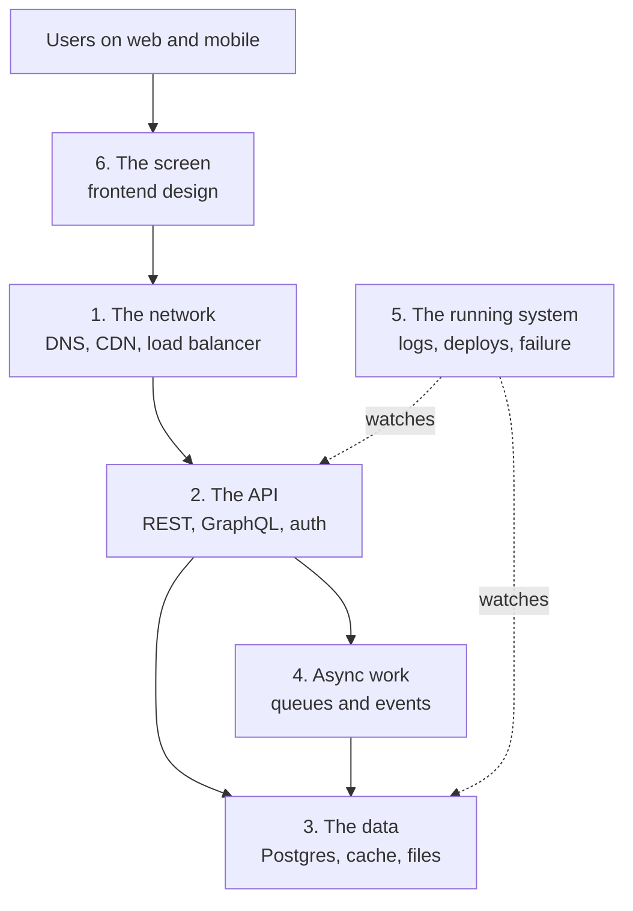
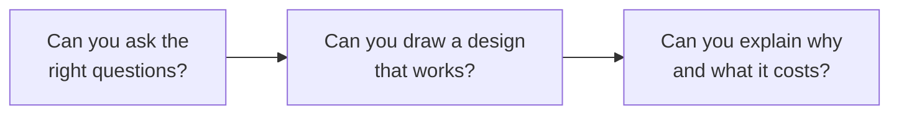
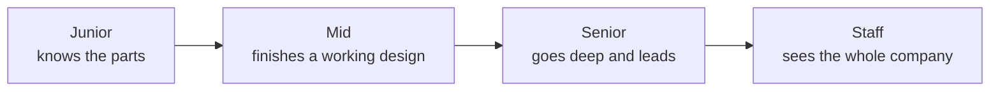
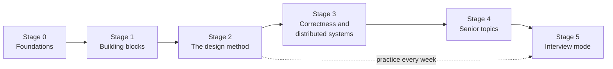
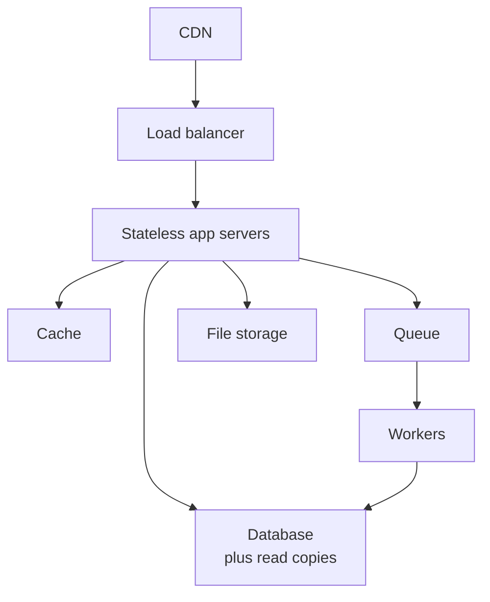
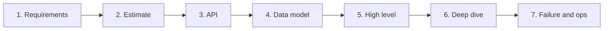
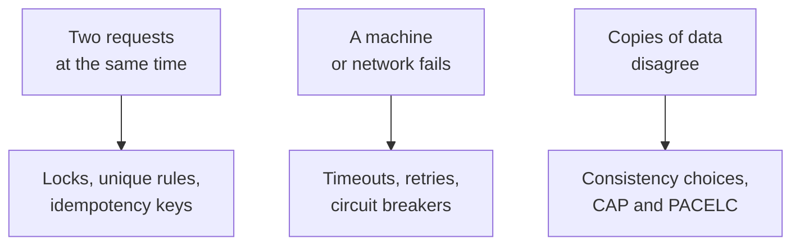
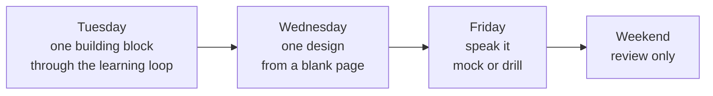
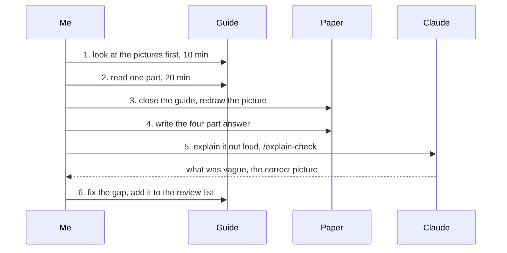
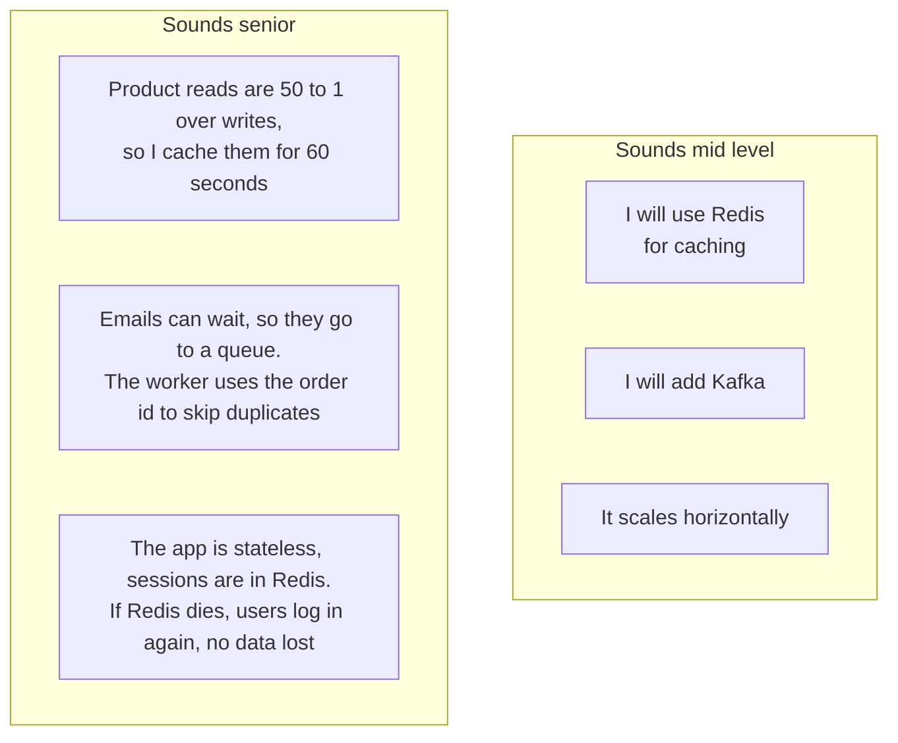

# System Design Roadmap: Beginner to Senior

- **Written:** 2026-10-16
- **Level:** Beginner to Senior (each stage is tagged)
- **Why this note exists:** System design is not one topic. It sits on top of networking, backend, data, async work and operations. This note is the map: what to learn, in what order, which file to open, and how you know you are ready for the next step.
- **Read with:** [Study method and weekly plan](../../my-learning/study-method-and-weekly-plan.md), [How I learn](../../my-learning/learner-profile.md)
- **How links were checked:** opened or found in web search on 2026-10-16.

## TL;DR

- System design has **six layers**: the network, the API, the data, the async work, the running system, and the screen. You learn them bottom up.
- The route has **six stages**: foundations, building blocks, the design method, correctness and distributed systems, senior topics, then interview mode.
- Every stage has a list of **"I can..." checks**. Move on when you can do them from a blank page, not when you have read the file.
- Plan: **10 weeks**, inside your normal week. Tuesday is theory, Wednesday is one design drawn from blank, Friday is a spoken mock.
- In 2026, interviewers push on **follow-up questions, cost, running the system, and AI features**. Memorized designs are not enough. You need the "why".

---

## Part 1: What system design really is [Beginner]

### The problem

An interviewer says "design a chat app". You know React, Express and Postgres. But where do you start? What boxes do you draw? Why those boxes?

Without a map, you jump to tools ("I will use Kafka"). The interviewer then asks "why?", and there is no answer.

### The picture: six layers

Every design you will ever draw is made of these six layers. Notice that each layer has its own guide.

- **The network** moves bytes between users and your servers.
- **The API** is the door into your system. It checks who you are and what you may do.
- **The data** is where facts are kept safe.
- **Async work** is the work you do later, outside the user's request.
- **The running system** is everything about keeping it alive at 3 in the morning.
- **The screen** is how the user sees it all, on web or mobile.

### What the interviewer is checking

A design round is not a test of facts. It checks three things.

The third box is where most people lose points. It is also your known weak spot. So this whole roadmap is built around the "why".

### Words you will hear

- **Building block:** one standard part you reuse in many designs, like a cache or a queue.
- **Tradeoff:** what you give up when you pick something. Every choice has one.
- **Scale:** how the design behaves when users grow 10 or 100 times.
- **Failure mode:** what happens when one box breaks.

---

## Part 2: What each level is expected to do [Beginner]

The same question is asked at every level. The bar is different. Hello Interview describes it as three things that grow with level: **depth, breadth, and how much you lead** without being asked ([Hello Interview, levels blog](https://hellointerview.com/blog/the-system-design-interview-what-is-expected-at-each-level)).

| | Mid level | Senior level |
|---|---|---|
| Requirements | Asks some questions when reminded | Asks the right questions first, writes them down, agrees scope |
| Design | A complete, working design | A working design, then picks the 2 hardest parts and goes deep |
| Tradeoffs | Names one option | Compares 2 or 3 options and says when each one wins |
| Failure | Talks about it if asked | Brings it up: what dies, what the user sees, how we notice |
| Running it | Rarely mentioned | Deploys, monitoring, cost, security, without being asked |
| Who leads | The interviewer guides | The candidate drives, the interviewer follows |

**Say this to yourself:** "Mid finishes the design. Senior finishes it, then finds where it breaks and fixes it."

---

## Part 3: The route, stage by stage

Read the map left to right. Each arrow means "you need this first".

Each stage below has: what it is for, the files to open in order, and the "I can..." checks. The checks are what matter. Tick a check only when you can do it **with the notes closed**.

### Stage 0: Foundations [Beginner]

**Why:** you cannot design a system if you cannot say what happens in one request. This stage is "one user, one server, one database".

| Order | Open this | Focus on |
|---|---|---|
| 1 | [What happens when you type a URL](../networking/networking-url-to-page-step-by-step.md) | DNS, TCP, TLS, HTTP, in order |
| 2 | [Express, GraphQL and Prisma with real auth](../backend-api/express-graphql-auth-tutorial.md) | one request through middleware, resolver, database |
| 3 | [Cheat sheet: API request, JWT, microservices](../backend-api/cheatsheet-api-auth-microservice.md) | JWT, sessions, refresh tokens |
| 4 | [Database design: how to model it, and why](../database/database-design-and-why.md) | tables, keys, indexes, one to many |

**I can...**

- [ ] Draw one request from the browser to Postgres and back, naming every step.
- [ ] Say what an index does and what it costs.
- [ ] Explain sessions vs JWT in four parts: problem, how, tradeoff, my example.
- [ ] Design the tables for a small shop: users, products, orders, order items.

### Stage 1: The building blocks [Beginner to Mid]

**Why:** every design is the same 8 to 10 parts put together in a new way. Learn each part once, well: what problem it solves, how it works, what it costs.

| Order | Open this | Focus on |
|---|---|---|
| 1 | [Networking for system design](../networking/networking-for-system-design.md) | latency numbers, DNS as a tool, proxies, real time options, cloud network layout |
| 2 | [System design basics](system-design-basics-senior-fullstack-interview.md) | scaling out, stateless servers, the first tour of the parts |
| 3 | [Load balancers and microservices for an online shop](load-balancers-microservices-online-shop.md) | L4 vs L7, health checks, zero downtime deploys |
| 4 | [Caching and CDN in depth](caching-and-cdn-in-depth.md) | cache aside, invalidation, stampede, HTTP caching |
| 5 | [Queues, streams and event-driven design](queues-streams-and-event-driven-design.md) | at least once, idempotent workers, dead letter queue |
| 6 | [Data storage choices for system design](data-storage-choices-for-system-design.md) | which store for which job, replication, sharding, file uploads |

**I can...**

- [ ] Say the latency of a memory read, a same region call and a cross continent call, roughly.
- [ ] Explain why app servers must be stateless before you add a load balancer.
- [ ] Draw cache aside and say what goes wrong when the data changes.
- [ ] Explain why a queue gives "at least once", and what the worker must do about it.
- [ ] Pick a store for: orders, sessions, product search, invoice PDFs, and say why.
- [ ] Draw the upload flow with a presigned URL.

### Stage 2: The design method [Mid]

**Why:** knowing the parts is not enough. You need a fixed set of steps so you never freeze on a blank page. This is the same fix as for coding problems: see the pattern before you type.

| Order | Open this | Focus on |
|---|---|---|
| 1 | [System design, step by step](system-design-step-by-step-walkthrough.md) | the seven steps and the clock, URL shortener and notifications solved |
| 2 | [Design workbook part 1: six classic designs](design-workbook-part-1-classic-designs.md) | rate limiter, chat, news feed, file upload, autocomplete, video |
| 3 | [Choosing the right tool](choosing-the-right-tool-frontend-backend-decisions.md) | how to defend a choice |

**I can...**

- [ ] Say the seven steps in order, and how many minutes each one gets.
- [ ] Do a back of the envelope estimate: requests per second and storage per year.
- [ ] Solve the URL shortener from a blank page in 35 minutes.
- [ ] Solve two designs from workbook part 1 without opening the answer first.

### Stage 3: Correctness and distributed systems [Mid to Senior]

**Why:** senior rounds and bank interviews love "two requests at the same moment" and "this box dies, now what?". This stage is about data that must never be wrong, and machines that do fail.

| Order | Open this | Focus on |
|---|---|---|
| 1 | [Scaling a database and keeping data correct](../database/database-scaling-and-correctness.md) | races, locking toolbox, outbox, the scaling ladder |
| 2 | [Distributed systems and reliability patterns](distributed-systems-and-reliability-patterns.md) | CAP, consistency, retries with jitter, circuit breaker, consensus |
| 3 | [Design workbook part 2: six designs where correctness matters](design-workbook-part-2-correctness-designs.md) | booking, ledger, loan workflow, scheduler, proximity, RAG |

**I can...**

- [ ] Draw a lost update and fix it three ways.
- [ ] Explain idempotency keys with a payment example.
- [ ] State CAP correctly: it only matters during a network split.
- [ ] Draw the circuit breaker's three states.
- [ ] Explain why a retry without jitter can make an outage worse.
- [ ] Design seat booking with no double booking, and defend the lock you chose.

### Stage 4: Senior topics [Senior]

**Why:** a senior is judged on what happens after the design is drawn: how it is split, run, secured, watched and paid for. And in 2026, how AI features fit into it.

| Order | Open this | Focus on |
|---|---|---|
| 1 | [Architecture patterns in 2026](architecture-patterns-2026.md) | modular monolith, microservices, BFF, multi-tenancy, LLM features, ADRs |
| 2 | [Production readiness: observability, deploys, security and cost](production-readiness-observability-security.md) | SLOs, OpenTelemetry, canary, RPO and RTO, OWASP API, cost |
| 3 | [Frontend system design, web and mobile](frontend-system-design.md) | rendering choices, client data layer, offline, design systems |
| 4 | [Performance: web, mobile and backend](performance-optimization-web-mobile-backend.md) | measure first, the usual fixes per layer |
| 5 | [Cloud models and serverless](../devops-cloud/cloud-computing-models-serverless-guide.md) and [Containers to Kubernetes](../devops-cloud/container-orchestration-guide.md) | where the code runs |
| 6 | [DBO B2B platform, told the senior way](../../interview/my-projects/dbo-b2b-platform-system-design-case-study.md) | your own system as a design story |

**I can...**

- [ ] Say when a modular monolith beats microservices, with a real public case.
- [ ] Draw a RAG pipeline and say where it can fail.
- [ ] Set an SLO and turn it into minutes of allowed downtime per month.
- [ ] Explain canary deploys and expand and contract migrations.
- [ ] Give a rough monthly cost for a simple design and name the biggest cost.
- [ ] Explain my own DBO system with one diagram and two decisions I would change.

### Stage 5: Interview mode [Senior]

**Why:** knowing is not saying. This stage turns the knowledge into answers you can say under pressure.

| Order | Open this | Focus on |
|---|---|---|
| 1 | [System design interview questions, beginner to senior](senior-system-design-interview-questions.md) and its flashcard drill | 60 second spoken answers |
| 2 | `/mock-interview system design` | a full spoken round with a scorecard |
| 3 | `/advanced-interview system design` | hard follow-ups, pushed into internals |
| 4 | `mock-interviewer` agent, "make me a written system design exam" | a written round at your own pace |

**I can...**

- [ ] Run a full 45 minute design out loud, alone, with a timer.
- [ ] Answer 30 drill cards with "got it".
- [ ] Handle a changed requirement in the middle of a design without starting over.
- [ ] End every design with a 60 second "how I would run this" summary.

---

## Part 4: The 10 week plan [Beginner to Senior]

This fits inside [your weekly plan](../../my-learning/study-method-and-weekly-plan.md). Monday and Thursday stay for coding. System design uses three slots:

| Week | Stage | Tuesday: theory, about 60 min | Wednesday: design from blank | Friday: say it |
|---|---|---|---|---|
| 1 | 0 | URL to page guide, the request journey | Draw one request through your own Express app | Explain sessions vs JWT out loud |
| 2 | 0 to 1 | Networking for system design, parts 1 to 3 | Draw the network for the online shop | Drill: networking cards |
| 3 | 1 | Caching and CDN in depth | Add a cache to the URL shortener, show invalidation | Drill: caching cards |
| 4 | 1 | Queues, streams and events | Notification system from blank | `/explain-check` at least once |
| 5 | 1 to 2 | Data storage choices | File upload service from workbook 1 | Drill: data cards |
| 6 | 2 | The seven steps walkthrough, again | Rate limiter, then chat app | `/mock-interview` URL shortener |
| 7 | 3 | Scaling and correctness (database folder) | Seat booking from workbook 2 | Drill: async and correctness cards |
| 8 | 3 | Distributed systems and reliability | Wallet with a ledger from workbook 2 | `/mock-interview` chat app |
| 9 | 4 | Architecture 2026 and production readiness | Loan workflow or RAG assistant from workbook 2 | DBO story with a diagram, 5 minutes |
| 10 | 5 | Frontend system design, then weak spots from the review list | News feed, end to end, web and mobile | `/advanced-interview` system design |

**Rules for the plan:**

- **One file a week, not three.** If a guide is long, do half on Tuesday and half next week.
- **Wednesday is always a blank page.** Draw first. Open the answer only after 35 minutes.
- **Anything you get wrong goes to [the review list](../../my-learning/review-list.md).** The weekend review asks it again on day 1, 3, 7 and 21.
- **Behind schedule is fine.** Skipping the "I can..." checks is not.

---

## Part 5: How one study session runs [Beginner]

This is [the learning loop](../../my-learning/study-method-and-weekly-plan.md) applied to system design.

The four part answer works for every building block:

| Part | Question to answer | Example: cache |
|---|---|---|
| Problem | What hurts without it? | The same product page hits Postgres 1,000 times a second |
| How it works | The picture, in words | App checks Redis first, on a miss reads Postgres and saves the result |
| Tradeoff | What does it cost? | Users can see old data until the key expires or is deleted |
| My example | Where would it show up for me? | Idea: a product list in a B2B shop that changes a few times a day |

---

## Part 6: What makes an answer sound senior [Senior]

Same design, two ways of saying it. Notice the difference is not more boxes. It is the "why" and the "what if".

Seven habits to practice in every design:

1. **Start from numbers.** "How many users? How many writes per second?" Then let the numbers pick the design.
2. **Say the default first.** "I start with one Postgres and one app. I only add parts when the numbers say so."
3. **Give two options, then pick.** "We could do A or B. I pick A because ... We lose ..."
4. **Find the hard part yourself.** "The interesting part here is the double booking. Let me go deep there."
5. **Break your own design.** "What if the payment provider is slow? What if Redis restarts?"
6. **Talk about running it.** Logs, alerts, deploys, cost, security. One minute at the end.
7. **Connect to real experience, only true facts.** "In DBO, I saw..." only if it really happened.

---

## Part 7: What is current in 2026 [Senior]

These trends come from interview prep sites and candidate reports, not official company rubrics. Treat them as direction, not rules.

- **Follow-up questions decide the result.** Interviewers change requirements halfway and push on every choice. Reciting a memorized design does not survive this ([Design Gurus, "What changed in system design interviews"](https://designgurus.substack.com/p/what-changed-in-system-design-interviews), found in search 2026-10-16).
- **AI features show up inside designs.** Senior loops can include an AI part: model latency and cost as limits, a vector store as a component, and a fallback when the model fails ([Design Gurus, "How to prepare for the system design interview in 2026"](https://www.designgurus.io/blog/how-to-prepare-for-system-design-interview-2026), found in search 2026-10-16). Covered in [Architecture patterns in 2026](architecture-patterns-2026.md) and the RAG design in [workbook part 2](design-workbook-part-2-correctness-designs.md).
- **Cost and operations are part of the answer.** Proposing multi region for a small app is now a red flag. Deploys, monitoring and rollback are expected, not extra. Covered in [Production readiness](production-readiness-observability-security.md).
- **Design rounds reach mid level too.** Several prep sites report that system design is no longer only for senior roles. So Stages 0 to 2 matter even for a mid level offer.
- **The standard book has a new edition.** *Designing Data-Intensive Applications*, 2nd edition, by Martin Kleppmann and Chris Riccomini, is dated February 2026 on the [O'Reilly page](https://www.oreilly.com/library/view/designing-data-intensive-applications/9781098119058/). It adds cloud object storage, vector databases and newer streaming ideas. Good for Stage 3 and 4, after this roadmap, not instead of it.

---

## Part 8: Practice

**A. Put the parts in order.** You have: CDN, Postgres, load balancer, queue, Redis, app servers, workers. Draw the online shop with all of them. Then say which one you would add **last**, and why.

Answer

One good order: browser, CDN for images and static files, load balancer, stateless app servers, Redis for hot reads, Postgres for orders, queue plus workers for emails and invoices.

Added last: usually the queue or the cache. You add them only when a number says so: slow emails inside checkout (queue), or too many repeated reads (cache). Starting with one app and one Postgres is the senior default.

**B. Which stage is this gap from?** "I can draw the chat app, but when the interviewer asks what happens if the server holding the WebSocket dies, I freeze."

Answer

Stage 3 (failure and distributed systems) plus the real time part of Stage 1 (networking). Study the WebSocket scaling part of the networking guide, then the failure checklist in the distributed systems guide.

**C. Mid or senior?** "We will use microservices so each part can scale."

Answer

Mid. No numbers, no team size, no cost. A senior version: "We are 6 engineers and traffic is modest, so I start with a modular monolith with clear modules. If checkout traffic grows much faster than the rest, I can split it out later. Splitting now would add network calls and harder deploys for no gain."

**D. Fix the plan.** "This week I will read the caching guide, the queue guide and the storage guide, then do the URL shortener."

Answer

Too much reading, too little doing. One guide on Tuesday, one design from blank on Wednesday, one spoken answer on Friday. Reading three guides feels productive but is the weak kind of studying.

**E. Say it in four parts.** Explain "load balancer" as problem, how it works, tradeoff, my example.

Answer

- Problem: one server cannot take all the traffic, and if it dies the app is down.
- How it works: one entry point gets every request and passes it to a healthy server, using round robin or least connections. It stops sending to a server that fails its health check.
- Tradeoff: servers must be stateless, and the load balancer itself needs a backup.
- My example: an idea to check, not a fact. How did requests reach the app in the CapRover setup you use? CapRover runs nginx in front of the apps.

**F. Draw from memory.** Close this file. Draw the six layers picture from Part 1 and the stage map from Part 3.

Answer

Compare with Part 1 and Part 3. The six layers: screen, network, API, data, async work, running system. The six stages: foundations, building blocks, design method, correctness and distributed systems, senior topics, interview mode.

---

## Watch and play

- **Read and see:** [The System Design Primer](https://github.com/donnemartin/system-design-primer) - free, many diagrams, has Anki flashcards. Use it to look up a part you do not know.
- **Levels:** [Hello Interview: what is expected at each level](https://hellointerview.com/blog/the-system-design-interview-what-is-expected-at-each-level) - read once to see the mid vs senior bar.
- **Method:** [Hello Interview: System Design in a Hurry](https://www.hellointerview.com/learn/system-design/in-a-hurry/introduction) - a short framework that matches the seven steps here.
- **Draw:** [Excalidraw](https://excalidraw.com/) - draw every Wednesday design here, like a whiteboard. (Carried over from the system design README, not re-checked today.)
- **Book, later:** [Designing Data-Intensive Applications, 2nd edition](https://www.oreilly.com/library/view/designing-data-intensive-applications/9781098119058/) - the deep version of Stage 3. Read one chapter after each related guide.

Each guide in the route has its own videos and visualizers in its "Watch and play" section.

---

## Review questions (day 1, 3, 7, 21)

1. Name the six layers of a system and one part that lives in each.
2. What is the difference between a mid level and a senior level design answer?
3. What are the seven steps of a design round, in order?
4. Draw the stage map from memory and say which "I can..." checks you still cannot do.

Answers

1. Screen (React, React Native), network (DNS, CDN, load balancer), API (Express, GraphQL, auth), data (Postgres, Redis, S3), async work (queue, workers), running system (logs, metrics, deploys).
2. Mid finishes a working design when guided. Senior also leads, goes deep on the hardest parts, compares options with tradeoffs, and brings up failure, operations and cost without being asked.
3. Requirements, estimation, API, data model, high level design, deep dive, failure and operations.
4. Compare with Part 3. Add every check you cannot do yet to the review list.

---

## Sources

- [The System Design Interview: What is Expected at Each Level, Hello Interview](https://hellointerview.com/blog/the-system-design-interview-what-is-expected-at-each-level), found in search 2026-10-16
- [System Design in a Hurry, Hello Interview](https://www.hellointerview.com/learn/system-design/in-a-hurry/introduction), found in search 2026-10-16
- [What changed in system design interviews, Design Gurus](https://designgurus.substack.com/p/what-changed-in-system-design-interviews), found in search 2026-10-16
- [How to prepare for the system design interview in 2026, Design Gurus](https://www.designgurus.io/blog/how-to-prepare-for-system-design-interview-2026), found in search 2026-10-16
- [Designing Data-Intensive Applications, 2nd edition, O'Reilly](https://www.oreilly.com/library/view/designing-data-intensive-applications/9781098119058/), dated February 2026, found in search 2026-10-16
- [The System Design Primer, GitHub](https://github.com/donnemartin/system-design-primer), opened 2026-10-16
