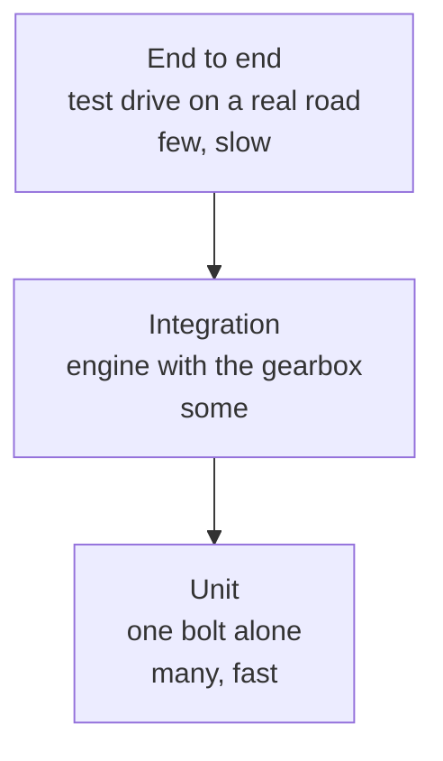
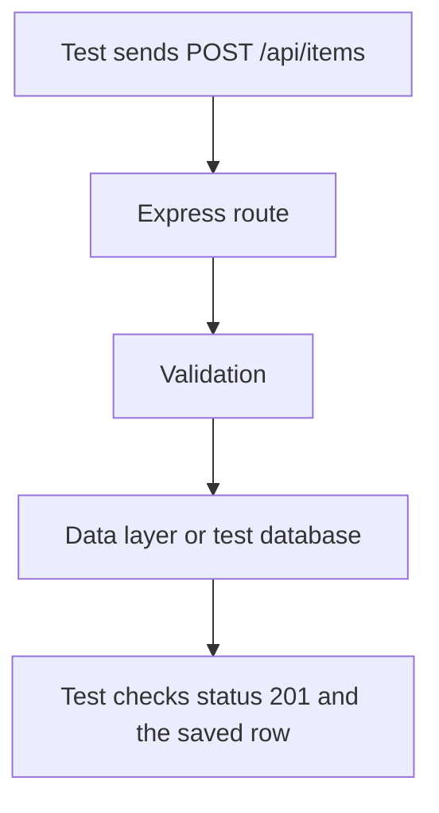
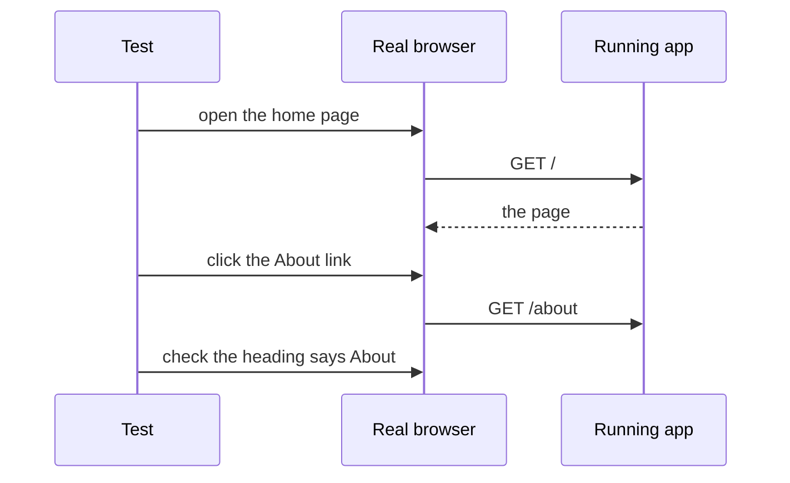

# 01. The kinds of tests

> **Subject:** Testing · **Lesson:** 01 · **Made:** 2026-11-27 · **Status:** ready
>
> **You will be able to:** name the kinds of tests that teams usually write, say what each one checks and costs, and say how many of each you want.
>
> **Before this:** [Testing map](README.md) · **Next:** [Test tools and settings](02-test-tools-and-settings.md)
>
> **How to read it:** one card is one idea. Look at the picture, guess, then press the orange bar to check. The blue bars (📖 More detail) hold the longer explanation. Skip them on the first read, open them when you want more. About 20 minutes for the cards.

<!-- quick-summary:start -->
## Quick summary

> Short on time? Read only this. These are the "Remember" lines from the cards below, so you can read the whole lesson in one minute.

- A test is a small program that checks that your code still does what you expect. Small tests are fast. Big tests are slow but see more.
- A unit test checks one piece alone, fast, with no network or database.
- An integration test joins real pieces and goes through the front door.
- E2e tests check the whole chain as a user, so keep them few and for the flows that matter most.
- There is no one right shape. Put your tests where your bugs live, and keep e2e few.
- Most extra names are a purpose. A regression test is any test that guards an old bug.
- Test what the code does, not how it does it.
- Coverage finds code that no test touches. It cannot tell you if the tests would catch a bug.
<!-- quick-summary:end -->

## 1. The idea: checking a car before it is sold

A car factory does not only test the finished car. It checks a **bolt** alone. It checks the **engine with the gearbox**. And it takes the finished car on a **test drive** on a real road.

Software tests work the same way. Small checks are fast and cheap. Big checks are slow and costly, but they find problems the small ones cannot see.



Notice: the picture is called the **test pyramid**. The wide bottom means "write more of these".

<details class="guess"><summary>🤔 Guess: which kind of test is the fastest to run, and which is the slowest? Press to check.</summary>

Unit tests are the fastest. They run in milliseconds. End to end tests are the slowest, because they start a real browser and click through real pages.

</details>

> **Remember:** a test is a small program that checks that your code still does what you expect. Small tests are fast. Big tests are slow but see more.

<details class="more"><summary>📖 More detail: the words you will hear</summary>

- **Test:** code that runs your code with a known input and checks the output.
- **Assertion:** one check inside a test, like "the answer is 150".
- **Test runner:** the program that finds your tests, runs them and shows which passed.
- **Regression:** a bug that comes back, or something that used to work and breaks. Tests exist mostly to catch regressions.

Interviewers often ask: "What kinds of tests do you write, and why?" The cards below give you the answer.

</details>

## 2. Unit test: one small piece alone

A **unit test** checks one small piece, such as one function, with nothing else involved. No network. No database. No browser.

```js
// the function
function discount(price, percent) {
  return Math.round(price * (100 - percent)) / 100
}

// the test: arrange, act, assert
it('takes 25 percent off 200', () => {
  const price = 200                      // arrange
  const result = discount(price, 25)     // act
  expect(result).toBe(150)               // assert
})
```

Notice: three steps: **arrange** the input, **act** by calling the code, **assert** the answer. People call this "AAA".

<details class="guess"><summary>🤔 Guess: a function reads the price from a database and then takes a discount. Is a test of it a unit test? Press to check.</summary>

Not a pure one. It uses a database, so it is more than one piece. Either replace the database with a fake (then it is a unit test), or use a real test database (then it is an integration test).

</details>

> **Remember:** a unit test checks one piece alone, fast, with no network or database.

<details class="more"><summary>📖 More detail: what unit tests are good and bad at</summary>

| | Unit test |
|---|---|
| Speed | very fast. In my run, all 7 Vitest tests (unit, component and API) finished in 0.7 seconds, including the start. |
| Catches | wrong logic: off by one, wrong rounding, wrong rule |
| Misses | pieces that do not fit together, wrong settings, a broken page |
| Needs | the code and a test runner. Nothing else. |

Units are best for **logic that has rules**: prices, dates, validation, parsing.

</details>

## 3. Integration test: parts working together

An **integration test** checks that a few real pieces work **together**. Each piece may pass its own unit tests and still fail when joined: a wrong field name, a wrong status code, a missing setting.



Notice: the test goes through the **door** (the route), the same way a real caller would. It does not call inner functions.

<details class="guess"><summary>🤔 Guess: a React component shows a list and a Delete button inside it. You render both and click Delete. Which kind is that? Press to check.</summary>

An integration test (often called a **component test**). Several pieces work together: the component, its children and its state. You do it in a fake browser (jsdom), so it is still fast.

</details>

> **Remember:** an integration test joins real pieces and goes through the front door.

<details class="more"><summary>📖 More detail: common integration tests</summary>

- **API test:** send a request to your Express or Next.js route and check the status and body. The tool is often Supertest.
- **Component test:** render a React component and use it like a user would. The tool is React Testing Library.
- **Database test:** run your Prisma or SQL code against a real test database (a throwaway copy), then check the rows.

I ran an API test and a component test together with the unit tests in under one second (2026-11-27). Lesson 02 shows both.

</details>

## 4. End to end test: the real thing, as a user

An **end to end test** (e2e) opens a **real browser**, goes to the **real app**, and does what a user does: types, clicks, waits, reads. It checks that the whole chain works: page, API, database.



Notice: nothing is fake here. That is why it finds problems the other tests miss. It is also why it is slow and sometimes unstable.

<details class="guess"><summary>🤔 Guess: an end to end test fails one time in ten, with no code change. Is the test fine? Press to check.</summary>

No. It is called a **flaky** test. Common causes: waiting a fixed time instead of waiting for the thing to appear, tests that depend on each other, or real network and data that change. Fix the cause. Do not just add retries, because retries hide the problem.

</details>

> **Remember:** e2e tests check the whole chain as a user, so keep them few and for the flows that matter most.

<details class="more"><summary>📖 More detail: what to cover with e2e</summary>

Pick the paths that would hurt most if they broke: sign up, log in, pay, the main thing your product does. Keep it to a handful.

| | End to end test |
|---|---|
| Speed | slow: a real browser must start. My 2 small tests took about 2 seconds including start. A big suite takes minutes. |
| Catches | the whole chain: wrong settings, broken pages, a link that goes nowhere |
| Misses | exact reason: when it fails, you must search to find which piece broke |
| Needs | a running app, a browser tool, and usually test data |

</details>

## 5. The shape: pyramid or trophy

How many of each? Two popular pictures disagree a little.

| Picture | Idea | Best when |
|---|---|---|
| **Pyramid** | many unit, some integration, few e2e | much of your risk is in plain logic (rules, math, parsing) |
| **Trophy** | a base of static checks (types and lint), then mostly integration, a few unit, a few e2e | an app made of components, where the bugs are in how pieces connect |

Notice: both agree on one thing: **keep e2e small**. They differ on whether to write mostly unit or mostly integration.

<details class="guess"><summary>🤔 Guess: a React and Next.js shop. Mostly screens and API calls, little hard logic. Which picture fits better? Press to check.</summary>

The trophy. The risk lives in how components, API calls and data fit together, so integration tests give the most value. Add unit tests for the few pure rules, such as the discount, and a few e2e tests for sign up and checkout.

</details>

> **Remember:** there is no one right shape. Put your tests where your bugs live, and keep e2e few.

<details class="more"><summary>📖 More detail: static checks, and where the pictures come from</summary>

**Static checks** find problems without running the code: TypeScript types, ESLint. They are very cheap, so the trophy puts them at the base.

The Next.js docs list the kinds of tests this way: unit, component, integration, end to end and snapshot, and say each has its own purpose. See [Next.js testing guide](https://nextjs.org/docs/app/guides/testing) (updated 2026-02-03).

The pyramid and the trophy are described in many blog posts. I found them through a web search and did not open them, so treat the "which is better" advice as opinion. One article is called "Pyramid or Crab? Find a testing strategy that fits" (web.dev). The advice there is to choose by where your bugs live.

</details>

## 6. Other kinds you will hear

There are more words than three. Most are a **purpose** (why you run it) and not a new size of test. Here is a short map.

| Kind | What it checks | Example tool |
|---|---|---|
| **Smoke test** | "does it start at all?" A few quick checks after a deploy | one e2e test, or a `curl` to a health address |
| **Regression test** | an old bug stays fixed | any test written after a bug |
| **Snapshot test** | the output is the same as a saved copy | Vitest or Jest snapshots |
| **Visual test** | the page looks the same, pixel by pixel | Playwright screenshots |
| **Load test** | how many users it can handle, how fast it answers | autocannon, k6 |
| **Accessibility test** | can people with screen readers or keyboards use it | axe |
| **Security test** | known holes: bad dependencies, injection | npm audit, scanners |
| **Contract test** | a service and its caller agree on the shape of the data | Pact, or a shared schema |

Notice: a smoke test is **small and fast**. Its job is to answer one question quickly: "is it alive?"

<details class="guess"><summary>🤔 Guess: you fix a bug where a discount of 100 percent crashed. What test do you add, and what is it called? Press to check.</summary>

A unit test with price 10 and percent 100, expecting 0. It is a **regression test**: it makes sure this exact bug never comes back.

</details>

> **Remember:** most extra names are a purpose. A regression test is any test that guards an old bug.

<details class="more"><summary>📖 More detail: what I ran, and what I did not</summary>

On 2026-11-27 I ran these for real: unit, component, API, e2e (Playwright), an accessibility check (axe) and a load test (autocannon).

- axe found 4 problems on a bare page: no page title, no `lang`, no main area, content outside a landmark. Real tests give real, specific answers.
- autocannon ran about 195 thousand requests in 3 seconds against a tiny local server. That number only describes my machine and a tiny page. Never compare it with your real app.

I did **not** run: k6, Cypress, Jest, Pact or a security scanner. They are named here from general knowledge. Check each tool's own docs before you rely on it.

</details>

## 7. Mistake 1: testing how, not what

A test that checks **how** the code works inside breaks every time you tidy the code. A test that checks **what** the user gets stays still.

```js
// bad: knows the insides. Breaks if you rename a variable.
expect(component.state.count).toBe(1)

// good: checks what the user sees
expect(screen.getByText('Count: 1')).toBeTruthy()
```

<details class="guess"><summary>🤔 Guess: you move some code into a new helper function. No behaviour changes. A test fails. What was wrong with the test? Press to check.</summary>

The test knew too much about the insides. A good test would still pass, because the behaviour did not change. Test through the **public door**: the function result, the route response, or what the user sees.

</details>

> **Remember:** test what the code does, not how it does it.

<details class="more"><summary>📖 More detail: how to pick what to check</summary>

Ask: "If a user, a caller or another team depended on this, what would they notice?" Check that. React Testing Library follows this idea: find things the way a user does (by role and by text), not by class names or state.

</details>

## 8. Mistake 2: chasing the coverage number

**Coverage** shows which lines of code ran during tests. It is useful for finding **untested** code. It is not a score for how good the tests are.

```js
// 100% of lines run, and it checks nothing
it('works', () => { discount(200, 25) })
```

<details class="guess"><summary>🤔 Guess: coverage says 100 percent. Does that mean the code has no bugs? Press to check.</summary>

No. It only means every line **ran**. A test with no `expect` runs the line and checks nothing. Ask a better question: "if I break this line on purpose, does a test fail?"

</details>

> **Remember:** coverage finds code that no test touches. It cannot tell you if the tests would catch a bug.

<details class="more"><summary>📖 More detail: a real run, and the exercise</summary>

In my run (Vitest with the v8 coverage tool), the report showed 91.66 percent of lines and pointed at **line 10** of one file, the one that returns status 201. No test sent a good request. That is useful: it shows exactly what to test next.

I also set a coverage minimum of 95 percent. The run **failed** with exit code 1: "Coverage for lines (91.66%) does not meet global threshold (95%)". This is how teams make the build fail when coverage falls.

A stronger check is **mutation testing**: break the code on purpose and see if a test notices. The exercise in this lesson does this by hand: you write test cases, and the test file runs them against five broken copies of `discount`.

</details>

## 9. Why it matters and what it costs

- **Without tests:** every change is a risk. Bugs return. People are afraid to tidy code.
- **With tests:** you change code with less fear, and a failing test points at what broke.
- **The cost:** time to write them, time to run them, and time to fix tests that break for no good reason. Slow or flaky tests make people stop trusting them.

| Question | Good default |
|---|---|
| Rules and math | unit tests |
| Screens, routes, how pieces connect | integration tests |
| Sign up, log in, pay | a few e2e tests |
| "Is it alive after a deploy?" | a smoke test |
| "Did this old bug come back?" | a regression test |

## 10. Watch and play

All links below were opened on 2026-11-27 and loaded. I found no video that I could open and check, so there is none here.

- **Do:** [practice/01-tests-that-catch-bugs.js](practice/01-tests-that-catch-bugs.js) - classify six tests, then write cases that catch five broken copies.
- **Read:** [Testing, Next.js docs](https://nextjs.org/docs/app/guides/testing) - the kinds of tests and the four tools it covers.
- **Read:** [Vitest with Next.js](https://nextjs.org/docs/app/guides/testing/vitest) - unit and component tests.
- **Read:** [Playwright with Next.js](https://nextjs.org/docs/app/guides/testing/playwright) - an end to end test of two pages.

## 11. Practice

**A. Predict**

Which kind is each of these: unit, integration or e2e?

1. `isValidEmail('x')` returns false.
2. A test sends `POST /login` to an Express app with a test database and checks for a cookie.
3. A real Chrome opens the shop, adds an item and pays.

<details><summary>Answer</summary>

1. Unit. One function, nothing else.
2. Integration. The route, the database and the cookie logic work together.
3. End to end. A real browser walks a real flow.

</details>

**B. Fix the bug**

```js
it('applies the discount', () => {
  discount(200, 25)
})
```

The test passes, even if you change `discount` to return 0. Why, and how do you fix it?

<details><summary>Answer</summary>

There is no assertion, so the test cannot fail unless the code throws. Add one: `expect(discount(200, 25)).toBe(150)`. Then break the function on purpose to check that the test fails.

</details>

**C. Write it yourself**

Open `practice/01-tests-that-catch-bugs.js`. Fill in the two tasks, then run:

```bash
node --test learn/testing/practice/01-tests-that-catch-bugs.test.js
```

<details><summary>One possible answer</summary>

```js
const answers = ["unit", "integration", "e2e", "unit", "integration", "e2e"];

const cases = [
  { price: 200, percent: 25, expected: 150 },
  { price: 10, percent: 0, expected: 10 },
  { price: 10, percent: 100, expected: 0 },
  { price: 19.99, percent: 15, expected: 16.99 },
];
const badPercents = [-1, 101];
```

Why each case: `0` and `100` are the edges, and catch two off by one bugs. `19.99` with `15` needs rounding to cents. `200` with `25` catches adding instead of subtracting. `-1` catches a missing lower check, and `101` the upper check.

</details>

## 12. Interview question

**Q:** What kinds of tests do you write, and how do you decide how many of each?

<details><summary>A strong answer, in four parts</summary>

1. **Problem:** code changes all the time, and every change can break something. We want to find breaks early and cheaply, without a test suite that is slow or that people do not trust.
2. **How it works:** unit tests check one piece alone and run in milliseconds. Integration tests join real pieces, like a route with a data layer or a component with its children. End to end tests drive a real browser through key flows. Smoke, regression, visual, load and accessibility checks are other purposes on top of these.
3. **Tradeoff:** the higher the test, the more it sees and the slower and flakier it gets. For a component heavy React app I lean on integration tests with a few unit tests for pure rules and a handful of e2e flows. For logic heavy code I add more unit tests. I use coverage to find untested code, not as a score.
4. **My example:** an idea, not a fact: a Next.js shop with a unit test for the discount rule, API tests for the routes, and a Playwright test for checkout. I will add what I really tested in DBO, Unloan or ZWS only after I confirm it.

</details>

## 13. Explain it back

Close this file. Explain the kinds of tests to a new junior in 4 parts (problem, how, tradeoff, my example). Then write your best version below and run `/explain-check kinds of tests` or ask the `explain-coach` agent to review it.

### My explanation

<write here>

### Coach feedback

<the explain-coach agent writes here>

## 14. Review questions (day 1, 3, 7, 21)

1. What is the difference between a unit test and an integration test?
2. Why should you keep end to end tests few?
3. What does a coverage number tell you, and what does it not tell you?
4. Draw the picture from card 1 from memory: the three levels of the pyramid.

<details><summary>Answers</summary>

1. A unit test checks one piece alone. An integration test joins a few real pieces and goes through the front door.
2. They are slow, can be flaky, and when they fail it is hard to see which piece broke. Keep them for the flows that matter most.
3. It tells you which lines ran. It does not tell you if the tests would catch a bug. A test with no assertion can still give coverage.
4. Top: end to end, few and slow. Middle: integration, some. Bottom: unit, many and fast.

</details>

## 15. Go deeper (optional)

<details><summary>Test doubles, and why tests sometimes lie</summary>

- **Test double:** a fake used in place of the real thing. A **stub** returns a fixed answer. A **mock** also records how it was called. A **fake** is a simple working copy, like an in memory database.
- **Test isolation:** each test should set up its own data and not depend on another test. Tests that depend on order are a common cause of flaky suites.
- **Property based testing:** instead of fixed examples, the tool makes many random inputs and checks a rule. The tool for JavaScript is called fast-check. I did not run it.
- **Testing async Server Components in Next.js:** the Next.js docs say the unit tools do not fully support them yet, and recommend end to end tests for those. Lesson 02 covers this.

</details>

## Connected lessons

- [Test tools and settings](02-test-tools-and-settings.md) - Vitest, React Testing Library, Supertest and Playwright, with real settings.
- [Validation and error handling](../backend-api/10-validation-and-error-handling.md) - a good place for unit tests.
- [Server and Client Components](../react/16-server-and-client-components.md) - why async Server Components lean on e2e tests.
- [What the browser can see](../backend-api/21-what-the-browser-can-see.md) - a proxy route is a good API test.
