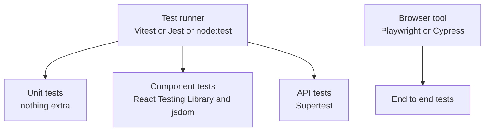

# 02. Test tools and settings

> **Subject:** Testing · **Lesson:** 02 · **Made:** 2026-11-27 · **Status:** ready
>
> **You will be able to:** pick the right tool for each kind of test, say what it needs to install, and use its main settings and command line options.
>
> **Before this:** [The kinds of tests](01-the-kinds-of-tests.md) · **Next:** [Testing map](README.md)
>
> **How to read it:** one card is one idea. Look at the picture, guess, then press the orange bar to check. The blue bars (📖 More detail) hold the longer explanation. Skip them on the first read, open them when you want more. About 25 minutes for the cards.

<!-- quick-summary:start -->
## Quick summary

> Short on time? Read only this. These are the "Remember" lines from the cards below, so you can read the whole lesson in one minute.

- One runner, plus one helper for each kind of test. A real browser only for end to end.
- `include` says which files are tests. `environment` says where they run: `node` or a fake browser (`jsdom`).
- Find things by role and text, like a user. `getBy` must exist, `queryBy` may be missing, `findBy` waits.
- Export the app, `listen` somewhere else, and test with `request(app)`.
- Mock the edges, not your own code. A test full of mocks only checks the mocks.
- Let Playwright start the app (`webServer`), find things by role, and let `expect` wait. Never use a fixed sleep.
- A threshold makes the build fail when a number is too low. Use it as a safety net, not a goal.
- Test `async` Server Components with e2e. Unit test the plain functions and client components.
<!-- quick-summary:end -->

## 1. The idea: a toolbox, one tool per job

You do not need one big tool. You use a **runner** that finds and runs your tests, and a few **helpers** for each kind of test.



Notice: the runner is the engine. The helpers add one skill each. End to end tests use a separate tool because they need a real browser.

<details class="guess"><summary>🤔 Guess: you want to test a React button click. Which two things do you need besides the runner? Press to check.</summary>

A fake browser (jsdom) so React has a page to draw on, and React Testing Library to render the component and click it. No real browser is needed, so it stays fast.

</details>

> **Remember:** one runner, plus one helper for each kind of test. A real browser only for end to end.

<details class="more"><summary>📖 More detail: the whole table, and what I ran</summary>

| Kind | Tool | What you install | Did I run it? |
|---|---|---|---|
| Unit | Vitest (or Jest, or node:test) | `vitest` | yes, Vitest 5.1.2 |
| Component | React Testing Library | `@testing-library/react`, `@testing-library/dom`, `@testing-library/user-event`, `jsdom` | yes, version 16.3.3 |
| API | Supertest | `supertest` | yes, 7.3.2 |
| End to end | Playwright | `@playwright/test` | yes, 1.65.1 |
| End to end | Cypress | `cypress` | no |
| Accessibility | axe | `@axe-core/playwright` | yes |
| Load | autocannon (k6 is another) | `autocannon` | autocannon yes, k6 no |
| Unit (old favourite) | Jest | `jest` | no |

The Next.js docs name four tools: Cypress, Playwright, Vitest and Jest. See [Testing, Next.js docs](https://nextjs.org/docs/app/guides/testing) (updated 2026-02-03). A web search says Vitest is often used in new projects and Jest in older ones. Those are blog opinions, not rules.

Built into Node, with nothing to install: `node --test` (the runner used by the exercises in this folder).

</details>

## 2. The runner: Vitest

Install it, write a config file, and run it. The config says **which files are tests** and **where they run**.

```bash
npm install -D vitest
npx vitest run
```

```js
// vitest.config.js
import { defineConfig } from 'vitest/config'

export default defineConfig({
  test: {
    include: ['tests/**/*.test.{js,jsx}'],
    environment: 'node',
  },
})
```

Notice: `vitest run` runs once and stops. Plain `vitest` stays open and re-runs tests when you save a file (watch mode).

<details class="guess"><summary>🤔 Guess: you want to run only the test named "rejects a bad percent". Which option? Press to check.</summary>

`-t "rejects"`. It runs only tests whose name matches. In my run, 1 test passed and 6 were skipped.

```bash
npx vitest run -t "rejects"
```

</details>

> **Remember:** `include` says which files are tests. `environment` says where they run: `node` or a fake browser (`jsdom`).

<details class="more"><summary>📖 More detail: settings and options I checked</summary>

Settings in the config file (under `test`):

| Setting | What it does |
|---|---|
| `include` | which files count as tests |
| `environment` | `node` (default) or `jsdom` for components |
| `coverage` | the coverage tool and its limits (card 7) |
| `setupFiles` | code that runs before each test file, for example to add helper checks |

Options on the command line (I read these from `npx vitest --help` on version 5.1.2):

| Option | What it does |
|---|---|
| `-t, --testNamePattern <pattern>` | run only tests whose name matches |
| `--coverage` | print a coverage report |
| `--ui` | open a browser page that shows the tests |
| `--reporter <name>` | choose the output style |
| `--environment <name>` | choose `node` or `jsdom` for this run |
| `--bail [number]` | stop after this many failures |
| `--shard <index/count>` | run a slice of the tests (to split work across machines) |
| `--changed [since]` | run only tests affected by changed files |
| `--testTimeout <ms>` | how long one test may take |
| `-u, --update` | update snapshots |
| `--passWithNoTests` | do not fail when no test is found |

One test file can pick its own environment with a first line comment: `// @vitest-environment jsdom`.

</details>

## 3. Component tests: React Testing Library

Render the component, find things **like a user does**, click, and check what is on screen.

```jsx
// @vitest-environment jsdom
import { it, expect } from 'vitest'
import { render, screen } from '@testing-library/react'
import userEvent from '@testing-library/user-event'
import { Counter } from '../src/Counter.jsx'

it('adds one when the button is clicked', async () => {
  render(<Counter />)
  expect(screen.getByText('Count: 0')).toBeTruthy()
  await userEvent.click(screen.getByRole('button', { name: 'Add' }))
  expect(screen.getByText('Count: 1')).toBeTruthy()
})
```

Notice: the test finds the button by its **role** and name, as a screen reader would. It does not care about class names or state.

<details class="guess"><summary>🤔 Guess: you want to check that something is NOT on screen. Which query do you use, and why not `getBy`? Press to check.</summary>

`queryBy`. The `getBy` queries throw an error when nothing is found, so they stop the test. `queryBy` returns `null` instead, so you can write `expect(screen.queryByText('Error')).toBeNull()`.

</details>

> **Remember:** find things by role and text, like a user. `getBy` must exist, `queryBy` may be missing, `findBy` waits.

<details class="more"><summary>📖 More detail: the three query families, and the setup from the Next.js docs</summary>

| Query | If not found | Use it for |
|---|---|---|
| `getBy...` | throws an error | something that must be there now |
| `queryBy...` | returns `null` | checking that something is not there |
| `findBy...` | waits, then throws | something that appears later (after a fetch) |

Query by what a user sees, in this order of preference: **role** (`getByRole`), label, text, and only last a test id.

The Next.js docs set it up like this: install `vitest @vitejs/plugin-react jsdom @testing-library/react @testing-library/dom`, and in the config use `plugins: [react()]` and `test: { environment: 'jsdom' }`. See [Vitest with Next.js](https://nextjs.org/docs/app/guides/testing/vitest) (updated 2026-08-25). I used the same setup in my run.

</details>

## 4. API tests: Supertest

Supertest sends a request to your Express app **without opening a port**. You check the status and the body.

```js
import request from 'supertest'
import { app } from '../src/app.js'

it('gives 404 for an unknown id', async () => {
  const res = await request(app).get('/api/items/9')
  expect(res.status).toBe(404)
})

it('POST needs a name', async () => {
  const res = await request(app).post('/api/items').send({})
  expect(res.status).toBe(400)
})
```

Notice: the file `app.js` only **builds** the app. A different file calls `app.listen`. This split lets the test use the app without starting a server.

<details class="guess"><summary>🤔 Guess: your `app.js` also calls `app.listen(3000)`. What goes wrong in tests? Press to check.</summary>

Each test file starts a real server on port 3000. The second one fails with "address already in use", or the test run never ends. Export the app and call `listen` in a separate `server.js`.

</details>

> **Remember:** export the app, `listen` somewhere else, and test with `request(app)`.

<details class="more"><summary>📖 More detail: what to check in an API test</summary>

- The **status code** (200, 201, 400, 401, 404).
- The **body**: use `toEqual` for the whole shape, or check only the fields that matter.
- The **headers** when they matter, for example a `Set-Cookie` or `Retry-After`.
- The **error cases**: missing field, wrong login, not your item. These are where real bugs live (see [validation](../backend-api/10-validation-and-error-handling.md) and [authorization](../backend-api/08-authorization.md)).

With a database, use a **separate test database** and clean it before each test, so tests do not affect each other.

</details>

## 5. Mocks: fake only what you must

A **mock** is a fake piece that records how it was used. You use it for things you do not want in a test: sending a real email, calling a paid API, waiting five real seconds.

```js
import { it, expect, vi } from 'vitest'

it('sends one email to the user', async () => {
  const sendEmail = vi.fn().mockResolvedValue(undefined)
  await sendWelcome({ name: 'Sam', email: 'sam@example.com' }, sendEmail)

  expect(sendEmail).toHaveBeenCalledTimes(1)
  expect(sendEmail).toHaveBeenCalledWith('sam@example.com', 'Welcome Sam')
})

it('fake time: no real waiting', () => {
  vi.useFakeTimers()
  const fn = vi.fn()
  setTimeout(fn, 5000)
  vi.advanceTimersByTime(5000)
  expect(fn).toHaveBeenCalledTimes(1)
  vi.useRealTimers()
})
```

Notice: `vi.fn()` makes a fake function. Fake timers let the test jump 5 seconds ahead in no time.

<details class="guess"><summary>🤔 Guess: you mock every function your code calls. Is the test still useful? Press to check.</summary>

Often not. The test only checks that your code calls the mocks in the order you wrote. It cannot find a real bug. Mock only the **edges** (network, email, clock). Keep your own code real.

</details>

> **Remember:** mock the edges, not your own code. A test full of mocks only checks the mocks.

<details class="more"><summary>📖 More detail: the words, and the network</summary>

- **Mock:** a fake that records how it was called.
- **Stub:** a fake that gives a fixed answer.
- **Fake timers:** the test controls the clock.

For the **network**, a popular tool is MSW (Mock Service Worker). It answers `fetch` calls with fake data, so your component code stays the same. I did not run MSW, so check its docs for the setup.

In my run, `vi.fn`, `mockResolvedValue`, `toHaveBeenCalledWith`, `useFakeTimers` and `advanceTimersByTime` all worked as shown above.

</details>

## 6. End to end tests: Playwright

Playwright drives a real browser. A config file sets the address, retries and how to start your app.

```js
// playwright.config.js
import { defineConfig, devices } from '@playwright/test'

export default defineConfig({
  testDir: './e2e',
  retries: 1,
  workers: 2,
  timeout: 15000,
  use: { baseURL: 'http://localhost:3210', trace: 'on-first-retry' },
  projects: [{ name: 'chromium', use: { ...devices['Desktop Chrome'] } }],
  webServer: { command: 'node site.js', url: 'http://localhost:3210' },
})
```

```js
// e2e/navigate.spec.js
import { test, expect } from '@playwright/test'

test('goes to the about page', async ({ page }) => {
  await page.goto('/')
  await page.getByRole('link', { name: 'About' }).click()
  await expect(page).toHaveURL('/about')
  await expect(page.getByRole('heading', { level: 1 })).toHaveText('About')
})
```

Notice: `expect` waits and retries for a short time until the thing is true. You do **not** need to write `sleep(2000)`.

<details class="guess"><summary>🤔 Guess: you want the test to start your app by itself before the tests. Which setting? Press to check.</summary>

`webServer`. Give it the `command` that starts the app and the `url` to wait for. Playwright starts the app, waits until the address answers, runs the tests, and stops it.

</details>

> **Remember:** let Playwright start the app (`webServer`), find things by role, and let `expect` wait. Never use a fixed sleep.

<details class="more"><summary>📖 More detail: settings and options I checked</summary>

Settings (in my config, which ran 2 tests in about 1.8 seconds):

| Setting | What it does |
|---|---|
| `testDir` | the folder with the test files |
| `retries` | how many times to re-run a failed test |
| `workers` | how many tests run at the same time |
| `timeout` | how long one test may run |
| `use.baseURL` | lets you write `page.goto('/about')` |
| `use.trace` | `'on-first-retry'` records a replayable trace only when a test fails and is retried |
| `projects` | run the same tests in several browsers or phone sizes |
| `webServer` | how to start the app before the tests |

Command line options (from `npx playwright test --help`, version 1.65.1):

| Option | What it does |
|---|---|
| `--headed` | show the browser window |
| `--ui` | interactive mode to watch and re-run tests |
| `--debug` | open the Playwright Inspector, step by step |
| `--grep <text>` | run only tests whose title matches. I ran `--grep "missing"` and 1 test ran. |
| `--project <name>` | run only one project (one browser) |
| `--retries <n>` | override the retries |
| `--reporter <name>` | choose the output style |
| `--trace <mode>` | force tracing on or off |
| `--last-failed` | run only the tests that failed last time |
| `--repeat-each <n>` | run each test n times (a good way to find flaky tests) |
| `--shard <i/n>` | run a slice of the tests |
| `--list` | list the tests without running them |

Locators, in order of preference: `getByRole`, `getByLabel`, `getByText`, and last `getByTestId`. Playwright automatically waits for an element to be ready before it clicks.

On a computer that has no browser yet, Playwright needs one: `npx playwright install`. In my sandbox a browser was already there.

Source: [Playwright with Next.js](https://nextjs.org/docs/app/guides/testing/playwright).

</details>

## 7. Coverage, accessibility and load

Three more checks, each with a small tool.

| Check | Tool | One command |
|---|---|---|
| Which code did tests run? | Vitest coverage (`@vitest/coverage-v8`) | `npx vitest run --coverage` |
| Can people with screen readers use it? | axe (`@axe-core/playwright`) | `new AxeBuilder({ page }).analyze()` |
| How many requests can it take? | autocannon | `npx autocannon -c 10 -d 3 http://localhost:3000/` |

Notice: coverage and axe run **inside** your test run and can fail the build. A load test is run on purpose, and usually not on every change.

<details class="guess"><summary>🤔 Guess: you set a coverage minimum of 95 percent and the real number is 91. What happens? Press to check.</summary>

The run fails with exit code 1 and the message "Coverage for lines (91.66%) does not meet global threshold (95%)". A build server sees the failure and stops. This is how teams stop coverage from falling.

</details>

> **Remember:** a threshold makes the build fail when a number is too low. Use it as a safety net, not a goal.

<details class="more"><summary>📖 More detail: the settings and what each tool printed</summary>

Coverage settings (I used these):

```js
test: {
  coverage: {
    provider: 'v8',
    include: ['src/**'],
    thresholds: { lines: 80 },
  },
}
```

- `provider`: the tool that measures. `v8` is built into Node.
- `include`: only count these files.
- `thresholds`: the minimum, per `lines`, `functions`, `branches` or `statements`.

**axe** on a bare page (no title, no `lang`) listed 4 problems: `document-title`, `html-has-lang`, `landmark-one-main` and `region`. One quirk: axe wants a browser **context**, so use `browser.newContext()`, then `newPage()`.

**autocannon** options I used: `-c` is the number of connections at the same time, and `-d` is the duration in seconds. It printed latency, requests per second and a total. My result (about 195 thousand requests in 3 seconds on a tiny local server) tells you nothing about your real app. A load test is only meaningful against a copy of your real setup. k6 is another popular load tool, with its own scripts and thresholds. I did not run it.

**In CI (an idea from general practice, not a test I ran):** a common order is: type check and lint, then unit and integration tests, then build, then end to end tests. Cheap checks go first, so a failure shows up early.

</details>

## 8. Mistake: unit testing an async Server Component

In Next.js, a Server Component can be an `async` function that reads data. You try to render it in a Vitest unit test.

```jsx
// app/page.jsx
export default async function Page() {
  const posts = await getPosts()
  return <ul>{posts.map(p => <li key={p.id}>{p.title}</li>)}</ul>
}
```

<details class="guess"><summary>🤔 Guess: what do the Next.js docs recommend for testing this? Press to check.</summary>

An **end to end test**. The docs say that `async` Server Components are new, some tools do not fully support them yet, and recommend e2e tests instead of unit tests for them. You can still unit test synchronous Server and Client Components, and plain functions like `getPosts`.

</details>

> **Remember:** test `async` Server Components with e2e. Unit test the plain functions and client components.

<details class="more"><summary>📖 More detail: what this means for your test plan</summary>

A practical split for a Next.js app:

| Part | How to test |
|---|---|
| pure functions (price, date, validation) | unit tests |
| client components with state and clicks | component tests with React Testing Library |
| route handlers and Server Actions' logic | API or integration tests, with the data layer |
| pages that are `async` Server Components | a few Playwright e2e tests |

The docs say this in the [Testing guide](https://nextjs.org/docs/app/guides/testing) and in the [Vitest setup page](https://nextjs.org/docs/app/guides/testing/vitest), which states that Vitest "currently does not support" `async` Server Components. Tools change, so re-read these pages before you rely on that.

</details>

## 9. Why it matters and what it costs

- **Without the right tool:** tests are slow, hard to write, or tell you nothing. People stop running them.
- **With it:** each kind of test is cheap in its own way, and you run them often.
- **The cost:** setup and upkeep: config files, test databases, a browser in CI, and updating tools as versions change.

| You want to check | Reach for |
|---|---|
| a function | Vitest, nothing extra |
| a React component | Vitest, jsdom, React Testing Library |
| an Express route | Vitest, Supertest |
| a full user flow | Playwright |
| a slow or paid call without calling it | a mock (`vi.fn`) |
| untested code | coverage |
| screen reader problems | axe |
| how many users it can take | autocannon or k6 |

## 10. Watch and play

All links below were opened on 2026-11-27 and loaded. I found no video that I could open and check, so there is none here.

- **Do:** [practice/01-tests-that-catch-bugs.js](practice/01-tests-that-catch-bugs.js) - the same exercise as lesson 01, now with the real tools in mind.
- **Read:** [Vitest with Next.js](https://nextjs.org/docs/app/guides/testing/vitest) - setup and a first test.
- **Read:** [Playwright with Next.js](https://nextjs.org/docs/app/guides/testing/playwright) - setup and a navigation test.
- **Read:** [Jest with Next.js](https://nextjs.org/docs/app/guides/testing/jest) - the other unit test tool, if your project already uses it.
- **Read:** [Testing overview, Next.js docs](https://nextjs.org/docs/app/guides/testing) - the kinds of tests and the four tools.

## 11. Practice

**A. Predict**

```bash
npx vitest run --coverage
```

The config has `thresholds: { lines: 90 }` and your lines are at 85. What is the exit code, and what does the build server do?

<details><summary>Answer</summary>

The exit code is 1 (not 0). The build server sees a failure and stops the pipeline. It prints that coverage does not meet the global threshold.

</details>

**B. Fix the bug**

```js
// app.js
import express from 'express'
export const app = express()
app.get('/ping', (req, res) => res.send('pong'))
app.listen(3000)
```

Tests import `app`, and the run hangs or fails with "address already in use". What do you change?

<details><summary>Answer</summary>

Move `app.listen(3000)` into a new `server.js` that imports `app`. Tests import `app.js` only, and use `request(app)`. Your start script runs `server.js`.

</details>

**C. Write it yourself**

On paper, write a Playwright test for this flow: open `/login`, type an email and a password, click "Sign in", and check that the heading "Dashboard" is shown. Use `getByLabel` and `getByRole`.

<details><summary>One possible answer</summary>

```js
import { test, expect } from '@playwright/test'

test('signs in and shows the dashboard', async ({ page }) => {
  await page.goto('/login')
  await page.getByLabel('Email').fill('sam@example.com')
  await page.getByLabel('Password').fill('test-password')
  await page.getByRole('button', { name: 'Sign in' }).click()
  await expect(page.getByRole('heading', { name: 'Dashboard' })).toBeVisible()
})
```

No sleeps. `expect(...).toBeVisible()` waits until the heading shows or the timeout ends.

</details>

## 12. Interview question

**Q:** How would you set up testing for a React and Next.js app? Which tools and settings?

<details><summary>A strong answer, in four parts</summary>

1. **Problem:** we want fast feedback on changes and confidence in key flows, without a slow or flaky suite.
2. **How it works:** Vitest as the runner, with jsdom and React Testing Library for components, and Supertest for Express routes. Playwright for a few end to end flows, started by its `webServer` setting. TypeScript and ESLint as static checks. Coverage with a threshold in CI to stop it from falling. axe for accessibility.
3. **Tradeoff:** more tools mean more setup and upkeep. Unit tools do not fully support `async` Server Components, so I cover those with e2e tests. I mock only the edges, such as email, payment and the clock. I use retries sparingly, because they can hide flaky tests.
4. **My example:** an idea, not a fact: Vitest and React Testing Library for a form with validation, a Supertest test for its API route, and one Playwright test for sign up. I will add what I really used in DBO, Unloan or ZWS only after I confirm it.

</details>

## 13. Explain it back

Close this file. Explain how you would set up tests for a Next.js app to a new junior in 4 parts (problem, how, tradeoff, my example). Then write your best version below and run `/explain-check test tools` or ask the `explain-coach` agent to review it.

### My explanation

<write here>

### Coach feedback

<the explain-coach agent writes here>

## 14. Review questions (day 1, 3, 7, 21)

1. What do you need to install to test a React component?
2. Why do you split `app.js` and `server.js` for Supertest?
3. What does `webServer` do in a Playwright config?
4. Draw the picture from card 1 from memory: the runner, the helpers and the browser tool.

<details><summary>Answers</summary>

1. A runner (Vitest), a fake browser (jsdom), and React Testing Library (with its DOM package).
2. So tests can import the app without starting a real server on a port.
3. It starts your app before the tests, waits until its address answers, and stops it afterwards.
4. Runner on top. Under it: unit (nothing extra), component (React Testing Library and jsdom), API (Supertest). Playwright or Cypress separately for end to end.

</details>

## 15. Go deeper (optional)

<details><summary>Other tools, versions and what I did not check</summary>

- **Jest** is the older runner and is still common. Its settings look similar (`testEnvironment`, `collectCoverage`). I did not run it. See the [Jest page of the Next.js docs](https://nextjs.org/docs/app/guides/testing/jest).
- **Cypress** is an e2e and component tool with its own runner and window. The Next.js docs list it. I did not run it.
- **node:test** is built into Node 18 and newer. Run it with `node --test`. The exercises in this repo use it.
- **Snapshot tests** save the output and compare it next time. They are quick to write but easy to approve without reading. Use them for small, stable output.
- **Versions in my run (2026-11-27):** Vitest 5.1.2, Playwright 1.65.1, React Testing Library 16.3.3, Supertest 7.3.2, Node 22. Option names change between versions, so check `--help` on your own version.

</details>

## Connected lessons

- [The kinds of tests](01-the-kinds-of-tests.md) - the idea behind each tool.
- [Validation and error handling](../backend-api/10-validation-and-error-handling.md) - good targets for unit and API tests.
- [Rate limiting](../backend-api/11-rate-limiting.md) - a 429 is easy to check with Supertest.
- [Server Actions](../react/18-server-actions.md) - test the logic as plain functions, the flow with e2e.
