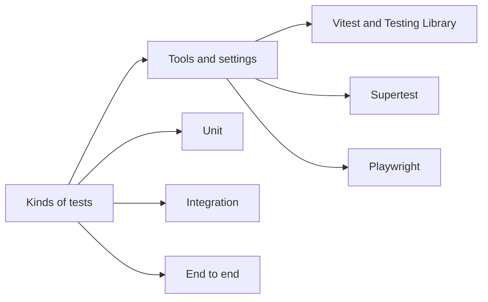

# Testing

What kinds of tests teams write, which tool does each one, and the settings and commands you need.

**Why it matters in interviews:** "What kinds of tests do you write?" and "How would you test this?" come up in almost every software engineer interview. Senior rounds ask how you decide what to test, how many of each, and how you keep tests fast and trusted.

**Short on time?** Read lesson 01 and its Quick summary. Then skim the tables in lesson 02.

## The map

How the lessons connect. Learn left to right.

## Lessons, one concept per file

Each lesson is one small file made from [the lesson template](../../templates/lesson-template.md): picture first, practice, links to read, and an explain it back section.

Status: `planned` (not written yet), `ready` (written, not studied), `learning`, `can explain` (passed explain-check).

### Basics

| # | Lesson | You will understand | Status |
|---|---|---|---|
| 01 | [The kinds of tests](01-the-kinds-of-tests.md) | unit, integration and end to end, the pyramid and the trophy, smoke, regression, load and other names, and two common mistakes | ready |
| 02 | [Test tools and settings](02-test-tools-and-settings.md) | Vitest, React Testing Library, Supertest, mocks, Playwright, coverage, axe and autocannon, with their main settings and command line options | ready |

### Next lessons (planned)

| # | Lesson | You will understand | Status |
|---|---|---|---|
| 03 | Testing React with React Testing Library `03-testing-react.md` | queries, user events, async UI, and what not to test | planned |
| 04 | Testing a database layer `04-testing-a-database-layer.md` | test databases, cleaning between tests, Prisma and Postgres | planned |
| 05 | Tests in CI `05-tests-in-ci.md` | what runs when, splitting across machines, flaky tests | planned |

Each ready lesson has a runnable exercise in [practice/](practice/). Run it with `node --test learn/testing/practice/01-tests-that-catch-bugs.test.js`. The exercise file fails until you fill in your answers.

**To make the next lesson:** in a chat with this folder open, say `/learn testing 03` to learn it live with Claude, or ask "make lesson testing 03" and the `research-material` agent writes the file. When a lesson file exists, its row becomes a link and the status changes to `ready`.

## Watch and play

All links were opened and loaded on 2026-11-27.

- [Testing overview, Next.js docs](https://nextjs.org/docs/app/guides/testing) - the kinds of tests and the four tools
- [Vitest with Next.js](https://nextjs.org/docs/app/guides/testing/vitest) - unit and component tests
- [Playwright with Next.js](https://nextjs.org/docs/app/guides/testing/playwright) - end to end tests
- [Jest with Next.js](https://nextjs.org/docs/app/guides/testing/jest) - the older unit test tool
