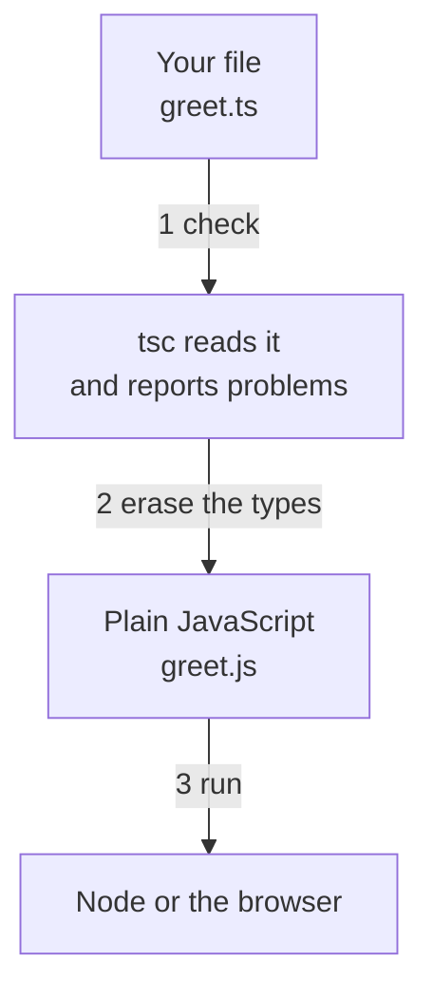
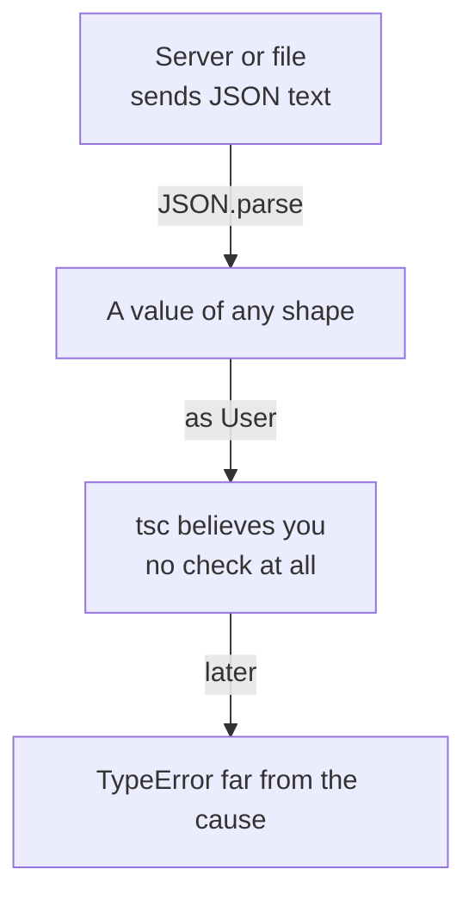
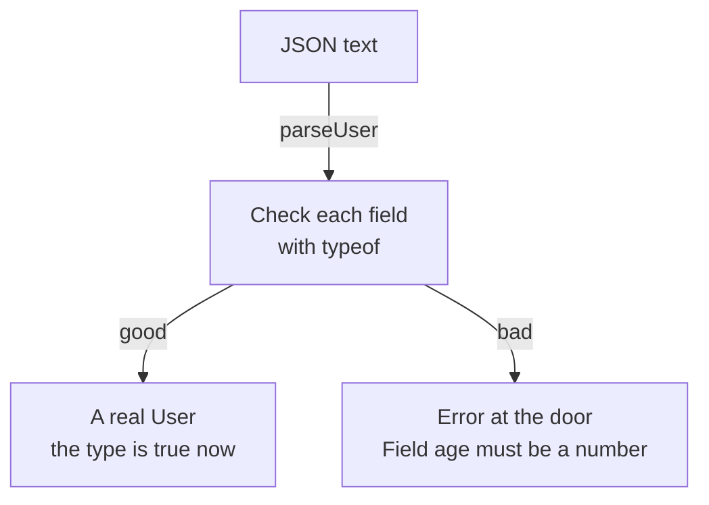

# 01. Why TypeScript and how it compiles

> **Subject:** TypeScript · **Lesson:** 01 · **Made:** 2026-11-27 · **Status:** ready
>
> **You will be able to:** say what TypeScript does before your code runs, why the types are gone when it runs, and why data from outside (JSON, a server, storage) must still be checked by your own code.
>
> **Before this:** [TypeScript map](README.md) · **Next:** [Basic types and inference](02-basic-types-and-inference.md)
>
> **How to read it:** one card is one idea. Look at the picture, guess, then press the orange bar to check. The blue bars (📖 More detail) hold the longer explanation. Skip them on the first read, open them when you want more. About 20 minutes for the cards.

<!-- quick-summary:start -->
## Quick summary

> Short on time? Read only this. These are the "Remember" lines from the cards below, so you can read the whole lesson in one minute.

- TypeScript checks your code before it runs. The types are removed, so the running program has only values.
- `tsc` can check, emit, or both. `--noEmit` is check only.
- Anything that only describes types is erased. The code that does the work stays.
- A type error is reported by the checker. The program can still run, so make your build stop on errors.
- `as User` is a promise from you, not a check. Nothing is checked at run time.
- A passing `tsc` means the types agree with each other. It does not mean the data is right.
- Check outside data once, at the border, and throw a clear error. After that the type is true.
<!-- quick-summary:end -->

## 1. The idea: a spell checker that runs before the code

A spell checker reads your essay and marks the mistakes. It does not change what the essay says. TypeScript is a **checker for your code**. It reads your file before the program runs and says where a value is used in the wrong way.



Notice: the thing that runs is plain JavaScript. The checker is not in the room when the program runs.

<details class="guess"><summary>🤔 Guess: the program is running. Can it ask "what is the type of this value, as I wrote it in TypeScript"? Press to check.</summary>

No. The types were removed before the program started. At run time there are only values: strings, numbers, objects. I ran `typeof User` for an `interface User` in a real file and it printed `undefined`, because the interface does not exist when the code runs.

</details>

> **Remember:** TypeScript checks your code before it runs. The types are removed, so the running program has only values.

<details class="more"><summary>📖 More detail: the words</summary>

- **TypeScript:** JavaScript plus types. The Handbook says that type annotations never change the runtime behavior of your program.
- **Type:** a rule for what a value can be and what you can do with it. For example "a string" or "an object with a name and an age".
- **tsc:** the TypeScript compiler. It checks the code and can write JavaScript files.
- **Compile:** here it means to turn a `.ts` file into a `.js` file.

</details>

## 2. What tsc does: two jobs

`tsc` does two separate jobs. You can do either one alone.

| Job | What happens | How to ask for it |
|---|---|---|
| Check | Find type problems. Write nothing. | `tsc --noEmit` |
| Emit | Write the `.js` files with the types removed | `tsc --outDir out` |
| Both | The default: check, then write files | `tsc` |

I ran the installed compiler (version 7.0.2) on a file with one type error. It printed one line and exited with a failure code:

```text
bad.ts(4,7): error TS2322: Type 'number' is not assignable to type 'string'.
```

<details class="guess"><summary>🤔 Guess: <code>tsc --noEmit</code> finds no errors. What files does it write? Press to check.</summary>

None. `--noEmit` means "check only". Many projects use it just for the check, because another tool (a bundler or Node) removes the types. That is general knowledge, not something I ran.

</details>

> **Remember:** `tsc` can check, emit, or both. `--noEmit` is check only.

<details class="more"><summary>📖 More detail: which tsc is this?</summary>

`npm install typescript` gives version 7.0.2 today, and `tsc --version` prints `Version 7.0.2`. The TypeScript 6.0 release notes on typescriptlang.org talk about "TypeScript's native port" and say that TypeScript 7 does parallel type checking. The `typescript-go` repository says it was the staging repo for the TypeScript 7.0 release during the native port, that this work is now complete, and that development continues in the main TypeScript repository. I read these pages on 2026-11-27. There is no TypeScript 7.0 page in the release notes on typescriptlang.org yet, so I say nothing more about version 7 than this.

The rules of the language are the same. The errors and messages in this lesson came from the real 7.0.2 compiler.

</details>

## 3. The types vanish: before and after

Here is a small file and what `tsc` writes for it. This is the real output from my run.

```ts
// greet.ts
interface User { name: string; age: number }
function greet<T extends User>(user: T): string {
  return "Hi " + user.name;
}
console.log(greet({ name: "Ana", age: 30 }));
```

```js
// greet.js (written by tsc)
"use strict";
function greet(user) {
    return "Hi " + user.name;
}
console.log(greet({ name: "Ana", age: 30 }));
```

| In the .ts file | In the .js file |
|---|---|
| `interface User { ... }` | gone |
| `<T extends User>` | gone |
| `: T` and `: string` | gone |
| the code that does the work | the same |

<details class="guess"><summary>🤔 Guess: which line of the .ts file is the most likely to still exist in the .js file: the interface, the type annotation, or the function body? Press to check.</summary>

The function body. Everything that only describes types is erased. Everything that does work stays.

</details>

> **Remember:** anything that only describes types is erased. The code that does the work stays.

<details class="more"><summary>📖 More detail: running a .ts file without tsc</summary>

Node 22.23.5 can run a `.ts` file directly: `node greet.ts` printed `Hi Ana`. Node only **strips** the types. It does not check them. Stripping works only for syntax that can be erased. An `enum` makes JavaScript code, so it cannot be erased. When I ran a file with `enum Color { Red, Green }`, Node stopped with:

```text
SyntaxError [ERR_UNSUPPORTED_TYPESCRIPT_SYNTAX]: TypeScript enum is not supported in strip-only mode
```

That is why the exercises in this folder use no enums.

**Step through it yourself:** [From TypeScript to JavaScript](visuals/01-from-ts-to-js.html). Press Next on each tab.

</details>

## 4. A type error does not stop the program

The problem: you think a type error means the program cannot run. By default it can still run.

```ts
// bad.ts
function double(n: number): number {
  return n * 2;
}
const result: string = double(21);
console.log("result is", result, typeof result);
```

| Step | What I saw |
|---|---|
| `tsc --noEmit --strict bad.ts` | one error, exit code 1 |
| `tsc` with an output folder | the same error, and `bad.js` was still written |
| `node bad.ts` | ran, printed `result is 42 number` |
| `tsc --noEmitOnError` | the same error, and no `.js` file was written |

<details class="guess"><summary>🤔 Guess: the type says <code>string</code>. What does <code>typeof result</code> print when the program runs? Press to check.</summary>

`number`. The program printed `result is 42 number`. The type said string, the value is a number, and nothing at run time knew about the type.

</details>

> **Remember:** a type error is reported by the checker. The program can still run, so make your build stop on errors.

<details class="more"><summary>📖 More detail: why the default lets you run</summary>

The Handbook explains this choice: TypeScript does not want to get in your way, because much of the time you know better than the checker. It also helps when you move a working JavaScript project to TypeScript step by step. If you want the stricter behavior, turn on `noEmitOnError`. In a real project, make the build or the CI job run `tsc --noEmit` and fail on any error.

</details>

## 5. Mistake 1: "the type protects me at runtime"

The picture: data comes in from outside. The type is only a promise that you make.



The wrong code, and what really happened when I ran it:

```ts
interface User { name: string; age: number }
const text = '{"name": 42}';
const user = JSON.parse(text) as User;
console.log(user.name.toUpperCase());
```

`tsc` passed with no error. Then Node stopped with `TypeError: user.name.toUpperCase is not a function`.

<details class="guess"><summary>🤔 Guess: where was the mistake: the line with <code>as User</code>, or the line with <code>toUpperCase</code>? Press to check.</summary>

The line with `as User`. It told the checker "trust me" while the data was wrong. The crash showed up later, on a line that looks fine. The fix is to check the data where it comes in (card 7).

</details>

> **Remember:** `as User` is a promise from you, not a check. Nothing is checked at run time.

<details class="more"><summary>📖 More detail: what a cast really is</summary>

`as` changes only what the checker believes. It writes no code. After the types are erased, `JSON.parse(text) as User` is just `JSON.parse(text)`. The same is true for data from `fetch`, `localStorage`, a form, a message from a native module, or a file. All of them give you values with no types.

</details>

## 6. Mistake 2: "tsc passes, so the code is correct"

The checker only knows what the types say. If a value is `any`, the checker stops checking it. `JSON.parse` returns `any`.

```ts
function total(prices: number[]): number {
  return prices.reduce((a, b) => a + b, 0);
}
console.log(total(JSON.parse('["1","2","3"]')));
```

<details class="guess"><summary>🤔 Guess: <code>tsc</code> passes. What does the program print, 6? Press to check.</summary>

It printed `0123`. The server sent strings, `+` joined them as text, and the function that promised a number returned a string. `tsc` exited with 0, because `any` goes into `number[]` without a check.

</details>

> **Remember:** a passing `tsc` means the types agree with each other. It does not mean the data is right.

<details class="more"><summary>📖 More detail: why any spreads</summary>

`any` means "do not check this". It spreads: a value that comes from an `any` goes everywhere without a check. Lesson 07 (any, unknown and never) shows the safer choice, `unknown`, which forces you to check before you use the value.

</details>

## 7. The fix: check at the border

The idea: all data from outside comes in through one door. At the door, test the real shape with `typeof`, and throw a clear error. After that, inside the program, the type is true.



The checking function has a special return type, `value is User`. It tells the checker "if I return true, treat this value as a User". You write this in the exercise.

<details class="guess"><summary>🤔 Guess: <code>parseUser('{"name":"Ana"}')</code> has no age. Which is better: return a user with <code>age: undefined</code>, or throw an error at once? Press to check.</summary>

Throw at once. The error then points to the data that came in, not to a line far away that used the age. A clear message such as `Field "age" must be a number` also tells the person on call which field was wrong.

</details>

> **Remember:** check outside data once, at the border, and throw a clear error. After that the type is true.

<details class="more"><summary>📖 More detail: libraries that do this for you</summary>

Many teams use a schema library (Zod is a well known one) that makes the checking function and the type from one description. I did not run one here, so I say nothing about speed or features. The idea is the same as `isUser`: check at the border. Lesson 08 (type guards) and lesson 10 (typing API data) go further.

</details>

## 8. Why it matters and what it costs

- **Without it:** a wrong property name, a missing argument or a wrong type is found by a user, as a crash. In a big team, nobody remembers what shape a function takes.
- **With it:** the editor and `tsc` find these mistakes while you type. A rename is safe, because the checker finds every use. Types also work as documentation that cannot go out of date.
- **The cost:** a build step (or type stripping), more to write, and a false sense of safety at the border where data comes in. Types do not check the real data, so you still need checks there, and tests.

## 9. Watch and play

I opened every link below on 2026-11-27 and each one loaded. I found no video that I could open and check, so there is none here.

- **Step through it:** [From TypeScript to JavaScript](visuals/01-from-ts-to-js.html) - check, erase, run, and what a type error and bad data look like.
- **Do:** [practice/01-types-vanish.ts](practice/01-types-vanish.ts) - write the border check, then run the tests.
- **Play with it:** [TypeScript Playground](https://www.typescriptlang.org/play) - type code and see the errors on the left and the JavaScript on the right.
- **Read:** [The Basics, TypeScript Handbook](https://www.typescriptlang.org/docs/handbook/2/basic-types.html) - the parts "Emitting with Errors" and "Erased Types".
- **Read:** [TypeScript for JavaScript Programmers](https://www.typescriptlang.org/docs/handbook/typescript-from-scratch.html) - how TypeScript relates to JavaScript.
- **Read:** [TypeScript 6.0 release notes](https://www.typescriptlang.org/docs/handbook/release-notes/typescript-6-0.html) - the native port and the version 7 plans.

## 10. Practice

**A. Predict**

```ts
const n: number = "5" as unknown as number;
console.log(typeof n, n + 1);
```

Does `tsc --strict` accept it? What does the program print?

<details><summary>Answer</summary>

`tsc` accepts it, because `as unknown as number` tells the checker to believe you. The program prints `string 51`. The value is still the text "5", and `+` joins it with 1. I ran it.

</details>

**B. Fix the bug**

```ts
interface User { name: string; age: number }

async function loadUser(id: string): Promise<User> {
  const res = await fetch("/api/users/" + id);
  return (await res.json()) as User;
}
```

The server sometimes sends `{"name":"Ana"}` with no age. The app shows "NaN years old". What is wrong, and what do you change?

<details><summary>Answer</summary>

The cast `as User` checks nothing, so the missing `age` goes through. Read the data as `unknown`, check it with a function like `isUser`, and throw a clear error (or show an error screen) when it fails. Also check `res.ok` before you read the body.

```ts
async function loadUser(id: string): Promise<User> {
  const res = await fetch("/api/users/" + id);
  if (!res.ok) throw new Error("Request failed: " + res.status);
  const data: unknown = await res.json();
  if (!isUser(data)) throw new Error("The server sent a bad user");
  return data;
}
```

</details>

**C. Write it yourself**

Open `practice/01-types-vanish.ts` and write `isUser` and `parseUser`, so that all 9 tests pass. One test runs the real TypeScript compiler on your file too.

```bash
cd learn/typescript/practice
npm install
node --test 01-types-vanish.test.ts
```

<details><summary>One possible answer</summary>

```ts
export interface User {
  name: string;
  age: number;
}

export function isUser(value: unknown): value is User {
  if (typeof value !== "object" || value === null || Array.isArray(value)) return false;
  const record = value as Record<string, unknown>;
  return typeof record.name === "string" && typeof record.age === "number";
}

export function parseUser(json: string): User {
  let data: unknown;
  try {
    data = JSON.parse(json);
  } catch {
    throw new Error("Invalid JSON");
  }
  if (typeof data !== "object" || data === null || Array.isArray(data)) {
    throw new Error("Expected an object");
  }
  const record = data as Record<string, unknown>;
  if (typeof record.name !== "string") throw new Error('Field "name" must be a string');
  if (typeof record.age !== "number") throw new Error('Field "age" must be a number');
  return { name: record.name, age: record.age };
}
```

Look at the pattern: the data comes in as `unknown`, which means "I know nothing yet". You test it with `typeof`. Only after the tests does the code say `as Record<string, unknown>`, and that cast is safe, because you already know it is a plain object. The last line builds a new object, so no extra fields come through.

</details>

## 11. Interview question

**Q:** What does TypeScript do, and does it make my code safe at runtime?

<details><summary>A strong answer, in four parts</summary>

1. **Problem:** JavaScript finds a wrong use of a value only when that line runs, often in front of a user. In a large codebase, nobody remembers the shape of every object.
2. **How it works:** `tsc` reads the code before it runs and checks each value against its type. Then the types are erased, and plain JavaScript runs. The checker is not part of the running program. A type error is reported, but by default the JavaScript can still be written and run. Turn on `noEmitOnError`, or fail the build on errors.
3. **Tradeoff:** it finds many mistakes early and makes refactors safe, but it costs a build step and extra writing. It gives no protection for data from outside (JSON, a server, storage). There a cast like `as User` checks nothing. You check the shape at the border, with `unknown` and a type guard or a schema library, and keep tests.
4. **My example:** I use TypeScript in my work. I will add one real moment where a type found a bug early, or where bad data from an API got past the types, only after I confirm the facts. This is an idea, not a fact about DBO, Unloan or ZWS.

</details>

## 12. Explain it back

Close this file. Explain TypeScript to a new junior, in 4 parts (problem, how, tradeoff, my example). Then write your best version below and run `/explain-check typescript compile and types vanish` or ask the `explain-coach` agent to review it.

### My explanation

<write here>

### Coach feedback

<the explain-coach agent writes here>

## 13. Review questions (day 1, 3, 7, 21)

1. What are the three steps between a `.ts` file and a running program?
2. A file has a type error. Does it still run? Say what controls that.
3. Why does `JSON.parse(text) as User` not protect you?
4. Draw the picture from card 5 from memory: the data from outside, the cast, the crash later.

<details><summary>Answers</summary>

1. Check (`tsc` reads the file), erase the types, run the plain JavaScript.
2. By default yes: `tsc` reports the error, and the JavaScript is still written and can run. Node's type stripping never checks. `noEmitOnError` stops the file from being written. A build that fails on errors stops it from shipping.
3. `as` is erased. It only changes what the checker believes, so no check happens at run time. The crash comes later, on a different line.
4. JSON text, then `JSON.parse` gives a value of any shape, then `as User` and `tsc` passes, then a `TypeError` far from the cause.

</details>

## 14. Go deeper (optional)

<details><summary>Versions, checked facts and rare edge cases</summary>

- **Checked on 2026-11-27** with `typescript` 7.0.2 from npm and Node 22.23.5. The error text, the exit codes, the Node error for `enum`, and the output of `bad.ts`, `cast.ts` and `total` came from real runs.
- **Strict mode:** the exercise tests run `tsc` with `--strict`. Lesson 11 (planned) explains what it turns on.
- **Other things that cannot be erased:** `enum` and `namespace` make real JavaScript code, so Node's strip-only mode rejects them. I tested only `enum`.
- **`satisfies` and `as const`:** these also only exist for the checker.
- **Not run here:** Zod or any schema library, and Babel or other tools that remove types.

</details>

## Connected lessons

- [Basic types and inference](02-basic-types-and-inference.md) - the types you write, and the ones the checker works out for you.
- any, unknown and never (lesson 07, planned) - why `unknown` is safer than `any`.
- Type guards and assertion functions (lesson 08, planned) - the `value is User` function in detail.
- Typing API data end to end (lesson 10, planned) - checking data at the border in a real app.
- tsconfig and strict mode (lesson 11, planned) - the flags that matter.
