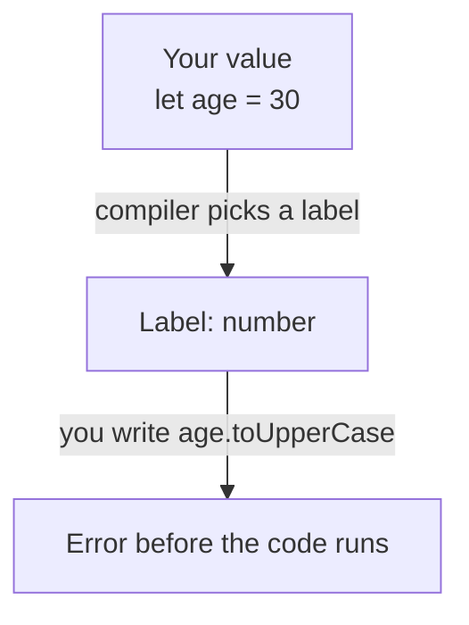
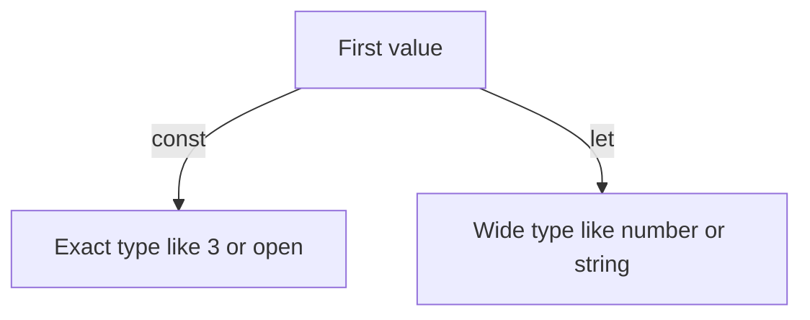
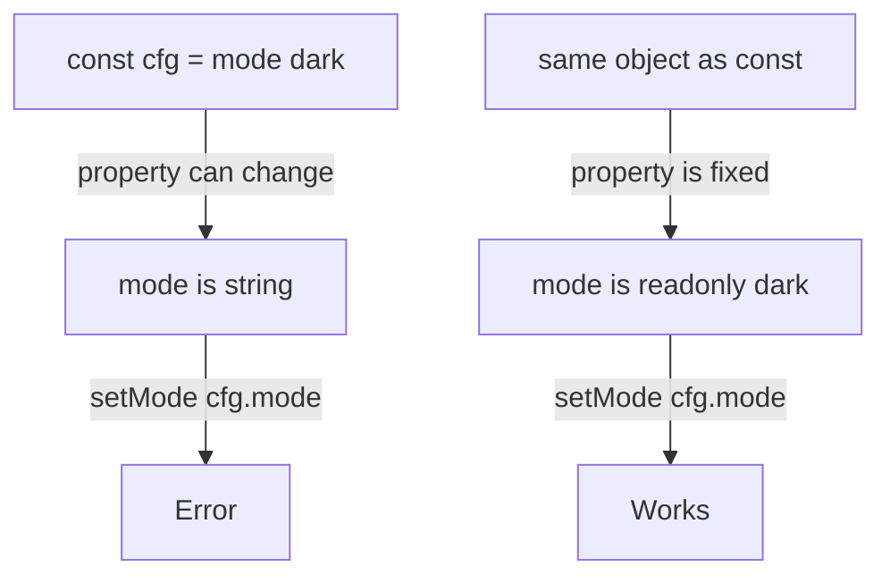

# 02. Basic types and inference

> **Subject:** TypeScript · **Lesson:** 02 · **Made:** 2026-11-27 · **Status:** ready
>
> **You will be able to:** name the basic types, say what type the compiler gives a value without being told, and say when you must write a type yourself and when you should not.
>
> **Before this:** [Why TypeScript and how it compiles](01-why-typescript-and-how-it-compiles.md) · **Next:** [Type vs interface](03-type-vs-interface.md)
>
> **How to read it:** one card is one idea. Look at the picture, guess, then press the orange bar to check. The blue bars (📖 More detail) hold the longer explanation. Skip them on the first read, open them when you want more. About 25 minutes for the cards.

<!-- quick-summary:start -->
## Quick summary

> Short on time? Read only this. These are the "Remember" lines from the cards below, so you can read the whole lesson in one minute.

- Every value has a type label. The compiler checks the labels before the code runs. The labels are removed from the JavaScript that ships.
- Use `string`, `number`, `boolean`, arrays, tuples and object types. A tuple has a fixed length, and each place has its own type.
- The compiler works out the type from the first value. `let` keeps the wide type. `const` keeps the exact value.
- A `const` object still widens its properties. Add `as const` to keep the exact values, and to make them read-only.
- Write types on function parameters, on empty arrays and objects, and on values that start empty. Let the compiler infer the rest.
- `any` switches the checking off. A wrong call compiles and crashes when it runs.
- An empty array inside an object, or returned from a function, has the type `never[]`. Write what it holds.
- Strict mode is on by default in TypeScript 6.0 and later. With it, `undefined` is a type that you must handle.
<!-- quick-summary:end -->

## 1. The idea: a label on every box

Think of a shelf of boxes. A box can hold a number, some text, or a list. A careful helper puts a **label** on each box: "number", "text", "list of numbers". Before you use a box, the helper reads the label. If you try to do text things with a number box, the helper stops you.

TypeScript works like this. The label is called a **type**. The compiler (the helper) reads the labels **before your code runs**.



Notice: you did not write the label. The compiler worked it out from the value `30`. That is the main idea of this lesson, and it is called **inference**.

<details class="guess"><summary>🤔 Guess: you write <code>let age = 30</code> and nothing else. What type does <code>age</code> have? Press to check.</summary>

`number`. You did not write it. The compiler looked at the first value and chose the label. This is why good TypeScript code has fewer type labels than you expect.

</details>

> **Remember:** every value has a type label. The compiler checks the labels before the code runs. The labels are removed from the JavaScript that ships.

<details class="more"><summary>📖 More detail: the words, and where the picture stops</summary>

- **Type:** a label that says what kind of value a place holds.
- **Inference:** the compiler works out the type by itself.
- **Annotation:** a type that you write, for example `let age: number`.

Where the picture stops: the helper reads labels **before** anything runs, and then the labels are thrown away. At runtime a number is just a number. [Lesson 01](01-why-typescript-and-how-it-compiles.md) explains why.

The TypeScript handbook gives the same advice: "try using fewer type annotations than you think".

</details>

## 2. The basic types

These are the types you will write every day.

| Type | What it holds | Example |
|---|---|---|
| `string` | text | `"Ana"` |
| `number` | any number, whole or decimal | `30`, `2.5` |
| `boolean` | yes or no | `true` |
| `bigint` | very large whole numbers | `10n` |
| `null` | "nothing here, on purpose" | `null` |
| `undefined` | "nothing here, not set" | `undefined` |
| `string[]` or `Array<string>` | a list of one type | `["a", "b"]` |
| `[string, number]` | a **tuple**: a fixed list, each place has its own type | `["Ana", 30]` |
| `{ name: string; nick?: string }` | an object, `?` means optional | `{ name: "Ana" }` |

The two array spellings mean the same thing. Most teams pick `string[]`.

A **tuple** (a small list with a fixed length) is the one that surprises people:

```ts
const t: [string, number] = ["Ana", 30];
t[2];
```

<details class="guess"><summary>🤔 Guess: does <code>t[2]</code> compile? Press to check.</summary>

No. The compiler says:

```text
error TS2493: Tuple type '[string, number]' of length '2' has no element at index '2'.
```

A plain array type `(string | number)[]` would allow it. The tuple says "exactly two places".

</details>

> **Remember:** use `string`, `number`, `boolean`, arrays, tuples and object types. A tuple has a fixed length, and each place has its own type.

<details class="more"><summary>📖 More detail: null, undefined and optional</summary>

With strict mode on (card 8), `null` and `undefined` are their own types. A `string` cannot be `null`:

```text
let u: string = null;
error TS2322: Type 'null' is not assignable to type 'string'.
```

A property with `?` can be missing, so its type is `string | undefined`. Reading `profile.nick.toUpperCase()` gives `error TS18048: 'profile.nick' is possibly 'undefined'.`

`bigint` literals such as `10n` need a target of ES2020 or newer. With `--target es2015` I got `error TS2737: BigInt literals are not available when targeting lower than ES2020.` With `es2020` there was no error.

</details>

## 3. Inference: the compiler reads the first value

You can write very little and still be fully checked. This table comes from real runs of `tsc` 7.0.2. The right column is the type the compiler chose.

| You write | The compiler's type |
|---|---|
| `let a = 3` | `number` |
| `const b = 3` | `3` (the exact value) |
| `let c = "open"` | `string` |
| `const d = "open"` | `"open"` (the exact value) |
| `[1, 2].map(n => n * 2)` | `number[]`, and `n` is a `number` |
| `[0, 1, null]` | `(number \| null)[]` |
| `{ ok: true }` | `{ ok: boolean }` |
| `function area(w = 5, h = 2)` | `(w?: number, h?: number) => number` |

Two rules sit behind the table. First, a value that **can change** (`let`) gets the wide type. A value that **cannot change** (`const`) keeps its exact value. Second, a default value gives the parameter its type.



<details class="guess"><summary>🤔 Guess: what is the type of <code>let c = "open"</code>, and what is the type of <code>const d = "open"</code>? Press to check.</summary>

`c` is `string`. `d` is `"open"`. A `let` might be set to other text later, so the compiler keeps the wide label. A `const` can only ever be `"open"`.

</details>

> **Remember:** the compiler works out the type from the first value. `let` keeps the wide type. `const` keeps the exact value.

<details class="more"><summary>📖 More detail: contextual typing and the "best common type"</summary>

- **Contextual typing:** in `[1, 2].map(n => n * 2)` you never wrote the type of `n`. The compiler knows `map` is called on a `number[]`, so `n` must be a `number`. The handbook calls this contextual typing.
- **Best common type:** for `[0, 1, null]` the compiler looks at all the candidates and builds one that fits all of them: `(number | null)[]`.
- When no single type covers all items, the result is a union array. The handbook example is `(Rhino | Elephant | Snake)[]`. If you want `Animal[]`, say so with an annotation.

Source: the handbook page "Type Inference". Checked on 2026-11-27.

</details>

## 4. Widening, and why `as const` exists

The "exact value" rule has a catch. Look at a settings object.

```ts
const cfg = { mode: "dark" };
function setMode(m: "dark" | "light") {}
setMode(cfg.mode);
```

The object is a `const`, but its **properties** can still change (`cfg.mode = "light"` is allowed). So the compiler widens `mode` to `string`. It prints the type as `{ mode: string; }`.



<details class="guess"><summary>🤔 Guess: what does the compiler say about <code>setMode(cfg.mode)</code>, and what is the one-word fix? Press to check.</summary>

```text
error TS2345: Argument of type 'string' is not assignable to parameter of type '"dark" | "light"'.
```

The fix is `as const` after the object: `const cfg = { mode: "dark" } as const;`. The type becomes `{ readonly mode: "dark"; }`, and the call works.

</details>

> **Remember:** a `const` object still widens its properties. Add `as const` to keep the exact values, and to make them read-only.

<details class="more"><summary>📖 More detail: as const on arrays, and annotations that widen</summary>

- `[1, 2, 3] as const` has the type `readonly [1, 2, 3]`: a read-only tuple of exact numbers.
- Writing `as const` also makes the object read-only. I ran `ro.retries = 4` on a `{ retries: 3 } as const` object and got `error TS2540: Cannot assign to 'retries' because it is a read-only property.`
- An annotation can widen on purpose. `const ann: string = "open"` has the type `string`, not `"open"`.

</details>

## 5. When to write a type, and when not to

Writing a type on everything is as bad as writing none. A useful rule:

| Write a type here | Let the compiler infer here |
|---|---|
| Function **parameters** (no value to read) | Local variables with an obvious first value |
| Empty arrays and objects that you fill later | Callbacks in `map`, `filter`, `forEach` |
| A variable that starts as `null` and gets a value later | Values with a default: `function f(n = 5)` |
| The **return type** of a function that other code calls (my advice, not a rule) | The return type of a small private helper |

The return type is worth a closer look. Compare two functions that make the same mistake:

```ts
function price(n: number): number { return n > 0 ? n : "free"; }
function price2(n: number) { return n > 0 ? n : "free"; }
const p: number = price2(0);
```

<details class="guess"><summary>🤔 Guess: where does each mistake show up? Press to check.</summary>

With the written return type, the error sits **on the bad line**, inside the function:

```text
error TS2322: Type 'string' is not assignable to type 'number'.
```

Without it, the function compiles. The error appears later, at the caller, with a longer message:

```text
error TS2322: Type 'number | "free"' is not assignable to type 'number'.
```

A written return type puts the error close to where you made it.

</details>

> **Remember:** write types on function parameters, on empty arrays and objects, and on values that start empty. Let the compiler infer the rest.

<details class="more"><summary>📖 More detail: why the return type is "my advice"</summary>

The handbook says you usually do not need a return type, because the compiler infers it from your `return` lines. It also says some codebases write it "for documentation purposes, to prevent accidental changes, or just for personal preference". Both ways are fine. Pick one style for the team and keep it.

</details>

## 6. Mistake 1: using `any` to make the error go away

The problem: the compiler complains about a parameter, and you want it to stop.

```ts
function shout(text) {
  return text.toUpperCase() + "!";
}
```

```text
error TS7006: Parameter 'text' implicitly has an 'any' type.
```

The quick "fix" is `text: any`. The error goes away. Now call `shout(42)`.

<details class="guess"><summary>🤔 Guess: what does the compiler say about <code>shout(42)</code>, and what happens when it runs? Press to check.</summary>

The compiler says **nothing**. `any` switches the checking off for that value. The code runs and crashes:

```text
TypeError: text.toUpperCase is not a function
```

The right fix is one word: `text: string`. Now `shout(42)` is an error before the code runs.

</details>

> **Remember:** `any` switches the checking off. A wrong call compiles and crashes when it runs.

<details class="more"><summary>📖 More detail: where any comes from</summary>

- With `noImplicitAny` on (part of strict mode), a missing type that the compiler cannot infer is an **error**, not a silent `any`. That is the `TS7006` message above. The handbook describes the flag this way.
- `JSON.parse` returns `any`. The data from a server is "any" until you check it. [Lesson 01](01-why-typescript-and-how-it-compiles.md) shows a function that checks it at runtime.
- Lesson 07 (`any`, `unknown` and `never`) covers the safe replacement, `unknown`.

</details>

## 7. Mistake 2: the empty array that holds nothing

The problem: you start with an empty list and push items in later.

```ts
const cart = { items: [], total: 0 };
cart.items.push({ name: "tea" });
```

```text
error TS2345: Argument of type '{ name: string; }' is not assignable to parameter of type 'never'.
```

The compiler typed `items` as `never[]`: a list that can hold **nothing**. A function that returns `[]` has the same type. I ran both.

<details class="guess"><summary>🤔 Guess: how do you fix it? Press to check.</summary>

Say what the list holds:

```ts
type Item = { name: string; price: number };
const cart: { items: Item[]; total: number } = { items: [], total: 0 };
```

Now `cart.items.push({ name: "tea", price: 3 })` works, and `cart.items.push(5)` is an error.

</details>

> **Remember:** an empty array inside an object, or returned from a function, has the type `never[]`. Write what it holds.

<details class="more"><summary>📖 More detail: why a plain const [] works, and the exception</summary>

A plain `const evolving = []` followed by `evolving.push(1)` in the same function does **not** fail. TypeScript lets the type "evolve" as you push, and I ran it: the type became `number[]`. But that trick stops when the array is inside an object or crosses a function. Do not depend on it. Writing `const items: string[] = []` is clear and always works.

</details>

## 8. Mistake 3: forgetting strict mode, and not handling "nothing"

Strict mode is a group of checks. Two matter most for this lesson: `noImplicitAny` (card 6) and **`strictNullChecks`**, which makes `null` and `undefined` real types that you must handle.

```ts
let maybe: string | undefined;
maybe.toUpperCase();
```

```text
error TS18048: 'maybe' is possibly 'undefined'.
```

The fix uses **optional chaining**: `maybe?.toUpperCase()`. The result has the type `string | undefined`, and you decide what to do when it is missing, for example `maybe?.toUpperCase() ?? ""`.

| Strict mode | What the compiler does with `let u: string = null` |
|---|---|
| on | Error: Type 'null' is not assignable to type 'string' |
| off | Nothing. The bug shows up when the code runs |

<details class="guess"><summary>🤔 Guess: you run <code>tsc</code> with no strict flag on the newest version. Is strict mode on or off? Press to check.</summary>

On. The TypeScript 6.0 release notes say: "strict is now true by default". I confirmed this with `tsc` 7.0.2: with no flag it reported the `TS2322` and `TS7006` errors above, and with `--strict false` those errors disappeared. Older projects may still turn it off in `tsconfig.json`, so check the file.

</details>

> **Remember:** strict mode is on by default in TypeScript 6.0 and later. With it, `undefined` is a type that you must handle.

<details class="more"><summary>📖 More detail: what to check in an old project</summary>

- Open `tsconfig.json` and look for `"strict": false`, or for a single flag such as `"strictNullChecks": false`.
- The tsconfig reference says `noImplicitAny` is "true if strict; false otherwise".
- Turning strict on in an old project makes many errors at once. Teams often turn on one flag at a time. Lesson 11 (tsconfig and strict mode, planned) covers this.

</details>

## 9. Why it matters and what it costs

- **Without it:** a typo like `user.agee` or a missing value shows up in production, as a crash.
- **With it:** the compiler finds these in your editor. In a run, `user.agee = 31` gave `error TS2551: Property 'agee' does not exist on type '{ name: string; age: number; }'. Did you mean 'age'?`
- **The cost:** a few types to write in the right places, and a few errors to fix when strict mode is new to you. Too many annotations make the code noisy, and `any` removes the benefit.

## 10. Watch and play

I opened every link below on 2026-11-27 and each one loaded. I found no video that I could open and check, so there is none here.

- **Do:** [practice/02-fix-the-types.ts](practice/02-fix-the-types.ts) - fix six small type problems, then run the test. The test runs the real compiler.
- **Play with it:** [TypeScript Playground](https://www.typescriptlang.org/play) - type `let a = 3` and `const b = 3`, then move the mouse over each name to see its type.
- **Read:** [Everyday Types](https://www.typescriptlang.org/docs/handbook/2/everyday-types.html) - the basic types, annotations, and literal types.
- **Read:** [Type Inference](https://www.typescriptlang.org/docs/handbook/type-inference.html) - best common type and contextual typing.
- **Read:** [TypeScript 6.0 release notes](https://www.typescriptlang.org/docs/handbook/release-notes/typescript-6-0.html) - search the page for "strict is now true by default".

## 11. Practice

**A. Predict**

What type does the compiler give each of these? Write your answer first.

```ts
const a = 3;
let b = 3;
const c = [1, "x"];
const d = { ok: true };
```

<details><summary>Answer</summary>

`a` is `3`. `b` is `number`. `c` is `(string | number)[]`. `d` is `{ ok: boolean }`. The `const` keeps the exact value only for a plain value, not for the properties inside an object.

</details>

**B. Fix the bug**

```ts
function total(prices) {
  return prices.reduce((sum, p) => sum + p, 0);
}
```

The compiler reports three errors. What are they, and what one change fixes all of them?

<details><summary>Answer</summary>

It reports `TS7006` for `prices`, for `sum` and for `p`: each "implicitly has an 'any' type". The one change is `prices: number[]`. Then the compiler works out `sum` and `p` from the array type, so they need no labels.

</details>

**C. Write it yourself**

Open `practice/02-fix-the-types.ts`. It has six problems. Fix them until the file compiles in strict mode and all 11 tests pass:

```bash
cd learn/typescript/practice
npm install
node --test 02-fix-the-types.test.ts
```

The test runs the real TypeScript compiler (version 7.0.2) on your file. It also writes a small temporary file that uses your code the wrong way, to check that the compiler still says no. I ran the tests with Node 22.23.5. I did not try other Node versions.

<details><summary>One possible answer</summary>

```ts
export type Point = [number, number];
export function makePoint(x: number, y: number): Point {
  return [x, y];
}
export function addPoints(a: Point, b: Point): Point {
  return [a[0] + b[0], a[1] + b[1]];
}

export function shout(text: string) {
  return text.toUpperCase() + "!";
}

type Item = { name: string; price: number };
export const cart: { items: Item[]; total: number } = { items: [], total: 0 };
export function addItem(name: string, price: number) {
  cart.items.push({ name, price });
  cart.total += price;
}

export type Status = "open" | "closed";
export let status: Status = "open";
export function setStatus(next: Status) {
  status = next;
}
export function nextStatus(current: Status): Status {
  return current === "open" ? "closed" : "open";
}

export const config = { mode: "dark", retries: 3 } as const;
export function applyMode(mode: "dark" | "light") {
  return `mode:${mode}`;
}
export const applied = applyMode(config.mode);

export function firstWord(text: string | undefined): string {
  return text?.split(" ")[0] ?? "";
}
```

Look at the pattern: every fix says **more exactly** what the value is. A tuple instead of an array, a union of two texts instead of `string`, an item list instead of `never[]`. None of the fixes needed `any`.

</details>

## 12. Interview question

**Q:** What is type inference in TypeScript? When do you write types yourself, and when do you let the compiler work them out?

<details><summary>A strong answer, in four parts</summary>

1. **Problem:** JavaScript has no checks before the code runs, so typos and missing values show up as crashes. But if you must write a type on every line, the code gets noisy and people stop writing them.
2. **How it works:** the compiler works out the type of a variable from its first value, and of a function result from its `return` lines. A `const` keeps the exact value, and a `let` keeps the wide type. I write types where the compiler has nothing to read: function parameters, empty arrays and objects, and values that start as `null`. In strict mode, a missing parameter type is an error, so the compiler tells me where it needs help.
3. **Tradeoff:** too few types give errors in the wrong place and weak documentation. Too many make the code noisy and hide the real information. `any` is the worst choice, because it switches the checking off and the crash happens at runtime.
4. **My example:** I use TypeScript every day. I will add one real case where a type caught a bug in DBO, Unloan or ZWS, only after I confirm the facts. As an idea, not a fact: a loan form status such as `"draft" | "submitted"` is a literal union, so a wrong text is an error.

</details>

## 13. Explain it back

Close this file. Explain type inference to a new junior in 4 parts (problem, how, tradeoff, my example). Then write your best version below and run `/explain-check type inference` or ask the `explain-coach` agent to review it.

### My explanation

<write here>

### Coach feedback

<the explain-coach agent writes here>

## 14. Review questions (day 1, 3, 7, 21)

1. What type does `const d = "open"` have, and what type does `let c = "open"` have? Why do they differ?
2. What is a tuple, and what does the compiler say about reading `t[2]` on `[string, number]`?
3. What does `as const` do, and when do you need it?
4. Draw the picture from card 3 from memory: the first value, `const` and `let`, and the label each one gets.

<details><summary>Answers</summary>

1. `d` is `"open"` and `c` is `string`. A `const` cannot change, so it keeps the exact value. A `let` can change, so it keeps the wide type.
2. A tuple is a list with a fixed length and a type for each place. Reading `t[2]` gives `TS2493`: Tuple type '[string, number]' of length '2' has no element at index '2'.
3. It keeps exact values and makes them read-only. You need it when an object property widens to `string` but a function wants exact text such as `"dark" | "light"`.
4. First value, then two arrows: `const` gives an exact type such as `3` or `"open"`, and `let` gives a wide type such as `number` or `string`.

</details>

## 15. Go deeper (optional)

<details><summary>Versions, a gotcha, and extra links</summary>

- **Checked on 2026-11-27** with `tsc` 7.0.2 (installed with `npm install typescript@7.0.2`) and Node 22.23.5, plus the handbook pages "Everyday Types" and "Type Inference" and the TypeScript 6.0 release notes. Every error message in this lesson comes from a real run.
- **A gotcha I hit:** in a file with no `import` or `export`, a top-level `let status = "open"` gave `error TS2451: Cannot redeclare block-scoped variable 'status'`. Such a file counts as a script, and its names share one global space with the browser types (the DOM library has a global `status`). Adding `export {}` to the file, or making it a module, fixes it. The exercise file uses `export`, so it is not affected.
- **Not covered here:** `satisfies`, enums and `unknown`. They come in later lessons.
- **Idea, not run here:** the test for the exercise writes a temporary `.ts` file and checks it with `tsc`. A real project would do the same kind of check with a type-test library. I did not try one.
- The [Everyday Types](https://www.typescriptlang.org/docs/handbook/2/everyday-types.html) page also covers unions, type aliases and `enum`, which come later.

</details>

## Connected lessons

- [Why TypeScript and how it compiles](01-why-typescript-and-how-it-compiles.md) - why the labels disappear at runtime.
- [Type vs interface](03-type-vs-interface.md) - how to name an object shape once and reuse it.
- [Union types and narrowing](04-union-types-and-narrowing.md) - what to do with a `string | undefined` after the compiler complains.
