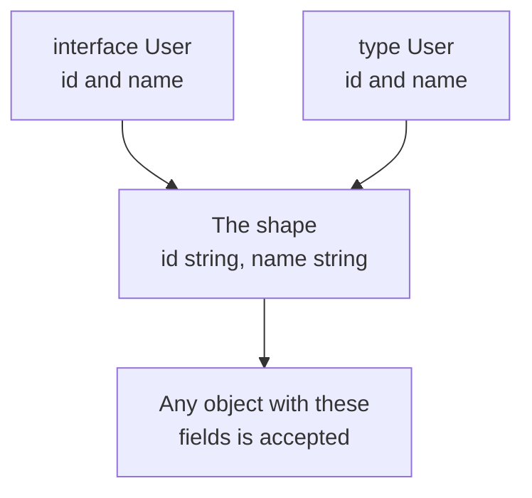
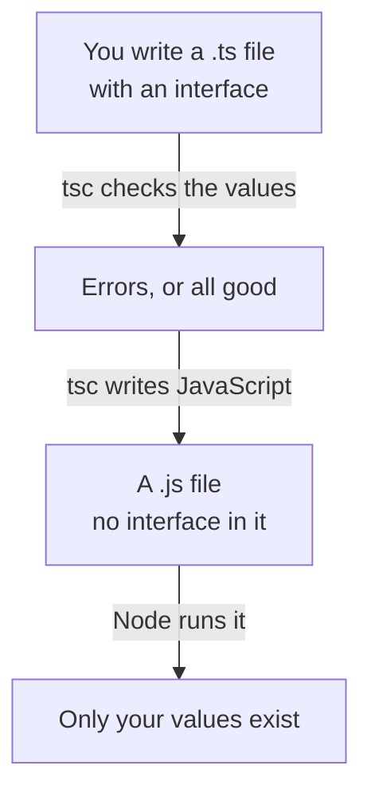
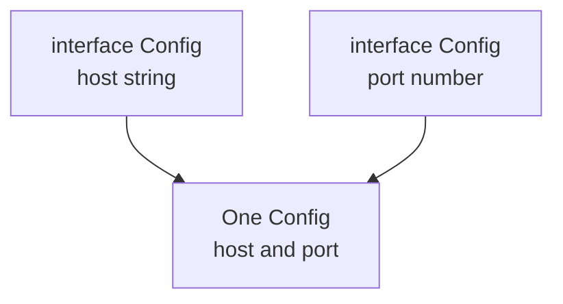
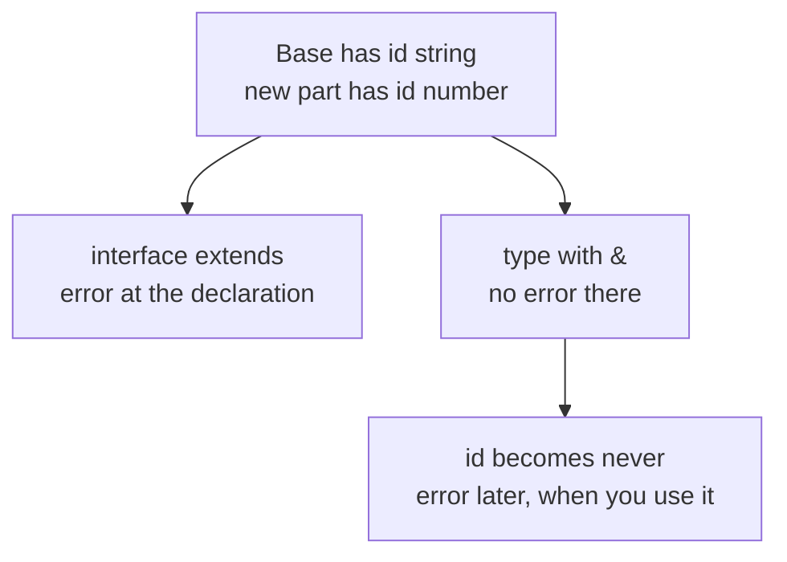

# 03. Type vs interface

> **Subject:** TypeScript · **Lesson:** 03 · **Made:** 2026-11-27 · **Status:** ready
>
> **You will be able to:** say what `type` and `interface` can each do that the other cannot, read the three real error messages, and give a rule for which one to use.
>
> **Before this:** [Basic types and inference](02-basic-types-and-inference.md) · **Next:** [Union types and narrowing](04-union-types-and-narrowing.md)
>
> **How to read it:** one card is one idea. Look at the picture, guess, then press the orange bar to check. The blue bars (📖 More detail) hold the longer explanation. Skip them on the first read, open them when you want more. About 20 minutes for the cards.

<!-- quick-summary:start -->
## Quick summary

> Short on time? Read only this. These are the "Remember" lines from the cards below, so you can read the whole lesson in one minute.

- For object shapes, `type` and `interface` are interchangeable most of the time, because TypeScript checks the shape.
- `type` and `interface` both vanish at run time. You cannot check them with `if` in your code.
- Interface blocks with the same name merge into one. A type alias with a repeated name is an error.
- Only a type alias can name a union, a tuple or a mapped type. An interface is for object shapes.
- `extends` shows a clash at the declaration. `&` hides it, turns the field into `never`, and fails later.
- Use a `type` when you need a union, a tuple or a mapped type. For plain object shapes, pick one rule for the team and keep it.
- A `type` cannot be re-opened. If you need to add to it later, use an `interface`.
- The compiler accepts both, so the team has to choose. Write the rule down.
<!-- quick-summary:end -->

## 1. The idea: two names for the same blueprint

A blueprint says what a house must have: two doors, three windows. Two builders can write the same blueprint on two different forms. The house is the same.

TypeScript has two forms to describe the shape of data. One is `interface`. The other is `type` (its full name is **type alias**, a new name for a type). For an object like a user, they say the same thing.



Notice: TypeScript checks the **shape** of a value, not the name of the form it came from. This is called **structural typing** (two types are the same if their shapes are the same).

<details class="guess"><summary>🤔 Guess: you have a value typed as an interface <code>PointI</code> and a type <code>PointT</code>, both with <code>x</code> and <code>y</code> numbers. Can you assign one to the other? Press to check.</summary>

Yes, both ways. I ran it with the real compiler (tsc 7.0.2). It said nothing, because the shapes match.

</details>

> **Remember:** for object shapes, `type` and `interface` are interchangeable most of the time, because TypeScript checks the shape.

<details class="more"><summary>📖 More detail: the words, and the real test</summary>

- **Interface:** a name for the shape of an object.
- **Type alias:** a name for any type. It can name an object shape, but also a union, a tuple or a function.
- **Structural typing:** only the shape counts, not the name.

The test I ran:

```ts
interface PointI { x: number; y: number }
type PointT = { x: number; y: number };
const pi: PointI = { x: 1, y: 2 };
const pt: PointT = pi;     // fine
const pi2: PointI = pt;    // fine
```

The handbook says the same: "Type aliases and interfaces are very similar, and in many cases you can choose between them freely."

</details>

## 2. Both disappear before the app runs

Neither one is real code. The compiler uses them to check your work, then throws them away.



<details class="guess"><summary>🤔 Guess: this file has an interface and a type. How many lines of JavaScript do they add? Press to check.</summary>

```ts
interface User { name: string }
type Id = string | number;
const u: User = { name: "A" };
console.log(typeof u, JSON.stringify(u));
```

Zero. The compiled output is only:

```js
"use strict";
const u = { name: "A" };
console.log(typeof u, JSON.stringify(u));
```

Node can also run the `.ts` file directly. It removes the types and prints `object {"name":"A"}`.

</details>

> **Remember:** `type` and `interface` both vanish at run time. You cannot check them with `if` in your code.

<details class="more"><summary>📖 More detail: what this means for real work</summary>

An API can send data that does not match your `interface User`. TypeScript cannot see that, because the interface is gone at run time. To trust outside data, you must check it with real code. Lesson 08 (planned) and lesson 10 (planned) cover this.

Checked on 2026-11-27 with tsc 7.0.2 and Node 22.23.5.

</details>

## 3. What only an interface can do: merge

Two `interface` blocks with the same name become **one**. This is **declaration merging**. A type alias cannot do it.



| Code | What tsc says (real run) |
|---|---|
| Two `interface Config` blocks, then `{ host: "a" }` | `error TS2741: Property 'port' is missing in type '{ host: string; }' but required in type 'Config'.` The blocks were joined. |
| Two `type Window2 = ...` lines | `error TS2300: Duplicate identifier 'Window2'.` It points at both lines. |

<details class="guess"><summary>🤔 Guess: why would anyone want two blocks with one name? Press to check.</summary>

To add a field to a type that is not yours. A library gives you `interface Request`. You write another `interface Request` block in your code that adds a `user` field. The two merge. The handbook's declaration merging page has a "Module Augmentation" part for this.

</details>

> **Remember:** interface blocks with the same name merge into one. A type alias with a repeated name is an error.

<details class="more"><summary>📖 More detail: the rule for clashing fields</summary>

The handbook says non-function members must be unique, or they must have the same type. If not, the compiler gives an error. I ran two blocks that gave `size` the types `number` and `string`:

```
error TS2717: Subsequent property declarations must have the same type.
Property 'size' must be of type 'number', but here has type 'string'.
```

Function members with the same name are treated as overloads (more than one way to call the same function).

</details>

## 4. What only a type can do: more than an object

An interface describes the shape of an **object**. A type alias can name **anything**.

| You want | `type` | `interface` |
|---|---|---|
| A string or a number | `type Id = string \| number;` works | `interface Id = string \| number;` fails: `error TS1005: '{' expected.` |
| A tuple (fixed list) | `type Pair = [string, number];` works | no tuple syntax |
| A mapped type (new type from the keys of another) | `type RO<T> = { readonly [K in keyof T]: T[K] };` works | `error TS7061: A mapped type may not declare properties or methods.` |
| A function type | `type Fn = (a: number) => string;` works | works too, as `interface Fn { (a: number): string }` |
| Extend an object type | `type B = A & { x: number }` | `interface B extends A { x: number }` |

<details class="guess"><summary>🤔 Guess: can an interface extend a type alias? Press to check.</summary>

Yes, if the alias is an object type. `type Base = { id: string }` and `interface Child extends Base { n: number }` compiled fine. It fails when the alias is a union. I ran an `interface` that extends `{ a: 1 } | { b: 2 }` and got: `error TS2312: An interface can only extend an object type or intersection of object types with statically known members.`

</details>

> **Remember:** only a type alias can name a union, a tuple or a mapped type. An interface is for object shapes.

<details class="more"><summary>📖 More detail: the handbook list</summary>

The handbook gives these differences: type aliases cannot take part in declaration merging, and "interfaces may only be used to declare the shapes of objects, not rename primitives". The mapped type is written with `[K in keyof T]`. You will use it by hand in the exercise, and lesson 09 (planned) explains it.

</details>

## 5. Extend or combine: the conflict surprise

Both can build a bigger type from a smaller one. They behave differently when the two parts disagree about a field. This is the difference the handbook calls the principal one.



The real messages:

| Way | Code | Message |
|---|---|---|
| `interface` | `interface B extends A { id: number }` while `A` has `id: string` | `error TS2430: Interface 'B' incorrectly extends interface 'A'. Types of property 'id' are incompatible. Type 'number' is not assignable to type 'string'.` |
| `type` and `&` | `type Row = Base & { id: number }`, then `const r: Row = { id: 1 }` | `error TS2322: Type 'number' is not assignable to type 'never'.` |

<details class="guess"><summary>🤔 Guess: which message helps you more, and why? Press to check.</summary>

The interface one. It stops at the line where you made the mistake and names both types. The intersection says nothing at the declaration. The field becomes `never` (a type with no possible value), and you see an error only later, where you use it. The message says `never`, which does not tell you the real reason.

</details>

> **Remember:** `extends` shows a clash at the declaration. `&` hides it, turns the field into `never`, and fails later.

<details class="more"><summary>📖 More detail: what the handbook says</summary>

The handbook (objects page): with interfaces of the same name, incompatible properties give an error. With intersection types, "properties with different types will be merged automatically", and the value must then satisfy both types at once, "which may produce unexpected results". It also says the way conflicts are handled is "typically one of the main reasons" to pick one over the other.

For error text in other cases (a missing property, a wrong type), I ran both forms and the words were the same. The handbook adds that an interface name always shows in its original form in messages, but only when you use it by name.

</details>

## 6. Which one do I use?

The handbook says: "For the most part, you can choose based on personal preference". It gives one rule of thumb: "use `interface` until you need to use features from `type`". It also says that `extends` "can often be more performant for the compiler" than intersections. I did not measure this.

| Situation | Pick | Why |
|---|---|---|
| Shape of an object, such as a user or a props object | `interface` or `type`, one rule per team | both work |
| You need a union, a tuple, a mapped type or a name for a primitive | `type` | an interface cannot |
| You may need to add fields later, or you extend a library type | `interface` | it merges |
| You build on another object type and want a clear error on a clash | `interface ... extends` | the error is at the declaration |
| A class says `implements` a shape | either | I ran both forms and both compiled |

**Opinion, not a rule:** many teams use `interface` for object shapes and `type` for everything else. Others use `type` for everything. A team rule that everyone follows matters more than the choice.

<details class="guess"><summary>🤔 Guess: you write <code>type Status = "on" | "off"</code>. Could you have used an interface? Press to check.</summary>

No. A union cannot be an interface. TypeScript tells you straight away, so you do not need to remember the rule.

</details>

> **Remember:** use a `type` when you need a union, a tuple or a mapped type. For plain object shapes, pick one rule for the team and keep it.

<details class="more"><summary>📖 More detail: why a rule is better than a mix</summary>

Because the two are so alike, a mix of both in one file tells the reader nothing. If `interface` always means "an object that may be extended or merged" and `type` always means "anything else", the choice carries meaning. This is my advice, not a TypeScript rule.

</details>

## 7. Mistake 1: expecting a type alias to merge

The problem: a developer wants to add a field to a type from another file, and writes a second `type` with the same name.

```ts
type Settings = { theme: string };
type Settings = { language: string };   // second block
```

<details class="guess"><summary>🤔 Guess: what does the compiler say, and what is the fix? Press to check.</summary>

`error TS2300: Duplicate identifier 'Settings'.` It marks both lines. A type alias cannot be re-opened. Fix: make it an `interface`, and the two blocks merge. Or write one `type` with both fields, or use `&` in a new name: `type AllSettings = Settings & { language: string }`.

</details>

> **Remember:** a `type` cannot be re-opened. If you need to add to it later, use an `interface`.

<details class="more"><summary>📖 More detail: the same rule in a real project</summary>

Libraries that expect you to add fields (for example a request object with a `user` field) give you an `interface` for this reason. If it were a `type`, you could not add to it.

</details>

## 8. Mistake 2: mixing both with no rule

The problem: a project has `type User`, `interface Order`, `type Product` and `interface Cart`, with no reason for any of the choices. A new developer asks "why?", and nobody knows. Then someone needs to extend `User`, finds it is a `type`, and uses `&`. A clash turns into `never`, as in card 5.

<details class="guess"><summary>🤔 Guess: what is a cheap fix? Press to check.</summary>

Write the rule in two lines in the project notes, for example "`interface` for object shapes, `type` for unions, tuples and mapped types". Then check it in code review, or with a lint rule. The compiler does not care which you pick, so a rule in your team is the only thing that keeps it consistent.

</details>

> **Remember:** the compiler accepts both, so the team has to choose. Write the rule down.

<details class="more"><summary>📖 More detail: a lint rule (not run here)</summary>

Some teams use a lint rule that enforces one form for object shapes. I did not run one for this lesson, so I do not name a rule. Ask your own team which rule they use.

</details>

## 9. Why it matters and what it costs

- **Without it:** you pick at random, and you hit errors you cannot read: a field turned into `never`, or a "Duplicate identifier" with no idea why.
- **With it:** you know the three real differences (merging, what only `type` can name, how a clash is handled) and you can explain them in one minute.
- **The cost:** a small one. It is mostly style. Do not spend a code review on it if the team has no rule yet. Pick one, write it down, and move on.

## 10. Watch and play

I opened every link below on 2026-11-27 and each one loaded. I found no video that I could open and check, so there is none here.

- **Do:** [practice/03-model-the-shapes.ts](practice/03-model-the-shapes.ts) - write the types, then run the tests. The tests run the real compiler.
- **Read:** [Everyday Types, "Differences Between Type Aliases and Interfaces"](https://www.typescriptlang.org/docs/handbook/2/everyday-types.html#differences-between-type-aliases-and-interfaces) - the side by side examples and the rule of thumb.
- **Read:** [Object Types, "Interface Extension vs. Intersection"](https://www.typescriptlang.org/docs/handbook/2/objects.html) - how a clash is handled.
- **Read:** [Declaration Merging](https://www.typescriptlang.org/docs/handbook/declaration-merging.html) - "Merging Interfaces" and "Module Augmentation".
- **Play with it:** [TypeScript Playground](https://www.typescriptlang.org/play) - paste the code from cards 3, 4 and 5 and read the real errors.

## 11. Practice

**A. Predict**

Which lines does the compiler mark as an error?

```ts
interface A { x: number }
interface A { y: number }
type B = { x: number }
type B = { y: number }
```

<details><summary>Answer</summary>

The two `type B` lines (`error TS2300: Duplicate identifier 'B'` on both). The two `interface A` lines are fine: they merge into one `A` with `x` and `y`.

</details>

**B. Fix the bug**

```ts
type Base = { id: string };
type Row = Base & { id: number };
const r: Row = { id: 1 };
// error TS2322: Type 'number' is not assignable to type 'never'.
```

Why does the message say `never`, and how do you fix it?

<details><summary>Answer</summary>

`Base` says `id` is a string. The new part says `id` is a number. With `&` the field must be both at once, and no value is both, so the compiler makes it `never`. Fix: stop the clash. Give the new field its own name, for example `type Row = Base & { rowId: number }`, and write `{ id: "a", rowId: 1 }`. I ran this version and it compiled. If you write it as an `interface Row extends Base`, the compiler would have shown the problem at the declaration (card 5).

</details>

**C. Write it yourself**

Open `practice/03-model-the-shapes.ts`. Write the eight types and the helper functions, so that all 12 tests pass. Every `// your code here` must be replaced.

```bash
cd learn/typescript/practice
npm install
node --test 03-model-the-shapes.test.ts
```

<details><summary>One possible answer</summary>

```ts
export interface User {
  id: string;
  name: string;
  email?: string;
}

export interface Admin extends User {
  permissions: string[];
}

export type Id = string | number;

export type Point = { x: number; y: number };

export type Pair = [string, number];

export type Formatter = (value: number) => string;

export interface Config {
  host: string;
}
export interface Config {
  port: number;
}

export type ReadOnlyCopy<T> = { readonly [K in keyof T]: T[K] };

export function describeUser(user: User): string {
  return user.email ? `${user.name} (${user.email})` : user.name;
}

export function describeAdmin(admin: Admin): string {
  return `${describeUser(admin)} [${admin.permissions.join(", ")}]`;
}

export function formatId(id: Id): string {
  return typeof id === "number" ? `#${id}` : id;
}

export function distance(a: Point, b: Point): number {
  return Math.hypot(a.x - b.x, a.y - b.y);
}

export function swap(pair: Pair): [number, string] {
  return [pair[1], pair[0]];
}

export const toMoney: Formatter = (value: number): string => `$${value.toFixed(2)}`;

export function lock<T extends object>(value: T): ReadOnlyCopy<T> {
  return Object.freeze({ ...value });
}
```

Look at the pattern. `Admin` uses `extends`, so it does not copy the `User` fields. `Config` is written twice and the blocks merge. `Id`, `Pair` and `ReadOnlyCopy` are type aliases, because only a type can do those jobs. The `<T>` in `ReadOnlyCopy<T>` is a generic (a placeholder for a type). Lesson 05 (planned) explains it. For now, copy the pattern.

</details>

## 12. Interview question

**Q:** What is the difference between `type` and `interface` in TypeScript? Which do you use, and why?

<details><summary>A strong answer, in four parts</summary>

1. **Problem:** both describe the shape of data, so people mix them with no reason, and then hit confusing errors.
2. **How it works:** for object shapes they are nearly the same, and TypeScript checks the shape, not the name. Both vanish at run time. The real differences are three. An interface can merge with another of the same name, and a type cannot. A type can name unions, tuples and mapped types, and an interface cannot. When you build a bigger type, `extends` reports a clash at the declaration, while `&` turns a clashing field into `never` and fails later.
3. **Tradeoff:** the handbook says to choose by preference and to use an interface until you need something only a type can do. My own rule: `interface` for object shapes that may be extended or merged, `type` for everything else, written down for the team. The cost of choosing wrong is low, so do not argue about it for long.
4. **My example:** I use TypeScript in my projects. I will fill in which rule my own projects follow, and one real case where I needed a union type or an interface merge, only after I confirm the facts. (Ideas, not facts: the props of a React component, the shape of a Prisma or GraphQL result.)

</details>

## 13. Explain it back

Close this file. Explain the difference between `type` and `interface` to a new junior, in 4 parts (problem, how, tradeoff, my example). Then write your best version below and run `/explain-check type vs interface` or ask the `explain-coach` agent to review it.

### My explanation

<write here>

### Coach feedback

<the explain-coach agent writes here>

## 14. Review questions (day 1, 3, 7, 21)

1. Do `type` and `interface` exist in the JavaScript that runs? Why does that matter?
2. Name the two things only a `type` can do, and the one thing only an `interface` can do.
3. What happens when `&` combines two types that disagree about a field? What happens with `extends`?
4. Draw the picture from card 3 from memory: two blocks with the same name that become one.

<details><summary>Answers</summary>

1. No. They vanish when the compiler writes the JavaScript. So you cannot check data from outside with them. You need real checks in code.
2. `type` can name a union, a tuple or a mapped type (and rename a primitive). `interface` can merge with another of the same name.
3. With `&` the field becomes `never` and the error shows up later, where you use it. With `extends` the compiler gives an error at the declaration.
4. Two `interface Config` blocks, one with `host` and one with `port`, joined into one `Config` with both.

</details>

## 15. Go deeper (optional)

<details><summary>Checks, versions, and extra reading</summary>

- **Checked on 2026-11-27** with the handbook pages linked above (Everyday Types, Object Types, Declaration Merging) and tsc 7.0.2 from npm, with `--strict`. Every error message in this lesson was copied from a real run.
- **Not run:** a lint rule for one style, and any speed test. The line about the compiler being faster with `extends` is the handbook's own, and I did not measure it.
- **Classes:** `class Sq implements Shape` compiled with both an `interface` and a `type` object shape. I ran both.
- **Where merging shows up in real life:** adding fields to a library type, as in the Module Augmentation part of the Declaration Merging page.
- **Other names you will hear:** "type alias" (the full name of `type`), "intersection type" (`A & B`), "tuple" (a fixed list with a type for each place).

</details>

## Connected lessons

- [Basic types and inference](02-basic-types-and-inference.md) - the building blocks you put into these shapes.
- [Union types and narrowing](04-union-types-and-narrowing.md) - the unions that only a `type` can name, and how to use them.
- Generics (planned) - the `<T>` you copied in `ReadOnlyCopy<T>`.
- Mapped and conditional types (planned) - the `[K in keyof T]` pattern in full.
- Typing API data end to end (planned) - what to do because types vanish at run time.
