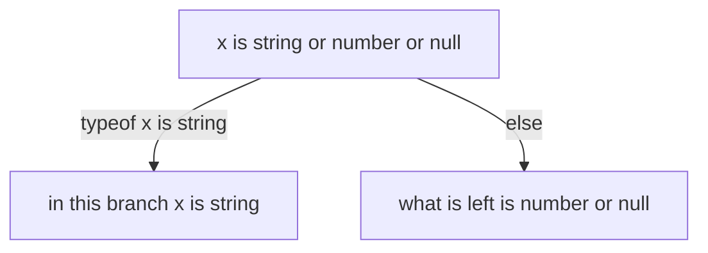
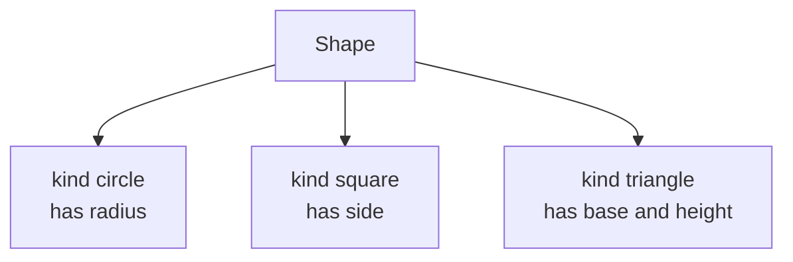

# 04. Union types and narrowing

> **Subject:** TypeScript · **Lesson:** 04 · **Made:** 2026-11-27 · **Status:** ready
>
> **You will be able to:** write a union type, make it smaller with `typeof`, truthiness, `in` and `instanceof`, build a union with a `kind` field, and make the compiler tell you when a case is missing.
>
> **Before this:** [Type vs interface](03-type-vs-interface.md) · **Next:** Generics (planned)
>
> **How to read it:** one card is one idea. Look at the picture, guess, then press the orange bar to check. The blue bars (📖 More detail) hold the longer explanation. Skip them on the first read, open them when you want more. About 25 minutes for the cards.

<!-- quick-summary:start -->
## Quick summary

> Short on time? Read only this. These are the "Remember" lines from the cards below, so you can read the whole lesson in one minute.

- A union means one of several types. A check in your code makes it smaller inside that branch.
- On a union you can only use what every member has. To use more, narrow it first.
- `typeof`, truthiness, `===`, `in`, `instanceof` and `Array.isArray` all make a union smaller.
- Truthiness is not the same as "has a value". For numbers and strings, check `!== undefined` or `!== null`.
- Give every member of an object union a `kind` field with one exact word. Then a `switch` on `kind` narrows it.
- Put `assertNever(x)` in the default branch. A new kind in the union becomes a compile error, not a quiet bug.
- Copy to a `const` before you check. Narrowing a property or a `let` can be stale.
- `!` and `as` do not check anything. Use a real check, then the compiler helps you.
<!-- quick-summary:end -->

## 1. The idea: a parcel with a label

A parcel can hold a book or a shoe. Before you open it, you can only treat it as "a parcel". After you read the label, you know what is inside, and you can use it the right way.

A **union type** says "one of these". `string | number` means "a string or a number". **Narrowing** means checking the label, so the compiler knows which one it is in that part of the code.



Notice: the check is normal JavaScript code. The compiler reads it and makes the type smaller for that branch only.

<details class="guess"><summary>🤔 Guess: <code>x</code> is <code>string | number</code>. You write <code>x.length</code>. Does it compile? Press to check.</summary>

No. I ran it with tsc 7.0.2:

```text
error TS2339: Property 'length' does not exist on type 'string | number'.
  Property 'length' does not exist on type 'number'.
```

A number has no `length`, and the compiler does not know which one you have.

</details>

> **Remember:** a union means one of several types. A check in your code makes it smaller inside that branch.

<details class="more"><summary>📖 More detail: the words</summary>

- **Union type:** a type made of other types joined with `|`. The Handbook calls it a type formed from two or more other types.
- **Narrowing:** the compiler makes a union smaller after a check. The Handbook has a page named "Narrowing" for it.
- **Type guard:** a check the compiler understands, like `typeof x === "string"`.
- **Member:** one of the types inside the union.

</details>

## 2. A union only allows what every member allows

With `string | number` you can only use what **both** can do. The compiler must be safe for every case.

| Code | Result |
|---|---|
| `x.toString()` | compiles: both a string and a number have it |
| `x.toFixed(2)` | error: `Property 'toFixed' does not exist on type 'string \| number'.` |
| `x.length` | error: a number has no `length` |

<details class="guess"><summary>🤔 Guess: <code>x</code> is <code>string | number | null</code>. What does the compiler say about <code>x.length</code>? Press to check.</summary>

Two errors, both real (tsc 7.0.2):

```text
error TS18047: 'x' is possibly 'null'.
error TS2339: Property 'length' does not exist on type 'string | number'.
```

`null` has no properties. The `null` part is a second problem on top of the number.

</details>

> **Remember:** on a union you can only use what every member has. To use more, narrow it first.

<details class="more"><summary>📖 More detail: why it is built this way</summary>

If the compiler allowed `x.length` and the value was a number, you would get `undefined` and a bug later. The error is the compiler saying "check first". This is the same idea as the checks you already write in JavaScript, but now the compiler follows them.

</details>

## 3. The tools: six checks the compiler understands

Each check below makes the type smaller. The table is from real runs of tsc 7.0.2.

| Check | Type before | Inside the check | In the else |
|---|---|---|---|
| `typeof x === "string"` | `string \| number \| null` | `string` | `number \| null` |
| `if (x)` (truthiness) | `string \| null \| undefined` | `string` | `string \| null \| undefined` |
| `"name" in x` | `{ name } \| { title }` | `{ name }` | `{ title }` |
| `x instanceof Date` | `Date \| string` | `Date` | `string` |
| `Array.isArray(x)` | `string \| string[]` | `string[]` | `string` |
| `x === y` | x is `string \| number`, y is `string \| boolean` | x is `string` | x is still `string \| number` |

```ts
function show(x: string | number | null) {
  if (typeof x === "string") {
    return x.toUpperCase(); // x is string
  }
  if (typeof x === "number") {
    return x.toFixed(2);    // x is number
  }
  return "nothing";         // x is null
}
```

<details class="guess"><summary>🤔 Guess: in the table, why is the else of <code>if (x)</code> still <code>string | null | undefined</code> and not just <code>null | undefined</code>? Press to check.</summary>

Because an empty string `""` is falsy. If `x` is `""`, the check fails, so the else branch can still hold a string. The compiler is right. That is the trap in the next card.

</details>

> **Remember:** `typeof`, truthiness, `===`, `in`, `instanceof` and `Array.isArray` all make a union smaller.

<details class="more"><summary>📖 More detail: step by step, what the compiler believes</summary>

| Step | Code line | What the compiler believes | Type of `x` |
|---|---|---|---|
| 1 | `function show(x: string \| number \| null)` | anything of the three | `string \| number \| null` |
| 2 | `if (typeof x === "string")` | inside the if, only a string | `string` |
| 3 | after that if returns | the string is gone | `number \| null` |
| 4 | `if (typeof x === "number")` | inside, only a number | `number` |
| 5 | the last line | only null is left | `null` |

The compiler follows the flow of your code. The Handbook calls this **control flow analysis**.

**Step through it yourself:** [How a type gets smaller](visuals/04-narrowing-steps.html). Press Next and watch the type change after each check.

</details>

## 4. The truthiness trap: 0 and the empty string

`if (count)` looks like "is there a count?". It really asks "is it truthy?". `0` and `""` are falsy, so real values can fall into the else.

```ts
function label(count: number | undefined) {
  if (count) return `${count} items`;
  return "no data";
}
label(0); // "no data"  (wrong, 0 is a real count)
label(3); // "3 items"
```

I ran this. The compiler believes the else branch is `number | undefined`: it did not forget the `0`. It just does not stop you.

<details class="guess"><summary>🤔 Guess: how do you fix <code>label</code> so that <code>label(0)</code> gives <code>"0 items"</code>? Press to check.</summary>

Check for `undefined` on purpose:

```ts
function label(count: number | undefined) {
  if (count !== undefined) return `${count} items`;
  return "no data";
}
label(0); // "0 items"
```

</details>

> **Remember:** truthiness is not the same as "has a value". For numbers and strings, check `!== undefined` or `!== null`.

<details class="more"><summary>📖 More detail: the falsy values</summary>

In JavaScript these are falsy: `false`, `0`, `""`, `null`, `undefined` and `NaN` (and `0n`). Arrays and objects are always truthy, even when empty. So `if (list)` is true for `[]`. The Handbook has a section named "Truthiness narrowing" that shows the same kind of trap.

</details>

## 5. A union with a kind: the best way to model "one of several shapes"

When the members are objects, give each a **literal field** with one exact word. Here it is `kind`. The compiler uses it to tell them apart.



```ts
type Shape =
  | { kind: "circle"; radius: number }
  | { kind: "square"; side: number }
  | { kind: "triangle"; base: number; height: number };

function area(s: Shape): number {
  switch (s.kind) {
    case "circle":
      return Math.PI * s.radius ** 2;   // s is the circle
    case "square":
      return s.side ** 2;               // s is the square
    case "triangle":
      return (s.base * s.height) / 2;   // s is the triangle
  }
}
```

Without the check, `s.radius` fails: `Property 'radius' does not exist on type 'Shape'.` and `Property 'radius' does not exist on type '{ kind: "square"; side: number; }'.`

<details class="guess"><summary>🤔 Guess: why does <code>case "circle"</code> let you write <code>s.radius</code>? Press to check.</summary>

`kind` is a literal type: exactly `"circle"`, not just any string. When the compiler sees `s.kind` is `"circle"`, only one member has that kind, so `s` becomes that member. The Handbook calls a union with such a common literal field a **discriminated union**.

</details>

> **Remember:** give every member of an object union a `kind` field with one exact word. Then a `switch` on `kind` narrows it.

<details class="more"><summary>📖 More detail: why not an optional field for each shape?</summary>

A common first try is one type with optional fields: `{ radius?: number; side?: number }`. Then every use must check for `undefined`, and nothing stops an object with both a radius and a side. The union with a kind makes the impossible shapes impossible, and the compiler knows which fields are there. In an API response this is the same as `{ status: "ok"; data } | { status: "error"; message }`.

</details>

## 6. Never: the compiler tells you what you forgot

After every case is handled, nothing is left. The compiler calls the leftover type `never`, the type with no values. You can use that to catch a **missing case**.

```ts
function assertNever(x: never): never {
  throw new Error("Unexpected value: " + JSON.stringify(x));
}

function area(s: Shape): number {
  switch (s.kind) {
    case "circle":
      return Math.PI * s.radius ** 2;
    case "square":
      return s.side ** 2;
    default:
      return assertNever(s); // s must be never here
  }
}
```

With the `triangle` case missing, I ran tsc 7.0.2:

```text
error TS2345: Argument of type '{ kind: "triangle"; base: number; height: number; }'
  is not assignable to parameter of type 'never'.
```

The error is in the function you forgot to update, not in the file where someone added the triangle.

<details class="guess"><summary>🤔 Guess: what if the default branch is <code>default: return 0</code> instead? Press to check.</summary>

No error at all. I ran it: `areaQuiet({ kind: "triangle", base: 3, height: 4 })` printed `0`. The compiler is quiet and the answer is wrong. `assertNever` is what makes the compiler loud.

</details>

> **Remember:** put `assertNever(x)` in the default branch. A new kind in the union becomes a compile error, not a quiet bug.

<details class="more"><summary>📖 More detail: other ways to see a missing case</summary>

- Without a `default`, if the function says it returns a `number`, tsc reports `Function lacks ending return statement and return type does not include 'undefined'.` (TS2366). That also catches a missing case, but only when every branch returns.
- The Handbook section "Exhaustiveness checking" uses a variable `const _exhaustiveCheck: never = shape;` for the same idea. A function like `assertNever` also throws at run time if bad data gets in.
- At run time, `never` does not exist. Only the throw remains. That is why the function must also throw.

</details>

## 7. Mistake 1: trusting a narrowing after a function call

The problem: the compiler keeps a narrowing even when another function could have changed the value.

```ts
type Box = { v: string | number };
function mutate(b: Box) { b.v = 1; }

function f(b: Box) {
  if (typeof b.v === "string") {
    mutate(b);                  // changes b.v to a number
    return b.v.toUpperCase();   // compiles with no error
  }
  return "";
}
f({ v: "hi" });
// b.v.toUpperCase is not a function
```

I ran it: tsc found no error, and Node crashed with `b.v.toUpperCase is not a function`.

<details class="guess"><summary>🤔 Guess: what is the safe habit? Press to check.</summary>

Copy the value into a `const` before you check it, and use the copy: `const v = b.v; if (typeof v === "string") { ... }`. A `const` cannot change. Also, in a callback the compiler can lose a narrowing when a `let` variable is changed later. I ran this: with `let x` that is set to `null` later in the function, `x.length` inside a callback gave `'x' is possibly 'null'`. With a `const`, it compiled.

</details>

> **Remember:** copy to a `const` before you check. Narrowing a property or a `let` can be stale.

<details class="more"><summary>📖 More detail: why the compiler allows it</summary>

Checking every function call for side effects would be slow and would reject a lot of normal code, so TypeScript trades some safety for ease. It is a known gap, not a bug in your code editor. Small objects that change are the usual place it bites.

</details>

## 8. Mistake 2: lying to the compiler with `!` and `as`

Two tools silence the compiler. They do **not** change the value.

```ts
function len(x: string | null) { return x!.length; }   // ! says "not null"
len(null);
// Cannot read properties of null (reading 'length')

function size(x: string | number) { return (x as string).length; }  // as says "string"
size(42);
// undefined   (no error at all)
```

I ran both. tsc compiled them clean. The first crashed. The second quietly returned `undefined`.

<details class="guess"><summary>🤔 Guess: when is <code>as</code> or <code>!</code> acceptable? Press to check.</summary>

When you know something the compiler cannot, and you checked it yourself, for example a value that you just set one line above. In the rest of the cases, write the check instead. A check is code that runs. An `as` is only a comment to the compiler. It disappears when the types are removed ([lesson 01](01-why-typescript-and-how-it-compiles.md)).

</details>

> **Remember:** `!` and `as` do not check anything. Use a real check, then the compiler helps you.

<details class="more"><summary>📖 More detail: what the Handbook says</summary>

The Handbook section "Type Assertions" says: "Because type assertions are removed at compile-time, there is no runtime checking associated with a type assertion." It also says TypeScript only allows assertions that convert to a more specific or less specific version of a type. The `!` operator has its own section, "Non-null Assertion Operator". It says `!` removes `null` and `undefined` from a type "without doing any explicit checking", and that it "doesn’t change the runtime behavior of your code".

</details>

## 9. Why it matters and what it costs

- **Without it:** you write `if` checks in JavaScript and hope you covered every case. A new kind is added and old code silently does the wrong thing.
- **With it:** the compiler follows your checks, allows only what is safe in each branch, and fails the build when a case is missing.
- **The cost:** you must write the checks. A union needs a `kind` field you may not have in old data. `!` and `as` give a false feeling of safety.

## 10. Watch and play

I opened every link below on 2026-11-27 and each one loaded. I found no video that I could open and check, so there is none here. All error messages in this lesson were run with tsc 7.0.2 and Node 22.23.5.

- **Step through it:** [How a type gets smaller](visuals/04-narrowing-steps.html) - typeof, a kind field, and the never trap.
- **Do:** [practice/04-narrow-it.ts](practice/04-narrow-it.ts) - write eight small functions, then run the tests.
- **Play:** [TypeScript Playground](https://www.typescriptlang.org/play) - paste the `Shape` example, hover over `s` in each case to see its type.
- **Read:** [Narrowing, TypeScript Handbook](https://www.typescriptlang.org/docs/handbook/2/narrowing.html) - sections "typeof type guards", "Discriminated unions" and "Exhaustiveness checking".
- **Read:** [Everyday Types, TypeScript Handbook](https://www.typescriptlang.org/docs/handbook/2/everyday-types.html) - "Union Types" and "Working with Union Types".

## 11. Practice

**A. Predict**

```ts
function pick(x: string | number | null) {
  if (typeof x === "object") {
    return x.length;
  }
  return 0;
}
```

Does it compile? What does the compiler say?

<details><summary>Answer</summary>

No. I ran it: `error TS18047: 'x' is possibly 'null'.` Inside `typeof x === "object"` the only member of the union that is an "object" is `null` (in JavaScript `typeof null` is `"object"`). So `x` is `null` there, and `.length` is not allowed.

</details>

**B. Fix the bug**

```ts
function label(count: number | undefined) {
  if (count) return `${count} items`;
  return "no data";
}
```

A store shows "no data" for an empty cart that has `count` 0. Change one line.

<details><summary>Answer</summary>

Change the check to `if (count !== undefined)`. Now `label(0)` is `"0 items"`. The old check treated `0` as "no value".

</details>

**C. Write it yourself**

Open `practice/04-narrow-it.ts` and write the bodies of the eight functions so that the file compiles under strict mode and all 12 tests pass:

```bash
cd learn/typescript/practice
npm install
node --test 04-narrow-it.test.ts
```

One test writes a temporary file with a new `triangle` kind that is not handled. It passes only when the compiler reports the missing case. So the test proves the exhaustive check works.

<details><summary>One possible answer</summary>

```ts
export function assertNever(x: never): never {
  throw new Error("Unexpected value: " + JSON.stringify(x));
}

export function area(shape: Shape): number {
  switch (shape.kind) {
    case "circle":
      return Math.PI * shape.radius * shape.radius;
    case "square":
      return shape.side * shape.side;
    case "rectangle":
      return shape.width * shape.height;
    default:
      return assertNever(shape);
  }
}

export function formatId(id: string | number): string {
  if (typeof id === "number") {
    return "#" + String(id).padStart(5, "0");
  }
  return id.trim().toUpperCase();
}

export function describe(value: string | string[] | null | undefined): string {
  if (value === null || value === undefined) return "nothing";
  if (Array.isArray(value)) return "list of " + value.length;
  if (value === "") return "empty text";
  return "text: " + value;
}

export function hasName(x: { name: string } | { title: string }): boolean {
  return "name" in x;
}

export function labelOf(x: { name: string } | { title: string }): string {
  if ("name" in x) {
    return x.name;
  }
  return x.title;
}

export function parseAge(text: string): Result {
  const n = Number(text);
  if (text.trim() === "" || !Number.isInteger(n)) {
    return { ok: false, error: "not a whole number: " + text };
  }
  if (n < 0 || n > 150) {
    return { ok: false, error: "out of range: " + n };
  }
  return { ok: true, value: n };
}

export function unwrap(result: Result): number {
  if (result.ok) {
    return result.value;
  }
  throw new Error(result.error);
}
```

Look at the pattern: each function checks first, and the compiler then allows only the right fields. `describe` checks `null` and `undefined` on purpose, because a plain `if (value)` would send `""` the wrong way. In `unwrap`, `result.ok` is the label: when it is true, `result.value` exists.

</details>

## 12. Interview question

**Q:** What is a discriminated union in TypeScript, and how does narrowing work? How do you make sure every case is handled?

<details><summary>A strong answer, in four parts</summary>

1. **Problem:** a value can be one of several shapes, like an API response that is a success or an error. With a plain object type, every field is optional and nothing stops impossible combinations. With a plain union, the compiler only allows what every member has.
2. **How it works:** a union type lists the allowed types. Narrowing means the compiler follows my checks (`typeof`, `in`, `instanceof`, equality, a `kind` field) and makes the type smaller in each branch. In a discriminated union each member has a literal field, like `kind: "circle"`, so a `switch` on that field picks one member. For completeness I put `assertNever(x: never)` in the `default` branch. If a new member is added and not handled, the compiler reports an error there.
3. **Tradeoff:** it needs a kind field and a check in every place that uses the value. The compiler can be wrong in rare cases: narrowing can survive a function call that changes the value, and `as` or `!` turn it off. The types also vanish at run time, so data from outside must still be checked, as in lesson 01.
4. **My example:** an idea, to fill in with a real case: an API response in DBO, Unloan or ZWS with a `status` field, such as ok or error, typed as one union. I will add the real project, the real field names and what the old code did before, only after I confirm them.

</details>

## 13. Explain it back

Close this file. Explain narrowing to a new junior, in 4 parts (problem, how, tradeoff, my example). Then write your best version below and run `/explain-check typescript narrowing` or ask the `explain-coach` agent to review it.

### My explanation

<write here>

### Coach feedback

<the explain-coach agent writes here>

## 14. Review questions (day 1, 3, 7, 21)

1. Why can you not write `x.length` when `x` is `string | number`?
2. What is the type of `x` inside `if (typeof x === "number")` when `x` is `string | number | null`?
3. Why is `if (count)` risky when `count` is `number | undefined`?
4. Draw the picture from card 6 from memory: a `switch` on `kind` with `assertNever` in the default branch, and what happens when a new kind is added.

<details><summary>Answers</summary>

1. A number has no `length`. A union only allows what every member has, so you must narrow first.
2. `number`.
3. `0` is falsy, so a real count of 0 goes to the else branch. Use `count !== undefined`.
4. Each case narrows `s` to one member. In the default branch `s` is `never`, and `assertNever(s)` compiles. A new member makes `s` that member in the default branch, and the compiler reports `Argument of type ... is not assignable to parameter of type 'never'` in your function.

</details>

## 15. Go deeper (optional)

<details><summary>Checked on, other checks, and what comes later</summary>

- **Checked on 2026-11-27** with tsc 7.0.2 (the native compiler) and Node 22.23.5, and against the Handbook pages "Narrowing" and "Everyday Types". The Handbook narrowing page lists these sections: typeof type guards, Truthiness narrowing, Equality narrowing, The in operator narrowing, instanceof narrowing, Assignments, Control flow analysis, Using type predicates, Assertion functions, Discriminated unions, The never type, Exhaustiveness checking.
- **Type predicates** (your own check function that the compiler understands, such as `function isCat(p: Pet): p is Cat`) are in lesson 08 (planned).
- **`unknown` and `never`** in more depth are in lesson 07 (planned).
- **Generics:** the `Result` in the exercise holds a number. Lesson 05 (planned) shows how to make it hold any type.
- **Optional properties:** `{ age?: number }` makes `u.age` of type `number | undefined`. I ran `u.age + 1` and got `error TS18048: 'u.age' is possibly 'undefined'.`

</details>

## Connected lessons

- [Why TypeScript and how it compiles](01-why-typescript-and-how-it-compiles.md) - why a check must be real code, and why `as` is not one.
- [Basic types and inference](02-basic-types-and-inference.md) - the types that unions are made of, and `null` and `undefined`.
- [Type vs interface](03-type-vs-interface.md) - how to name the members of a union.
- Generics (planned) - a union that works for any type, like `Result` of anything.
