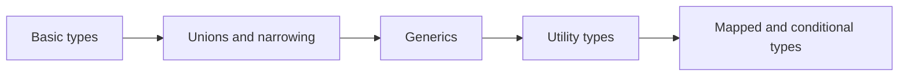

# TypeScript

Types on top of JavaScript: how the compiler thinks, and how to model real data safely.

**Why it matters in interviews:** Senior interviews ask how you type an API response, when to use generics, and why any is dangerous. You use TypeScript daily, so the goal is to explain what you already do.

## The map

How the lessons connect. Learn left to right.

## Lessons, one concept per file

Each lesson is one small file made from [the lesson template](../../templates/lesson-template.md): picture first, a code trace, practice, links to watch and play, and an explain it back section.

Status: `planned` (not written yet), `ready` (written, not studied), `learning`, `can explain` (passed explain-check).

### Basics

| # | Lesson | You will understand | Status |
|---|---|---|---|
| 01 | Why TypeScript and how it compiles `01-why-typescript-and-how-it-compiles.md` | types disappear at runtime, what tsc actually does | planned |
| 02 | Basic types and inference `02-basic-types-and-inference.md` | string, number, arrays, tuples, and when you do not need to write types | planned |
| 03 | Type vs interface `03-type-vs-interface.md` | the real differences and when to pick each | planned |
| 04 | Union types and narrowing `04-union-types-and-narrowing.md` | string | number, typeof, in, and discriminated unions | planned |

### Core ideas

| # | Lesson | You will understand | Status |
|---|---|---|---|
| 05 | Generics `05-generics.md` | functions and types that work for many types, with constraints | planned |
| 06 | Utility types `06-utility-types.md` | Partial, Pick, Omit, Record, ReturnType, and how they are built | planned |
| 07 | any, unknown and never `07-any-unknown-and-never.md` | why unknown is safer than any, and where never shows up | planned |
| 08 | Type guards and assertion functions `08-type-guards-and-assertion-functions.md` | custom is checks and asserts | planned |

### Senior level

| # | Lesson | You will understand | Status |
|---|---|---|---|
| 09 | Mapped and conditional types `09-mapped-and-conditional-types.md` | building new types from old ones | planned |
| 10 | Typing API data end to end `10-typing-api-data-end-to-end.md` | from Prisma or GraphQL types to React props | planned |
| 11 | tsconfig and strict mode `11-tsconfig-and-strict-mode.md` | the flags that matter and why | planned |

**To make the next lesson:** in a chat with this folder open, say `/learn typescript 01` to learn it live with Claude, or ask "make lesson typescript 01" and the `research-material` agent writes the file. When a lesson file exists, its row becomes a link and the status changes to `ready`.

## Watch and play

Trusted places to see the ideas, not only read them. Each lesson adds its own checked video and visualizer links.

- [TypeScript Handbook](https://www.typescriptlang.org/docs/handbook/intro.html) - the official guide
- [TypeScript Playground](https://www.typescriptlang.org/play) - type code and see errors and the compiled JavaScript side by side
- [roadmap.sh TypeScript](https://roadmap.sh/typescript) - visual map of the topics
