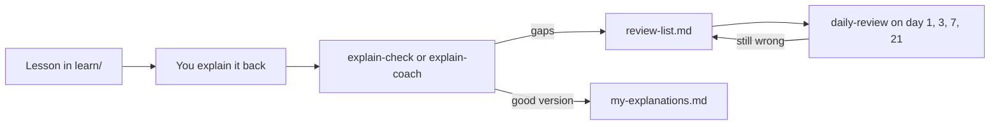

# My Learning

Your own learning record. The skills and agents write here, so you can see what you understand and what still needs work.

| File | What it is | Written by |
|---|---|---|
| [learner-profile.md](learner-profile.md) | How you learn. Every skill and agent reads this first. Edit it when something changes. | you |
| [study-method-and-weekly-plan.md](study-method-and-weekly-plan.md) | The learning loop, the four part answer, the weekly plan | Claude, once |
| [review-list.md](review-list.md) | Questions you could not answer yet, with the next review day | `/explain-check`, `explain-coach`, `/learn`, `/daily-review` |
| [recordings/](recordings/README.md) | Transcripts of me explaining out loud, with the coach feedback added | the website recorder, then `explain-coach` |
| [my-explanations.md](my-explanations.md) | Your best explanations, tidied but still in your words | `/explain-check`, `explain-coach` |

