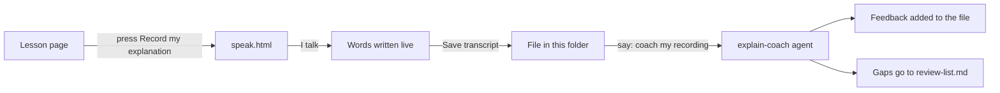

# Recordings

Transcripts of me explaining a concept out loud. Made with the **Record my explanation** button (the website page `speak.html`).

## How it works

1. Open a lesson on the website and press **Record my explanation** under "Explain it back".
2. Explain it in four parts: problem, how it works, tradeoff, my example.
3. Fix wrong words, press **Save transcript (.md)**, and put the file in this folder.
4. In a chat with this folder open, say `coach my recording`. The `explain-coach` agent reads the words (it cannot hear the audio), scores the four parts, and comments on order, filler words and pace.

The audio file is only for me to listen back. Keep it outside the repo.
