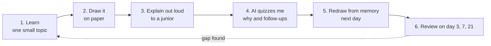
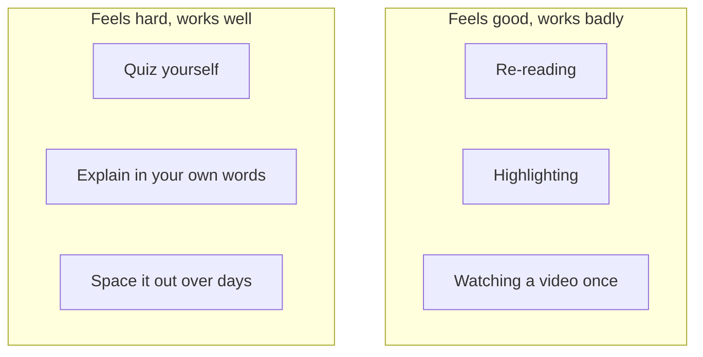
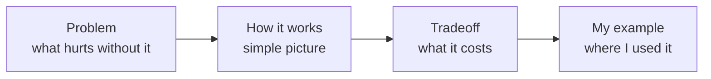
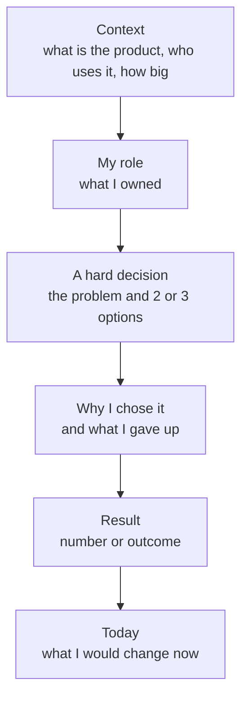
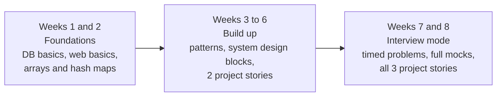

# Study Method and Weekly Plan: Learn to Understand, Not Just Remember

- **Written:** 2026-10-10
- **Target:** Software Engineer and Senior Software Engineer interviews
- **Why this note exists:** I forget what I study, I memorize theory without understanding it, and in interviews I struggle to explain why I made a choice in my own projects.

## TL;DR

- Reading again and again feels like learning, but it is weak. Testing yourself and explaining out loud is much stronger.
- Every topic goes through one loop: learn, draw, explain, get quizzed, review later.
- Theory questions are answered with "what problem does this solve, and what do I lose by using it."
- My own projects (DBO, Unloan, ZWS) are my best interview material. I need a one page story for each.
- For coding problems, learn about 10 patterns instead of grinding random questions. See `learn/problem-solving/`.

## The Learning Loop

Use this for every topic: a database index, caching, the event loop, anything.

**Learn small.** One topic per session, about 30 minutes. "How a B-tree index finds a row" is one topic. "All of databases" is not.

**Draw it.** Draw the flow with boxes and arrows on paper or in Excalidraw. A request going through load balancer, cache and database. A transaction that rolls back. Drawing forces me to decide what connects to what, and that is exactly what understanding is.

**Explain out loud.** Close the notes. Explain it like I am talking to a new junior developer. Wherever I stop or say "um, it just does", that is the gap.

**Get quizzed.** Tell the AI: "Act as an interviewer. Ask me about this topic one question at a time. After my answer, ask a follow-up why. Do not give me the answer until I try twice." The `/mock-interview` skill in this workspace does this.

**Redraw from memory.** The next day, draw it again with nothing open. If I can redraw it, I understand it. If I cannot, I only recognized it.

**Review later.** Come back after 1 day, 3 days, 7 days and 21 days. Ten minutes each time, just questions, no re-reading.

## Why Reading Again Does Not Work

Researchers rated common study methods. Practice testing (quizzing yourself) and spreading study over time ranked highest. Re-reading and highlighting ranked lowest, even though they feel productive ([APS summary of Dunlosky et al., 2013](https://www.psychologicalscience.org/news/releases/which-study-strategies-make-the-grade.html)).

The hard feeling in the second group is the learning happening. If a session feels easy, I am probably only recognizing things.

## How to Answer Theory Questions

Theory questions like "what is an index?" or "how does the event loop work?" are not asking for a definition. They check if I know why the thing exists. I answer in four parts:

**Example: database index.**
- Problem: searching a big table scans every row, which is slow.
- How it works: the index is a sorted structure (a B-tree) so the database jumps to the row like using a book's index.
- Tradeoff: reads get faster, but every insert and update must also update the index, and it uses disk space.
- My example: an index on the column I filter orders by in a PostgreSQL table.

Each core topic now has its own lesson in `learn/<subject>/`, one concept per file, made from `templates/lesson-template.md` with this four part answer built in. The longer guides in the same folders go deeper.

## Project Story Template (Fixes "Explain Why You Chose That")

Interviewers dig into my real projects. The fix is to prepare each project before the interview, not during it. Make one page per project, saved as `interview/my-projects/my-project-stories.md`, using this shape:

Fill it in for each project (DBO, Unloan, ZWS). Pick 2 to 3 real decisions per project. Good ones to look for:

**Data fetching or API choice.** Why GraphQL or REST for this app? What got easier and what got harder?

**State and structure.** Why this way of organizing the mobile app or the CMS?

**Problems you fixed.** A slow screen, a bug in production, a hard feature like the ZWS subscription flow. What was the cause and how did you find it?

**Team and process.** How I broke work into tasks with stakeholders, and how I worked with the Australia team on Unloan.

Then practice saying each story in 2 minutes, and in 5 minutes with a diagram. Always be ready for the follow up "why not the other option?"

## Weekly Plan

About 1 to 1.5 hours a day, 5 days a week. Small and steady beats long and rare.

| Day | Focus | What I do |
|---|---|---|
| Mon | Coding | One pattern, 2 to 3 problems in `learn/problem-solving/` |
| Tue | Backend and database theory | One topic through the learning loop, with a diagram |
| Wed | System design | One design (URL shortener, chat, notifications), drawn from a blank page |
| Thu | Coding | Same pattern again, plus redo one old problem |
| Fri | Interview practice | Write one project story, then a spoken mock with `/mock-interview` |
| Weekend | Review only | 30 minutes of questions from the spaced review list, no new material |

## Skills in this workspace that run the method

**`/explain-check <topic>`** is step 3 and 4 of the loop. I explain, Claude points out what is vague or memorized, asks "why", and draws the correct picture.

**`/project-story <project>`** builds the project stories above and then attacks them like an interviewer. It never makes up facts.

**`/daily-review`** is the spaced review. It asks only what is due today, about 10 minutes.

**`/mock-interview` and `/live-coding`** are for Friday practice and the coding days.

## Review List

Questions I could not answer live in `my-learning/review-list.md`. The skills add to it and `/daily-review` reads it. My own tidied explanations are in `my-learning/my-explanations.md`.

## Sources

- [Which Study Strategies Make the Grade? (APS, summary of Dunlosky et al., 2013)](https://www.psychologicalscience.org/news/releases/which-study-strategies-make-the-grade.html), published 2013-01-10
