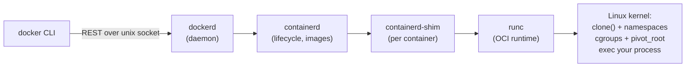
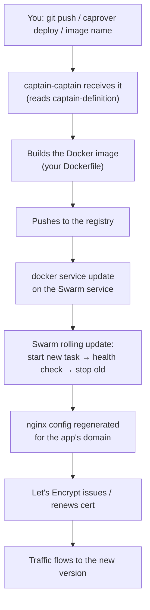

# Docker and CapRover Internals — How the Tools You Use Actually Work

- **Researched:** 2026-09-18
- **Target:** Software Engineer — depth questions on tools you have really used
- **Sources freshness:** 2025–2026 (CapRover architecture verified live)
- **Companion:** [container-orchestration-guide.md](container-orchestration-guide.md) covers the *ladder* (Docker → Compose → Swarm → CapRover → Kubernetes) and how to talk about K8s honestly. **This note goes one layer down: the mechanisms.**

## TL;DR

- **A container is not a small VM. It is a normal Linux process** that has been given its own view of the system (**namespaces**) and a spending limit (**cgroups**). That one sentence answers half of all Docker interview questions.
- **An image is a stack of read-only layers** merged by a union filesystem (OverlayFS), with one thin writable layer on top per container. This explains layer caching, why image size doesn't shrink when you delete a file in a later step, and why container writes are slower than you'd expect.
- **`docker run` is a chain**: CLI → dockerd → containerd → runc → a `clone()` with namespace flags. Knowing that chain is L3 depth; most candidates stop at "Docker runs my container".
- **CapRover is a Swarm service called `captain-captain`** that builds your image, updates a Swarm service, regenerates an nginx config, and asks Let's Encrypt for a certificate. Nothing magic — and being able to describe those four steps is what makes "I use CapRover" sound like engineering instead of a button click.
- **The Node-in-a-container trap is a favourite question:** the cgroup memory limit and V8's heap limit are two different numbers, and when the kernel OOM-kills you there is no JavaScript stack trace — just exit code 137.

---

# Part 1 — What a container actually is

## The one-sentence answer

> "A container is a normal Linux process that the kernel has given an isolated view of the system through **namespaces**, and a resource budget through **cgroups**. There is no guest OS and no hypervisor — it is the host kernel running your process with restrictions."

Everything below expands that sentence.

## Namespaces — the isolated view

A namespace makes a process see only part of the system. Docker uses several at once:

| Namespace | What it isolates | What you notice |
|---|---|---|
| **PID** | Process IDs | Your app is **PID 1** inside, and can't see host processes |
| **MNT** | Filesystem mounts | It sees the image's filesystem as `/`, not the host's |
| **NET** | Network stack | Its own interfaces, IP, routing table, and ports |
| **UTS** | Hostname | `hostname` returns the container id |
| **IPC** | Shared memory, semaphores | Can't touch another container's shared memory |
| **USER** | UID/GID mapping | Root inside can map to an unprivileged host user (off by default) |

The point to make in an interview: **these are kernel features, not Docker features.** Docker is a convenient way to ask the kernel for them. That's why containers start in milliseconds — nothing boots. There's no kernel to load and no hardware to emulate; the kernel just creates a process with some flags set.

## cgroups — the resource budget

Control groups limit and account for what a process tree may consume: **memory**, **CPU**, **block I/O**, and **number of processes**. Docker's `--memory` and `--cpus` flags write cgroup values.

The consequences matter more than the mechanism:
- Exceed the **memory** limit and the **kernel kills the process**. It is not a graceful error — see Part 6.
- Exceed the **CPU** quota and you are **throttled**, not killed. Your app doesn't error, it just gets slower in a way that looks like a mysterious latency spike.

## Container vs VM — say this if asked

| | **VM** | **Container** |
|---|---|---|
| Runs | A full guest OS with its own kernel | A process on the host kernel |
| Needs | A hypervisor | Just the kernel |
| Boot | Seconds to minutes | Milliseconds |
| Overhead | Hundreds of MB minimum | Roughly your process's memory |
| Isolation | **Strong** — separate kernel | **Weaker** — shared kernel |

**The honest caveat that scores points:** because the kernel is shared, a kernel vulnerability can allow a container escape. That's why regulated environments sometimes still use VMs, or lightweight VM runtimes (Firecracker, gVisor) to get container ergonomics with VM-grade isolation.

---

# Part 2 — Images, layers, and why your build is slow

## An image is a stack of read-only layers

Each instruction in a Dockerfile that changes the filesystem (`RUN`, `COPY`, `ADD`) produces a **layer** — a diff of file changes. The image is those layers plus metadata (entrypoint, env, exposed ports).

When you start a container, Docker uses a **union filesystem** (OverlayFS on modern Linux) to present them as one:

- **lowerdir** — the image's read-only layers
- **upperdir** — a thin **writable layer** created for this container
- **merged** — the single view your process sees as `/`

**Copy-on-write:** reading a file comes straight from the image layer. The moment you *modify* it, the whole file is copied up into the writable layer first, then changed. Small edit to a large file = a large copy.

Three consequences worth stating:
1. **Containers are cheap to start** — no copying at launch, just a new empty writable layer.
2. **Write-heavy workloads in the writable layer are slow.** Databases belong on a volume, which bypasses the union filesystem entirely.
3. **The writable layer dies with the container.** Anything you want to keep must be a volume.

## Layer caching — and the Dockerfile rule everyone gets wrong

Docker caches each layer. On rebuild, it reuses cached layers until it hits one whose inputs changed — **and then every layer after it is rebuilt**, cache discarded.

```dockerfile
# ❌ Slow: any source change reinstalls every dependency
FROM node:22-slim
WORKDIR /app
COPY . .
RUN npm ci
CMD ["node", "dist/server.js"]
```

```dockerfile
# ✅ Fast: dependencies are cached until package files change
FROM node:22-slim
WORKDIR /app
COPY package*.json ./
RUN npm ci                 # cached — source edits don't invalidate this
COPY . .                   # only this rebuilds on a code change
CMD ["node", "dist/server.js"]
```

**The rule:** order Dockerfile instructions from least-likely-to-change to most-likely-to-change. That's the whole reason `package.json` is copied separately from your source.

## Why deleting a file doesn't shrink the image

```dockerfile
RUN apt-get update && apt-get install -y build-essential   # layer A: +400MB
RUN rm -rf /var/lib/apt/lists/*                            # layer B: "deletes" it
```

Layer B records a **whiteout** — a marker saying "this file is hidden". **Layer A still contains the data**, and the image still ships it. To actually save the space, the install and cleanup must be in **one** `RUN`:

```dockerfile
RUN apt-get update \
 && apt-get install -y --no-install-recommends build-essential \
 && rm -rf /var/lib/apt/lists/*
```

This is a great L3 question because it only makes sense once you understand layers are immutable diffs.

## Multi-stage builds

Build with the full toolchain, ship only the output:

```dockerfile
FROM node:22 AS build
WORKDIR /app
COPY package*.json ./
RUN npm ci
COPY . .
RUN npm run build

FROM node:22-slim AS runtime
WORKDIR /app
COPY package*.json ./
RUN npm ci --omit=dev
COPY --from=build /app/dist ./dist
USER node
CMD ["node", "dist/server.js"]
```

Result: compilers, dev dependencies, and source never reach production. Smaller image, smaller attack surface, faster pulls.

## Two more things worth knowing

- **Build context:** `docker build .` sends that directory to the daemon before building. Forget `.dockerignore` and you're uploading `node_modules` and `.git` on every build. (BuildKit, the default builder now, transfers context more efficiently — but excluding it is still correct.)
- **Tags are mutable; digests are immutable.** `node:22-slim` points at different bytes over time. `:latest` in production means your deploy is not reproducible — pin a digest (`node@sha256:…`) when reproducibility matters.

---

# Part 3 — What `docker run` actually does



Step by step:
1. The CLI sends an HTTP request to **dockerd** over `/var/run/docker.sock`.
2. dockerd asks **containerd** to prepare the image snapshot and start the container.
3. containerd starts a **shim** per container, so containers survive a daemon restart.
4. The shim calls **runc**, which does the actual kernel work: create namespaces, apply cgroups, `pivot_root` into the container's filesystem, drop capabilities, then `exec` your process.
5. runc exits. The shim stays as the parent process.

**Why this matters in an interview:** it shows you know Docker is an orchestration layer over standard components (OCI runtime spec, containerd), not a monolith. It also explains why Kubernetes can drop Docker entirely and talk to containerd directly.

## The PID 1 problem — a genuinely practical question

Inside the container, your process is **PID 1**, and PID 1 is special: the kernel **does not apply default signal handlers to it**. If your app doesn't explicitly handle `SIGTERM`, it simply ignores it.

So `docker stop` sends `SIGTERM`, nothing happens, Docker waits (10s by default), then sends `SIGKILL`. Every deploy kills your app mid-request.

```dockerfile
CMD npm start                      # ❌ shell form: /bin/sh is PID 1, npm is a child
                                   #    signals typically don't reach node at all
CMD ["node", "dist/server.js"]     # ✅ exec form: node IS PID 1
```

Then actually handle it:

```ts
const server = app.listen(3000);

process.on('SIGTERM', () => {
  server.close(() => process.exit(0));   // stop accepting, finish in-flight, exit
});
```

Also: PID 1 is responsible for **reaping zombie processes**. If your app spawns children and doesn't reap them, use `docker run --init` (which runs `tini` as PID 1) to do it properly.

**This single topic — exec form, SIGTERM, graceful shutdown — comes up constantly** and connects containers to zero-downtime deploys.

---

# Part 4 — Networking

## The default bridge

Docker creates a virtual switch on the host called `docker0`. Each container gets a **veth pair** — one end inside the container as `eth0`, the other plugged into the bridge — and an IP on a private subnet.

- **Outbound traffic** is NAT'd (iptables MASQUERADE) so it appears to come from the host.
- **`-p 8080:3000`** writes an iptables **DNAT** rule: traffic to host port 8080 is rewritten to the container's IP on port 3000. Publishing a port is a firewall rule, not a proxy.

## The DNS detail that trips people up

- On the **default** bridge, containers can reach each other by IP but **not by name**.
- On a **user-defined** network (which Docker Compose creates for you automatically), Docker runs an embedded DNS server at `127.0.0.11`, so `http://api:3000` resolves to the `api` container.

That's why Compose services can talk to each other by service name with no configuration — and why the same thing fails if you run containers manually on the default bridge.

## Other modes, briefly
- **`--network host`** — no network namespace at all, the container uses the host's stack directly. Fastest, zero isolation, port conflicts are real.
- **`--network none`** — no connectivity. Good for untrusted batch work.

**The classic confusion:** `localhost` inside a container is the *container*, not the host. To reach a service on the host from inside, use `host.docker.internal` (Docker Desktop) or the bridge gateway IP on Linux.

## Swarm overlay networks and the routing mesh — what CapRover rides on

Swarm adds an **overlay network** spanning all nodes, using VXLAN to tunnel container traffic between machines. On top of that sits the **routing mesh**: when a service publishes port 80, **every node** in the swarm accepts traffic on port 80 and forwards it to a node actually running a task, load-balanced via IPVS.

Practical consequence: you can point DNS at any node and it works, even if that node isn't running your container. That's how a CapRover cluster keeps routing simple.

---

# Part 5 — Storage

| | **Volume** | **Bind mount** | **tmpfs** |
|---|---|---|---|
| Lives | Docker-managed area on the host | A specific host path you choose | RAM only |
| Best for | Databases, uploads, anything to keep | Local dev (live code reload) | Secrets, scratch files |
| Portability | Good — Docker manages the path | Tied to that host's layout | N/A |
| Survives container removal | Yes | Yes | No |

Two things to say:
1. **Volumes bypass the union filesystem**, so they avoid copy-on-write overhead — that's *why* databases need them, beyond just persistence.
2. **State in a container is a design decision, not an accident.** If it isn't on a volume, it's gone at the next deploy. In CapRover this is exactly what "persistent directories" configure.

---

# Part 6 — Resource limits and the Node-specific trap

**This is the most practical container question for a Node engineer, and worth memorising.**

## Memory

The container memory limit is a **cgroup** limit enforced by the kernel. Exceed it and the kernel's OOM killer terminates the process immediately — **no JavaScript error, no stack trace, no `uncaughtException` handler**. You see the container gone and **exit code 137** (128 + 9, meaning SIGKILL).

Meanwhile, **V8 has its own heap limit**, which is a completely separate number. The failure modes differ:

| Symptom | Cause | Fix |
|---|---|---|
| Exit 137, no logs | Kernel OOM-killed the container | Raise the container limit, or lower V8's heap so V8 fails first |
| `JavaScript heap out of memory` + stack trace | V8 hit *its* limit | Fix the leak, or raise `--max-old-space-size` |

The rule: **set V8's heap explicitly, a bit below the container limit** (e.g. container 1GB → `node --max-old-space-size=768`). Then you get a JS error you can debug instead of a silent kill.

## CPU

A CPU limit is a CFS quota — when you exceed it you are **throttled**, not killed. The symptom is latency, not errors, which makes it harder to diagnose.

Also: inside a container, `os.cpus()` may report the **host's** core count, not your quota. Code that spawns one worker per core (`cluster`, worker pools) can then create 32 workers on a 0.5-CPU budget and thrash. Read the limit from config, don't infer it from the host.

## Exit codes to recognise
- **137** = SIGKILL — OOM kill, or a `docker stop` that timed out waiting for graceful shutdown
- **143** = SIGTERM — a clean stop
- **0** = your process exited normally (if unexpected, your app finished instead of listening)

---

# Part 7 — CapRover, properly explained

## What it actually is

> "CapRover is a self-hosted PaaS built on **Docker Swarm**. It runs as a Swarm service called `captain-captain`, and it manages three things for me: building and deploying images as Swarm services, an **nginx** reverse proxy that routes each app's domain, and **Let's Encrypt** certificates issued and renewed automatically."

That sentence is the whole answer to "what is CapRover?" and it's accurate.

## What happens when you deploy



Being able to walk through those seven steps is the difference between "I click deploy" and "I operate this".

## The pieces
- **`captain-definition`** — a small JSON file in your repo telling CapRover how to build (a Dockerfile path, inline Dockerfile lines, or a template).
- **nginx** — one reverse-proxy config per app: subdomain or custom domain → the Swarm service. TLS terminates here, so your Node app speaks plain HTTP behind it. This is **L7 routing**, the same concept as a Kubernetes Ingress.
- **Persistent directories** — host paths mounted into the container; everything else is lost on redeploy.
- **Environment variables** — CapRover's config layer, equivalent to ConfigMaps/Secrets in K8s (and, honestly, weaker — they're not encrypted at rest the way a real secret manager would be).
- **Instance count** — sets the Swarm service's replica count.
- **One-click apps** — templates that provision Postgres, Redis, MongoDB etc. as Swarm services on the same overlay network, reachable by service name.

## Zero-downtime deploys — and how to get it wrong

Swarm's rolling update starts a new task, waits, then stops the old one. **Without a health check, "waits" just means "the process started"** — so nginx can route traffic to a container that hasn't connected to the database yet, and users get 502s during every deploy.

Add a real health check that verifies dependencies, and configure `start-first` ordering. This maps exactly to **readiness probes** in Kubernetes — say that out loud, it shows the concepts transfer.

## Be honest about the limits

Most CapRover installs are **a single server**. That means:
- **It's a single point of failure.** One machine dies, everything is down.
- **No autoscaling.** You scale by changing replica count manually, or by buying a bigger box.
- **No multi-region, no advanced traffic policy, no RBAC.** One admin dashboard, one set of credentials.
- **Backups are your job** — the persistent directories and CapRover's own config under `/captain`.

Saying this unprompted is a *strength*. It shows you know where your tooling stops, which is exactly what a senior interviewer is checking.

## CapRover → Kubernetes translation table

| CapRover / Swarm | Kubernetes |
|---|---|
| Swarm service | Deployment + ReplicaSet |
| Replica count | `replicas` |
| nginx routing | Ingress + Ingress Controller |
| Environment variables | ConfigMap / Secret |
| Persistent directory | PersistentVolumeClaim |
| Health check | Readiness / liveness probe |
| Rolling update | Rolling update (`maxSurge`, `maxUnavailable`) |
| One-click app | Helm chart |

---

# Part 8 — Likely questions, with answer outlines

**Q: What is a container, really?**
- A Linux process with namespaces (isolated view) and cgroups (resource budget).
- No guest OS, no hypervisor — that's why it starts in milliseconds.
- Shared kernel means weaker isolation than a VM; mention Firecracker/gVisor if isolation is the concern.

**Q: What's the difference between an image and a container?**
- Image = immutable stack of read-only layers + metadata. Container = that stack plus a thin writable layer plus a running process.
- One image, many containers, each with its own writable layer.
- The writable layer dies with the container — that's why volumes exist.

**Q: Why is my Docker build slow, and how do you fix it?**
- Layer cache invalidation: a changed layer rebuilds everything after it.
- Copy dependency manifests and install *before* copying source.
- Multi-stage builds to keep the toolchain out of the final image.
- `.dockerignore` so the build context isn't hundreds of MB.

**Q: Your container exits with code 137. What happened?**
- 137 = 128 + 9 = SIGKILL. Almost always the kernel OOM killer hitting the cgroup memory limit — or a `docker stop` that timed out.
- No JS stack trace, because the kernel killed the process outright.
- Fix: raise the limit, or set `--max-old-space-size` below it so V8 fails first with a debuggable error.

**Q: How do you get zero-downtime deploys?**
- Rolling update: start the new container first, health-check it, then stop the old one.
- The health check must verify real readiness (DB reachable), not just "process started".
- The app must handle `SIGTERM`: stop accepting new connections, finish in-flight requests, exit.
- Use exec-form `CMD` so your process is PID 1 and actually receives the signal.

**Q: Two containers need to talk. How?**
- Same user-defined network → resolve each other by container/service name via Docker's embedded DNS.
- Default bridge has no name resolution — a common gotcha.
- Across a Swarm cluster, an overlay network spans nodes; the routing mesh publishes ports on every node.

**Q: What does CapRover do for you, and what doesn't it?**
- Does: image build, Swarm service updates, nginx routing, automatic TLS, one-click databases.
- Doesn't: autoscaling, multi-region, RBAC, real secret management, HA on a single node.
- The honest close: "It's the right tool for a small team with a handful of services. At the point where several teams need to deploy independently with separate permissions, that's when Kubernetes earns its complexity."

**Q: Would you run Postgres in a container?**
- Yes for dev, and yes in production *with care*: data on a volume (never the writable layer), resource limits set, backups tested, and awareness that a container restart must not mean data loss.
- Managed Postgres (RDS, Neon, Supabase) is usually the better call for a small team — you're buying backups, failover, and patching, which is a lot of undifferentiated work.

---

## Cheatsheet

**The three sentences to have ready:**
1. "A container is a Linux process with namespaces for isolation and cgroups for limits — no guest OS, no hypervisor."
2. "An image is a stack of read-only layers; a container adds one thin writable layer on top, and that layer dies with the container."
3. "CapRover is a PaaS over Docker Swarm — it builds the image, updates the Swarm service, regenerates nginx, and handles Let's Encrypt."

**Numbers and codes:**
- Exit **137** = OOM kill or stop timeout · **143** = clean SIGTERM
- `docker stop` grace period = **10s** by default
- Container memory limit ≠ V8 heap limit — set `--max-old-space-size` **below** the container limit

**Dockerfile rules:**
- Least-changing instructions first; `COPY package*.json` before `COPY . .`
- Install and clean up in **one** `RUN`, or the deleted bytes still ship
- Exec form `CMD ["node", "server.js"]`, never `CMD npm start`
- Multi-stage: build fat, ship thin
- `.dockerignore` always

**Memory hooks:**
- **Namespaces = what you can see. cgroups = what you can use.**
- **A whiteout hides a file; it doesn't delete the bytes.**
- **PID 1 ignores signals it doesn't handle** — that's why deploys kill requests.
- **`localhost` in a container is the container.**

---

## Where your other two topics already live

You mentioned system design and database logic alongside these tools — both already have material:

| Topic | Where |
|---|---|
| **System design, step by step** | [system-design-step-by-step-walkthrough.md](system-design-step-by-step-walkthrough.md) — the 7 steps, plus two designs carried start to finish |
| **System design concepts** | [system-design-basics-senior-fullstack-interview.md](system-design-basics-senior-fullstack-interview.md) |
| **Database internals** (B+trees, MVCC, WAL, planner, joins) | `.claude/skills/advanced-interview/references/database-internals.md` |
| **Postgres query practice** | [postgresql-queries-interview-guide.md](postgresql-queries-interview-guide.md) |
| **Your DB gaps from the 2026-09-18 mock** | [advanced-interview-database-2026-09-18.md](advanced-interview/advanced-interview-database-2026-09-18.md) |

---

## Sources

- [CapRover — official site](https://caprover.com/) — architecture, read 2026-09-18
- [CapRover — App Scaling & Cluster docs](https://caprover.com/docs/app-scaling-and-cluster.html) — 2026
- [caprover/caprover — GitHub](https://github.com/caprover/caprover) — "Scalable PaaS (automated Docker+nginx)"
- [CapRover: Self-hosted PaaS with Docker Swarm orchestration (2026) — Zaira Labs](https://zairalabs.ai/guide/tools/caprover/) — 2026
- [Docker Integration — caprover/caprover, DeepWiki](https://deepwiki.com/caprover/caprover/3.2-docker-integration) — 2026
