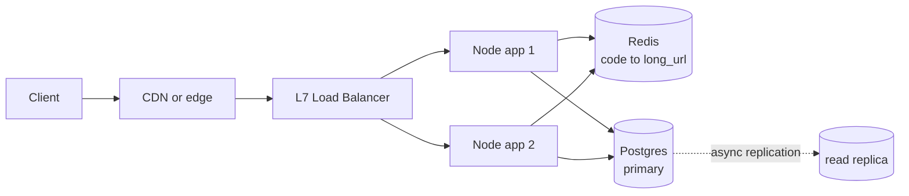
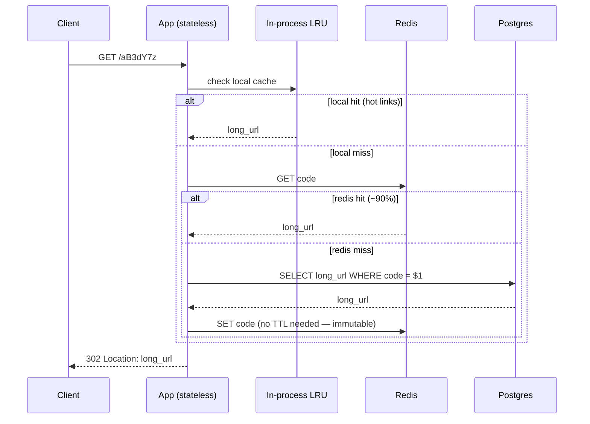
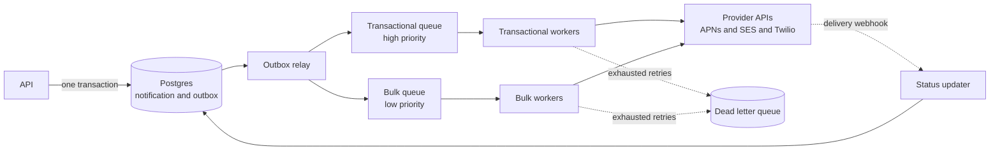

# System Design, Step by Step — From Blank Page to Finished Design

- **Researched:** 2026-09-18
- **Target:** Senior Software Engineer at international companies (US/EU/SG/JP loops)
- **Sources freshness:** 2025–2026
- **Companion note:** [system-design-basics-senior-fullstack-interview.md](../system-design-basics-senior-fullstack-interview.md) covers the *concepts* (load balancers, caching, sharding). **This note covers the *execution*** — exactly what happens at each minute, in order, until the design is complete.

## TL;DR

- A system design round is **seven steps in a fixed order**. The order is not a suggestion — jumping to architecture before requirements is the most common reason people get downlevelled.
- The clock: **5 min requirements → 5 min estimation → 5 min API → 5 min data model → 8 min high-level → 15 min deep dive → 5 min failure/ops**. The deep dive is where the round is actually won.
- **You drive.** The interviewer says almost nothing on purpose. Propose the scope, state assumptions out loud, and ask "shall I go deeper here or move on?"
- **Every claim gets a number.** "It'll be slow" scores nothing; "10,000 reads/sec against one Postgres will saturate it, so reads go to cache" scores.
- The 2026 rubric explicitly includes **cost, observability, and operational maturity** — the last 5 minutes are not optional bonus points.

---

## The clock — what happens when

| # | Step | Time | The one thing that must come out of it |
|---|---|---|---|
| 1 | Requirements | 5 min | A written list of what's **in** and what you're **cutting** |
| 2 | Estimation | 5 min | QPS, storage/year, and **which number is the design driver** |
| 3 | API | 5 min | The 2–4 endpoints that matter, with their shapes |
| 4 | Data model | 5 min | Tables, keys, and the **access pattern** each key serves |
| 5 | High-level design | 8 min | One diagram, request path end to end |
| 6 | Deep dive | 15 min | Two or three hard parts, solved with tradeoffs named |
| 7 | Failure & ops | 5 min | What breaks, how you'd know, what it costs |

Total ≈ 48 min. If the round is 60 minutes, the extra time goes into step 6 — never into steps 1–5.

---

# Part 1 — The seven steps in detail

## Step 1 — Requirements (5 min)

**Goal:** turn a vague prompt into a scoped problem you can actually finish in 45 minutes.

The prompt ("Design a URL shortener") is deliberately underspecified. If you start designing immediately, you're designing the wrong thing.

### What you do

**A. Functional requirements** — write 2–4 "users should be able to…" lines. Then **explicitly cut** everything else.

> "Users should be able to submit a long URL and get a short one back. Users should be able to open the short URL and land on the original. I'm going to park analytics, custom aliases, and user accounts unless you want them — sound right?"

That last question matters. Cutting scope *without asking* looks like you missed the requirement. Cutting it *out loud* looks like judgment.

**B. Non-functional requirements** — the four that decide your architecture:

| Question | Why it changes the design |
|---|---|
| **How many users / how much traffic?** | 100 QPS and 100,000 QPS are different systems |
| **Latency target?** | p99 < 100ms rules out synchronous cross-region calls |
| **Consistency needs?** | "balance must be exact" vs "like count can lag 5s" |
| **Availability target?** | 99.9% (8h/year down) vs 99.99% (52 min) is a cost decision |

**C. Ask who the user is and where they are.** Global users mean multi-region, which means you'll be talking about replication lag later. One country means you can skip it.

### How it's scored
- ✅ Wrote requirements down, cut scope explicitly, asked about scale before designing.
- ❌ Started drawing boxes in minute two. Asked zero questions.

### The trap
Don't ask 15 questions. Ask the four that change your design, propose sensible defaults for the rest, and move. "I'll assume 10M new URLs a day and reads dominating — I'll adjust if that's wrong" is better than an interrogation.

---

## Step 2 — Estimation (5 min)

**Goal:** find the one number that drives every later decision.

You are not trying to be accurate. You're trying to know whether you need **one server or a hundred, 10 GB or 10 TB**. Order of magnitude is the whole point.

### The four calculations

```
1. Write QPS  = daily writes ÷ 86,400        (use 100,000 — easier, conservative)
2. Read QPS   = write QPS × read:write ratio
3. Peak QPS   = average × 2–3   (× 10 for spiky consumer traffic or scheduled events)
4. Storage    = daily writes × bytes per row × 365 × replication factor
```

### Worked, out loud

> "10 million new URLs a day. 86,400 seconds — I'll call it 100,000 to keep the math easy. That's **100 writes per second average**, so peak around **300**.
>
> Read-to-write for a link shortener is maybe 100:1, so **10,000 reads/sec average, 30,000 at peak**.
>
> Each row: a 7-character code, a URL around 200 bytes, a user id, a timestamp — call it 500 bytes with index overhead. 10M × 500 bytes = **5 GB/day, about 1.8 TB/year**.
>
> **So the design driver is read traffic, not storage.** 1.8 TB/year fits comfortably on one Postgres box for years. 30,000 reads/sec does not. That tells me where to spend the rest of this interview."

That last sentence is the entire point of step 2. **Estimation is not a ritual — it selects your deep dive.**

### Numbers to memorize

| Constant | Value |
|---|---|
| Seconds per day | 86,400 → **round to 100,000** |
| Seconds per year | ~31.5M → **round to 30M** |
| 1 KB × 1M rows/day | **1 GB/day ≈ 365 GB/year** |
| 1M DAU × 10 actions/day | **~100 QPS average** |
| Peak multiplier | **2–3×** typical, **10×** for spiky/scheduled |
| Read:write — social feed | ~100:1 |
| Read:write — e-commerce catalog | ~50:1 |
| Read:write — messaging | ~3:1 |
| One Postgres box | **thousands** of simple QPS |
| One Redis instance | **100,000+** ops/sec |
| One Node instance (simple API) | ~1,000–5,000 req/sec |

Sizes: `int` 4B · `bigint`/timestamp 8B · UUID 16B binary (36B as text) · 1 ASCII char 1B · a typical URL ~200B · a tweet-sized text ~300B.

### How it's scored
- ✅ Did arithmetic out loud, rounded aggressively, and **concluded something** from the numbers.
- ❌ Refused to estimate, or calculated for three minutes and then never used the result.

---

## Step 3 — API (5 min)

**Goal:** lock the contract before the architecture, so the boxes have something to serve.

Keep it to the 2–4 calls that matter. Show the shape, not full OpenAPI.

```http
POST /urls
  body: { longUrl: string, customAlias?: string, expiresAt?: string }
  → 201 { shortUrl: "https://sho.rt/aB3dY7z" }

GET /:code
  → 302 Location: <longUrl>
  → 404 if unknown or expired
```

### What to say while writing it
- **Which calls are idempotent**, and how retries behave. (`POST /urls` twice with the same body — two codes or one? Your call, but say it.)
- **Auth**: who can call this, and with what. One line is enough.
- **Pagination** on any list endpoint — and say **cursor-based, not `OFFSET`**, because you already know why.
- **Rate limits**, if abuse is plausible (it is, for a shortener).

If your stack is GraphQL, say why: many clients with different data needs → GraphQL; a single public redirect endpoint → REST, because you want CDN caching and a plain `302`.

---

## Step 4 — Data model (5 min)

**Goal:** the schema, the keys, and **which query each key serves**. Most weak designs die here, in public.

```sql
CREATE TABLE urls (
  code        VARCHAR(7)  PRIMARY KEY,      -- the lookup key: GET /:code
  long_url    TEXT        NOT NULL,
  user_id     BIGINT      REFERENCES users(id),
  created_at  TIMESTAMPTZ NOT NULL DEFAULT now(),
  expires_at  TIMESTAMPTZ
);

CREATE INDEX idx_urls_user_created ON urls (user_id, created_at DESC);
-- serves: "list my links, newest first" — equality column first, sort column second
```

### Say these three things out loud
1. **"The primary access pattern is `code → long_url`, so `code` is the primary key."** Key choice follows access pattern, always.
2. **"The secondary pattern is 'my links, newest first', so a composite index on `(user_id, created_at DESC)`"** — and explain the column order: equality first, then range/sort, so no separate sort step is needed.
3. **"This is immutable data — a short code never points somewhere new."** That single observation makes caching trivial later, and a strong interviewer will notice you spotted it.

### If you'd pick a non-relational store, justify it by access pattern
"Postgres, because I need a unique constraint on the code and the volume is small." Or: "DynamoDB, partition key = code, because the only access pattern is a point lookup and I want predictable latency at any scale." **Never** "NoSQL because it scales."

---

## Step 5 — High-level design (8 min)

**Goal:** one diagram, and a walk through the request path end to end.

Draw the boxes, then **trace one request out loud from click to response**. The narration is what's scored, not the drawing.



> "A redirect comes in, hits the load balancer, goes to any app instance — they're stateless, so any instance can serve any request. The app checks Redis for the code. On a hit, it returns a 302 immediately. On a miss, it reads Postgres, writes the value back into Redis, then returns. Creation goes to the primary; redirects never touch the primary at all."

### Rules for this step
- **Stateless app tier**, always — say the word "stateless" and say *why* (any instance serves any request, so you can scale horizontally and lose a box safely).
- **Don't add components you can't justify.** A queue, a search cluster and three microservices at 100 QPS is a red flag, not sophistication.
- **Then stop and check in:** "That's the happy path. Want me to go deeper on key generation or on the read path?" — you're driving, but collaboratively.

---

## Step 6 — Deep dive (15 min) — *this is where the round is won*

**Goal:** pick the 2–3 genuinely hard parts and solve them with real mechanisms and named tradeoffs.

Steps 1–5 get you to "competent". Step 6 decides your level. Pick the deep dives from **step 2's design driver** — that's what the estimation was for.

### The shape of a good deep dive

For each hard part: **name the options → say what each costs → commit to one → say when you'd choose differently.**

> "Three ways to generate the code. Random base62 plus a uniqueness check — simple, but it costs a read on every write. A global counter encoded to base62 — no collisions, but it's sequential, so anyone can enumerate every link and infer our volume, which is a real security problem. Or each app instance claims a block of 10,000 counter values up front and hands them out locally — no coordination in the hot path, and gaps when an instance dies, which I don't care about. **I'd take the third.** If I needed identical URLs to collapse to one code, I'd hash the URL instead and accept handling collisions."

That paragraph is a pass. Options, costs, a decision, and the condition that would flip it.

### Deep dives that come up again and again
- **Hot path scaling** — cache strategy, hit rate, what happens on a cold cache.
- **Key/ID generation** — uniqueness without a coordination bottleneck.
- **Fan-out** — write-time vs read-time (feeds, notifications).
- **Consistency** — where you need it and where you're deliberately giving it up.
- **Concurrency** — two writers on the same row; optimistic vs pessimistic locking.
- **Large/slow work** — move it off the request path into a queue and a worker.

---

## Step 7 — Failure and operations (5 min)

**Goal:** show you've run something in production, not just drawn one.

Since 2025–2026 this is explicitly on the rubric at senior level. Skipping it is lost points, not a neutral omission. Volunteer it — don't wait to be asked.

Cover, briefly:

1. **What breaks first at 10× traffic?** Name the component and the symptom.
2. **Each box dies — what does the user see?** Redis down → every read hits Postgres at 30k/s and it falls over, so: an in-process LRU in front of Redis, plus connection limits so a slow DB can't consume every worker.
3. **What do you monitor?** Golden signals — latency (p50/p99, not average), traffic, errors, saturation. Plus one business metric: redirect success rate.
4. **What alerts, at what threshold?** "p99 redirect latency over 200ms for 5 minutes" — a specific number, not "we'd have alerts".
5. **Deploy and rollback.** Stateless rolling deploy, health checks, feature flags for the risky path, and the ability to roll back **without** a schema rollback (expand/contract migrations).
6. **Cost.** Rough per-million-requests. In 2026 rubrics this is a senior signal — "cache hit rate directly drives DB size, so hit rate is a cost lever, not just latency."

---

# Part 2 — Complete worked example: URL shortener

The same seven steps, start to finish, as one continuous answer.

### Step 1 — Requirements
**In:** create a short URL from a long one; redirect a short URL to the original.
**Cut (stated out loud):** analytics, custom aliases, user accounts, link editing.
**Non-functional:** 10M new links/day · reads dominate ~100:1 · redirect p99 < 100ms · redirects must be highly available (a dead redirect breaks someone else's site); creation can tolerate brief downtime · global users.

### Step 2 — Estimation
- Writes: 10M ÷ 100k = **100/s avg, ~300/s peak**
- Reads: **10,000/s avg, ~30,000/s peak**
- Storage: 10M × 500B = **5 GB/day ≈ 1.8 TB/year**
- Key space: base62 with 7 chars = 62⁷ ≈ **3.5 trillion** — at 10M/day that's centuries of headroom. 6 chars gives 56 billion ≈ 15 years. **Take 7.**
- **Driver: read QPS.** Storage is a non-issue; one Postgres holds years of this.

### Step 3 — API
`POST /urls {longUrl}` → `201 {shortUrl}` · `GET /:code` → `302` · rate-limited per API key.

### Step 4 — Data model
`urls(code PK, long_url, user_id, created_at, expires_at)` + `(user_id, created_at DESC)` index. **Immutable rows** — a code never changes target.

### Step 5 — High-level
The diagram above. Redirects: LB → stateless app → Redis → (miss) Postgres. Creation: LB → app → counter block → Postgres.

### Step 6 — Deep dives

**Deep dive 1 — key generation.** Pre-allocated counter blocks per instance (as argued above), base62-encoded, 7 chars. Blocks come from a single row in Postgres updated with `UPDATE ... RETURNING` — one round trip per 10,000 codes, so it's not a bottleneck.

**Deep dive 2 — the read path.** This is where the design driver lands.



Why this works: link popularity is heavily skewed (Zipf) — a small number of links take most of the traffic, so a modest cache gets a high hit rate. And because **the data is immutable, there is no invalidation problem at all** — the hardest part of caching simply doesn't exist here. Say that out loud; it's the insight that makes this design easy.

**Deep dive 3 — 301 vs 302.** A `301` is cached by the browser: the second click never reaches you, so you shed enormous load — but you lose all analytics and can never repoint the link. A `302` means every click hits your service: analytics work, the link stays changeable, and you pay for the traffic. **Pick `302`** if the product needs click data; `301` if it's pure redirection at scale. This is a product tradeoff wearing an HTTP hat, and interviewers love it.

### Step 7 — Failure and ops
- **Redis dies:** 30k/s slams Postgres → it falls over. Mitigation: the in-process LRU absorbs the hot set, plus a bounded DB connection pool so the app degrades instead of dying.
- **Postgres primary dies:** redirects keep working from cache; creation returns 503. That asymmetry is deliberate and worth stating.
- **Hot key / viral link:** the local LRU handles it — no shared-cache round trip at all.
- **Monitor:** p99 redirect latency, cache hit rate (the cost lever), 404 rate (broken/expired links), creation error rate.
- **Alert:** p99 > 200ms for 5 min; cache hit rate below 70%.
- **Scale-out path if it grows 10×:** more app instances (stateless, trivial), Redis cluster, then partition `urls` by hash of `code` — the point lookup makes sharding painless, which is a benefit of the key choice made back in step 4.

---

# Part 3 — Complete worked example: notification system

A harder problem, showing where the steps change shape. Same order, compressed.

### Step 1 — Requirements
**In:** send a notification to a user over push, email, or SMS; respect user preferences; support both **transactional** (OTP, password reset) and **bulk** (marketing campaign).
**Cut:** in-app inbox UI, rich templating editor, analytics dashboards.
**Non-functional:** OTP delivered end-to-end **p99 < 5 seconds** · no lost notifications (at-least-once) · **no duplicate sends the user can notice** · a campaign can target 5M users at once.

### Step 2 — Estimation
- Steady state: 10M notifications/day = **100/s average**. Unremarkable.
- **The campaign burst:** 5M users in 10 minutes = 5,000,000 ÷ 600 = **~8,300/s**, an 80× spike.
- **Driver: the burst, and the fact that an OTP must not get stuck behind it.** Everything below follows from that one sentence.

### Step 3 — API
```http
POST /notifications
  body: { userId, template, channel?, data, idempotencyKey }
  → 202 Accepted { notificationId }
```
`202`, not `201` — you're accepting the work, not completing it. Say why.

### Step 4 — Data model
`notifications(id, user_id, channel, template, payload, status, attempts, idempotency_key UNIQUE, created_at, sent_at)` · `user_preferences(user_id, channel, enabled, quiet_hours)` · `outbox(id, event, payload, published_at NULL)`.

The **unique constraint on `idempotency_key`** is the entire duplicate-prevention mechanism — point at it.

### Step 5 — High-level



### Step 6 — Deep dives

**1. Separate queues per priority — not priorities in one queue.** An OTP behind 5M queued marketing messages is a failed product. Two queues with independently scaled worker pools guarantee isolation; a single priority queue degrades under exactly the burst you're designing for.

**2. The dual-write problem, solved with the outbox.** You cannot atomically write to Postgres and publish to a queue — two systems, no shared transaction. If the DB commits and the publish fails, the notification silently never sends. So: write the notification **and** an outbox row **in one transaction**, then a relay publishes from the outbox and marks it done. At-least-once, with no lost messages.

**3. Idempotency.** The relay may publish twice; a worker may crash after sending but before acking. So the send path checks the idempotency key first, and the unique constraint makes a double-insert impossible. At-least-once delivery + an idempotent consumer = **effectively-once**, which is the only honest version of "exactly once".

**4. Provider limits and retries.** Providers rate-limit you — a token bucket per provider in the worker, exponential backoff **with jitter** so 8,300 workers don't retry in lockstep, a cap on attempts, then the dead letter queue. Never retry a 4xx; do respect `Retry-After` on a 429.

**5. Webhooks are unreliable.** Delivery webhooks arrive twice, out of order, or never. Treat them as hints and **reconcile against the provider's own record** on a schedule — don't let your `sent` status depend on a webhook you may never receive.

### Step 7 — Failure and ops
- **A provider goes down:** circuit breaker opens, messages hold in the queue (they're durable), optionally fall back to another channel for high-priority sends.
- **Worker pool dies mid-campaign:** messages are unacked, so they redeliver — which is exactly why idempotency is non-negotiable here.
- **Monitor:** queue depth per priority (the leading indicator), send latency p99 split by channel, provider error rate, DLQ size.
- **Alert:** transactional queue depth > 1,000 — because that means OTPs are late, which is user-visible in seconds.
- **Cost:** SMS is orders of magnitude more expensive than push. Channel selection is a cost decision, and preferring push where available is real money saved.

---

# Part 4 — How it's scored, honestly

### The rubric, step by step

| Step | Senior looks like | Downlevel signal |
|---|---|---|
| Requirements | Cuts scope out loud, asks about scale first | Draws boxes in minute two |
| Estimation | Concludes *something* from the numbers | Refuses to estimate, or estimates and ignores it |
| API | Mentions idempotency and auth unprompted | Lists 12 endpoints in full detail |
| Data model | Key follows access pattern, explains index order | "We'll use NoSQL, it scales" |
| High-level | Traces one request end to end | Adds a queue and 4 services at 100 QPS |
| Deep dive | Options → costs → decision → when it flips | Names tools instead of mechanisms |
| Failure/ops | Volunteers it, with specific thresholds | Never mentions failure or monitoring |

### The seven sentences worth memorizing

1. "Let me write down requirements first, then cut what we're not doing."
2. "86,400 — I'll round to 100,000 to keep this easy."
3. "**So the driver here is X**, which is where I'll spend my deep dive."
4. "These app instances are stateless, so any one can serve any request."
5. "Three options. Here's what each costs. I'd take the second — and here's what would change my mind."
6. "If this box dies, the user sees…"
7. "I'd alert on p99 over 200ms for five minutes."

### Five mistakes that cost the most
1. **Designing before scoping.** Fatal, and it happens in the first two minutes.
2. **No numbers anywhere.** Every architectural claim needs an order of magnitude behind it.
3. **Over-engineering.** Microservices, Kafka and a service mesh for 100 QPS reads as "can't judge scale".
4. **Naming tools instead of mechanisms.** "We'd use Redis" — for what, keyed how, invalidated when?
5. **Going silent.** Thinking quietly for 30 seconds gives the interviewer nothing to write down. Narrate the tradeoff you're weighing.

---

## Cheatsheet

**The seven steps:** Requirements → Estimation → API → Data model → High-level → **Deep dive** → Failure & ops.

**The estimation four:**
```
write QPS = daily writes ÷ 100,000
read QPS  = write QPS × read:write ratio
peak      = average × 2–3   (×10 if spiky)
storage   = daily writes × bytes/row × 365
```

**At a glance — where the time goes:**

| | Steps 1–5 | Step 6 (deep dive) | Step 7 |
|---|---|---|---|
| Time | ~28 min | ~15 min | ~5 min |
| Gets you | "Competent" | **Your level** | "Has shipped things" |
| Skip it and | You design the wrong thing | You read as mid-level | You lose easy points |

**Deep dive template (say it in this order):**
```
"There are N ways to do this.
 Option A: <mechanism>, costs <cost>.
 Option B: <mechanism>, costs <cost>.
 I'd take <X> because <reason tied to the design driver>.
 I'd switch to <Y> if <condition> changed."
```

**Memory hooks:**
- **Estimation picks your deep dive.** If the numbers didn't change what you talk about next, you wasted the five minutes.
- **The key follows the access pattern** — never the other way round.
- **Immutable data has no cache invalidation problem.** Spot it and say it.
- **Two queues, not two priorities** — isolation beats ordering when a burst is the threat.
- **`202 Accepted` means "I took the work", `201 Created` means "it's done".**

---

## Sources

- [System Design Interview Guide 2026: Framework, Concepts & Questions — DesignGurus](https://www.designgurus.io/blog/complete-guide-sys-design) — 2026
- [System Design Interview Framework: Key Steps for Structured Answers — DesignGurus](https://www.designgurus.io/answers/detail/system-design-interview-framework-key-steps-for-structured-answers) — 2026
- [How to Ace a System Design Interview: The Complete 2026 Framework — TechScreen](https://techscreen.app/articles/how-to-ace-system-design-interview-2026) — 2026
- [Back-of-the-Envelope Estimation: A Step-by-Step Guide — DesignGurus](https://www.designgurus.io/blog/back-of-the-envelope-system-design-interview) — 2025–2026
- [Back-of-the-envelope Estimation — ByteByteGo](https://bytebytego.com/courses/system-design-interview/back-of-the-envelope-estimation) — 2025
- [A Senior Engineer's Guide to the System Design Interview — interviewing.io](https://interviewing.io/guides/system-design-interview) — 2025–2026
- [Expectations by Level / YoE — AlgoMaster](https://algomaster.io/learn/system-design-interviews/expectations-by-level) — 2026
- [System Design Interviews Changed in 2026 — DesignGurus](https://designgurus.substack.com/p/system-design-interviews-changed) — 2026
