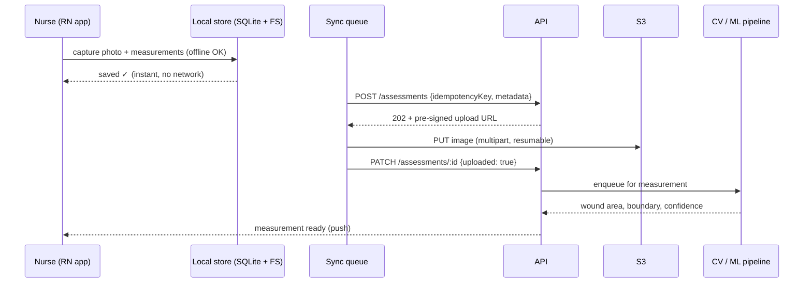

# Parable Health — Software Engineer Interview Prep

- **Researched:** 2026-09-18
- **Company:** [Parable Health, Inc.](https://parablehealth.com/) (product/app entity: Healogram, Inc.) — New York, NY
- **Target role:** Software Engineer / Full-stack product engineer
- **Sources freshness:** company site read live 2026-09-18; profile data 2025–2026

## TL;DR

- **Parable is a wound-care telemonitoring company.** Clinicians photograph wounds with a phone, the app measures them with computer vision, and specialists review remotely instead of travelling to the patient. Customers: home health agencies, inpatient units, and ambulatory clinics (plastic surgery, orthopedics, dermatology).
- **Read this first — a scope warning.** Their careers page lists engineering roles for **Computer Vision (asks for strong C/C++), Machine Learning, and Data Science**. There is **no general full-stack / JavaScript role posted.** Your stack (React/Next/React Native/GraphQL/Node/Postgres) does not match the posted requirements.
- **But the page also says:** *"Are you a top notch engineer or sales expert? We'd love to talk!"* — that's an open invitation, and a seed-stage team of this size always needs product engineering. Their iOS app, clinician dashboard, and backend were all built by someone. **Apply as a generalist product engineer, not as an applicant to the CV role.**
- **Three things will decide this interview:** (1) can you build a reliable **mobile image-capture and upload pipeline** in bad network conditions, (2) do you understand **HIPAA/PHI** obligations in code, (3) can you work *next to* ML without being an ML engineer.
- **No public interview questions exist** for this company — it's too small for Glassdoor data. Everything below is predicted from their product, stage, and posted requirements.

---

## 1. Company snapshot

| | |
|---|---|
| **What they do** | Wound care measurement, monitoring, and remote review |
| **Location** | New York, NY |
| **Stage** | Seed stage; Wellfound lists the company at **1–10 employees** |
| **Founded** | 2013, by Nathan Ie and Peter Jackson (originally Healogram) |
| **Customers** | Home health agencies, inpatient units, ambulatory clinics; pilots reported at Mass General and Brigham and Women's |
| **Platform** | iOS app (App Store, published by Healogram, Inc.) + web dashboard |

### The product, in their own words

- **Smart Capture™** — capture and analyze wounds in **2D and 3D**, measure automatically "with consistency and precision", smart photo alignment (head-to-toe guides so every photo has the same orientation), and **time-lapse playback** of healing.
- **Recommendation Engine** — standardized treatment protocols and documentation.
- **Panorama Dashboard™** — a population-level view: find the patients who need intervention before a small problem becomes a big one.
- **Ambulatory follow-up** — store-and-forward telemedicine: the patient sends a photo, gets automated virtual check-ins, and skips the in-person appointment.

### The problem they're solving (say this back to them)
A nurse drives to a patient's home to look at a wound. That drive is expensive and most visits find nothing wrong. Measurements done by hand with a ruler are inconsistent between clinicians, so you can't tell whether a wound is actually healing. Parable replaces the ruler with computer vision and replaces most of the driving with remote review — **"more clinical time, less windshield time"** is their own phrase.

> ⚠️ **Name-collision warning.** There is an unrelated company called **Parable** (an enterprise operations platform, founded 2024) that raised a $16.5M seed round in late 2025. That is **not** this company. Do not cite that funding in your interview — it's the fastest way to show you researched the wrong business.

---

## 2. The stack reality — and how to position yourself

### What's actually posted (engineering)

| Role | Requirements listed |
|---|---|
| **Computer Vision** | CV expertise · **strong C and C++** · machine learning experience |
| **Machine Learning** | Modern deep learning · CNNs · experience working with images |
| **Data Science** | Modern big data tooling · strong statistical background · normalizing complex data sets |

None of those is your role. **Be honest with yourself about that** — applying to the CV role with a React/Node background will not go well.

### What they need but haven't posted

A company this size with an iOS app, a web dashboard, a clinician workflow, and hospital customers needs someone who:

- builds and ships the **clinician-facing mobile app** (photo capture, offline handling, measurement UI)
- builds the **Panorama Dashboard** web app (population view, alerts, charts)
- builds the **API and data model** behind both (patients, wounds, assessments, measurements over time)
- handles **integration and compliance** work — HIPAA controls, audit logs, access control, possibly EHR/FHIR integration
- builds the **data plumbing that feeds the CV/ML team** — labeled images, training data pipelines, model output surfaced back into the product

**That is your pitch.** You are the person who ships the product surface around their CV core, so their CV and ML people can stay on the model.

### How to open your application or first call

> "I saw the CV and ML roles — that's not my background, and I won't pretend otherwise. I build product: React Native apps, Node/GraphQL APIs, Postgres. From the outside it looks like your CV work needs a product surface around it — an app clinicians can actually use in a patient's home on bad wifi, a dashboard that surfaces the right patients, and a pipeline that gets labeled images back to your models. That's the work I do. Is that a need you have?"

That paragraph is honest, specific, and shows you read the site instead of the job title. **At a 10-person company, the person reading your email is probably a founder.**

---

## 3. Predicted interview questions

### A. Why us / domain motivation — *guaranteed, and it matters more here than at a big company*

**Q: Why healthcare? Why wound care specifically?**
A small mission-driven team screens hard for this. A generic "I want impact" answer fails.

**Answer outline:**
- Name the concrete problem you understood from their site: inconsistent manual measurement and expensive unnecessary home visits.
- Connect it to something real about how you work — you like problems where the constraint is the messy real world (a nurse in a patient's living room with one hand free and bad signal), not just scale.
- Be honest that you don't have clinical background, and say what you'd do about it: shadow a clinician, learn the workflow before designing the screen.
- **Avoid:** pretending to a healthcare passion you don't have. They'll know.

**Q: What do you think is hard about our product?**
Strong answer: "The measurement has to be trustworthy enough that a clinician changes their decision because of it. That's not a UI problem — it's consistency, calibration, and making the app enforce a repeatable capture every time, in a room with bad lighting, by someone in a hurry."

---

### B. Healthcare engineering — HIPAA and PHI in code

This is the domain knowledge gap most candidates have, and it's cheap to close. HIPAA compliance has **two layers** — infrastructure (encryption at rest, network isolation, log storage, patching) and **application** (access control, session handling, what you log, integrity controls). Interviewers care about the second one, because that's the part engineers get wrong.

**Q: What is PHI, and what changes in your code because of it?**
- PHI = protected health information: anything that identifies a patient tied to their health. **A wound photo is PHI.** So is the filename if it contains a name or MRN, and so is the **EXIF metadata** — GPS coordinates in a photo taken in a patient's home is a genuine leak.
- Encrypt in transit (TLS) and at rest (S3/DB encryption).
- **Never log PHI.** Log the patient *id*, never the name, photo, or note body. Error tracking (Sentry etc.) is the classic accidental leak — request bodies get captured by default.
- Strip EXIF on upload. Give images non-guessable keys and serve them via short-lived signed URLs, never a public bucket.

**Q: HIPAA requires an audit trail. What does that mean in your database?**
This is *the* question where most candidates are thin, and it maps directly to your Postgres work.
- Every PHI **access** — not just writes — must be recorded: **who, what record, what action, when**. Reads count. That's the part people miss.
- An `audit_log` table (append-only): `actor_id, action, resource_type, resource_id, ip, user_agent, created_at`. No PHI in the log body itself.
- Append-only enforcement: revoke `UPDATE`/`DELETE` from the app role, or write via a trigger so the app can't rewrite history.
- Retention: HIPAA-related documentation is generally kept 6 years — so this table grows forever. Partition it by month and archive cold partitions (ties straight to the partitioning answer in your DB notes).

**Q: Two clinicians work at the same agency. How do you make sure one can't see the other's patients?**
- Role-based access control **plus** a tenancy/relationship check — role alone isn't enough; it must be "is this clinician assigned to this patient?"
- Enforce it at the data layer, not in the UI: Postgres row-level security, or a mandatory scope on every query. If you use Hasura, this is exactly its row-level permission model — **good thing to mention, you've used it.**
- Add the "break the glass" case: emergency access is sometimes allowed but must be loudly audited.
- Test it: a test that asserts clinician A gets 404 (not 403 — don't confirm the record exists) on clinician B's patient.

**Q: Have you worked under compliance before?**
If no — say no, then show you understand the shape: a BAA with every vendor that touches PHI, access reviews, least privilege, encryption, audit logs, breach notification. **Knowing the vocabulary honestly beats faking experience.**

---

### C. The mobile capture pipeline — *the most likely deep technical topic*

This is the heart of their product and squarely in your React Native wheelhouse. Prepare this properly.

**Q: Design the photo capture and upload flow for a nurse in a patient's home with poor connectivity.**

**Answer outline:**
- **Offline-first is a requirement, not a feature.** Home health has no reliable wifi. Capture must fully succeed locally: write the image to the device filesystem, create a local record in SQLite/WatermelonDB, mark it `pending`, show it as saved to the nurse immediately.
- **A background sync queue** drains pending items when connectivity returns, with exponential backoff and jitter. The nurse must be able to close the app and drive away.
- **Idempotency:** each capture gets a client-generated UUID sent as an idempotency key, so a retried upload doesn't create a duplicate assessment. (You know this pattern now — use the word.)
- **Large files:** a wound photo (possibly 3D/depth data) is multi-MB. Upload directly to S3 with a **pre-signed URL** so the image never passes through your API server; the API only records metadata. Use multipart upload so a dropped connection resumes instead of restarting.
- **Compression tradeoff — and be careful here:** you would normally compress aggressively. **You cannot, because the CV model measures this image.** Lossy compression changes wound boundary pixels and therefore changes the measurement. The right answer is to ask the ML team what fidelity the model needs, and keep the original for the model while generating a compressed derivative for display. *This answer alone will separate you from other candidates.*
- **Capture consistency:** their head-to-toe alignment guide exists because photo angle and distance ruin comparability. On-device guidance (overlay, level indicator, distance/scale reference) is a product feature that protects the model.
- **Failure states the clinician sees:** what happens when upload fails for 6 hours? Never silently lose a capture; show a clear pending/failed state and a manual retry.



**Q: The nurse takes the photo but the measurement comes back wrong. What do you build?**
- A human-in-the-loop correction UI — the clinician adjusts the boundary; the correction is stored.
- **Those corrections are training data.** Capture them deliberately: original image, model output, human correction, who corrected it. That's the feedback loop that makes the model better, and building it is a product-engineer job, not an ML job.
- Show model **confidence** and degrade gracefully when it's low — ask for a re-capture rather than showing a number the clinician shouldn't trust.

---

### D. Backend, API, and data modelling

**Q: Model the data for a patient's wound over time.**

They care about this because *longitudinal* data is their whole product (time-lapse, "is it healing?").

```sql
patients      (id, external_mrn, org_id, ...)
wounds        (id, patient_id, body_location, etiology, opened_at, closed_at)
assessments   (id, wound_id, captured_by, captured_at, image_key, status)
measurements  (id, assessment_id, area_cm2, length_cm, width_cm, depth_cm,
               source, model_version, confidence, corrected_by)
audit_log     (actor_id, action, resource_type, resource_id, created_at)
```

**Points to make out loud:**
- **A wound is the timeline, not the patient.** One patient can have several wounds; each has its own healing trajectory. Getting this wrong makes the time-lapse meaningless.
- `measurements.source` distinguishes `model` vs `clinician_corrected` — you must always know which numbers a human touched.
- **Store `model_version` on every measurement.** When the model improves, historical measurements were produced by a different model — a trend line that mixes versions is a lie. This is a strong senior point.
- Access pattern drives the index: "show me this wound's assessments newest first" → `(wound_id, captured_at DESC)`, equality column first.
- Nothing is hard-deleted in clinical data — soft delete plus audit trail, because deleting a record someone made a decision from is a compliance problem.

**Q: How would you surface the Panorama Dashboard — every patient in an agency, flagged by risk?**
- The query is "all active wounds for org X, sorted by a risk signal" — a dashboard read, not a transactional one.
- Precompute the flags. Recomputing risk across a population on every dashboard load doesn't scale; a nightly/streaming job writes a `wound_status` row you read cheaply.
- Cursor pagination, not `OFFSET`.
- Alerting: "wound has grown for 3 consecutive assessments" is a rule you evaluate on write, not a query you run on read.

---

### E. Working next to ML (without being an ML engineer)

Given three of their roles are CV/ML/DS, expect at least one question probing whether you can collaborate with them.

**Q: You're not an ML engineer. How do you work with one?**
**Answer outline:**
- You own the interfaces: how images get to the model, how results get back into the product, how corrections get back into training.
- You own the **contract**: inference is async and can fail or be slow, so the product must work while the measurement is pending — never block the nurse on a model.
- You care about **model versioning in production**: which version produced which number, how a new version is rolled out (shadow mode first — run the new model alongside, compare outputs, don't show them), and how you roll back.
- You know what you don't know: you won't be tuning a CNN, and you'd ask the ML engineer what image fidelity, resolution, and metadata the model actually needs before you design the pipeline.

**Q: How would you know the model got worse after a deploy?**
- Monitor the **distribution** of outputs, not just errors: average measured area, confidence distribution, and the **rate of human corrections** — a spike in corrections is your real regression alarm.
- Shadow deployments and a held-out comparison set.
- This is the "observability for ML" answer, and very few product engineers give it.

---

### F. Core engineering — expect these from a small team

They can't afford a bad hire, so expect practical depth, not puzzles:

- **React Native:** how do you keep a list of hundreds of wound photos smooth? (`FlatList` windowing, image caching, resizing derivatives, avoiding re-renders). What's different about RN's threading model? How do you debug a release-only crash?
- **JS/TS:** async handling of a queue with retries; why `forEach` doesn't await; typing an API client with generics; error handling that doesn't swallow failures.
- **Node/API:** file upload handling, pre-signed URLs, background jobs, idempotency, request validation.
- **Postgres:** indexing for the access patterns above, migrations without downtime, `EXPLAIN ANALYZE` — **this is the area your last mock exposed; see §6.**
- **Testing:** what do you test in a clinical app? (access control, the sync queue's retry/dedupe behavior, measurement math — the places where a bug harms a patient or leaks data.)

---

### G. Behavioral — calibrated to a ~10-person seed startup

Different from big-company behavioral rounds. They're screening for: can you own things without process, will you talk to customers, will you still be useful when priorities change weekly.

Expect:
- **"Tell me about something you built end to end, alone."** — your strongest card; use the DBO B2B platform.
- **"When did you have to choose speed over quality? How did you decide?"** — they need honesty, not a pretense that you always do it right.
- **"How do you work when requirements are unclear?"** — at a seed company the spec is a conversation with a nurse, not a ticket.
- **"Have you talked to users directly?"** — say yes with a specific example if you can; at this size engineers talk to customers.
- **"What do you do when you disagree with a founder?"**
- **Their real anxiety:** timezone and remote. Address it directly — your overlap hours with New York, and how you'd handle async work. Don't wait for them to raise it awkwardly.

---

## 4. Questions you should ask them

Pick 4–5. These are specific to *them*, which is the point.

**About the product and engineering:**
- "Is the mobile app native or React Native today, and who maintains it?"
- "How much of the measurement is on-device versus server-side inference? What drove that choice?"
- "How do clinician corrections flow back into training the model today — is that automated yet?"
- "What does the 3D capture use — LiDAR on newer iPhones, or photogrammetry? Does that limit which devices you can support?"
- "Do you integrate with EHR systems, or is Parable a standalone record today? Is FHIR on the roadmap?"

**About the company and the role:**
- "What does the engineering team look like right now, and where would I fit?"
- "You have pilots with large hospital systems — what does converting a pilot into a paid deployment depend on?"
- "What's the biggest engineering constraint right now: capture reliability, model accuracy, or the clinical workflow?"
- "How do you handle HIPAA compliance today — is there a BAA and a formal audit process in place?"
- "What would you want me to have shipped 90 days in?"

---

## 5. Your positioning — map your experience to their needs

| What they need | What you say |
|---|---|
| Clinician mobile app | React Native experience; offline handling, camera work, list performance |
| Web dashboard | React/Next.js; data-dense UI, charts, population views |
| API + data model | Node/Express, GraphQL, Prisma, Postgres — and longitudinal data modelling |
| Access control / compliance | Auth work (JWT, sessions, OAuth) + **Hasura row-level permissions** = you've implemented row-scoped access before, which is exactly the RBAC/tenancy problem |
| Shipping alone, fast | The DBO B2B platform case study — end-to-end ownership |
| Data plumbing for ML | Queues, background jobs, S3 pipelines |

**Your honest gaps, and what to say:**
- **No C/C++, no CV/ML background.** Say it plainly and immediately. "I'm not the CV hire" is a *credibility* move at a company that needs a real CV hire.
- **No healthcare/HIPAA production experience.** Say so, then show the vocabulary from §B — demonstrated preparation beats claimed experience.
- **US timezone overlap.** Have a concrete answer ready.

---

## 6. Before you apply — close these gaps

From your database mock on 2026-09-18 ([report](../advanced-interview/advanced-interview-database-2026-09-18.md)), three things would hurt you here specifically:

1. **`EXPLAIN ANALYZE`** — a small team will absolutely ask how you debug a slow query. Practice it this week on a real query.
2. **Index mechanism and composite index column order** — you'll need it for the `(wound_id, captured_at DESC)` answer above.
3. **Audit logging / append-only tables** — new territory for you, and it's the most likely healthcare-specific technical question. §B above is your script; make sure you can say it in your own words.

**Tools depth — likely the biggest chunk of this interview.** You don't have Go, C++, or ML, so expect them to probe what you *have* run in production. Depth on Docker and CapRover is now written up in [docker-caprover-internals.md](../docker-caprover-internals.md) — namespaces vs cgroups, image layers, `docker run` internals, the PID 1 / SIGTERM deploy trap, exit code 137, and the seven steps of a CapRover deploy.

Also worth doing: **read their App Store listing and, if you can, install the app.** Walking into the interview having used the product and saying "I tried the capture flow, here's what I noticed" is the single highest-leverage 20 minutes of preparation available for a company this size.

---

## Cheatsheet — 10 minutes before the call

**What they do, in one line:** clinicians photograph wounds, computer vision measures them consistently, specialists review remotely instead of driving to the patient.

**Their three product names:** Smart Capture™ (2D/3D capture + auto-measurement) · Recommendation Engine (treatment protocols) · Panorama Dashboard™ (population view + alerts).

**The five things to work into your answers:**
1. "A wound photo is PHI — including its EXIF metadata."
2. "Offline-first, because home health has no reliable wifi."
3. "I wouldn't compress the image before knowing what fidelity the model needs."
4. "Store the model version on every measurement, or your trend lines mix models."
5. "Clinician corrections are training data — capture them on purpose."

**Do not say:**
- Anything about a $16.5M seed round (that's a different Parable).
- That you're excited about the computer vision role.
- "I'm passionate about healthcare" with nothing behind it.

**One-line pitch:** "I build the product surface around a model — the app clinicians use in the field, the dashboard that surfaces the right patient, and the pipeline that gets corrections back to your ML team."

---

## Sources

- [Parable Health — official site](https://parablehealth.com/) — homepage, careers, and post-acute/inpatient product pages, read 2026-09-18
- [Parable Health — Crunchbase profile (Healo Health)](https://www.crunchbase.com/organization/healo-health) — 2025–2026
- [Parable Health — Wellfound company page](https://wellfound.com/company/parable-health) — employee count, 2026
- [Parable Health — WoundSource product profile](https://www.woundsource.com/company/parable-health) — 2025
- [Parable — App Store listing (Healogram, Inc.)](https://apps.apple.com/us/app/parable/id1041732839)
- [HIPAA-Compliant App Development: What Engineers Actually Need — Aptible](https://www.aptible.com/hipaa/app-development) — 2025–2026
- [A Complete Guide to HIPAA Audit Trail and Audit Log Requirements](https://www.dreamsoft4u.com/blog/guide-to-hipaa-audit-trails-and-audit-log-requirements) — 2025
- [Parable Raises $16.5M in Seed Funding — FinSMEs](https://www.finsmes.com/2025/11/parable-raises-11m-in-seed-funding.html) — **different company**, listed here only so you don't confuse them
