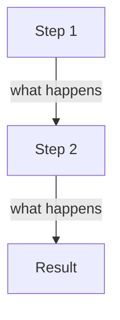

# <NN>. <Concept name>

> **Subject:** <JavaScript> · **Lesson:** <NN> · **Made:** <YYYY-MM-DD> · **Status:** ready
>
> **You will be able to:** <one sentence, e.g. "say what happens in memory when you write let x = 5, and why var behaves differently">
>
> **Before this:** [<previous lesson>](<file>.md) · **Next:** [<next lesson>](<file>.md)
>
> **How to read it:** one card is one idea. Look at the picture, guess, then press the orange bar to check. The blue bars (📖 More detail) hold the longer explanation. Skip them on the first read, open them when you want more. About <N> minutes for the cards.

<!--
THE SHAPE (read this, then delete this comment block).

One H2 = one card = one idea. Each concept card has these parts, in this order:

1. A picture or an analogy FIRST (a Mermaid graph TB, a small table, or 2 lines of everyday story).
2. At most about 100 words of text outside the bars. One idea per sentence, about 12 words.
3. A guess bar: <details class="guess"><summary>🤔 Guess: <question>? Press to check.</summary> ... </details>
4. One line: > **Remember:** <the one thing to keep>
5. A blue bar for the longer explanation: <details class="more"><summary>📖 More detail: <what is inside></summary> ... </details>
   The why, the real names, version notes, a real example, rare cases. Never needed for the next card.

Rules found while building the first lessons:
- Use graph TB. A left-to-right picture is too wide on a phone. To stack two flows in one picture, join them with ~~~.
- Keep picture labels short. A branching graph with three answers can be too wide: use a small table instead.
- Keep code lines near 36 characters. Put comments on their own line above the code.
- Mermaid: never flowchart. Edge labels only -->|label| with no colons and no commas. No parentheses in node labels. No <-->.
- Every code output and every number is run for real. A "checked on <date>" line goes inside a bar, not in the card text.
- Plain words, at most 4 new words in the whole lesson, interview word in brackets after the plain one. No em dashes.
-->

## 1. The idea: <a short everyday picture>

<One everyday story in 2 or 3 lines. Then the picture.>



Notice: <one line on what to look at, and where the analogy stops being true.>

<details class="guess"><summary>🤔 Guess: <a question the picture can answer>? Press to check.</summary>

<The answer in 2 or 3 lines.>

</details>

> **Remember:** <one line>

<details class="more"><summary>📖 More detail: <what is inside></summary>

<New words, at most 4, one line each. The real names. Why it exists.>

</details>

## 2. <Card name: one idea>

<Picture or table first. Smallest code that shows it, under 12 lines, with the exact output. Run it before you write it.>

<details class="guess"><summary>🤔 Guess: <what does this print or do>? Press to check.</summary>

<The output, then one line on why.>

</details>

> **Remember:** <one line>

<details class="more"><summary>📖 More detail: step by step, what the engine does</summary>

| Step | Code line | What the engine does | State after |
|---|---|---|---|
| 1 | | | |
| 2 | | | |

**Step through it yourself:** [<name of the stepper>](visuals/<NN>-<slug>.html). Required when the concept runs in an engine. Press Next and watch each part change. Delete this line only for concepts with nothing that moves.

</details>

## 3. Mistake 1: <what people get wrong>

<The problem first, drawn or in a few lines. Then the wrong code and the wrong result.>

<details class="guess"><summary>🤔 Guess: what goes wrong, and why? Press to check.</summary>

<The reason, then the right code.>

</details>

> **Remember:** <one line>

(Add more concept cards the same way. About 5 to 8 cards in all. If it needs 12, split it into two lessons.)

## N. Why it matters and what it costs

- **Without it:** <what breaks>
- **With it:** <how it solves it>
- **The cost:** <when not to use it, what it costs>

## N+1. Watch and play

<Say once how the links were checked and on what date. 4 to 7 links, each opened and confirmed. Prefer a short video, an interactive visualizer and one doc page with good diagrams. One short line per link: why to open it and what to try. Extra links go in a Go deeper box.>

- **Video:** [<title>](<url>) <channel, length> - <what it shows>
- **Play with it:** [<tool>](<url>) - <what to try>
- **Read:** [<page>](<url>) - <which part>

## N+2. Practice

**A. Predict the output** (write your answer before opening)

```js
```

<details><summary>Answer</summary>

<answer and one line why>

</details>

**B. Fix the bug**

```js
```

<details><summary>Answer</summary>

</details>

**C. Write it yourself**

<small task, ideally a runnable file under `practice/` in this subject folder with a test>

<details><summary>One possible answer</summary>

</details>

## N+3. Interview question

**Q:** <the way an interviewer would ask it>

<details><summary>A strong answer, in four parts</summary>

1. **Problem:** <what it solves>
2. **How it works:** <the mechanism, the picture in words>
3. **Tradeoff:** <cost, when not to use>
4. **My example:** <where it shows up in DBO, Unloan, ZWS or Skyworx work, only true facts. Label an idea as an idea.>

</details>

## N+4. Explain it back

Close this file. Explain the concept out loud like to a new junior, in 4 parts (problem, how, tradeoff, my example). Then write your best version below and run `/explain-check <concept>` or ask the `explain-coach` agent to review it.

### My explanation

<write here>

### Coach feedback

<the explain-coach agent writes here>

## N+5. Review questions (day 1, 3, 7, 21)

1. <question>
2. <question>
3. <question>
4. Draw the picture from card 1 from memory.

<details><summary>Answers</summary>

1.
2.
3.

</details>

## N+6. Go deeper (optional)

Open these when you are ready. None of them is needed for the cards above.

<details><summary>Engine details, versions, rare edge cases, extra links</summary>

</details>

## Connected lessons

- [<lesson>](<file>.md) - <how it connects>
